<!-- nohf -->

# Rapport de Projet - Maison Intelligente STM32

**ECUE :** Architectures Numériques Embarquées  
**Binôme :** Thibault AGUEH, Benoît DE KEYN   
**Date :** 26/10/2026  
**Carte cible :** NUCLEO-F411RE (STM32F411RET6)

---

## Table des matières

<!-- TOC -->

<details><summary>Table des matières</summary>
<span class="fo">&ensp;&ensp;</span><b><a href="#table-des-mati%C3%A8res">Table des matières</a></b><br>
<span class="fo">&ensp;&ensp;</span><b><a href="#introduction">Introduction</a></b><br>
<span class="fo">&ensp;&ensp;</span>&ensp;&ensp;&ensp;&ensp;<a href="#1-photos-de-la-maison">1. Photos de la maison</a><br>
<span class="fo">&ensp;&ensp;</span>&ensp;&ensp;&ensp;&ensp;<a href="#2-description-du-fonctionnement">2. Description du fonctionnement</a><br>
<span class="fo">&ensp;&ensp;</span><b><a href="#architecture-globale-du-syst%C3%A8me">Architecture globale du système</a></b>
<details><summary>&ensp;&ensp;&ensp;&ensp;<a href="#1-branchement-des-composants">1. Branchement des composants</a></summary>
<span class="fo">&ensp;&ensp;</span>&ensp;&ensp;&ensp;&ensp;&ensp;&ensp;&ensp;&ensp;<a href="#11-contraintes-de-brochage">1.1. Contraintes de brochage</a><br>
<span class="fo">&ensp;&ensp;</span>&ensp;&ensp;&ensp;&ensp;&ensp;&ensp;&ensp;&ensp;<a href="#12-tableau-de-brochage-final">1.2. Tableau de brochage final</a>
</details>
<span class="fo">&ensp;&ensp;</span>&ensp;&ensp;&ensp;&ensp;<a href="#2-arbre-dhorloge-et-fr%C3%A9quences">2. Arbre d'horloge et fréquences</a>
<details><summary>&ensp;&ensp;&ensp;&ensp;<a href="#3-organisation-logicielle">3. Organisation logicielle</a></summary>
<span class="fo">&ensp;&ensp;</span>&ensp;&ensp;&ensp;&ensp;&ensp;&ensp;&ensp;&ensp;<a href="#31-boucle-principale-et-gestion-des-interruptions">3.1. Boucle principale et gestion des interruptions</a><br>
<span class="fo">&ensp;&ensp;</span>&ensp;&ensp;&ensp;&ensp;&ensp;&ensp;&ensp;&ensp;<a href="#32-organisation-en-biblioth%C3%A8ques">3.2. Organisation en bibliothèques</a>
</details>
<span class="fo">&ensp;&ensp;</span>&ensp;&ensp;&ensp;&ensp;<a href="#4-recyclage-des-timers">4. Recyclage des timers</a>
<details><summary>&ensp;&ensp;&ensp;&ensp;<a href="#5-pas-de-hardcoding">5. Pas de Hardcoding</a></summary>
<span class="fo">&ensp;&ensp;</span>&ensp;&ensp;&ensp;&ensp;&ensp;&ensp;&ensp;&ensp;<a href="#51-defines-mat%C3%A9riels">5.1. Defines matériels</a>
</details>
<span class="fo">&ensp;&ensp;</span>&ensp;&ensp;&ensp;&ensp;<a href="#6-structure-pour-les-leds">6. Structure pour les LEDs</a><br>
<span class="fo">&ensp;&ensp;</span><b><a href="#sc%C3%A9nario-1--base-temporelle-pour-l%C3%A9chantillonnage">Scénario 1 – Base temporelle pour l'échantillonnage</a></b>
<details><summary>&ensp;&ensp;&ensp;&ensp;<a href="#1-configuration-du-timer">1. Configuration du Timer</a></summary>
<span class="fo">&ensp;&ensp;</span>&ensp;&ensp;&ensp;&ensp;&ensp;&ensp;&ensp;&ensp;<a href="#11-contraintes-de-d%C3%A9part">1.1. Contraintes de départ</a><br>
<span class="fo">&ensp;&ensp;</span>&ensp;&ensp;&ensp;&ensp;&ensp;&ensp;&ensp;&ensp;<a href="#12-calcul-du-prescaler">1.2. Calcul du Prescaler</a><br>
<span class="fo">&ensp;&ensp;</span>&ensp;&ensp;&ensp;&ensp;&ensp;&ensp;&ensp;&ensp;<a href="#13-calcul-de-la-p%C3%A9riode">1.3. Calcul de la Période</a><br>
<span class="fo">&ensp;&ensp;</span>&ensp;&ensp;&ensp;&ensp;&ensp;&ensp;&ensp;&ensp;<a href="#14-dans-cubemx">1.4. Dans CubeMX</a>
</details>
<span class="fo">&ensp;&ensp;</span>&ensp;&ensp;&ensp;&ensp;<a href="#2-clignotement-de-la-led-t%C3%A9moin">2. Clignotement de la LED témoin</a><br>
<span class="fo">&ensp;&ensp;</span>&ensp;&ensp;&ensp;&ensp;<a href="#3-validation-exp%C3%A9rimentale">3. Validation expérimentale</a><br>
<span class="fo">&ensp;&ensp;</span>&ensp;&ensp;&ensp;&ensp;<a href="#4-ancienne-m%C3%A9thode">4. Ancienne méthode</a><br>
<!-- newpage -->
<span class="fo">&ensp;&ensp;</span><b><a href="#sc%C3%A9nario-2--s%C3%A9curit%C3%A9--homeaway-et-d%C3%A9tection-dintrusion">Scénario 2 – Sécurité : HOME/AWAY et détection d'intrusion</a></b><br>
<span class="fo">&ensp;&ensp;</span>&ensp;&ensp;&ensp;&ensp;<a href="#1-configuration-du-bouton-mode">1. Configuration du bouton MODE</a>
<details><summary>&ensp;&ensp;&ensp;&ensp;<a href="#2-gestion-de-lanti-rebond">2. Gestion de l'anti-rebond</a></summary>
<span class="fo">&ensp;&ensp;</span>&ensp;&ensp;&ensp;&ensp;&ensp;&ensp;&ensp;&ensp;<a href="#21-prescaler-du-timer-5">2.1. Prescaler du Timer 5</a><br>
<span class="fo">&ensp;&ensp;</span>&ensp;&ensp;&ensp;&ensp;&ensp;&ensp;&ensp;&ensp;<a href="#22-p%C3%A9riode-du-timer-5">2.2. Période du Timer 5</a><br>
<span class="fo">&ensp;&ensp;</span>&ensp;&ensp;&ensp;&ensp;&ensp;&ensp;&ensp;&ensp;<a href="#23-routine-dinterruption-du-gpio-et-du-timer">2.3. Routine d'interruption du GPIO et du Timer</a><br>
<span class="fo">&ensp;&ensp;</span>&ensp;&ensp;&ensp;&ensp;&ensp;&ensp;&ensp;&ensp;<a href="#24-d%C3%A9tection-dappui">2.4. Détection d'appui</a>
</details>
<details><summary>&ensp;&ensp;&ensp;&ensp;<a href="#3-machine-%C3%A0-%C3%A9tats-home--away">3. Machine à états HOME / AWAY</a></summary>
<span class="fo">&ensp;&ensp;</span>&ensp;&ensp;&ensp;&ensp;&ensp;&ensp;&ensp;&ensp;<a href="#31-description-de-la-machine-%C3%A0-%C3%A9tats">3.1. Description de la machine à états</a><br>
<span class="fo">&ensp;&ensp;</span>&ensp;&ensp;&ensp;&ensp;&ensp;&ensp;&ensp;&ensp;<a href="#32-gestion-des-modes">3.2. Gestion des modes</a><br>
<span class="fo">&ensp;&ensp;</span>&ensp;&ensp;&ensp;&ensp;&ensp;&ensp;&ensp;&ensp;<a href="#33-impl%C3%A9mentation-de-la-machine-%C3%A0-%C3%A9tats">3.3. Implémentation de la machine à états</a>
</details>
<details><summary>&ensp;&ensp;&ensp;&ensp;<a href="#4-capteur-pir-et-alarme-intrusion">4. Capteur PIR et alarme intrusion</a></summary>
<span class="fo">&ensp;&ensp;</span>&ensp;&ensp;&ensp;&ensp;&ensp;&ensp;&ensp;&ensp;<a href="#41-configuration-du-capteur-de-mouvement">4.1. Configuration du capteur de mouvement</a><br>
<span class="fo">&ensp;&ensp;</span>&ensp;&ensp;&ensp;&ensp;&ensp;&ensp;&ensp;&ensp;<a href="#42-lecture-du-capteur-pir">4.2. Lecture du capteur PIR</a>
</details>
<details><summary>&ensp;&ensp;&ensp;&ensp;<a href="#5-comportement-selon-le-mode-away-vs-home">5. Comportement selon le mode (AWAY vs HOME)</a></summary>
<span class="fo">&ensp;&ensp;</span>&ensp;&ensp;&ensp;&ensp;&ensp;&ensp;&ensp;&ensp;<a href="#51-machine-%C3%A0-%C3%A9tats-avec-alarme-intrusion">5.1. Machine à états avec alarme intrusion</a><br>
<span class="fo">&ensp;&ensp;</span>&ensp;&ensp;&ensp;&ensp;&ensp;&ensp;&ensp;&ensp;<a href="#52-impl%C3%A9mentation-dans-la-while1">5.2. Implémentation dans la while(1)</a><br>
<span class="fo">&ensp;&ensp;</span>&ensp;&ensp;&ensp;&ensp;&ensp;&ensp;&ensp;&ensp;<a href="#53-alarme-intrusion">5.3. Alarme intrusion</a>
</details>
<span class="fo">&ensp;&ensp;</span><b><a href="#sc%C3%A9nario-3--d%C3%A9tection-de-gaz">Scénario 3 – Détection de gaz</a></b><br>
<span class="fo">&ensp;&ensp;</span>&ensp;&ensp;&ensp;&ensp;<a href="#1-d%C3%A9clenchement-de-ladc-par-le-timer-2">1. Déclenchement de l'ADC par le Timer 2</a><br>
<span class="fo">&ensp;&ensp;</span>&ensp;&ensp;&ensp;&ensp;<a href="#2-lecture-de-la-valeur-adc-au-sc%C3%A9nario-3-et-probl%C3%A8me-rencontr%C3%A9">2. Lecture de la valeur ADC au Scénario 3 et problème rencontré</a>
<details><summary>&ensp;&ensp;&ensp;&ensp;<a href="#3-tests-du-capteur-et-seuil">3. Tests du capteur et seuil</a></summary>
<span class="fo">&ensp;&ensp;</span>&ensp;&ensp;&ensp;&ensp;&ensp;&ensp;&ensp;&ensp;<a href="#31-tension-dalimentation-et-de-mesure-de-ladc">3.1. Tension d'alimentation et de mesure de l'ADC</a><br>
<span class="fo">&ensp;&ensp;</span>&ensp;&ensp;&ensp;&ensp;&ensp;&ensp;&ensp;&ensp;<a href="#32-seuil-de-d%C3%A9tection">3.2. Seuil de détection</a>
</details>
<span class="fo">&ensp;&ensp;</span>&ensp;&ensp;&ensp;&ensp;<a href="#4-alarme-gaz">4. Alarme gaz</a><br>
<!-- newpage -->
<span class="fo">&ensp;&ensp;</span><b><a href="#sc%C3%A9nario-4--supervision-uart">Scénario 4 – Supervision UART</a></b><br>
<span class="fo">&ensp;&ensp;</span>&ensp;&ensp;&ensp;&ensp;<a href="#1-configuration-de-luart-avec-st-link">1. Configuration de l'UART avec ST-LINK</a><br>
<span class="fo">&ensp;&ensp;</span>&ensp;&ensp;&ensp;&ensp;<a href="#2-redirection-de-printf-vers-luart">2. Redirection de printf vers l'UART</a><br>
<span class="fo">&ensp;&ensp;</span>&ensp;&ensp;&ensp;&ensp;<a href="#3-message-de-bienvenue-au-d%C3%A9marrage">3. Message de bienvenue au démarrage</a>
<details><summary>&ensp;&ensp;&ensp;&ensp;<a href="#4-supervision-en-temps-r%C3%A9el">4. Supervision en temps réel</a></summary>
<span class="fo">&ensp;&ensp;</span>&ensp;&ensp;&ensp;&ensp;&ensp;&ensp;&ensp;&ensp;<a href="#41-mesures-p%C3%A9riodiques-toutes-les-2-s">4.1. Mesures périodiques (toutes les 2 s)</a><br>
<span class="fo">&ensp;&ensp;</span>&ensp;&ensp;&ensp;&ensp;&ensp;&ensp;&ensp;&ensp;<a href="#42-%C3%A9v%C3%A9nements-d%C3%A9tat-asynchrones">4.2. Événements d'état (asynchrones)</a><br>
<span class="fo">&ensp;&ensp;</span>&ensp;&ensp;&ensp;&ensp;&ensp;&ensp;&ensp;&ensp;<a href="#43-erreurs">4.3. Erreurs</a>
</details>
<span class="fo">&ensp;&ensp;</span>&ensp;&ensp;&ensp;&ensp;<a href="#5-validation-avec-un-terminal-s%C3%A9rie">5. Validation avec un terminal série</a><br>
<span class="fo">&ensp;&ensp;</span><b><a href="#sc%C3%A9nario-5--gestion-intelligente-de-la-fen%C3%AAtre">Scénario 5 – Gestion intelligente de la fenêtre</a></b>
<details><summary>&ensp;&ensp;&ensp;&ensp;<a href="#1-commande-du-servomoteur">1. Commande du servomoteur</a></summary>
<span class="fo">&ensp;&ensp;</span>&ensp;&ensp;&ensp;&ensp;&ensp;&ensp;&ensp;&ensp;<a href="#11-brochage-et-alimentation">1.1. Brochage et alimentation</a><br>
<span class="fo">&ensp;&ensp;</span>&ensp;&ensp;&ensp;&ensp;&ensp;&ensp;&ensp;&ensp;<a href="#12-protocole-pwm-du-servo">1.2. Protocole PWM du servo</a><br>
<span class="fo">&ensp;&ensp;</span>&ensp;&ensp;&ensp;&ensp;&ensp;&ensp;&ensp;&ensp;<a href="#13-configuration-du-timer-1-dans-cubemx">1.3. Configuration du Timer 1 dans CubeMX</a><br>
<span class="fo">&ensp;&ensp;</span>&ensp;&ensp;&ensp;&ensp;&ensp;&ensp;&ensp;&ensp;<a href="#14-calcul-de-la-r%C3%A9solution-angulaire">1.4. Calcul de la résolution angulaire</a><br>
<span class="fo">&ensp;&ensp;</span>&ensp;&ensp;&ensp;&ensp;&ensp;&ensp;&ensp;&ensp;<a href="#15-appliquer-un-angle-au-servomoteur">1.5. Appliquer un angle au servomoteur</a>
</details>
<details><summary>&ensp;&ensp;&ensp;&ensp;<a href="#2-gestion-de-la-fen%C3%AAtre">2. Gestion de la fenêtre</a></summary>
<span class="fo">&ensp;&ensp;</span>&ensp;&ensp;&ensp;&ensp;&ensp;&ensp;&ensp;&ensp;<a href="#21-%C3%A9tats-de-la-fen%C3%AAtre">2.1. États de la fenêtre</a><br>
<span class="fo">&ensp;&ensp;</span>&ensp;&ensp;&ensp;&ensp;&ensp;&ensp;&ensp;&ensp;<a href="#22-application-de-letat-de-la-fen%C3%AAtre">2.2. Application de l'etat de la fenêtre</a>
</details>
<details><summary>&ensp;&ensp;&ensp;&ensp;<a href="#3-bouton-fen%C3%AAtre-et-anti-rebond">3. Bouton fenêtre et anti-rebond</a></summary>
<span class="fo">&ensp;&ensp;</span>&ensp;&ensp;&ensp;&ensp;&ensp;&ensp;&ensp;&ensp;<a href="#31-impl%C3%A9mentation-et-anti-rebond">3.1. Implémentation et anti-rebond</a><br>
<span class="fo">&ensp;&ensp;</span>&ensp;&ensp;&ensp;&ensp;&ensp;&ensp;&ensp;&ensp;<a href="#32-comportement-et-priorit%C3%A9s-selon-le-mode-home-vs-away">3.2. Comportement et priorités selon le mode (HOME vs AWAY)</a>
</details>
<details><summary>&ensp;&ensp;&ensp;&ensp;<a href="#4-d%C3%A9tection-de-pluie-avec-adc-dma-multi-canaux">4. Détection de pluie avec ADC DMA multi-canaux</a></summary>
<span class="fo">&ensp;&ensp;</span>&ensp;&ensp;&ensp;&ensp;&ensp;&ensp;&ensp;&ensp;<a href="#41-d%C3%A9clenchement-des-mesures">4.1. Déclenchement des mesures</a><br>
<span class="fo">&ensp;&ensp;</span>&ensp;&ensp;&ensp;&ensp;&ensp;&ensp;&ensp;&ensp;<a href="#42-configuration-adc-en-mode-scan-multi-canaux">4.2. Configuration ADC en mode Scan multi-canaux</a><br>
<span class="fo">&ensp;&ensp;</span>&ensp;&ensp;&ensp;&ensp;&ensp;&ensp;&ensp;&ensp;<a href="#43-configuration-dma">4.3. Configuration DMA</a><br>
<span class="fo">&ensp;&ensp;</span>&ensp;&ensp;&ensp;&ensp;&ensp;&ensp;&ensp;&ensp;<a href="#44-interruptions-adc-et-dma-activ%C3%A9es">4.4. Interruptions ADC et DMA activées</a><br>
<span class="fo">&ensp;&ensp;</span>&ensp;&ensp;&ensp;&ensp;&ensp;&ensp;&ensp;&ensp;<a href="#45-lecture-et-%C3%A9valuation-des-capteurs">4.5. Lecture et évaluation des capteurs</a><br>
<span class="fo">&ensp;&ensp;</span>&ensp;&ensp;&ensp;&ensp;&ensp;&ensp;&ensp;&ensp;<a href="#46-tests-du-capteur-de-pluie-et-seuil">4.6. Tests du capteur de pluie et seuil</a>
</details>
<span class="fo">&ensp;&ensp;</span>&ensp;&ensp;&ensp;&ensp;<a href="#5-logique-de-d%C3%A9cision-de-la-fen%C3%AAtre">5. Logique de décision de la fenêtre</a><br>
<!-- newpage -->
<span class="fo">&ensp;&ensp;</span><b><a href="#sc%C3%A9nario-6--mesure-de-temp%C3%A9rature-tmp102">Scénario 6 – Mesure de température (TMP102)</a></b>
<details><summary>&ensp;&ensp;&ensp;&ensp;<a href="#1-branchement-et-configuration-cubemx">1. Branchement et configuration CubeMX</a></summary>
<span class="fo">&ensp;&ensp;</span>&ensp;&ensp;&ensp;&ensp;&ensp;&ensp;&ensp;&ensp;<a href="#11-alimentation-vccgnd">1.1. Alimentation (VCC/GND)</a><br>
<span class="fo">&ensp;&ensp;</span>&ensp;&ensp;&ensp;&ensp;&ensp;&ensp;&ensp;&ensp;<a href="#12-bus-ic-sdascl">1.2. Bus I²C (SDA/SCL)</a><br>
<span class="fo">&ensp;&ensp;</span>&ensp;&ensp;&ensp;&ensp;&ensp;&ensp;&ensp;&ensp;<a href="#13-adresse-ic-add0">1.3. Adresse I²C (ADD0)</a><br>
<span class="fo">&ensp;&ensp;</span>&ensp;&ensp;&ensp;&ensp;&ensp;&ensp;&ensp;&ensp;<a href="#14-broche-alt">1.4. Broche (ALT)</a>
</details>
<details><summary>&ensp;&ensp;&ensp;&ensp;<a href="#2-analyse-de-la-datasheet">2. Analyse de la datasheet</a></summary>
<span class="fo">&ensp;&ensp;</span>&ensp;&ensp;&ensp;&ensp;&ensp;&ensp;&ensp;&ensp;<a href="#21-registres-accessibles">2.1. Registres accessibles</a><br>
<span class="fo">&ensp;&ensp;</span>&ensp;&ensp;&ensp;&ensp;&ensp;&ensp;&ensp;&ensp;<a href="#22-registre-de-temp%C3%A9rature">2.2. Registre de température</a><br>
<span class="fo">&ensp;&ensp;</span>&ensp;&ensp;&ensp;&ensp;&ensp;&ensp;&ensp;&ensp;<a href="#23-registre-de-configuration">2.3. Registre de configuration</a><br>
<span class="fo">&ensp;&ensp;</span>&ensp;&ensp;&ensp;&ensp;&ensp;&ensp;&ensp;&ensp;<a href="#24-registres-t_low-et-t_high">2.4. Registres T_LOW et T_HIGH</a>
</details>
<details><summary>&ensp;&ensp;&ensp;&ensp;<a href="#3-communication-ic-avec-le-capteur">3. Communication I²C avec le capteur</a></summary>
<span class="fo">&ensp;&ensp;</span>&ensp;&ensp;&ensp;&ensp;&ensp;&ensp;&ensp;&ensp;<a href="#31-protocole-ic-du-tmp102">3.1. Protocole I²C du TMP102</a><br>
<span class="fo">&ensp;&ensp;</span>&ensp;&ensp;&ensp;&ensp;&ensp;&ensp;&ensp;&ensp;<a href="#32-fonctions-hal-utilis%C3%A9es">3.2. Fonctions HAL utilisées</a><br>
<span class="fo">&ensp;&ensp;</span>&ensp;&ensp;&ensp;&ensp;&ensp;&ensp;&ensp;&ensp;<a href="#33-alternatives-hal-non-utilis%C3%A9es">3.3. Alternatives HAL non utilisées</a>
</details>
<details><summary>&ensp;&ensp;&ensp;&ensp;<a href="#4-structure-de-la-biblioth%C3%A8que">4. Structure de la bibliothèque</a></summary>
<span class="fo">&ensp;&ensp;</span>&ensp;&ensp;&ensp;&ensp;&ensp;&ensp;&ensp;&ensp;<a href="#41-vue-densemble">4.1. Vue d'ensemble</a><br>
<span class="fo">&ensp;&ensp;</span>&ensp;&ensp;&ensp;&ensp;&ensp;&ensp;&ensp;&ensp;<a href="#42-les-structures-tmp102_config_t-et-tmp102_t">4.2. Les structures TMP102_Config_t et TMP102_t</a><br>
<span class="fo">&ensp;&ensp;</span>&ensp;&ensp;&ensp;&ensp;&ensp;&ensp;&ensp;&ensp;<a href="#43-define">4.3. Define</a><br>
<span class="fo">&ensp;&ensp;</span>&ensp;&ensp;&ensp;&ensp;&ensp;&ensp;&ensp;&ensp;<a href="#44-organisation-des-champs-du-registre-de-configuration">4.4. Organisation des champs du registre de configuration</a><br>
<span class="fo">&ensp;&ensp;</span>&ensp;&ensp;&ensp;&ensp;&ensp;&ensp;&ensp;&ensp;<a href="#45-synchronisation-entre-le-registre-de-configuration-et-lobjet-tmp102">4.5. Synchronisation entre le registre de configuration et l'objet TMP102</a>
</details>
<details><summary>&ensp;&ensp;&ensp;&ensp;<a href="#5-mise-%C3%A0-jour-des-registres-du-capteur">5. Mise à jour des registres du capteur</a></summary>
<span class="fo">&ensp;&ensp;</span>&ensp;&ensp;&ensp;&ensp;&ensp;&ensp;&ensp;&ensp;<a href="#51-application-du-registre-de-configuration">5.1. Application du registre de configuration</a><br>
<span class="fo">&ensp;&ensp;</span>&ensp;&ensp;&ensp;&ensp;&ensp;&ensp;&ensp;&ensp;<a href="#52-application-des-registres-de-seuil-de-temp%C3%A9rature">5.2. Application des registres de seuil de température</a>
</details>
<details><summary>&ensp;&ensp;&ensp;&ensp;<a href="#6-initialisation">6. Initialisation</a></summary>
<span class="fo">&ensp;&ensp;</span>&ensp;&ensp;&ensp;&ensp;&ensp;&ensp;&ensp;&ensp;<a href="#61-instanciation">6.1. Instanciation</a><br>
<span class="fo">&ensp;&ensp;</span>&ensp;&ensp;&ensp;&ensp;&ensp;&ensp;&ensp;&ensp;<a href="#62-valeurs-par-d%C3%A9faut">6.2. Valeurs par défaut</a><br>
<span class="fo">&ensp;&ensp;</span>&ensp;&ensp;&ensp;&ensp;&ensp;&ensp;&ensp;&ensp;<a href="#63-personnalisation">6.3. Personnalisation</a><br>
<span class="fo">&ensp;&ensp;</span>&ensp;&ensp;&ensp;&ensp;&ensp;&ensp;&ensp;&ensp;<a href="#64-exemple-dans-notre-code">6.4. Exemple dans notre code</a>
</details>
<details><summary>&ensp;&ensp;&ensp;&ensp;<a href="#7-lecture-du-registre-de-temp%C3%A9rature">7. Lecture du registre de température</a></summary>
<span class="fo">&ensp;&ensp;</span>&ensp;&ensp;&ensp;&ensp;&ensp;&ensp;&ensp;&ensp;<a href="#71-fonction-de-lecture">7.1. Fonction de lecture</a><br>
<span class="fo">&ensp;&ensp;</span>&ensp;&ensp;&ensp;&ensp;&ensp;&ensp;&ensp;&ensp;<a href="#72-appel-externe">7.2. Appel externe</a>
</details>
<details><summary>&ensp;&ensp;&ensp;&ensp;<a href="#8-conversion-et-affichage-de-la-temp%C3%A9rature">8. Conversion et affichage de la température</a></summary>
<span class="fo">&ensp;&ensp;</span>&ensp;&ensp;&ensp;&ensp;&ensp;&ensp;&ensp;&ensp;<a href="#81-registre-brut--temp%C3%A9rature-en-c">8.1. Registre brut → température en °C</a><br>
<span class="fo">&ensp;&ensp;</span>&ensp;&ensp;&ensp;&ensp;&ensp;&ensp;&ensp;&ensp;<a href="#82-temp%C3%A9rature-en-c--registre-brut">8.2. Température en °C → Registre brut</a><br>
<span class="fo">&ensp;&ensp;</span>&ensp;&ensp;&ensp;&ensp;&ensp;&ensp;&ensp;&ensp;<a href="#83-affichage-de-la-temp%C3%A9rature-de-type-float">8.3. Affichage de la température de type float</a>
</details>
<details><summary>&ensp;&ensp;&ensp;&ensp;<a href="#9-mesure-one-shot-en-mode-shutdown">9. Mesure One-Shot en mode Shutdown</a></summary>
<span class="fo">&ensp;&ensp;</span>&ensp;&ensp;&ensp;&ensp;&ensp;&ensp;&ensp;&ensp;<a href="#91-mode-continous-vs-shutdown">9.1. Mode Continous vs Shutdown</a><br>
<span class="fo">&ensp;&ensp;</span>&ensp;&ensp;&ensp;&ensp;&ensp;&ensp;&ensp;&ensp;<a href="#92-d%C3%A9clencher-une-mesure-one-shot">9.2. Déclencher une mesure One-Shot</a><br>
<span class="fo">&ensp;&ensp;</span>&ensp;&ensp;&ensp;&ensp;&ensp;&ensp;&ensp;&ensp;<a href="#93-attendre-la-fin-de-la-mesure">9.3. Attendre la fin de la mesure</a><br>
<span class="fo">&ensp;&ensp;</span>&ensp;&ensp;&ensp;&ensp;&ensp;&ensp;&ensp;&ensp;<a href="#94-lire-la-temp%C3%A9rature-actualis%C3%A9e">9.4. Lire la température actualisée</a>
</details>
<details><summary>&ensp;&ensp;&ensp;&ensp;<a href="#10-utilisation-de-la-biblioth%C3%A8que-dans-le-code">10. Utilisation de la bibliothèque dans le code</a></summary>
<span class="fo">&ensp;&ensp;</span>&ensp;&ensp;&ensp;&ensp;&ensp;&ensp;&ensp;&ensp;<a href="#101-d%C3%A9claration-et-initialisation">10.1. Déclaration et initialisation</a><br>
<span class="fo">&ensp;&ensp;</span>&ensp;&ensp;&ensp;&ensp;&ensp;&ensp;&ensp;&ensp;<a href="#102-cycle-de-mesure-dans-la-boucle-principale">10.2. Cycle de mesure dans la boucle principale</a>
</details>
<span class="fo">&ensp;&ensp;</span>&ensp;&ensp;&ensp;&ensp;<a href="#11-analyse-des-trames-ic">11. Analyse des trames I²C</a>
<details><summary>&ensp;&ensp;&ensp;&ensp;<a href="#12-gestion-automatique-de-la-fen%C3%AAtre-par-la-temp%C3%A9rature">12. Gestion automatique de la fenêtre par la température</a></summary>
<span class="fo">&ensp;&ensp;</span>&ensp;&ensp;&ensp;&ensp;&ensp;&ensp;&ensp;&ensp;<a href="#121-seuils-et-%C3%A9tats-de-temp%C3%A9rature">12.1. Seuils et états de température</a><br>
<span class="fo">&ensp;&ensp;</span>&ensp;&ensp;&ensp;&ensp;&ensp;&ensp;&ensp;&ensp;<a href="#122-logique-de-d%C3%A9cision-de-la-fen%C3%AAtre">12.2. Logique de décision de la fenêtre</a><br>
<span class="fo">&ensp;&ensp;</span>&ensp;&ensp;&ensp;&ensp;&ensp;&ensp;&ensp;&ensp;<a href="#123-r%C3%A9sum%C3%A9-du-comportement-global-de-la-fen%C3%AAtre">12.3. Résumé du comportement global de la fenêtre</a>
</details>
<span class="fo">&ensp;&ensp;</span><b><a href="#sc%C3%A9nario-7--int%C3%A9gration-et-affichage-lcd">Scénario 7 – Intégration et affichage LCD</a></b>
<details><summary>&ensp;&ensp;&ensp;&ensp;<a href="#1-configuration-bus-ic">1. Configuration Bus I²C</a></summary>
<span class="fo">&ensp;&ensp;</span>&ensp;&ensp;&ensp;&ensp;&ensp;&ensp;&ensp;&ensp;<a href="#11-branchement-et-configuration-cubemx">1.1. Branchement et configuration CubeMX</a><br>
<span class="fo">&ensp;&ensp;</span>&ensp;&ensp;&ensp;&ensp;&ensp;&ensp;&ensp;&ensp;<a href="#12-adresse-ic">1.2. Adresse I²C</a>
</details>
<details><summary>&ensp;&ensp;&ensp;&ensp;<a href="#2-int%C3%A9gration-de-la-biblioth%C3%A8que-lcd-ic">2. Intégration de la bibliothèque LCD I²C</a></summary>
<span class="fo">&ensp;&ensp;</span>&ensp;&ensp;&ensp;&ensp;&ensp;&ensp;&ensp;&ensp;<a href="#21-modification-de-linitialisation">2.1. Modification de l'initialisation</a>
</details>
<details><summary>&ensp;&ensp;&ensp;&ensp;<a href="#3-affichage-des-donn%C3%A9es-en-16x2">3. Affichage des données en 16x2</a></summary>
<span class="fo">&ensp;&ensp;</span>&ensp;&ensp;&ensp;&ensp;&ensp;&ensp;&ensp;&ensp;<a href="#31-initialisation">3.1. Initialisation</a><br>
<span class="fo">&ensp;&ensp;</span>&ensp;&ensp;&ensp;&ensp;&ensp;&ensp;&ensp;&ensp;<a href="#32-home--away">3.2. HOME / AWAY</a><br>
<span class="fo">&ensp;&ensp;</span>&ensp;&ensp;&ensp;&ensp;&ensp;&ensp;&ensp;&ensp;<a href="#33-valeurs-capteurs">3.3. Valeurs capteurs</a>
</details>
<span class="fo">&ensp;&ensp;</span><b><a href="#sc%C3%A9nario-8--gestion-globale-des-alarmes">Scénario 8 – Gestion globale des alarmes</a></b><br>
<span class="fo">&ensp;&ensp;</span>&ensp;&ensp;&ensp;&ensp;<a href="#1-clignotement-non-bloquant-par-compteur-partag%C3%A9">1. Clignotement non bloquant par compteur partagé</a>
<details><summary>&ensp;&ensp;&ensp;&ensp;<a href="#2-gestion-du-buzzer-avec-fr%C3%A9quences-distinctes">2. Gestion du buzzer avec fréquences distinctes</a></summary>
<span class="fo">&ensp;&ensp;</span>&ensp;&ensp;&ensp;&ensp;&ensp;&ensp;&ensp;&ensp;<a href="#21-configuration-du-timer-pwm">2.1. Configuration du Timer PWM</a><br>
<span class="fo">&ensp;&ensp;</span>&ensp;&ensp;&ensp;&ensp;&ensp;&ensp;&ensp;&ensp;<a href="#22-configuration-sur-cubemx">2.2. Configuration sur CubeMX</a><br>
<span class="fo">&ensp;&ensp;</span>&ensp;&ensp;&ensp;&ensp;&ensp;&ensp;&ensp;&ensp;<a href="#23-fr%C3%A9quences-distinctes-pour-chaque-alarme">2.3. Fréquences distinctes pour chaque alarme</a>
</details>
<span class="fo">&ensp;&ensp;</span>&ensp;&ensp;&ensp;&ensp;<a href="#3-cas-simultan%C3%A9--alternance-gaz--intrusion">3. Cas simultané : alternance gaz / intrusion</a><br>
<span class="fo">&ensp;&ensp;</span><b><a href="#sc%C3%A9nario-9--bande-de-led-neopixel">Scénario 9 – Bande de LED NeoPixel</a></b><br>
<span class="fo">&ensp;&ensp;</span>&ensp;&ensp;&ensp;&ensp;<a href="#1-analyse-de-la-datasheet-protocole-one-wire">1. Analyse de la datasheet (protocole one-wire)</a><br>
<span class="fo">&ensp;&ensp;</span>&ensp;&ensp;&ensp;&ensp;<a href="#2-principe-dimpl%C3%A9mentation--pwm--dma">2. Principe d'implémentation : PWM + DMA</a>
<details><summary>&ensp;&ensp;&ensp;&ensp;<a href="#3-branchement-et-configuration-cubemx">3. Branchement et configuration CubeMX</a></summary>
<span class="fo">&ensp;&ensp;</span>&ensp;&ensp;&ensp;&ensp;&ensp;&ensp;&ensp;&ensp;<a href="#31-branchement">3.1. Branchement</a><br>
<span class="fo">&ensp;&ensp;</span>&ensp;&ensp;&ensp;&ensp;&ensp;&ensp;&ensp;&ensp;<a href="#32-calcul-des-param%C3%A8tres-du-timer-4">3.2. Calcul des paramètres du Timer 4</a><br>
<span class="fo">&ensp;&ensp;</span>&ensp;&ensp;&ensp;&ensp;&ensp;&ensp;&ensp;&ensp;<a href="#33-configuration-du-timer-4-dans-cubemx">3.3. Configuration du Timer 4 dans CubeMX</a><br>
<span class="fo">&ensp;&ensp;</span>&ensp;&ensp;&ensp;&ensp;&ensp;&ensp;&ensp;&ensp;<a href="#34-configuration-du-dma">3.4. Configuration du DMA</a><br>
<span class="fo">&ensp;&ensp;</span>&ensp;&ensp;&ensp;&ensp;&ensp;&ensp;&ensp;&ensp;<a href="#35-interruptions-activ%C3%A9es">3.5. Interruptions activées</a>
</details>
<details><summary>&ensp;&ensp;&ensp;&ensp;<a href="#4-structure-de-la-biblioth%C3%A8que-1">4. Structure de la bibliothèque</a></summary>
<span class="fo">&ensp;&ensp;</span>&ensp;&ensp;&ensp;&ensp;&ensp;&ensp;&ensp;&ensp;<a href="#41-vue-densemble-1">4.1. Vue d'ensemble</a><br>
<span class="fo">&ensp;&ensp;</span>&ensp;&ensp;&ensp;&ensp;&ensp;&ensp;&ensp;&ensp;<a href="#42-les-structures-bl_rgb_t-et-bandeled_t">4.2. Les structures BL_RGB_t et BandeLED_t</a><br>
<span class="fo">&ensp;&ensp;</span>&ensp;&ensp;&ensp;&ensp;&ensp;&ensp;&ensp;&ensp;<a href="#43-define-1">4.3. Define</a>
</details>
<span class="fo">&ensp;&ensp;</span>&ensp;&ensp;&ensp;&ensp;<a href="#5-initialisation">5. Initialisation</a><br>
<span class="fo">&ensp;&ensp;</span>&ensp;&ensp;&ensp;&ensp;<a href="#6-encodage-et-envoi-de-la-trame">6. Encodage et envoi de la trame</a>
<details><summary>&ensp;&ensp;&ensp;&ensp;<a href="#7-modification-de-l%C3%A9tat-des-leds">7. Modification de l'état des LEDs</a></summary>
<span class="fo">&ensp;&ensp;</span>&ensp;&ensp;&ensp;&ensp;&ensp;&ensp;&ensp;&ensp;<a href="#71-fonction-de-d%C3%A9monstration">7.1. Fonction de démonstration</a>
</details>
<details><summary>&ensp;&ensp;&ensp;&ensp;<a href="#8-utilisation-dans-le-code">8. Utilisation dans le code</a></summary>
<span class="fo">&ensp;&ensp;</span>&ensp;&ensp;&ensp;&ensp;&ensp;&ensp;&ensp;&ensp;<a href="#81-d%C3%A9claration-et-initialisation">8.1. Déclaration et initialisation</a><br>
<span class="fo">&ensp;&ensp;</span>&ensp;&ensp;&ensp;&ensp;&ensp;&ensp;&ensp;&ensp;<a href="#82-informations-transmises-par-les-neopixels">8.2. Informations transmises par les NeoPixels</a><br>
<span class="fo">&ensp;&ensp;</span>&ensp;&ensp;&ensp;&ensp;&ensp;&ensp;&ensp;&ensp;<a href="#83-mise-%C3%A0-jour-p%C3%A9riodique">8.3. Mise à jour périodique</a><br>
<span class="fo">&ensp;&ensp;</span>&ensp;&ensp;&ensp;&ensp;&ensp;&ensp;&ensp;&ensp;<a href="#84-respect-de-la-r%C3%A8gle--pas-de-blocage-">8.4. Respect de la règle « pas de blocage »</a>
</details>
</details>

<!-- /TOC -->
---

## Introduction


### 1. Photos de la maison


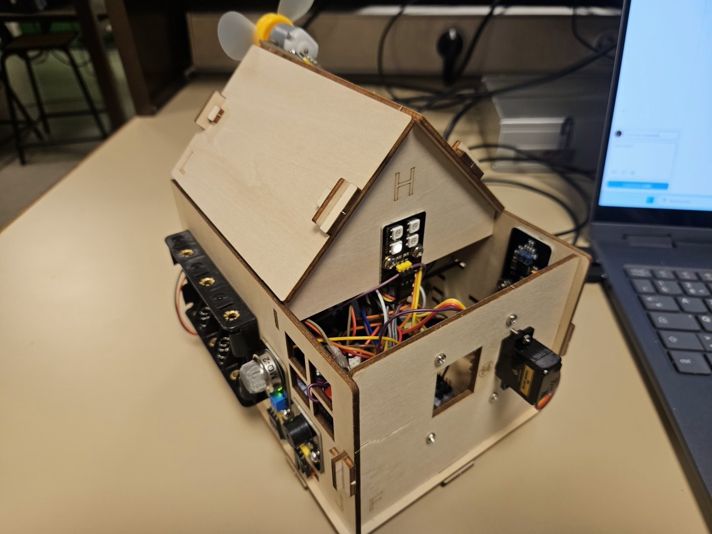

Pour simplifier le câblage, notamment pour les premiers scénarios, nous avons soudé des boutons, des LEDs (une RGB, une jaune et une bleue), et collé une breadboard sur un shield Arduino vierge. Voici à quoi ressemble notre montage :


### 2. Description du fonctionnement

Toutes les fonctionnalités respectent le cahier des charges du projet et, lorsque le sujet nous en laissait la liberté, une approche axée sur l'expérience utilisateur a été privilégiée.

L'entrée et la sortie de la maison s'effectuent via le bouton HOME.
Une fois l'utilisateur sorti, la fenêtre reste fermée (ou se ferme automatiquement), et l'alarme intrusion s'arme et se déclenche automatiquement si une présence est détectée. Elle continue de retentir tant que l'on n'est pas rentré à nouveau dans la maison.

Dans la maison, on peut ouvrir et fermer la fenêtre avec le bouton fenêtre.
S'il commence à pleuvoir, la fenêtre se ferme automatiquement et reste verrouillée en fermeture tant qu'il pleut.
Le contrôle de la fenêtre suit également la température : s'il fait trop chaud, la fenêtre s'ouvre automatiquement une fois (sans maintenir l'ouverture forcée) et, inversement, s'il fait trop froid, la fenêtre se ferme une fois (sans maintenir la fermeture forcée).

L'alarme de gaz peut se déclencher à tout moment, quel que soit l'état de la maison.

Des logs sur le moniteur série permettent de suivre la valeur des capteurs et les différentes situations.

L'écran LCD indique la température, le niveau de gaz, le niveau de pluie et si on est sorti ou non.

Les 4 LEDs NeoPixel indiquent : 
- l'alarme intrusion en jaune clignotant
- l'alarme gaz en rouge clignotant
- la mise à jour de la valeur des capteurs, en bleu par un toggle
- la tranche de température : 
   - bleu si trop froid
   - vert si tempéré
   - orange si trop chaud

## Architecture globale du système


### 1. Branchement des composants

#### 1.1. Contraintes de brochage
Nous avons voulu rester sur l'**Arduino Header** de la Nucleo pour simplifier le câblage avec la breadboard notamment. 
À partir du scénario 6, il a fallu réorganiser le brochage arbitraire que nous avions adopté au début pour tout faire rentrer sur le header Arduino.
Nous avons donc listé tous les composants et leurs fonctions pour leur assigner des broches, de la plus contraignante à la moins contraignante.

Si on reprend le pinout fourni sur BlackBoard : 


---

**Priorité 1 — Broches fixées par le matériel**

Nous sommes partis de cette base :

- **PA2 & PA3** → USART2 TX/RX, reliés physiquement au ST-LINK sur la Nucleo pour la liaison série USB.
- **PA5 (D13)** → LED built-in, inutilisée pour pouvoir déporter les LEDs (avant d'implémenter les NeoPixels).
- **PB10 (D6)** → LED bleue que nous avons soudée sur le shield.

---

**Priorité 2 — I²C**

Le header Arduino n'avait qu'une seule paire de broches SDA & SCL disponible, nous les avons donc réservées directement :

Le module **I2C3** est disponible avec :
- SCL sur **PA8 (D7)**
- SDA sur **PB4 (D5)**

---

**Priorité 3 — Timers**

Nous avions besoin de 4 timers :
- PWM du servomoteur
- PWM du buzzer passif
- PWM de la bande de 4 LEDs NeoPixel
- Timer pour l'échantillonnage

Nous n'avons que 4 timers disponibles sur le header Arduino.
Or, pour l'échantillonnage, nous voulions que l'ADC soit déclenché par un événement TRGO du timer d'échantillonnage, et seuls les timers 2 et 3 le permettent.
Nous avons donc choisi arbitrairement le Timer 2 pour l'échantillonnage.
Pour le reste, nous avons choisi arbitrairement quel composant affecter à quel timer, sachant qu'APB1 et APB2 sont tous les deux à 100 MHz, donc sans différence sur ce point.

Résultat :
- Timer 1 → Servomoteur sur le canal 2 (CH2) : PA9 (D8)
- Timer 2 → Échantillonnage
- Timer 3 → Buzzer sur le canal 2 (CH2) : PB5 (D4)
- Timer 4 → LEDs NeoPixel sur le canal 1 (CH1) : PB6 (D10)

---

**Priorité 4 — Voies analogiques**

Deux mesures analogiques sont nécessaires (gaz MQ-2 et capteur de pluie). 
L'ADC1 est le seul ADC de la carte, mais on dispose de plusieurs entrées sur les broches analogiques notamment, qui sont traditionnellement réservées aux mesures analogiques. Nous avons arbitrairement choisi parmi les broches Ax restantes : 

- **A2 (PA4)** → ADC1 canal 4 → capteur de gaz MQ-2
- **A3 (PB0)** → ADC1 canal 8 → capteur de pluie

---

**Priorité 5 — Broches d'interruption**

Nous avions besoin de 3 interruptions externes (EXTI) :
- **Bouton HOME** (bascule mode HOME/AWAY)
- **Bouton FENÊTRE** (commande manuelle de la fenêtre)
<!-- newpage -->
- **Capteur PIR** (détection de mouvement)

La contrainte importante est que deux broches de **même numéro** sur des ports différents partagent la même ligne EXTI. Il fallait donc choisir des broches ayant un numéro différent. Nous avons choisi :

- **PA6 (D12)** → EXTI 6   → Bouton HOME
- **PA10 (D2)** → EXTI 10  → Bouton FENÊTRE
- **PC7 (D9)**  → EXTI 7   → PIR

---

**Priorité 6 — Sorties GPIO**

Nous avions besoin de 3 sorties GPIO pour les LEDs indicatrices. Nous avons choisi arbitrairement parmi les broches restantes :

- **PB3 (D3)** → LED jaune du shield : Alarme intrusion
- **PA7 (D11)** → LED RGB couleur rouge du shield : Alarme gaz
- **PB10 (D6)** → LED bleue (imposée par la soudure) : cycle capteurs

*NB : C'est seulement à la fin que nous avons décidé d'ajouter les 4 LEDs NeoPixel WS2812B en bonus, mais nous les avions déjà prises en compte au moment du refactoring des broches. Finalement, nous avons conservé les deux systèmes de LEDs en parallèle.*

---

#### 1.2. Tableau de brochage final
| Composant | Label CubeMX | Connecteur Arduino | Broche STM32 | Périphérique / Mode | Pull | Tension |
|---|---|---|---|---|---|---|
| Liaison série USB | SERIAL_TX | — | PA2 | USART2 TX (ST-LINK) | — | 3V3 |
| Liaison série USB | SERIAL_RX | — | PA3 | USART2 RX (ST-LINK) | — | 3V3 |
| TMP102 + LCD (SDA) | I2C_SDA | D5 | PB4 | I2C3 SDA | — | 5V |
| TMP102 + LCD (SCL) | I2C_SCL | D7 | PA8 | I2C3 SCL | — | 5V |
| Buzzer passif | BUZZER | D4 | PB5 | TIM3 CH2 – PWM | — | 3V3 |
| Servomoteur fenêtre | SERVO | D8 | PA9 | TIM1 CH2 – PWM | — | 5V |
| Bande LED NeoPixel | RGB_BANDE | D10 | PB6 | TIM4 CH1 – PWM + DMA | — | 3V3 |
| Capteur gaz MQ-2 | GAZ | A2 | PA4 | ADC1 CH4 | — | 5V |
| Capteur de pluie | PLUIE | A3 | PB0 | ADC1 CH8 | — | 5V |
<!-- newpage -->
| Capteur PIR | PIR_MVMT | D9 | PC7 | EXTI7 – Rising Edge | PULLDOWN | 3V3 |
| Bouton HOME/AWAY | BTN_HOME | D12 | PA6 | EXTI6 – Falling Edge | PULLUP | 3V3 |
| Bouton fenêtre | BTN_FENTR | D2 | PA10 | EXTI10 – Falling Edge | PULLUP | 3V3 |
| LED alarme intrusion | LED_JAUNE | D3 | PB3 | GPIO Output | — | 3V3 |
| LED cycle capteurs | LED_BLEUE | D6 | PB10 | GPIO Output | — | 3V3 |
| LED alarme gaz | RGB_ROUGE | D11 | PA7 | GPIO Output | — | 3V3 |

### 2. Arbre d'horloge et fréquences

Pour le réglage des horloges, nous avons simplement conservé la configuration effectuée lors du premier TD, en gardant la plus haute fréquence possible pour SYSCLK, l'APB1 et l'APB2 des timers, soit 100 MHz.

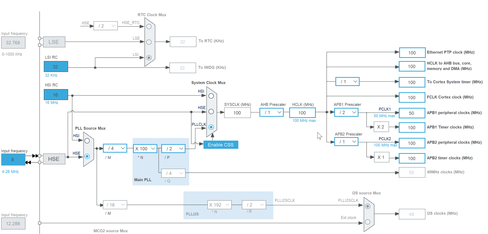

### 3. Organisation logicielle

#### 3.1. Boucle principale et gestion des interruptions
Tout le code que nous avons écrit n'utilise jamais de délai bloquant (HAL_Delay) ni de boucle while bloquante. Toutes les fonctions appelées dans la boucle while(1) sont des actions « instantanées » qui n'attendent pas un événement pour se terminer.
Pour chaque routine d'interruption, nous avons veillé à réduire au maximum le temps passé à l'intérieur en nous contentant de lever un flag indiquant que l'événement correspondant s'est produit. Le traitement est déporté dans des fonctions appelées à chaque passage de la boucle while(1) qui vérifient ces flags.

#### 3.2. Organisation en bibliothèques
Pour l'écran LCD, le capteur de température et les 4 NeoPixels, nous avons créé des bibliothèques séparées comme demandé.
En revanche, au lieu de les placer à la racine du projet, comme nous en créions un nouveau pour chaque scénario, nous les avons regroupées dans un dossier `Bibliotheques`.  

Nous avons donc créé des liens symboliques, ajouté les chemins des headers au compilateur, et inclus les dossiers symboliques au build pour qu'elles soient bien prises en compte et compilées.

Dossiers symboliques  
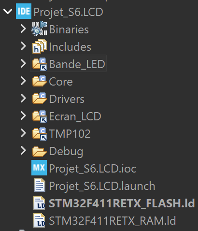

<!-- newpage -->

Décochage de « Exclude from Build » dans les propriétés des dossiers symboliques
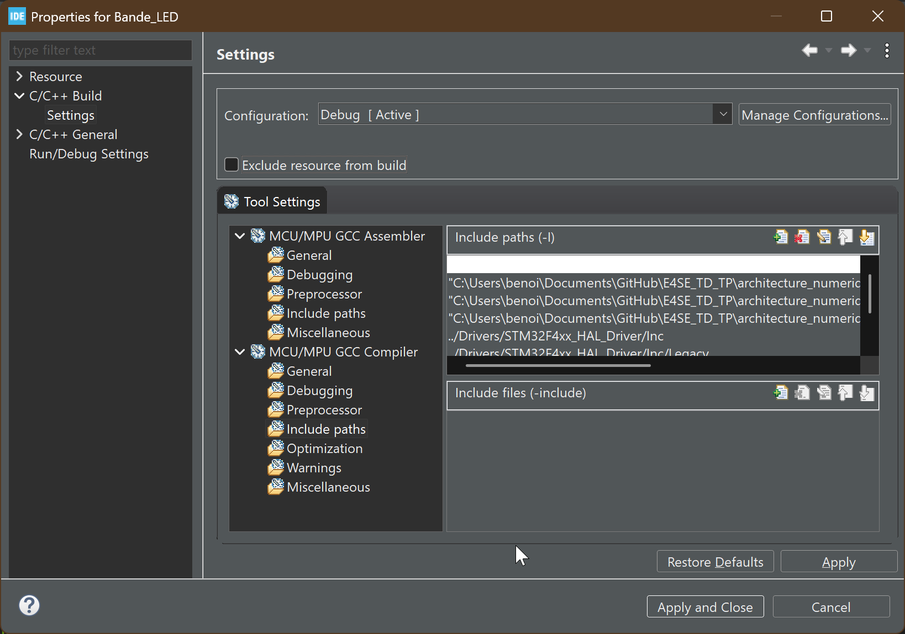

Include path dans les project settings   


### 4. Recyclage des timers
Le SysTick est le compteur de millisecondes intégré au cœur Cortex-M, et la HAL fournit `HAL_GetTick()` pour l'exploiter. Nous ne l'avons pas utilisé : nous avons oublié, pendant le développement, que ce compteur était disponible. Nous avons donc géré tous les délais non bloquants avec des timers que nous avons nous-mêmes configurés.

Nous avons eu besoin de mesurer du temps dans deux situations :
- le délai de filtrage des rebonds des boutons ;
- le délai d'inversion des LEDs et du buzzer pour le clignotement des alarmes de gaz et d'intrusion.

Pour le debounce, nous avions d'abord configuré un timer dédié, et M. ROY nous a indiqué qu'il s'agissait d'une meilleure solution que la nôtre. Plutôt que de revenir au SysTick, nous avons donc continué sur cette lancée : le Timer 3 a d'abord compté les 50 ms de debounce, puis nous l'avons recyclé pour gérer le clignotement des alarmes. Dans la version finale du projet, la base de 50 ms est portée par le Timer 5 (voir [Scénario 2 – 2. Gestion de l'anti-rebond](#2-gestion-de-lanti-rebond) et [Scénario 8 – Gestion globale des alarmes - 1. Clignotement non bloquant par compteur partagé](#1-clignotement-non-bloquant-par-compteur-partagé)).

Ce choix présente plusieurs avantages, certes minimes :
- les événements basés sur des délais non bloquants sont vérifiés moins souvent, ce qui décharge le CPU : `update_cycle_alarmes()` et `debounce_filter()` ne sont appelées que 20 fois par seconde au lieu d'être évaluées à chaque tour de boucle ;
- nous avons appris à baser nos délais sur une fréquence non conventionnelle, avec des formules qui s'adaptent à la fréquence du timer grâce aux modulos (voir la partie [Scénario 8 – Gestion globale des alarmes - 1. Clignotement non bloquant par compteur partagé](#1-clignotement-non-bloquant-par-compteur-partagé)).

Nous sommes conscients de n'avoir pas exploité toutes les ressources de la carte, qui auraient permis de simplifier le code. Nous aurions tout aussi bien pu utiliser le SysTick et calculer des différences de temps avec `HAL_GetTick()`.

### 5. Pas de Hardcoding

Pour éviter les erreurs de recopie, faciliter la compréhension du code et surtout permettre de reconfigurer facilement des valeurs ou des changements de brochage, nous avons défini des macros (`#define`) pour chaque valeur ou objet HAL utilisé dans notre code.

#### 5.1. Defines matériels

Voici les `#define`s matériels définis dans le main.c qui permettent de pointer vers les différents périphériques sans avoir à changer toutes les occurrences en cas de changement dans le .ioc :
```c
#define ADC_CAPTEURS    (&hadc1)
#define BUS_I2C         (&hi2c3)
#define TIMER_CAPTEURS  (&htim2)
#define TIMER_DEBOUNCE  (&htim5)
#define TIMER_SERVO     (&htim1)
#define CANAL_SERVO     TIM_CHANNEL_2
#define TIMER_BUZZER    (&htim3)
#define CANAL_BUZZER    TIM_CHANNEL_2
#define TIMER_BANDE_LED (&htim4)
#define CANAL_BANDE_LED TIM_CHANNEL_1
```

### 6. Structure pour les LEDs

Nous avons défini un type structure `LED_t` pour représenter une LED et son état. Les avantages de cette approche sont multiples : 

- Une seule variable de type `LED_t` suffit pour représenter une LED au lieu d'avoir un port et une broche (pin) à spécifier à chaque changement d'état.
- On peut mémoriser l'état de la LED dans la variable `state` de la structure, et le modifier sans avoir à utiliser les lourdes fonctions HAL.
- On peut associer un nom fonctionnel à un label matériel (ex : ```led_capteurs``` est redirigée vers ```LED_BLEUE```), ce qui donne plus de sens au code sans insérer des choix logiciels dans la configuration du ```.ioc```.

Voici la définition du type `LED_t` dans le ```main.c``` : 
```c
typedef struct {
    GPIO_TypeDef *port;
    uint16_t pin;
    bool state;
} LED_t;
```

Voici un exemple de déclaration de LED dans le ```main.c``` :
```c
LED_t led_capteurs = {LED_BLEUE_GPIO_Port, LED_BLEUE_Pin, false};
...
```
*NB : Les `#define`s associés aux ports et pins des broches sont générés automatiquement par le .ioc dans le fichier ```main.h```.*

Dans la boucle while(1) de la fonction main, nous appelons à chaque itération la fonction de commande des LEDs, qui va modifier l'état des LEDs en fonction de leur état mémorisé :

```c
void commande_led()
{
  if (led_capteurs.state) {
    HAL_GPIO_WritePin(led_capteurs.port, led_capteurs.pin, 1);
  } else {
    HAL_GPIO_WritePin(led_capteurs.port, led_capteurs.pin, 0);
  }
  ...
}
```

Voici les 3 exemples d'utilisation : 

```c
led_capteurs.state = true;
led_capteurs.state = false;
led_capteurs.state = !led_capteurs.state;
```

## Scénario 1 – Base temporelle pour l'échantillonnage


### 1. Configuration du Timer

Comme justifié dans la partie [Architecture globale – 1. Branchement des composants](#1-branchement-des-composants), nous avons choisi le Timer 2 pour cadencer la prise de mesure de nos capteurs.
Nous avons utilisé un timer avec interruptions pour éviter l'utilisation de boucles bloquantes, garantissant ainsi un échantillonnage régulier. L'horloge source du timer étant de 100 MHz, nous avons configuré les registres PSC et ARR pour obtenir une période d'échantillonnage de 2 s.

#### 1.1. Contraintes de départ
- PSC fait 16 bits.
- On veut garder un temps par tic qui soit une puissance de 10 (ex : 1 ms, 10 µs, 1 µs, ...) pour simplifier la correspondance entre ARR et période souhaitée.
- La période souhaitée est de 2 s.

#### 1.2. Calcul du Prescaler
Nous avons choisi la résolution temporelle par tic la plus fine possible afin d'obtenir un ratio simple entre le nombre de tics dans ARR et la durée de la période en secondes.

$$Prescaler < 2^{16} - 1$$
$$Prescaler < 65 535$$

La plus grande puissance de 10 permettant de diviser 100 MHz sans dépasser la valeur maximale du prescaler est 10 000. On choisit donc :
$$PSC = 10 000 - 1 = 9 999$$
$$\implies f_{PSC} = \frac{100\text{ MHz}}{10 000} = 10\text{ kHz}$$
$$\implies T_{PSC} = \frac{1}{10\text{ kHz}} = 0,1\text{ ms}$$

#### 1.3. Calcul de la Période
Ainsi pour mesurer une durée de 2 secondes, le nombre de tics requis est de :
$$N_{tics} = \frac{2\text{ s}}{0,1\text{ ms}} = 20 000$$
On choisit donc `ARR = 20 000 - 1 = 19 999`.

#### 1.4. Dans CubeMX

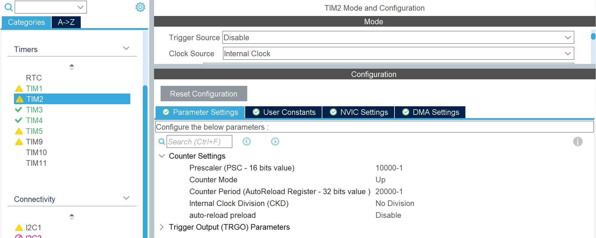

### 2. Clignotement de la LED témoin

Pour être informé de la mise à jour des capteurs par le timer TIM2, nous avons codé le changement d'état de la LED bleue à chaque interruption de fin de comptage générée par le TIM2 en passant par un flag :

Dans la section `USER CODE 4` du `main.c` :
```c
void HAL_TIM_PeriodElapsedCallback(TIM_HandleTypeDef *htim)
{
  if (htim == TIMER_CAPTEURS)
  {
    timer_capteurs_flag = true;
  }
  ...
}
```

Dans la boucle while(1) de la fonction main, nous vérifions le flag à chaque itération :

```c
  if (timer_capteurs_flag) {
    timer_capteurs_flag = false;
    led_capteurs.state = !led_capteurs.state;
    ...
  }
```

### 3. Validation expérimentale

En observant la LED à l'oscilloscope, nous avons pu vérifier que la période du signal correspond bien exactement à 4 s, confirmant ainsi une période de 2 s entre chaque inversion. Cela montre que le timer fonctionne comme prévu et que TIM2 est correctement configuré pour fournir la base temporelle souhaitée.

### 4. Ancienne méthode

Au début, nous avions utilisé le Timer 3 de manière totalement arbitraire, sans `#define` personnalisé pour les objets HAL, sans structure pour les LED, et sans flag pour les routines d'interruption :

```c
void HAL_TIM_PeriodElapsedCallback(TIM_HandleTypeDef *htim) {
    if (htim->Instance == TIM3) {
        HAL_GPIO_TogglePin(BLUE_GPIO_Port, BLUE_Pin);
    }
}
```

## Scénario 2 – Sécurité : HOME/AWAY et détection d'intrusion

### 1. Configuration du bouton MODE

Le bouton MODE est configuré en EXTI sur front descendant (*l'interruption est déclenchée au moment précis où l'utilisateur appuie sur le bouton, lorsque le signal passe du niveau haut au niveau bas*) avec pull-up interne (*le bouton étant configuré pour renvoyer un 0 si pressé et 1 sinon, le signal est maintenu à l'état haut par défaut*).
Cela permet de détecter les appuis sur le bouton tout en évitant les faux déclenchements dus au bruit. 

### 2. Gestion de l'anti-rebond

Pour s'assurer que l'appui sur le bouton est correctement détecté sans être perturbé par les rebonds mécaniques, nous avons mis en place un mécanisme anti-rebond grâce au Timer 5.

#### 2.1. Prescaler du Timer 5
(`PSC = 10000 - 1`) : Nous avons gardé la même résolution que pour TIM2, soit une résolution exacte de $0{,}1\text{ ms}$ par tic.

#### 2.2. Période du Timer 5
(`ARR = 500 - 1`) : Nous cherchons une période de $\frac{500}{10\,000} = 50\text{ ms}$ (fréquence de 20 Hz), largement satisfaisante pour couvrir la fenêtre temporelle des rebonds mécaniques du bouton.

#### 2.3. Routine d'interruption du GPIO et du Timer
Lors de l'appui sur le bouton MODE, l'interruption EXTI 6 est déclenchée.  
Dans la routine d'interruption, le flag `debouncing_bouton_home` est levé et le Timer 5 est remis à zéro pour attendre exactement 50 ms : 

```c
// Flag utilisé pour l'anti-rebond
volatile bool   timer_debounce_flag         = false;
volatile bool   debouncing_bouton_home      = false;

// dans USER CODE 4
void HAL_TIM_PeriodElapsedCallback(TIM_HandleTypeDef *htim)
{
  if (htim == TIMER_DEBOUNCE)
  {
	  timer_debounce_flag = true;
  }
  ...
}

void HAL_GPIO_EXTI_Callback(uint16_t GPIO_Pin)
{
   ...
  if (GPIO_Pin == BTN_HOME_Pin)
  {
    if (!debouncing_bouton_home) {
      debouncing_bouton_home = true;
      __HAL_TIM_SET_COUNTER(TIMER_DEBOUNCE, 0);
    }
  }
  ...
}
```

#### 2.4. Détection d'appui
Ensuite, dans la boucle while(1) du main, on vérifie si le flag `timer_debounce_flag` est levé puis si le bouton est toujours enfoncé :

```c
// dans USER CODE 0
void debounce_filter() 
{
	if (debouncing_bouton_home && !HAL_GPIO_ReadPin(BTN_HOME_GPIO_Port, BTN_HOME_Pin)) {
		debouncing_bouton_home = false;
		bouton_home_appuye = true;
	}
  ...
}

// dans la boucle while(1) du main
if (timer_debounce_flag)
{
  timer_debounce_flag = false;
  debounce_filter();
  ...
}
```  
La fonction `debounce_filter()` est appelée à chaque fin de période du timer, soit toutes les 50 ms.  
Si le flag `debouncing_bouton_home` est levé ET que le bouton est toujours au niveau bas (actif à 0), cela signifie que l'appui est bien resté stable 50 ms après la détection du front descendant.  
La variable `bouton_home_appuye` est alors validée et le flag `debouncing_bouton_home` est réinitialisé.  
Ce mécanisme permet de gérer l'anti-rebond de manière non bloquante, contrairement à un simple délai qui bloquerait l'exécution du programme.

> Nous n'avons pas utilisé le compteur de millisecondes du SysTick (`HAL_GetTick()`) pour cette temporisation, mais un timer dédié. Ce choix et son contexte sont expliqués dans [Architecture globale – 4. Recyclage des timers](#4-recyclage-des-timers).

### 3. Machine à états HOME / AWAY

#### 3.1. Description de la machine à états

Nous avons défini une première machine à états pour gérer les différents modes de la maison : `HOME`, `AWAY`.

> La version complétée avec l'alarme intrusion est décrite plus bas : [Scénario 2 – 5.1. Machine à états avec alarme intrusion](#51-machine-à-états-avec-alarme-intrusion)

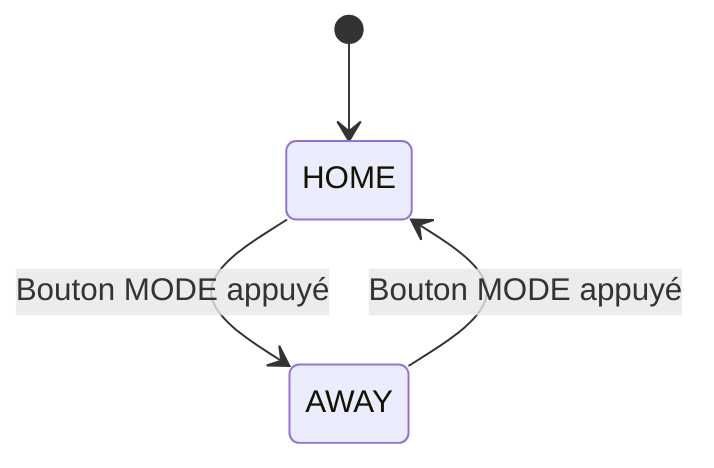

#### 3.2. Gestion des modes

Afin de manipuler plus facilement les états de la maison, nous avons défini une énumération `maison_mode_t` qui représente les différents modes possibles : `HOME` et `AWAY`.

```c
// dans la section USER CODE PTD
typedef enum {
    HOME,
    AWAY
} maison_mode_t;

// dans la section USER CODE PV
maison_mode_t mode = HOME;
```
> Au début, nous avions utilisé de simples variables booléennes pour gérer les modes de la maison. L'avantage de l'enum est que l'on peut voir le nom associé au mode dans les Live Expressions en mode Debugger.

#### 3.3. Implémentation de la machine à états

Première version de la machine à états :

```c
// Dans la boucle while(1) de la main()
switch (mode) 
{
  case HOME:
    if (bouton_mode_appuye) 
    {
      bouton_mode_appuye = false;
      mode = AWAY;   
    }
    break;

  case AWAY:
    if (bouton_home_appuye)
    {
      bouton_home_appuye = false;
      mode = HOME;
    }
    break;
}
```

### 4. Capteur PIR et alarme intrusion

#### 4.1. Configuration du capteur de mouvement
Le capteur de présence PIR est raccordé sur la broche PC7 et configuré en interruption externe déclenchée sur front montant, avec une résistance de tirage interne (pull-down), afin de garantir un signal stable en l'absence de mouvement.


#### 4.2. Lecture du capteur PIR

À tout moment, la détection d'un mouvement déclenche l'interruption du capteur. On positionne alors le flag `presence_detectee` à `true` :

```c
// Dans USERCODE PV
volatile bool presence_detectee = false;

// Dans USER CODE 4 : Interruption EXTI
void HAL_GPIO_EXTI_Callback(uint16_t GPIO_Pin)
{
    if (GPIO_Pin == PIR_MVMT_Pin)
    {
        presence_detectee = true;
    }
    ...
}
```

> La variable `presence_detectee` est déclarée volatile car elle est modifiée dans une routine d'interruption et lue dans la boucle principale.

### 5. Comportement selon le mode (AWAY vs HOME)

#### 5.1. Machine à états avec alarme intrusion

Nous avons donc ajouté la gestion de l'alarme intrusion en fonction du mode de la maison. L'alarme se déclenche uniquement si le mode est AWAY et qu'une présence est détectée.

**Machine à états HOME/AWAY complétée**
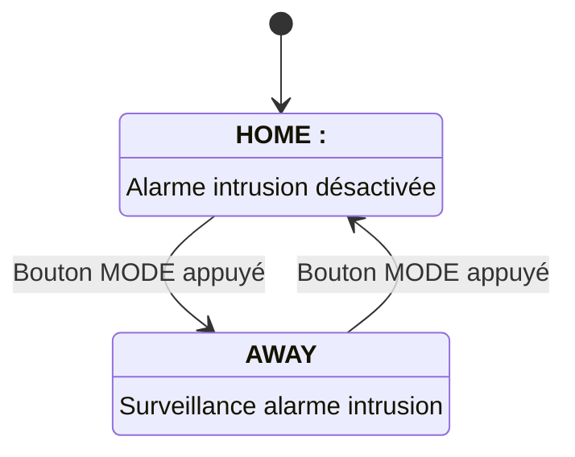

**Organigramme de l'alarme intrusion du mode AWAY :**
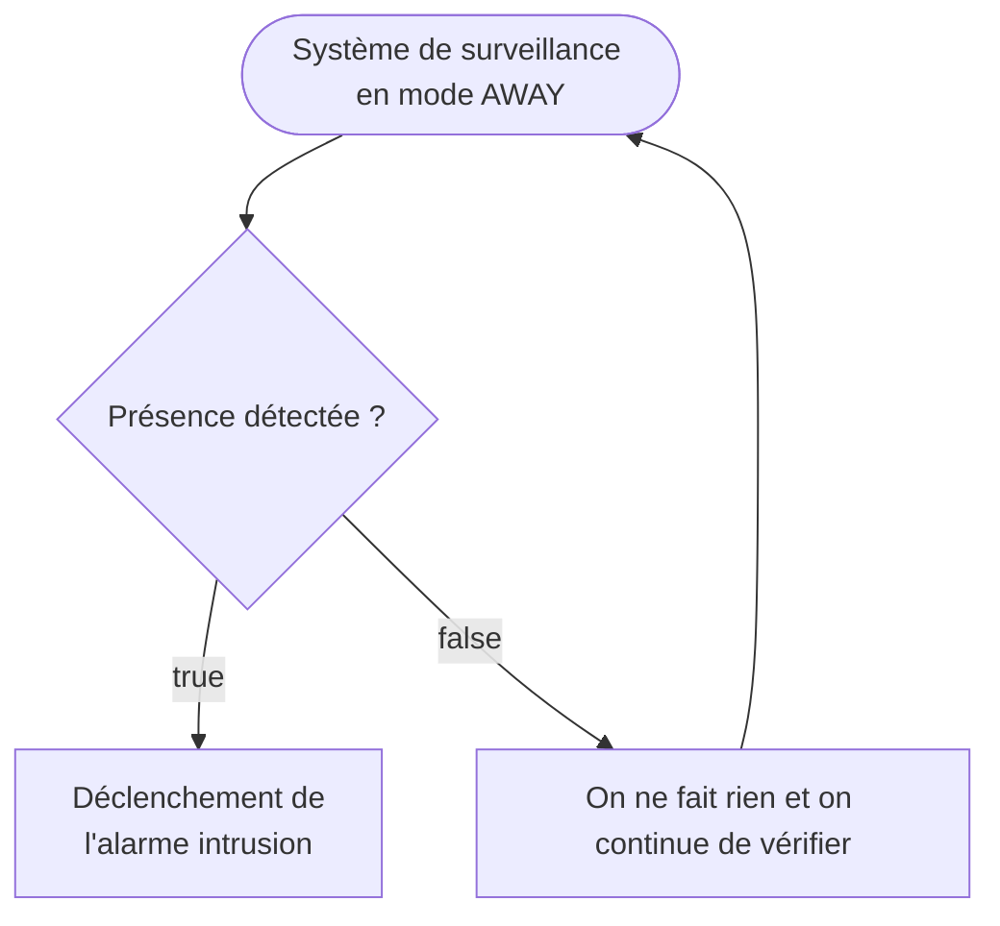


#### 5.2. Implémentation dans la while(1)

```c
// Machine à état avec HOME et AWAY
    switch(mode) 
    {
      case  HOME: 
      {
        // Transitions
        if (bouton_home_appuye) 
        {
          bouton_home_appuye = false;
          mode = AWAY;
        }
        else 
        {
          // Actions
          presence_detectee = false;
          alarme_intrusion = false;
        }
        break;
      }
      case AWAY:
      {
        // Transitions
        if (bouton_home_appuye) 
        {
          bouton_home_appuye = false;
          mode = HOME;
        } 
        else 
        {
          // Actions          
          if (presence_detectee) 
          {
            alarme_intrusion = true;
            presence_detectee = false;
          }
        }
        break;
      }
    }
```

> En mode HOME, on réinitialise toujours `presence_detectee` et `alarme_intrusion` à `false` pour empêcher tout déclenchement au moment de la transition si une détection a eu lieu dans ce mode.

#### 5.3. Alarme intrusion

L'alarme intrusion est gérée par la variable `alarme_intrusion` :

```c
// dans CODE PV
bool alarme_intrusion = false;
```

L'application de l'alarme intrusion est déportée dans une fonction non bloquante `update_cycle_alarmes()` qui lit la variable globale `alarme_intrusion`.  
→ [Scénario 8 – Gestion globale des alarmes](#scénario-8--gestion-globale-des-alarmes).

## Scénario 3 – Détection de gaz

### 1. Déclenchement de l'ADC par le Timer 2

Pour cadencer les acquisitions ADC à intervalle régulier sans utiliser le processeur en permanence, nous avons configuré le Timer 2 comme source de déclenchement de l'ADC1.  
La configuration du Timer 2 (période de 2 s, PSC et ARR) est détaillée dans [Scénario 1 – Base temporelle pour l'échantillonnage](#sc%C3%A9nario-1--base-temporelle-pour-l%C3%A9chantillonnage).

Le seul paramètre spécifique modifié dans le scénario 3 est l'activation du **Trigger Output (TRGO)** sur l'événement *Update* du Timer 2 dans CubeMX :

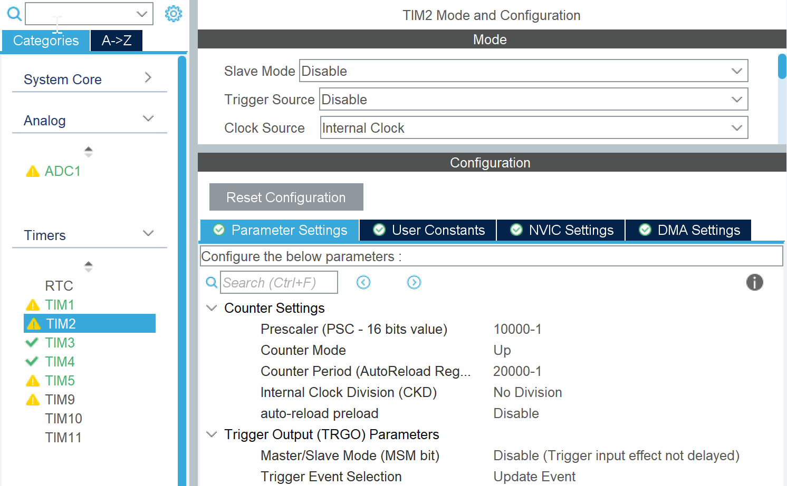

À chaque fin de période (toutes les 2 secondes), le Timer 2 émet automatiquement un signal matériel TRGO vers le trigger de l'ADC1, qui déclenche une séquence de conversion sans avoir à coder quoi que ce soit.

Dans CubeMX, nous avons donc défini l'ADC1 comme ceci :

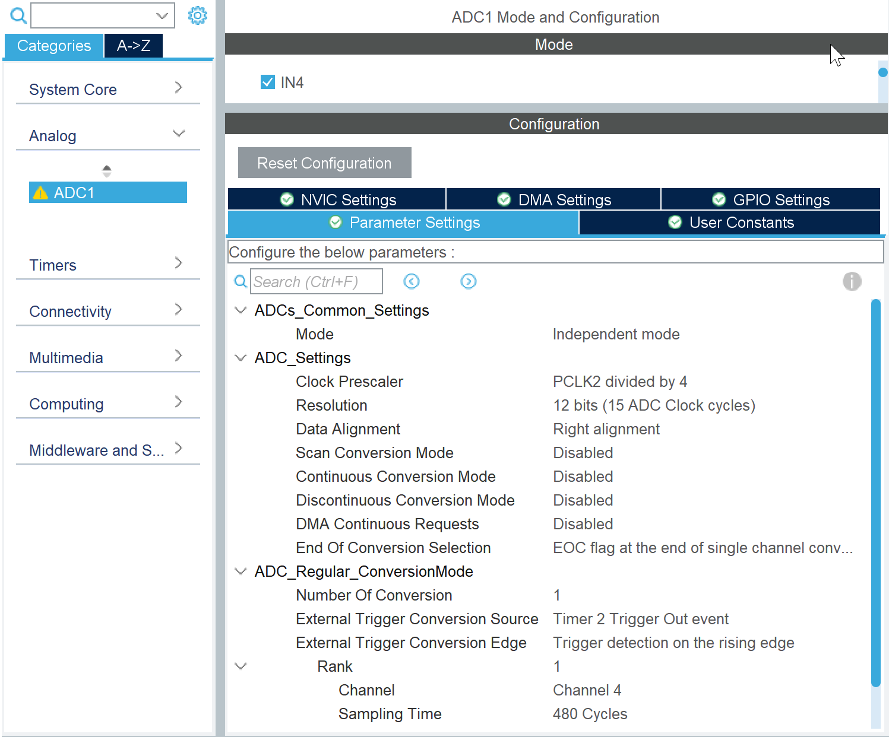

Nous avons globalement laissé les paramètres par défaut, à part :
- le TRGO sur l'Update du Timer 2 ;
- les 480 cycles d'échantillonnage pour s'assurer que la valeur soit bien stable.

### 2. Lecture de la valeur ADC au Scénario 3 et problème rencontré

Au moment du scénario 3, seul le capteur de gaz était connecté sur le Channel 4 (A2). L'ADC fonctionnait en conversion unique sur un canal, et nous lisions la valeur directement dans le callback du Timer 2, sans attendre la fin de la conversion.

```c
// Extrait du main.c — version Scénario 3
void HAL_TIM_PeriodElapsedCallback(TIM_HandleTypeDef *htim)
{
    // TIM2 -> PER = 2s pour l'échantillonnage des capteurs
    if (htim->Instance == TIM2)
    {
        HAL_GPIO_TogglePin(BLUE_GPIO_Port, BLUE_Pin);
        update_mesure_gaz();
    }
}

void update_mesure_gaz() {
    gaz_value = HAL_ADC_GetValue(&hadc1);
    if (gaz_value >= SEUIL_GAZ) {
        alarme_gaz = true;
    } else {
        alarme_gaz = false;
    }
}
```

`HAL_ADC_GetValue()` lisait le registre contenant le résultat de l'ADC sans vérifier si la conversion était terminée.  
Le problème est que la conversion prend un certain temps (d'autant plus que nous avions paramétré l'ADC à 480 cycles d'échantillonnage).  
Ainsi, en lisant directement dans l'ISR de TIM2 au moment du déclenchement, on récupérait en réalité la valeur de la conversion précédente, c'est-à-dire celle qui avait été lancée 2 secondes plus tôt. La valeur affichée était donc systématiquement une mesure prise entre 2 et 4 secondes plus tôt.

Nous avons identifié le problème au Scénario 5, au moment d'ajouter le capteur de pluie. C'est à ce moment-là que nous avons entièrement revu l'architecture de la chaîne ADC pour passer à une implémentation multi-canaux avec DMA.

> _La version finale de l'ADC (mode Scan, 2 canaux, DMA circulaire, callback de fin de conversion) est détaillée en [Scénario 5 – 4. Détection de pluie avec ADC DMA multi-canaux](#4-détection-de-pluie-avec-adc-dma-multi-canaux)._

### 3. Tests du capteur et seuil

#### 3.1. Tension d'alimentation et de mesure de l'ADC

Le capteur MQ-2 génère une tension proportionnelle à la concentration de gaz détecté entre 0 et 5 V d'après la datasheet du capteur. L'ADC1, avec sa résolution de 12 bits, produit une valeur entre 0 et $2^{12}-1 = 4095$, sur une plage de 0 à VREF+ d'après la documentation de la Nucleo : 

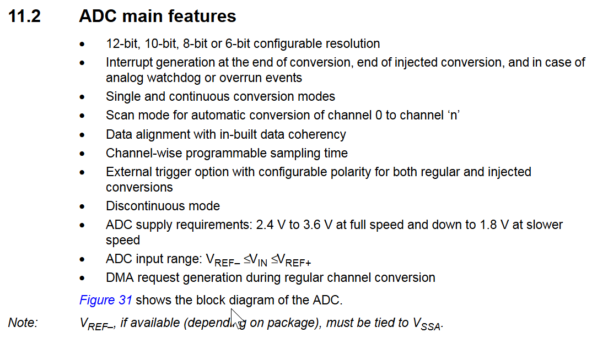 

Il se trouve qu'en cherchant plus précisément dans la [documentation de la carte Nucleo](https://www.st.com/resource/en/user_manual/um1724-stm32-nucleo64-boards-mb1136-stmicroelectronics.pdf), nous avons constaté que sur la carte Nucleo, VREF+ est relié à VDDA = VDD = 3,3 V.

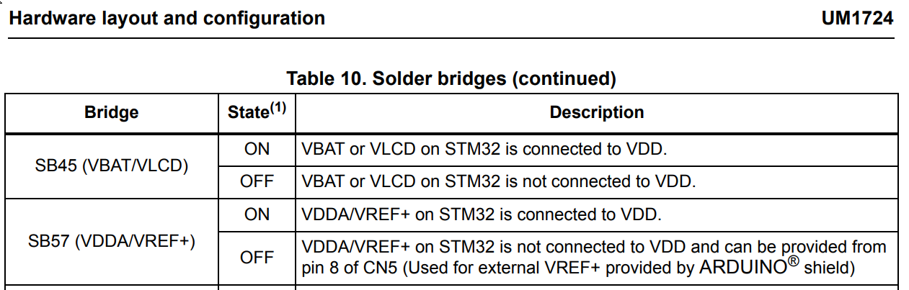 

Cependant, nous avions initialement alimenté et testé le capteur en 5 V comme indiqué dans sa datasheet. Comme l'ADC semblait bien réagir et que M. ROY avait lui-même raccordé le 5 V aux broches analogiques lors de tests, nous n'avions pas relevé cette incohérence sur le moment.
Nous souhaitions poser la question, mais avons oublié entre-temps.  

Donc à moins que le capteur ne renvoie explicitement 3V3 maximum sur sa broche analogique, nous sommes probablement en train d'abîmer des diodes de protection ou de griller la carte à chaque mise sous tension ...

#### 3.2. Seuil de détection

Nous avons surveillé la valeur en temps réel sur le moniteur série pour définir le seuil de détection de gaz :
- **À l'air libre** : la valeur ADC se stabilise aux alentours de 800 (500 quand le capteur a bien chauffé).
- **En présence de vapeurs** : la valeur monte au-delà de 3000.

Nous avons donc retenu `SEUIL_GAZ = 2500` comme compromis entre sensibilité et faux positifs.

> Le capteur ayant besoin de préchauffer sa résistance interne, il fallait attendre environ 2 minutes après sa mise sous tension que la tension analogique descende au fur et à mesure de la chauffe, avant de pouvoir l'utiliser avec un seuil bas lors de nos tests avec notre souffle (faible différence avec l'air ambiant) hors des séances de TP.

### 4. Alarme gaz

La détection de gaz est permanente et indépendante du mode HOME/AWAY comme demandé dans le TP, car une fuite de gaz reste dangereuse, que l'on soit présent ou absent.  
La variable globale `alarme_gaz` est positionnée à `true` dans `evaluer_gaz()` dès que la valeur dépasse le seuil.  

La gestion de l'alarme de gaz est déportée dans une fonction non bloquante `update_cycle_alarmes()` qui lit la variable globale `alarme_gaz`.  
→ [Scénario 8 – Gestion globale des alarmes](#scénario-8--gestion-globale-des-alarmes).

---

## Scénario 4 – Supervision UART

### 1. Configuration de l'UART avec ST-LINK

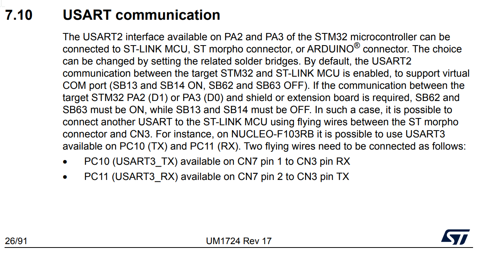

La carte NUCLEO-F411RE embarque un convertisseur USB-UART intégré au ST-LINK, qui expose un port COM virtuel sur le PC.

Aucun câblage externe n'est donc nécessaire pour la liaison PC : le câble USB de débogage suffit à la fois pour programmer, déboguer et superviser.

Dans CubeMX, nous avons activé l'USART2 en mode Asynchronous avec les paramètres par défaut :

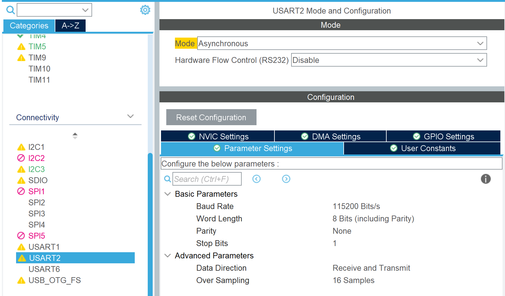

### 2. Redirection de printf vers l'UART

Pour transmettre des messages formatés sans avoir à manipuler `HAL_UART_Transmit()` à chaque appel, nous avons redirigé la fonction standard `printf` vers l'USART2 en redéfinissant la fonction `__io_putchar()`, utilisée par la bibliothèque C standard pour l'envoi caractère par caractère :

```c
// main.c — USER CODE BEGIN 4
// Redirection du printf vers USART2
int __io_putchar(int ch) {
    HAL_UART_Transmit(&huart2, (uint8_t *)&ch, 1, HAL_MAX_DELAY);
    return ch;
}
```

La fonction `__io_putchar` prend en paramètre :
- `&huart2` : un pointeur sur la structure de l'UART2 ;
- `(uint8_t *)&ch` : un pointeur sur le caractère à transmettre ;
- `1` : le nombre de caractères à transmettre ;
- `HAL_MAX_DELAY` : le temps maximum d'attente avant de considérer la transmission comme échouée.

`printf` découpe la chaîne en caractères, et `__io_putchar()` les transmet un à un via `HAL_UART_Transmit()` en mode bloquant (`HAL_MAX_DELAY`), ce qui est acceptable ici car les transmissions sont courtes et espacées (toutes les 2 secondes en moyenne).

> Nous avons bien inclus `#include <stdio.h>` pour utiliser `printf` et `snprintf`.

### 3. Message de bienvenue au démarrage

Au démarrage du système (juste après l'initialisation de tous les composants), un message de bienvenue est transmis sur l'UART pour confirmer que la liaison fonctionne et afficher la configuration choisie :

```c
// main.c — USER CODE BEGIN 2 (après les initialisations)
printf("\r\n--- Demarrage Systeme STM32 ---\r\n\n");
printf("Seuil gaz configure: %d\r\n", SEUIL_GAZ);
printf("Frequence clignotement alarme gaz: %d Hz\r\n", FREQ_BLINK_ALARME_GAZ);
printf("Frequence clignotement alarme intrusion: %d Hz\r\n", FREQ_BLINK_ALARME_INTRUSION);
printf("Periode echantillonnage capteurs: %d s\r\n", (int)(1/FREQ_CYCLE_CAPTEURS));
printf("Periode debounce bouton: %d ms\r\n", (int)(1000/FREQ_CYCLE_DEBOUNCE));
```

### 4. Supervision en temps réel

La liaison UART est utilisée tout au long du fonctionnement pour transmettre trois types d'informations :

#### 4.1. Mesures périodiques (toutes les 2 s)

À chaque cycle d'échantillonnage, les valeurs brutes des trois capteurs sont transmises :

```c
// Dans evaluer_gaz() — main.c
printf("                                      GAZ   = %d\r\n", gaz_valeur);

// Dans evaluer_pluie() — main.c
printf("                                      PLUIE = %d\r\n", pluie_valeur);

// Dans evaluer_temperature() — main.c
printf("                                      TEMP  = %s°C\r\n",
       TMP102_temperature_to_string(temperature_valeur, 2));
```

Comme nous envoyons systématiquement toutes les 2 secondes les valeurs de ces trois capteurs, nous avons préféré ajouter une indentation importante pour les différencier des messages occasionnels liés à la situation de la maison ou aux actions utilisateurs.

> Pour la température, nous avons une fonction dédiée à la génération de la chaîne correspondant à un float, comme détaillé au paragraphe [Scénario 6 – 8.3. Affichage de la température de type float](#83-affichage-de-la-température-de-type-float).

#### 4.2. Événements d'état (asynchrones)

Seules ces 8 actions provoquent un message sur l'UART en plus des mesures périodiques :

| Événement | Message transmis |
| :--- | :--- |
| Passage HOME → AWAY | `Je sors de la maison` |
| Passage AWAY → HOME | `Je rentre à la maison` |
| Ouverture fenêtre | `J'ouvre la fenetre` |
| Fermeture fenêtre | `Je ferme la fenetre` |
| Détection d'intrusion | `Intrusion detectee !` |
| Détection de gaz | `Gaz detecte !` |
| Détection de pluie | `Pluie detectee !` |
| TMP102 initialisé | `Capteur TMP102 configuré` |

#### 4.3. Erreurs

Les erreurs de communication I²C avec le TMP102 sont également signalées :

```c
printf("Erreur d'initialisation du capteur TMP102\r\n");
printf("Erreur lors du demarrage de la mesure TMP102 en mode One-Shot\r\n");
```

### 5. Validation avec un terminal série

Pour valider la liaison, nous avons utilisé le moniteur série intégré à STM32CubeIDE (ShellCode) configuré à **115200 bauds** sur le bon port COM.

---


## Scénario 5 – Gestion intelligente de la fenêtre


### 1. Commande du servomoteur

#### 1.1. Brochage et alimentation

*Extrait de la datasheet du servomoteur :*

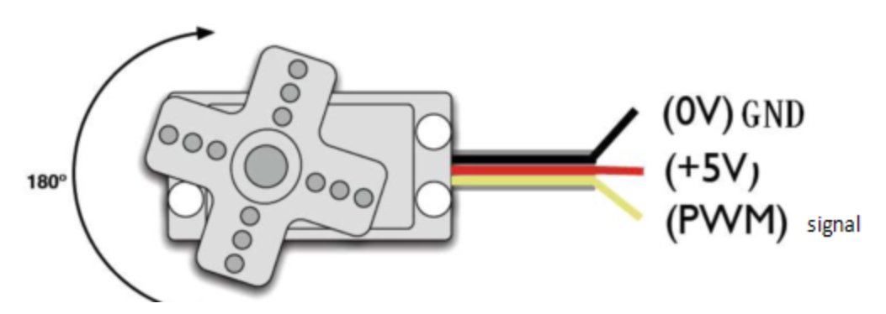

Le servomoteur est alimenté en 5V et le signal de commande PWM (broche orange) est connecté sur PA9 (D8), correspondant au canal TIM1 CH2.

#### 1.2. Protocole PWM du servo

Comme c'est un servomoteur à commande analogique, il se pilote par un signal PWM à 50 Hz (période de 20 ms). La position angulaire est encodée via la largeur de l'impulsion à l'état haut, comme décrit ci-dessous :

*Extrait de la datasheet du servomoteur :*
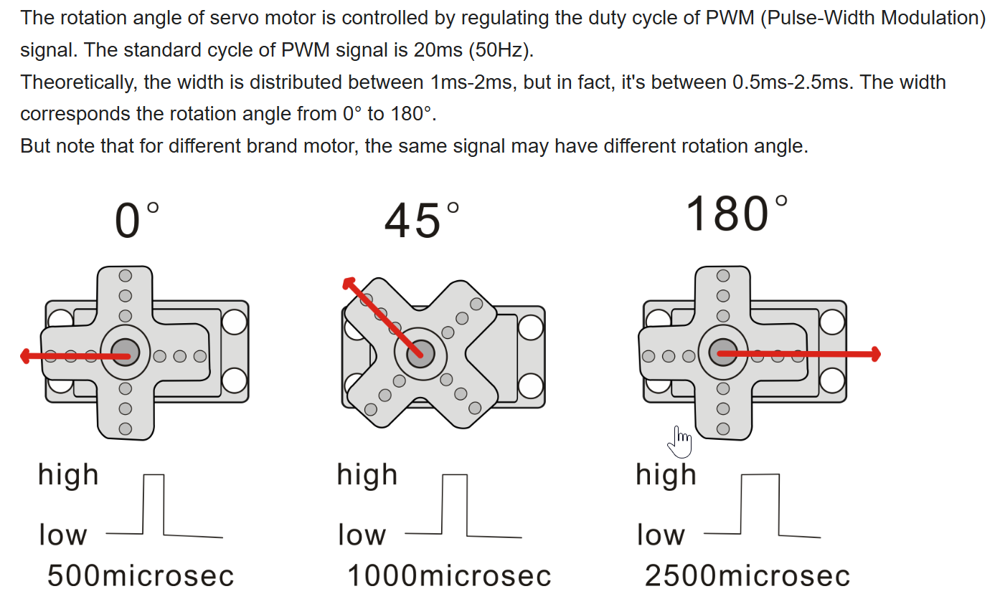

Exemple :
| Position | Durée de l'impulsion |
| :--- | :--- |
| 0° | 0,5 ms |
| 90° | 1,5 ms |
| 180° | 2,5 ms |

#### 1.3. Configuration du Timer 1 dans CubeMX

Le Timer 1 prend en entrée l'horloge APB2 à 100 MHz. Nous devons générer un signal PWM à 50 Hz. Nous avons cherché à obtenir la meilleure résolution possible sur la largeur d'impulsion.

Les contraintes de calcul sont : 
- La fréquence de la PWM est de 50 Hz.
- La fréquence de l'horloge source est de 100 MHz.
- Le prescaler est codé sur 16 bits.
- Le registre ARR est codé sur 16 bits.

On peut d'abord déterminer la fréquence de comptage maximale permettant de compter sur ARR pour obtenir une fréquence PWM de 50 Hz :

$$ARR = \frac{f_{timer}}{50\, \text{Hz}}$$
Or $$ARR \leq 2^{16}-1 $$ 
$$ARR \leq 65 535$$
Donc $$\frac{f_{timer}}{50\, \text{Hz}} \leq 65 535$$
$$f_{timer} \leq 3,276 \text{ MHz}$$

On cherche la fréquence de comptage la plus élevée possible qui soit un diviseur entier de 100 MHz et qui donne une valeur entière pour ARR à 50 Hz. On choisit donc :

$$f_{timer} = 2{,}5\, \text{ MHz}$$
$$\implies \text{PSC} = \frac{100\, \text{MHz}}{2{,}5\, \text{MHz}} - 1 = 40 - 1 = 39$$

$$\implies ARR = \frac{2{,}5\, \text{MHz}}{50\, \text{Hz}} - 1 = 50\,000 - 1 = 49\,999$$

On obtient ainsi une fréquence PWM exactement égale à 50 Hz, avec une résolution de comptage de :

$$T_{tic} = \frac{1}{2{,}5\, \text{MHz}} = 0{,}4\, \mu\text{s par tic}$$

Ce qui donne la configuration suivante dans CubeMX :

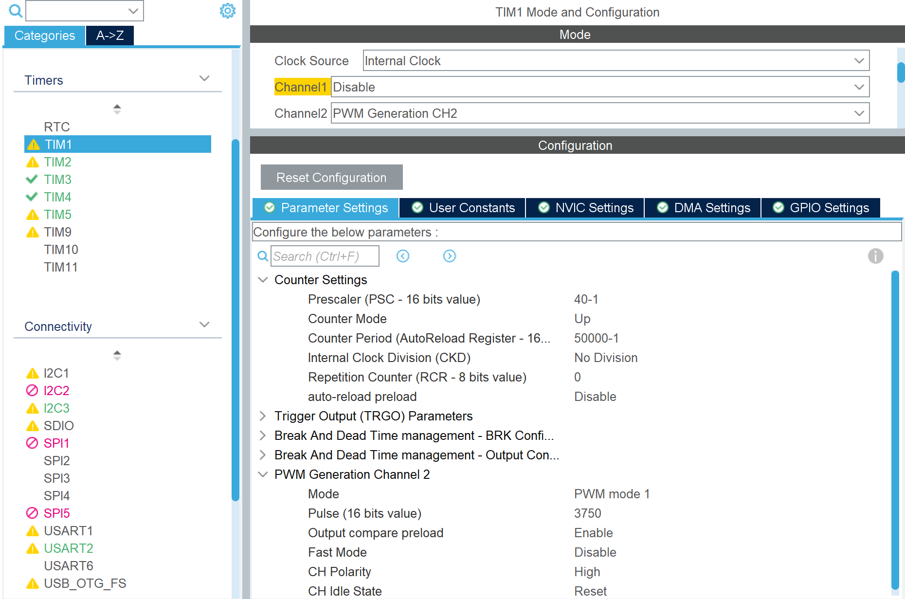

#### 1.4. Calcul de la résolution angulaire

La correspondance angle → impulsion est linéaire entre 0° et 180°. La formule de conversion d'un angle cible en durée d'impulsion est la suivante : 

$$\text{Pulse}_{cible} = \left[\frac{\text{Angle}_{cible}}{180°} \times (\text{Pulse}_{180°} - \text{Pulse}_{0°})\right] + \text{Pulse}_{0°}$$

Or si nous n'utilisons que les données issues de la datasheet et la fréquence du timer configuré, nous avons :

$$\text{Pulse}_{0°} = \frac{\text{T}_{0°}}{\text{T}_{tic}} = \text{T}_{0°} \times f_{timer}$$
$$\text{Pulse}_{180°} = \frac{\text{T}_{180°}}{\text{T}_{tic}} = \text{T}_{180°} \times f_{timer}$$

Ce qui donne comme formule finale : 

$$\text{Pulse}_{cible} = \left[\frac{\text{Angle}_{cible}}{180°} \times (\text{T}_{180°} - \text{T}_{0°}) \times f_{timer}\right] + \text{T}_{0°} \times f_{timer}$$

$$\Leftrightarrow \text{Pulse}_{cible} = \left[ \left[\frac{\text{Angle}_{cible}}{180°} \times (\text{T}_{180°} - \text{T}_{0°})\right] + \text{T}_{0°} \right] \times f_{timer}$$

Où
$$\begin{cases}
\text{T}_{0°} = 0{,}5\, \text{ms},\\
\text{T}_{180°} = 2{,}5\, \text{ms},\\
f_{timer} = 2{,}5\, \text{MHz}
\end{cases}$$

Voici 3 valeurs types :   
| Angle | Impulsion | Pulse (tics) |
| :--- | :--- | :--- |
| 0° | 0,5 ms | $0{,}5\, \text{ms} \times 2,5\, \text{MHz} = \mathbf{1250}$ tics |
| 90° | 1,5 ms | $1{,}5\, \text{ms} \times 2,5\, \text{MHz} = \mathbf{3750}$ tics |
| 180° | 2,5 ms | $2{,}5\, \text{ms} \times 2,5\, \text{MHz} = \mathbf{6250}$ tics |

Si on divise la plage de tics $(6250 - 1250 = 5000\, \text{tics})$ par la plage d'angle de 0° à 180°, on obtient :

$$\frac{5000\, \text{tics}}{180°} \approx 27{,}8\, \text{tics/degré}$$

Ce qui donne une résolution angulaire théorique de $\approx 0{,}036°$ par tic, largement suffisante pour commander une fenêtre !

#### 1.5. Appliquer un angle au servomoteur

Nous avons implémenté la formule que nous avons décrites plus haut dans une fonction pour la conversion d'un angle vers la valeur de Pulse (CCR) à encoder en s'appuyant uniquement sur les macros et l'angle cible :

```c
// main.c
#define FREQ_TIMER_SERVO  2500000   // 2.5 MHz
#define SERVO_0_DEG_MS    0.5       // impulsion à 0°   (ms)
#define SERVO_180_DEG_MS  2.5       // impulsion à 180° (ms)

void angle_servo(int angle)
{
    int pulse_tics =
    (
        (
            (angle / 180.0)
            * (SERVO_180_DEG_MS - SERVO_0_DEG_MS) / 1000.0
        )
        + (SERVO_0_DEG_MS / 1000.0)
    )
    * FREQ_TIMER_SERVO;

    __HAL_TIM_SET_COMPARE(TIMER_SERVO, CANAL_SERVO, pulse_tics);
}
```
> Ici `/ 1000.0` correspond à la conversion de millisecondes en secondes.

Le registre de comparaison CCR correspondant au Pulse, est mis à jour avec la valeur de `pulse_tics` via `__HAL_TIM_SET_COMPARE()`.

### 2. Gestion de la fenêtre

#### 2.1. États de la fenêtre
Le servomoteur de la fenêtre est commandé par une variable globale `fenetre` prenant trois états possibles : `INIT`, `FERMEE` et `OUVERTE`. L'état `INIT` correspond à l'initialisation du système, `FERMEE` à la fenêtre fermée et `OUVERTE` à la fenêtre ouverte. La transition entre ces états est déclenchée par les commandes de l'utilisateur via le bouton de fenêtre, ainsi que par les conditions environnementales (cf. [Scénario 5 – 4. Détection de pluie avec ADC DMA multi-canaux](#4-détection-de-pluie-avec-adc-dma-multi-canaux) et [Scénario 6 – 12. Gestion automatique de la fenêtre par la température](#12-gestion-automatique-de-la-fenêtre-par-la-température)).

#### 2.2. Application de l'etat de la fenêtre

Pour éviter d'envoyer continuellement la même commande PWM au servo à chaque tour de boucle principale, `commande_fenetre()` n'agit que lorsque l'état `fenetre` change :

```c
// USER CODE PD
#define ANGLE_SERVO_OUVERT  120   // ATTENTION maximum 120° sinon ça casse
#define ANGLE_SERVO_FERME   0

//boucle principale while(1)
void commande_fenetre()
{
    static fenetre_t etat_precedent = INIT;
    if (fenetre != etat_precedent) {
        switch(fenetre) {
            case OUVERTE : angle_servo(ANGLE_SERVO_OUVERT); break;
            case FERMEE  : angle_servo(ANGLE_SERVO_FERME);  break;
            case INIT    : break;
        }
        etat_precedent = fenetre;
    }
}
```

La variable `etat_precedent` est déclarée `static` : elle est initialisée une seule fois à `INIT` et conserve sa valeur entre les appels. Au premier passage dans le `main()`, `fenetre = OUVERTE` (valeur par défaut) ≠ `INIT`, donc le servo est immédiatement positionné à 0° à l'initialisation.

> Lors du montage de la maison, nous avons réglé le servomoteur à 0° avant de visser la fenêtre en position fermée. Ensuite, nous avons testé de manière empirique l'angle permettant d'ouvrir au mieux la fenêtre. Nous avons retenu 120° : en deçà, la fenêtre n'est pas complètement ouverte ; au-delà, elle vient buter contre le mur (ce qui faisait surchauffer le servomoteur).

### 3. Bouton fenêtre et anti-rebond

#### 3.1. Implémentation et anti-rebond
Le bouton de fenêtre est physiquement identique à celui du mode HOME/AWAY.
Les seules différences d'implémentation de sa lecture par rapport au bouton de mode sont : 

1. Sa broche de connexion : PA10 (D2) qui lève l'EXTI 10.
2. Le nom du flag levé par l'interruption EXTI : `debouncing_bouton_fenetre`
3. Le nom de la variable globale qui indique si le bouton a été appuyé : `bouton_fenetre_appuye`

Pour un rappel sur la méthode d'implémentation, voir les sections dédiées :  
- [Scénario 2 – 1. Configuration du bouton MODE](#1-configuration-du-bouton-mode)  
- [Scénario 2 – 2. Gestion de l'anti-rebond](#2-gestion-de-lanti-rebond)  

#### 3.2. Comportement et priorités selon le mode (HOME vs AWAY)
La prise en compte de l'appui sur le bouton de la fenêtre dépend directement du mode de la maison et des conditions environnementales :

- **En mode HOME :** L'utilisateur a le contrôle de l'ouverture et de la fermeture de la fenêtre, sauf en cas d'intempérie. Si la pluie est détectée, elle prend une priorité absolue et force la fermeture. Sinon, chaque appui validé bascule l'état de la fenêtre.
- **En mode AWAY :** L'utilisateur n'a pas le contrôle de la fenêtre, celle-ci devant rester impérativement fermée.

```c
// boucle principale while(1) — Machine à états, case HOME
      case  HOME: 
      {
        //Transition
        ... 
        {
          // Actions
          presence_detectee = false;
          alarme_intrusion = false;
          
          // Gestion du bouton de fenêtre
          if (bouton_fenetre_appuye) 
          {
            bouton_fenetre_appuye = false;
            switch(fenetre)
            {
              case OUVERTE: 
              {
                fenetre = FERMEE;
                printf("Je ferme la fenetre\r\n");
                break;
              }
              case FERMEE: 
              {
                fenetre = OUVERTE;
                printf("J'ouvre la fenetre\r\n");
                break;
              }
              case INIT:
                // pris en charge au premier appel de commande_fenetre()
                break;
            }
          }
        }
        break;
      }
      ....
case AWAY:
{
    bouton_fenetre_appuye = false;
    ...
}
```

En mode `AWAY`, le flag `bouton_fenetre_appuye` est immédiatement effacé sans traitement : la fenêtre reste fermée et l'utilisateur ne peut pas l'ouvrir tant que le mode reste `AWAY`, même en appuyant sur le bouton.

### 4. Détection de pluie avec ADC DMA multi-canaux

C'est au moment d'ajouter le capteur de pluie au Scénario 5 que nous avons entièrement revu l'architecture de l'ADC pour passer à une solution multi-canaux avec DMA et interruption de fin de conversion.

#### 4.1. Déclenchement des mesures

Le déclenchement périodique des conversions ADC reste assuré par le Timer 2 via son signal TRGO, exactement comme décrit pour le Scénario 3 : [Scénario 3 – 1. Déclenchement de l'ADC par le Timer 2](#1-déclenchement-de-ladc-par-le-timer-2)

#### 4.2. Configuration ADC en mode Scan multi-canaux

Pour acquérir simultanément deux capteurs (GAZ sur A2, et PLUIE sur A3), nous avons activé le mode Scan de l'ADC1 avec 2 conversions en séquence.

Par rapport à la configuration du Scénario 3, les paramètres suivants ont été modifiés dans CubeMX :


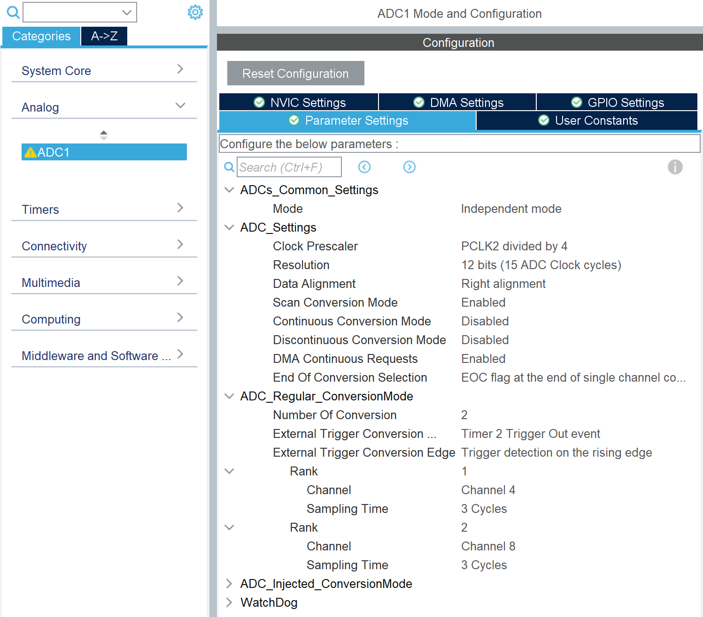

| Paramètre | Scénario 3 | Scénario 5 |
| :--- | :--- | :--- |
| Number of Conversions | 1 | 2 |
| Scan Conversion Mode | Disabled | Enabled |
| Rank 1 | CH4 (GAZ) — 480 cycles | CH4 (GAZ) — 3 cycles |
| Rank 2 | — | CH8 (PLUIE) — 3 cycles |
| DMA Continuous Requests | Disabled | Enabled |

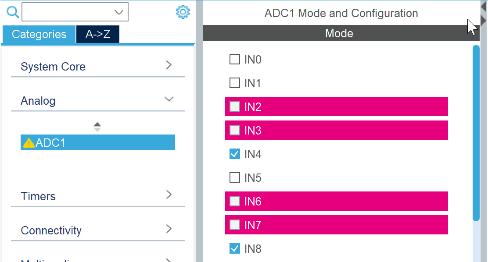

Dans le Scénario 3, nous avions choisi 480 cycles d'échantillonnage, ce qui donnait environ 19,7 µs par canal pour stabiliser la mesure. Mais en cherchant à réduire au maximum la latence entre déclenchement et mesure, nous avons testé avec 3 cycles, et les valeurs obtenues étaient cohérentes et stables.

**Détail du calcul :**

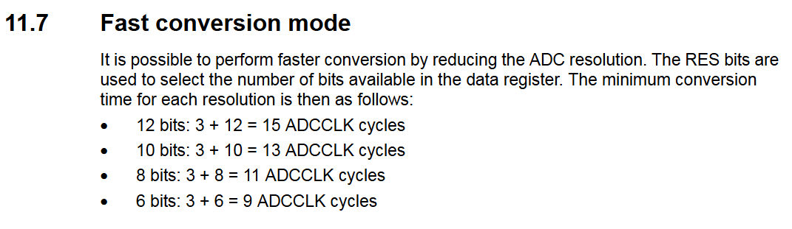

> Horloge $= 100\, \text{MHz}$   
> Prescaler $= 4$   
> Fréquence ADC $= 100\, \text{MHz} / 4 = 25\, \text{MHz}$  
> Période ADC $= 1 / 25\, \text{MHz} = 40\, \text{ns}$  
> Nombre de cycles pour 12 bits $= 12$ 

> Nombre de cycles d'échantillonnage $= 480$    
> Total cycles $= 12 + 480 = 492$  
> Latence $= 492 \times 40\, \text{ns} = 19,68\, \mu \text{s}$   

> Nombre de cycles d'échantillonnage $= 3$    
> Total cycles $= 12 + 3 = 15$  
> Latence $= 15 \times 40\, \text{ns} = 600\, \text{ns}$ 

On reste ainsi bien en dessous de la période de 100 µs du Timer 2 cadencé à 10 kHz, ce qui laisse une large marge pour déclencher les mesures. Nous avons donc conservé l'ADC à 3 cycles d'échantillonnage.  

#### 4.3. Configuration DMA

Pour que les deux résultats de conversion soient stockés automatiquement en mémoire sans intervention du CPU, nous avons activé le DMA en mode circulaire sur le canal ADC1 :

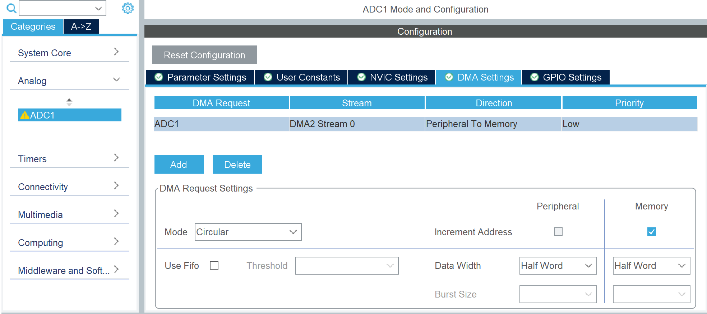

En mode circulaire, le DMA recommence automatiquement depuis le début du buffer dès qu'il a rempli toutes les cases, sans jamais s'arrêter. Ainsi, `adc_valeurs[0]` reçoit toujours la valeur du Rank 1 (GAZ) et `adc_valeurs[1]` celle du Rank 2 (PLUIE).

Le buffer est déclaré `volatile` car il est modifié par le DMA, ce qui oblige le compilateur à le relire en mémoire à chaque accès plutôt que de se fier à une valeur en registre :

```c
// main.c — Variables globales
volatile uint16_t adc_valeurs[NBR_CAPTEURS_ADC];  // NBR_CAPTEURS_ADC = 2
```

Le démarrage du DMA se fait une seule fois au début du `main()`. Ensuite le DMA et le TIM2 TRGO fonctionnent de façon autonome :

```c
// main.c — Initialisation (USER CODE BEGIN 2)
HAL_TIM_Base_Start_IT(TIMER_CAPTEURS);                              // TIM2 → TRGO + IRQ
HAL_ADC_Start_DMA(ADC_CAPTEURS, (uint32_t*)adc_valeurs, NBR_CAPTEURS_ADC);
```

#### 4.4. Interruptions ADC et DMA activées

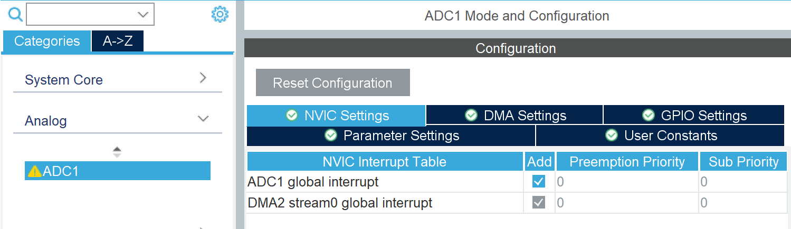

Deux interruptions sont activées dans le NVIC :
- **ADC IRQ** (`ADC_IRQn`) : pour que le callback `HAL_ADC_ConvCpltCallback` soit appelé à la fin de la séquence de conversion.
- **DMA2 Stream0 IRQ** (`DMA2_Stream0_IRQn`) par défaut.

```c
// main.c — Callback de fin de conversion ADC (USER CODE BEGIN 4)
void HAL_ADC_ConvCpltCallback(ADC_HandleTypeDef* hadc)
{
    if (hadc == ADC_CAPTEURS)
    {
        fin_mesure_ADC_flag = true;
    }
}
```

Ce callback est déclenché par le DMA lorsqu'il a fini sa séquence de mesures. C'est à ce moment précis, et pas avant, qu'on lit le buffer fraîchement rempli par le DMA :

#### 4.5. Lecture et évaluation des capteurs

Dans la boucle principale, dès que `fin_mesure_ADC_flag` est levé, les deux fonctions d'évaluation sont appelées :

```c
// main.c — Boucle principale
if (fin_mesure_ADC_flag) {
    fin_mesure_ADC_flag = false;
    evaluer_pluie();
    evaluer_gaz();
}
```

Chaque fonction lit la case correspondante du buffer DMA :

```c
void evaluer_gaz() {
    gaz_valeur = adc_valeurs[GAZ_ADC_RANK];    // GAZ_ADC_RANK = 0 → Rank 1
    alarme_gaz = (gaz_valeur >= SEUIL_GAZ);    // SEUIL_GAZ = 2500
    printf("GAZ   = %d\r\n", gaz_valeur);
}

void evaluer_pluie() {
    pluie_valeur = adc_valeurs[PLUIE_ADC_RANK]; // PLUIE_ADC_RANK = 1 → Rank 2
    pluie_detectee = (pluie_valeur >= SEUIL_PLUIE); // SEUIL_PLUIE = 4000
    printf("PLUIE = %d\r\n", pluie_valeur);
}
```

#### 4.6. Tests du capteur de pluie et seuil

Le capteur de pluie génère une tension proportionnelle à la quantité d'humidité à sa surface.  
L'ADC1, avec sa résolution de 12 bits, produit une valeur comprise entre 0 et $2^{12}-1 = 4095$. Pour la plage de tension de référence de l'ADC, c'est la même histoire que pour le capteur de gaz : [Scénario 3 – 3.1. Tension d'alimentation et de mesure de l'ADC](#31-tension-dalimentation-et-de-mesure-de-ladc).  

Nous avons mesuré que la valeur ADC reste sous 1000 quand le capteur est sec et monte directement à son maximum 4095 en présence ne serait-ce que d'un doigt. Nous avons donc retenu `SEUIL_PLUIE = 4000` pour éviter les faux positifs.

### 5. Logique de décision de la fenêtre
On ajoute à notre logique précédente la prise en compte de la pluie pour la commande de la fenêtre (cf. [Scénario 5 – 2. Gestion de la fenêtre](#2-gestion-de-la-fenêtre)).  
La commande de la fenêtre suit l'ordre de priorité suivant :

- Mode `AWAY` : la fenêtre doit être fermée et les appuis sur le bouton fenêtre sont ignorés.
- `Pluie détectée` : la fermeture est forcée, quel que soit l'état précédent de la fenêtre.
- Commande manuelle : en mode `HOME` et sans pluie, un appui sur le bouton fenêtre inverse l'état (`OUVERTE` ou `FERMEE`).

De la même manière que l'on bloque la fenêtre en mode `AWAY`, lorsque la pluie est détectée, la valeur de `bouton_fenetre_appuye` est directement effacée.

```c
//boucle principale while(1)
case  HOME: 
    {
      ...
      // Si vérification de la température ou d'autres conditions
      else if (pluie_detectee)
      {
        fenetre = FERMEE;
    	  bouton_fenetre_appuye = false;
      } 
    }
```
La fenêtre étant automatiquement fermée en mode AWAY ainsi que lors de l'entrée dans la maison, la gestion de la détection de pluie hors du mode HOME est triviale : la fenêtre reste impérativement fermée.

---

## Scénario 6 – Mesure de température (TMP102)


### 1. Branchement et configuration CubeMX

Pour configurer et brancher le capteur, nous avons d'abord considéré les éléments suivants :

*Extrait de la datasheet du TMP102 :*  


#### 1.1. Alimentation (VCC/GND)
Nous avons alimenté le capteur avec la broche 3.3V de la carte Nucleo.

| Signal | Broche |
| :--- | :--- |
| VCC | 3.3V |
| GND | GND |

#### 1.2. Bus I²C (SDA/SCL)
Pour tous les composants I²C (à savoir le TMP102 et l'écran LCD), nous avons utilisé le bus I2C3 selon le câblage suivant : 

| Signal | Broche | Arduino |
| :--- | :--- | :--- |
| SDA | PB4 | A4 |
| SCL | PA8 | A5 |

Nous n'avons pas touché à la configuration par défaut après avoir assigné les 2 broches :  


Les interruptions et le DMA sont désactivés.

#### 1.3. Adresse I²C (ADD0)
L'adresse I²C du TMP102 est par défaut 0x48.
Cependant il est possible de la choisir en fonction du branchement de la broche ADDR0 :

*Extrait de la datasheet du capteur TMP102 :*  


Pour lever toute ambiguïté, nous avons simplement relié la broche ADDR0 à la masse, ce qui correspond à l'adresse 0x48 (1001000).

#### 1.4. Broche (ALT)
Comme expliqué ci-dessous, nous n'avons pas eu besoin d'utiliser les alertes du capteur, nous avons donc laissé la broche ALERT non connectée.

### 2. Analyse de la datasheet

#### 2.1. Registres accessibles
En lisant la datasheet sur les modes et les registres accessibles depuis I²C, nous avons remarqué qu'il y avait 4 registres de 16 bits accessibles en I²C par une adresse sur 2 bits interprétée par le pointer register : 


#### 2.2. Registre de température
Le registre de température contient simplement une valeur sur 12 ou 13 bits en fonction du mode de résolution.
La valeur est alignée à gauche et suivie d'un padding de 3 ou 4 '0'.
La conversion se fait selon une série d'étapes détaillées ici :

*Extrait de la datasheet du capteur TMP102 :*      


#### 2.3. Registre de configuration
Le registre de configuration (adresse 0x01) permet de régler plusieurs paramètres du capteur :

* La résolution de la mesure (12 bits ou 13 bits en « Extended mode »)
* Le mode de mesure : Shutdown avec One-Shot ou Continuous
* La fréquence d'actualisation du registre de température en mode « Continuous » (1, 2, 4 ou 8 Hz)
* Le fonctionnement des alertes de dépassement de seuils haut/bas (polarité, interruption, stabilisation, etc.)

Nous avons choisi d'écrire une bibliothèque complète permettant d'exploiter l'ensemble des fonctionnalités du capteur.  
Cependant, nous n'avons utilisé ni la résolution sur 13 bits (inutile pour mesurer des températures ambiantes inférieures à 128 °C), ni les alertes, car le cahier des charges demandait explicitement un échantillonnage périodique toutes les 2 à 5 secondes.  

#### 2.4. Registres T_LOW et T_HIGH

Nous n'avons pas utilisé ces deux registres, qui permettent de fixer des seuils haut et bas pour le déclenchement de l'alerte matérielle selon le même encodage que le registre de température.
Nous avons néanmoins implémenté leur gestion dans la bibliothèque par souci d'exhaustivité.

### 3. Communication I²C avec le capteur

#### 3.1. Protocole I²C du TMP102

Le TMP102 est un périphérique I²C standard. Chaque transaction commence par l'envoi de l'adresse 7 bits du capteur (décalée d'un bit pour le bit R/W), puis d'un octet appelé **Pointer Register** qui désigne le registre cible (température, configuration, T_LOW ou T_HIGH). En lecture, le maître enchaîne immédiatement avec la lecture des octets du registre pointé. En écriture, les octets de données suivent le pointer byte dans la même transaction.

Le capteur échange toujours des données sur 16 bits (2 octets) pour tous ses registres, que ce soit en lecture ou en écriture.

#### 3.2. Fonctions HAL utilisées

Nous n'utilisons que deux fonctions de la HAL pour toutes les communications I²C avec le capteur :

```cpp
HAL_I2C_Mem_Write(hi2c, address, reg, I2C_MEMADD_SIZE_8BIT, data, size, timeout);
HAL_I2C_Mem_Read (hi2c, address, reg, I2C_MEMADD_SIZE_8BIT, data, size, timeout);
```

Ces fonctions gèrent automatiquement toute la séquence I²C (START, adresse, pointer register, données, STOP), ce qui simplifie beaucoup le code.  
Le paramètre `I2C_MEMADD_SIZE_8BIT` indique que l'adresse du registre (le pointer register) est codée sur 1 octet, conformément à la datasheet et au fait qu'en I²C, l'unité d'envoi est l'octet.

Pour éviter tout hardcoding, l'adresse I²C et le pointeur vers le bus sont stockés dans la structure `TMP102_t`, ce qui permet théoriquement de brancher plusieurs capteurs sur le même bus avec des adresses différentes sans changer une ligne de bibliothèque.

#### 3.3. Alternatives HAL non utilisées

Si nous avions voulu réinventer la roue sans utiliser `HAL_I2C_Mem_*`, nous avions deux options en utilisant les fonctions de base de la HAL :

* **1. Fonctions bloquantes directes (`HAL_I2C_Master_Transmit / Receive`)** :
  * En écriture, il aurait fallu concaténer manuellement l'adresse du registre et les données dans un buffer temporaire de 3 octets à transmettre.
  * En lecture, `Transmit` termine obligatoirement par un `STOP`, découpant la transaction de lecture en 2 octets au lieu d'enchaîner avec un **Repeated Start** (`Sr`) comme recommandé par la datasheet.

* **2. Fonctions séquentielles asynchrones (`HAL_I2C_Master_Seq_*_IT` ou DMA)** :
  * Elles permettent de gérer le Repeated Start (via les drapeaux `I2C_FIRST_FRAME` et `I2C_LAST_FRAME`).
  * En revanche, elles imposent d'activer les interruptions I²C dans le NVIC, de créer une machine à états et d'enchaîner deux callbacks (`MasterTxCpltCallback` puis `MasterRxCpltCallback`), ou d'utiliser le DMA, pour seulement 2 octets toutes les 2 secondes.

Finalement, `HAL_I2C_Mem_Read/Write` était donc le choix le plus simple à coder, rapide à exécuter et fiable.

### 4. Structure de la bibliothèque

#### 4.1. Vue d'ensemble

La bibliothèque est organisée autour de deux fichiers : `tmp102.h` pour les définitions et l'API publique, et `tmp102.c` pour l'implémentation. Les fonctions internes (accès registres, encodage/décodage) sont déclarées `static` pour ne pas polluer l'espace de noms global et clarifier le header : seules les 5 fonctions utilisables hors de la bibliothèque sont exposées dans le header.


#### 4.2. Les structures `TMP102_Config_t` et `TMP102_t`

Plutôt que de manipuler directement des octets bruts pour configurer le capteur, nous avons défini une structure `TMP102_Config_t` qui contient un champ dédié pour chaque réglage du registre de configuration :

```c
typedef struct 
{
   uint8_t Mode;           // Shutdown ou Continuous
    uint8_t ConversionRate; // 0.25 / 1 / 4 / 8 Hz
    uint8_t ExtendedMode;   // 12 ou 13 bits
    uint8_t ThermostatMode; // Comparateur ou Interruption
    uint8_t AlertPolarity;  // Actif bas ou haut
    uint8_t FaultQueue;     // 1 / 2 / 4 / 6 fautes
    uint8_t OneShot;        // Déclenchement One-Shot
    uint8_t Resolution;     // Lecture seule (toujours 0x03)
    uint8_t Alert;          // Lecture seule
    uint8_t Padding;        // Bits inutilisés (toujours 0x00)
} TMP102_Config_t;
```

Cette structure est elle-même embarquée dans `TMP102_t` qui regroupe tout ce dont on a besoin pour piloter une instance du capteur :

```c
typedef struct 
{
   bool                is_measuring_one_shot; // Flag interne de suivi
    I2C_HandleTypeDef  *busI2C;               // Pointeur vers le bus HAL
    uint8_t             address;              // Adresse I²C décalée (<<1)
    TMP102_Config_t     config;               // Tous les réglages
    float               T_High;               // Seuil haut d'alerte (°C)
    float               T_Low;                // Seuil bas d'alerte (°C)
} TMP102_t;
```

Cette approche présente plusieurs avantages : on peut instancier plusieurs capteurs indépendamment, la configuration est lisible directement dans le code sans avoir à décoder des masques de bits, et les réglages sont conservés en mémoire entre deux écritures de registre.

*NB : Pour simplifier les explications, on appellera "Objet TMP102" une instance de la structure TMP102.*
   
#### 4.3. Define

Pour ne jamais rien harcoder, nous avons utilisé des `#define` pour chaque valeur constante issue de la datasheet, pour les mêmes raisons que mentionnées précédemment :

*Extraits de `Bibliotheques/TMP102/Inc/tmp102.h`:*  

```c
// TAILLES et TIMEOUTS 
#define TMP102_NBR_CONFIG_REG_BYTES 2
#define TMP102_NBR_REG_TEMP_BYTES   2
#define TMP102_I2C_TIMEOUT          100

// ADRESSES I2C
#define TMP102_I2C_ADDR_GND         (0x48 << 1)
...

// REGISTRES INTERNES
#define TMP102_REG_TEMP             0x00
#define TMP102_REG_CONFIG           0x01
...

// VALEURS DES REGLAGES
#define TMP102_MODE_CONTINUOUS      0x00
#define TMP102_MODE_SHUTDOWN        0x01
...

// ONE SHOT
#define TMP102_OS_DEFAULT           0x00  
#define TMP102_OS_START_MEASURE     0x01
#define TMP102_OS_MEASURING         0x00
...

// INTERPRETATION REGISTRE TEMPERATURE
#define TMP102_TEMP_RESOLUTION      0.0625f
#define TMP102_NORM_BIT_LEN         12
#define TMP102_EXT_BIT_LEN          13
```

#### 4.4. Organisation des champs du registre de configuration

Le registre de configuration du TMP102 est un registre de 16 bits dont les champs ne sont pas alignés sur des octets entiers. Pour éviter de dupliquer la logique de masquage (une fois pour l'écriture, une fois pour la lecture), et pour définir de manière claire et unique les champs du registre, nous avons conçu un système de mapping générique.

La structure `TMP102_FieldMap_t` décrit la position, la taille et l'emplacement d'un champ du registre de configuration du TMP102 :

```c
typedef struct 
{
    uint8_t byte_idx;   // Octet 0 ou 1 du registre 16 bits
    uint8_t position;   // Position du LSB du champ dans l'octet
    uint8_t length;     // Nombre de bits du champ
    uint8_t *value_ptr; // Pointeur vers son champ dans TMP102_Config_t
} TMP102_FieldMap_t;
```

La fonction statique `TMP102_SyncConfigBuffer()`, via un tableau de `TMP102_FieldMap_t`, encode ou décode l'ensemble des champs.
Lorsque l'on veut mettre à jour l'objet TMP102 de la bibliothèque à partir du contenu du registre de configuration du capteur (```is_write = false```) ou, à l'inverse, préparer le buffer d'écriture à partir de l'objet TMP102 (```is_write = true```), il suffit de fournir en paramètre l'instance du capteur, le buffer et le booléen `is_write` :

```c
static void TMP102_SyncConfigBuffer(TMP102_t *tmp102, uint8_t *buffer, bool is_write) 
{
    TMP102_FieldMap_t fields[] = {
    //   Byte | Position | Length | Champ

        {   0 ,        7 ,      1 , &tmp102->config.OneShot        },
        {   0 ,        5 ,      2 , &tmp102->config.Resolution     },
        {   0 ,        3 ,      2 , &tmp102->config.FaultQueue     },
        {   0 ,        2 ,      1 , &tmp102->config.AlertPolarity  },
        {   0 ,        1 ,      1 , &tmp102->config.ThermostatMode },
        {   0 ,        0 ,      1 , &tmp102->config.Mode           },

        {   1 ,        6 ,      2 , &tmp102->config.ConversionRate },
        {   1 ,        5 ,      1 , &tmp102->config.Alert          },
        {   1 ,        4 ,      1 , &tmp102->config.ExtendedMode   },
        {   1 ,        0 ,      4 , &tmp102->config.Padding        }
    };

   // Encodage (Structure -> Buffer) ou decodage (Buffer -> Structure)
   ...
}
``` 

Les positions et tailles des champs sont issues de la table des registres de la datasheet :

*Extrait de la datasheet du TMP102 :*
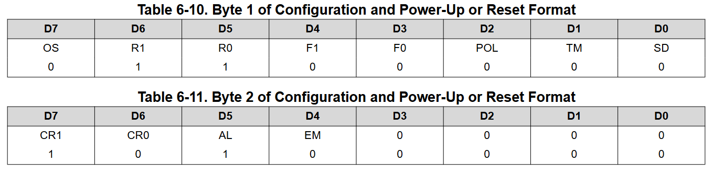</img>

#### 4.5. Synchronisation entre le registre de configuration et l'objet TMP102

Une fois le tableau de descripteurs défini, une boucle `for` parcourt l'ensemble des champs pour effectuer l'encodage ou le décodage bit à bit selon la valeur du flag `is_write` :

```c
uint8_t num_fields = sizeof(fields) / sizeof(fields[0]);
for (uint8_t i = 0; i < num_fields; i++) 
{
    uint8_t mask = (1U << fields[i].length) - 1;
    
    if (is_write) 
    {
        // Encode : Structure -> Buffer
        buffer[fields[i].byte_idx] 
        |=   (*fields[i].value_ptr & mask) 
            << fields[i].position;
    } 
    else 
    {
        // Décode : Buffer -> Structure
               *fields[i].value_ptr = 
        (buffer[fields[i].byte_idx] 
             >> fields[i].position) 
        & mask;
    }
}
```
Le traitement repose sur trois étapes :
1. **Calcul dynamique du masque de bits**
```c
uint8_t mask = (1U << fields[i].length) - 1;
```
On génère un masque adapté à la largeur de chaque champ.
> Exemple pour un champ sur 2 bits :  
> `(1 << 2) = 0100` → `0100 - 1 = 0011`  
> On obtient bien un masque de 2 bits : `0011`

*NB : 1U force l'entier 1 à être interprété comme un entier non signé, évitant un avertissement du compilateur lors du décalage à gauche du bit de signe.* 

2. **Encodage : Structure $\rightarrow$ Buffer (`is_write == true`)**
```c
   buffer[fields[i].byte_idx] 
   |=   (*fields[i].value_ptr & mask) 
       << fields[i].position;
```
* On masque la valeur pointée dans l'objet TMP102 (`*fields[i].value_ptr & mask`) pour éliminer tout bit parasite dépassant de la taille du champ.
* On décale les bits vers la gauche du nombre de sa `position` pour les positionner au bon endroit dans l'octet du buffer (`<< fields[i].position`)
* On utilise un OU binaire (`|=`) pour fusionner ce champ avec les bits des autres champs partageant le même octet dans le buffer. S'il y a un `0` à un certain index dans la valeur masquée et décalée, le bit correspondant dans le buffer restera inchangé.

*NB : le buffer doit être initialisé à 0 avant l'appel de la fonction, car chaque champ est fusionné avec les bits des autres champs partageant le même octet dans le buffer.*

> Exemple avec 2 champs :  
> * buffer = `0000 0000`
> * Champ 1 : position = 0, length = 3, value = `110`
> * Champ 2 : position = 3, length = 5, value = `10101`
> 
> Opération sur le premier champ :  
> `mask = 0000 0111`  
> `(value & mask) = 0000 0110`  
> `0000 0110 << position = 0000 0110`  
> `buffer = 0000 0000`  
> `buffer |= 0000 0110`  
> → `buffer = 0000 0110`   
>   
> Opération sur le second champ :  
> `mask = 0001 1111`  
> `(value & mask) = 0001 0101`  
> `0001 0101 << position = 1010 1000`  
> `buffer = 0000 0110`   
> `buffer |= 1010 1000`   
> → `buffer = 1010 1110`    

3. **Décodage : Buffer $\rightarrow$ Structure (`is_write == false`)**
```c
       *fields[i].value_ptr =
(buffer[fields[i].byte_idx] 
     >> fields[i].position) 
& mask;
```
* On lit l'octet correspondant dans le buffer brut reçu par I²C (`buffer[fields[i].byte_idx]`).
* On décale les bits vers la droite du nombre de sa `position` (`>> fields[i].position`) pour ramener les bits du champ tout à droite (alignés sur le bit 0).
* On applique le masque avec un ET binaire (`& mask`) pour mettre à `0` tous les bits devant la valeur ciblée.
* On affecte le résultat obtenu directement dans la variable de la structure `config` de l'objet TMP102 via son pointeur `*fields[i].value_ptr`.

> Exemple en reprenant le buffer obtenu à l'étape 2 :
> * buffer = `1010 1110`
> * Champ 1 : position = 0, length = 3, value = `110`
> * Champ 2 : position = 3, length = 5, value = `10101`
> 
> Opération sur le premier champ :  
> `mask = 0000 0111`   
> `buffer = 1010 1110`  
> `1010 1110 >> position = 1010 1110`    
> `1010 1110 & mask = 0000 0110`   
> → `*value_ptr = 110` (valeur d'origine)  
>   
> Opération sur le second champ :  
> `mask = 0001 1111`  
> `buffer = 1010 1110`  
> `1010 1110 >> position = 0001 0101`    
> `0001 0101 & mask = 0001 0101`   
> → `*value_ptr = 10101` (valeur d'origine)  


### 5. Mise à jour des registres du capteur

La fonction publique `TMP102_apply_registers()` envoie la configuration stockée dans l'objet TMP102 vers le capteur via I²C. Elle commence par le registre de configuration en appelant `TMP102_write_config_reg()`, puis écrit les registres de seuil de température T_LOW et T_HIGH avec la fonction `TMP102_write_T_LOW_T_HIGH_reg()`.  

```c
bool TMP102_apply_registers(TMP102_t *tmp102) 
{
   if (!TMP102_write_config_reg(tmp102))       return false;
    if (!TMP102_write_T_LOW_T_HIGH_reg(tmp102)) return false;
    return true;
}
```
Le retour `bool` permet de détecter un problème de communication I²C.

#### 5.1. Application du registre de configuration

La fonction `TMP102_write_config_reg()` met à jour le registre de configuration du TMP102 en appelant `TMP102_SyncConfigBuffer()` pour encoder la structure en buffer et en utilisant les fonctions HAL pour la lecture/écriture de registres en I²C :

1. **Initialisation des variables**
```c
uint8_t write_buffer[TMP102_NBR_CONFIG_REG_BYTES];
```

2. **Encodage de la structure en buffer**

```c
   TMP102_SyncConfigBuffer(tmp102, write_buffer, WRITE);
```
La fonction `TMP102_SyncConfigBuffer()` est détaillée ci-dessus en [Scénario 6 – 4.5. Synchronisation entre le registre de configuration et l'objet TMP102](#45-synchronisation-entre-le-registre-de-configuration-et-lobjet-tmp102).

3. **Envoi du buffer vers le registre de configuration du capteur**

```c
if (HAL_I2C_Mem_Write(tmp102->busI2C, tmp102->address,
                        TMP102_REG_CONFIG,
                        I2C_MEMADD_SIZE_8BIT,
                        write_buffer,
                        TMP102_NBR_CONFIG_REG_BYTES,
                        TMP102_I2C_TIMEOUT) 
   != HAL_OK) 
{
   return false;
}    
return true;
```
On spécifie à la fonction HAL : 
- le bus I²C
- l'adresse I²C du capteur
- l'adresse interne du registre
- la taille du registre en octets
- le buffer contenant la valeur à écrire
- la taille du buffer en octets
- le timeout de la transaction

#### 5.2. Application des registres de seuil de température

```cpp
bool TMP102_write_T_LOW_T_HIGH_reg(TMP102_t *tmp102);
```
La fonction met à jour les registres de seuil de température T_LOW et T_HIGH du TMP102 en appelant `TMP102_celsius_to_register()` pour convertir les températures en valeurs de registre et en utilisant les fonctions HAL pour l'écriture de registres en I²C :

1. **Déclaration des buffers**
```c
uint8_t t_low_reg_bytes[TMP102_NBR_REG_TEMP_BYTES];
uint8_t t_high_reg_bytes[TMP102_NBR_REG_TEMP_BYTES];
```

2. **Conversion des températures en valeurs de registre**

```cpp
TMP102_celsius_to_register(tmp102->T_Low, t_low_reg_bytes, tmp102->config.ExtendedMode);
TMP102_celsius_to_register(tmp102->T_High, t_high_reg_bytes, tmp102->config.ExtendedMode);
```
La fonction `TMP102_celsius_to_register()` est expliquée ci-après en [Scénario 6 – 8.2. Température en °C → Registre brut](#82-température-en-c--registre-brut).

3. **Envoi des buffers vers le capteur en I²C**

```c
// Registre T_LOW
bool i2c_ok = (HAL_I2C_Mem_Write(tmp102->busI2C, tmp102->address,
                           TMP102_REG_TLOW,
                           I2C_MEMADD_SIZE_8BIT,
                           t_low_reg_bytes,
                           TMP102_NBR_REG_TEMP_BYTES,
                           TMP102_I2C_TIMEOUT)
                   == HAL_OK);
if (!i2c_ok) return false;
// Registre T_HIGH
i2c_ok = (HAL_I2C_Mem_Write(tmp102->busI2C, tmp102->address,
                           TMP102_REG_THIGH,
                           I2C_MEMADD_SIZE_8BIT,
                           t_high_reg_bytes,
                           TMP102_NBR_REG_TEMP_BYTES,
                           TMP102_I2C_TIMEOUT)
                   == HAL_OK);
if (!i2c_ok) return false;
return true;
```
Pour chaque registre, on spécifie à la fonction HAL : 
- le bus I²C
- l'adresse I²C du capteur
- l'adresse interne du registre
- la taille du registre en octets
- le buffer contenant la valeur à écrire
- la taille du buffer en octets
- le timeout de la transaction

### 6. Initialisation

#### 6.1. Instanciation

Pour manipuler le capteur avec la bibliothèque, il suffit d'instancier une variable de type `TMP102_t`. Cet objet regroupe l'ensemble du contexte matériel et logiciel du capteur (bus I²C, adresse, configuration des registres, seuils d'alerte et état des mesures).

#### 6.2. Valeurs par défaut

Avant de configurer quoi que ce soit, on initialise la structure avec des valeurs sûres via `TMP102_init_default()`.  
Sans cela, les champs de la structure contiendraient des valeurs indéterminées en mémoire.  
La fonction fixe également les champs en lecture seule à leur valeur par défaut :    

```c
void TMP102_init_default(TMP102_t *tmp102) 
{
    tmp102->busI2C                = NULL;
    tmp102->address               = TMP102_I2C_ADDR_GND;
    tmp102->T_Low                 = 0.0f;
    tmp102->T_High                = 100.0f;
    tmp102->is_measuring_one_shot = false;
    
   // Registre de configuration

    tmp102->config.Mode           = TMP102_MODE_CONTINUOUS;
    tmp102->config.ConversionRate = TMP102_RATE_8HZ;
    tmp102->config.ExtendedMode   = TMP102_EXTENDED_OFF;
    tmp102->config.ThermostatMode = TMP102_TM_INTERRUPT;
    tmp102->config.AlertPolarity  = TMP102_POL_ACTIVE_HIGH;
    tmp102->config.FaultQueue     = TMP102_FAULT_1;
    // Dont des champs en lecture seule
    tmp102->config.OneShot        = TMP102_OS_DEFAULT;   
    tmp102->config.Resolution     = TMP102_R_DEFAULT;    
    tmp102->config.Alert          = TMP102_AL_DEFAULT;   
    tmp102->config.Padding        = TMP102_PADD_DEFAULT;
}
```
Ensuite il faut appeler `TMP102_apply_registers()` pour appliquer la configuration au capteur.

#### 6.3. Personnalisation
Une fois cette initialisation faite, pour modifier la configuration, il suffit de réécrire les champs que l'on veut modifier un par un, puis d'appliquer la configuration au capteur avec la fonction `TMP102_apply_registers()` détaillée ci-dessous.

#### 6.4. Exemple dans notre code

→ [Déclaration et initialisation](#101-déclaration-et-initialisation).

### 7. Lecture du registre de température

#### 7.1. Fonction de lecture
La lecture de la température se fait avec la fonction suivante qui lit le registre de température du TMP102 en I²C :

```c
static bool TMP102_read_temperature_register(TMP102_t *tmp102, float *Temperature) 
``` 
1. **Initialisation des variables :**  
```c
    uint8_t buffer_temp_reg[TMP102_NBR_REG_TEMP_BYTES] = {0};
```
Le buffer est un tableau de 2 octets correspondant au registre de température du TMP102.

2. **Lecture de registre en I²C**  
```c
    bool i2c_ok = (HAL_I2C_Mem_Read(tmp102->busI2C, 
                                    tmp102->address, 
                                    TMP102_REG_TEMP, 
                                    I2C_MEMADD_SIZE_8BIT, 
                                    buffer_temp_reg, 
                                    TMP102_NBR_REG_TEMP_BYTES, 
                                    TMP102_I2C_TIMEOUT)
                   == HAL_OK);
```
Pour la fonction HAL on spécifie : 
- le bus I2C
- l'adresse I²C du capteur
- l'adresse interne du registre
- la taille du registre en octets
- le buffer de stockage des données lues
- la taille du buffer en octets
- le timeout de la transaction

3. **Si la communication I²C a échoué**
```c
if (!i2c_ok) 
{
   *Temperature = -999.0f;
   return false;
}
```
En cas de problème de communication, la température est mise à -999.0f pour rendre l'erreur plus visible encore, et la fonction retourne `false`.

4. **Conversion du registre de température en température en °C :**  
```cpp
TMP102_register_to_celsius(buffer_temp_reg, Temperature);
```

#### 7.2. Appel externe

Cette fonction est statique car elle n'est pas destinée à être appelée directement depuis l'extérieur de la bibliothèque, mais par la fonction externe `TMP102_get_temperature()`. Cela permet de découpler l'appel applicatif de la lecture matérielle.  
Pour lire la température (par exemple en mode Continuous) depuis le `main.c`, on appelle :  
```c
bool TMP102_get_temperature(TMP102_t *tmp102, float *Temperature) 
{
    return TMP102_read_temperature_register(tmp102, Temperature);
}
```

### 8. Conversion et affichage de la température

#### 8.1. Registre brut → température en °C

Voici les explications de notre fonction de conversion du registre de température en valeur en °C :
```c
static void TMP102_register_to_celsius(uint8_t *reg_value, float *temperature);
```

Le registre de température est un entier signé en complément à 2, aligné à gauche sur 16 bits. Les bits de poids faible sont des zéros de padding (3 en mode normal, 4 si extended). La conversion se fait en plusieurs étapes :

*Extrait de la datasheet du TMP102 :*


1. **On détecte le mode étendu**
```c
    bool extended_mode = (reg_value[1] & 0x01) != 0;
    uint8_t temp_length = extended_mode ? TMP102_EXT_BIT_LEN : TMP102_NORM_BIT_LEN;
```
Cette ligne détecte si le mode étendu est activé en lisant le bit **D0** de l'octet 2 (index 1). Si le bit 0 est à 1, le mode étendu est activé et la longueur du registre est de 13 bits. Sinon, le mode normal est activé et la longueur du registre est de 12 bits.

2. **On concatène les 2 octets**
```c
uint16_t raw_reg = (uint16_t)((reg_value[0] << 8) | reg_value[1]);
```
Cette ligne concatène les deux octets du registre de température pour former un entier non signé de 16 bits. On décale le premier octet de 8 bits vers la gauche pour le placer dans la partie haute du registre, puis on effectue un OU binaire avec le second octet qui reste donc dans la partie basse.   

3. **On décale à droite avec extension du signe**
```c
int16_t reg_val = (int16_t)raw_reg >> (16 - temp_length);
```
Cette ligne décale le registre de température du nombre de bits de padding (**16 - temp_length**). Le cast en `int16_t` avant le décalage est essentiel car si l'entier est signé, le MSB de signe est propagé lors du décalage, ce qui permet de gérer les températures négatives.

4. **On multiplie par la résolution**
```c
*temperature = (float)reg_val * TMP102_TEMP_RESOLUTION;
```
Cette ligne multiplie la valeur entière du registre par la résolution du capteur pour obtenir la température en degrés Celsius. La résolution est de **0.0625 °C par LSB**, c'est-à-dire qu'un "delta" de 1 bit dans le registre de température correspond à un "delta" de **0.0625 °C** dans la température.

#### 8.2. Température en °C → Registre brut

Pour écrire les seuils T_LOW et T_HIGH, nous avons également créé la fonction inverse
```c
static void TMP102_celsius_to_register(uint8_t *reg_value, float *temperature, bool extended_mode);
```

Cette fois, le mode étendu n'est plus défini dans le registre de température mais en paramètre de la fonction.
```c
uint8_t temp_length = (extended_mode) 
                       ? TMP102_EXT_BIT_LEN 
                       : TMP102_NORM_BIT_LEN;
```

Puis on effectue les mêmes étapes mais en sens inverse :  
1. **On divise la température par la résolution**
```c
float reg_value_float = temperature / TMP102_TEMP_RESOLUTION;
```
2. **On arrondit au nombre entier le plus proche**
```c
int16_t reg_val = (int16_t)(reg_value_float >= 0.0f 
                            ? (reg_value_float + 0.5f)
                            : (reg_value_float - 0.5f));
```
3. **On décale à gauche du nombre de bits de padding**
```c
uint16_t raw_reg = (uint16_t)reg_val << (16 - temp_length);
```
4. **On sépare les 2 octets dans le buffer**
```c
reg_value[0] = (uint8_t)(raw_reg >> 8);
reg_value[1] = (uint8_t)(raw_reg & 0xFF);
```

#### 8.3. Affichage de la température de type float

L'affichage de la température sur le LCD et dans les logs UART nécessite de formater un `float` en chaîne de caractères. Par défaut, la prise en charge des flottants dans `printf` ne fonctionnait pas dans STM32CubeIDE, nous avons donc écrit une fonction dédiée de conversion de `float` en chaîne de caractères avec choix de la précision :

```c
char* TMP102_temperature_to_string(float temperature, uint8_t precision);
```
Voici les étapes de la conversion de `float` en `String` :

1. **On définit un buffer pour stocker la chaîne de caractères**

```c
    static char buffer[16];
```

2. **On précalcule les puissances de 10**

```c
    static const int multi_table[] = {1, 10, 100, 1000, 10000};
```

Le tableau `multi_table` sert à multiplier la partie décimale de la température par la puissance de 10 correspondant à la précision souhaitée.

NB : On aurait pu utiliser la fonction `pow`, mais il aurait fallu utiliser une bibliothèque mathématique, ce qui aurait augmenté la taille du code pour une seule utilisation ridicule dans tout le TP.

3. **On bride la précision à 4**

```c
    if(precision > 4) precision = 4;
```

Une précision de 4 décimales est largement suffisante : la résolution du capteur étant de 0,0625 °C (soit 4 chiffres après la virgule) et sa précision absolue de ±2 °C.


4. **On détecte le signe et on prend la valeur absolue :**

```c
    bool negatif   = (temperature < 0.0f);
    float temp_abs = negatif ? -temperature : temperature;
```
5. **On sépare la partie entière et la partie décimale :**

```c
    int partie_entiere  = (int)temp_abs;
    int partie_decimale = (int)((temp_abs - partie_entiere) * multi_table[precision] + 0.5f);
```
6. **On propage la retenue si l'arrondi déborde (ex: 18,997 arrondi à 19,00)**

```c
    if (partie_decimale >= multi_table[precision]) {
        partie_entiere++;
        partie_decimale = 0;
    }
```
7. **On formate la chaîne de caractères en utilisant `snprintf`**
```c
    snprintf(buffer, sizeof(buffer), "%s%d,%0*d",
             negatif ? "-" : "", partie_entiere, precision, partie_decimale);
    return buffer;
```
Ici, `%0*d` dans le `snprintf` permet de forcer le zéro-padding de la partie décimale (ex. `18,06` et non `18,6`). 
Nous avons également pensé à inclure la bibliothèque `<stdio>` dans le header de la bibliothèque.

### 9. Mesure One-Shot en mode Shutdown

#### 9.1. Mode Continous vs Shutdown
Comme le sujet demandait d'implémenter le déclenchement d'une mesure et la configuration du capteur (sachant que par défaut le capteur est en mode « Continuous »), et par souci d'économie d'énergie, nous avons choisi de configurer le capteur en mode « Shutdown » et de déclencher une mesure One-Shot avant de lire le registre de température à chaque cycle d'échantillonnage.

Le capteur reste ainsi en veille pendant 2 secondes et ne se réveille que pendant ~10 ms pour effectuer sa conversion, avant de repasser automatiquement en veille. En veille, il consomme moins de 0,15 µA (contre 2,6 µA en mode Continuous au repos).  
De plus, les fréquences de rafraîchissement disponibles en mode Continuous étant restreintes, il aurait fallu échantillonner à 1 Hz au minimum, alors qu'une conversion consomme 55 µA pendant 10 ms.

*Extraits de la datasheet du capteur TMP102 :*


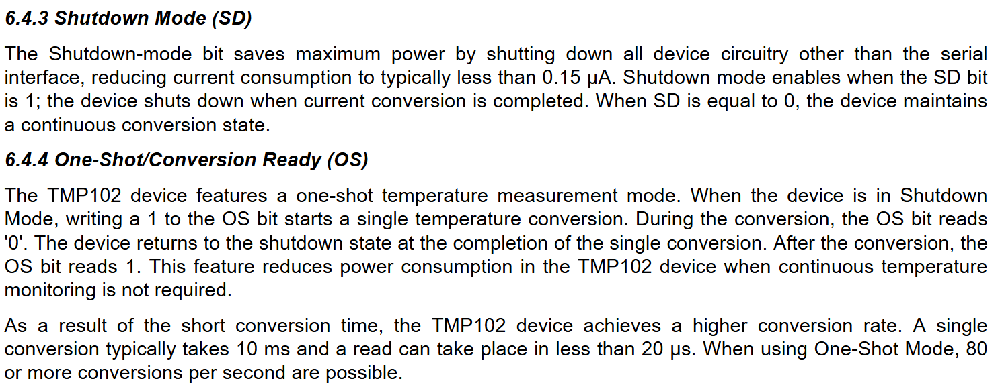

#### 9.2. Déclencher une mesure One-Shot

En mode Shutdown, le capteur ne mesure rien tout seul. Pour déclencher une mesure, il faut écrire le bit `OS` (One-Shot) à 1 dans le registre de configuration. Le capteur effectue alors une unique mesure, met le résultat dans le registre de température, et repasse automatiquement en veille. On peut savoir si la mesure est terminée en relisant le registre de configuration : le bit `OS` repasse à 0 pendant la mesure et revient à 1 une fois terminé.

Dans la fonction de démarrage d'une mesure, on vérifie d'abord que le capteur est bien en mode Shutdown, puis on positionne le drapeau `is_measuring_one_shot` à `true` pour autoriser les tests de fin de conversion via `TMP102_is_measure_ready()`. Enfin, on écrit `1` sur le bit `OS` du registre de configuration pour déclencher la conversion.  
*NB : Le bit OS valant déjà 1 au repos en mode Shutdown, le capteur déclenche la conversion sur l'événement d'écriture du registre.*

```c
bool TMP102_start_measure(TMP102_t *tmp102) 
{
    if (tmp102->config.Mode != TMP102_MODE_SHUTDOWN) return false;

    tmp102->is_measuring_one_shot = true;
    tmp102->config.OneShot = TMP102_OS_START_MEASURE;
    return TMP102_write_config_reg(tmp102);
}
```

#### 9.3. Attendre la fin de la mesure

Une fois que la mesure est déclenchée, cette fonction de polling non bloquante doit être appelée en boucle pour savoir si la mesure est terminée.
Elle vérifie d'abord qu'une mesure a bien été demandée et que le capteur est en mode Shutdown. À chaque appel, elle lit le registre de configuration et contrôle l'état du bit `OS` (0 indiquant qu'une conversion est toujours en cours).  
Dès que le bit `OS` repasse à 1, la conversion est achevée : le flag interne `is_measuring_one_shot` est remis à `false` et la fonction renvoie `true`. Le capteur repasse de lui-même en veille automatiquement.

```c
bool TMP102_is_measure_ready(TMP102_t *tmp102) 
{
    if (!tmp102->is_measuring_one_shot)                
        return false;
    if (tmp102->config.Mode != TMP102_MODE_SHUTDOWN)   
        return false;
    if (!TMP102_read_config_reg(tmp102)) // Lecture I2C            
        return false; // Erreur I2C
    if (tmp102->config.OneShot == TMP102_OS_MEASURING) 
        return false; // La mesure est en cours
 
    tmp102->is_measuring_one_shot = false;
    return true;
}
```

#### 9.4. Lire la température actualisée

Une fois la mesure achevée, il suffit de lire le registre de température du capteur comme décrit au paragraphe [Scénario 6 – 7. Lecture du registre de température](#7-lecture-du-registre-de-température).

### 10. Utilisation de la bibliothèque dans le code

#### 10.1. Déclaration et initialisation

Le capteur est représenté par une unique variable globale de type `TMP102_t`.

*Dans la section `USER CODE PV` du fichier `main.c`*
```c
TMP102_t thermometre;
```

Son initialisation est regroupée dans la fonction `initialiser_thermometre()` appelée une seule fois au début de la fonction `main()` :

*Dans la section `USER CODE 0` du fichier `main.c`*
```c
void initialiser_thermometre() 
{
    TMP102_init_default(&thermometre); // Valeurs par défaut

    thermometre.busI2C              = BUS_I2C;             
    thermometre.address             = TMP102_I2C_ADDR_GND; 
    thermometre.config.Mode         = TMP102_MODE_SHUTDOWN; 
    thermometre.config.ExtendedMode = TMP102_EXTENDED_OFF;

    if (TMP102_apply_registers(&thermometre)) {
        printf("Capteur TMP102 configuré\r\n");
    } else {
        printf("Erreur d'initialisation du capteur TMP102\r\n");
    }
}
```

On commence par appeler `TMP102_init_default()` pour partir d'un état connu, puis on modifie uniquement les champs qui diffèrent des valeurs par défaut. Ici, on bascule le `Mode` de `CONTINUOUS` à `SHUTDOWN` et l'on maintient explicitement `ExtendedMode` à OFF. Tous les autres champs (polarité d'alerte, FaultQueue, etc.) conservent leurs valeurs par défaut, car nous ne les utilisons pas.

#### 10.2. Cycle de mesure dans la boucle principale

Le cycle de mesure complet se déroule sur plusieurs itérations de la boucle `while(1)`, sans jamais bloquer. On peut décomposer la séquence :

1. **Déclenchement** : au tick du `TIMER_CAPTEURS` (toutes les 2 s), `TMP102_start_measure()` est lancé :
```c
if (timer_capteurs_flag) {
      timer_capteurs_flag = false;
      ...
      if (!TMP102_start_measure(&thermometre)) {
        printf("Erreur lors du demarrage de la mesure TMP102 en mode One-Shot\r\n");
      }
      ...
    }
```
2. **Attente non bloquante** : pendant les ~26 ms de la conversion, la boucle continue de traiter les autres événements. À chaque itération, `TMP102_is_measure_ready()` permet de vérifier si la mesure est terminée :

*Dans la boucle `while(1)` de la fonction `main()` :*
```c
if (TMP102_is_measure_ready(&thermometre)) {
   evaluer_temperature();
   printf("\r\n");
   afficher_capteurs_ecran();
}
```
Nous mettons à jour l'affichage LCD après la lecture de température, qui est la dernière valeur à arriver lors du déclenchement des différentes mesures (l'ADC est très rapide comparé au TMP102 qui a besoin de ~10 ms).

3. **Lecture et traitement** : dès que la mesure est terminée, `evaluer_temperature()` appelle `TMP102_get_temperature()` qui lit le registre de température et décode la valeur en °C :

*Dans la section `USER CODE 0` du fichier `main.c` :*
```c
void evaluer_temperature() 
{
  if (TMP102_get_temperature(&thermometre, &temperature_valeur)) 
  {
    printf("TEMP  = %s°C\r\n", TMP102_temperature_to_string(temperature_valeur, 2));
  } else {
    printf("TEMP  = ERREUR LECTURE\r\n");
  }
}
```
  
### 11. Analyse des trames I²C

Nous avons oublié de faire l'analyse des trames I²C le jour de la démo, quand nous sommes arrivé avec le Scénario 6 enfin terminé. 
Cependant nous sommes capable de décrire à quoi cela devrait ressembler en théorie.

### 12. Gestion automatique de la fenêtre par la température

#### 12.1. Seuils et états de température

Deux seuils sont définis en haut du `main.c` :

```c
#define SEUIL_CHALEUR  26  // °C
#define SEUIL_FROID    24  // °C
```

L'état de la température est représenté par une variable globale d'un type énuméré `temperature_t` que nous avons doté de trois valeurs :

*Dans la section `USER CODE PTD` du fichier `main.c` :*
```c
typedef enum {
   FROID,
   CHAUD, 
   TEMPEREE
} temperature_t;
```

*Dans la section `USER CODE PV` du fichier `main.c` :*
```c
temperature_t temperature = TEMPEREE;
```
La plage tempérée (24–26°C) crée une hystérésis naturelle : une fois détecté comme `CHAUD`, le capteur ne revient à `TEMPEREE` que si la température descend en dessous de `SEUIL_CHALEUR`. Cela évite les oscillations rapides de la fenêtre autour du seuil. On suit donc la température selon la machine à états suivante.

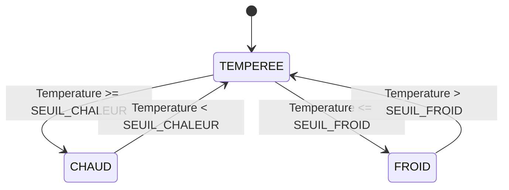

#### 12.2. Logique de décision de la fenêtre
Dans notre fonction `evaluer_temperature()`, nous avons ajouté l'actionnement de la fenêtre lors des transitions vers les états `CHAUD` et `FROID`, lorsque le système est en mode `HOME` et en l'absence de pluie :  
En dehors de ces transitions, la fenêtre reste sous le contrôle manuel de l'utilisateur ou est forcée par la détection de pluie.  
La logique est volontairement asymétrique : une transition déclenche une action ponctuelle sur la fenêtre (sans la bloquer dans cette position).

```c
void evaluer_temperature() 
{
  ...
  //gestion de la température et de la fenêtre selon les seuils et l'état actuel
  switch(temperature)
  {
    case CHAUD:
      if (temperature_valeur < SEUIL_CHALEUR)
      {
        temperature = TEMPEREE;
        break;
      }
      else
      {
        break;
      }
    case FROID:
      if (temperature_valeur > SEUIL_FROID)
      {
        temperature = TEMPEREE;
        break;
      }
      else
      {
      break;
      }
    case TEMPEREE:
      if (temperature_valeur >= SEUIL_CHALEUR && temperature != CHAUD)
      {
        temperature = CHAUD;
        if (mode == HOME && !pluie_detectee) {
          fenetre = OUVERTE;
        }
        break;
      }
      else if (temperature_valeur <= SEUIL_FROID && temperature != FROID)
      {
        temperature = FROID;
        if (mode == HOME && !pluie_detectee) {
          fenetre = FERMEE;
        }
        break;
      }
      else
      {
        break;
      }
  }
}
```

La transition de `CHAUD` ou `FROID` vers `TEMPEREE` ne déclenche aucune action sur la fenêtre : on revient simplement à un état neutre, et l'utilisateur reprend le contrôle manuel. Les conditions `mode == HOME` et `!pluie_detectee` garantissent que la fenêtre ne s'ouvre jamais s'il pleut ou si la maison est inoccupée.

#### 12.3. Résumé du comportement global de la fenêtre

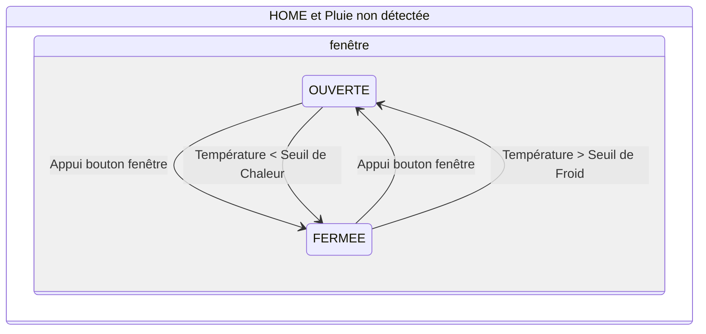

---

## Scénario 7 – Intégration et affichage LCD

### 1. Configuration Bus I²C

#### 1.1. Branchement et configuration CubeMX
Identique à la configuration du capteur TMP102 :  
→ Cf. [Scénario 6 – 1.2. Bus I²C (SDA/SCL)](#12-bus-ic-sdascl).

#### 1.2. Adresse I²C
Nous n'avons pas modifié l'adresse par défaut de l'écran car les deux composants sur le bus possèdent des adresses distinctes et compatibles.  
Nous utilisons donc l'adresse `0x27`.

### 2. Intégration de la bibliothèque LCD I²C

#### 2.1. Modification de l'initialisation
Comme nous avons défini l'instance `I2C3` de la HAL via une macro (`#define BUS_I2C (&hi2c3)`), nous avons adapté la fonction d'initialisation de la bibliothèque afin d'enregistrer le pointeur du bus I²C dans une variable statique interne au fichier source :

*Extrait de Bibliotheques/Ecran_LCD/Src/i2c-lcd.c :*
```c
static I2C_HandleTypeDef *local_bus_i2c = NULL;

void lcd_init (I2C_HandleTypeDef *bus_i2c)
{
   local_bus_i2c = bus_i2c;
   ...
}
```

### 3. Affichage des données en 16x2

L'écran LCD 16×2 n'a pas beaucoup d'espace d'affichage (32 caractères au total). Nous avons donc optimisé la disposition des informations pour afficher le statut de la maison et l'état des trois capteurs :

* **Ligne 1 :** Mode courant à gauche (`HOME` ou `AWAY`) et température à droite (ex. : ` 18,38°C`).
* **Ligne 2 :** Valeurs analogiques des capteurs de pluie et de gaz (ex. : `Hu 1234  Ga 1234`).

#### 3.1. Initialisation

L'initialisation de l'afficheur est regroupée dans la fonction `initialiser_ecran()`, appelée une seule fois au démarrage dans le `main()` :

*Dans la section `USER CODE 0` du fichier `main.c` :*
```c
void initialiser_ecran()
{
    lcd_init(BUS_I2C);
    afficher_mode_ecran();
    lcd_put_cur(1, 0);
    lcd_send_string("Hello Abir (^w^)");
}
```

1. **Configuration matérielle** :  
Appel de `lcd_init(BUS_I2C)` en passant le bus `I2C3` (défini par `#define BUS_I2C (&hi2c3)`).  
→ Cf. [Scénario 7 – 2.1. Modification de l'initialisation](#21-modification-de-linitialisation).
2. **Affichage du mode initial** : `afficher_mode_ecran()` écrit immédiatement le mode par défaut (`HOME`) en haut à gauche dès le démarrage.
3. **Message d'accueil** :  
Un message de bienvenue personnalisé est affiché sur la ligne 2. Il reste visible pendant les 2 premières secondes, jusqu'à l'arrivée de la première mesure des capteurs qui vient écraser cette seconde ligne.

#### 3.2. HOME / AWAY

L'affichage du mode est volontairement dissocié du rafraîchissement des capteurs : le mode doit être affiché dès le démarrage et réagir instantanément lors d'un appui sur le bouton HOME, tandis que les mesures des capteurs sont actualisées toutes les 2 secondes.

*Extrait de la section `USER CODE 0` du fichier `main.c` :*  
```c
void afficher_mode_ecran() 
{ 
  char ligne_mode[8];
  snprintf(ligne_mode, sizeof(ligne_mode), "%4s",
           (mode == HOME) ? "HOME" : "AWAY");

  lcd_put_cur(0, 0);
  lcd_send_string(ligne_mode);
}
```

1. **Chaîne de caractères** : on utilise `snprintf` de la bibliothèque standard `<stdio.h>` pour formater la chaîne de manière à ce qu'elle fasse toujours exactement 4 caractères (`%4s`), remplaçant proprement `HOME` par `AWAY` (et inversement) sans altérer le reste de la ligne (la température).
2. **Curseur** : le curseur est placé au début de la première ligne (`lcd_put_cur(0, 0)`).

*Remarque : Cette fonction n'est appelée que lors des transitions de la machine à états du mode, et non en continu dans la boucle principale.*

#### 3.3. Valeurs capteurs

Les trois capteurs sont mis à jour ensemble à chaque fin de cycle de mesure via la fonction `afficher_capteurs_ecran()` :

*Extrait de la section `USER CODE 0` du fichier `main.c` :*
```c
void afficher_capteurs_ecran() 
{
    char ligne1[8+1];
    char ligne2[16+1];

    // Ligne 1 (2nde moitié) : " 18,38°C"
    snprintf(ligne1, sizeof(ligne1), " %5s\xDF" "C",
             TMP102_temperature_to_string(temperature_valeur, 2));

    // Ligne 2 : "Hu 1234  Ga 1234"
    snprintf(ligne2, sizeof(ligne2), "Hu %4d  Ga %4d", 
             pluie_valeur, 
             gaz_valeur);

    lcd_put_cur(0, 8);
    lcd_send_string(ligne1);

    lcd_put_cur(1, 0);
    lcd_send_string(ligne2);
}
```

Cette fonction applique plusieurs choix de conception :

1. **Préservation du mode** : la température est écrite à partir de la colonne 8 (`lcd_put_cur(0, 8)`). Les 8 premières colonnes de la ligne 1 restent ainsi totalement intactes, ce qui permet de conserver le texte `HOME` ou `AWAY`.

2. **Formatage à largeur fixe** :
* La température est cadrée sur 5 caractères grâce à `TMP102_temperature_to_string()` (ex. : `"18,38"`).
* Les valeurs ADC de pluie (`Hu` pour humidité) et de gaz (`Ga`) sont formatées avec `%4d`. Cela force l'affichage sur 4 chiffres, évitant que les chiffres d'une mesure précédente ne restent affichés si la valeur passe par exemple de 1024 à 95.

3. **Synchronisation avec la dernière mesure prête** : dans la boucle `while(1)`, `afficher_capteurs_ecran()` n'est appelée que lorsque `TMP102_is_measure_ready(&thermometre)` devient vrai. Comme la mesure du TMP102 prend ~10 ms alors que les conversions ADC en DMA sont quasi instantanées, la température est toujours la dernière donnée disponible. L'affichage est donc rafraîchi une seule fois par cycle de 2 s avec des valeurs parfaitement synchronisées.  
→ Cf. [Scénario 6 – 10.2. Cycle de mesure dans la boucle principale](#102-cycle-de-mesure-dans-la-boucle-principale).
   
4. **Caractère degré personnalisé (`\xDF`)** : la table ASCII standard ne contient pas le symbole degré `°`. Dans la mémoire ROM du contrôleur I²C de l'écran il y a une table de caractères où le caractère `°` est situé à l'adresse hexadécimale `1101 1111` en binaire soit `0xDF` en hexadécimal :  
</img>  

---

## Scénario 8 – Gestion globale des alarmes

### 1. Clignotement non bloquant par compteur partagé

Pour gérer les différentes alarmes sans interrompre l'exécution du programme, nous avons exploité le Timer 5, configuré à 20 Hz (soit une interruption toutes les 50 ms). À chaque itération de ce timer, un compteur global `blink_counter_alarm` est incrémenté.
Le clignotement de chaque LED est obtenu en calculant le nombre de périodes du Timer à 20 Hz qui doivent s'écouler pour atteindre la demi-période de la fréquence de clignotement cible, moment où l'état de la LED s'inverse :  
- L'alarme gaz est définie pour clignoter à 10 Hz. Ainsi, sa demi-période est atteinte à 20 Hz, ce qui correspond à la fréquence du Timer 5. La LED s'inverse donc à chaque tic du Timer 5. 
- L'alarme intrusion clignote à 2 Hz. Ainsi, sa demi-période est atteinte à 4 Hz, ce qui correspond exactement à un cinquième ($5$ tics) de la fréquence du Timer 5. La LED s'inverse donc tous les 5 tics du Timer 5.

Ce mécanisme est fondamentalement non bloquant : au lieu d'utiliser des délais logiciels d'attente (`HAL_Delay`), le microcontrôleur évalue instantanément une simple condition mathématique (avec un modulo sur le compteur de tics du Timer 5) à chaque fin de période, afin de déterminer s'il faut inverser ou non l'état de la broche. Une fois l'évaluation terminée, il poursuit immédiatement l'exécution de la boucle principale.

> Comme pour le debounce, ce délai est porté par un timer recyclé plutôt que par le compteur de millisecondes du SysTick. Le détail de ce choix est présenté dans [Architecture globale – 4. Recyclage des timers](#4-recyclage-des-timers).

### 2. Gestion du buzzer avec fréquences distinctes

#### 2.1. Configuration du Timer PWM

Pour générer nos signaux PWM destinés au buzzer, nous cherchons à maximiser la précision de comptage du Timer 3 tout en respectant sa contrainte matérielle de 16 bits (capacité maximale du registre ARR : $2^{16} - 1 = 65\,535$).

Les contraintes pour le calcul sont :
- La fréquence minimale à générer est de $384\text{ Hz}$ (alarme intrusion).
- Le registre ARR est codé sur 16 bits ($\le 65\,535$).
- La fréquence d'horloge source du bus est de $100\text{ MHz}$.

On cherche la fréquence de comptage maximale $f$ permettant d'obtenir le plus de précision et la note la plus basse sans saturer le registre ARR :

$$ARR = \frac{f}{384\, \text{Hz}} \leq 65\,535$$
$$f \leq 384 \times 65\,535 \approx 25{,}16\, \text{MHz}$$

On sélectionne une fréquence de comptage de **$25\text{ MHz}$**, qui est un diviseur entier de l'horloge source de $100\text{ MHz}$ :

$$\implies \text{PSC} = \frac{100\, \text{MHz}}{25\, \text{MHz}} - 1 = 4 - 1$$

À partir de cette fréquence de base de $25\text{ MHz}$, nous calculons la période (`ARR`) et l'impulsion (`CCR`) pour chaque alarme. La valeur de comparaison `CCR` est fixée à la moitié de la période afin d'obtenir un rapport cyclique de 50 % (onde carrée) pour le buzzer :

- Alarme Gaz (440 Hz) :
  $$ARR_{440\text{Hz}} = \frac{25\,000\,000}{440} - 1 = 56\,818 - 1$$
  $$CCR_{440\text{Hz}} = \frac{ARR_{440\text{Hz}} + 1}{2} = \mathbf{28\,409}$$

- Alarme Intrusion (384 Hz) :
  $$ARR_{384\text{Hz}} = \frac{25\,000\,000}{384} - 1 = 65\,104 - 1$$
  $$CCR_{384\text{Hz}} = \frac{ARR_{384\text{Hz}} + 1}{2} = \mathbf{32\,552}$$
   
#### 2.2. Configuration sur CubeMX

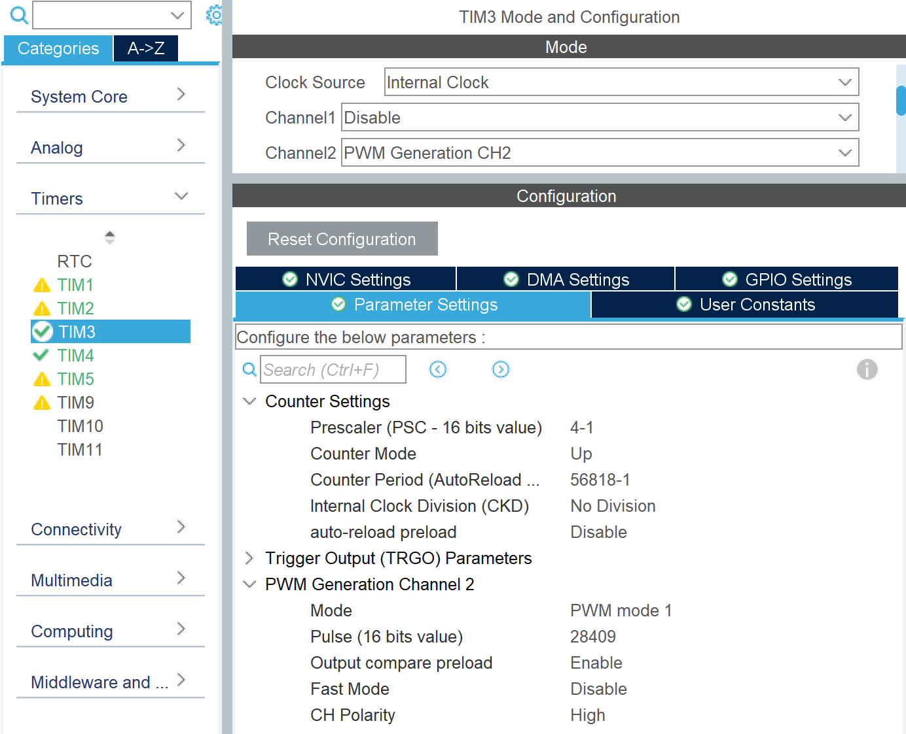

#### 2.3. Fréquences distinctes pour chaque alarme

Pour permettre à l'utilisateur de différencier les alertes à l'oreille, la fréquence du signal est ajustée de manière dynamique via la fonction `frequence_buzzer()`. Cette fonction recalcule et met à jour en temps réel la période (registre `ARR`) et l'impulsion (registre `CCR`) du Timer 3.
```c
void frequence_buzzer(int frequence) 
{
	int periode_tics = (double)FREQ_TIMER_BUZZER/frequence;
	int pulse_tics   = periode_tics/2;
	__HAL_TIM_SET_AUTORELOAD(TIMER_BUZZER, periode_tics);
	__HAL_TIM_SET_COMPARE(TIMER_BUZZER, CANAL_BUZZER, pulse_tics);
}
```
Nous avons donc choisi des fréquences distinctes pour chaque alarme :
- Alarme gaz : 440 Hz (note La4 fondamentale), produisant un son plus aigu avec un rythme rapide.
- Alarme intrusion : 384 Hz, produisant un son légèrement plus grave.

De plus, l'activation du buzzer est synchronisée avec le retour visuel : le signal PWM du buzzer est activé uniquement lorsque la LED de l'alarme correspondante est à l'état haut et le buzzer se tait lorsque la LED s'éteint, suivant ainsi le rythme visuel de la LED. On obtient donc deux signatures distinctes pour chaque alarme.

### 3. Cas simultané : alternance gaz / intrusion

Lorsque les deux alarmes sont actives simultanément, les deux LEDs continuent de clignoter indépendamment selon leur propre fréquence : la LED rouge du gaz à 10 Hz (demi-période de 50 ms) et la LED jaune de l'intrusion à 2 Hz (demi-période de 250 ms).

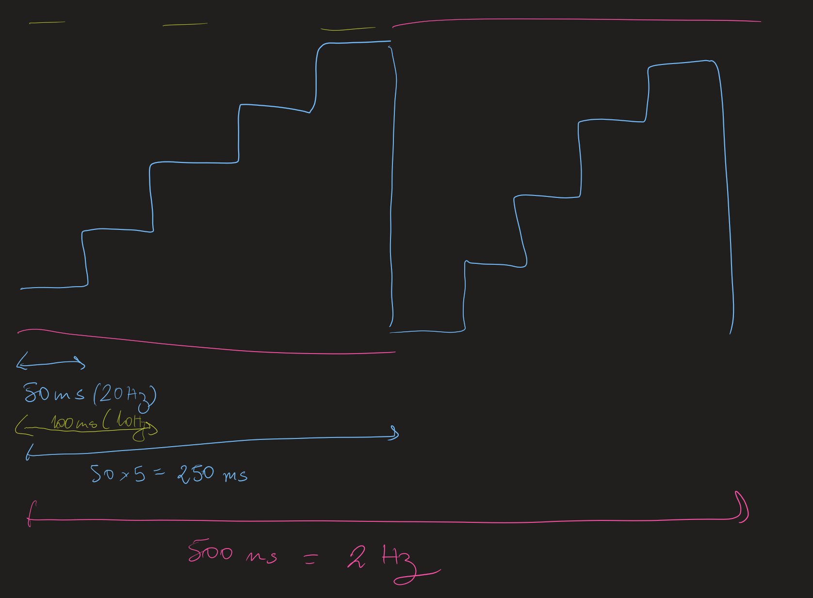 

Le buzzer ne peut produire qu'une seule fréquence à la fois. Il alterne donc entre les deux signatures sonores par phases de 250 ms : d'abord 384 Hz pour l'intrusion, puis 440 Hz pour le gaz. Pendant la phase gaz, le buzzer suit le clignotement rapide de la LED rouge et se tait lorsque celle-ci est éteinte. Ce cycle de 500 ms se répète tant que les deux alarmes restent actives.

Cette alternance permet de distinguer auditivement les deux alarmes sans empêcher leur signalisation visuelle simultanée : chaque LED conserve son rythme propre, même pendant la phase sonore de l'autre alarme.

---

## Scénario 9 – Bande de LED NeoPixel

Pour afficher l'état de la maison de manière visuelle, nous avons ajouté en bonus un module de 4 LEDs NeoPixel (WS2812B) chaînées. Contrairement aux LEDs classiques de la maison, chaque NeoPixel contient un circuit intégré qui pilote lui-même ses 3 puces LED (rouge, verte, bleue) via une PWM sur 8 bits (256 niveaux par couleur).

### 1. Analyse de la datasheet (protocole one-wire)

*Extrait de la documentation sur les LEDs WS2812B (Fonctionnement LED NeoPixel WS2812B) :*

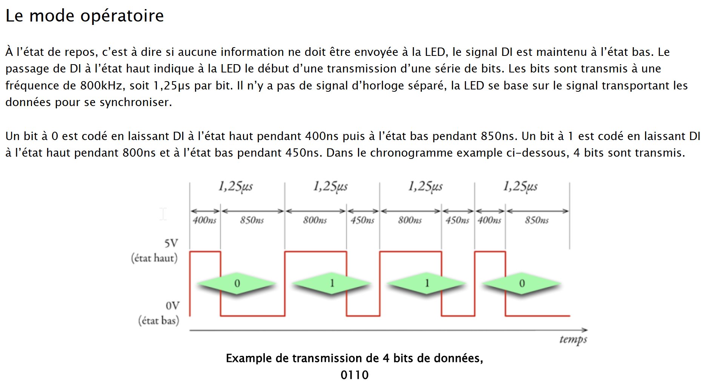

Les LEDs n'ont qu'une seule broche d'entrée de données (DI) et une broche de sortie (DO) reliée à l'entrée de la LED suivante. Il n'y a pas de signal d'horloge séparé : la LED se synchronise sur les fronts du signal de données lui-même. Chaque bit occupe donc une période fixe de $1{,}25\, \mu\text{s}$ (soit une fréquence de $800\, \text{kHz}$), et c'est la durée de l'état haut au sein de cette période qui encode la valeur du bit :

| Bit | État haut | État bas | Total |
| :--- | :--- | :--- | :--- |
| 0 | 400 ns | 850 ns | 1,25 µs |
| 1 | 800 ns | 450 ns | 1,25 µs |

*Extrait de la documentation sur les LEDs WS2812B (Fonctionnement LED NeoPixel WS2812B) :*

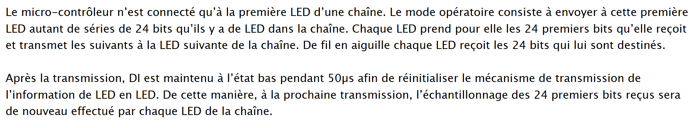

Le microcontrôleur n'est connecté qu'à la première LED de la chaîne et envoie à la suite **24 bits par LED** (8 bits par couleur, dans l'ordre Vert, Rouge, Bleu, bit de poids fort en premier). Chaque LED garde pour elle les 24 premiers bits qu'elle reçoit et retransmet les suivants à la LED suivante. Pour notre bande de 4 LEDs, une trame comporte donc $4 \times 24 = 96$ bits.

Pour que chaque LED enregistre sa couleur, la trame doit être suivie d'un état bas d'au moins 50 µs (« reset ») : c'est ce temps de silence qui réinitialise le mécanisme de transmission, afin que la trame suivante soit de nouveau lue depuis la première LED.

Durée d'une trame complète pour 4 LEDs :

$$T_{trame} = 96 \times 1{,}25\, \mu\text{s} = 120\, \mu\text{s} \qquad T_{trame+reset} \approx 120\, \mu\text{s} + 50\, \mu\text{s} = 170\, \mu\text{s}$$

### 2. Principe d'implémentation : PWM + DMA

Le protocole impose un signal dont les fronts doivent être précis à quelques dizaines de nanosecondes près. À 100 MHz, une période de bit de 1,25 µs ne représente que 125 cycles d'horloge, ce qui exclut les approches logicielles :

**Solution retenue : PWM de timer + DMA** :
* Chaque bit est une période de PWM. Le rapport cyclique de la période encode la valeur du bit : un état haut court pour un bit 0 et un état haut long pour un bit 1.
* Le DMA recopie, à chaque période, la valeur suivante dans le registre de comparaison `CCR1` du timer, depuis un tableau en mémoire. Le CPU ne fait que remplir le tableau, puis lance le transfert : il n'intervient plus pendant les 120 µs de la trame.

Le signal est donc généré entièrement par le matériel, avec la précision du timer.

### 3. Branchement et configuration CubeMX

#### 3.1. Branchement

La bande est alimentée en 3,3 V et son entrée de données DI est connectée à PB6 (D10), qui correspond à TIM4 CH1 (cf. [Architecture globale – 1.2. Tableau de brochage final](#12-tableau-de-brochage-final)).

| Signal | Broche |
| :--- | :--- |
| VCC | 3,3 V |
| GND | GND |
| DI | PB6 (D10) — TIM4 CH1 |

#### 3.2. Calcul des paramètres du Timer 4

Comme pour les autres timers, le Timer 4 est alimenté par l'horloge à 100 MHz.

Les contraintes pour le calcul sont :
- La période d'un bit est de $1{,}25\, \mu\text{s}$, soit une fréquence PWM de $800\, \text{kHz}$.
- La largeur d'impulsion doit pouvoir valoir $400\, \text{ns}$ et $800\, \text{ns}$, avec une tolérance de $\pm 150\, \text{ns}$.
- La fréquence de l'horloge source est de $100\, \text{MHz}$.

La période de 1,25 µs correspond à un petit nombre de tics, il n'y a donc pas besoin de diviser l'horloge : au contraire, on garde la résolution maximale avec `PSC = 0` :

$$T_{tic} = \frac{1}{100\, \text{MHz}} = 10\, \text{ns}$$

Cette résolution de 10 ns est très inférieure à la tolérance de 150 ns de la datasheet. On en déduit la période du timer :

$$ARR = \frac{100\, \text{MHz}}{800\, \text{kHz}} - 1 = 125 - 1 = 124$$

Et les valeurs de `CCR1` pour chaque valeur de bit :

$$CCR_{bit\,0} = \frac{400\, \text{ns}}{10\, \text{ns}} = \mathbf{40} \quad (32\,\%) \qquad CCR_{bit\,1} = \frac{800\, \text{ns}}{10\, \text{ns}} = \mathbf{80} \quad (64\,\%)$$

Les durées à l'état bas sont donc : $(125 - 40) \times 10\, \text{ns} = 850\, \text{ns}$ pour un 0 et $(125 - 80) \times 10\, \text{ns} = 450\, \text{ns}$ pour un 1.

#### 3.3. Configuration du Timer 4 dans CubeMX

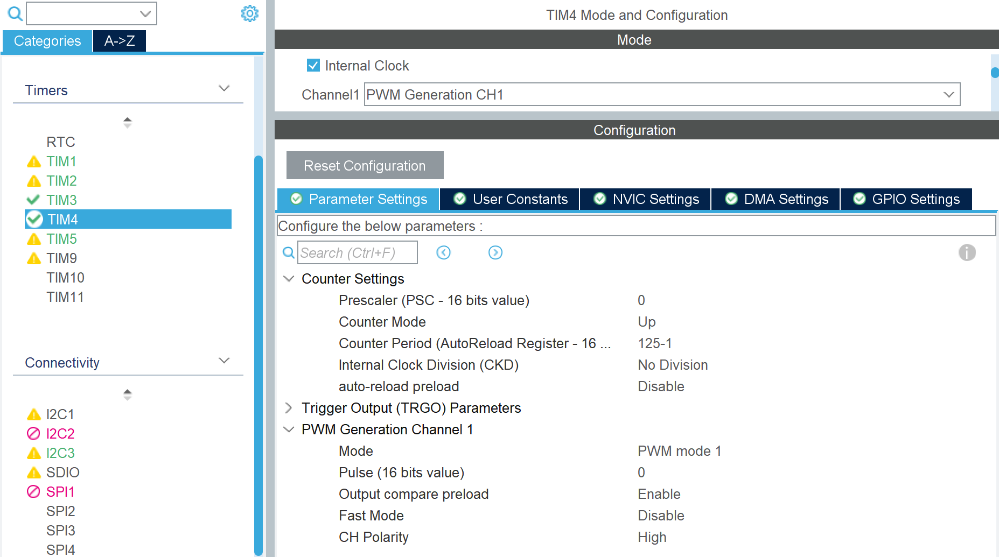

| Paramètre | Valeur | Justification |
| :--- | :--- | :--- |
| Mode | PWM Generation CH1 | Signal de sortie sur PB6 |
| Prescaler | 0 | Résolution maximale de 10 ns |
| Counter Period (ARR) | 125 - 1 | Période de 1,25 µs (800 kHz) |
| PWM Mode | PWM mode 1 | Sortie à l'état haut tant que le compteur est inférieur à `CCR1` |
| Output compare preload | Enable | Voir ci-dessous |

L'*Output compare preload* est activé car le DMA écrit la prochaine valeur de `CCR1` pendant que la période en cours n'est pas terminée. Avec le preload, la nouvelle valeur est mise en attente et n'est appliquée qu'au début de la période suivante : la largeur d'impulsion d'un bit n'est donc jamais modifiée en cours de route.

#### 3.4. Configuration du DMA

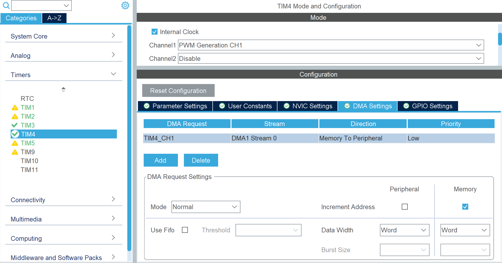

| Paramètre | Valeur | Justification |
| :--- | :--- | :--- |
| DMA Request | TIM4_CH1 | Requête générée à chaque comparaison sur le canal 1 du timer, soit une fois par bit |
| Stream | DMA1 Stream 0 | Le seul flux qui peut servir la requête TIM4_CH1 (canal 2) |
| Direction | Memory To Peripheral | On lit le tableau en mémoire pour écrire dans `CCR1` |
| Mode | Normal | Le tableau est envoyé une seule fois puis le DMA s'arrête |
| Increment Address (Peripheral) | Désactivé | On écrit toujours dans le même registre `CCR1` |
| Increment Address (Memory) | Activé | On avance d'une case du tableau à chaque bit |
| Data Width | Word / Word | Le tableau est de type `uint32_t`, la largeur est identique des deux côtés |

Le mode Normal (et non Circular comme pour l'ADC) est choisi car une trame doit être envoyée une seule fois à chaque mise à jour. Une fois le tableau entièrement parcouru, le DMA s'arrête, et la dernière valeur de `CCR1` étant 0, la sortie reste à l'état bas : c'est l'état de repos exigé par la datasheet.

#### 3.5. Interruptions activées

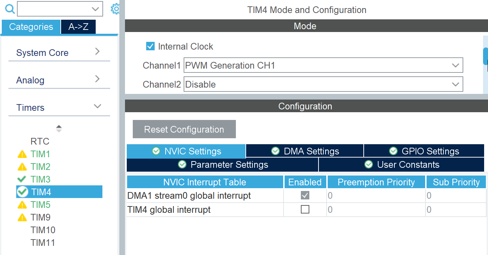

- DMA1 Stream 0 global interrupt : activée par défaut
- TIM4 global interrupt : désactivée. Aucune interruption du timer n'est utile.

### 4. Structure de la bibliothèque

#### 4.1. Vue d'ensemble

La bibliothèque est organisée autour de deux fichiers : `bande-led.h` pour les définitions et l'accès externe, et `bande-led.c` pour l'implémentation. Comme pour le TMP102, la bibliothèque ne dépend d'aucun timer ou canal en particulier : ils sont passés en paramètre à l'initialisation, et le `main.c` reste le seul endroit où ils sont choisis.

Les fonctions publiques sont :

| Fonction | Rôle |
| :--- | :--- |
| `BandeLED_Init()` | Alloue et initialise l'objet bande |
| `BandeLED_show()` | Encode l'état de toutes les LEDs et lance l'envoi par DMA |
| `BandeLED_allumer()` / `BandeLED_eteindre()` | Allume / éteint toute la bande |
| `BandeLED_set_led_state()` | Allume / éteint une LED |
| `BandeLED_set_led_hexa()` / `BandeLED_set_led_rgb()` | Fixe la couleur d'une LED |
| `BandeLED_set_led_luminosity()` | Fixe la luminosité d'une LED |
| `BandeLED_demo()` | Démonstration non bloquante |

Nous avons fait générer par IA les fonctions `Roue_Chromatique()` et `Bande_LED_demo()`.
Comme `Roue_Chromatique()` est utilisée uniquement par la démonstration, elle est déclarée `static` pour ne pas être exposée.

#### 4.2. Les structures `BL_RGB_t` et `BandeLED_t`

Comme pour le TMP102, la bande est représentée par un objet qui regroupe tout son contexte. Chaque LED est décrite par la structure `BL_RGB_t` :

```c
typedef struct {
    uint8_t rouge;
    uint8_t vert;
    uint8_t bleu;
    uint8_t alpha;  // Luminosité 0-255
    bool    power;  // LED allumée ou éteinte
} BL_RGB_t;
```

Nous avons séparé les champs `alpha` et `power` de la couleur pour que la couleur soit mémorisée indépendamment de l'état de la LED : éteindre une LED puis la rallumer, ou baisser sa luminosité, ne fait pas perdre sa couleur.

L'objet `BandeLED_t` regroupe l'ensemble de la bande :

```c
typedef struct {
    bool                power;            // Interrupteur général de la bande
    int                 nb_leds;          // Nombre de LEDs de la chaîne
    BL_RGB_t*           leds;             // Tableau des LEDs
    TIM_HandleTypeDef*  PWM_timer;        // Timer utilisé (htim4)
    uint32_t            PWM_channel;      // Canal du timer (TIM_CHANNEL_1)
    uint32_t*           dma_buffer;       // Tableau de valeurs de CCR1 à envoyer
    int                 freq_timer;       // Fréquence de comptage du timer (Hz)
    int                 cycles_delai_maj; // Nombre de périodes pour le reset
} BandeLED_t;
```

Le timer est stocké dans la structure, comme `busI2C` pour le TMP102, pour ne rien hardcoder dans la bibliothèque.

#### 4.3. Define

Pour ne jamais rien hardcoder, nous avons utilisé des `#define` pour chaque valeur issue de la datasheet, ainsi que pour les couleurs courantes :

*Extraits de `Bibliotheques/Bande_LED/Inc/bande-led.h`:*

```c
// Parametres datasheet bande led
#define BL_FREQ_CYCLE_PWM 800000
#define BL_PULSE_BIT_0_nS 400
#define BL_PULSE_BIT_1_nS 800
#define BL_DELAI_MAJ_nS   50000
#define BL_NSEC_IN_1_SEC  1000000000
#define BL_VERT_SEQ_RANG  1
#define BL_ROUGE_SEQ_RANG 2
#define BL_BLEU_SEQ_RANG  3

// Couleurs predefinies
#define BL_HEXA_BLANC  0xFFFFFF
#define BL_HEXA_ROUGE  0xFF0000
#define BL_HEXA_VERT   0x00FF00
#define BL_HEXA_BLEU   0x0000FF
...
```

- Les durées sont exprimées en nanosecondes comme dans la datasheet : elles sont converties en tics du timer par la bibliothèque (cf. [Scénario 9 – 6. Encodage et envoi de la trame](#6-encodage-et-envoi-de-la-trame)). Si on change la fréquence du timer, rien ne change dans la bibliothèque.
- Les trois `BL_*_SEQ_RANG` donnent l'ordre d'envoi des couleurs (Vert, Rouge, Bleu). Si on utilisait une bande avec un autre ordre (par exemple RVB), il suffirait de modifier ces trois valeurs.
- Les couleurs sont au format `0xRRGGBB` pour pouvoir les écrire naturellement, comme en HTML/CSS.

### 5. Initialisation

L'initialisation se fait avec une seule fonction :

```c
void BandeLED_Init(BandeLED_t* bande_led, TIM_HandleTypeDef *htim, uint32_t timer_channel, uint32_t freq_timer, uint8_t nb_leds)
```

Les étapes sont les suivantes :

1. **Calcul du nombre de périodes de reset :**
```c
bande_led->cycles_delai_maj = (BL_DELAI_MAJ_nS / (BL_NSEC_IN_1_SEC / BL_FREQ_CYCLE_PWM)) + 1;
```
La trame doit être suivie d'au moins 50 µs d'état bas. Comme une période de bit dure $\frac{1\,\text{s}}{800\,\text{KHz}} = 1250\, \text{ns}$, il faut $\frac{50\,000}{1250} = 40$ périodes à zéro. Le `+ 1` garantit que le délai est toujours **supérieur** à 50 µs, même si la division entière arrondissait à l'inférieur avec d'autres paramètres. On obtient donc **41 périodes**, soit $41 \times 1{,}25\, \mu\text{s} = 51{,}25\, \mu\text{s}$.

2. **Enregistrement du matériel :** le timer, le canal, la fréquence de comptage du timer et le nombre de LEDs sont mémorisés dans l'objet.

3. **Allocation du tableau pour le DMA :**
```c
bande_led->dma_buffer = malloc((nb_leds * 3 * 8 + bande_led->cycles_delai_maj) * sizeof(uint32_t));
```
Il faut une case par bit à envoyer ($3 \times 8 = 24$ bits par LED) plus une case par période de reset. Chaque case est un `uint32_t` pour correspondre à la largeur Word configurée dans le DMA. Pour nos 4 LEDs :
$$(4 \times 24 + 41) \times 4\, \text{octets} = 137 \times 4 = 548\, \text{octets}$$
L'allocation dynamique permet à la bibliothèque de s'adapter à **n'importe quelle longueur de bande** simplement en changeant `NB_LEDS_BANDE_RGB` dans le `main.c`, sans modifier la bibliothèque. Le tableau `leds` est alloué de la même manière.

4. **Valeurs par défaut :** chaque LED est initialisée en noir (0, 0, 0), avec une luminosité maximale (`alpha = 255`) et allumée (`power = true`). On part ainsi d'un état connu, comme pour `TMP102_init_default()`.

5. **Envoi de la première trame** : `BandeLED_show()` puis `BandeLED_allumer()` envoient l'état initial (noir) pour que les LEDs soient dans un état défini dès le démarrage plutôt que dans un état aléatoire à la mise sous tension.

### 6. Encodage et envoi de la trame

La fonction `BandeLED_show()` convertit l'état de toutes les LEDs en tableau de valeurs de `CCR1`, puis lance son envoi par DMA.

1. **Conversion des durées en tics du timer :**
```c
int nS_per_timer_tic = BL_NSEC_IN_1_SEC  / bande_led->freq_timer;
int pulse_bit_0_tics = BL_PULSE_BIT_0_nS / nS_per_timer_tic;
int pulse_bit_1_tics = BL_PULSE_BIT_1_nS / nS_per_timer_tic;
```
Avec `freq_timer = 100 000 000` Hz : $\frac{10^9}{10^8} = 10\, \text{ns par tic}$, donc $\frac{400}{10} = 40$ tics pour un 0 et $\frac{800}{10} = 80$ tics pour un 1. On retrouve les valeurs calculées dans la configuration du timer.

2. **Parcours des LEDs et de leurs trois composantes :** pour chaque LED, une boucle sur le rang de la composante (1 à 3) sélectionne la couleur à envoyer selon l'ordre de la datasheet :
```c
switch (composante)
{
    case BL_ROUGE_SEQ_RANG :
        valeur_composante = led_courante->rouge * led_courante->alpha / 255;
        break;
    case BL_VERT_SEQ_RANG :
        valeur_composante = led_courante->vert * led_courante->alpha / 255;
        break;
    case BL_BLEU_SEQ_RANG :
        valeur_composante = led_courante->bleu * led_courante->alpha / 255;
        break;
}
```
La boucle passe par les rangs 1, 2, 3 et c'est le `switch` qui détermine quelle couleur correspond à chaque rang : le Vert (rang 1) est donc émis en premier, puis le Rouge, puis le Bleu.

3. **Application de la luminosité :** la composante est multipliée par `alpha / 255`. Avec `alpha = 255` la couleur est inchangée, avec `alpha = 0` elle est nulle, et entre les deux la luminosité est proportionnelle. Cela permet de régler la luminosité sans modifier la couleur mémorisée.

4. **Application de l'interrupteur :**
```c
uint8_t valeur_a_envoyer = (bande_led->power && led_courante->power) ? valeur_composante : 0;
```
Pour qu'une LED soit éteinte, il ne suffit pas de ne plus lui envoyer de données : elle conserve la dernière couleur reçue jusqu'à la trame suivante. On lui envoie donc explicitement des 0. La LED s'allume si l'interrupteur général de la bande **et** celui de la LED sont actifs.

5. **Encodage des 8 bits, poids fort en premier :**
```c
for (int bit = 8-1; bit >= 0; bit--)
{
    uint32_t valeur_pulse = (valeur_a_envoyer & (1 << bit)) ? pulse_bit_1_tics : pulse_bit_0_tics;
    bande_led->dma_buffer[dma_index] = valeur_pulse;
    dma_index++;
}
```
Le masque `1 << bit` isole chaque bit, du bit 7 au bit 0, et on écrit dans le tableau 80 tics pour un 1 ou 40 tics pour un 0.

*Exemple : LED violette (`0x8000FF`) à la luminosité de 10 :*

| Composante | Valeur | Après luminosité ($\times\, 10 / 255$) | Bits envoyés |
| :--- | :--- | :--- | :--- |
| Vert | 0x00 = 0 | 0 | `00000000` |
| Rouge | 0x80 = 128 | 5 | `00000101` |
| Bleu | 0xFF = 255 | 10 | `00001010` |

La trame de cette LED est donc `00000000 00000101 00001010`, soit 24 valeurs de 40 ou 80 dans le tableau.

6. **Ajout du délai de reset :**
```c
for (int i = 0; i < bande_led->cycles_delai_maj; i++) {
    bande_led->dma_buffer[dma_index] = 0;
    dma_index++;
}
```
Les 41 dernières cases valent 0 : avec `CCR1 = 0` la sortie reste à l'état bas pendant 41 périodes, ce qui forme le reset de 51 µs. Comme ces zéros sont envoyés par le même mécanisme que les bits, il n'y a pas besoin de timer supplémentaire ni d'attente active.

7. **Lancement de l'envoi par DMA :**
```c
HAL_TIM_PWM_Stop_DMA(bande_led->PWM_timer, bande_led->PWM_channel);
__HAL_TIM_SET_COUNTER(bande_led->PWM_timer, 0);
bool status = (HAL_TIM_PWM_Start_DMA(bande_led->PWM_timer, bande_led->PWM_channel, bande_led->dma_buffer, dma_index) == HAL_OK);
return status;
```
On arrête d'abord proprement un éventuel transfert précédent, car la HAL refuse de démarrer un nouveau transfert si le canal est déjà occupé. Le compteur est ensuite remis à 0 pour que la première période commence au début. Enfin `HAL_TIM_PWM_Start_DMA()` reçoit le tableau et sa longueur en nombre de cases (ici $137$ pour 4 LEDs) : le DMA envoie alors les 96 bits suivis des 41 périodes de reset, soit une durée de :

$$137 \times 1{,}25\, \mu\text{s} \approx 171\, \mu\text{s}$$

La fonction retourne `true` si le DMA a bien démarré, et **ne bloque pas** : la transmission se déroule en arrière-plan pendant que la boucle principale continue.

### 7. Modification de l'état des LEDs

Les fonctions `BandeLED_set_led_*` ne font que **modifier la mémoire** : aucune ne lance de transmission. L'envoi n'a lieu que lors de l'appel de `BandeLED_show()`.

Cette séparation est volontaire : une seule trame contient l'état de toutes les LEDs. On peut ainsi modifier autant de LEDs que nécessaire, puis envoyer **une seule trame** au lieu d'une par modification.

Toutes les fonctions vérifient que l'indice de LED est valide avant d'écrire, pour ne jamais écrire en dehors du tableau :
```c
if (led_id >= 0 && led_id < bande_led->nb_leds)
```

- **`BandeLED_set_led_hexa()`** extrait chaque composante d'une couleur au format `0xRRGGBB` par décalage et masquage :
```c
bande_led->leds[led_id].rouge = (hexa >> 16) & 0xFF;
bande_led->leds[led_id].vert  = (hexa >> 8) & 0xFF;
bande_led->leds[led_id].bleu  = hexa & 0xFF;
```
  Cela permet d'utiliser directement les couleurs prédéfinies comme `BL_HEXA_ROUGE`.
- **`BandeLED_set_led_rgb()`** fait la même chose avec les trois composantes séparées, pour les couleurs calculées.
- **`BandeLED_set_led_luminosity()`** modifie `alpha`.
- **`BandeLED_set_led_state()`** modifie le `power` d'une LED.
- **`BandeLED_allumer()` / `BandeLED_eteindre()`** modifient le `power` global de la bande puis appellent `BandeLED_show()` pour l'appliquer immédiatement.

#### 7.1. Fonction de démonstration

La bibliothèque contient aussi `BandeLED_demo()`, non utilisée dans le `main.c` final, qui permet de tester rapidement la bande. Elle est conçue pour être appelée à 20 Hz sans bloquer : un compteur statique incrémenté à chaque appel fait défiler deux LEDs sur la roue chromatique à des vitesses différentes (fonction `Roue_Chromatique()` qui convertit une position de 0 à 255 en couleur RGB), et fait clignoter deux autres LEDs en blanc à des fréquences différentes, puis envoie la trame avec `BandeLED_show()`.

### 8. Utilisation dans le code

#### 8.1. Déclaration et initialisation

La bande est représentée par une unique variable globale de type `BandeLED_t`.

*Dans la section `USER CODE PV` du fichier `main.c`*
```c
BandeLED_t bande_led;
```

Les paramètres matériels et d'affichage sont définis par des `#define` en tête de `main.c` :

```c
#define TIMER_BANDE_LED      (&htim4)
#define CANAL_BANDE_LED      TIM_CHANNEL_1
#define FREQ_TIMER_BANDE_LED 100000000

#define NB_LEDS_BANDE_RGB 4
#define LED_BAS_DROITE    0
#define LED_HAUT_DROITE   1
#define LED_HAUT_GAUCHE   2
#define LED_BAS_GAUCHE    3
#define LUMINOSITE_BASE   10 // 0-255

#define COULEUR_CAPTEURS         BL_HEXA_VIOLET
#define COULEUR_ALARME_GAZ       BL_HEXA_ROUGE
#define COULEUR_ALARME_INTRUSION BL_HEXA_ORANGE
#define COULEUR_TEMP_FROID       BL_HEXA_BLEU
#define COULEUR_TEMP_TEMPERE     BL_HEXA_VERT
#define COULEUR_TEMP_CHAUD       BL_HEXA_ORANGE
```

- `FREQ_TIMER_BANDE_LED` vaut 100 MHz car c'est la fréquence de comptage du Timer 4 avec `PSC = 0`. Cette valeur doit correspondre à la configuration CubeMX, car la bibliothèque s'en sert pour convertir les durées de la datasheet en tics.
- Les quatre `LED_*` associent un **nom fonctionnel** à la **position physique** de la LED dans la chaîne (indice 0 = première LED reliée au microcontrôleur), de la même manière que `LED_t` associe un nom à un label matériel ([Defines et types personnalisés - 6. Structure pour les LEDs](#6-structure-pour-les-leds)).
- La luminosité est volontairement limitée à $\frac{10}{255} \approx 4\,\%$ : les NeoPixels sont très lumineux à pleine puissance, et cette valeur suffit à les voir clairement tout en limitant la consommation de la bande.

L'initialisation est regroupée dans la fonction `initialiser_bande_led()`, appelée une seule fois au début du `main()` :

*Dans la section `USER CODE 0` du fichier `main.c`*
```c
void initialiser_bande_led()
{
  BandeLED_Init(&bande_led, TIMER_BANDE_LED, CANAL_BANDE_LED, FREQ_TIMER_BANDE_LED, NB_LEDS_BANDE_RGB);
  for (int i = 0; i < NB_LEDS_BANDE_RGB; i++) {
      BandeLED_set_led_luminosity(&bande_led, i, LUMINOSITE_BASE);
  }

  // Affectation des couleurs fixes une seule fois en mémoire
  BandeLED_set_led_hexa(&bande_led, LED_HAUT_GAUCHE, COULEUR_CAPTEURS);
  BandeLED_set_led_hexa(&bande_led, LED_HAUT_DROITE, COULEUR_ALARME_GAZ);
  BandeLED_set_led_hexa(&bande_led, LED_BAS_DROITE, COULEUR_ALARME_INTRUSION);

  // Extinction de toutes les LEDs pour commencer proprement
  BandeLED_set_led_state(&bande_led, LED_HAUT_GAUCHE, false);
  BandeLED_set_led_state(&bande_led, LED_HAUT_DROITE, false);
  BandeLED_set_led_state(&bande_led, LED_BAS_DROITE, false);
  BandeLED_set_led_state(&bande_led, LED_BAS_GAUCHE, false);

  BandeLED_show(&bande_led);
}
```

1. `BandeLED_Init()` crée l'objet avec les paramètres matériels.
2. La luminosité de base est appliquée à toutes les LEDs.
3. **Les couleurs des trois LEDs qui n'ont qu'une seule signification sont affectées une seule fois ici** (alarme gaz, alarme intrusion, capteurs). Comme la couleur est mémorisée indépendamment de l'état `power`, il suffira ensuite de les allumer et de les éteindre sans jamais les recalculer. La LED de température est la seule dont la couleur varie, elle est donc gérée dans la boucle.
4. Toutes les LEDs sont éteintes (`power = false`) pour démarrer proprement, puis `BandeLED_show()` envoie cet état.

#### 8.2. Informations transmises par les NeoPixels

Les 4 NeoPixels affichent l'état de la maison :

| LED (indice) | Information | Couleur | Comportement |
| :--- | :--- | :--- | :--- |
| `LED_HAUT_GAUCHE` (2) | Mise à jour des capteurs | Violet | Change d'état (toggle) toutes les 2 s à chaque cycle de mesure |
| `LED_HAUT_DROITE` (1) | Alarme gaz | Rouge | Clignote à 10 Hz pendant l'alarme |
| `LED_BAS_DROITE` (0) | Alarme intrusion | Orange | Clignote à 2 Hz pendant l'alarme |
| `LED_BAS_GAUCHE` (3) | Tranche de température | Bleu / Vert / Orange | Froid / tempérée / chaude |

Les trois premières LEDs **recopient l'état des LEDs discrètes déjà gérées** : `led_capteurs`, `led_alarme_gaz` et `led_alarme_intrusion` ([Defines et types personnalisés - 3. Structure pour les LEDs](#6-structure-pour-les-leds)). Les clignotements restent donc calculés à un seul endroit par le compteur partagé ([Scénario 8 – 1. Clignotement non bloquant par compteur partagé](#1-clignotement-non-bloquant-par-compteur-partagé)), et les NeoPixels n'ont pas leur propre logique de temporisation : ils affichent simplement le même état que les LEDs soudées.

#### 8.3. Mise à jour périodique

*Dans la section `USER CODE 0` du fichier `main.c`*
```c
void update_bande_led()
{
    BandeLED_set_led_state(&bande_led, LED_HAUT_GAUCHE, led_capteurs.state);
    BandeLED_set_led_state(&bande_led, LED_HAUT_DROITE, led_alarme_gaz.state);
    BandeLED_set_led_state(&bande_led, LED_BAS_DROITE, led_alarme_intrusion.state);

    switch (temperature) {
        case FROID:
            BandeLED_set_led_state(&bande_led, LED_BAS_GAUCHE, true);
            BandeLED_set_led_hexa(&bande_led, LED_BAS_GAUCHE, COULEUR_TEMP_FROID);
            break;
        case TEMPEREE:
            BandeLED_set_led_state(&bande_led, LED_BAS_GAUCHE, true);
            BandeLED_set_led_hexa(&bande_led, LED_BAS_GAUCHE, COULEUR_TEMP_TEMPERE);
            break;
        case CHAUD:
            BandeLED_set_led_state(&bande_led, LED_BAS_GAUCHE, true);
            BandeLED_set_led_hexa(&bande_led, LED_BAS_GAUCHE, COULEUR_TEMP_CHAUD);
            break;
        default:
            BandeLED_set_led_state(&bande_led, LED_BAS_GAUCHE, false);
            break;
    }

    BandeLED_show(&bande_led);
}
```

1. **Recopie des états :** les états `state` des trois LEDs discrètes sont copiés dans le `power` des LEDs correspondantes. Si l'état n'a pas changé, la valeur écrite est identique.
2. **Tranche de température :** la LED est toujours allumée, et c'est sa couleur qui change selon la variable `temperature` calculée par `evaluer_temperature()` ([Scénario 6 – 12. Gestion automatique de la fenêtre par la température](#12-gestion-automatique-de-la-fenêtre-par-la-température)). Le `default` éteint la LED si la valeur n'est pas reconnue.
3. **Envoi d'une seule trame** avec `BandeLED_show()` après toutes les modifications ([Scénario 9 – 7. Modification de l'état des LEDs](#7-modification-de-létat-des-leds)).

Cette fonction est appelée dans la boucle `while(1)` **à la cadence de 20 Hz** du Timer 5, c'est-à-dire sur le même flag que le filtre anti-rebond et le cycle des alarmes :

```c
if (timer_debounce_flag) {
    timer_debounce_flag = false;
    debounce_filter();
    update_cycle_alarmes();
    update_bande_led();
}
```

Cette cadence est justifiée de deux manières :
- **Cohérence avec les alarmes :** l'alarme gaz clignote à 10 Hz, donc sa LED change d'état toutes les 50 ms ([Scénario 8 – 1. Clignotement non bloquant par compteur partagé](#1-clignotement-non-bloquant-par-compteur-partagé)). `update_cycle_alarmes()` et `update_bande_led()` étant appelées à la suite sur le même tic de 20 Hz, chaque changement d'état est envoyé aux NeoPixels dans le même tic, sans retard ni état manqué.
- **Temps de transmission :** une trame dure $\approx 171\, \mu\text{s}$, soit environ 300 fois moins que les 50 ms qui séparent deux mises à jour : la transmission d'une trame est toujours terminée bien avant la suivante.

#### 8.4. Respect de la règle « pas de blocage »

Dans le prolongement de la règle de [Architecture globale – 3. Organisation logicielle](#3-organisation-logicielle), l'utilisation des NeoPixels ne bloque jamais le programme : le CPU n'écrit que quelques dizaines de valeurs dans un tableau et lance le DMA, qui génère ensuite les 137 périodes de PWM tout seul. La boucle principale continue de traiter les boutons, capteurs et alarmes pendant la transmission.
