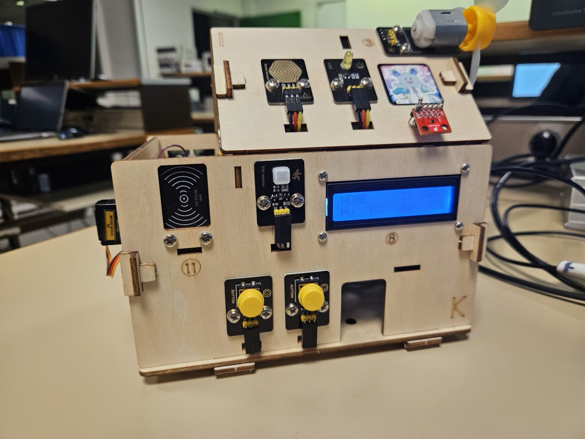
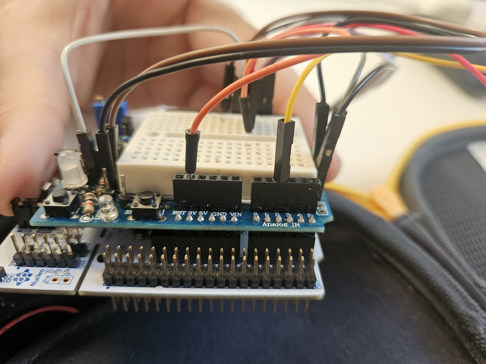
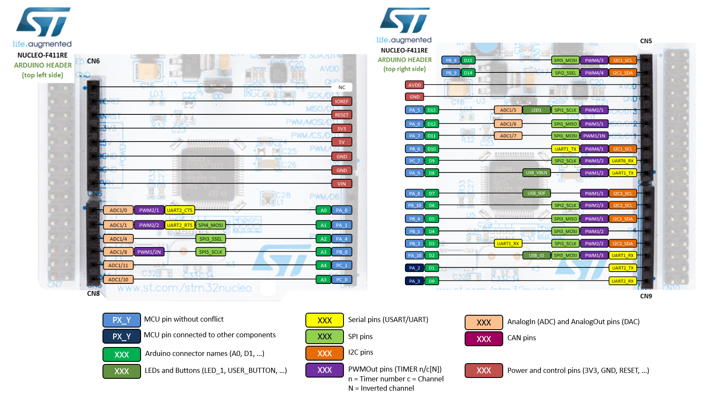
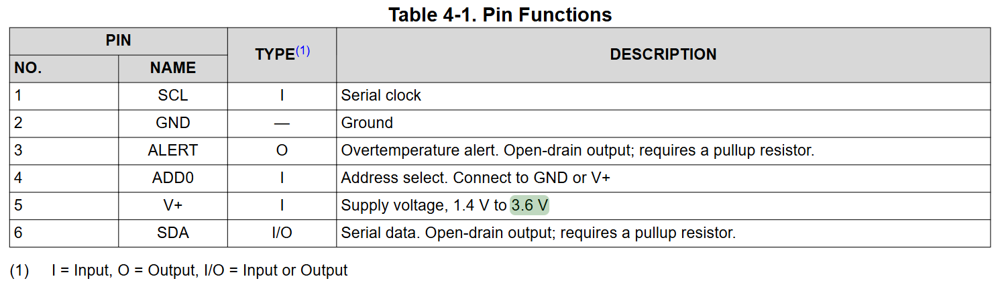
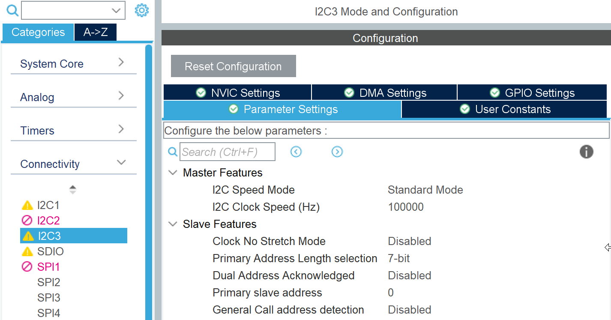
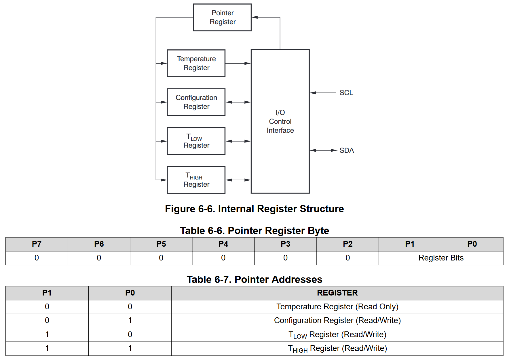
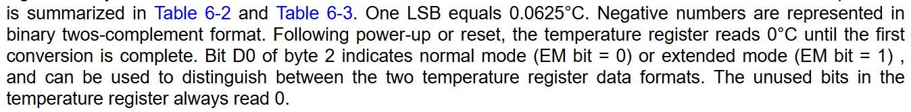
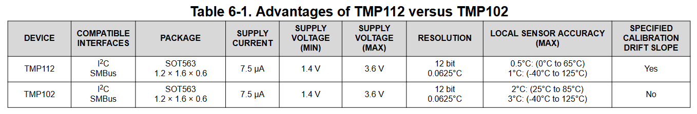
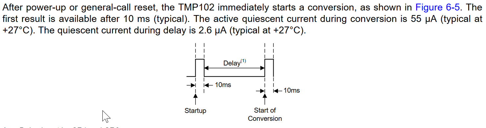
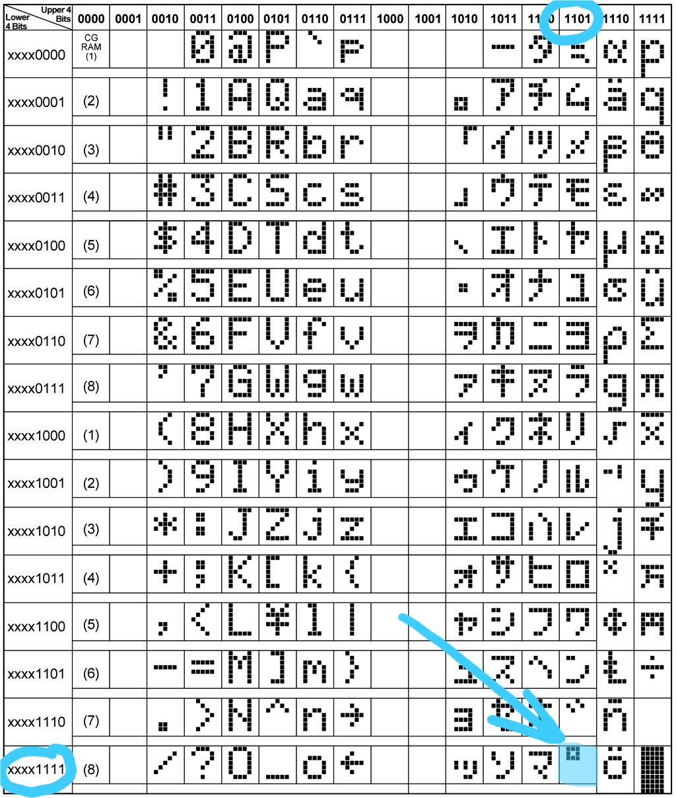

# Rapport de Projet - Maison Intelligente STM32

**ECUE :** Architecture Numériques Embarquées  
**Binôme :** Thibault AGUEH, Benoît DE KEYN   
**Date :** 26/10/2026  
**Carte cible :** NUCLEO-F411RE (STM32F411RET6)

---

## 1. Table des matières

<!-- TOC -->

- [1. Table des matières](#1-table-des-mati%C3%A8res)
- [2. Introduction](#2-introduction)
    - [2.1. Photos de la maison](#21-photos-de-la-maison)
    - [2.2. Description du fonctionnement](#22-description-du-fonctionnement)
- [3. Architecture globale du système](#3-architecture-globale-du-syst%C3%A8me)
    - [3.1. Branchement des composants](#31-branchement-des-composants)
    - [3.2. Arbre d'horloge et fréquences](#32-arbre-dhorloge-et-fr%C3%A9quences)
    - [3.3. Organisation logicielle](#33-organisation-logicielle)
- [4. Define et types personalisés](#4-define-et-types-personalis%C3%A9s)
    - [4.1. Pas de Hardcoding](#41-pas-de-hardcoding)
    - [4.2. Define matériels](#42-define-mat%C3%A9riels)
    - [4.3. Structure pour les LEDs](#43-structure-pour-les-leds)
- [5. — Scénario 1 — Base temporelle pour l'échantillonnage](#5--sc%C3%A9nario-1--base-temporelle-pour-l%C3%A9chantillonnage)
    - [5.1. Configuration du Timer](#51-configuration-du-timer)
    - [5.2. Clignotement de la LED témoin](#52-clignotement-de-la-led-t%C3%A9moin)
    - [5.3. Validation expérimentale](#53-validation-exp%C3%A9rimentale)
    - [5.4. Ancienne méthode](#54-ancienne-m%C3%A9thode)
- [6. — Scénario 2 — Sécurité : HOME/AWAY et détection d'intrusion](#6--sc%C3%A9nario-2--s%C3%A9curit%C3%A9--homeaway-et-d%C3%A9tection-dintrusion)
    - [6.1. Bouton MODE et anti-rebond](#61-bouton-mode-et-anti-rebond)
    - [6.2. Configuration de l'interruption externe (EXTI)](#62-configuration-de-linterruption-externe-exti)
    - [6.3. Machine à états HOME / AWAY](#63-machine-%C3%A0-%C3%A9tats-home--away)
    - [6.4. Capteur PIR et alarme intrusion](#64-capteur-pir-et-alarme-intrusion)
    - [6.5. Gestion non bloquante des alarmes](#65-gestion-non-bloquante-des-alarmes)
- [7. — Scénario 3 — Détection de gaz](#7--sc%C3%A9nario-3--d%C3%A9tection-de-gaz)
    - [7.1. Configuration de l'ADC et du DMA](#71-configuration-de-ladc-et-du-dma)
    - [7.2. Caractérisation du MQ-2 et seuil](#72-caract%C3%A9risation-du-mq-2-et-seuil)
    - [7.3. Alarme gaz](#73-alarme-gaz)
- [8. — Scénario 4 — Supervision UART](#8--sc%C3%A9nario-4--supervision-uart)
    - [8.1. Configuration de l'USART2](#81-configuration-de-lusart2)
    - [8.2. Redirection de printf](#82-redirection-de-printf)
    - [8.3. Informations transmises](#83-informations-transmises)
- [9. — Scénario 5 — Gestion intelligente de la fenêtre](#9--sc%C3%A9nario-5--gestion-intelligente-de-la-fen%C3%AAtre)
    - [9.1. Commande du servomoteur (TIM1 PWM)](#91-commande-du-servomoteur-tim1-pwm)
    - [9.2. Bouton fenêtre et anti-rebond](#92-bouton-fen%C3%AAtre-et-anti-rebond)
    - [9.3. Détection de pluie (Steam Sensor via ADC)](#93-d%C3%A9tection-de-pluie-steam-sensor-via-adc)
    - [9.4. Logique de décision de la fenêtre](#94-logique-de-d%C3%A9cision-de-la-fen%C3%AAtre)
- [10. — Scénario 6 — Mesure de température (TMP102)](#10--sc%C3%A9nario-6--mesure-de-temp%C3%A9rature-tmp102)
    - [10.1. Branchement et configuration CubeMX](#101-branchement-et-configuration-cubemx)
    - [10.2. Analyse de la datasheet](#102-analyse-de-la-datasheet)
    - [10.3. Communication I²C avec le capteur](#103-communication-ic-avec-le-capteur)
    - [10.4. Structure de la bibliothèque](#104-structure-de-la-biblioth%C3%A8que)
    - [10.5. Mise à jour des registres du capteur](#105-mise-%C3%A0-jour-des-registres-du-capteur)
    - [10.6. Initialisation](#106-initialisation)
    - [10.7. Lecture du registre de température](#107-lecture-du-registre-de-temp%C3%A9rature)
    - [10.8. Conversion et affichage de la température](#108-conversion-et-affichage-de-la-temp%C3%A9rature)
    - [10.9. Mesure One-Shot en mode Shutdown](#109-mesure-one-shot-en-mode-shutdown)
    - [10.10. Utilisation de la bibliothèque dans le code](#1010-utilisation-de-la-biblioth%C3%A8que-dans-le-code)
    - [10.11. Gestion automatique de la fenêtre par la température](#1011-gestion-automatique-de-la-fen%C3%AAtre-par-la-temp%C3%A9rature)
    - [10.12. Analyse des trames I²C](#1012-analyse-des-trames-ic)
- [11. — Scénario 7 — Intégration et affichage LCD](#11--sc%C3%A9nario-7--int%C3%A9gration-et-affichage-lcd)
    - [11.1. Configuration Bus I²C](#111-configuration-bus-ic)
    - [11.2. Intégration de la bibliothèque LCD I²C](#112-int%C3%A9gration-de-la-biblioth%C3%A8que-lcd-ic)
    - [11.3. Affichage des données en 16x2](#113-affichage-des-donn%C3%A9es-en-16x2)
- [12. — Bonus — Bibliothèque Bande LED RGB (WS2812B)](#12--bonus--biblioth%C3%A8que-bande-led-rgb-ws2812b)
    - [12.1. Principe de communication (protocole one-wire)](#121-principe-de-communication-protocole-one-wire)
    - [12.2. Implémentation PWM + DMA (TIM4)](#122-impl%C3%A9mentation-pwm--dma-tim4)
    - [12.3. Tableau de bord LED](#123-tableau-de-bord-led)
- [13. — Bonus — Gestion globale des alarmes](#13--bonus--gestion-globale-des-alarmes)
    - [13.1. Clignotement non bloquant par compteur partagé](#131-clignotement-non-bloquant-par-compteur-partag%C3%A9)
    - [13.2. Gestion du buzzer avec fréquences distinctes](#132-gestion-du-buzzer-avec-fr%C3%A9quences-distinctes)
    - [13.3. Cas simultané : alternance gaz / intrusion](#133-cas-simultan%C3%A9--alternance-gaz--intrusion)

<!-- /TOC -->
---

## 2. Introduction


### 2.1. Photos de la maison




Pour simplifier le cablage notamment pour les premiers scénarios, nous avons soudé des boutons, des LED (une RGB, une jaune et une bleue), et collé une breadboard sur un shield Arduino vierge. Voici à quoi ressemble notre montage :



### 2.2. Description du fonctionnement

Toutes les fonctionnalités respectent le cahier des charges du projet et, lorsque le sujet nous en laissait la liberté, une approche axée sur l'expérience utilisateur à été privilégié.

L'entrée et la sortie de la maison se font avec le bouton HOME.
Une fois sorti, la fenêtre reste fermée ou se ferme automatiquement, et l'alarme intrusion devient active et se déclenche automatiquement si une présence est détectée. Elle continue de sonner tant qu'on n'est pas rentré à nouveau dans la maison.

Dans la maison, on peut ouvrir et fermer la fenêtre avec le bouton fenêtre.
Si il commence à pleuvoir, la fenêtre se ferme automatiquement et force la fermeture tant qu'il pleut.
Le controle de la fenêtre suis également la température : si il fait trop chaud, la fenêtre s'ouvre automatiquement une fois (sans maintenir forcée l'ouverture) et vice versa s'il fait trop froid, la fenêtre se ferme une fois (sans maintenir forcée la fermeture).

L'alarme de gaz peut se déclencher à tout moment, quel que soit l'état de la maison.

Des logs sur le monieteur série permettent de suivre la valeur des capteurs et les différentes situations.

L'écran LCD indique la température, le niveau de gaz, le niveau de pluie et si on est sorti ou non.

Les 4 LEDs NeoPixel indiquent : 
- l'alarme intrusion en jaune clignotant
- l'alarme gaz en rouge clignotant
- la mise à jour de la valeur des capteurs, en bleu par un toogle.
- la tranche de température : 
   - bleu si trop froid
   - vert si tempéré
   - orange si trop chaud

## 3. Architecture globale du système


### 3.1. Branchement des composants

#### Contraintes de brochage
Nous avons voulu rester sur l'**Arduino Header** de la Nucleo pour simplifier le câblage avec la breadboard notamment. 
A partir du scenario 6, il a fallu réorganiser le brochage arbitraire qu'on faisait au début pour tout faire rentrer sur le header Arduino.
Nous avons donc listé tous les composants et leur fonctions pour leur assigner des broches du plus contraignant au moins contraignant.

Si on reprend le pinout fourni sur BlackBoard : 



---

**Priorité 1 — Broches fixées par le matériel**

Nous sommes partis de cette base :

- **PA2 & PA3** → USART2 TX/RX, reliés physiquement au ST-LINK sur la Nucleo pour la liaison série USB.
- **PA5 (D13)** → LED built-in, inutilisée pour pouvoir déporter les LEDs (avant d'implémenter les NeoPixels).
- **PB10 (D6)** → LED bleue que nous avons soudé sur le shield.

---

**Priorité 2 — I²C**

Le header Arduino n'avait qu'une paire de broches SDA & SCL disponibles, donc nous les avons réservée directement :

Le module **I2C3** est disponible avec :
- SCL sur **PA8 (D7)**
- SDA sur **PB4 (D5)**

---

**Priorité 3 — Timers**

Nous avions besoin de 4 timers :
- PWM du servomoteur
- PWM du buzzer passif
- PWM de la bande de 4 LEDs NeoPixel
- Timer pour l'échantillonnage

n'Nous avons que 4 timers disponibles sur le header Arduino.
Or pour l'échantillonnage nous voulions que l'ADC soit déclenché par un TGO event du timer d'échantillonnage, or il y a que les timers 2 et 3 qui permettent ça.
Nous avons donc choisit arbitrairement le timer 2 pour l'échantillonnage.
Pour le reste, nous avons choisi arbitrairement quel composant allait sur quel timer, sachant que APB1 et APB2 sont tous les deux à 100Mhz donc pas de différence sur ce point.

Résultat :
- Timer 1 → Servomoteur sur le channel 3 : PA9 (D8)
- Timer 2 → Echantillonnage
- Timer 3 → Buzzer sur le channel 2 : PB5 (D4)
- Timer 4 → LEDs NeoPixel sur le channel 1 : PA6 (D11)

---

**Priorité 4 — Voies analogiques**

Deux mesures analogiques sont nécessaires (gaz MQ-2 et capteur de pluie). 
L'ADC1 est le seul ADC de la carte. mais on a plusieurs entrées sur les broches analogiques notemment qui sont traditionnellement reservées aux mesures analogiques. On arbitrairement choisi parmi les AX restantes : 

- **A2 (PA4)** → ADC1 canal 4 → capteur de gaz MQ-2
- **A3 (PB0)** → ADC1 canal 8 → capteur de pluie

---

**Priorité 5 — Broches d'interruption**

Nous avions besoin de 3 interruptions externes (EXTI) :
- **Bouton HOME** (bascule mode HOME/AWAY)
- **Bouton FENÊTRE** (commande manuelle de la fenêtre)
- **Capteur PIR** (détection de mouvement)

La contrainte importante est que deux broches de **même numéro** sur des ports différents partagent la même ligne EXTI. Il fallait choisir des broches qui aient un numéro différent. Nous avons choisi :

- **PA6 (D12)** → EXTI 6   → Bouton HOME
- **PA10 (D2)** → EXTI 10  → Bouton FENÊTRE
- **PC7 (D9)**  → EXTI 7   → PIR

---

**Priorité 6 — Sorties GPIO**

Nous avions besoin de 3 sorties GPIO pour les LEDs indicatrices. Nous avons choisi arbitrairement parmi les broches restantes :

- **PB3 (D3)** → LED jaune du shield : Alarme intrusion
- **PA7 (D11)** → LED RGB couleur rouge du shield : Alarme gaz
- **PB10 (D6)** → LED bleue (imposé par la soudure) : cycle capteurs

PS : C'est seulement à la fin que nous avons décidé d'ajouter les 4 LEDs NeoPixels WS2812B en bonus. Mais nous l'avions déjà prise en compte au moment du refacto des pins. Finalement nous avons gardé les 2 systèmes de LED ensemble.

---

#### Tableau de brochage final
| Composant | Label CubeMX | Connecteur Arduino | Broche STM32 | Périphérique / Mode | Pull | Tension |
|---|---|---|---|---|---|---|
| Liaison série USB | SERIAL_TX | — | PA2 | USART2 TX (ST-LINK) | — | 3V3 |
| Liaison série USB | SERIAL_RX | — | PA3 | USART2 RX (ST-LINK) | — | 3V3 |
| TMP102 + LCD (SDA) | I2C_SDA | D5 | PB4 | I2C3 SDA | — | 5V |
| TMP102 + LCD (SCL) | I2C_SCL | D7 | PA8 | I2C3 SCL | — | 5V |
| Buzzer passif | BUZZER | D4 | PB5 | TIM3 CH2 – PWM | — | 3V3 |
| Servomoteur fenêtre | SERVO | D8 | PA9 | TIM1 CH2 – PWM | — | 5V |
| Bande LED NeoPixel | RGB_BANDE | D10 | PB6 | TIM4 CH1 – PWM + DMA | — | 5V |
| Capteur gaz MQ-2 | GAZ | A2 | PA4 | ADC1 CH4 | — | 5V |
| Capteur de pluie | PLUIE | A3 | PB0 | ADC1 CH8 | — | 5V |
| Capteur PIR | PIR_MVMT | D9 | PC7 | EXTI7 – Rising Edge | PULLDOWN | 3V3 |
| Bouton HOME/AWAY | BTN_HOME | D12 | PA6 | EXTI6 – Falling Edge | PULLUP | 3V3 |
| Bouton fenêtre | BTN_FENTR | D2 | PA10 | EXTI10 – Falling Edge | PULLUP | 3V3 |
| LED alarme intrusion | LED_JAUNE | D3 | PB3 | GPIO Output | — | 3V3 |
| LED cycle capteurs | LED_BLEUE | D6 | PB10 | GPIO Output | — | 3V3 |
| LED alarme gaz | RGB_ROUGE | D11 | PA7 | GPIO Output | — | 3V3 |

### 3.2. Arbre d'horloge et fréquences

Pour le réglage des horloge, nous avons simplement gardé la configuration que nous avions faite au premier TD, donc en gardant la plus haute fréquence possible pour le sysclk, l'APB1 et l'APB2 des timers, soit 100 MHz.


### 3.3. Organisation logicielle

#### Boucle principale et gestion des interruptions
Tout le code que nous avons écrit n'utilise jamais de delay ou de boucle while bloquante. Toutes les fonctions appelées dans la boucle while(1) sont des actions "instantanées" qui n'attendent pas un évènement pour se terminer.
Pour chaque routine d'interruption, nous avons préféré réduire au maximum le temps passé à l'intérieur en se contentant de lever un flag indiquant que l'évènement correspondant s'est produit. Le traitement est délocalisé dans des fonctions appelées à chaque passage de la boucle while(1) qui vérifient ces flags.

#### Organisation en bibliothèques
Pour l'écran LCD, le capteur de température et les 4 NeoPixels, nous avons créé des bibliothèques séparées comme demandé.
En revanche, au lieu de les placer à la racine du projet, comme nous en créions un nouveau pour chaque scénario, nous les avons regroupées dans un dossier `Bibliotheques`.  

Nous avons donc créé des liens symboliques, ajouté les chemins des header au compilateur, et inclus les dossiers symboliques au build pour qu'elles soient bien lues et compilées.

Dossiers symboliques  


Décochage de "Exclude from Build" dans les propriété des dossiers symboliques


Include path dans les project settings 
  

## 4. Define et types personalisés


### 4.1. Pas de Hardcoding

Pour éviter les erreurs de recopie, faciliter la compréhension du code et surtout permettre de reconfigurer facilement des valeurs ou des changements de brochage, nous avons défini des macros (`#define`) pour chaque valeur ou objet HAL utilisés dans notre code.

### 4.2. Define matériels

Voici les `#define`s matérielles définies dans le main.c qui permettent de pointer vers les différents périphériques sans avoir à changer toutes les occurences en cas de changement dans le .ioc :
```c
#define ADC_CAPTEURS    (&hadc1)
#define BUS_I2C         (&hi2c3)
#define TIMER_CAPTEURS  (&htim2)
#define TIMER_DEBOUNCE  (&htim5)
#define TIMER_SERVO     (&htim1)
#define CANAL_SERVO     TIM_CHANNEL_2
#define TIMER_BUZZER    (&htim3)
#define CANAL_BUZZER    TIM_CHANNEL_2
#define TIMER_BANDE_LED (&htim4)
#define CANAL_BANDE_LED TIM_CHANNEL_1
```

### 4.3. Structure pour les LEDs

Nous avons défini un type structure `LED_t` pour représenter une LED et son état. Les avantages de cette approches sont multiples : 

- Une seule variable de type `LED_t` suffit pour représenter une LED au lieu d'avoir un port et un pin à spécifier à chaque changement d'état.
- On peut mémoriser l'état de la LED dans la variable `state` de la structure, et le modifier sans avoir à utiliser les lourdes fonctions HAL.
- On peut associer un nom fonctionnel à un label matériel (ex : ```led_capteurs``` est redirigée vers ```LED_BLEUE```), ce qui donne plus de sens au code sans insérer des choix logiciels dans la configuration du ```.ioc```.

Voici la définition du type `LED_t` dans le ```main.c``` : 
```c
typedef struct {
    GPIO_TypeDef *port;
    uint16_t pin;
    bool state;
} LED_t;
```

Voici un exemple de déclaration de LED dans le ```main.c``` :
```c
LED_t led_capteurs = {LED_BLEUE_GPIO_Port, LED_BLEUE_Pin, false};
...
```
*NB : Les `#define`s associées aux Port et Pin des broches sont générée automatiquement par le .ioc dans le fichier ```main.h```.*

Dans la boucle while(1) de la fonction main, nous appelons à chaque exécution la fonction de commande des LED, qui va modifier l'état des LED en fonction de leur état mémorisé :

```c
void commande_led()
{
  if (led_capteurs.state) {
    HAL_GPIO_WritePin(led_capteurs.port, led_capteurs.pin, 1);
  } else {
    HAL_GPIO_WritePin(led_capteurs.port, led_capteurs.pin, 0);
  }
  ...
}
```

Voici les 3 exemples d'utilisation : 

```c
led_capteurs.state = true;
led_capteurs.state = false;
led_capteurs.state = !led_capteurs.state;
```

---

## 5. — Scénario 1 — Base temporelle pour l'échantillonnage


### 5.1. Configuration du Timer

Comme justifié dans la partie [3.1. Branchement des composants](#31-branchement-des-composants), nous avons choisi le Timer 2 pour cadencer la prise de mesure de nos capteurs.
Nous avons utilisé un timer avec interruptions pour éviter l'utilisation de boucles bloquantes, garantissant ainsi un échantillonnage régulier. L'horloge source du timer étant de 100 MHz, nous avons configuré les registres PSC et ARR pour obtenir une période d'échantillonnage de 2s (soit une fréquence de 0,5 Hz) : 

#### Calcul du Prescaler
Le registre $PSC$ étant codé sur 16 bits, sa valeur maximale est $2^{16} - 1 = 65\,535$ (soit un facteur de division de $65\,536$).
    $f_{\text{PSC, min}} = \frac{100\text{ MHz}}{65\,536} \approx 1\,525{,}88\text{ Hz}$ Nous avons donc choisi un Prescaler : (`PSC = 10000 - 1`)   qui nous donne pour obtenir une fréquence après prescaler de 10 kHz, largement au-dessus de la fréquence minimale possible et qui incrémente le compteur toutes les 0.1 ms.

    

#### Calcul de la Période
La valeur maximale de $ARR$ est identique à celle du $PSC$. À une fréquence de $10\text{ kHz}$, la durée maximale mesurable serait de :
    $T_{\text{max}} = \frac{65\,536}{10\,000\text{ Hz}} \approx 6{,}55\text{ secondes}$
   Nous avons donc choisit une Period:  (`ARR = 20000 - 1`) qui nous permet donc d'obtenir une durée exacte de 2 secondes ($20\,000 \times 0{,}1\text{ ms}$) inférieure à la durée maximale, et qui laisse une grande marge pour mofifier la période d'échantillonnage si besoin.

### 5.2. Clignotement de la LED témoin

Pour être informé de la mise à jour des capteurs par le timer TIM2, nous avons codé le changement d'état de la LED bleue à chaque interruption de fin de comptage générée par le TIM2 en passant par un flag :

Dans la section `USER CODE 4` du `main.c` :
```c
void HAL_TIM_PeriodElapsedCallback(TIM_HandleTypeDef *htim)
{
  if (htim == TIMER_CAPTEURS)
  {
    timer_capteurs_flag = true;
  }
  ...
}
```

Dans la boucle while(1) de la fonction main, nous vérifions le flag à chaque itération :

```c
  if (timer_capteurs_flag) {
    timer_capteurs_flag = false;
    led_capteurs.state = !led_capteurs.state;
    ...
  }
```

### 5.3. Validation expérimentale

En observant la LED à l'oscilloscope, nous avions pu vérifier que la période du signal correspond bien à exactement 4s, confirmant ainsi une période de 2s entre chaque inversion. Cela montre que le timer fonctionne comme prévu et que TIM2 est correctement configuré pour fournir la base temporelle souhaitée.

### 5.4. Ancienne méthode

Au début, nous avions utilisé le Timer 3 de manière totalement arbitraire, sans `#define` personnalisé pour les objets HAL, sans structure pour les LED, et sans flag pour les routines d'interruption :

```c
void HAL_TIM_PeriodElapsedCallback(TIM_HandleTypeDef *htim) {
    if (htim->Instance == TIM3) {
        HAL_GPIO_TogglePin(BLUE_GPIO_Port, BLUE_Pin);
    }
}
```

## 6. — Scénario 2 — Sécurité : HOME/AWAY et détection d'intrusion


### 6.1. Bouton MODE et anti-rebond

> _Expliquer le choix d'utiliser le bouton sur PA6 en EXTI sur front descendant (falling edge) avec pull-up interne. Justifier le mécanisme d'anti-rebond implémenté : à l'appui, un flag `debouncing_bouton_home` est levé et le compteur de TIM5 est remis à zéro. TIM5 est configuré à 20 Hz (Prescaler=10000-1, Period=500-1 → 50 ms). Au prochain tick de TIM5, `debounce_filter()` vérifie que le bouton est bien relâché (état stable) avant de valider l'appui. Expliquer pourquoi cette méthode est plus fiable qu'un simple délai bloquant._

### 6.2. Configuration de l'interruption externe (EXTI)
Le bouton MODE est connecté à PA6 et configuré en EXTI sur front descendant (_L'interruption est déclenchée au moment précis où l'utilisateur appuie sur le bouton, lorsque le signal passe de haut à bas_) avec pull-up interne (_maintient le signal à l'état haut_). 
Cela permet de détecter les appuis sur le bouton tout en évitant les faux déclenchements dus au bruit. 

#### Mécanisme d'anti-rebond non bloquant via TIM5
Pour s'assurer que l'appui sur le bouton est correctement détecté sans être perturbé par les rebonds mécaniques, nous avons mis en place un mécanisme anti-rebond via TIM5.

* **Prescaler** (`PSC = 10000-1`) : Nous avons gardé la meme résolution que pour le TIM3 soit une résolution exacte de $0{,}1\text{ ms}$ par tic.
* **Counter Period (`500-1`) :** Nous cherchons une période de  **$50\text{ ms}$** ($\frac{500}{10\,000\text{ Hz}}$) (20Hz), largement satisfaisante pour couvrir largement la fenêtre de rebonds mécaniques du bouton.

Lors de l'appui sur le bouton MODE, l'interruption EXTI sur PA6 est déclenchée. Dans le gestionnaire d'interruption, le flag `debouncing_bouton_home` est levé et le compteur de TIM5 est remis à zéro. 
```c
// Définition utilisé pour l'anti-rebond
#define BTN_HOME_Pin GPIO_PIN_6
#define BTN_HOME_GPIO_Port GPIOA
#define TIMER_DEBOUNCE &htim5

// Flag utilisé pour l'anti-rebond
volatile bool   timer_debounce_flag         = false;
volatile bool   debouncing_bouton_home      = false;

void HAL_TIM_PeriodElapsedCallback(TIM_HandleTypeDef *htim)
{
  if (htim == TIMER_DEBOUNCE)
  {
	  timer_debounce_flag = true;
  }
  ...
}

void HAL_GPIO_EXTI_Callback(uint16_t GPIO_Pin)
{
   ...
  if (GPIO_Pin == BTN_HOME_Pin)
  {
    if (!debouncing_bouton_home) {
      debouncing_bouton_home = true;
      __HAL_TIM_SET_COUNTER(TIMER_DEBOUNCE, 0);
    }
  }
  ...
}
```
À chaque tick, la fonction `debounce_filter()` vérifie si le bouton est toujours relâché. Si l'état est stable, l'appui est validé et le flag `debouncing_bouton_home` est réinitialisé. Ce mécanisme permet de gérer l'anti-rebond de manière non bloquante, contrairement à un simple délai qui stopperait l'exécution du programme.
```c
void debounce_filter() 
{
	if (debouncing_bouton_home && !HAL_GPIO_ReadPin(BTN_HOME_GPIO_Port, BTN_HOME_Pin)) {
		debouncing_bouton_home = false;
		bouton_home_appuye = true;
	}

	if (debouncing_bouton_fenetre && !HAL_GPIO_ReadPin(BTN_FENTR_GPIO_Port, BTN_FENTR_Pin)) {
		debouncing_bouton_fenetre = false;
		bouton_fenetre_appuye = true;
	}
}
```

#### Pourquoi cette méthode dépasse le simple délai blquant ?

L'utilisation de TIM5 pour gérer l'anti-rebond permet au microcontrôleur de continuer à exécuter d'autres tâches pendant la période de stabilisation du bouton. Contrairement à un simple délai bloquant qui stopperait l'exécution du programme, cette méthode non bloquante assure que le système reste réactif et que d'autres événements (comme la détection PIR ou le clignotement LED) peuvent être traités simultanément.


### 6.3. Machine à états HOME / AWAY

> _Décrire la machine à états dans la boucle principale : état `HOME` (éclairage/fenêtre actifs, pas d'alarme intrusion) et état `AWAY` (fenêtre forcée fermée, bouton fenêtre ignoré, détection PIR active). Expliquer les transitions : bouton MODE bascule HOME→AWAY (ferme la fenêtre) ou AWAY→HOME (désactive l'alarme intrusion). Justifier que le changement de mode est signalé sur l'écran LCD et via UART._

### 6.4. Capteur PIR et alarme intrusion

> _Décrire la configuration du PIR sur PC7 en EXTI Rising Edge avec pull-down. Expliquer le comportement : en mode AWAY, le front montant positionne `presence_detectee = true`, ce qui déclenche l'alarme intrusion dans la boucle principale. En mode HOME, l'interruption PIR est ignorée. Justifier que le traitement est minimal dans l'ISR (un simple flag)._

### 6.5. Gestion non bloquante des alarmes

> _Renvoyer vers la section 11 pour le détail de l'implémentation non bloquante du clignotement LED + buzzer._

---

## 7. — Scénario 3 — Détection de gaz


### 7.1. Configuration de l'ADC et du DMA

> _Expliquer la configuration de l'ADC1 en mode Scan avec 2 canaux (CH4 pour le gaz, CH8 pour la pluie). Justifier l'utilisation du DMA en mode circulaire (DMA2 Stream0) pour le transfert automatique des résultats dans le tableau `adc_valeurs[2]`. Expliquer le déclenchement externe par TIM2 TRGO (Event Update) : à chaque période de 2 s, une séquence de conversion est automatiquement lancée sans intervention logicielle. Le callback `HAL_ADC_ConvCpltCallback` positionne un flag pour le traitement dans la boucle principale._

### 7.2. Caractérisation du MQ-2 et seuil

> _Décrire les mesures expérimentales réalisées pour caractériser le capteur MQ-2 : valeur au repos (air ambiant) vs. valeur en présence de gaz (briquet/allumette). Justifier le seuil `SEUIL_GAZ = 2500` retenu sur une plage ADC de 0–4095 (12 bits). Mentionner le temps de chauffe du capteur si observé._

### 7.3. Alarme gaz

> _Expliquer que la surveillance du gaz est active en permanence (indépendante du mode HOME/AWAY), conformément au cahier des charges. Quand `gaz_valeur >= SEUIL_GAZ`, le flag `alarme_gaz` est activé, ce qui déclenche le clignotement de la LED rouge (RGB_ROUGE sur PA7) et le buzzer à 440 Hz. Un message « Gaz detecte ! » est envoyé sur UART et affiché sur le LCD._

---

## 8. — Scénario 4 — Supervision UART


### 8.1. Configuration de l'USART2

> _Expliquer que l'USART2 (PA2 TX, PA3 RX) est la liaison série reliée au ST-LINK sur la Nucleo, permettant la communication avec un terminal PC via USB. Mentionner la vitesse par défaut (115200 baud)._

### 8.2. Redirection de printf

> _Justifier le choix de rediriger `printf` via `__io_putchar()` qui appelle `HAL_UART_Transmit()`. Mentionner l'avantage : utilisation facile de `printf` et `snprintf` dans tout le code pour le debug et la supervision._

### 8.3. Informations transmises

> _Lister les informations transmises via UART : message de bienvenue au démarrage (seuils configurés, fréquences), valeurs des capteurs à chaque cycle (GAZ, PLUIE, TEMP), événements (changement de mode, ouverture/fermeture fenêtre, alarmes intrusion/gaz)._

---

## 9. — Scénario 5 — Gestion intelligente de la fenêtre


### 9.1. Commande du servomoteur (TIM1 PWM)

> _Expliquer la configuration de TIM1 CH2 en PWM pour le servo (PA9). Détailler le calcul : horloge APB2 Timer = 100 MHz, Prescaler = 40-1 → fréquence timer = 2.5 MHz, Period = 50000-1 → fréquence PWM = 50 Hz (période de 20 ms, standard servo). Décrire la fonction `angle_servo(int angle)` qui convertit un angle (0°–180°) en nombre de ticks de comparaison : impulsion de 0.5 ms (0°) à 2.5 ms (180°). Mentionner la limitation matérielle à 120° max pour éviter d'endommager le montage._

### 9.2. Bouton fenêtre et anti-rebond

> _Expliquer que le bouton fenêtre (PA10, EXTI Falling Edge, Pull-up) utilise le même mécanisme d'anti-rebond que le bouton MODE via TIM5. Justifier le choix du front descendant + pull-up (le bouton est actif bas). En mode HOME et sans pluie, chaque appui bascule la fenêtre entre OUVERTE et FERMEE. En mode AWAY ou en cas de pluie, l'appui est ignoré._

### 9.3. Détection de pluie (Steam Sensor via ADC)

> _Décrire le Steam Sensor connecté sur PB0 (ADC1 CH8). Expliquer la caractérisation expérimentale et justifier le seuil `SEUIL_PLUIE = 4000`. Quand la pluie est détectée, la fenêtre est forcée fermée et le bouton fenêtre est ignoré tant que la condition persiste._

### 9.4. Logique de décision de la fenêtre

> _Résumer les règles de priorité de la fenêtre : (1) mode AWAY → fermée, (2) pluie détectée → fermée, (3) commande manuelle (bouton) si HOME et pas de pluie, (4) commande automatique par température (voir scénario 6). Expliquer que `commande_fenetre()` n'envoie le signal PWM au servo que lors d'un changement d'état (variable `etat_precedent`) pour éviter des commandes inutiles._

---

## 10. — Scénario 6 — Mesure de température (TMP102)


### 10.1. Branchement et configuration CubeMX

*Extrait de la datasheet du TMP102 :*  



#### Alimentation (VCC/GND)
Nous avons alimenté le capteur avec la broche 3.3V de la carte Nucleo.

| Signal | Broche |
| :--- | :--- |
| VCC | 3.3V |
| GND | GND |

#### Bus I²C (SDA/SCL)
Pour tous les composants I²C (à savoir le TMP102 et l'écran LCD) nous avons utilisé le bus I2C3 en suivant le branchement suivant : 

| Signal | Broche | Arduino |
| :--- | :--- | :--- |
| SDA | PB4 | A4 |
| SCL | PA8 | A5 |

Nous n'avons pas touché à la configuration par défaut après avoir assigné les 2 broches :  



Les interruptions et le DMA sont désactivés.

#### Adresse I²C (ADD0)
L'adresse I²C du TMP102 est par défaut 0x48.
Cependant il est possible de la choisir en fonction du branchement de la broche ADDR0 :

*Extrait de la datasheet du capteur TMP102 :*  


Pour lever toute ambiguité, nous avons simplement mis la broche ADDR0 à la masse, ce qui correspond à l'adresse 0x48 (1001000).

#### Broche (ALT)
Comme expliqué ci-dessous, nous n'avons pas eu besoin d'utiliser les alertes du capteurs, nous avons donc laissé la broche ALERT déconnectée.

### 10.2. Analyse de la datasheet

#### Registres accessibles
En lisant la datasheet sur les modes et les registres accessibles depuis I²C, nous avons remarqué qu'il y avait 4 registres de 16 bits accessibles en I²C par une adresse sur 2 bits interprétée par le pointer register : 



#### Registre de température
Le registre de température contient simplement une valeur sur 12 ou 13 bits en fonction du mode de résolution.
La valeur est alignée à gauche et suivie d'un padding de 3 ou 4 '0'.
La conversion se fait selon une série d'étapes détaillées ici :

*Extrait de la datasheet du capteur TMP102 :*      


#### Registre de configuration
Le registre de configuration (adresse 0x01) permet de régler plusieurs paramètres du capteur :

* La résolution de la mesure (12bits ou 13 bits en "Extended mode")
* Le mode de mesure : Shutdown avec One-Shot ou Continous
* La fréquence d'actualisation du registre de température en mode "Continous" (1, 2, 4 ou 8 Hz)
* Le fonctionnement des alertes de dépassement de seuil haut/bas (polarité, interruption, stabilisation, ...)

Nous avons préféré écrire une bibliothèque complète qui permette d'utiliser l'ensemble des fonctionnalités du capteur.  
Cependant nous n'avons pas utilisé ni la résolution sur 13 bits (car une maison n'a pas besoin de mesurer plus de 128°C), ni les alertes car il était demandé explicitement de mesurer la température périodiquement toutes les 2-5 secondes.  

#### Registres T_LOW et T_HIGH

Nous n'avons pas utilisé ces 2 registres qui permettent de définir un seuil haut et bas en encodant une température limite pour les déclenchement de l'alerte, selon le même encodage que pour le registre de température.
Nous avons néamoins laissé la possibilité de les modifier de manière fonctionnelle dans la bibliothèque.

### 10.3. Communication I²C avec le capteur

#### Protocole I²C du TMP102

Le TMP102 est un périphérique I²C standard. Chaque transaction commence par l'envoi de l'adresse 7 bits du capteur (décalée d'un bit pour le bit R/W), puis d'un octet appelé **Pointer Register** qui désigne le registre cible (température, configuration, T_LOW ou T_HIGH). En lecture, le maître enchaîne immédiatement avec la lecture des octets du registre pointé. En écriture, les octets de données suivent le pointer byte dans la même transaction.

Le capteur échange toujours des données sur 16 bits (2 octets) pour tous ses registres, que ce soit en lecture ou en écriture.

#### Fonctions HAL utilisées

Nous n'utilisons que deux fonctions de la HAL pour toutes les communications I²C avec le capteur :

```cpp
HAL_I2C_Mem_Write(hi2c, address, reg, I2C_MEMADD_SIZE_8BIT, data, size, timeout);
HAL_I2C_Mem_Read (hi2c, address, reg, I2C_MEMADD_SIZE_8BIT, data, size, timeout);
```

Ces fonctions gèrent automatiquement toute la séquence I²C (START, adresse, pointer register, données, STOP), ce qui simplifie beaucoup le code.  
Le paramètre `I2C_MEMADD_SIZE_8BIT` indique que l'adresse du registre (le pointer register) est codée sur 1 octet, conformément à la datasheet et au fait qu'en I²C, l'unité d'envoi est l'octet.

Pour éviter tout hardcoding, l'adresse I²C et le pointeur vers le bus sont stockés dans la structure `TMP102_t`, ce qui permet théoriquement de brancher plusieurs capteurs sur le même bus avec des adresses différentes sans changer une ligne de bibliothèque.

#### Alternatives HAL non utilisées

Si nous avions voulu réinventer la roue sans utiliser `HAL_I2C_Mem_*`, nous avions deux options en utilisant les fonctions de base de la HAL :

* **1. Fonctions bloquantes directes (`HAL_I2C_Master_Transmit / Receive`)** :
  * En écriture, il aurait fallu concaténer manuellement l'adresse du registre et les données dans un buffer temporaire de 3 octets à transmettre.
  * En lecture, `Transmit` termine obligatoirement par un `STOP`, découpant la transaction de lecture en 2 octets au lieu d'enchaîner avec un **Repeated Start** (`Sr`) comme recommandé par la datasheet.

* **2. Fonctions séquentielles asynchrones (`HAL_I2C_Master_Seq_*_IT` ou DMA)** :
  * Elles permettent de gérer le Repeated Start (via les drapeaux `I2C_FIRST_FRAME` et `I2C_LAST_FRAME`).
  * En revanche, elles imposent d'activer les interruptions I²C dans le NVIC, de créer une machine à états et d'enchaîner deux callbacks (`MasterTxCpltCallback` puis `MasterRxCpltCallback`) ou sinon d'utiliser des DMA, pour seulement 2 octets,toutes les 2 secondes.

Finalement, `HAL_I2C_Mem_Read/Write` était donc le choix le plus simple à coder, rapide à exécuter et fiable.

### 10.4. Structure de la bibliothèque

#### Vue d'ensemble

La bibliothèque est organisée autour de deux fichiers : [`tmp102.h`](https://github.com/benoitdekeyn/E4SE_TD_TP/blob/main/architecture_numeriques_embarquees/STM32CubeIDE_v1.19.0/Bibliotheques/TMP102/Inc/tmp102.h) pour les définitions et l'API publique, et [`tmp102.c`](https://github.com/benoitdekeyn/E4SE_TD_TP/blob/main/architecture_numeriques_embarquees/STM32CubeIDE_v1.19.0/Bibliotheques/TMP102/Src/tmp102.c) pour l'implémentation. Les fonctions internes (accès registres, encodage/décodage) sont déclarées `static` pour ne pas polluer l'espace de noms global et clarifier le header : seules les 5 fonctions utilisables hors de la bibliothèque sont exposées dans le header.


#### Les structures `TMP102_Config_t` et `TMP102_t`

Plutôt que de manipuler directement des octets bruts pour configurer le capteur, nous avons défini une structure `TMP102_Config_t` qui contient une varibale pour chaque champ du registre de configuration :

```c
typedef struct 
{
   uint8_t Mode;           // Shutdown ou Continuous
    uint8_t ConversionRate; // 0.25 / 1 / 4 / 8 Hz
    uint8_t ExtendedMode;   // 12 ou 13 bits
    uint8_t ThermostatMode; // Comparateur ou Interruption
    uint8_t AlertPolarity;  // Actif bas ou haut
    uint8_t FaultQueue;     // 1 / 2 / 4 / 6 fautes
    uint8_t OneShot;        // Déclenchement One-Shot
    uint8_t Resolution;     // Lecture seule (toujours 0x03)
    uint8_t Alert;          // Lecture seule
    uint8_t Padding;        // Bits inutilisés (toujours 0x00)
} TMP102_Config_t;
```

Cette structure est elle-même embarquée dans `TMP102_t` qui regroupe tout ce dont on a besoin pour piloter une instance du capteur :

```c
typedef struct 
{
   bool                is_measuring_one_shot; // Flag interne de suivi
    I2C_HandleTypeDef  *busI2C;               // Pointeur vers le bus HAL
    uint8_t             address;              // Adresse I²C décalée (<<1)
    TMP102_Config_t     config;               // Tous les réglages
    float               T_High;               // Seuil haut d'alerte (°C)
    float               T_Low;                // Seuil bas d'alerte (°C)
} TMP102_t;
```

Cette approche présente plusieurs avantages : on peut instancier plusieurs capteurs indépendamment, la configuration est lisible directement dans le code sans avoir à décoder des masques de bits, et les réglages sont conservés en mémoire entre deux écritures de registre.

*NB : Pour simplifier les explications, on appellera "Objet TMP102" une instance de la structure TMP102.*
   
#### Define

Pour ne jamais rien hardcoder, nous avons utilisé une `#define` pour chaque valeur constante issue de la datsheet pour les mêmes raison que mentionnées ici :

*Extraits de `Bibliotheques/TMP102/Inc/tmp102.h`:*  

```c
// TAILLES et TIMEOUTS 
#define TMP102_NBR_CONFIG_REG_BYTES 2
#define TMP102_NBR_REG_TEMP_BYTES   2
#define TMP102_I2C_TIMEOUT          100

// ADRESSES I2C
#define TMP102_I2C_ADDR_GND         (0x48 << 1)
...

// REGISTRES INTERNES
#define TMP102_REG_TEMP             0x00
#define TMP102_REG_CONFIG           0x01
...

// VALEURS DES REGLAGES
#define TMP102_MODE_CONTINUOUS      0x00
#define TMP102_MODE_SHUTDOWN        0x01
...

// ONE SHOT
#define TMP102_OS_DEFAULT           0x00  
#define TMP102_OS_START_MEASURE     0x01
#define TMP102_OS_MEASURING         0x00
...

// INTERPRETATION REGISTRE TEMPERATURE
#define TMP102_TEMP_RESOLUTION      0.0625f
#define TMP102_NORM_BIT_LEN         12
#define TMP102_EXT_BIT_LEN          13
```

#### Organisation des champs du registre de configuration

Le registre de configuration du TMP102 est un registre de 16 bits dont les champs ne sont pas alignés sur des octets entiers. Pour éviter de dupliquer la logique de masquage (une fois pour l'écriture, une fois pour la lecture), et pour définir de manière claire et unique les champs du registre, nous avons conçu un système de mapping générique.

La structure `TMP102_FieldMap_t` décrit la position, la taille et l'emplacement d'un champ du registre de configuration du TMP102:

```c
typedef struct 
{
    uint8_t byte_idx;   // Octet 0 ou 1 du registre 16 bits
    uint8_t position;   // Position du LSB du champ dans l'octet
    uint8_t length;     // Nombre de bits du champ
    uint8_t *value_ptr; // Pointeur vers son champ dans TMP102_Config_t
} TMP102_FieldMap_t;
```

la fonction statique `TMP102_SyncConfigBuffer()`, via un tableau de TMP102_FieldMap_t, encode ou décode tous les champs.
Lorsque l'on veut mettre à jour l'objet TMP102 de la bibliothèque à partir du contenu du registre de configuration du capteur (```is_write = false```), ou à l'inverse, mettre à jour le registre de configuration du capteur à partir de l'objet TMP102 de la bibliothèque (```is_write = true```), il suffit de passer en paramètre l'objet TMP102, le buffer et le flag is_write :

```c
static void TMP102_SyncConfigBuffer(TMP102_t *tmp102, uint8_t *buffer, bool is_write) 
{
    TMP102_FieldMap_t fields[] = {
    //   Byte | Position | Length | Champ

        {   0 ,        7 ,      1 , &tmp102->config.OneShot        },
        {   0 ,        5 ,      2 , &tmp102->config.Resolution     },
        {   0 ,        3 ,      2 , &tmp102->config.FaultQueue     },
        {   0 ,        2 ,      1 , &tmp102->config.AlertPolarity  },
        {   0 ,        1 ,      1 , &tmp102->config.ThermostatMode },
        {   0 ,        0 ,      1 , &tmp102->config.Mode           },

        {   1 ,        6 ,      2 , &tmp102->config.ConversionRate },
        {   1 ,        5 ,      1 , &tmp102->config.Alert          },
        {   1 ,        4 ,      1 , &tmp102->config.ExtendedMode   },
        {   1 ,        0 ,      4 , &tmp102->config.Padding        }
    };

   // Encodage (Structure -> Buffer) ou decodage (Buffer -> Structure)
   ...
}
``` 

Les valeurs du pseudo tableau ci-dessus sont données ici par:

*Extrait de la datasheet du TMP102 :*
</img>

#### Synchronisation entre le registre de configuration et l'objet TMP102

Une fois le tableau de descripteurs défini, une boucle `for` parcourt l'ensemble des champs pour effectuer l'encodage ou le décodage bit à bit selon la valeur du flag `is_write` :

```c
uint8_t num_fields = sizeof(fields) / sizeof(fields[0]);
for (uint8_t i = 0; i < num_fields; i++) 
{
    uint8_t mask = (1U << fields[i].length) - 1;
    
    if (is_write) 
    {
        // Encode : Structure -> Buffer
        buffer[fields[i].byte_idx] 
        |=   (*fields[i].value_ptr & mask) 
            << fields[i].position;
    } 
    else 
    {
        // Décode : Buffer -> Structure
               *fields[i].value_ptr = 
        (buffer[fields[i].byte_idx] 
             >> fields[i].position) 
        & mask;
    }
}
```
Le traitement repose sur trois étapes :
1. **Calcul dynamique du masque de bits**
```c
uint8_t mask = (1U << fields[i].length) - 1;
```
On génère un masque adapté à la largeur de chaque champ.
> Exemple pour un champ sur 2 bits :  
> `(1 << 2) = 0100` → `0100 - 1 = 0011`  
> On obtient bien un masque de 2 bits : `0011`

*NB : 1U force l'entier 1 à être interprété comme un entier non signé, évitant ainsi un warning du compilateur lors du décalage vers la gauche du bit de signe qui disparaîtrait si on utilisait simplement 1.* 

2. **Encodage : Structure $\rightarrow$ Buffer (`is_write == true`)**
```c
   buffer[fields[i].byte_idx] 
   |=   (*fields[i].value_ptr & mask) 
       << fields[i].position;
```
* On masque la valeur pointée dans l'objet TMP102 (`*fields[i].value_ptr & mask`) pour éliminer tout bit parasite dépassant de la taille du champ.
* On décale les bits vers la gauche du nombre de sa `position` pour les positionner au bon endroit dans l'octet du buffer (`<< fields[i].position`)
* On utilise un OU binaire (`|=`) pour fusionner ce champ avec les bits des autres champs partageant le même octet dans le buffer. Si il y a un `0` à un certain index dans la valeur masquée et décalée, le bit du buffer à cet index restera inchangé.

*NB : le buffer doit être initialisé à 0 avant l'appel de la fonction, car chaque champ est fusionné avec les bits des autres champs partageant le même octet dans le buffer.*

> Exemple avec 2 champs :  
> * buffer = `0000 0000`
> * Champ 1 : position = 0, length = 3, value = `110`
> * Champ 2 : position = 3, length = 5, value = `10101`
> 
> Opération sur le premier champ :  
> `mask = 0000 0111`  
> `(value & mask) = 0000 0110`  
> `0000 0110 << position = 0000 0110`  
> `buffer = 0000 0000`  
> `buffer |= 0000 0110`  
> → `buffer = 0000 0110`   
>   
> Opération sur le second champ :  
> `mask = 0001 1111`  
> `(value & mask) = 0001 0101`  
> `0001 0101 << position = 1010 1000`  
> `buffer = 0000 0110`   
> `buffer |= 1010 1000`   
> → `buffer = 1010 1110`    

3. **Décodage : Buffer $\rightarrow$ Structure (`is_write == false`)**
```c
       *fields[i].value_ptr =
(buffer[fields[i].byte_idx] 
     >> fields[i].position) 
& mask;
```
* On lit l'octet correspondant dans le buffer brut reçu par I²C (`buffer[fields[i].byte_idx]`).
* On décale les bits vers la droite du nombre de sa `position` (`>> fields[i].position`) pour ramener les bits du champ tout à droite (alignés sur le bit 0).
* On applique le masque avec un ET binaire (`& mask`) pour mettre à `0` tous les bits devant la valeur ciblée.
* On affecte le résultat obtenu directement dans la variable de la structure `config` de l'objet TMP102 via son pointeur `*fields[i].value_ptr`.

> Exemple en reprenant le buffer obtenu à l'étape 2 :
> * buffer = `1010 1110`
> * Champ 1 : position = 0, length = 3, value = `110`
> * Champ 2 : position = 3, length = 5, value = `10101`
> 
> Opération sur le premier champ :  
> `mask = 0000 0111`   
> `buffer = 1010 1110`  
> `1010 1110 >> position = 1010 1110`    
> `1010 1110 & mask = 0000 0110`   
> → `*value_ptr = 110` (valeur d'origine)  
>   
> Opération sur le second champ :  
> `mask = 0001 1111`  
> `buffer = 1010 1110`  
> `1010 1110 >> position = 0001 0101`    
> `0001 0101 & mask = 0001 0101`   
> → `*value_ptr = 10101` (valeur d'origine)  


### 10.5. Mise à jour des registres du capteur

La fonction publique `TMP102_apply_registers()` envoie la configuration stockée dans l'objet TMP102 vers le capteur via I²C. Elle commence par le registre de configuration en appelant `TMP102_write_config_reg()`, puis écrit les registres de seuil de température T_LOW et T_HIGH avec la fonction `TMP102_write_T_LOW_T_HIGH_reg()`.  

```c
bool TMP102_apply_registers(TMP102_t *tmp102) 
{
   if (!TMP102_write_config_reg(tmp102))       return false;
    if (!TMP102_write_T_LOW_T_HIGH_reg(tmp102)) return false;
    return true;
}
```
Le retour `bool` permet de détecter un problème de communication I²C.

#### Application du registre de configuration

La fonction `TMP102_write_config_reg()` met à jour le registre de configuration du TMP102 en appelant `TMP102_SyncConfigBuffer()` pour encoder la structure en buffer et en utilisant les fonctions HAL pour la lecture/écriture de registres en I²C :

1. **Initialisation des variables**
```c
uint8_t write_buffer[TMP102_NBR_CONFIG_REG_BYTES];
```

2. **Encodage de la structure en buffer**

```c
   TMP102_SyncConfigBuffer(tmp102, write_buffer, WRITE);
```
La fonction `TMP102_SyncConfigBuffer()` est détaillée ici
-> [10.5.4 Synchronization entre la configuration interne et le registre de configuration](#1054-synchronisation-entre-la-configuration-interne-et-le-registre-de-configuration)

3. **Envoi du buffer vers le registre de configuration du capteur**

```c
if (HAL_I2C_Mem_Write(tmp102->busI2C, tmp102->address,
                        TMP102_REG_CONFIG,
                        I2C_MEMADD_SIZE_8BIT,
                        write_buffer,
                        TMP102_NBR_CONFIG_REG_BYTES,
                        TMP102_I2C_TIMEOUT) 
   != HAL_OK) 
{
   return false;
}    
return true;
```
On spécifie à la fonction HAL : 
- le bus I²C
- l'adresse I²C du capteur
- l'adresse interne du registre
- la taille du registre en octets
- le buffer contenant la valeur à écrire
- la taille du buffer en octets
- le timeout de la transaction

#### Application des registres de seuil de température

```cpp
bool TMP102_write_T_LOW_T_HIGH_reg(TMP102_t *tmp102);
```
La fonction met à jour les registres de seuil de température T_LOW et T_HIGH du TMP102 en appelant `TMP102_celsius_to_register()` pour convertir les températures en valeurs de registre et en utilisant les fonctions HAL pour l'écriture de registres en I²C :

1. **Déclaration des buffers**
```c
uint8_t t_low_reg_bytes[TMP102_NBR_REG_TEMP_BYTES];
uint8_t t_high_reg_bytes[TMP102_NBR_REG_TEMP_BYTES];
```

2. **Conversion des températures en valeurs de registre**

```cpp
TMP102_celsius_to_register(tmp102->T_Low, t_low_reg_bytes, tmp102->config.ExtendedMode);
TMP102_celsius_to_register(tmp102->T_High, t_high_reg_bytes, tmp102->config.ExtendedMode);
```
La fonction `TMP102_celsius_to_register()` est expliquée plus bas   
-> [10.8 Température en °C → Registre brut](#temp%C3%A9rature-en-c--registre-brut)

3. **Envoi des buffers vers le capteur en I²C**

```c
// Registre T_LOW
bool i2c_ok = (HAL_I2C_Mem_Write(tmp102->busI2C, tmp102->address,
                           TMP102_REG_TLOW,
                           I2C_MEMADD_SIZE_8BIT,
                           t_low_reg_bytes,
                           TMP102_NBR_REG_TEMP_BYTES,
                           TMP102_I2C_TIMEOUT)
                   == HAL_OK);
if (!i2c_ok) return false;
// Registre T_HIGH
i2c_ok = (HAL_I2C_Mem_Write(tmp102->busI2C, tmp102->address,
                           TMP102_REG_THIGH,
                           I2C_MEMADD_SIZE_8BIT,
                           t_high_reg_bytes,
                           TMP102_NBR_REG_TEMP_BYTES,
                           TMP102_I2C_TIMEOUT)
                   == HAL_OK);
if (!i2c_ok) return false;
return true;
```
Pour chaque registre, on spécifie à la fonction HAL : 
- le bus I²C
- l'adresse I²C du capteur
- l'adresse interne du registre
- la taille du registre en octets
- le buffer contenant la valeur à écrire
- la taille du buffer en octets
- le timeout de la transaction

### 10.6. Initialisation

#### 1. Instanciation

Pour manipuler le capteur avec la bibliothèque, il suffit d'instancier une variable de type `TMP102_t`. Cet objet regroupe l'ensemble du contexte matériel et logiciel du capteur (bus I²C, adresse, configuration des registres, seuils d'alerte et état des mesures).

#### 2. Valeurs par défaut

Avant de configurer quoi que ce soit, on initialise la structure avec des valeurs sûres via `TMP102_init_default()`.  
Sinon les champs de la structure peuvent contenir des valeurs indéterminées (variables locales non initialisées en C).  
La fonction fixe également les champs en lecture seule à leur valeur correcte pour ne pas avoir à les lire pour les initialiser :    

```c
void TMP102_init_default(TMP102_t *tmp102) 
{
    tmp102->busI2C                = NULL;
    tmp102->address               = TMP102_I2C_ADDR_GND;
    tmp102->T_Low                 = 0.0f;
    tmp102->T_High                = 100.0f;
    tmp102->is_measuring_one_shot = false;
    
   // Registre de configuration

    tmp102->config.Mode           = TMP102_MODE_CONTINUOUS;
    tmp102->config.ConversionRate = TMP102_RATE_8HZ;
    tmp102->config.ExtendedMode   = TMP102_EXTENDED_OFF;
    tmp102->config.ThermostatMode = TMP102_TM_INTERRUPT;
    tmp102->config.AlertPolarity  = TMP102_POL_ACTIVE_HIGH;
    tmp102->config.FaultQueue     = TMP102_FAULT_1;
    // Dont des champs en lecture seule
    tmp102->config.OneShot        = TMP102_OS_DEFAULT;   
    tmp102->config.Resolution     = TMP102_R_DEFAULT;    
    tmp102->config.Alert          = TMP102_AL_DEFAULT;   
    tmp102->config.Padding        = TMP102_PADD_DEFAULT;
}
```
Ensuite il faut appeler `TMP102_apply_registers()` pour appliquer la configuration au capteur.

#### 3. Personnalisation
Une fois cette initialisation faite, pour modifier la configuration, il suffit de réécrire les champs que l'on veut modifier un par un, puis d'appliquer la configuration au capteur avec la fonction `TMP102_apply_registers()` détaillée ci-dessous.

#### Exemple dans notre code

→ [Déclaration et initialisation](#déclaration-et-initialisation).

### 10.7. Lecture du registre de température

#### Fonction de lecture
La lecture de la température se fait avec la fonction suivante qui lit le registre de température du TMP102 en I²C :

```c
static bool TMP102_read_temperature_register(TMP102_t *tmp102, float *Temperature) 
``` 
1. **Initialisation des variables :**  
```c
    uint8_t buffer_temp_reg[TMP102_NBR_REG_TEMP_BYTES] = {0};
```
Le buffer est un tableau de 2 octets correpsondant au registre de température du TMP102.

2. **Lecture de registre en I²C**  
```c
    bool i2c_ok = (HAL_I2C_Mem_Read(tmp102->busI2C, 
                                    tmp102->address, 
                                    TMP102_REG_TEMP, 
                                    I2C_MEMADD_SIZE_8BIT, 
                                    buffer_temp_reg, 
                                    TMP102_NBR_REG_TEMP_BYTES, 
                                    TMP102_I2C_TIMEOUT)
                   == HAL_OK);
```
Pour la fonction HAL on spécifie : 
- le bus I2C
- l'adresse I²C du capteur
- l'adresse interne du registre
- la taille du registre en octets
- le buffer de stockage des données lues
- la taille du buffer en octets
- le timeout de la transaction

3. **Si la communication I²C a échouée**
```c
if (!i2c_ok) 
{
   *Temperature = -999.0f;
   return false;
}
```
En cas de problème de communication, la température est mise à -999.0f pour rendre l'erreur plus visible encore, et la fonction retourne `false`.

4. **Conversion du registre de température en température en °C :**  
```cpp
TMP102_register_to_celsius(buffer_temp_reg, Temperature);
```

#### Appel externe

Cette fonction est statique car elle n'est pas destinée à être appelée directement depuis l'extérieur de la bibliothèque mais par la fonction non static `TMP102_get_temperature()` pour découpler l'appel externe de la résolution interne, même si il n'y a finalement plus d'autres fonctions de la bibliothèque qui ont besoin de lire la température.  
Pour lire la temperature en mode "Continous" par exemple, depuis le `main.c` il faudrait utiliser cette fonction non static :  
```c
bool TMP102_get_temperature(TMP102_t *tmp102, float *Temperature) 
{
    return TMP102_read_temperature_register(tmp102, Temperature);
}
```

### 10.8. Conversion et affichage de la température

#### Registre brut → température en °C

Nous allons expliquer la fonction de conversion du registre de température en valeur en °C
```c
static void TMP102_register_to_celsius(uint8_t *reg_value, float *temperature);
```

Le registre de température est un entier signé en complément à 2, aligné à gauche sur 16 bits. Les bits de poids faible sont des zéros de padding (3 en mode normal, 4 si extended). La conversion se fait en plusieurs étapes :

*Extrait de la datasheet du TMP102 :*


1. **On détecte le mode étendu**
```c
    bool extended_mode = (reg_value[1] & 0x01) != 0;
    uint8_t temp_length = extended_mode ? TMP102_EXT_BIT_LEN : TMP102_NORM_BIT_LEN;
```
Cette ligne détecte si le mode étendu est activé en lisant le bit **D0** de l'octet 2 (index 1). Si le bit 0 est à 1, le mode étendu est activé et la longueur du registre est de 13 bits. Sinon, le mode normal est activé et la longueur du registre est de 12 bits.

2. **On concatène les 2 octets**
```c
uint16_t raw_reg = (uint16_t)((reg_value[0] << 8) | reg_value[1]);
```
Cette ligne concatène les deux octets du registre de température pour former un entier non signé de 16 bits. On décale le premier octet de 8 bits vers la gauche pour le placer dans la partie haute du registre, puis on effectue un OU binaire avec le second octet qui reste donc dans la partie basse.   

3. **On décale à droite avec extension du signe**
```c
int16_t reg_val = (int16_t)raw_reg >> (16 - temp_length);
```
Cette ligne décale le registre de température du nombre de bits de padding (**16 - temp_length**). Le cast en `int16_t` avant le décalage est essentiel car si l'entier est signé, le MSB de signe est propagé lors du décalage, ce qui permet de gérer les températures négatives.

4. **On multiplie par la résolution**
```c
*temperature = (float)reg_val * TMP102_TEMP_RESOLUTION;
```
Cette ligne multiplie la valeur entière du registre par la résolution du capteur pour obtenir la température en degrés Celsius. La résolution est de **0.0625 °C par LSB**, c'est-à-dire qu'un "delta" de 1 bit dans le registre de température correspond à un "delta" de **0.0625 °C** dans la température.

#### Température en °C → Registre brut

Pour écrire les seuils T_LOW et T_HIGH, nous avons également créé la fonction inverse
```c
static void TMP102_celsius_to_register(uint8_t *reg_value, float *temperature, bool extended_mode);
```

Cette fois, le mode étendu n'est plus défini dans le registre de température mais en paramètre de la fonction.
```c
uint8_t temp_length = (extended_mode) 
                      ? TMP102_EXT_BIT_LEN 
                      : TMP102_NORM_BIT_LEN;
```

Puis on effectue les mêmes étapes mais en sens inverse :  
1. **On divise la température par la résolution**
```c
float reg_value_float = temperature / TMP102_TEMP_RESOLUTION;
```
2. **On arrondit au nombre entier le plus proche**
```c
int16_t reg_val = (int16_t)(reg_value_float >= 0.0f 
                            ? (reg_value_float + 0.5f)
                            : (reg_value_float - 0.5f));
```
3. **On décale à gauche du nombre de bits de padding**
```c
uint16_t raw_reg = (uint16_t)reg_val << (16 - temp_length);
```
4. **On sépare les 2 octets dans le buffer**
```c
reg_value[0] = (uint8_t)(raw_reg >> 8);
reg_value[1] = (uint8_t)(raw_reg & 0xFF);
```

#### Affichage de la température de type float

L'affichage de la température sur le LCD et dans les logs UART nécessite de formater un `float` en chaîne de caractères. Or, `printf("%f", ...)` ne fonctionnait pas dans STM32CubeIDE, nous avons donc implémenté une fonction de conversion de `float` en `String` en mettant en paramètre la précision souhaitée.

```c
char* TMP102_temperature_to_string(float temperature, uint8_t precision);
```
Voici les étapes de la conversion de `float` en `String` :

1. **On définit un buffer pour stocker la chaîne de caractères**

```c
    static char buffer[16];
```

2. **On précalcule les puissance de 10**

```c
    static const int multi_table[] = {1, 10, 100, 1000, 10000};
```

Le tableau `multi_table` sert à multiplier la partie décimale de la température par la puissance de 10 correspondante à la précision souhaitée.

NB : On aurait pu utiliser la fonction `pow`, mais il aurait fallu utiliser une bibliothèque mathématique, ce qui aurait augmenté la taille du code pour une seule utilisation ridicule dans tout le TP.

3. **On bride la précision à 4**

```c
    if(precision > 4) precision = 4;
```

La précision de 4 est excessive par rapport à la précision de l'encodage du capteur avec une résolution de 0.0625 °C, et par rapport à sa précision absolue de maximum 2°C, mais comme en soi chaque changement dans le registre de température modifie jusqu'à 4 chiffres après la virgule, nous avons pris large.



4. **On détecte le signe et on prend la valeur absolue :**

```c
    bool negatif   = (temperature < 0.0f);
    float temp_abs = negatif ? -temperature : temperature;
```
5. **On sépare la partie entière et la partie décimale :**

```c
    int partie_entiere  = (int)temp_abs;
    int partie_decimale = (int)((temp_abs - partie_entiere) * multi_table[precision] + 0.5f);
```
6. **On propage la retenue si l'arrondi déborde (ex: 18,997 arrondi à 19,00)**

```c
    if (partie_decimale >= multi_table[precision]) {
        partie_entiere++;
        partie_decimale = 0;
    }
```
7. **On formate la chaîne de caractères en utilisant `snprintf`**
```c
    snprintf(buffer, sizeof(buffer), "%s%d,%0*d",
             negatif ? "-" : "", partie_entiere, precision, partie_decimale);
    return buffer;
```
Ici, `%0*d` dans le `snprintf` permet de forcer le zéro-padding de la partie décimale (ex. `18,06` et non `18,6`). 
Nous avons également pensé à inclure la bibliothèque `<stdio>` dans le header de la bibliothèque.

### 10.9. Mesure One-Shot en mode Shutdown

#### Mode Continous vs Shutdown
Comme il était indiqué dans le TP de coder une fonction pour lancer une mesure, et pour configurer le capteur (sachant que par défaut, le capteur est en mode "Continous"), et par souci d'optimisation des resources, nous avons choisi de mettre le capteur en mode "Shutdown" et de lancer une mesure avant de lire le registre de température à chaque cycle du timer d'échantillonage.

Le capteur est donc en veille pendant 2 secondes et se réveille pendant ~10 ms le temps de la mesure, puis se remet en veille automatiquement à la fin de sa mesure. En veille il consomme moins de 0,15µA contre 2,6µA pendant le temps d'attente entre 2 mesures du mode "Continous".  
D'autant plus que le choix de la fréquence en mode "Continous" étant limmité, il aurait fallu déclencher une mesure 2 fois plus souvent (à 1Hz) sachant qu'une mesure consomme 55µA pendant ~10ms.

*Extraits de la datasheet du capteur TMP102 :*




#### Déclencher une mesure One-Shot

En mode Shutdown, le capteur ne mesure rien tout seul. Pour déclencher une mesure, il faut écrire le bit `OS` (One-Shot) à 1 dans le registre de configuration. Le capteur effectue alors une unique mesure, met le résultat dans le registre de température, et repasse automatiquement en veille. On peut savoir si la mesure est terminée en relisant le registre de configuration : le bit `OS` repasse à 0 pendant la mesure et revient à 1 une fois terminé.

Dans la fonction pour démarrer une mesure, on vérifie d'abord si le capteur est en mode Shutdown, puis on met le flag `is_measuring_one_shot` à `true` pour débloquer la fonction `TMP102_is_measure_ready`, puis on écrit `1` sur le bit `OS` du registre de configuration du capteur pour lancer une mesure.  
*NB : Le bit OS est censé déjà à 1 au moment de l'écriture, mais le capteur détecte l'écriture quand-même*

```c
bool TMP102_start_measure(TMP102_t *tmp102) 
{
    if (tmp102->config.Mode != TMP102_MODE_SHUTDOWN) return false;

    tmp102->is_measuring_one_shot = true;
    tmp102->config.OneShot = TMP102_OS_START_MEASURE;
    return TMP102_write_config_reg(tmp102);
}
```

#### Attendre la fin de la mesure

Une fois que la mesure est déclenchée, cette fonction de polling non bloquante doit être appelée en boucle pour savoir si la mesure est terminée.
Elle vérifie d'abord si on a bien lancé une mesure et si on est bien en mode Shutdown, puis à chaque appel, elle lit le registre de configuration du capteur et vérifie si le bit `OS` est toujours à 0 (ce qui signifie que le capteur est en train de mesurer).
Si ces 4 tests sont passés, cela veut dire que la mesure est terminée et que le flag interne `is_measuring_one_shot` est remis à `false` pour une prochaine mesure one-shot. Le capteur bascule lui-même en mode veille automatiquement à la fin de la mesure quand il remet le bit `OS` à `1`.

```c
bool TMP102_is_measure_ready(TMP102_t *tmp102) 
{
    if (!tmp102->is_measuring_one_shot)                
        return false;
    if (tmp102->config.Mode != TMP102_MODE_SHUTDOWN)   
        return false;
    if (!TMP102_read_config_reg(tmp102)) // Lecture I2C            
        return false; // Erreur I2C
    if (tmp102->config.OneShot == TMP102_OS_MEASURING) 
        return false; // La mesure est en cours

    tmp102->is_measuring_one_shot = false;
    return true;
}
```

#### Lire la température actualisée

Une fois la mesure effectuée, il suffit simplement de lire le registre de température du capteur comme indiqué précédemment 

### 10.10. Utilisation de la bibliothèque dans le code

#### Déclaration et initialisation

Le capteur est représenté par une unique variable globale de type `TMP102_t`.

*Dans la section `USER CODE PV` du fichier `main.c`*
```c
TMP102_t thermometre;
```

Son initialisation est regroupée dans la fonction `initialiser_thermometre()` appelée une seule fois au début de la fonction `main()` :

*Dans la section `USER CODE 0` du fichier `main.c`*
```c
void initialiser_thermometre() 
{
    TMP102_init_default(&thermometre); // Valeurs par défaut

    thermometre.busI2C              = BUS_I2C;             
    thermometre.address             = TMP102_I2C_ADDR_GND; 
    thermometre.config.Mode         = TMP102_MODE_SHUTDOWN; 
    thermometre.config.ExtendedMode = TMP102_EXTENDED_OFF;

    if (TMP102_apply_registers(&thermometre)) {
        printf("Capteur TMP102 configuré\r\n");
    } else {
        printf("Erreur d'initialisation du capteur TMP102\r\n");
    }
}
```

On commence par appeler `TMP102_init_default()` pour partir d'un état connu, puis on modifie uniquement les champs qui diffèrent des valeurs par défaut. Ici, on change le `Mode` (passe de `CONTINUOUS` à `SHUTDOWN`) et l'on confirme explicitement `ExtendedMode` à OFF. Tous les autres champs (polarité d'alerte, FaultQueue, etc.) gardent leurs valeurs par défaut définies dans `TMP102_init_default()` car nous ne les utilisont pas.

#### Cycle de mesure dans la boucle principale

Le cycle de mesure complet se déroule sur plusieurs itérations de la boucle `while(1)`, sans jamais bloquer. On peut décomposer la séquence :

1. **Déclenchement** : au tick du `TIMER_CAPTEURS` (toutes les 2 s), `TMP102_start_measure()` est lancé :
```c
if (timer_capteurs_flag) {
      timer_capteurs_flag = false;
      ...
      if (!TMP102_start_measure(&thermometre)) {
        printf("Erreur lors du demarrage de la mesure TMP102 en mode One-Shot\r\n");
      }
      ...
    }
```
2. **Attente non bloquante** : pendant les ~26 ms de la conversion, la boucle continue de traiter les autres événements. À chaque itération, `TMP102_is_measure_ready()` permet de vérifier si la mesure est terminée :

*Dans la boucle `while(1)` de la fonction `main()` :*
```c
if (TMP102_is_measure_ready(&thermometre)) {
   evaluer_temperature();
   printf("\r\n");
   afficher_capteurs_ecran();
}
```
Nous mettons à jour l'affichage LCD après la lecture de température, qui est la dernière valeur à arriver lors du déclenchement des différentes mesures (l'ADC est très rapide comparé au TMP102 qui a besoin de ~10 ms).

3. **Lecture et traitement** : dès que la mesure est terminée, `evaluer_temperature()` appelle `TMP102_get_temperature()` qui lit le registre de température et décode la valeur en °C :

*Dans la section `USER CODE 0` du fichier `main.c` :*
```c
void evaluer_temperature() 
{
  if (TMP102_get_temperature(&thermometre, &temperature_valeur)) 
  {
    printf("TEMP  = %s°C\r\n", TMP102_temperature_to_string(temperature_valeur, 2));
  } else {
    printf("TEMP  = ERREUR LECTURE\r\n");
  }
}
```

### 10.11. Gestion automatique de la fenêtre par la température

#### Seuils et états de température

Deux seuils sont définis en haut du `main.c` :

```c
#define SEUIL_CHALEUR  26  // °C
#define SEUIL_FROID    24  // °C
```

L'état de la température est représenté par une variable de type énuméré `temperature_t` qui peut prendre trois valeurs :

*Dans la section `USER CODE PTD` du fichier `main.c` :*
```c
typedef enum {
   FROID,
   CHAUD, 
   TEMPEREE
} temperature_t;
```

*Dans la section `USER CODE PV` du fichier `main.c` :*
```c
temperature_t temperature = TEMPEREE;
```
// TODO

La plage tempérée (24–26°C) crée une **hystérésis** naturelle : une fois détecté comme `CHAUD`, le capteur ne revient à `TEMPEREE` que si la température descend en dessous de `SEUIL_CHALEUR` (et non en dessous de `SEUIL_FROID`). Cela évite les oscillations rapides de la fenêtre autour du seuil.

#### Logique de décision de la fenêtre

La fonction `evaluer_temperature()` implémente une machine à états sur la variable `temperature`. La logique est asymétrique : une transition déclenche une action **unique** sur la fenêtre (sans la maintenir forcée), contrairement à la pluie qui force la fermeture tant qu'elle persiste.

```c
case TEMPEREE:
    if (temperature_valeur >= SEUIL_CHALEUR) {
        temperature = CHAUD;
        if (mode == HOME && !pluie_detectee) {
            fenetre = OUVERTE; // Action one-shot : ouvre sans forcer
        }
    }
    else if (temperature_valeur <= SEUIL_FROID) {
        temperature = FROID;
        if (mode == HOME && !pluie_detectee) {
            fenetre = FERMEE; // Action one-shot : ferme sans forcer
        }
    }
```

La transition de `CHAUD` ou `FROID` vers `TEMPEREE` ne déclenche **aucune** action sur la fenêtre : on revient simplement à un état neutre, et l'utilisateur reprend le contrôle manuel. Les conditions `mode == HOME` et `!pluie_detectee` garantissent que la fenêtre ne s'ouvre jamais s'il pleut ou si la maison est inoccupée.

### 10.12. Analyse des trames I²C

Nous avons oublié de faire l'analyse des trames I²C le jour de la démo, quand nous sommes arrivé avec le Scénario 6 enfin terminé. 
Cependant nous sommes capable de décrire à quoi cela devrait ressembler en théorie.

---

## 11. — Scénario 7 — Intégration et affichage LCD

### 11.1. Configuration Bus I²C

#### Branchement et configuration CubeMX
Commun au capteur TMP102
→ [Bus I²C (SDA/SCL)](#bus-ic-sdascl).

#### Adresse I²C
Nous n'avons pas changé l'adresse par défaut de l'écran car nous avons seulement deux composants aux adresses compatibles.  
Nous utilisons donc l'adresse 0x27 (toujours décalée de 1 bit).

### 11.2. Intégration de la bibliothèque LCD I²C

#### Modification de l'initialisation
Comme nous avons défini l'objet I2C3 de l'HAL en `#define`, nous avons modifié la fonction d'initialisation de la biibliothèque pour stocker le pointeur vers un objet I2C de la HAL dans une variable globale interne au code source de la bibliothèque :

*Extrait de Bibliotheques/Ecran_LCD/Src/i2c-lcd.c :*
```c
static I2C_HandleTypeDef *local_bus_i2c = NULL;

void lcd_init (I2C_HandleTypeDef *bus_i2c)
{
   local_bus_i2c = bus_i2c;
   ...
}
```

### 11.3. Affichage des données en 16x2

L'écran LCD 16x2 n'a pas beaucoup d'espace d'affichage (32 caractères au total). Nous avons donc optimisé la disposition des informations pour afficher le statut de la maison et l'état des trois capteurs :

* **Ligne 1 :** Mode courant à gauche (`HOME` ou `AWAY`) et température à droite (ex: ` 18,38°C`).
* **Ligne 2 :** Valeurs analogiques des capteurs de pluie et de gaz (ex: `Hu 1234  Ga 1234`).

#### Initialisation

L'initialisation de l'afficheur est regroupée dans la fonction `initialiser_ecran()`, appelée une seule fois au démarrage dans le `main()` :

*Dans la section `USER CODE 0` du fichier `main.c` :*
```c
void initialiser_ecran()
{
    lcd_init(BUS_I2C);
    afficher_mode_ecran();
    lcd_put_cur(1, 0);
    lcd_send_string("Hello Abir (^w^)");
}
```

1. **Configuration matérielle**   
D'abord on appelle `lcd_init(BUS_I2C)` en lui passant le bus `I2C3` (défini par le `#define BUS_I2C (&hi2c3)`)  
→ Cf. [Modification de l'initialisation](#modification-de-linitialisation)
2. **Affichage du mode initial** : `afficher_mode_ecran()` écrit immédiatement le mode par défaut (`HOME`) en haut à gauche dès le début.
3. **Message d'accueil**  
On affiche un message de bienvenue personnalisé sur la ligne 2. Il reste visible pendant les 2 premières secondes, jusqu'à l'arrivée de la première mesure des capteurs qui viendra écraser cette seconde ligne.

#### HOME / AWAY

L'affichage du mode est volontairement dissocié du rafraîchissement des mesures capteurs car on veut que le mode soit affiché dès le début et s'actualise uniquement lors d'un appui sur le bouton HOME.
Tandis que les mesures capteurs sont actualisées toutes les 2 secondes.

*Extrait de la section `USER CODE 0` du fichier `main.c` :*  
```c
void afficher_mode_ecran() 
{ 
  char ligne_mode[8];
  snprintf(ligne_mode, sizeof(ligne_mode), "%4s",
           (mode == HOME) ? "HOME" : "AWAY");

  lcd_put_cur(0, 0);
  lcd_send_string(ligne_mode);
}
```

1. **Chaîne de caractères** : On utilise `snprintf` de la bibliothèque standard `<stdio>` pour formater la chaîne de manière à ce qu'elle fasse toujours exactement 4 caractères (`%4s`), remplaçant proprement `HOME` par `AWAY` (et inversement) sans toucher au reste de la ligne (la température).
2. **Curseur** : le curseur est placé au début de la première ligne (`lcd_put_cur(0, 0)`).

*NB : Cette fonction n'est appelée que sur la transition d'un MODE à l'autre de la machine à états et non pas en continu.*

#### Valeurs capteurs

Les trois capteurs sont mis à jour ensemble à chaque fin de cycle de mesure via la fonction `afficher_capteurs_ecran()` :

*Extrait de la section `USER CODE 0` du fichier `main.c` :*
```c
void afficher_capteurs_ecran() 
{
    char ligne1[8+1];
    char ligne2[16+1];

    // Ligne 1 (2nde moitié) : " 18,38°C"
    snprintf(ligne1, sizeof(ligne1), " %5s\xDF" "C",
             TMP102_temperature_to_string(temperature_valeur, 2));

    // Ligne 2 : "Hu 1234  Ga 1234"
    snprintf(ligne2, sizeof(ligne2), "Hu %4d  Ga %4d", 
             pluie_valeur, 
             gaz_valeur);

    lcd_put_cur(0, 8);
    lcd_send_string(ligne1);

    lcd_put_cur(1, 0);
    lcd_send_string(ligne2);
}
```

Cette fonction applique plusieurs choix de conception :

1. **Préservation du mode** : la température est écrite à partir de la colonne 8 (`lcd_put_cur(0, 8)`). Les 8 premières colonnes de la ligne 1 restent ainsi totalement intactes, ce qui permet de conserver le texte `HOME` ou `AWAY`.

2. **Formatage à largeur fixe** :
* La température est cadrée sur 5 caractères grâce à `TMP102_temperature_to_string()` (ex: `"18,38"`).
* Les valeurs ADC de pluie (`Hu` pour humidité) et de gaz (`Ga`) sont formatées avec `%4d`. Cela force l'affichage sur 4 chiffres, évitant que les chiffres d'une mesure précédente ne restent affichés si la valeur passe par exemple de 1024 à 95.

3. **Synchronisation avec la dernière mesure prête** : dans la boucle `while(1)`, `afficher_capteurs_ecran()` n'est appelée que lorsque `TMP102_is_measure_ready(&thermometre)` devient vrai. Comme la mesure du TMP102 prend ~26 ms alors que les conversions ADC en DMA sont quasi instantanées, la température est toujours la dernière donnée disponible. L'affichage est donc rafraîchi une seule fois par cycle de 2 s avec des valeurs parfaitement synchronisées.
Cf. [Cycle de mesure dans la boucle principale](#cycle-de-mesure-dans-la-boucle-principale)
   
4. **Caractère degré personnalisé (`\xDF`)** : la table ASCII standard ne contient pas le symbole degré `°`. Dans la mémoire ROM du contrôleur I²C de l'écran il y a une table de caractères où le caractère `°` est situé à l'adresse hexadécimale `1101 1111` en binaire soit `0xDF` en hexadécimal :  
</img>  

---

## 12. — Bonus — Bibliothèque Bande LED RGB (WS2812B)


### 12.1. Principe de communication (protocole one-wire)

> _Décrire le protocole des LED WS2812B : signal one-wire à 800 kHz, chaque bit est codé par la durée de l'impulsion haute (400 ns pour un 0, 800 ns pour un 1) sur une période fixe. L'ordre des couleurs dans la trame est GRB. Un délai de reset (≥ 50 µs) termine la trame._

### 12.2. Implémentation PWM + DMA (TIM4)

> _Justifier le choix de TIM4 CH1 (PB6) en PWM + DMA pour générer le signal : chaque bit correspond à un cycle PWM dont le duty cycle est ajusté par une valeur dans le buffer DMA. Le timer est cadencé à 100 MHz, Period = 125-1 → fréquence PWM = 800 kHz. Le DMA (DMA1 Stream0, Memory to Peripheral) transfère automatiquement les valeurs de duty cycle pour chaque bit de chaque LED. Détailler la construction du buffer DMA dans `BandeLED_show()` : pour chaque LED, pour chaque composante (GRB), pour chaque bit (MSB first), la valeur de comparaison est soit `pulse_bit_0` soit `pulse_bit_1`. Les cycles de reset (duty = 0) sont ajoutés à la fin._

### 12.3. Tableau de bord LED

> _Expliquer l'utilisation de la bande de 4 LEDs RGB comme tableau de bord visuel :_
> - _LED haut gauche (violet) : clignote à chaque cycle capteurs (témoin d'activité)_
> - _LED haut droite (rouge) : état de l'alarme gaz (clignotante si alerte)_
> - _LED bas droite (orange) : état de l'alarme intrusion (clignotante si alerte)_
> - _LED bas gauche : indicateur de température (bleu = froid, vert = tempéré, orange = chaud)_
>
> _Justifier le choix de la luminosité réduite (`LUMINOSITE_BASE = 10/255`) pour éviter l'éblouissement._

---

## 13. — Bonus — Gestion globale des alarmes


### 13.1. Clignotement non bloquant par compteur partagé

> _Expliquer le mécanisme de clignotement non bloquant : un compteur `blink_counter_alarm` est incrémenté à chaque tick de TIM5 (20 Hz). Pour chaque alarme, une demi-période de clignotement est calculée en nombre de ticks (ex : alarme gaz à 10 Hz → demi-période = 1 tick ; alarme intrusion à 2 Hz → demi-période = 5 ticks). L'état de la LED est inversé à chaque fin de demi-période. Justifier que ce mécanisme est entièrement non bloquant._

### 13.2. Gestion du buzzer avec fréquences distinctes

> _Expliquer que le buzzer passif (PB5, TIM3 CH2) est piloté en PWM avec un duty cycle de 50 %. La fréquence du buzzer est ajustée dynamiquement via `frequence_buzzer()` qui modifie l'auto-reload et le compare de TIM3. L'alarme gaz sonne à 440 Hz (La4), l'alarme intrusion à 384 Hz. Le buzzer est synchronisé avec l'état de la LED correspondante (il sonne quand la LED est allumée)._

### 13.3. Cas simultané : alternance gaz / intrusion

> _Décrire la stratégie quand les deux alarmes sont actives simultanément : le buzzer alterne entre les deux fréquences (intrusion puis gaz) par demi-périodes, tandis que chaque LED clignote indépendamment à sa propre fréquence. Justifier ce choix pour permettre d'identifier les deux alarmes même quand elles sont concomitantes._
