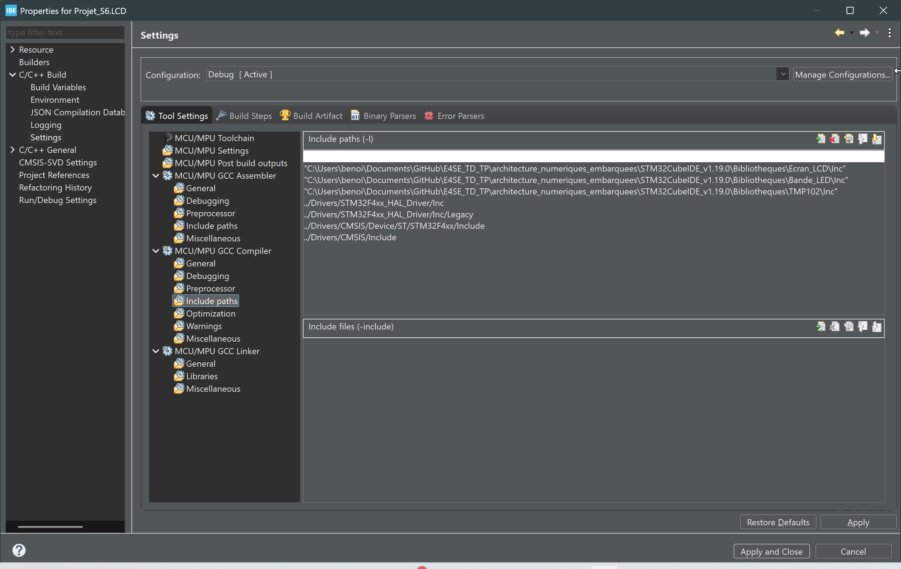
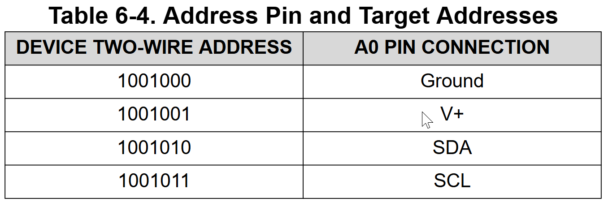
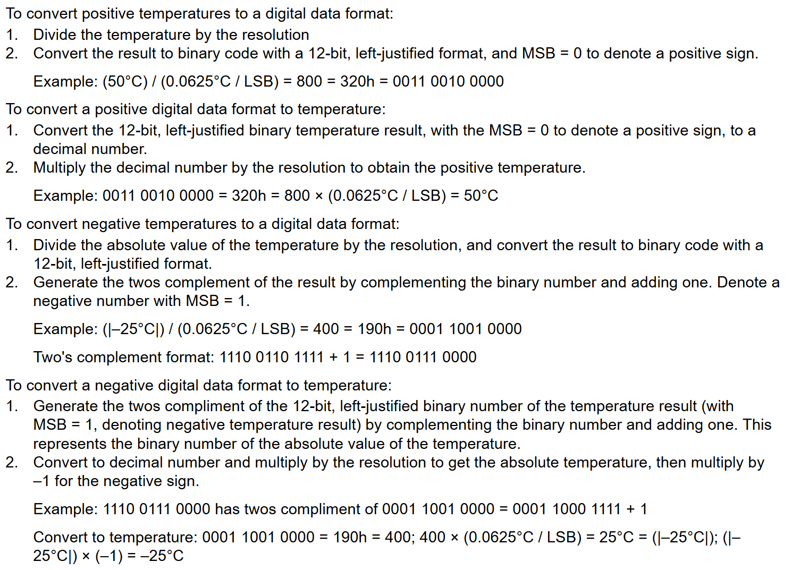

# Rapport de Projet - Maison Intelligente STM32

**ECUE :** Architecture Numériques Embarquées  
**Binôme :** Thibault AGUEH, Benoît DE KEYN   
**Date :** 26/10/2026  
**Carte cible :** NUCLEO-F411RE (STM32F411RET6)

---

## 1. Table des matières

<!-- TOC -->

- [1. Table des matières](#1-table-des-mati%C3%A8res)
- [2. Introduction](#2-introduction)
   - [2.1. Photos de la maison](#21-photos-de-la-maison)
   - [2.2. Description du fonctionnement](#22-description-du-fonctionnement)
- [3. Architecture globale du système](#3-architecture-globale-du-syst%C3%A8me)
   - [3.1. Branchement des composants](#31-branchement-des-composants)
   - [3.2. Arbre d'horloge et fréquences](#32-arbre-dhorloge-et-fr%C3%A9quences)
   - [3.3. Organisation logicielle](#33-organisation-logicielle)
- [4. Macros et types personalisés](#4-macros-et-types-personalis%C3%A9s)
   - [4.1. Pas de Hardcoding](#41-pas-de-hardcoding)
   - [4.2. Macros matérielles](#42-macros-mat%C3%A9rielles)
   - [4.3. Structure pour les LEDs](#43-structure-pour-les-leds)
- [5. — Scénario 1 — Base temporelle pour l'échantillonnage](#5--sc%C3%A9nario-1--base-temporelle-pour-l%C3%A9chantillonnage)
   - [5.1. Configuration du Timer](#51-configuration-du-timer)
   - [5.2. Clignotement de la LED témoin](#52-clignotement-de-la-led-t%C3%A9moin)
   - [5.3. Validation expérimentale](#53-validation-exp%C3%A9rimentale)
   - [5.4. Ancienne méthode](#54-ancienne-m%C3%A9thode)
- [6. — Scénario 2 — Sécurité : HOME/AWAY et détection d'intrusion](#6--sc%C3%A9nario-2--s%C3%A9curit%C3%A9--homeaway-et-d%C3%A9tection-dintrusion)
   - [6.1. Bouton MODE et anti-rebond](#61-bouton-mode-et-anti-rebond)
   - [6.2. Configuration de l'interruption externe (EXTI)](#62-configuration-de-linterruption-externe-exti)
   - [6.3. Machine à états HOME / AWAY](#63-machine-%C3%A0-%C3%A9tats-home--away)
   - [6.4. Capteur PIR et alarme intrusion](#64-capteur-pir-et-alarme-intrusion)
   - [6.5. Gestion non bloquante des alarmes](#65-gestion-non-bloquante-des-alarmes)
- [7. — Scénario 3 — Détection de gaz](#7--sc%C3%A9nario-3--d%C3%A9tection-de-gaz)
   - [7.1. Configuration de l'ADC et du DMA](#71-configuration-de-ladc-et-du-dma)
   - [7.2. Caractérisation du MQ-2 et seuil](#72-caract%C3%A9risation-du-mq-2-et-seuil)
   - [7.3. Alarme gaz](#73-alarme-gaz)
- [8. — Scénario 4 — Supervision UART](#8--sc%C3%A9nario-4--supervision-uart)
   - [8.1. Configuration de l'USART2](#81-configuration-de-lusart2)
   - [8.2. Redirection de printf](#82-redirection-de-printf)
   - [8.3. Informations transmises](#83-informations-transmises)
- [9. — Scénario 5 — Gestion intelligente de la fenêtre](#9--sc%C3%A9nario-5--gestion-intelligente-de-la-fen%C3%AAtre)
   - [9.1. Commande du servomoteur (TIM1 PWM)](#91-commande-du-servomoteur-tim1-pwm)
   - [9.2. Bouton fenêtre et anti-rebond](#92-bouton-fen%C3%AAtre-et-anti-rebond)
   - [9.3. Détection de pluie (Steam Sensor via ADC)](#93-d%C3%A9tection-de-pluie-steam-sensor-via-adc)
   - [9.4. Logique de décision de la fenêtre](#94-logique-de-d%C3%A9cision-de-la-fen%C3%AAtre)
- [10. — Scénario 6 — Mesure de température (TMP102)](#10--sc%C3%A9nario-6--mesure-de-temp%C3%A9rature-tmp102)
   - [10.1. Branchement et configuration CubeMX](#101-branchement-et-configuration-cubemx)
   - [10.2. Analyse de la datasheet](#102-analyse-de-la-datasheet)
   - [10.3. Communication I²C avec le capteur](#103-communication-ic-avec-le-capteur)
   - [10.4. Structure de la bibliothèque](#104-structure-de-la-biblioth%C3%A8que)
   - [10.5. Initialisation et configuration](#105-initialisation-et-configuration)
   - [10.6. Mode One-Shot et polling non bloquant](#106-mode-one-shot-et-polling-non-bloquant)
   - [10.7. Conversion et affichage de la température](#107-conversion-et-affichage-de-la-temp%C3%A9rature)
   - [10.8. Utilisation de la bibliothèque dans le code](#108-utilisation-de-la-biblioth%C3%A8que-dans-le-code)
   - [10.9. Gestion automatique de la fenêtre par la température](#109-gestion-automatique-de-la-fen%C3%AAtre-par-la-temp%C3%A9rature)
   - [10.10. Analyse des trames I²C](#1010-analyse-des-trames-ic)
- [11. — Scénario 7 — Intégration et affichage LCD](#11--sc%C3%A9nario-7--int%C3%A9gration-et-affichage-lcd)
   - [11.1. Configuration Bus I²C](#111-configuration-bus-ic)
   - [11.2. Intégration de la bibliothèque LCD I²C](#112-int%C3%A9gration-de-la-biblioth%C3%A8que-lcd-ic)
   - [11.3. Affichage des données en 16x2](#113-affichage-des-donn%C3%A9es-en-16x2)
- [12. — Bonus — Bibliothèque Bande LED RGB (WS2812B)](#12--bonus--biblioth%C3%A8que-bande-led-rgb-ws2812b)
   - [12.1. Principe de communication (protocole one-wire)](#121-principe-de-communication-protocole-one-wire)
   - [12.2. Implémentation PWM + DMA (TIM4)](#122-impl%C3%A9mentation-pwm--dma-tim4)
   - [12.3. Tableau de bord LED](#123-tableau-de-bord-led)
- [13. — Bonus — Gestion globale des alarmes](#13--bonus--gestion-globale-des-alarmes)
   - [13.1. Clignotement non bloquant par compteur partagé](#131-clignotement-non-bloquant-par-compteur-partag%C3%A9)
   - [13.2. Gestion du buzzer avec fréquences distinctes](#132-gestion-du-buzzer-avec-fr%C3%A9quences-distinctes)
   - [13.3. Cas simultané : alternance gaz / intrusion](#133-cas-simultan%C3%A9--alternance-gaz--intrusion)

<!-- /TOC -->
---

## 2. Introduction


### 2.1. Photos de la maison


Pour simplifier le cablage notamment pour les premiers scénarios, nous avons soudé des boutons, des LED (une RGB, une jaune et une bleue), et collé une breadboard sur un shield Arduino vierge. Voici à quoi ressemble notre montage :


### 2.2. Description du fonctionnement

Toutes les fonctionnalités respectent le cahier des charges du projet et, lorsque le sujet nous en laissait la liberté, une approche axée sur l'expérience utilisateur à été privilégié.

L'entrée et la sortie de la maison se font avec le bouton HOME.
Une fois sorti, la fenêtre reste fermée ou se ferme automatiquement, et l'alarme intrusion devient active et se déclenche automatiquement si une présence est détectée. Elle continue de sonner tant qu'on n'est pas rentré à nouveau dans la maison.

Dans la maison, on peut ouvrir et fermer la fenêtre avec le bouton fenêtre.
Si il commence à pleuvoir, la fenêtre se ferme automatiquement et force la fermeture tant qu'il pleut.
Le controle de la fenêtre suis également la température : si il fait trop chaud, la fenêtre s'ouvre automatiquement une fois (sans maintenir forcée l'ouverture) et vice versa s'il fait trop froid, la fenêtre se ferme une fois (sans maintenir forcée la fermeture).

L'alarme de gaz peut se déclencher à tout moment, quel que soit l'état de la maison.

Des logs sur le monieteur série permettent de suivre la valeur des capteurs et les différentes situations.

L'écran LCD indique la température, le niveau de gaz, le niveau de pluie et si on est sorti ou non.

Les 4 LEDs NeoPixel indiquent : 
- l'alarme intrusion en jaune clignotant
- l'alarme gaz en rouge clignotant
- la mise à jour de la valeur des capteurs, en bleu par un toogle.
- la tranche de température : 
   - bleu si trop froid
   - vert si tempéré
   - orange si trop chaud

## 3. Architecture globale du système


### 3.1. Branchement des composants

#### Contraintes de brochage
Nous avons voulu rester sur l'**Arduino Header** de la Nucleo pour simplifier le câblage avec la breadboard notamment. 
A partir du scenario 6, il a fallu réorganiser le brochage arbitraire qu'on faisait au début pour tout faire rentrer sur le header Arduino.
Nous avons donc listé tous les composants et leur fonctions pour leur assigner des broches du plus contraignant au moins contraignant.

Si on reprend le pinout fourni sur BlackBoard : 


---

**Priorité 1 — Broches fixées par le matériel**

Nous sommes partis de cette base :

- **PA2 & PA3** → USART2 TX/RX, reliés physiquement au ST-LINK sur la Nucleo pour la liaison série USB.
- **PA5 (D13)** → LED built-in, inutilisée pour pouvoir déporter les LEDs (avant d'implémenter les NeoPixels).
- **PB10 (D6)** → LED bleue que nous avons soudé sur le shield.

---

**Priorité 2 — I²C**

Le header Arduino n'avait qu'une paire de broches SDA & SCL disponibles, donc nous les avons réservée directement :

Le module **I2C3** est disponible avec :
- SCL sur **PA8 (D7)**
- SDA sur **PB4 (D5)**

---

**Priorité 3 — Timers**

Nous avions besoin de 4 timers :
- PWM du servomoteur
- PWM du buzzer passif
- PWM de la bande de 4 LEDs NeoPixel
- Timer pour l'échantillonnage

n'Nous avons que 4 timers disponibles sur le header Arduino.
Or pour l'échantillonnage nous voulions que l'ADC soit déclenché par un TGO event du timer d'échantillonnage, or il y a que les timers 2 et 3 qui permettent ça.
Nous avons donc choisit arbitrairement le timer 2 pour l'échantillonnage.
Pour le reste, nous avons choisi arbitrairement quel composant allait sur quel timer, sachant que APB1 et APB2 sont tous les deux à 100Mhz donc pas de différence sur ce point.

Résultat :
- Timer 1 → Servomoteur sur le channel 3 : PA9 (D8)
- Timer 2 → Echantillonnage
- Timer 3 → Buzzer sur le channel 2 : PB5 (D4)
- Timer 4 → LEDs NeoPixel sur le channel 1 : PA6 (D11)

---

**Priorité 4 — Voies analogiques**

Deux mesures analogiques sont nécessaires (gaz MQ-2 et capteur de pluie). 
L'ADC1 est le seul ADC de la carte. mais on a plusieurs entrées sur les broches analogiques notemment qui sont traditionnellement reservées aux mesures analogiques. On arbitrairement choisi parmi les AX restantes : 

- **A2 (PA4)** → ADC1 canal 4 → capteur de gaz MQ-2
- **A3 (PB0)** → ADC1 canal 8 → capteur de pluie

---

**Priorité 5 — Broches d'interruption**

Nous avions besoin de 3 interruptions externes (EXTI) :
- **Bouton HOME** (bascule mode HOME/AWAY)
- **Bouton FENÊTRE** (commande manuelle de la fenêtre)
- **Capteur PIR** (détection de mouvement)

La contrainte importante est que deux broches de **même numéro** sur des ports différents partagent la même ligne EXTI. Il fallait choisir des broches qui aient un numéro différent. Nous avons choisi :

- **PA6 (D12)** → EXTI 6   → Bouton HOME
- **PA10 (D2)** → EXTI 10  → Bouton FENÊTRE
- **PC7 (D9)**  → EXTI 7   → PIR

---

**Priorité 6 — Sorties GPIO**

Nous avions besoin de 3 sorties GPIO pour les LEDs indicatrices. Nous avons choisi arbitrairement parmi les broches restantes :

- **PB3 (D3)** → LED jaune du shield : Alarme intrusion
- **PA7 (D11)** → LED RGB couleur rouge du shield : Alarme gaz
- **PB10 (D6)** → LED bleue (imposé par la soudure) : cycle capteurs

PS : C'est seulement à la fin que nous avons décidé d'ajouter les 4 LEDs NeoPixels WS2812B en bonus. Mais nous l'avions déjà prise en compte au moment du refacto des pins. Finalement nous avons gardé les 2 systèmes de LED ensemble.

---

#### Tableau de brochage final
| Composant | Label CubeMX | Connecteur Arduino | Broche STM32 | Périphérique / Mode | Pull | Tension |
|---|---|---|---|---|---|---|
| Liaison série USB | SERIAL_TX | — | PA2 | USART2 TX (ST-LINK) | — | 3V3 |
| Liaison série USB | SERIAL_RX | — | PA3 | USART2 RX (ST-LINK) | — | 3V3 |
| TMP102 + LCD (SDA) | I2C_SDA | D5 | PB4 | I2C3 SDA | — | 5V |
| TMP102 + LCD (SCL) | I2C_SCL | D7 | PA8 | I2C3 SCL | — | 5V |
| Buzzer passif | BUZZER | D4 | PB5 | TIM3 CH2 – PWM | — | 3V3 |
| Servomoteur fenêtre | SERVO | D8 | PA9 | TIM1 CH2 – PWM | — | 5V |
| Bande LED NeoPixel | RGB_BANDE | D10 | PB6 | TIM4 CH1 – PWM + DMA | — | 5V |
| Capteur gaz MQ-2 | GAZ | A2 | PA4 | ADC1 CH4 | — | 5V |
| Capteur de pluie | PLUIE | A3 | PB0 | ADC1 CH8 | — | 5V |
| Capteur PIR | PIR_MVMT | D9 | PC7 | EXTI7 – Rising Edge | PULLDOWN | 3V3 |
| Bouton HOME/AWAY | BTN_HOME | D12 | PA6 | EXTI6 – Falling Edge | PULLUP | 3V3 |
| Bouton fenêtre | BTN_FENTR | D2 | PA10 | EXTI10 – Falling Edge | PULLUP | 3V3 |
| LED alarme intrusion | LED_JAUNE | D3 | PB3 | GPIO Output | — | 3V3 |
| LED cycle capteurs | LED_BLEUE | D6 | PB10 | GPIO Output | — | 3V3 |
| LED alarme gaz | RGB_ROUGE | D11 | PA7 | GPIO Output | — | 3V3 |

### 3.2. Arbre d'horloge et fréquences

Pour le réglage des horloge, nous avons simplement gardé la configuration que nous avions faite au premier TD, donc en gardant la plus haute fréquence possible pour le sysclk, l'APB1 et l'APB2 des timers, soit 100 MHz.


### 3.3. Organisation logicielle

#### Boucle principale et gestion des interruptions
Tout le code que nous avons écrit n'utilise jamais de delay ou de boucle while bloquante. Toutes les fonctions appelées dans la boucle while(1) sont des actions "instantanées" qui n'attendent pas un évènement pour se terminer.
Pour chaque routine d'interruption, nous avons préféré réduire au maximum le temps passé à l'intérieur en se contentant de lever un flag indiquant que l'évènement correspondant s'est produit. Le traitement est délocalisé dans des fonctions appelées à chaque passage de la boucle while(1) qui vérifient ces flags.

#### Organisation en bibliothèques
Pour l'écran LCD, le capteur de température et les 4 NeoPixels, nous avons créé des bibliothèques séparées comme demandé.
En revanche, au lieu de les placer à la racine du projet, comme nous en créions un nouveau pour chaque scénario, nous les avons regroupées dans un dossier `Bibliotheques`.  

Nous avons donc créé des liens symboliques, ajouté les chemins des header au compilateur, et inclus les dossiers symboliques au build pour qu'elles soient bien lues et compilées.

Dossiers symboliques  


Décochage de "Exclude from Build" dans les propriété des dossiers symboliques


Include path dans les project settings 
  

## 4. Macros et types personalisés


### 4.1. Pas de Hardcoding

Pour éviter les erreurs de recopie, faciliter la compréhension du code et surtout permettre de reconfigurer facilement des valeurs ou des changements de brochage, nous avons défini des macros (```#define```) pour chaque valeur ou objet HAL utilisés dans notre code.

### 4.2. Macros matérielles

Voici les macros matérielles définies dans le main.c qui permettent de pointer vers les différents périphériques sans avoir à changer toutes les occurences en cas de changement dans le .ioc :
```c
#define ADC_CAPTEURS    (&hadc1)
#define BUS_I2C         (&hi2c3)
#define TIMER_CAPTEURS  (&htim2)
#define TIMER_DEBOUNCE  (&htim5)
#define TIMER_SERVO     (&htim1)
#define CANAL_SERVO     TIM_CHANNEL_2
#define TIMER_BUZZER    (&htim3)
#define CANAL_BUZZER    TIM_CHANNEL_2
#define TIMER_BANDE_LED (&htim4)
#define CANAL_BANDE_LED TIM_CHANNEL_1
```

### 4.3. Structure pour les LEDs

Nous avons défini un type structure `LED_t` pour représenter une LED et son état. Les avantages de cette approches sont multiples : 

- Une seule variable de type `LED_t` suffit pour représenter une LED au lieu d'avoir un port et un pin à spécifier à chaque changement d'état.
- On peut mémoriser l'état de la LED dans la variable `state` de la structure, et le modifier sans avoir à utiliser les lourdes fonctions HAL.
- On peut associer un nom fonctionnel à un label matériel (ex : ```led_capteurs``` est redirigée vers ```LED_BLEUE```), ce qui donne plus de sens au code sans insérer des choix logiciels dans la configuration du ```.ioc```.

Voici la définition du type `LED_t` dans le ```main.c``` : 
```c
typedef struct {
    GPIO_TypeDef *port;
    uint16_t pin;
    bool state;
} LED_t;
```

Voici un exemple de déclaration de LED dans le ```main.c``` :
```c
volatile LED_t led_capteurs = {LED_BLEUE_GPIO_Port, LED_BLEUE_Pin, false};
...
```
*NB : Les macros associées aux Port et Pin des broches sont générée automatiquement par le .ioc dans le fichier ```main.h```.*

Dans la boucle while(1) de la fonction main, nous appelons à chaque exécution la fonction de commande des LED, qui va modifier l'état des LED en fonction de leur état mémorisé :

```c
void commande_led()
{
  if (led_capteurs.state) {
    HAL_GPIO_WritePin(led_capteurs.port, led_capteurs.pin, 1);
  } else {
    HAL_GPIO_WritePin(led_capteurs.port, led_capteurs.pin, 0);
  }
  ...
}
```

Voici les 3 exemples d'utilisation : 

```c
led_capteurs.state = true;
led_capteurs.state = false;
led_capteurs.state = !led_capteurs.state;
```

---

## 5. — Scénario 1 — Base temporelle pour l'échantillonnage


### 5.1. Configuration du Timer

Comme justifié dans la partie [3.1. Branchement des composants](#31-branchement-des-composants), nous avons choisi le Timer 2 pour cadencer la prise de mesure de nos capteurs.
Nous avons utilisé un timer avec interruptions pour éviter l'utilisation de boucles bloquantes, garantissant ainsi un échantillonnage régulier. L'horloge source du timer étant de 100 MHz, nous avons configuré les registres PSC et ARR pour obtenir une période d'échantillonnage de 2s (soit une fréquence de 0,5 Hz) : 

#### Calcul du Prescaler
Le registre $PSC$ étant codé sur 16 bits, sa valeur maximale est $2^{16} - 1 = 65\,535$ (soit un facteur de division de $65\,536$).
    $f_{\text{PSC, min}} = \frac{100\text{ MHz}}{65\,536} \approx 1\,525{,}88\text{ Hz}$ Nous avons donc choisi un Prescaler : (`PSC = 10000 - 1`)   qui nous donne pour obtenir une fréquence après prescaler de 10 kHz, largement au-dessus de la fréquence minimale possible et qui incrémente le compteur toutes les 0.1 ms.

    

#### Calcul de la Période
La valeur maximale de $ARR$ est identique à celle du $PSC$. À une fréquence de $10\text{ kHz}$, la durée maximale mesurable serait de :
    $T_{\text{max}} = \frac{65\,536}{10\,000\text{ Hz}} \approx 6{,}55\text{ secondes}$
   Nous avons donc choisit une Period:  (`ARR = 20000 - 1`) qui nous permet donc d'obtenir une durée exacte de 2 secondes ($20\,000 \times 0{,}1\text{ ms}$) inférieure à la durée maximale, et qui laisse une grande marge pour mofifier la période d'échantillonnage si besoin.

### 5.2. Clignotement de la LED témoin

Pour être informé de la mise à jour des capteurs par le timer TIM2, nous avons codé le changement d'état de la LED bleue à chaque interruption de fin de comptage générée par le TIM2 en passant par un flag :

Dans la section ```USER CODE 4``` du ```main.c``` :
```c
void HAL_TIM_PeriodElapsedCallback(TIM_HandleTypeDef *htim)
{
  if (htim == TIMER_CAPTEURS)
  {
    timer_capteurs_flag = true;
  }
  ...
}
```

Dans la boucle while(1) de la fonction main, nous vérifions le flag à chaque itération :

```c
  if (timer_capteurs_flag) {
    timer_capteurs_flag = false;
    led_capteurs.state = !led_capteurs.state;
    ...
  }
```

### 5.3. Validation expérimentale

En observant la LED à l'oscilloscope, nous avions pu vérifier que la période du signal correspond bien à exactement 4s, confirmant ainsi une période de 2s entre chaque inversion. Cela montre que le timer fonctionne comme prévu et que TIM2 est correctement configuré pour fournir la base temporelle souhaitée.

### 5.4. Ancienne méthode

Au début, nous avions utilisé le Timer 3 de manière totalement arbitraire, sans ```#define``` personnelisé pour les objets HAL, sans structure pour les LED, et sans flag pour les routines d'interruption :

```c
void HAL_TIM_PeriodElapsedCallback(TIM_HandleTypeDef *htim) {
    if (htim->Instance == TIM3) {
        HAL_GPIO_TogglePin(BLUE_GPIO_Port, BLUE_Pin);
    }
}
```

## 6. — Scénario 2 — Sécurité : HOME/AWAY et détection d'intrusion


### 6.1. Bouton MODE et anti-rebond

> _Expliquer le choix d'utiliser le bouton sur PA6 en EXTI sur front descendant (falling edge) avec pull-up interne. Justifier le mécanisme d'anti-rebond implémenté : à l'appui, un flag `debouncing_bouton_home` est levé et le compteur de TIM5 est remis à zéro. TIM5 est configuré à 20 Hz (Prescaler=10000-1, Period=500-1 → 50 ms). Au prochain tick de TIM5, `debounce_filter()` vérifie que le bouton est bien relâché (état stable) avant de valider l'appui. Expliquer pourquoi cette méthode est plus fiable qu'un simple délai bloquant._

### 6.2. Configuration de l'interruption externe (EXTI)
Le bouton MODE est connecté à PA6 et configuré en EXTI sur front descendant (_L'interruption est déclenchée au moment précis où l'utilisateur appuie sur le bouton, lorsque le signal passe de haut à bas_) avec pull-up interne (_maintient le signal à l'état haut_). 
Cela permet de détecter les appuis sur le bouton tout en évitant les faux déclenchements dus au bruit. 

#### Mécanisme d'anti-rebond non bloquant via TIM5
Pour s'assurer que l'appui sur le bouton est correctement détecté sans être perturbé par les rebonds mécaniques, nous avons mis en place un mécanisme anti-rebond via TIM5.

* **Prescaler** (`PSC = 10000-1`) : Nous avons gardé la meme résolution que pour le TIM3 soit une résolution exacte de $0{,}1\text{ ms}$ par tic.
* **Counter Period (`500-1`) :** Nous cherchons une période de  **$50\text{ ms}$** ($\frac{500}{10\,000\text{ Hz}}$) (20Hz), largement satisfaisante pour couvrir largement la fenêtre de rebonds mécaniques du bouton.

Lors de l'appui sur le bouton MODE, l'interruption EXTI sur PA6 est déclenchée. Dans le gestionnaire d'interruption, le flag `debouncing_bouton_home` est levé et le compteur de TIM5 est remis à zéro. 
```c
// Définition utilisé pour l'anti-rebond
#define BTN_HOME_Pin GPIO_PIN_6
#define BTN_HOME_GPIO_Port GPIOA
#define TIMER_DEBOUNCE &htim5

// Flag utilisé pour l'anti-rebond
volatile bool   timer_debounce_flag         = false;
volatile bool   debouncing_bouton_home      = false;

void HAL_TIM_PeriodElapsedCallback(TIM_HandleTypeDef *htim)
{
  if (htim == TIMER_DEBOUNCE)
  {
	  timer_debounce_flag = true;
  }
  ...
}

void HAL_GPIO_EXTI_Callback(uint16_t GPIO_Pin)
{
   ...
  if (GPIO_Pin == BTN_HOME_Pin)
  {
    if (!debouncing_bouton_home) {
      debouncing_bouton_home = true;
      __HAL_TIM_SET_COUNTER(TIMER_DEBOUNCE, 0);
    }
  }
  ...
}
```
. À chaque tick, la fonction `debounce_filter()` vérifie si le bouton est toujours relâché. Si l'état est stable, l'appui est validé et le flag `debouncing_bouton_home` est réinitialisé. Ce mécanisme permet de gérer l'anti-rebond de manière non bloquante, contrairement à un simple délai qui stopperait l'exécution du programme.
```c
void debounce_filter() 
{
	if (debouncing_bouton_home && !HAL_GPIO_ReadPin(BTN_HOME_GPIO_Port, BTN_HOME_Pin)) {
		debouncing_bouton_home = false;
		bouton_home_appuye = true;
	}

	if (debouncing_bouton_fenetre && !HAL_GPIO_ReadPin(BTN_FENTR_GPIO_Port, BTN_FENTR_Pin)) {
		debouncing_bouton_fenetre = false;
		bouton_fenetre_appuye = true;
	}
}
```

#### Pourquoi cette méthode dépasse le simple délai blquant ?

L'utilisation de TIM5 pour gérer l'anti-rebond permet au microcontrôleur de continuer à exécuter d'autres tâches pendant la période de stabilisation du bouton. Contrairement à un simple délai bloquant qui stopperait l'exécution du programme, cette méthode non bloquante assure que le système reste réactif et que d'autres événements (comme la détection PIR ou le clignotement LED) peuvent être traités simultanément.


### 6.3. Machine à états HOME / AWAY

> _Décrire la machine à états dans la boucle principale : état `HOME` (éclairage/fenêtre actifs, pas d'alarme intrusion) et état `AWAY` (fenêtre forcée fermée, bouton fenêtre ignoré, détection PIR active). Expliquer les transitions : bouton MODE bascule HOME→AWAY (ferme la fenêtre) ou AWAY→HOME (désactive l'alarme intrusion). Justifier que le changement de mode est signalé sur l'écran LCD et via UART._

### 6.4. Capteur PIR et alarme intrusion

> _Décrire la configuration du PIR sur PC7 en EXTI Rising Edge avec pull-down. Expliquer le comportement : en mode AWAY, le front montant positionne `presence_detectee = true`, ce qui déclenche l'alarme intrusion dans la boucle principale. En mode HOME, l'interruption PIR est ignorée. Justifier que le traitement est minimal dans l'ISR (un simple flag)._

### 6.5. Gestion non bloquante des alarmes

> _Renvoyer vers la section 11 pour le détail de l'implémentation non bloquante du clignotement LED + buzzer._

---

## 7. — Scénario 3 — Détection de gaz


### 7.1. Configuration de l'ADC et du DMA

> _Expliquer la configuration de l'ADC1 en mode Scan avec 2 canaux (CH4 pour le gaz, CH8 pour la pluie). Justifier l'utilisation du DMA en mode circulaire (DMA2 Stream0) pour le transfert automatique des résultats dans le tableau `adc_valeurs[2]`. Expliquer le déclenchement externe par TIM2 TRGO (Event Update) : à chaque période de 2 s, une séquence de conversion est automatiquement lancée sans intervention logicielle. Le callback `HAL_ADC_ConvCpltCallback` positionne un flag pour le traitement dans la boucle principale._

### 7.2. Caractérisation du MQ-2 et seuil

> _Décrire les mesures expérimentales réalisées pour caractériser le capteur MQ-2 : valeur au repos (air ambiant) vs. valeur en présence de gaz (briquet/allumette). Justifier le seuil `SEUIL_GAZ = 2500` retenu sur une plage ADC de 0–4095 (12 bits). Mentionner le temps de chauffe du capteur si observé._

### 7.3. Alarme gaz

> _Expliquer que la surveillance du gaz est active en permanence (indépendante du mode HOME/AWAY), conformément au cahier des charges. Quand `gaz_valeur >= SEUIL_GAZ`, le flag `alarme_gaz` est activé, ce qui déclenche le clignotement de la LED rouge (RGB_ROUGE sur PA7) et le buzzer à 440 Hz. Un message « Gaz detecte ! » est envoyé sur UART et affiché sur le LCD._

---

## 8. — Scénario 4 — Supervision UART


### 8.1. Configuration de l'USART2

> _Expliquer que l'USART2 (PA2 TX, PA3 RX) est la liaison série reliée au ST-LINK sur la Nucleo, permettant la communication avec un terminal PC via USB. Mentionner la vitesse par défaut (115200 baud)._

### 8.2. Redirection de printf

> _Justifier le choix de rediriger `printf` via `__io_putchar()` qui appelle `HAL_UART_Transmit()`. Mentionner l'avantage : utilisation facile de `printf` et `snprintf` dans tout le code pour le debug et la supervision._

### 8.3. Informations transmises

> _Lister les informations transmises via UART : message de bienvenue au démarrage (seuils configurés, fréquences), valeurs des capteurs à chaque cycle (GAZ, PLUIE, TEMP), événements (changement de mode, ouverture/fermeture fenêtre, alarmes intrusion/gaz)._

---

## 9. — Scénario 5 — Gestion intelligente de la fenêtre


### 9.1. Commande du servomoteur (TIM1 PWM)

> _Expliquer la configuration de TIM1 CH2 en PWM pour le servo (PA9). Détailler le calcul : horloge APB2 Timer = 100 MHz, Prescaler = 40-1 → fréquence timer = 2.5 MHz, Period = 50000-1 → fréquence PWM = 50 Hz (période de 20 ms, standard servo). Décrire la fonction `angle_servo(int angle)` qui convertit un angle (0°–180°) en nombre de ticks de comparaison : impulsion de 0.5 ms (0°) à 2.5 ms (180°). Mentionner la limitation matérielle à 120° max pour éviter d'endommager le montage._

### 9.2. Bouton fenêtre et anti-rebond

> _Expliquer que le bouton fenêtre (PA10, EXTI Falling Edge, Pull-up) utilise le même mécanisme d'anti-rebond que le bouton MODE via TIM5. Justifier le choix du front descendant + pull-up (le bouton est actif bas). En mode HOME et sans pluie, chaque appui bascule la fenêtre entre OUVERTE et FERMEE. En mode AWAY ou en cas de pluie, l'appui est ignoré._

### 9.3. Détection de pluie (Steam Sensor via ADC)

> _Décrire le Steam Sensor connecté sur PB0 (ADC1 CH8). Expliquer la caractérisation expérimentale et justifier le seuil `SEUIL_PLUIE = 4000`. Quand la pluie est détectée, la fenêtre est forcée fermée et le bouton fenêtre est ignoré tant que la condition persiste._

### 9.4. Logique de décision de la fenêtre

> _Résumer les règles de priorité de la fenêtre : (1) mode AWAY → fermée, (2) pluie détectée → fermée, (3) commande manuelle (bouton) si HOME et pas de pluie, (4) commande automatique par température (voir scénario 6). Expliquer que `commande_fenetre()` n'envoie le signal PWM au servo que lors d'un changement d'état (variable `etat_precedent`) pour éviter des commandes inutiles._

---

## 10. — Scénario 6 — Mesure de température (TMP102)


### 10.1. Branchement et configuration CubeMX

*Extrait de la datasheet du TMP102 :*  


#### Alimentation (VCC/GND)
Nous avons alimenté le capteur avec la broche 3.3V de la carte Nucleo.

| Signal | Broche |
| :--- | :--- |
| VCC | 3.3V |
| GND | GND |

#### Bus I²C (SDA/SCL)
Pour tous les composants I²C (à savoir le TMP102 et l'écran LCD) nous avons utilisé le bus I2C3 en suivant le branchement suivant : 

| Signal | Broche | Arduino |
| :--- | :--- | :--- |
| SDA | PB4 | A4 |
| SCL | PA8 | A5 |

Nous n'avons pas touché à la configuration par défaut après avoir assigné les 2 broches :  


Les interruptions et le DMA sont désactivés.

#### Adresse I²C (ADD0)
L'adresse I²C du TMP102 est par défaut 0x48.
Cependant il est possible de la choisir en fonction du branchement de la broche ADDR0 :

*Extrait de la datasheet du capteur TMP102 :*  


Pour lever toute ambiguité, nous avons simplement mis la broche ADDR0 à la masse, ce qui correspond à l'adresse 0x48 (1001000).

#### Broche (ALT)
Comme expliqué ci-dessous, nous n'avons pas eu besoin d'utiliser les alertes du capteurs, nous avons donc laissé la broche ALERT déconnectée.

### 10.2. Analyse de la datasheet

#### Registres accessibles
En lisant la datasheet sur les modes et les registres accessibles depuis I²C, nous avons remarqué qu'il y avait 4 registres de 16 bits accessibles en I²C par une adresse sur 2 bits interprétée par le pointer register : 


#### Registre de température
Le registre de température contient simplement une valeur sur 12 ou 13 bits en fonction du mode de résolution.
La valeur est alignée à gauche et suivie d'un padding de 3 ou 4 '0'.
La conversion se fait selon une série d'étapes détaillées ici :

*Extrait de la datasheet du capteur TMP102 :*      


#### Registre de configuration
Le registre de configuration (adresse 0x01) permet de régler plusieurs paramètres du capteur :

* La résolution de la mesure (12bits ou 13 bits en "Extended mode")
* Le mode de mesure : Shutdown avec One-Shot ou Continous
* La fréquence d'actualisation du registre de température en mode "Continous" (1, 2, 4 ou 8 Hz)
* Le fonctionnement des alertes de dépassement de seuil haut/bas (polarité, interruption, stabilisation, ...)

Nous avons préféré écrire une bibliothèque complète qui permette d'utiliser l'ensemble des fonctionnalités du capteur.  
Cependant nous n'avons pas utilisé ni la résolution sur 13 bits (car une maison n'a pas besoin de mesurer plus de 128°C), ni les alertes car il était demandé explicitement de mesurer la température périodiquement toutes les 2-5 secondes.  

#### Registres T_LOW et T_HIGH

Nous n'avons pas utilisé ces 2 registres qui permettent de définir un seuil haut et bas en encodant une température limite pour les déclenchement de l'alerte, selon le même encodage que pour le registre de température.
Nous avons néamoins laissé la possibilité de les modifier de manière fonctionnelle dans la bibliothèque.

### 10.3. Communication I²C avec le capteur

### 10.4. Structure de la bibliothèque

### 10.5. Initialisation et configuration

### 10.6. Mode One-Shot et polling non bloquant

Comme il était indiqué dans le TP de coder une fonction pour lancer une mesure, et pour configurer le capteur (sachant que par défaut, le capteur est en mode "Continous"), et par souci d'optimisation des resources, nous avons choisi de mettre le capteur en mode "Shutdown" et de lancer une mesure avant de lire le registre de température à chaque cycle du timer d'échantillonage.

Le capteur est donc en veille pendant 2 secondes et se réveille pendant ~10 ms le temps de la mesure, puis se remet en veille automatiquement à la fin de sa mesure. En veille il consomme moins de 0,15µA contre 2,6µA pendant le temps d'attente entre 2 mesures du mode "Continous".  
D'autant plus que le choix de la fréquence en mode "Continous" étant limmité, il aurait fallu déclencher une mesure 2 fois plus souvent (à 1Hz) sachant qu'une mesure consomme 55µA pendant ~10ms.

*Extraits de la datasheet du capteur TMP102 :*


### 10.7. Conversion et affichage de la température


### 10.8. Utilisation de la bibliothèque dans le code


### 10.9. Gestion automatique de la fenêtre par la température

### 10.10. Analyse des trames I²C

---

## 11. — Scénario 7 — Intégration et affichage LCD

### 11.1. Configuration Bus I²C

#### Branchement et configuration CubeMX
Commun au capteur TMP102   
→ [Bus I²C (SDA/SCL)](#bus-ic-sdascl).

#### Adresse I²C
Nous n'avons pas changé l'adresse par défaut de l'écran car nous avons seulement deux composants aux adresses compatibles.  
Nous utilisons donc l'adresse 0x27 (toujours décalée de 1 bit).

### 11.2. Intégration de la bibliothèque LCD I²C

#### Modification de l'initialisation
Comme nous avons défini l'objet I2C3 de l'HAL en macro, nous avons modifié la fonction d'initialisation de la biibliothèque pour stocker le pointeur vers un objet I2C de la HAL dans une variable globale interne au code source de la bibliothèque :

*Extrait de Bibliotheques/Ecran_LCD/Src/i2c-lcd.c :*
```c
static I2C_HandleTypeDef *local_bus_i2c = NULL;

void lcd_init (I2C_HandleTypeDef *bus_i2c)
{
   local_bus_i2c = bus_i2c;
   ...
}
```

### 11.3. Affichage des données en 16x2

> _Justifier l'organisation de l'affichage sur les 2 lignes de 16 caractères :_
> - _Ligne 1 : `HOME  18,38°C` — mode courant (4 car.) + température (8 car.)_
> - _Ligne 2 : `Hu 1234  Ga 1234` — valeur pluie et valeur gaz_
>
> _Expliquer que l'affichage du mode n'est mis à jour qu'au changement, et que les valeurs des capteurs sont mises à jour à chaque cycle de 2 s (après la dernière mesure disponible : la température). Justifier ce découpage pour maximiser l'information affichée dans l'espace contraint. Mentionner le message de bienvenue au démarrage._

---

## 12. — Bonus — Bibliothèque Bande LED RGB (WS2812B)


### 12.1. Principe de communication (protocole one-wire)

> _Décrire le protocole des LED WS2812B : signal one-wire à 800 kHz, chaque bit est codé par la durée de l'impulsion haute (400 ns pour un 0, 800 ns pour un 1) sur une période fixe. L'ordre des couleurs dans la trame est GRB. Un délai de reset (≥ 50 µs) termine la trame._

### 12.2. Implémentation PWM + DMA (TIM4)

> _Justifier le choix de TIM4 CH1 (PB6) en PWM + DMA pour générer le signal : chaque bit correspond à un cycle PWM dont le duty cycle est ajusté par une valeur dans le buffer DMA. Le timer est cadencé à 100 MHz, Period = 125-1 → fréquence PWM = 800 kHz. Le DMA (DMA1 Stream0, Memory to Peripheral) transfère automatiquement les valeurs de duty cycle pour chaque bit de chaque LED. Détailler la construction du buffer DMA dans `BandeLED_show()` : pour chaque LED, pour chaque composante (GRB), pour chaque bit (MSB first), la valeur de comparaison est soit `pulse_bit_0` soit `pulse_bit_1`. Les cycles de reset (duty = 0) sont ajoutés à la fin._

### 12.3. Tableau de bord LED

> _Expliquer l'utilisation de la bande de 4 LEDs RGB comme tableau de bord visuel :_
> - _LED haut gauche (violet) : clignote à chaque cycle capteurs (témoin d'activité)_
> - _LED haut droite (rouge) : état de l'alarme gaz (clignotante si alerte)_
> - _LED bas droite (orange) : état de l'alarme intrusion (clignotante si alerte)_
> - _LED bas gauche : indicateur de température (bleu = froid, vert = tempéré, orange = chaud)_
>
> _Justifier le choix de la luminosité réduite (`LUMINOSITE_BASE = 10/255`) pour éviter l'éblouissement._

---

## 13. — Bonus — Gestion globale des alarmes


### 13.1. Clignotement non bloquant par compteur partagé

> _Expliquer le mécanisme de clignotement non bloquant : un compteur `blink_counter_alarm` est incrémenté à chaque tick de TIM5 (20 Hz). Pour chaque alarme, une demi-période de clignotement est calculée en nombre de ticks (ex : alarme gaz à 10 Hz → demi-période = 1 tick ; alarme intrusion à 2 Hz → demi-période = 5 ticks). L'état de la LED est inversé à chaque fin de demi-période. Justifier que ce mécanisme est entièrement non bloquant._

### 13.2. Gestion du buzzer avec fréquences distinctes

> _Expliquer que le buzzer passif (PB5, TIM3 CH2) est piloté en PWM avec un duty cycle de 50 %. La fréquence du buzzer est ajustée dynamiquement via `frequence_buzzer()` qui modifie l'auto-reload et le compare de TIM3. L'alarme gaz sonne à 440 Hz (La4), l'alarme intrusion à 384 Hz. Le buzzer est synchronisé avec l'état de la LED correspondante (il sonne quand la LED est allumée)._

### 13.3. Cas simultané : alternance gaz / intrusion

> _Décrire la stratégie quand les deux alarmes sont actives simultanément : le buzzer alterne entre les deux fréquences (intrusion puis gaz) par demi-périodes, tandis que chaque LED clignote indépendamment à sa propre fréquence. Justifier ce choix pour permettre d'identifier les deux alarmes même quand elles sont concomitantes._
