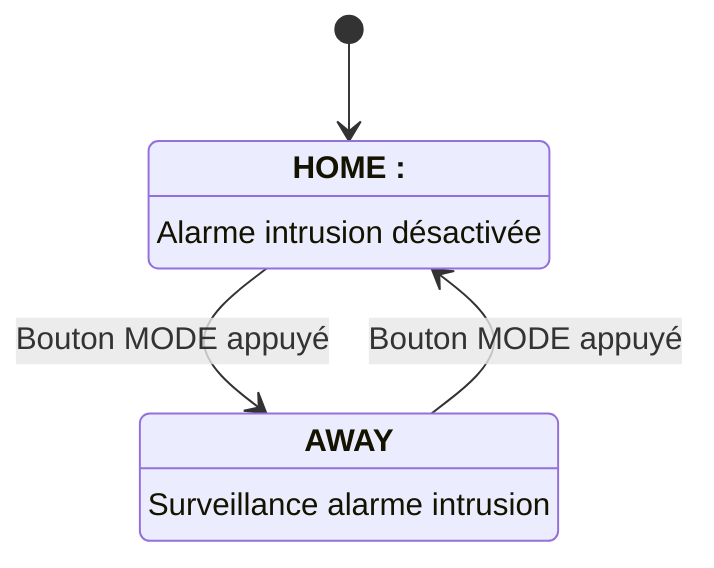
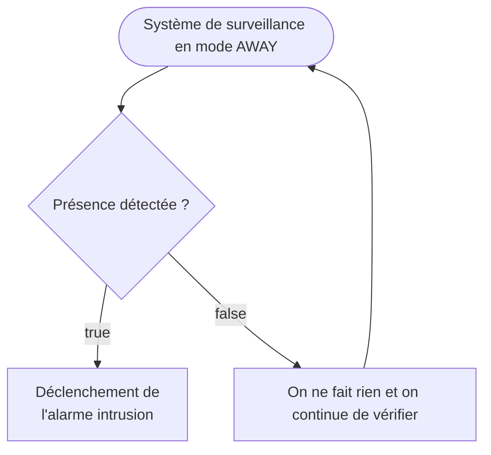
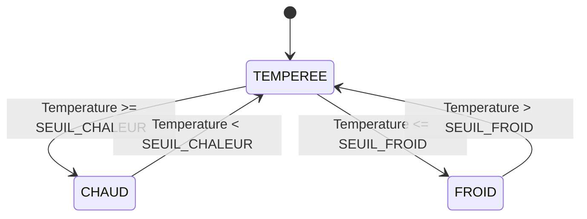
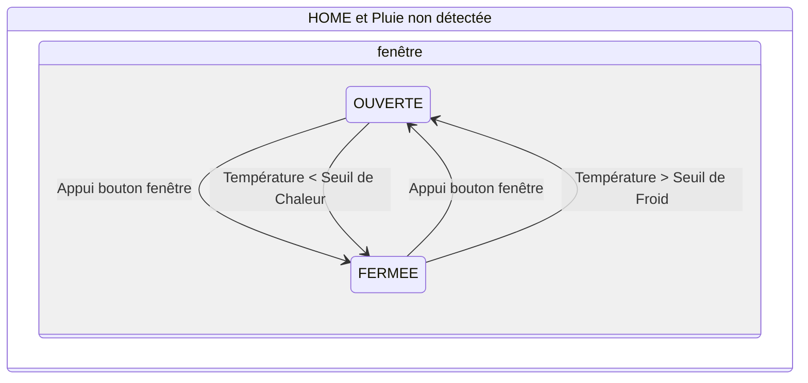

### 6.3. Machine à états HOME / AWAY

#### Description de la machine à états

````mermaid
stateDiagram
  direction TB
[*] --> HOME
  AWAY:AWAY
  HOME:HOME
  HOME --> AWAY:Bouton MODE appuyé
  AWAY --> HOME:Bouton MODE appuyé
````
### 6.5. Comportement selon le mode (AWAY vs HOME)

#### Machine à états avec alarme intrusion





### 10.12. Gestion automatique de la fenêtre par la température

#### Seuils et états de température


#### Résumé des comportements global de la fenêtre

