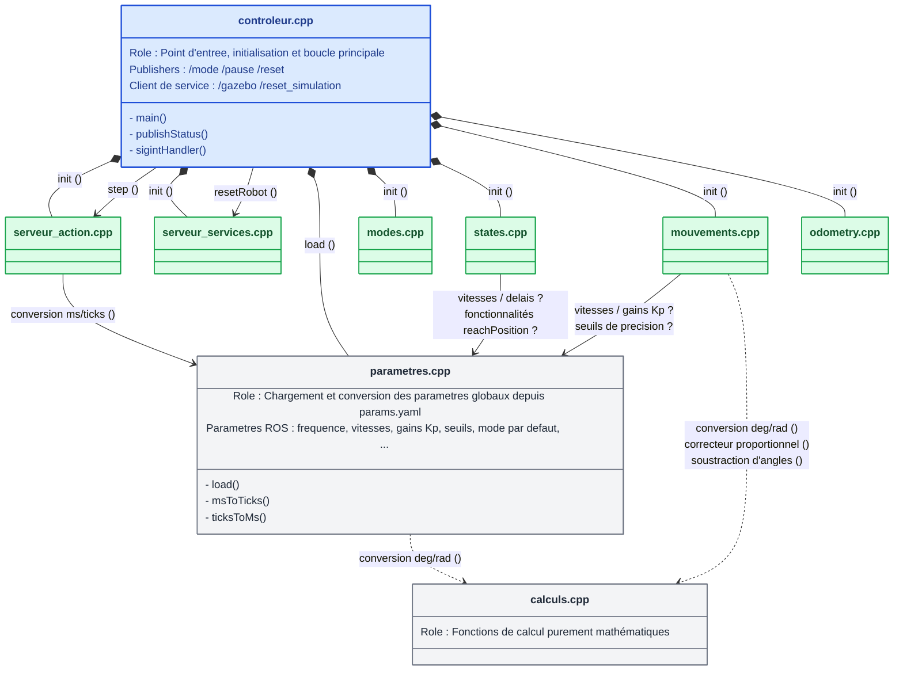
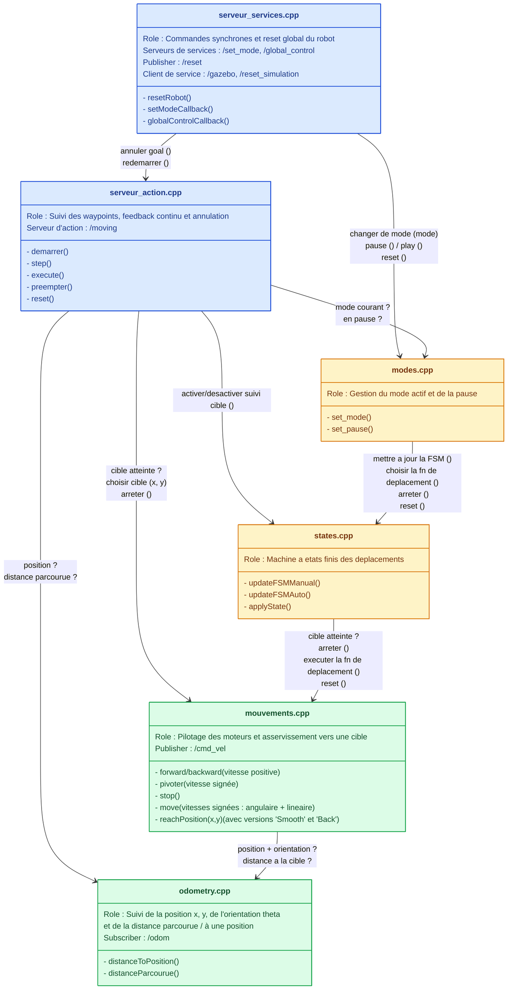
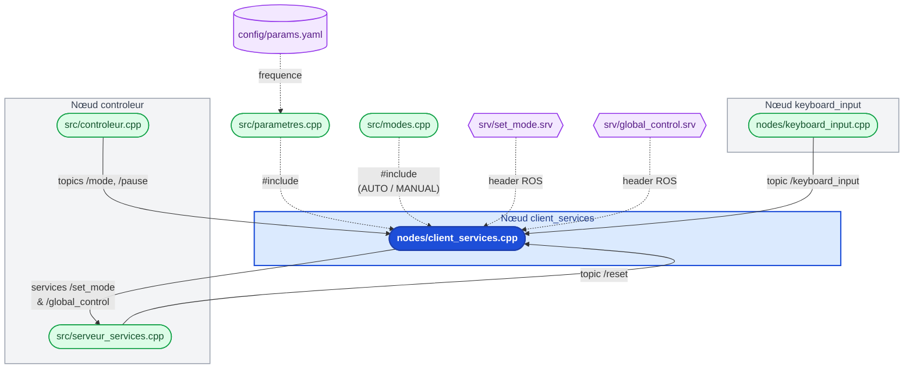
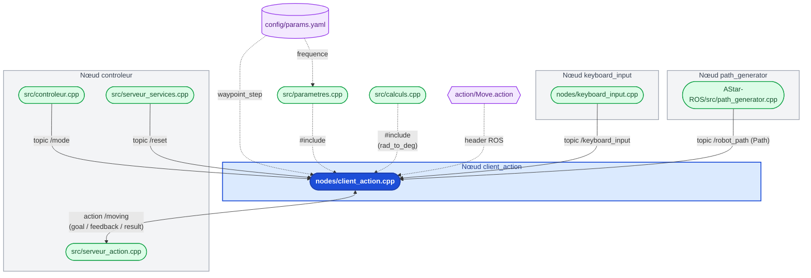

# Rapport — Projet robotique mobile et navigation autonome : Application au robot TurtleBot3

## I. Architecture finale du projet

### Arborescence du paquet TABDK


### Découpage du noeud Controleur en classes

#### Classe principale et dépendances neutres

Le fichier `calculs.cpp` est le seul fichier `.cpp` qui ne contient pas une classe mais simplement des fonctions utilitaires.




#### Interactions entre les classes du nœud Controleur



### Interaction des différents noeuds

Les 4 nœuds du dossier `TABDK/src/nodes/` complètent le nœud `controleur`. Leurs diagrammes d'interactions détaillés (dépendances de compilation, paramètres, topics, services et action) sont présentés et commentés dans la **version finale** de leurs parties respectives :

| Nœud (`TABDK/src/nodes/`) | Rôle principal | Schéma détaillé |
| --- | --- | --- |
| `keyboard_input.cpp` | Capture clavier non-canonique → `/keyboard_input` | [§ 3.2 Mode navigation manuelle](#32-mode-navigation-manuelle) |
| `detector.cpp` | Analyse LiDAR 8 régions, marqueurs RViz & anti-collision | [§ 4. Perception LiDAR](#4-perception-de-lenvironnement-à-laide-du-lidar-capteur-de-distance-laser-360-lds-01---lds-02) |
| `client_services.cpp` | Commandes clavier `m`/`p`/`r` → `/set_mode` & `/global_control` | [§ 5.1 Services](#51-configuration-à-la-volée-du-comportement-du-robot--service) |
| `client_action.cpp` | File de waypoints (clavier ou `/robot_path`) → action `/moving` | [§ 5.3 Gestion des trajectoires — Path](#53-gestion-des-trajectoires--path) |

> La démarche complète de passage d'un `controleur.cpp` monolithique à cette architecture orientée objet (pattern `init()`, injection de dépendances, callbacks membres et contraintes spécifiques de `ServeurAction`) est détaillée en [§ 7. Migration architecturale](#7-migration-architecturale--du-monolithe-controleurcpp-au-système-de-classes).

## 2. Pilotage de base et paramétrage du TB3

### 2.3 Pilotage de base du TB3

#### Énoncé

Ajouter dans le nœud contrôleur un *publisher* générant une commande en vitesse pour déplacer le robot TurtleBot3 :

1. Identifier le topic concerné, l'en-tête `.h`, son *namespace* et le type de message associé.
2. Réaliser `avancer(double vitesse)` et `arreter()` (publication effectuée dans la boucle principale).
3. Arrêter proprement le robot lors d'un `CTRL+C` dans `sigintHandler`.
4. Enchaîner périodiquement **avancer → arrêter → reculer** avec des durées multiples de la période du contrôleur.

#### Choix fonctionnels

- Utilisation du topic `/cmd_vel` avec le message `geometry_msgs::Twist` (`#include <geometry_msgs/Twist.h>`), en pilotant `linear.x` (translation) et `angular.z` (rotation).
- Conception de primitives élémentaires (`forward`, `backward`, `pivoter`, `stop`, `move`) afin de poser une couche bas niveau réutilisable dans tous les exercices suivants.
- Séquencement périodique géré par une machine à états (`FORWARD` → `STOP` → `BACKWARD`) cadencée par `ros::Rate`.
- Interception explicite de `SIGINT` (`ros::init_options::NoSigintHandler`) afin de garantir l'envoi d'une vitesse nulle avant la fermeture de ROS.

#### Première implémentation

Le premier package `TABDK` regroupait tout dans un unique fichier `controleur.cpp` (131 lignes) : un *publisher* `/cmd_vel`, des fonctions globales (`forward`, `backward`, `stop`), un compteur de ticks et une boucle `while (ros::ok())`. Les durées étaient initialement configurées en **nombre brut de périodes** (`move_fwd_per: 10`, `move_bwd_per: 5`, `move_stp_per: 3`).

#### Difficultés rencontrées

- **Arrêt incomplet dans `stop()`** : la première version remettait uniquement `vel.linear.x = 0` sans toucher à `vel.angular.z`. Dès l'ajout de la rotation (`pivoter()`), le robot continuait de tourner sur place après un arrêt ; corrigé en réinitialisant tout le message via `vel = Twist()`.
- **Arrêt lors d'un `CTRL+C`** : sans `NoSigintHandler`, ROS coupe la boucle avant que la commande d'arrêt ne soit publiée et le robot continue sur son inertie. Le passage par un drapeau `arret_demande` levé par `sigintHandler` permet d'exécuter un arrêt garanti en sortie de boucle.
- **Dépendance des durées à la fréquence** : exprimer les durées en nombre de périodes (`*_per`) changeait la durée réelle des mouvements dès qu'on modifiait la fréquence de boucle ; passage à des durées en millisecondes (`*_tm`) converties par `msToTicks()`.

#### Version finale

- Les primitives moteurs sont encapsulées dans la classe `Mouvements` (`TABDK/src/mouvements.cpp`), avec `stop()` publiant un `Twist()` nul.
- Le cycle périodique avancer/arrêter/reculer est conservé dans `States::updateFSMAuto()` (`TABDK/src/states.cpp`).
- `sigintHandler()` dans `TABDK/src/controleur.cpp` lève `arret_demande`, déclenchant `services.resetRobot()` puis `ros::shutdown()` en sortie de boucle.

---

### 2.4 Paramètres de l'application

#### Énoncé

Rendre l'application générique en spécifiant des paramètres (notamment la fréquence de contrôle) au lancement des nœuds, soit via les arguments de `run.launch`, soit via un fichier YAML dans un sous-dossier `config/`, puis tester le contrôleur à différentes fréquences.

#### Choix fonctionnels

- Adoption d'un fichier YAML centralisé (`TABDK/config/params.yaml`) chargé sur le serveur de paramètres ROS par `<rosparam command="load" file="$(find TABDK)/config/params.yaml" />` dans `launch/run.launch`, plutôt que de multiplier les `<arg>` dans le launch file.
- Saisie des paramètres angulaires en **degrés** et des temporisations en **millisecondes** dans le YAML pour rester lisible lors des essais sur robot, avec conversion automatique en radians / ticks au chargement.
- Valeurs par défaut codées dans la classe `Params` servant de filet de sécurité si une clé manque ou comporte une faute de frappe dans le YAML.

#### Première implémentation

Le premier `config/params.yaml` ne comportait que 5 clés (`frequence`, `linear_speed`, `move_fwd_per`, `move_bwd_per`, `move_stp_per`), lues directement au début du `main()` de `controleur.cpp`. Par la suite, les premiers nœuds satellites (`keyboard_input`, `detector`, `client_action`) ont d'abord conservé leurs propres constantes codées en dur (`FREQ_ACTUALISATION = 5`, `Rate loop_rate(5)`, `MIN_DELAY_COLLISION = 2.0f`).

#### Difficultés rencontrées

- **Paramètres éclatés et fréquences désynchronisées** : multiplier les constantes locales dans chaque nœud empêchait de changer la fréquence globale ou les seuils de collision d'un seul geste. La classe `Params` a donc été incluse dans l'ensemble des 5 nœuds pour unifier le chargement.
- **Pièges de saisie YAML et d'unités** : un doublon de clé dans `params.yaml` (par exemple `debut_collision_face` renseigné deux fois au lieu de `debut_collision_dos`) ou une confusion degrés/radians peut passer silencieusement ; les valeurs de repli de `Params` et la conversion centralisée dans `Params::load()` limitent ces risques.

#### Version finale

- La classe `Params` (`TABDK/src/parametres.cpp`) est incluse par les 5 nœuds du package (`controleur`, `keyboard_input`, `client_services`, `client_action`, `detector`).
- `Params::load(nh)` charge 19 paramètres (fréquence, vitesses, gains `Kp_*`, seuils de précision et de pivot, `waypoint_step`, `move_smooth`, `move_back`, `default_mode`, temporisations et paramètres anti-collision) et convertit `precision_angular` et `trigger_pivot` en radians.
- Les méthodes `msToTicks()` et `ticksToMs()` garantissent une base de temps homogène dans tout le contrôleur, indépendante de la fréquence choisie :

<!-- code:TABDK/src/parametres.cpp -->
```cpp
void load(NodeHandle &nh) {
  nh.getParam("frequence", frequence);
  // ... chargement des vitesses, gains Kp, seuils, modes et collision ...
  precision_angular = deg_to_rad(precision_angular);
  trigger_pivot     = deg_to_rad(trigger_pivot);
}

int msToTicks(int ms)                   { return frequence * ms / 1000; }
double ticksToMs(std::uint64_t ticks) const { return ticks * 1000.0 / frequence; }
```

*(Voir [§ 7. Migration architecturale](#7-migration-architecturale--du-monolithe-controleurcpp-au-système-de-classes) pour le mécanisme d'inclusion `#include "*.cpp"` partagé entre nœuds et l'initialisation différée après `ros::init()`.)*

---

## 3. Contrôle et navigation du TB3

### 3.1 Les modes de navigation

#### Énoncé

Permettre au TurtleBot3 de basculer entre **mode manuel** et **mode navigation autonome** à l'aide d'une machine à états finis (`switch`), avec un mode par défaut configurable au lancement de l'application.

#### Choix fonctionnels

- Séparation progressive de trois concepts qui étaient initialement mêlés :
  1. le **mode actif** (`"manual"` ou `"auto"`), stocké en `std::string` pour correspondre directement aux messages ROS sans table de conversion ;
  2. la **pause** (`pause_active`), traitée comme un état orthogonal afin de suspendre n'importe quel mode sans le réinitialiser ;
  3. la **FSM des déplacements** (`STOP`, `FORWARD`, `BACKWARD`, `PIVOTER_GAUCHE`, `PIVOTER_DROITE`, `REACH_POSITION_X`, `REACH_ANGLE`, `REACH_POSITION`).
- Publication continue (latched) de `/mode` (`std_msgs/String`) et `/pause` (`std_msgs/Bool`) par `controleur.cpp` pour garder tous les nœuds synchronisés.

#### Première implémentation

Une `enum RobotMode` (`AUTO`, `MANUAL`, puis `PAUSE`) et une `enum RobotState` étaient gérées par des `switch` dans `controleur.cpp`. Les ordres issus du clavier étaient initialement stockés dans un dictionnaire dynamique `std::unordered_map<string, std::variant<bool, string>>` (approche inspirée de Python).

#### Difficultés rencontrées

- **Structure de données trop lourde** : l'usage de `unordered_map<string, variant<bool, string>>` imposait des extractions verbeuses (`std::get<string>`) et des chaînes non vérifiées à la compilation ; il a été remplacé très tôt par une structure typée `struct KeyboardInputs` et une `enum Direction`.
- **Pause couplée aux directions et aux modes** : dans les premières versions, mettre le robot en pause ne remettait pas la direction clavier à `NONE` (le robot repartait dans l'ancienne direction à la reprise), puis `PAUSE` géré comme un mode à part entière (avec `previous_mode_`) compliquait les changements de mode pendant une pause.
- **Monolithe de plus de 700 lignes** : `controleur.cpp` accumulait calculs, paramètres, odométrie, clavier, FSM et mouvements. Trois refactorings successifs ont permis de passer en programmation orientée objet : extraction des modules bas niveau (`calculs`, `parametres`, `odometry`, `mouvements`), découplage de la pause, puis éclatement du cœur logique en `Modes` et `States` avec une convention `init()` uniforme après `ros::init()` *(détaillé en [§ 7. Migration architecturale](#7-migration-architecturale--du-monolithe-controleurcpp-au-système-de-classes))*.

#### Version finale

- `Modes` (`TABDK/src/modes.cpp`) valide le mode par défaut issu de `params.yaml` (`default_mode`), gère `set_mode()` / `set_pause()` et cadence `States` dans `step()`.
- `States` (`TABDK/src/states.cpp`) pilote la FSM des déplacements et appelle `Mouvements` via `applyState()`.
- En version finale, `manual` et `auto` partagent tous deux le suivi de cible (`REACH_POSITION`), la différence portant sur l'origine des waypoints (saisie clavier vs trajectoire `/robot_path`), tandis que `pause_active` intercepte le cycle en amont sans altérer l'état courant :


---

### 3.2 Mode navigation manuelle

#### Énoncé

Intégrer un nœud `key_input_node.cpp` pour piloter le robot au clavier (avancer, reculer, pivoter, modifier les vitesses dans les limites du TB3), puis évaluer la réactivité et minimiser les latences d'E/S.

#### Choix fonctionnels

- Externalisation de la capture clavier dans un nœud séparé (`keyboard_input.cpp`) pour ne jamais bloquer la boucle de commande du contrôleur sur `stdin`.
- Passage du terminal en mode non-canonique via `termios` (`newt.c_lflag &= ~ICANON`) dans `getch()` afin de capter chaque touche instantanément sans validation par `Entrée`, tout en restaurant les réglages d'origine (`oldt`) juste après lecture.
- **Architecture personnalisée (au-delà de l'énoncé)** : plutôt que de conserver un pilotage direct en vitesse au clavier en parallèle du serveur d'action, nous avons scindé la chaîne clavier en **3 nœuds découplés** et fait évoluer le mode manuel vers la saisie de **waypoints virtuels**. Le mode manuel réutilise ainsi exactement le même asservissement et la même sécurité anti-collision que le mode autonome.

#### Première implémentation

Le nœud `key_input_node.cpp` publiait les codes ASCII sur `/keyboard_input`, lus directement par `controleur.cpp` pour commander `FORWARD`, `BACKWARD`, `PIVOTER_GAUCHE`, `PIVOTER_DROITE`, `STOP` (barre espace) et `KEY_ZERO` (`0`, remise à `NONE`). Lors de l'introduction des services, le nœud a brièvement été transformé en `nodes/keyboard.cpp` appelant directement `/set_mode` et `/global_control`.

#### Difficultés rencontrées

- **Arrêt des rotations et remise à zéro de la direction** : sans remise à `NONE` explicite (`KEY_ZERO` ou lors d'une pause), la dernière direction reçue restait active à chaque tick.
- **Conflit de responsabilités sur le clavier** : dès qu'il a fallu envoyer des waypoints au clavier en mode manuel tout en gardant les raccourcis `m`/`p`/`r` (services), concentrer la capture clavier et la logique applicative dans un seul nœud `keyboard.cpp` créait un couplage ingérable.
- **Fréquence de scrutation** : la fréquence d'actualisation de `keyboard_input.cpp` a d'abord été codée en dur à 5 Hz avant d'être raccordée à `params.frequence`.

#### Version finale

Le pilotage clavier repose sur 3 nœuds spécialisés (`keyboard_input.cpp` publie les codes bruts sur `/keyboard_input`) dont la répartition des commandes est la suivante :

| Touches | Nœud consommateur | Mécanisme ROS | Effet |
| --- | --- | --- | --- |
| `m` | `client_services.cpp` | Service `/set_mode` | Bascule `manual` ↔ `auto` |
| `p` | `client_services.cpp` | Service `/global_control` | Bascule `pause` ↔ `play` |
| `r` | `client_services.cpp` | Service `/global_control` | Réinitialisation globale (`reset`) |
| `↑` `↓` `←` `→` | `client_action.cpp` *(mode `manual`)* | Variable locale `waypoint_virtuel` | Déplace la cible virtuelle de `±waypoint_step` en `x` ou `y` |
| `w` | `client_action.cpp` *(mode `manual`)* | Action `/moving` (via `trajectoire`) | Empile `waypoint_virtuel` dans la file de waypoints |
| `x` | `client_action.cpp` *(mode `manual`)* | File locale `trajectoire` | Vide la file de waypoints en attente |

Le nœud `keyboard_input.cpp` ne fait plus aucune logique métier : il lit `frequence` via `parametres.cpp` et diffuse les codes touches sur `/keyboard_input` aux deux nœuds consommateurs :


---

### 3.3 Mode navigation autonome

#### 3.3.1 Localisation du TB3

##### Énoncé

Identifier le topic d'odométrie du TB3, son rythme et son type de message. Lire et afficher en temps réel la position `(x, y)` et le cap `theta` (via `tf::getYaw` sur le quaternion), puis permettre la réinitialisation sur robot réel (`/reset`) et en simulation (`/gazebo/reset_simulation`).

##### Choix fonctionnels

- Abonnement à `/odom` (`nav_msgs/Odometry`, ~30 Hz), extraction du cap `theta` par `tf::getYaw()` et stockage dans un `geometry_msgs/Pose2D`, complété par la vitesse instantanée `geometry_msgs/Twist`.
- Calcul continu de la distance cumulée `distance_parcourue` et de la distance euclidienne à un point `distanceToPosition(x, y)` directement dans la classe `Odometry`.
- **Architecture personnalisée** : unification du reset réel (`/reset`, `std_msgs/Empty`) et simulé (`/gazebo/reset_simulation`, `std_srvs/Empty`) dans une procédure unique `ServeurServices::resetRobot()` qui remet aussi à zéro les états internes et le serveur d'action dans un ordre précis.

##### Première implémentation

Le subscriber `/odom` et le publisher `/reset` (touche `r`) ont d'abord été ajoutés directement dans `controleur.cpp`, puis extraits dans la classe `Odometry` lors de la mise en objets du contrôleur.

##### Difficultés rencontrées

- **Saut sur la première mesure odométrique** : lors de l'ajout du cumul de distance parcourue (pour les résultats d'action), la première callback calculait la distance depuis `(0, 0)` vers la position initiale du robot ; corrigé grâce au booléen `position_recue`.
- **Tentative de correction `map → odom` via TF** : lors de l'intégration avec AMCL/SLAM, nous avons tenté d'ajouter un `tf::TransformListener` dans `odometry.cpp` pour projeter la pose `/odom` dans le repère `map` (tout en continuant à intégrer `distance_parcourue` dans le repère `odom` continu pour éviter les sauts d'AMCL). Face aux instabilités de disponibilité du transform en pratique, cette modification a été annulée (`revert`) au profit d'une calibration propre de la carte en `(0, 0)`.
- **Effet de bord du reset Gazebo sur `actionlib`** : `/gazebo/reset_simulation` remet l'horloge simulée à `0`, ce qui bloquait les goals d'action suivants avant l'ajout de `action_server->redemarrer()`.

##### Version finale

- `Odometry` (`TABDK/src/odometry.cpp`) expose `position`, `vitesse`, `distanceToPosition(x, y)` et `distanceParcourue()`.
- `ServeurServices::resetRobot()` (`TABDK/src/serveur_services.cpp`) exécute la réinitialisation dans un ordre critique (d'abord arrêt/préemption, puis reset de l'horloge Gazebo, puis recréation du serveur d'action, enfin diffusion de `/reset` aux clients) :

<!-- code:TABDK/src/serveur_services.cpp -->
```cpp
void resetRobot() {
  action_server->reset();                 // 1. préempte les goals en cours
  modes->reset();                         // 2. stoppe moteurs, reset mode & pause
  std_srvs::Empty service;
  client_reset_sim->call(service);        // 3. remet la simu et /clock à 0
  action_server->redemarrer();            // 4. oublie les anciens timestamps actionlib
  pub_reset->publish(std_msgs::Empty());  // 5. notifie le TB3 réel et les clients ROS
}
```

*(Voir [§ 7. Migration architecturale](#7-migration-architecturale--du-monolithe-controleurcpp-au-système-de-classes) pour l'enregistrement du callback membre `&Odometry::odomCallback, this` et le partage d'instance par pointeur entre classes.)*

---

#### 3.3.2 Navigation vers un but

##### Énoncé

Mettre en place l'asservissement en position du TurtleBot3 :
1. **Parcours de distance** sur un axe (`x0` → `x1`, tolérance `±0.02 m`) avec correcteur proportionnel/PID.
2. **Asservissement angulaire** vers `theta` (tolérance `±0.05 rad`) en gérant l'intervalle `[-π, +π]` avec `cal_delta_Theta`.
3. **Cinématique inverse** pour rallier une cible cartésienne `(x, y)` à partir de la distance et de `atan2`.
4. **Bonus (simulation)** : réception interactive d'une cible via `2D Nav Goal` dans RViz (`/move_base_simple/goal`).

##### Choix fonctionnels

- Choix de **correcteurs proportionnels saturés** (`commande_proportionnelle(Kp, erreur, vitesse_max) = min(|Kp · e|, vmax)`), suffisants et robustes sur le TB3 sans nécessiter de termes intégral/dérivé sensibles au bruit.
- **Fonctions originales créées au-delà de l'énoncé** : en plus du `reachPosition(x, y)` séquentiel classique, nous avons conçu deux variantes activables depuis `params.yaml` (`move_smooth`, `move_back`) :
  - **`reachPositionSmooth(x, y, arriere)`** : introduit une **hystérésis angulaire** (`pivot_en_cours`). Tant que $|\Delta\theta| \le \text{trigger\_pivot}$, le robot avance et corrige son cap **simultanément** via `move(v, w)` (avec zone morte $|\Delta\theta| \le \text{precision\_angular}$). Si $|\Delta\theta|$ dépasse `trigger_pivot`, `pivot_en_cours` passe à `true` et le robot pivote sur place (avec le gain dédié `Kp_pivot`) jusqu'à retomber sous `precision_angular` — ce qui évite les oscillations entre pivot et avance.
  - **`reachPositionSmoothBack(x, y)`** : si la cible se trouve dans le demi-plan arrière ($|\Delta\theta| > \pi / 2$), le robot évite un demi-tour complet en visant l'angle opposé ($\theta_{\text{cible}} + \pi$, normalisé sur $[-\pi, \pi]$ par `cal_angle_offset`) et en inversant la vitesse linéaire (`-soft_linear_speed`).
- Exploitation du bonus `2D Nav Goal` (`/move_base_simple/goal`) via le nœud `path_generator` (section 6.2) qui convertit le clic RViz en trajectoire `/robot_path`.

##### Première implémentation

Les fonctions `reachPositionX`, `reachAngle` et `reachPosition` ont été développées et validées successivement dans `controleur.cpp`, puis portées dans `mouvements.cpp` lors du refactoring objet, où une première version de `reachPositionSmooth` a été expérimentée.

##### Difficultés rencontrées

- **Discontinuité angulaire autour de `±π`** : une soustraction directe faisait tourner le robot dans le mauvais sens au passage de ±180° ; résolu avec `cal_delta_Theta` et `cal_angle_offset` dans `calculs.cpp`.
- **Inversion des gains et instabilité près de la cible** : dans les premiers tests de `reachPositionSmooth`, `Kp_pivot` et `Kp_angular` avaient été inversés entre le mode pivot et le mode avance simultanée ; de plus, sans arrêt prioritaire en début de fonction (`if (erreur_distance < precision_linear) { stop(); return; }`), le bruit de `atan2` à très faible distance relançait des pivots sur place.
- **Échec de la première marche arrière automatique** : un premier essai de marche arrière dans `reachPositionSmooth` testait `-90 < erreur_angle < 90` sur un angle exprimé en **radians** et rendait la distance négative. Elle a dû être retirée temporairement avant d'être réécrite proprement dans `reachPositionSmoothBack()` avec un décalage d'angle de `M_PI` et un test `> M_PI / 2`.
- **Prolifération d'états FSM** : `states.cpp` distinguait initialement trois états (`REACH_POSITION`, `REACH_POSITION_SMOOTH`, `REACH_POSITION_SMOOTH_BACK`) ; ils ont été simplifiés en un seul état `REACH_POSITION` aiguillé par `params->move_smooth` et `params->move_back`.

##### Version finale

`Mouvements` (`TABDK/src/mouvements.cpp`) et `calculs.cpp` fournissent un asservissement fluide avant/arrière entièrement paramétrable depuis `config/params.yaml`. La logique de décision de `reachPositionSmoothBack(x, y)` se résume ainsi :


<!-- code:TABDK/src/mouvements.cpp -->
```cpp
void reachPositionSmoothBack(double x, double y) {
  double erreur_angle_abs = fabs(calculerErreurAngle(x, y, false));
  bool arriere = erreur_angle_abs > M_PI / 2;
  reachPositionSmooth(x, y, arriere);
}

double calculerErreurAngle(double x, double y, bool arriere) {
  double angle_cible = atan2(y - odom->position.y, x - odom->position.x);
  if (arriere) angle_cible = cal_angle_offset(angle_cible, M_PI);
  return cal_delta_Theta(angle_cible, odom->position.theta);
}
```

*(Voir [§ 7. Migration architecturale](#7-migration-architecturale--du-monolithe-controleurcpp-au-système-de-classes) pour l'injection de `Params *` et `Odometry *` dans `Mouvements` sans recopie d'état.)*

---

## 4. Perception de l'environnement à l'aide du Lidar (Capteur de distance Laser 360 LDS-01 - LDS-02)

### Énoncé

Créer le nœud `detector.cpp` abonné aux mesures LiDAR 360° (topic et type de message à identifier) : diviser l'espace autour du robot en 8 régions égales, filtrer les valeurs hors `[range_min, range_max]`, calculer la distance minimale par région, détecter les obstacles sous un seuil et publier une visualisation RViz (`visualization_msgs/MarkerArray` avec code couleur rouge/vert et labels textuels, lancée via `rviz_tb3.launch` et `config/tb3_lidar.rviz`).

### Choix fonctionnels

- Abonnement à `/scan` (`sensor_msgs/LaserScan`) et publication sur `/obstacles_markers` (`visualization_msgs/MarkerArray`, repère `base_scan`).
- **Découpage personnalisé centré sur les axes du robot** : décalage des 8 secteurs de 45° de `OFFSET_REGIONS = -22.5°` afin que la **région 0** couvre exactement l'avant (`[-22.5°, +22.5°]`) et la **région 4** exactement l'arrière (`[157.5°, 202.5°]`).
- **Visualisation géométrique dans RViz** : 8 rayons gris + labels d'angles limites, un label de distance adaptatif (`cm` sous 1 m, `m` au-delà), et une *stripline* (`Marker::LINE_LIST`) traçant pour chaque région un segment **perpendiculaire à l'axe central** à la distance minimale $d$ (rouge si $d < 0{,}30\text{ m}$, vert sinon), dont les extrémités sur les bords du secteur sont placées à :
  $$d_{\text{bord}} = \frac{d}{\cos(\Delta\theta / 2)} \quad \text{avec } \Delta\theta = 45^\circ$$
- **Extension non demandée dans l'énoncé — anti-collision prédictif `prevent_collision()`** : le nœud écoute aussi `/cmd_vel` et `/pause`, estime le **temps avant impact** dans la direction effective du déplacement (avant si $v > 0$, arrière si $v < 0$) en retranchant le gabarit du TB3 :
  $$t_{\text{collision}} = \frac{|d_{\min} - d_{\text{gabarit}}|}{|v|} \times 1000 \text{ (ms)}$$
  Si $t_{\text{collision}} < \text{delay\_collision}$, `detector` met le robot en pause via `/global_control` (`"pause"`), mémorise la distance et le côté (`distance_to_last_obstacle`, `was_obstacle_on_back`), puis relance automatiquement (`"play"`) dès que l'obstacle recule — sans jamais annuler une pause demandée manuellement par l'opérateur (`robot_pause && !collision_pause`).

### Première implémentation

Démarrage avec un découpage simple à partir de 0° (`[0°, 45°]`, `[45°, 90°]`…), filtrage des valeurs invalides à `FLT_MAX`, puis ajout des marqueurs RViz (`rviz_tb3.launch` + `config/tb3_lidar.rviz`) et d'une première ébauche d'anti-collision basée uniquement sur `/scan`.

### Difficultés rencontrées

- **Confusion radians / degrés au démarrage** : la première version initialisait `int SCAN_SAMPLE = 2 * M_PI` (tronqué en entier à `6` !) au lieu de `360` ; corrigé avec `SCAN_SAMPLE = 360` et `angle_deg_increment = scan->angle_increment * 180 / M_PI`.
- **Renommages successifs du topic RViz** : le topic des marqueurs est passé de `/markers` à `/lidar_visualization` puis `/obstacles_markers`, imposant de garder `detector.cpp` et `config/tb3_lidar.rviz` parfaitement alignés.
- **Région frontale à cheval sur 0°** : sans le décalage de `-22.5°`, un obstacle droit devant à `-5°` tombait dans la région 7 au lieu de la région 0. Le décalage a imposé deux ajustements :
  1. gérer la traversée du 0° en deux boucles dans `get_minimum()` lorsque `index_fin < index_debut` ;
  2. corriger un bug subtil d'affichage RViz : `(debut + fin) / 2.0` donnait `(337.5 + 22.5) / 2 = 180°` et plaçait la barre frontale… à l'arrière du robot ! Corrigé par `(debut + ANGLE_REGION / 2.0)`.
- **Mise au point de l'anti-collision (avant/arrière et pauses)** :
  1. La première version appelait `play` à chaque scan sans obstacle, annulant toute pause manuelle de l'opérateur ; corrigé en écoutant `/pause` et en distinguant `robot_pause` de `collision_pause`.
  2. En marche arrière, un bug dans `was_obstacle_on_back` (jamais passé à `true` lors d'une détection arrière et remis à `false` trop tôt) créait des **saccades** entre pause et reprise.
  3. Le LiDAR mesurant depuis le centre du robot, il a fallu soustraire les 12 cm de carrosserie (`debut_collision_face` / `debut_collision_dos`) et passer les seuils (`delay_collision = 500 ms`) dans `params.yaml`.

### Version finale

`TABDK/src/nodes/detector.cpp` réalise la détection sur 8 régions centrées, publie les marqueurs complets sur `/obstacles_markers` (visualisés via `rviz_tb3.launch` et `tb3_lidar.rviz`) et protège le robot en marche avant comme en marche arrière via le service `/global_control` :

<!-- code:TABDK/src/nodes/detector.cpp -->
```cpp
void prevent_collision() {
  if (robot_pause && !collision_pause) return; // respecte une pause opérateur

  if (robot_pause && collision_pause) {        // reprise auto dès que la voie se libère
    float d = was_obstacle_on_back ? min_distances[REGION_DOS] : min_distances[REGION_FACE];
    if (d > distance_to_last_obstacle) {
      collision_pause = false;
      callGlobalControl("play");
    }
    return;
  }

  if (linear_speed > 0.001 || linear_speed < -0.001) {
    bool back = linear_speed < 0;
    float d   = back ? min_distances[REGION_DOS] : min_distances[REGION_FACE];
    float off = back ? debut_collision_dos       : debut_collision_face;
    int t_ms  = fabs((d - off) / linear_speed * 1000);
    if (t_ms < min_delay_before_collision) {
      distance_to_last_obstacle = d;
      was_obstacle_on_back = back;
      collision_pause = true;
      callGlobalControl("pause");
    }
  }
}
```

Le diagramme ci-dessous résume l'ensemble des échanges finaux du nœud `detector.cpp` (paramètres YAML, LiDAR `/scan`, vitesse `/cmd_vel`, état `/pause`, appel au service `/global_control` et marqueurs RViz `/obstacles_markers`) :


---

## 5. Services, actions et gestion de trajectoires

### 5.1 Configuration à la volée du comportement du robot — Service

#### Énoncé

Définir un service ROS personnalisé (`.srv`, génération dans `CMakeLists.txt`, compilation `cm`) permettant de modifier à la volée et de manière synchrone le comportement du robot dans le contrôleur, puis le tester avec `rosservice call`.

#### Choix fonctionnels

- **Écart assumé par rapport à l'énoncé** : plutôt qu'un unique service `/set_behavior` mêlant mode et commandes ponctuelles, séparation en **deux services spécialisés** afin que `detector.cpp` puisse mettre le robot en pause sans connaître ni modifier le mode courant :

<!-- code:TABDK/srv/set_mode.srv -->
```text
string mode          # "auto" ou "manual"
---
bool success
string mode_courant
```

<!-- code:TABDK/srv/global_control.srv -->
```text
string command       # "play", "pause" ou "reset"
---
bool success
string mode_courant
```

- **Topics *latched* (`/mode`, `/pause`)** : publiés avec `advertise(..., 1, true)` par `controleur.cpp` afin que tout nœud démarrant après le contrôleur reçoive immédiatement le dernier état sans avoir besoin d'un service de lecture.

#### Première implémentation

Déclaration des deux `.srv` dans `CMakeLists.txt` (`add_service_files`, `generate_messages`), serveurs intégrés directement dans `controleur.cpp` et appelés par un nœud `keyboard.cpp`, avec validation par `rosservice call` puis sur le robot réel.

#### Difficultés rencontrées

- **Confusion entre mode et pause** : au départ, `PAUSE` était géré comme un mode dans `controleur.cpp`, ce qui compliquait la reprise du mode précédent ; la pause a été découplée dans un drapeau indépendant `pause_active` piloté exclusivement par `/global_control`.
- **Désynchronisation multi-clients** : comme `client_services.cpp` bascule `manual ↔ auto` et `pause ↔ play`, son état local devenait faux dès qu'un autre nœud (`detector` ou un terminal) appelait le service ; résolu par l'abonnement aux topics latched `/mode`, `/pause` et `/reset`.
- **Découplage architecture** : extraction des serveurs dans `serveur_services.cpp`, séparation du client dans `client_services.cpp`, et passage des modes en `std::string` pour supprimer les conversions `enum ↔ string`.

#### Version finale

- Côté serveur : `ServeurServices` (`TABDK/src/serveur_services.cpp`) au sein du nœud `controleur` *(voir [§ 7. Migration architecturale](#7-migration-architecturale--du-monolithe-controleurcpp-au-système-de-classes) pour l'enregistrement des callbacks membres et l'injection de `Modes` et `ServeurAction`)*.
- Côté client : `TABDK/src/nodes/client_services.cpp` (touches `m`, `p`, `r`) et `TABDK/src/nodes/detector.cpp` (arrêt/reprise anti-collision).

Le schéma ci-dessous illustre les dépendances de compilation (`parametres.cpp`, `modes.cpp`, headers générés depuis `set_mode.srv` et `global_control.srv`) et les échanges ROS du nœud `client_services.cpp` :



---

### 5.2 Navigation — Serveur d'action

#### Énoncé

Créer une action ROS (`action/Move.action`, compilation en deux temps dans `CMakeLists.txt`) pour gérer de façon asynchrone les déplacements longs du robot, puis intégrer le serveur d'action dans le contrôleur avec feedbacks réguliers (position, vitesse, distance restante…) et résultat final (distance totale parcourue, temps écoulé).

#### Choix fonctionnels

- Définition dans `TABDK/action/Move.action` d'une messagerie adaptée à la simulation et au TB3 réel (le champ batterie, indisponible en simulation, est remplacé par l'état `mode` et `pause`) :

<!-- code:TABDK/action/Move.action -->
```text
float64 position_x
float64 position_y
---
bool atteint
float64 temps_total            # ms, hors temps de pause
float64 distance_parcourue     # m
geometry_msgs/Pose2D position
---
geometry_msgs/Pose2D position
geometry_msgs/Twist vitesse
float64 distance_restante      # m
float64 temps_ecoule           # ms, hors temps de pause
string mode                    # "manual" ou "auto"
bool pause
```

- **Serveur non-bloquant intégré à la boucle principale** : plutôt qu'une boucle bloquante dans un callback d'exécution, `SimpleActionServer<MoveAction>` enregistre `execute()` (qui accepte le goal et fixe la cible dans `Mouvements`) et `preempter()`, tandis que `ServeurAction::step()` est appelé à chaque tour du `while (ok())` de `controleur.cpp`.
- **Temps de trajet hors pause** : `ticks_ecoules` n'est incrémenté dans `step()` que si `!modes->paused()`, puis converti en ms par `params->ticksToMs()`.
- Déport de l'affichage des logs de suivi et de bilan vers `client_action.cpp` pour garder la sortie du contrôleur lisible.

#### Première implémentation

Validation d'un test unitaire client/serveur isolé après la compilation en deux temps (`cm`), puis adaptation de `Move.action` (ajout vitesse, mode, pause) et intégration dans le contrôleur pour piloter `Mouvements` sur des waypoints envoyés par `client_action`.

#### Difficultés rencontrées

- **Feedbacks reçus en retard** : lors d'un reset ou d'une fin de goal, des feedbacks tardifs continuaient d'être traités côté client ; corrigé en ajoutant `goal_termine`, `stopTrackingGoal()` et `ROS_INFO_THROTTLE(1.0)`.
- **Temps de trajet faussé par les pauses** : mesurer le temps avec `ros::Time::now()` comptabilisait les périodes de pause (opérateur ou obstacle) ; résolu en comptant uniquement les ticks de boucle où `!modes->paused()`, convertis en millisecondes via `ticksToMs()`.
- **Rejet de goals après reset Gazebo** : après `/gazebo/reset_simulation`, l'horloge simulée revient à `0`, mais `SimpleActionServer` conserve les horodatages des goals précédents et refuse les nouveaux. Résolu par `ServeurAction::redemarrer()`, qui détruit et recrée proprement le serveur lors d'un reset global (`delete server; demarrer();`).
- **Association de `ServeurAction` aux autres classes** : `SimpleActionServer` n'ayant pas de constructeur par défaut, son intégration dans l'architecture objet a imposé une allocation dynamique avec destructeur, la liaison des callbacks membres via `boost::bind` et l'injection des 5 autres classes du contrôleur *(détails techniques en [§ 7.4 Cas critique : intégration de `ServeurAction`](#74-cas-critique--intégration-de-serveuraction))*.
- **Cible résiduelle après changement de mode** : `states->target_active` est remis à `false` dès qu'un goal est atteint afin qu'un changement de mode ne relance pas une ancienne cible.

#### Version finale

`ServeurAction` (`TABDK/src/serveur_action.cpp`) est cadencé par `controleur.cpp` (`step()`) et dialogue sur `/moving` avec `TABDK/src/nodes/client_action.cpp`, avec gestion complète de la préemption, de la pause et du reset *(le schéma complet des interactions de `client_action.cpp` avec le serveur d'action et `/robot_path` est présenté en [§ 5.3](#53-gestion-des-trajectoires--path))*.

---

### 5.3 Gestion des trajectoires — Path

#### Énoncé

Faire de `client_action.cpp` un gestionnaire de mission abonné à un topic `nav_msgs/Path` : extraire les coordonnées 2D `(x, y)` de `poses[].pose.position` dans `std::vector<Pose2D> trajectoire`, puis envoyer les waypoints un à un au serveur d'action (`trajectoire[0]` puis `erase(begin())` après réussite) jusqu'à vider la file.

#### Choix fonctionnels

- Unification dans `client_action.cpp` d'une unique file `std::vector<Pose2D> trajectoire` alimentée selon le mode actif :
  - en mode `manual` : construction interactive au clavier (flèches pour déplacer `waypoint_virtuel` par pas de `waypoint_step`, `w` pour empiler, `x` pour vider) ;
  - en mode `auto` : réception d'un `nav_msgs/Path` sur `/robot_path` (nom aligné sur `path_generator` pour un branchement direct sans nœud intermédiaire), qui annule le goal en cours et remplace la file.
- **Mécanismes techniques de robustesse (hors énoncé)** :
  - **Annulation différée** : `SimpleActionClient("moving", false)` partage le fil unique de `spinOnce()` avec les callbacks clavier, `/reset` et `/robot_path`. Les callbacks ne font donc jamais `cancelGoal()` directement : ils lèvent `annulation_demandee`, consommé de manière sûre dans la boucle principale par `traiterAnnulation()`.
  - **Verrou `sequence_blocked`** : si un waypoint échoue ou est préempté (`state != SUCCEEDED`), la file n'est pas dépilée aveuglément ; l'envoi est suspendu jusqu'à un `/reset` ou une nouvelle trajectoire.
- Filtrage strict par `/mode` : les touches clavier sont ignorées en mode `auto`, et les trajectoires `/robot_path` sont ignorées en mode `manual`.

#### Première implémentation

Abonnement initial au topic `/trajectoire` (`nav_msgs/Path`), extraction des `(x, y)` dans `trajectoire`, envoi du premier élément (`trajectoire[0]`) et suppression à la validation (`SUCCEEDED`), avant renommage du topic en `/robot_path` lors du raccordement à `AStar-ROS`.

#### Difficultés rencontrées

- **Inversion du signe de `y` au clavier** : dans la première version des waypoints manuels, les flèches gauche et droite incrémentaient `y` à l'envers par rapport au repère direct de ROS (`+x` devant, `+y` à gauche).
- **Annulation asynchrone depuis les callbacks** : appeler `cancelGoal()` directement dans `resetCallback` ou `robotPathCallback` pouvait créer des conflits avec la boucle `spinOnce()` ; résolu par le couple `annulation_demandee` / `traiterAnnulation()`.
- **Comportement en cas d'échec de goal** : l'ajout de `sequence_blocked` évite d'enchaîner sur un waypoint suivant après une annulation ou un échec.

#### Version finale

`TABDK/src/nodes/client_action.cpp` orchestre l'ensemble des missions multi-waypoints (clavier en `manual`, `/robot_path` en `auto`) vers l'action `/moving`, avec attente non-bloquante du serveur (`attendreServeur()`) :

<!-- code:TABDK/src/nodes/client_action.cpp -->
```cpp
if (mode_received && (mode_manual || mode_auto) && !goal_active &&
    !sequence_blocked && !trajectoire.empty()) {
  MoveGoal goal;
  goal.position_x = trajectoire[0].x;
  goal.position_y = trajectoire[0].y;
  goal_termine = false;
  goal_active = true;
  client.sendGoal(goal, &doneCb, &activeCb, &feedbackCallback);
}
if (goal_active && client.getState().isDone()) {
  goal_active = false;
  if (client.getState() == SimpleClientGoalState::SUCCEEDED)
    trajectoire.erase(trajectoire.begin());
  else
    sequence_blocked = true; // suspend la séquence en cas d'échec
}
```

Le diagramme ci-dessous présente la version finale complète des interactions de `client_action.cpp` (paramètres, inclusions `parametres.cpp`/`calculs.cpp`, header `Move.action`, entrées clavier et `/robot_path`, synchronisation `/mode`/`/reset`, et dialogue bidirectionnel `/moving` avec `serveur_action.cpp`) :



---

## 6. Évitement d'obstacle et planification de trajectoire — SLAM

### 6.1 SLAM (Cartographie et Localisation simultanées)

#### Énoncé

Cartographier l'environnement (maison Gazebo en simulation ou labyrinthe de la salle 4105 en réel) en lançant Gmapping (`turtlebot3_slam.launch`) et la téléopération (`turtlebot3_teleop_key.launch`) à faible vitesse, puis enregistrer la grille d'occupation 2D (`map.pgm` + `map.yaml`) via `map_server map_saver`.

#### Choix fonctionnels

- Centralisation des commandes ROS dans `tabdk.sh` (alias `cm`, `slam`, `teleop`, `robot_maison`, `robot_vide`, `astar`, `tabdk`, `tabdk_rviz`) et outillage de synchronisation locale → SSH (`sync_robot.ps1`) pour fiabiliser les essais sur le robot réel.
- Archivage des cartes directement dans `AStar-ROS/map/` pour basculer simplement d'un environnement à l'autre dans `AStar-ROS/launch/run.launch`.

#### Première implémentation

Cartographie progressive en simulation (`map_tb3_house`, `map_simu_tabdk`) puis dans le labyrinthe de la salle 4105 (`map_4105`), suivie de la sauvegarde par `map_saver`.

#### Difficultés rencontrées

- **Déformation des murs lors de rotations rapides** : la téléopération trop vive induisait de la dérive odométrique et dédoublait les parois ; des déplacements lents et réguliers ont été indispensables pour obtenir une grille d'occupation propre.
- **Décalage entre l'origine de la carte et `/odom`** : sur les premières cartes (`map_simu_tabdk`, `map_4105`), la position de départ du robot ne coïncidait pas avec l'origine de la grille, obligeant à bricoler `origin` dans le `.yaml` et `initial_pose_x/y` dans `amcl.launch`. Réaliser une carte proprement référencée en `(0, 0)` (`map_4105_00`) a éliminé ce décalage.

#### Version finale

Un ensemble de cartes validées (simulation et réel) est disponible dans `AStar-ROS/map/`, avec `map_4105_00.pgm/.yaml` calibrée en `(0, 0)` et chargée par défaut par `AStar-ROS/launch/run.launch`.

---

### 6.2 Navigation à base de SLAM

#### Énoncé

Importer et compiler `AStar-ROS` (`roslaunch path_generator run.launch`), calibrer la pose initiale dans RViz (`2D Pose Estimate`), spécifier la destination (`2D Nav Goal`) pour diffuser le chemin `/robot_path` (`nav_msgs/Path`) et le faire suivre par le contrôleur, puis améliorer la navigation pour obtenir :
- une trajectoire plus lisse ;
- la gestion d'éventuels obstacles dynamiques.

#### Choix fonctionnels

- Branchement direct entre `path_generator` (`AStar-ROS`) et `client_action` (`TABDK`) sur `/robot_path`, avec une vue RViz dédiée (`AStar-ROS/rviz/turtlebot3_navigation_tabdk.rviz`).
- **Marge de sécurité statique (`ecart_obstacle`)** : ajout d'un paramètre YAML dans `AStar-ROS/config/params.yaml` (`ecart_obstacle: 4` cases, soit 20 cm pour une résolution de 5 cm). Dans `isCollision_in_OCG()`, toute cellule $(x, y)$ est déclarée en collision si un carré $(2 \cdot \text{ecart} + 1)^2$ autour d'elle touche une cellule occupée, inconnue (`ocg.data != 0`) ou hors carte.
- **Refonte algorithmique d'A\*** (`a_star.cpp`) : remplacement de l'implémentation d'origine (listes linéaires en $O(n)$ + timeout arbitraire d'1 s) par une `std::priority_queue` et deux tableaux plats `costs` et `parents` indexés par `y * width + x` (complexité $O((V + E)\log V)$, zéro fuite mémoire, exploration complète et diagnostics explicites si départ/but bloqué).
- **Algorithme original de lissage optimal (`path_simplifier.cpp`)** : l'énoncé demandant une trajectoire plus lisse sans imposer de méthode, nous avons conçu un module dédié combinant deux briques :
  1. `hasLineOfSight(start, end)` : supercover discret exact sur grille (arithmétique entière `(1 + 2*ix)*ny` vs `(1 + 2*iy)*nx`, sans imprécision flottante) vérifiant chaque cellule traversée — et **les deux cellules latérales** lorsqu'un segment passe exactement par un coin ;
  2. `simplifyPath(path)` : parcours en largeur (**BFS**) sur les indices du chemin A\*, reliant un point `from` à tout point `to > from` visible en ligne droite. Le BFS garantit mathématiquement le **nombre minimal de segments droits** (diagonales incluses) tout en respectant partout la marge `ecart_obstacle`.
- **Sécurité face aux obstacles dynamiques** : le planificateur A* ne connaissant que la carte statique, la protection temps réel est assurée par `detector.cpp` (pause automatique avant impact et reprise dès libération du passage).

#### Première implémentation

Import du package `AStar-ROS` d'origine (`map_server`, `amcl`, `rviz`, `path_generator`) et connexion de `/robot_path` à `client_action.cpp`.

#### Difficultés rencontrées

- **Trajectoire en escalier et collisions avec les murs** : le A* fourni générait un waypoint tous les 5 cm en 4 directions et rasait les parois. Le robot s'arrêtait sans cesse et accrochait les coins. L'ajout combiné d'`ecart_obstacle`, de la réécriture d'`a_star.cpp` (sur la branche `astar_amélioré`) et de `path_simplifier.cpp` a divisé drastiquement le nombre de waypoints et supprimé les frottements.
- **Recalage `odom` ↔ `map` via AMCL** : après avoir tenté d'ajuster `initial_pose` dans `amcl.launch` puis d'ajouter un `tf::TransformListener` dans `TABDK/src/odometry.cpp`, nous avons finalement annulé (`revert`) la dépendance TF au profit de la carte `map_4105_00` calée en `(0, 0)`, beaucoup plus stable lors des essais.
- **Obstacles imprévus hors carte SLAM** : un obstacle dynamique placé dans le labyrinthe reste invisible pour `path_generator` ; le couplage avec `detector.cpp` (via `/global_control`) évite toute collision avant ou arrière.

#### Version finale

Le pipeline complet de navigation autonome relie `AStar-ROS` amélioré et `TABDK` de la façon suivante :


<!-- code:AStar-ROS/src/path_simplifier.cpp -->
```cpp
// BFS sur les indices du chemin A* : trouve le nombre minimal de segments en ligne de vue
for (size_t head = 0; head < queue.size() && parent[count - 1] == count; ++head) {
  size_t from = queue[head];
  for (size_t to = count - 1; to > from; --to) {
    if (parent[to] == count && hasLineOfSight(path[from], path[to], generator)) {
      parent[to] = from;
      queue.push_back(to);
      if (to == count - 1) break;
    }
  }
}
```

Le robot planifie son itinéraire depuis RViz (`2D Nav Goal`), suit une trajectoire simplifiée et fluide sans raser les murs, et s'arrête automatiquement devant tout obstacle dynamique.

---

## 7. Migration architecturale : du monolithe `controleur.cpp` au système de classes

### 7.1 Motivation et étapes de la migration

Au démarrage du projet (exercices 2.3 à 3.3), tout le code était rassemblé dans un unique `controleur.cpp` qui a dépassé **700 lignes** (variables globales, callbacks ROS, conversions mathématiques, odométrie, clavier, modes, FSM et asservissements). Dès l'ajout des services puis du serveur d'action, cette structure monolithique est devenue difficile à faire évoluer et à déboguer.

La migration vers l'architecture objet actuelle s'est effectuée en **trois étapes successives** :

1. **Extraction des briques bas niveau** : création de `calculs.cpp` (fonctions pures), `parametres.cpp` (`Params`), `odometry.cpp` (`Odometry`), `mouvements.cpp` (`Mouvements`) et d'un module temporaire `clavier.cpp`.
2. **Externalisation des couches ROS** : extraction des serveurs dans `serveur_services.cpp` (`ServeurServices`) et `serveur_action.cpp` (`ServeurAction`), tandis que la logique clavier sortait complètement du contrôleur vers `client_services.cpp` et `client_action.cpp`.
3. **Séparation de la logique métier** : éclatement du reste de `controleur.cpp` en `Modes` (`modes.cpp`, mode actif et pause) et `States` (`states.cpp`, FSM des déplacements). `controleur.cpp` ne fait plus que **90 lignes** : instanciation, assemblage et boucle principale.

### 7.2 Organisation de la compilation (`#include "*.cpp"` et namespaces)

Plutôt que de multiplier les paires `.h` / `.cpp` à déclarer dans `CMakeLists.txt`, chaque classe réside dans un seul fichier `.cpp` protégé par des gardes d'inclusion (`#ifndef ..._CPP` / `#define ..._CPP` / `#endif`), inclus par `controleur.cpp` dans l'ordre strict de ses dépendances (des utilitaires jusqu'aux serveurs) :

<!-- code:TABDK/src/controleur.cpp -->
```cpp
#include "calculs.cpp"
#include "parametres.cpp"
#include "odometry.cpp"
#include "mouvements.cpp"
#include "states.cpp"
#include "modes.cpp"
#include "serveur_action.cpp"
#include "serveur_services.cpp"
```

Ce choix léger permet aussi aux nœuds satellites (`nodes/*.cpp`) de réutiliser directement `parametres.cpp`, `calculs.cpp` ou `modes.cpp` sans configurer de bibliothèque CMake dédiée. En contrepartie, toutes les classes d'un exécutable partagent la même unité de compilation : il a fallu nettoyer les `using namespace` et importer explicitement chaque symbole (`using std_msgs::Bool;`, `using geometry_msgs::Pose2D;`) pour éviter les collisions de noms.

### 7.3 Patron `init()` différé et association des classes par pointeurs

En ROS C++, on ne peut créer de `Publisher`, `Subscriber`, `ServiceServer` ou `SimpleActionServer` qu'**après** `ros::init()` et la création du `ros::NodeHandle`. Plutôt que de tout passer par des constructeurs complexes, nous avons adopté deux règles uniformes :

1. **Initialisation différée via `init(...)`** : chaque classe dispose d'un constructeur par défaut neutre et d'une méthode `init(...)` appelée explicitement dans `main()` dans l'ordre topologique des dépendances (`Params::load` → `Odometry` → `Mouvements` → `States` → `Modes` → `ServeurAction` → `ServeurServices`).
2. **Propriété unique dans `main()` + injection par adresse** : toutes les instances vivent sur la pile de `main()` (durée de vie garantie sur tout le programme). Les classes qui collaborent reçoivent leurs dépendances par référence ou pointeur dans `init(...)` et conservent uniquement leur adresse (`Params *`, `Odometry *`, `Mouvements *`, `Modes *`, `States *`). Aucune donnée n'est dupliquée : une mise à jour de `odometry.position` ou de `mouvements.position_atteinte` est immédiatement visible par `States`, `Modes` et `ServeurAction`.

### 7.4 Cas critique : intégration de `ServeurAction`

Le passage en classes a posé des contraintes spécifiques dès qu'une classe devait enregistrer des **callbacks ROS** — et tout particulièrement pour `ServeurAction` (`TABDK/src/serveur_action.cpp`), qui concentre le plus de dépendances (5 autres classes + `NodeHandle`) :

- **Callbacks sur méthodes membres** : une fonction globale C ne suffit plus ; il faut lier le pointeur d'instance `this` à chaque enregistrement ROS :
  - `nh.subscribe("/odom", 100, &Odometry::odomCallback, this)` dans `Odometry` ;
  - `nh.advertiseService("/set_mode", &ServeurServices::setModeCallback, this)` dans `ServeurServices` ;
  - `server->registerGoalCallback(boost::bind(&ServeurAction::execute, this))` et `registerPreemptCallback(boost::bind(&ServeurAction::preempter, this))` dans `ServeurAction`.
- **Absence de constructeur par défaut sur `SimpleActionServer`** : contrairement à un `Publisher` ou `Subscriber`, `actionlib::SimpleActionServer<MoveAction>` exige un `NodeHandle` dès sa construction et ne peut donc pas être membre par valeur si l'on utilise le patron `init()`. Nous avons dû le stocker en pointeur (`Server *server = nullptr`), l'allouer dynamiquement dans `demarrer()` et libérer la mémoire dans le destructeur `~ServeurAction()`.
- **Bénéfice inattendu pour le reset Gazebo** : cette allocation dynamique via `demarrer()` a permis d'ajouter proprement `redemarrer()` (`delete server; demarrer();`), appelé par `ServeurServices::resetRobot()` après `/gazebo/reset_simulation` pour purger les anciens horodatages conservés par `actionlib`.

<!-- code:TABDK/src/serveur_action.cpp -->
```cpp
void demarrer() {
  server = new Server(*nh, "moving", false);
  server->registerGoalCallback(boost::bind(&ServeurAction::execute, this));
  server->registerPreemptCallback(boost::bind(&ServeurAction::preempter, this));
  server->start();
}

void redemarrer() {      // appelé par ServeurServices::resetRobot() après reset /clock
  delete server;
  server = nullptr;
  demarrer();
}

~ServeurAction() {
  if (server) delete server;
}
```