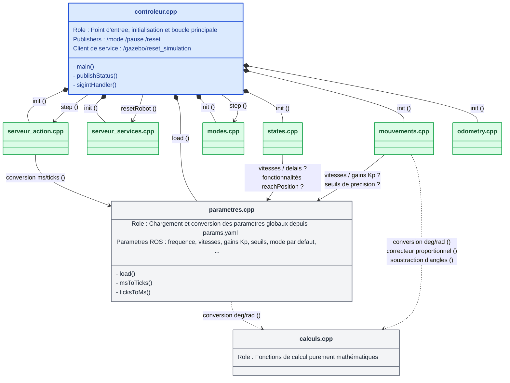
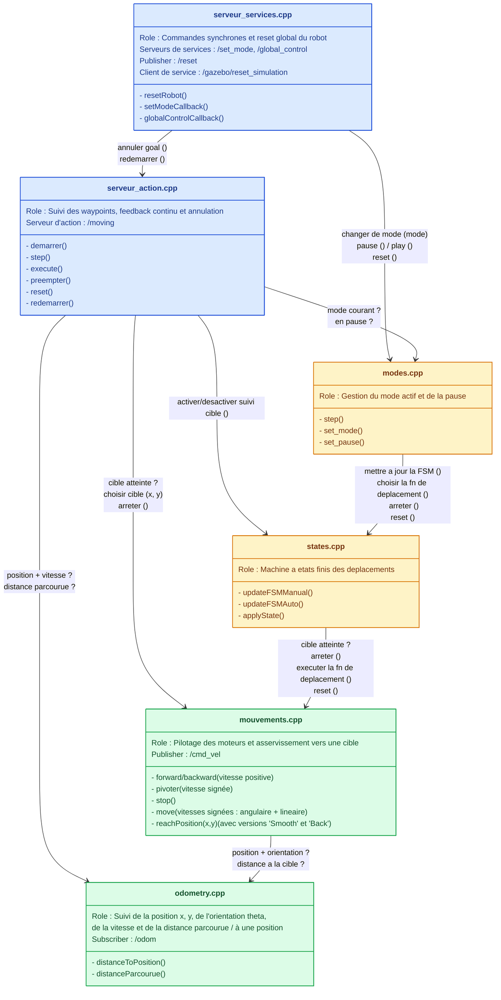
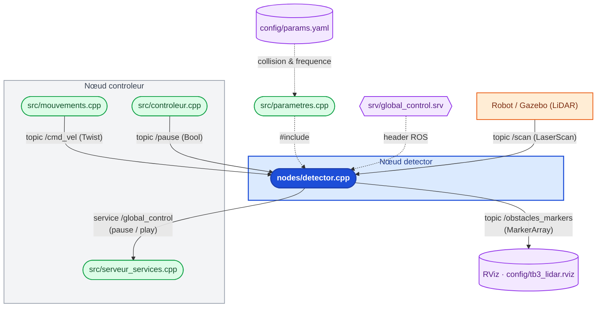
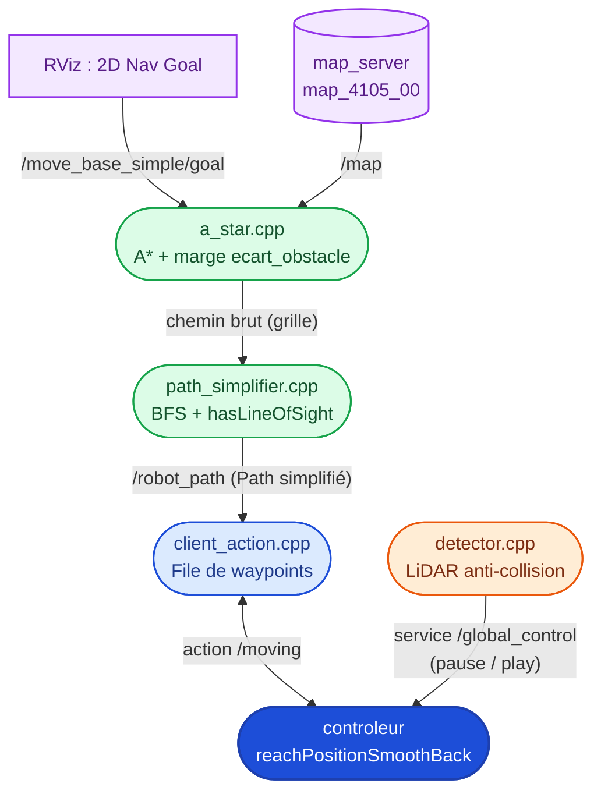

# Rapport : Projet robotique mobile et navigation autonome appliqué au robot TurtleBot3

**Binôme :** Benoît de Keyn & Thibault Agueh  
**Date :** 26 novembre 2026

## Introduction

Ce rapport présente la conception, l'implémentation et la validation de notre projet de **robotique mobile et navigation autonome** sous **ROS Noetic**, appliqué au robot **TurtleBot3 Burger** (en simulation Gazebo et en conditions réelles dans le labyrinthe de la salle 4105).

L'objectif du projet était de construire progressivement une chaîne logicielle complète, regroupée dans notre package **`TABDK`** puis couplée au planificateur **`AStar-ROS`**, couvrant l'ensemble des briques demandées :

- le pilotage bas niveau (`/cmd_vel`) et le paramétrage global via YAML ([section 3, Pilotage de base et paramétrage du TB3](#3-pilotage-de-base-et-paramétrage-du-tb3)) ;
- la gestion des modes (`manual` et `auto`), de la pause, du pilotage manuel et de la localisation odométrique (`/odom`) ([section 4, Contrôle et navigation du TB3](#4-contrôle-et-navigation-du-tb3)) ;
- l'asservissement en position et en orientation, étendu vers des déplacements fluides en marche avant et arrière ([section 4.3.2, Navigation vers un but](#432-navigation-vers-un-but)) ;
- la perception 360° par LiDAR (`/scan`), la visualisation dans RViz et la prévention active de collision ([section 5, Perception de l'environnement à l'aide du Lidar](#5-perception-de-lenvironnement-à-laide-du-lidar-capteur-de-distance-laser-360-lds-01---lds-02)) ;
- la supervision par services ROS (`/set_mode`, `/global_control`), le suivi asynchrone de waypoints par action (`/moving`) et la gestion de trajectoires `nav_msgs/Path` ([section 6, Services, actions et gestion de trajectoires](#6-services-actions-et-gestion-de-trajectoires)) ;
- la cartographie SLAM (Gmapping) et la planification de chemin A\* améliorée avec lissage de trajectoire ([section 7, Évitement d'obstacle et planification de trajectoire : SLAM](#7-évitement-dobstacle-et-planification-de-trajectoire--slam)).

## 1. Environnement de développement

Pour avancer efficacement tout au long du projet et travailler à deux dans de bonnes conditions, nous nous sommes appuyés sur deux environnements complémentaires : la simulation en ligne **TheConstructSim** et un **workspace VS Code automatisé** couplé à GitHub pour le robot physique.

### 1.1 Simulation en ligne : TheConstructSim

Pour travailler à distance depuis chez nous, tester nos packages dans un environnement virtuel et **économiser la batterie du TurtleBot3 réel** (qui tenait peu longtemps en séance), nous avons utilisé la plateforme **TheConstructSim**. Elle met à disposition dans le navigateur un **VS Code en ligne**, **Gazebo** et **RViz** déjà prêts à l'emploi. Nous détaillons dans la [section 7.1, SLAM (Cartographie et Localisation simultanées)](#71-slam-cartographie-et-localisation-simultanées) les contraintes rencontrées sur cette plateforme lors de l'installation des paquets SLAM et navigation.

### 1.2 Développement local et déploiement sur le robot : VS Code, GitHub et SSH

Sur nos ordinateurs personnels, plutôt que d'installer **MobaXterm** (qui oblige à garder le code directement sur le robot, à ouvrir et agencer manuellement plusieurs fenêtres SSH et à retaper régulièrement le mot de passe), nous avons préféré travailler avec **VS Code**, **GitHub** et **GitHub Desktop**. Nous versions ainsi notre code localement pour collaborer proprement en binôme, garder un historique clair et sauvegarder nos avancées en toute sécurité.

Au début, nous devions copier manuellement chaque fichier modifié sur le robot après nos modifications sur Git. Nous avons donc fini par mettre en place un **workspace VS Code dédié** (`robotique.code-workspace`) pour automatiser notre organisation de travail :

- **Arborescence épurée** : nous affichons uniquement nos dossiers utiles (`TABDK/`, puis `AStar-ROS/` lorsque nous en avons eu besoin) directement dans VS Code, sans avoir à naviguer dans toute l'arborescence du robot.
- **Synchronisation automatique à la sauvegarde** : à chaque enregistrement d'un fichier local, nos dossiers locaux (`TABDK/` et `AStar-ROS/`) sont recopiés automatiquement en miroir vers `~/catkin_ws/src/` sur le robot via SSH.\*
- **Ouverture automatique des terminaux et de RViz** : à l'ouverture du workspace, VS Code démarre le serveur X (**VcXsrv** pour l'affichage de RViz), lance une synchronisation initiale, exécute `run_robot.sh` pour démarrer l'environnement nécessaire sur le robot dans un terminal SSH indépendant, puis ouvre un terminal SSH vierge prêt à l'emploi avec nos alias déjà chargés.
- **Terminal SSH par défaut** : chaque nouveau terminal ouvert dans VS Code se connecte directement en SSH sur le robot.

*\* Remarque sur la synchronisation et la conservation de la carte : lors de la création de la carte SLAM ([section 7.1, SLAM (Cartographie et Localisation simultanées)](#71-slam-cartographie-et-localisation-simultanées)) directement sur le robot, cette carte n'existait pas encore dans notre dossier local. À la première modification de code en local, la synchronisation en miroir a donc supprimé la carte sur le robot. Par la suite, nous avons systématiquement copié chaque carte générée sur le robot vers notre dossier local avant d'effectuer des modifications de code, afin qu'elle soit conservée lors des synchronisations suivantes.*

## 2. Architecture finale du projet

### 2.1 Arborescence du paquet TABDK


### 2.2 Découpage du nœud contrôleur en classes

Dans sa version finale, `controleur.cpp` constitue le point d'entrée de l'application : il initialise les composants et exécute la boucle principale, en s'appuyant sur plusieurs classes spécialisées qui prennent chacune en charge une responsabilité précise :

- les déplacements et l'asservissement (`Mouvements`) ;
- l'odométrie (`Odometry`) ;
- la machine à états des déplacements (`States`) ;
- les modes de fonctionnement et la pause (`Modes`) ;
- le chargement et la conversion des paramètres (`Params`) ;
- les interactions avec ROS par services et par action (`ServeurServices` et `ServeurAction`).

Nous expliquons dans la [section 8, Migration architecturale : passage d'un fichier contrôleur unique à un découpage en classes](#8-migration-architecturale--passage-dun-fichier-contrôleur-unique-à-un-découpage-en-classes) comment nous sommes passés de la première implémentation dans un seul fichier à cette organisation en classes.

#### Classe principale et dépendances neutres

Le fichier `calculs.cpp` est le seul fichier `.cpp` qui ne contient pas une classe mais simplement des fonctions utilitaires.



#### Interactions entre les classes du nœud contrôleur



### 2.3 Interaction des différents nœuds

Le paquet `TABDK` contient le nœud contrôleur ainsi que quatre autres nœuds, dont les schémas et les descriptions sont disponibles dans les parties indiquées dans le tableau suivant :

| Nœud (`TABDK/src/nodes/`) | Rôle principal | Schéma détaillé |
| --- | --- | --- |
| `keyboard_input.cpp` | Capture clavier → `/keyboard_input` | [section 4.2, Mode navigation manuelle](#42-mode-navigation-manuelle) |
| `detector.cpp` | Analyse LiDAR 8 régions, marqueurs RViz et anti-collision | [section 5, Perception de l'environnement à l'aide du Lidar](#5-perception-de-lenvironnement-à-laide-du-lidar-capteur-de-distance-laser-360-lds-01---lds-02) |
| `client_services.cpp` | Commandes clavier `m`/`p`/`r` → `/set_mode` et `/global_control` | [section 6.1, Configuration à la volée du comportement du robot : service](#61-configuration-à-la-volée-du-comportement-du-robot--service) |
| `client_action.cpp` | File de waypoints (clavier ou `/robot_path`) → action `/moving` | [section 6.3, Gestion des trajectoires : Path](#63-gestion-des-trajectoires--path) |

> Nous expliquons dans la [section 8, Migration architecturale : passage d'un fichier contrôleur unique à un découpage en classes](#8-migration-architecturale--passage-dun-fichier-contrôleur-unique-à-un-découpage-en-classes) comment nous sommes passés d'un fichier `controleur.cpp` unique à ce découpage en classes.

## 3. Pilotage de base et paramétrage du TB3

### 3.1 Pilotage de base du TB3

#### Énoncé

Ajouter dans le nœud contrôleur un *publisher* générant une commande en vitesse pour déplacer le robot TurtleBot3 :

1. Identifier le topic concerné, l'en-tête `.h`, son *namespace* et le type de message associé.
2. Réaliser `avancer(double vitesse)` et `arreter()` (publication effectuée dans la boucle principale).
3. Arrêter proprement le robot lors d'un `CTRL+C` dans `sigintHandler`.
4. Enchaîner périodiquement **avancer → arrêter → reculer** avec des durées multiples de la période du contrôleur.

#### Choix fonctionnels

- Nous avons utilisé le topic `/cmd_vel` avec le message `geometry_msgs::Twist` (`#include <geometry_msgs/Twist.h>`), en pilotant la vitesse linéaire sur `linear.x`.
- Nous avons isolé les commandes moteurs de base dans trois fonctions simples (`forward()`, `backward()` et `stop()`) afin de structurer le pilotage dès ce premier exercice.
- Pour gérer l'interruption `CTRL+C` dans ROS, nous avons utilisé le `sigintHandler()` demandé dans l'énoncé afin d'arrêter proprement le robot à la fermeture du nœud.

#### Première implémentation

Dans notre premier package `TABDK`, nous avons regroupé tout le code dans un seul fichier `controleur.cpp` : un publisher sur `/cmd_vel`, les fonctions globales `forward()`, `backward()` et `stop()`, ainsi qu'une boucle `while (ok())` rythmée par `ros::Rate`.

- **De la boucle à compteur vers la machine à états** : dans le tout premier commit, nous gérions l'enchaînement avancer, arrêter, reculer à l'aide d'un compteur de déplacements (`move_counter`) et d'une succession de conditions `if / else if`, avec des durées exprimées en nombre de périodes (`move_fwd_per`, `move_bwd_per`, `move_stp_per`). Ensuite, à la suite de vos recommandations sur l'utilisation d'une machine à états, et pour rendre le code plus facile à faire évoluer, nous avons remplacé ce compteur par une véritable FSM : une énumération `enum RobotState`, une variable `current_state` mémorisant l'état courant, et un `switch(current_state)` pour faire évoluer les transitions (`update_FSM_auto()`) et appeler les fonctions correspondantes (`apply_state()`).

<!-- code:TABDK/src/controleur.cpp (première FSM) -->
```cpp
enum RobotState { FORWARD, BACKWARD, STOP };

RobotState current_state = FORWARD;
int ticks_counter = 0;

void update_FSM_auto() {
  switch (current_state) {
    case FORWARD:
      if (ms_to_ticks(move_fwd_tm) == ticks_counter) {
        ticks_counter = 0;
        current_state = STOP;
      }
      break;
    case STOP:
      if (ms_to_ticks(move_stp_tm) == ticks_counter) {
        ticks_counter = 0;
        current_state = BACKWARD;
      }
      break;
    case BACKWARD:
      if (ms_to_ticks(move_bwd_tm) == ticks_counter) {
        ticks_counter = 0;
        current_state = FORWARD;
      }
      break;
  }
}

void apply_state() {
  switch (current_state) {
    case FORWARD:  forward(linear_speed);  break;
    case STOP:     stop();                 break;
    case BACKWARD: backward(linear_speed); break;
  }
}
```

- **Évolution de la gestion de `CTRL+C` (`sigintHandler`)** : dans la toute première version, `sigintHandler()` appelait simplement `stop()` puis `shutdown()`. Lorsque nous avons ajouté la réinitialisation du robot et de la simulation, nous avons fait évoluer ce gestionnaire pour qu'il appelle `reset_robot()` (qui réinitialise puis arrête le robot) avant `shutdown()`. Enfin, lors du découpage en classes, nous avons remplacé cet appel direct par un drapeau `arret_demande` mis à `true` dans `sigintHandler()` : la boucle principale s'interrompt alors proprement, puis `main()` exécute `services.resetRobot()` et `shutdown()` à un endroit maîtrisé du programme. Le gestionnaire de signal se contente ainsi de lever un indicateur, plutôt que d'exécuter une série d'appels ROS directement dans le contexte du signal.

#### Difficultés rencontrées

- **Dépendance des durées à la fréquence** : exprimer les temporisations en nombre brut de périodes (`move_fwd_per`, `move_bwd_per`, `move_stp_per`) changeait la durée réelle des déplacements dès que nous modifiions la fréquence de contrôle. Nous sommes donc passés à des durées en millisecondes (`move_fwd_tm`, `move_bwd_tm`, `move_stp_tm`), converties en nombre de ticks (voir la [section 3.2, Paramètres de l'application](#32-paramètres-de-lapplication)).

#### Version finale

- Les fonctions de commande moteur sont regroupées dans la classe `Mouvements` ([TABDK/src/mouvements.cpp](https://github.com/benoitdekeyn/E4SE_TD_TP/blob/main/robotique_et_navigation/TABDK/src/mouvements.cpp#L57-L106)), où `stop()` publie un `Twist()` nul.
- L'ancien cycle périodique avancer, arrêter, reculer reste conservé dans `States::updateFSMAuto()` ([TABDK/src/states.cpp](https://github.com/benoitdekeyn/E4SE_TD_TP/blob/main/robotique_et_navigation/TABDK/src/states.cpp#L117-L145)), bien qu'il ne soit plus appelé dans le fonctionnement final (comme expliqué dans la [section 4.3, Mode navigation autonome](#43-mode-navigation-autonome)).
- Dans [TABDK/src/controleur.cpp](https://github.com/benoitdekeyn/E4SE_TD_TP/blob/main/robotique_et_navigation/TABDK/src/controleur.cpp#L24-L28) et [L77-L89](https://github.com/benoitdekeyn/E4SE_TD_TP/blob/main/robotique_et_navigation/TABDK/src/controleur.cpp#L77-L89), `sigintHandler()` lève `arret_demande`, ce qui déclenche `services.resetRobot()` puis `shutdown()` en sortie de boucle.

---

### 3.2 Paramètres de l'application

#### Énoncé

Rendre l'application générique en spécifiant des paramètres (notamment la fréquence de contrôle) au lancement des nœuds, soit via les arguments de `run.launch`, soit via un fichier YAML dans un sous-dossier `config/`, puis tester le contrôleur à différentes fréquences.

#### Choix fonctionnels

- Nous avons préféré régler les paramètres depuis un fichier YAML (`TABDK/config/params.yaml`) plutôt que de les passer un par un en arguments dans `run.launch`.
- Nous avons choisi d'écrire les paramètres angulaires en degrés et les temporisations en millisecondes dans ce fichier YAML pour faciliter les réglages, puis d'effectuer les conversions nécessaires au chargement.
- Nous avons attribué des valeurs par défaut à chacune de nos variables de configuration afin que l'application conserve des valeurs utilisables lorsqu'un paramètre n'est pas trouvé à l'exécution.
- Nous avons écrit deux fonctions de conversion temporelle, `msToTicks()` et `ticksToMs()`, afin de centraliser la conversion entre millisecondes et itérations de boucle et d'éviter de multiplier les divisions ou multiplications par 1000 dans tout le code.

#### Première implémentation

Notre premier fichier `config/params.yaml` ne contenait que cinq paramètres (`frequence`, `linear_speed`, `move_fwd_per`, `move_bwd_per`, `move_stp_per`), lus directement au début du `main()` de `controleur.cpp` dans des variables globales initialisées par défaut. Lorsque nous avons ajouté les autres nœuds (`keyboard_input`, `detector`, `client_action`), nous avons d'abord utilisé des constantes locales codées en dur dans chacun d'eux.

#### Difficultés rencontrées

- **Paramètres éclatés entre plusieurs nœuds** : conserver des constantes locales dans chaque nœud empêchait de modifier la fréquence globale ou les seuils anti-collision depuis un seul endroit. Nous avons donc regroupé le chargement des paramètres dans une classe dédiée `Params`, incluse par nos cinq nœuds.
- **Cohérence des unités** : manipuler des degrés, des radians, des millisecondes et des ticks dans plusieurs fichiers nous a conduits à regrouper les conversions au chargement et dans `msToTicks()` / `ticksToMs()`.

#### Version finale

- La classe `Params` ([TABDK/src/parametres.cpp](https://github.com/benoitdekeyn/E4SE_TD_TP/blob/main/robotique_et_navigation/TABDK/src/parametres.cpp#L11-L70)) centralise les valeurs par défaut, charge les paramètres depuis [TABDK/config/params.yaml](https://github.com/benoitdekeyn/E4SE_TD_TP/blob/main/robotique_et_navigation/TABDK/config/params.yaml) via `Params::load()`, et convertit `precision_angular` et `trigger_pivot` en radians.
- Elle est incluse par les cinq nœuds du package ; `params.frequence` (réglé à 5 Hz) rythme notamment les boucles de `controleur`, `keyboard_input` et `client_action` (tandis que `detector` et `client_services` réagissent directement aux messages reçus via `spin()`).
- Les méthodes `msToTicks()` et `ticksToMs()` assurent la conversion temporelle dans l'ensemble du contrôleur :

<!-- code:TABDK/src/parametres.cpp -->
```cpp
void load(NodeHandle &nh) {
  nh.getParam("frequence", frequence);
  // ... chargement des vitesses, gains Kp, seuils, modes et collision ...
  precision_angular = deg_to_rad(precision_angular);
  trigger_pivot     = deg_to_rad(trigger_pivot);
}

int msToTicks(int ms)                       { return frequence * ms / 1000; }
double ticksToMs(std::uint64_t ticks) const { return ticks * 1000.0 / frequence; }
```

*(Voir la [section 8, Migration architecturale : passage d'un fichier contrôleur unique à un découpage en classes](#8-migration-architecturale--passage-dun-fichier-contrôleur-unique-à-un-découpage-en-classes) pour l'organisation des fichiers `.cpp` et l'initialisation après `ros::init()`.)*

---

## 4. Contrôle et navigation du TB3

### 4.1 Les modes de navigation

#### Énoncé

Permettre au TurtleBot3 de basculer entre **mode manuel** et **mode navigation autonome** à l'aide d'une machine à états finis (`switch`), avec un mode par défaut configurable au lancement de l'application.

#### Choix fonctionnels

- Dès les premières versions de notre machine à états, nous avons voulu intégrer un **mécanisme de pause**. Cette idée venait de notre expérience de l'année précédente : pouvoir arrêter le robot à un instant précis (par exemple juste avant un obstacle ou dans une situation particulière à analyser) nous permettait d'observer tranquillement les capteurs, l'état interne et les logs sans qu'il continue d'avancer.
- Nous avons défini le mode de démarrage au moyen du paramètre `default_mode` dans `config/params.yaml` (avec un repli sur `"manual"` si la valeur fournie est invalide).
- Lorsque notre architecture s'est enrichie de plusieurs nœuds ROS, de services et d'actions, nous avons décidé de **séparer complètement la gestion de la pause de celle du mode**. Nous avons voulu que l'état de pause reflète l'état physique du robot (interruption des déplacements et des compteurs de déplacement) sans figer son algorithme de décision ni bloquer la lecture des entrées utilisateur.

#### Première implémentation

Dans la première version, nous avions deux modes principaux dans `controleur.cpp` (`enum RobotMode`) :

- le mode automatique (`AUTO`) exécutait la séquence prédéfinie de déplacements (avancer, s'arrêter, reculer) ;
- le mode manuel (`MANUAL`) permettait de piloter directement le robot avec le clavier.

Très rapidement après, nous avons ajouté la pause comme un **troisième mode** (`PAUSE`) dans `enum RobotMode`, accompagnée d'une variable d'historique (`previous_mode`) afin de retrouver le mode actif avant la mise en pause.

#### Difficultés rencontrées

- **Limites de la pause gérée comme un troisième mode** : au début, la mise en pause ne remettait pas la direction clavier à `NONE`, si bien que le robot repartait dans l'ancienne direction à la reprise. Surtout, dès que nous avons ajouté plusieurs nœuds ROS, des services ([section 6.1, Configuration à la volée du comportement du robot : service](#61-configuration-à-la-volée-du-comportement-du-robot--service)) et l'anti-collision LiDAR ([section 5, Perception de l'environnement à l'aide du Lidar](#5-perception-de-lenvironnement-à-laide-du-lidar-capteur-de-distance-laser-360-lds-01---lds-02)), représenter la pause comme un mode rendait la maintenance difficile : il fallait par exemple mettre à jour `previous_mode` si l'utilisateur changeait de mode pendant une pause.
- **Synchronisation entre plusieurs nœuds** : une fois les commandes réparties entre plusieurs nœuds, ceux-ci devaient connaître le mode et l'état de pause courants. C'est à cette étape plus tardive du développement que nous avons ajouté la publication continue des topics `/mode` (`std_msgs/String`) et `/pause` (`std_msgs/Bool`) dans `controleur.cpp`.
- **Croissance de `controleur.cpp`** : le fichier unique accumulant de plus en plus de responsabilités, nous avons séparé la gestion des modes (`Modes`) de la machine à états des déplacements (`States`), comme détaillé dans la [section 8, Migration architecturale : passage d'un fichier contrôleur unique à un découpage en classes](#8-migration-architecturale--passage-dun-fichier-contrôleur-unique-à-un-découpage-en-classes).

#### Version finale

Dans l'architecture finale, le mode (`"manual"` ou `"auto"`) et la pause (`pause_active`) sont totalement indépendants :

- La classe `Modes` ([TABDK/src/modes.cpp](https://github.com/benoitdekeyn/E4SE_TD_TP/blob/main/robotique_et_navigation/TABDK/src/modes.cpp#L16-L100)) stocke le mode courant en `std::string` et le booléen `pause_active`. Elle fournit notamment les fonctions `set_mode()` et `set_pause()` au serveur de services (`ServeurServices`), qui les appelle sur réception des requêtes `/set_mode` et `/global_control`.
- À chaque itération de la boucle principale de `controleur.cpp` ([TABDK/src/controleur.cpp](https://github.com/benoitdekeyn/E4SE_TD_TP/blob/main/robotique_et_navigation/TABDK/src/controleur.cpp#L77-L83)), `Modes::step()` est appelée pour mettre à jour la FSM. Si `pause_active` est vrai, elle coupe les déplacements (`states->stop()`) sans faire progresser la FSM (et le compteur de temps de `ServeurAction` cesse de s'incrémenter), tout en laissant la boucle ROS et la lecture des commandes actives. Sinon, elle met à jour `States` via `updateFSMManual()` puis exécute l'état courant avec `applyState()`.
- La classe `States` ([TABDK/src/states.cpp](https://github.com/benoitdekeyn/E4SE_TD_TP/blob/main/robotique_et_navigation/TABDK/src/states.cpp#L4-L115)) conserve les états développés au fil du projet, mais dans le fonctionnement final les modes `manual` et `auto` utilisent tous deux le suivi de cible (`STOP` ↔ `REACH_POSITION`), seule la provenance des waypoints changeant (clavier ou `/robot_path`).


---

### 4.2 Mode navigation manuelle

#### Énoncé

Intégrer un nœud `key_input_node.cpp` pour piloter le robot au clavier (avancer, reculer, pivoter, modifier les vitesses dans les limites du TB3), puis évaluer la réactivité et minimiser les latences d'E/S.

#### Choix fonctionnels

- Nous nous sommes appuyés sur le nœud de saisie clavier fourni dans l'énoncé (`key_input_node.cpp`, renommé ensuite `keyboard_input.cpp`), qui publie les codes ASCII des touches sur `/keyboard_input` (`std_msgs/Int8`) dans un nœud séparé afin de ne pas bloquer la boucle du contrôleur.
- Plutôt que de conserver indéfiniment un pilotage direct en vitesse séparé du reste de notre architecture, nous avons fait évoluer le mode manuel en **trois générations successives**, jusqu'à aboutir dans la version finale à un pilotage par **waypoint virtuel** relié aux services et au serveur d'action. Ainsi, le mode manuel bénéficie de la même chaîne de navigation ([section 6.2, Navigation : serveur d'action](#62-navigation--serveur-daction)) et de la même protection anti-collision ([section 5, Perception de l'environnement à l'aide du Lidar](#5-perception-de-lenvironnement-à-laide-du-lidar-capteur-de-distance-laser-360-lds-01---lds-02)) que le mode autonome.

#### Première implémentation et évolution en trois générations

Le pilotage manuel a traversé trois générations chronologiques au fil de l'ajout de nos fonctionnalités :

1. **Première génération : commandes directes** : au début, `key_input_node.cpp` publiait les touches sur `/keyboard_input` et `controleur.cpp` s'y abonnait directement. Chaque touche déclenchait un mouvement élémentaire dans la FSM du contrôleur (`FORWARD`, `BACKWARD`, `PIVOTER_GAUCHE`, `PIVOTER_DROITE`, `STOP`), avec la barre espace pour la pause et la touche `0` (`KEY_ZERO`) pour remettre la direction à `NONE`.
2. **Deuxième génération : déplacement vers des coordonnées cibles** : lorsque nous avons implémenté `reachPosition()` ([section 4.3.2, Navigation vers un but](#432-navigation-vers-un-but)), nous sommes passés d'un pilotage direct à un pilotage par position cible. Les flèches du clavier ne commandaient plus un mouvement continu, mais incrémentaient ou décrémentaient une cible de coordonnées absolues `(x, y)` dans le repère d'odométrie (par pas de `0,1 m` : haut/bas sur `x`, gauche/droite sur `y`, stockée dans `target_position` puis dans l'attribut `targets` de `Mouvements`). La FSM passait alors dans l'état `REACH_POSITION` pour rejoindre cette nouvelle cible.
3. **Troisième génération : déplacement d'un waypoint virtuel (architecture finale)** : lors de la mise en place des services et du serveur d'action, nous avons séparé la réception du clavier côté contrôleur pour la confier à `client_services.cpp` et `client_action.cpp`. Dans `client_action.cpp`, une variable `waypoint_virtuel` est initialisée à la position `(0, 0)` (et réinitialisée à `(0, 0)` lors d'un reset). En mode manuel, les flèches du clavier déplacent ce waypoint virtuel par pas de `waypoint_step`. Lorsque l'utilisateur appuie sur `w`, le waypoint virtuel courant est ajouté à la liste `trajectoire`, et le robot suit les éléments de cette liste dans l'ordre via l'action `/moving`.

#### Difficultés rencontrées

- **Dictionnaire dynamique trop lourd pour les entrées clavier** : dans notre première version, nous avions stocké les commandes issues du clavier dans un dictionnaire dynamique (`std::unordered_map<string, std::variant<bool, string>>`) associant des clés textuelles à des booléens (changement de mode, arrêt) ou des chaînes de caractères (direction). Le callback mettait à jour ce dictionnaire et le reste du programme le lisait ensuite. À la suite d'une discussion avec Rémi Caussic, cette approche s'est révélée trop lourde pour notre application embarquée ; nous l'avons remplacée par une structure typée (`struct KeyboardInputs`) et des énumérations (`Direction`, puis `Arrow`).
- **Initialisation de `Twist` dans les fonctions de déplacement** : au début, `stop()` ne remettait que `linear.x` à zéro et les fonctions de déplacement réutilisaient une même variable `Twist` globale ; après ajout de `pivoter()`, le robot pouvait continuer de tourner lors d'un arrêt ou cumuler des composantes. Nous avons corrigé cela en réinitialisant le message via `vel = Twist()` dans `stop()`, puis en créant un `Twist` vierge dans chacune des fonctions de déplacement (`forward()`, `backward()`, `pivoter()`, `move()`).
- **Remise à zéro de la direction clavier** : dans la première génération, sans remise explicite à `NONE` (`KEY_ZERO` ou lors d'une pause), la dernière direction reçue restait mémorisée d'une itération sur l'autre.
- **Séparation des responsabilités clavier** : lors de l'ajout des services ([section 6.1, Configuration à la volée du comportement du robot : service](#61-configuration-à-la-volée-du-comportement-du-robot--service)), nous avons brièvement regroupé la lecture clavier et les appels de services dans un nœud `keyboard.cpp`. Lorsque nous avons ensuite eu besoin du clavier à la fois pour les services (`m`, `p`, `r`) et pour les waypoints dans `client_action.cpp`, nous avons séparé la capture brute (`keyboard_input.cpp`) des deux nœuds consommateurs (`client_services.cpp` et `client_action.cpp`).
- **Fréquence de polling** : la fréquence de polling de `keyboard_input.cpp` était initialement définie par une constante locale de 5 Hz (`FREQ_ACTUALISATION = 5`). Nous l'avons ensuite centralisée dans `config/params.yaml` (`params.frequence`) afin d'harmoniser le paramétrage de l'application, tout en conservant cette fréquence de 5 Hz ([section 3.2, Paramètres de l'application](#32-paramètres-de-lapplication)).

#### Version finale

Dans la version finale, `keyboard_input.cpp` ([TABDK/src/nodes/keyboard_input.cpp](https://github.com/benoitdekeyn/E4SE_TD_TP/blob/main/robotique_et_navigation/TABDK/src/nodes/keyboard_input.cpp#L14-L32)) publie les codes touches bruts sur `/keyboard_input`, qui sont consommés par `client_services.cpp` ([TABDK/src/nodes/client_services.cpp](https://github.com/benoitdekeyn/E4SE_TD_TP/blob/main/robotique_et_navigation/TABDK/src/nodes/client_services.cpp#L79-L126)) et `client_action.cpp` ([TABDK/src/nodes/client_action.cpp](https://github.com/benoitdekeyn/E4SE_TD_TP/blob/main/robotique_et_navigation/TABDK/src/nodes/client_action.cpp#L116-L154)) selon la répartition suivante :

| Touches | Nœud consommateur | Mécanisme ROS | Effet |
| --- | --- | --- | --- |
| `m` | `client_services.cpp` | Service `/set_mode` | Bascule `manual` ↔ `auto` |
| `p` | `client_services.cpp` | Service `/global_control` | Bascule `pause` ↔ `play` |
| `r` | `client_services.cpp` | Service `/global_control` | Réinitialisation globale (`reset`) |
| `↑` `↓` `←` `→` | `client_action.cpp` *(mode `manual`)* | Variable locale `waypoint_virtuel` | Déplace le waypoint virtuel de `±waypoint_step` en `x` ou `y` |
| `w` | `client_action.cpp` *(mode `manual`)* | Action `/moving` (via `trajectoire`) | Ajoute `waypoint_virtuel` à la liste des waypoints |
| `x` | `client_action.cpp` *(mode `manual`)* | File locale `trajectoire` | Vide la liste de waypoints en attente |

Le diagramme ci-dessous représente cette architecture finale de communication autour de `keyboard_input.cpp` :


---

### 4.3 Mode navigation autonome

Au fil du projet, le fonctionnement du mode automatique a évolué en profondeur : nous sommes passés d'une séquence prédéfinie (avancer, s'arrêter, reculer) à une navigation par waypoints. Dans l'architecture finale, l'ancienne séquence automatique n'est plus exécutée : `Modes::step()` n'appelle plus `States::updateFSMAuto()`. À la place, les modes `auto` et `manual` passent tous deux par `States::updateFSMManual()` et l'état `REACH_POSITION`, tandis que le serveur d'action ([section 6.2, Navigation : serveur d'action](#62-navigation--serveur-daction)) modifie directement la cible utilisée par `reachPosition()`. Nous avons tout de même conservé `updateFSMAuto()` et les noms historiques dans `states.cpp` afin de pouvoir consulter l'ancien mécanisme et d'y revenir facilement si nécessaire (en désactivant le serveur d'action et en réactivant l'appel à `updateFSMAuto()`).

#### 4.3.1 Localisation du TB3 et odométrie

##### Énoncé

Identifier le topic d'odométrie du TB3, son rythme et son type de message. Lire et afficher en temps réel la position `(x, y)` et le cap `theta` (via `tf::getYaw` sur le quaternion), puis permettre la réinitialisation sur robot réel (`/reset`) et en simulation (`/gazebo/reset_simulation`).

##### Choix fonctionnels

- Nous nous sommes abonnés au topic `/odom` (`nav_msgs/Odometry`), sur lequel nous avons mesuré directement avec ROS une fréquence de publication d'environ **20 Hz**. Il convient de distinguer cette fréquence de publication du topic de la fréquence de traitement dans notre boucle principale de contrôle, réglée à **5 Hz** (`params.frequence`), lors de laquelle `spinOnce()` traite les messages reçus.
- À partir de chaque message `nav_msgs/Odometry`, nous extrayons directement les coordonnées `x` et `y`, le cap `theta` à partir du quaternion grâce à `tf::getYaw()`, ainsi que les vitesses linéaire et angulaire (`msg->twist.twist`).
- Nous avons ajouté dans la classe `Odometry` le calcul de la distance cumulée (`distanceParcourue()`) et la méthode `distanceToPosition(x, y)` afin de les partager entre l'asservissement ([section 4.3.2, Navigation vers un but](#432-navigation-vers-un-but)) et le serveur d'action ([section 6.2, Navigation : serveur d'action](#62-navigation--serveur-daction)).

##### Première implémentation

Au début, nous avons placé le subscriber `/odom` et la réinitialisation (`/reset` et `/gazebo/reset_simulation`, déclenchés par la touche `r`) directement dans `controleur.cpp`, avec une structure personnalisée stockant `x`, `y` et la rotation. Lors du passage en classe `Odometry`, nous avons d'abord conservé notre propre `struct Pose2D`, avant de découvrir que ROS proposait déjà le type standard `geometry_msgs::Pose2D` et de le réutiliser à la place. Nous avons ensuite ajouté le stockage de `vitesse` dans `Odometry` lorsque nous en avons eu besoin pour les feedbacks de `Move.action` ([section 6.2, Navigation : serveur d'action](#62-navigation--serveur-daction)).

##### Difficultés rencontrées

- **Doute initial sur l'odométrie et redémarrage du robot** : pendant nos premiers essais d'asservissement sur l'axe `x`, nous pensions que l'odométrie dysfonctionnait car les mesures semblaient incohérentes et les resets ne répondaient plus. Après un redémarrage complet du robot, nous avons constaté que l'odométrie était finalement précise.
- **Compréhension du repère fixe après reset** : nous nous sommes longtemps demandé pourquoi le reset ne gardait pas l'axe `x` face au robot lorsque nous le déplacions pendant nos essais en `(x, y)`. Au moment du reset, l'axe `x` est bien orienté devant le robot, mais comme l'orientation odométrique s'appuie sur le capteur inertiel du robot, cet axe reste ensuite fixe par rapport à l'environnement lorsque nous déplaçons le robot à la main. Pour les essais de SLAM, vous nous aviez d'ailleurs donné la consigne de toujours replacer le robot au même endroit.

##### Version finale

La classe `Odometry` ([TABDK/src/odometry.cpp](https://github.com/benoitdekeyn/E4SE_TD_TP/blob/main/robotique_et_navigation/TABDK/src/odometry.cpp#L17-L60)) met à jour `position` (`geometry_msgs::Pose2D`), `vitesse` (`geometry_msgs::Twist`) et `distance_parcourue` dans `odomCallback()` :

<!-- code:TABDK/src/odometry.cpp -->
```cpp
void odomCallback(const nav_msgs::Odometry::ConstPtr &msg) {
  if (position_recue) {
    distance_parcourue += distanceToPosition(msg->pose.pose.position.x,
                                             msg->pose.pose.position.y);
  }
  position_recue = true;

  Quaternion quaternion_odom = Quaternion(
    msg->pose.pose.orientation.x,
    msg->pose.pose.orientation.y,
    msg->pose.pose.orientation.z,
    msg->pose.pose.orientation.w
  );
  position.x = msg->pose.pose.position.x;
  position.y = msg->pose.pose.position.y;
  position.theta = getYaw(quaternion_odom);
  vitesse = msg->twist.twist;
}
```

---

#### 4.3.2 Navigation vers un but

##### Énoncé

Mettre en place l'asservissement en position du TurtleBot3 :
1. **Parcours de distance** sur un axe (`x0` → `x1`, tolérance `±0.02 m`) avec correcteur proportionnel/PID.
2. **Asservissement angulaire** vers `theta` (tolérance `±0.05 rad`) en gérant l'intervalle `[-π, +π]` avec `cal_delta_Theta`.
3. **Cinématique inverse** pour rallier une cible cartésienne `(x, y)` à partir de la distance et de `atan2`.
4. **Bonus (simulation)** : réception interactive d'une cible via `2D Nav Goal` dans RViz (`/move_base_simple/goal`).

##### Choix fonctionnels

- **Asservissement proportionnel et amortissement** : nous avons choisi un asservissement proportionnel (`commande_proportionnelle()` dans `calculs.cpp`, plafonné aux vitesses maximales `linear_speed` et `angular_speed`). Ce comportement d'amortissement donne une vitesse élevée lorsque l'erreur est importante, puis réduit progressivement la vitesse à l'approche de la cible, ce qui rend le déplacement plus fluide et limite les oscillations. Nos essais à 5 Hz nous ont donné des résultats satisfaisants sans avoir besoin d'ajouter de termes intégral ou dérivé : l'asservissement interne des roues et des moteurs derrière `/cmd_vel`, ainsi que la vitesse et l'inertie du robot réel, ne provoquaient pas de dépassements problématiques à l'arrêt.
- **Déplacement fluide et marche arrière configurables** : pour obtenir une trajectoire droite sans grands arcs de cercle tout en évitant des arrêts répétés, nous avons ajouté la fonction `move(linear, angular)` (qui combine vitesse linéaire et vitesse angulaire) et conçu deux options configurables dans `config/params.yaml` (`move_smooth` et `move_back`) :
  - **`reachPositionSmooth(x, y, arriere)`** : activée lorsque `move_smooth` vaut `true`. Tant que l'erreur angulaire reste inférieure au seuil de pivot (`trigger_pivot`), le robot avance tout en corrigeant son orientation avec `move()` (sans tourner tant que l'erreur angulaire reste dans la précision angulaire `precision_angular`). Si l'erreur angulaire dépasse le seuil de pivot, le robot bascule en pivot sur place (`pivot_en_cours` avec le gain `Kp_pivot`) jusqu'à revenir dans la précision angulaire.
  - **`reachPositionSmoothBack(x, y)`** : activée lorsque `move_smooth` et `move_back` valent tous deux `true`. Lorsque l'angle à parcourir pour viser la cible dépasse 90°, notre algorithme choisit de faire marche arrière plutôt que d'effectuer un grand demi-tour sur place : nous inversons l'angle cible de 180° et nous inversons le signe de la vitesse linéaire. Si `move_back` est désactivé, l'algorithme corrige simplement son orientation pour avancer en marche avant.
- **Calculs angulaires** : nous combinons deux fonctions aux rôles distincts dans `calculs.cpp` : `cal_delta_Theta()`, qui était fournie dans l'énoncé pour gérer la discontinuité angulaire autour de ±180°, et `cal_angle_offset()`, que nous avons développée (d'abord lors des tests angulaires, puis réutilisée dans `calculerErreurAngle()` pour décaler l'angle cible de 180° en marche arrière avant d'appeler `cal_delta_Theta()`).

##### Première implémentation

Nous avons d'abord développé et validé `reachPositionX()`, `reachAngle()` et `reachPosition()` (alignement bloquant puis avance) directement dans `controleur.cpp`. Lors du passage en classe `Mouvements` (`mouvements.cpp`), nous avons ajouté `move()` puis implémenté `reachPositionSmooth()` et, plus tard, `reachPositionSmoothBack()`.

##### Difficultés rencontrées

- **Inversion des gains et bridage défaillant** : dans nos premiers essais de `reachPositionSmooth()`, nous avions inversé `Kp_pivot` et `Kp_angular` entre le pivot sur place et la correction pendant l'avancement, et une erreur de frappe dans le bridage empêchait la limitation de vitesse. Nous avons corrigé cela et factorisé le calcul dans `commande_proportionnelle()`.
- **Instabilité angulaire à proximité immédiate de la cible** : dans `reachPositionSmooth()`, sans vérifier en priorité la distance à la cible au tout début de la fonction, les calculs angulaires devenaient instables lorsque le robot était très proche du point visé et déclenchaient des pivots inutiles. Placer le test de distance en premier permet d'arrêter immédiatement le robot dès qu'il est dans la tolérance `precision_linear`.
- **Première tentative ratée de marche arrière** : lors de notre premier essai, nous avions comparé l'erreur angulaire en radians à `-90` et `90` (en degrés) tout en rendant la distance négative. Nous avons retiré ce code puis réécrit la marche arrière proprement dans `reachPositionSmoothBack()`.
- **Sol glissant et dépassements en simulation** : pendant les essais dans Gazebo, nous avons rencontré des problèmes de dépassement et d'adhérence : au démarrage et à l'arrêt, des accélérations ou décélérations trop brusques pouvaient faire tourner le robot sur lui-même, et une vitesse trop élevée le faisait dériver latéralement. Nous avons donc ajusté les vitesses et les paramètres de déplacement dans `config/params.yaml`.
- **Regroupement des états de navigation** : nous avions d'abord créé trois états distincts dans `states.cpp` (`REACH_POSITION`, `REACH_POSITION_SMOOTH` et `REACH_POSITION_SMOOTH_BACK`). Nous les avons finalement regroupés dans un seul état `REACH_POSITION`, le choix de la variante étant piloté par les paramètres YAML `move_smooth` et `move_back`. Ce regroupement simplifie la FSM sans rien perdre des comportements disponibles.
- **Limitation à l'approche de la cible** : lorsque le robot arrive très près de la position demandée, il peut légèrement la dépasser, ce qui fait brusquement augmenter l'erreur angulaire et peut déclencher un petit pivot final. Cette limitation concerne les différentes variantes de `reachPosition()`, et nous avons choisi d'accepter ce comportement sans ajouter de traitement particulier.

##### Version finale

`Mouvements` ([TABDK/src/mouvements.cpp](https://github.com/benoitdekeyn/E4SE_TD_TP/blob/main/robotique_et_navigation/TABDK/src/mouvements.cpp#L158-L279)), `calculs.cpp` ([TABDK/src/calculs.cpp](https://github.com/benoitdekeyn/E4SE_TD_TP/blob/main/robotique_et_navigation/TABDK/src/calculs.cpp#L16-L48)) et l'état `REACH_POSITION` de `States` ([TABDK/src/states.cpp](https://github.com/benoitdekeyn/E4SE_TD_TP/blob/main/robotique_et_navigation/TABDK/src/states.cpp#L102-L110)) assurent le déplacement vers une cible selon les options `move_smooth` et `move_back`. Le schéma suivant résume la logique générale de `reachPositionSmoothBack()` :


<!-- code:TABDK/src/mouvements.cpp -->
```cpp
void reachPositionSmoothBack(double x, double y) {
  double erreur_angle_abs = fabs(calculerErreurAngle(x, y, false));
  bool arriere = erreur_angle_abs > M_PI / 2;
  reachPositionSmooth(x, y, arriere);
}

double calculerErreurAngle(double x, double y, bool arriere) {
  double angle_cible = atan2(y - odom->position.y, x - odom->position.x);
  if (arriere) angle_cible = cal_angle_offset(angle_cible, M_PI);
  return cal_delta_Theta(angle_cible, odom->position.theta);
}
```

*(Voir la [section 8.3, Patron init() différé et association des classes par pointeurs](#83-patron-init-différé-et-association-des-classes-par-pointeurs) pour la manière dont `Mouvements` accède aux paramètres et à l'odométrie.)*

---

## 5. Perception de l'environnement à l'aide du Lidar (Capteur de distance Laser 360 LDS-01 - LDS-02)

### Énoncé

Créer le nœud `detector.cpp` abonné aux mesures LiDAR 360° (topic et type de message à identifier) : diviser l'espace autour du robot en 8 régions égales, filtrer les valeurs hors `[range_min, range_max]`, calculer la distance minimale par région, détecter les obstacles sous un seuil et publier une visualisation RViz (`visualization_msgs/MarkerArray` avec code couleur rouge/vert et labels textuels, lancée via `rviz_tb3.launch` et `config/tb3_lidar.rviz`).

### Choix fonctionnels

- Nous nous sommes abonnés à `/scan` (`sensor_msgs/LaserScan`) et nous publions nos marqueurs sur `/obstacles_markers` (`visualization_msgs/MarkerArray`, dans le repère `base_scan`).
- **Découpage centré sur les axes du robot** : nous avons décalé les 8 régions de 45° (`OFFSET_REGIONS`), de sorte que la **région 0** corresponde à l'avant du robot et la **région 4** à l'arrière.
- **Visualisation géométrique dans RViz** : nous affichons 8 rayons gris avec leurs angles limites, un label de distance formaté en `cm` sous 1 m et en `m` au-delà, ainsi qu'une *stripline* (`Marker::LINE_LIST`) traçant dans chaque région un segment perpendiculaire à l'axe central à la distance minimale (rouge sous 0,30 m, vert au-delà), avec des extrémités posées sur les bords du secteur.
- **Prévention active de collision par temps avant impact (`prevent_collision()`)** : dès le départ, nous avons basé notre anti-collision sur le **temps avant collision** plutôt que sur une simple distance fixe, car la distance nécessaire pour éviter un choc dépend directement de la vitesse du robot. Une fois le service `/global_control` en place ([section 6.1, Configuration à la volée du comportement du robot : service](#61-configuration-à-la-volée-du-comportement-du-robot--service)), nous avons abonné `detector.cpp` à `/cmd_vel` et `/pause` pour calculer ce délai dans le sens effectif du déplacement (région avant en marche avant, région arrière en marche arrière) en retranchant le gabarit physique du robot (`debut_collision_face` et `debut_collision_dos`) :
  $$t_{\text{collision}} = \frac{|d_{\min} - d_{\text{gabarit}}|}{|v|} \times 1000 \text{ (ms)}$$
  Lorsque ce délai passe sous `delay_collision`, nous mettons le robot en pause via `/global_control` (`"pause"`) et nous mémorisons la distance de l'obstacle (`distance_to_last_obstacle`) ainsi que le côté concerné (`was_obstacle_on_back`). Dès que la distance mesurée augmente au-delà de cette valeur (l'obstacle s'éloigne), nous relançons le robot (`"play"`), sans jamais annuler une pause demandée manuellement par l'opérateur (`robot_pause && !collision_pause`). Ce mécanisme permet notamment au robot de suivre un obstacle en mouvement lent tout en conservant sa distance de sécurité, comme nous avons pu le montrer lors de la démonstration.

### Première implémentation

Nous avons commencé par découper les 360° à partir de 0° (`[0°, 45°]`, `[45°, 90°]`…), filtrer les valeurs invalides en les remplaçant par `FLT_MAX`, puis ajouter les marqueurs RViz (`rviz_tb3.launch` et `config/tb3_lidar.rviz`). Plus tard, nous avons ajouté une première version de `prevent_collision()` basée sur le temps avant collision (`min_distances / vitesse < MIN_DELAY_COLLISION`), qui appelait `/global_control` depuis `scanCallback()`.

### Difficultés rencontrées

- **Confusion radians / degrés au démarrage** : dans notre première version, nous avions écrit `int SCAN_SAMPLE = 2 * M_PI` (tronqué en entier à `6`) au lieu de `360`. Nous avons corrigé cela en passant à `SCAN_SAMPLE = 360` et en convertissant `angle_increment` en degrés.
- **Renommages du topic RViz et réactivité des marqueurs** : le topic des marqueurs a changé plusieurs fois (`/markers`, puis `/lidar_visualization`, puis `/obstacles_markers`), nous obligeant à resynchroniser `config/tb3_lidar.rviz`. De plus, nous avions d'abord une boucle lente à 1 Hz qui rendait l'affichage saccadé ; dans la version finale, `detector.cpp` fonctionne de façon événementielle avec `spin()`, ce qui met à jour les marqueurs et l'anti-collision à chaque réception d'un scan `/scan`.
- **Région frontale à cheval sur 0°** : avant le décalage des régions, un obstacle droit devant légèrement à droite tombait dans la région 7 au lieu de la région 0. Le décalage a nécessité deux corrections :
  1. gérer la traversée du 0° en deux boucles dans `get_minimum()` lorsque `index_fin < index_debut` ;
  2. corriger un bug d'affichage dans RViz où le centre de la région 0 était calculé par `(debut + fin) / 2.0`, ce qui plaçait la barre frontale à 180° derrière le robot. Nous avons corrigé la formule en `(debut + ANGLE_REGION / 2.0)`.
- **Mise au point de l'anti-collision** :
  1. Au début, nous appelions `"play"` dès que le temps avant collision repassait au-dessus du seuil, ce qui annulait une pause manuelle de l'opérateur. Nous avons résolu ce point en écoutant `/pause` et en distinguant `robot_pause` de `collision_pause`.
  2. En marche arrière, nous avons eu des saccades entre pause et reprise car `was_obstacle_on_back` n'était pas passé à `true` lors d'une détection arrière et était remis à `false` trop tôt.
  3. Comme le LiDAR mesure depuis le centre du robot, nous avons dû soustraire les 12 cm de carrosserie (`debut_collision_face` et `debut_collision_dos`) et rendre `delay_collision` configurable dans `config/params.yaml`.

### Version finale

Le nœud `detector.cpp` ([TABDK/src/nodes/detector.cpp](https://github.com/benoitdekeyn/E4SE_TD_TP/blob/main/robotique_et_navigation/TABDK/src/nodes/detector.cpp#L203-L233) et [L330-L377](https://github.com/benoitdekeyn/E4SE_TD_TP/blob/main/robotique_et_navigation/TABDK/src/nodes/detector.cpp#L330-L377)) analyse les 8 régions à chaque réception sur `/scan`, publie les marqueurs sur `/obstacles_markers` (visualisés via [TABDK/launch/rviz_tb3.launch](https://github.com/benoitdekeyn/E4SE_TD_TP/blob/main/robotique_et_navigation/TABDK/launch/rviz_tb3.launch) et `tb3_lidar.rviz`) et gère l'arrêt et la reprise anti-collision en marche avant comme en marche arrière via `/global_control` ([section 6.1, Configuration à la volée du comportement du robot : service](#61-configuration-à-la-volée-du-comportement-du-robot--service)) :

<!-- code:TABDK/src/nodes/detector.cpp -->
```cpp
void prevent_collision() {
  if (robot_pause && !collision_pause) return; // respecte une pause opérateur

  if (robot_pause && collision_pause) {        // reprise auto dès que la voie se libère
    float d = was_obstacle_on_back ? min_distances[REGION_DOS] : min_distances[REGION_FACE];
    if (d > distance_to_last_obstacle) {
      collision_pause = false;
      callGlobalControl("play");
    }
    return;
  }

  if (linear_speed > 0.001 || linear_speed < -0.001) {
    bool back = linear_speed < 0;
    float d   = back ? min_distances[REGION_DOS] : min_distances[REGION_FACE];
    float off = back ? debut_collision_dos       : debut_collision_face;
    int t_ms  = fabs((d - off) / linear_speed * 1000);
    if (t_ms < min_delay_before_collision) {
      distance_to_last_obstacle = d;
      was_obstacle_on_back = back;
      collision_pause = true;
      callGlobalControl("pause");
    }
  }
}
```

Le diagramme ci-dessous résume l'ensemble des échanges finaux du nœud `detector.cpp` :



---

## 6. Services, actions et gestion de trajectoires

### 6.1 Configuration à la volée du comportement du robot : service

#### Énoncé

Définir un service ROS personnalisé (`.srv`, génération dans `CMakeLists.txt`, compilation `cm`) permettant de modifier à la volée et de manière synchrone le comportement du robot dans le contrôleur, puis le tester avec `rosservice call`.

#### Choix fonctionnels

- **Écart choisi par rapport à l'énoncé** : plutôt que de regrouper les changements de mode et les commandes globales dans un unique service `/set_behavior`, nous avons séparé ces responsabilités en **deux services distincts**. Cela permet notamment à `detector.cpp` ([section 5, Perception de l'environnement à l'aide du Lidar](#5-perception-de-lenvironnement-à-laide-du-lidar-capteur-de-distance-laser-360-lds-01---lds-02)) de mettre le robot en pause ou de le relancer sans connaître ni modifier le mode actif :

<!-- code:TABDK/srv/set_mode.srv -->
```text
string mode          # "auto" ou "manual"
---
bool success
string mode_courant
```

<!-- code:TABDK/srv/global_control.srv -->
```text
string command       # "play", "pause" ou "reset"
---
bool success
string mode_courant
```

- **Synchronisation par topics *latched* (`/mode`, `/pause`)** : nous publions ces deux topics en continu dans `controleur.cpp` afin que chaque nœud connecté reçoive immédiatement le dernier état connu.

#### Première implémentation

Nous avons déclaré `set_mode.srv` et `global_control.srv` dans `CMakeLists.txt`, implémenté les serveurs directement dans `controleur.cpp` et les appels dans un nœud intermédiaire `keyboard.cpp`, puis validé les appels par `rosservice call` et sur le robot réel.

#### Difficultés rencontrées

- **Séparation entre mode et pause** : au départ, la pause était encore gérée comme un mode dans `controleur.cpp`, ce qui compliquait les changements de mode en pause (voir la [section 4.1, Les modes de navigation](#41-les-modes-de-navigation)). Nous avons donc découplé `pause_active` pour qu'il soit piloté uniquement par `/global_control`.
- **Désynchronisation multi-clients** : comme `client_services.cpp` bascule `manual ↔ auto` et `pause ↔ play` à l'appui des touches `m` et `p`, son état local devenait faux dès qu'un autre client (`detector.cpp` ou `rosservice call`) appelait un service. Nous avons résolu cela en l'abonnant aux topics `/mode`, `/pause` et `/reset`.
- **Séparation des responsabilités** : nous avons ensuite extrait les serveurs dans la classe `ServeurServices` ([section 8.1, Motivation et étapes du découpage](#81-motivation-et-étapes-du-découpage)), séparé `client_services.cpp` de `keyboard_input.cpp` ([section 4.2, Mode navigation manuelle](#42-mode-navigation-manuelle)) et remplacé l'ancienne `enum` des modes par des `std::string`.

#### Version finale

- Côté serveur : la classe `ServeurServices` ([TABDK/src/serveur_services.cpp](https://github.com/benoitdekeyn/E4SE_TD_TP/blob/main/robotique_et_navigation/TABDK/src/serveur_services.cpp#L16-L75)) expose `/set_mode` ([TABDK/srv/set_mode.srv](https://github.com/benoitdekeyn/E4SE_TD_TP/blob/main/robotique_et_navigation/TABDK/srv/set_mode.srv)) et `/global_control` ([TABDK/srv/global_control.srv](https://github.com/benoitdekeyn/E4SE_TD_TP/blob/main/robotique_et_navigation/TABDK/srv/global_control.srv)) dans le nœud `controleur`, et coordonne la réinitialisation globale dans `resetRobot()` *(voir la [section 8.3, Patron init() différé et association des classes par pointeurs](#83-patron-init-différé-et-association-des-classes-par-pointeurs))*.
- Côté client : `client_services.cpp` ([TABDK/src/nodes/client_services.cpp](https://github.com/benoitdekeyn/E4SE_TD_TP/blob/main/robotique_et_navigation/TABDK/src/nodes/client_services.cpp#L79-L126)) gère les touches `m`, `p`, `r`, et `detector.cpp` appelle `/global_control` pour l'anti-collision.

Le schéma ci-dessous présente les dépendances de compilation et les échanges ROS du nœud `client_services.cpp` :


---

### 6.2 Navigation : serveur d'action

#### Énoncé

Créer une action ROS (`action/Move.action`, compilation en deux temps dans `CMakeLists.txt`) pour gérer de façon asynchrone les déplacements longs du robot, puis intégrer le serveur d'action dans le contrôleur avec feedbacks réguliers (position, vitesse, distance restante…) et résultat final (distance totale parcourue, temps écoulé).

#### Choix fonctionnels

- Nous avons adapté `TABDK/action/Move.action` à la simulation et au TB3 réel (en remplaçant le niveau de batterie, non disponible en simulation, par le `mode` courant et l'état de `pause`) :

<!-- code:TABDK/action/Move.action -->
```text
float64 position_x
float64 position_y
---
bool atteint
float64 temps_total            # ms, hors temps de pause
float64 distance_parcourue     # m
geometry_msgs/Pose2D position
---
geometry_msgs/Pose2D position
geometry_msgs/Twist vitesse
float64 distance_restante      # m
float64 temps_ecoule           # ms, hors temps de pause
string mode                    # "manual" ou "auto"
bool pause
```

- **Serveur non-bloquant intégré à la boucle principale** : plutôt que de bloquer dans un callback d'exécution, nous utilisons `SimpleActionServer<MoveAction>` avec `registerGoalCallback` (`execute()`) et `registerPreemptCallback` (`preempter()`), tandis que `ServeurAction::step()` est appelé à chaque itération de `controleur.cpp`.
- **Temps de trajet hors pause** : nous incrémentons `ticks_ecoules` dans `step()` uniquement lorsque `!modes->paused()`, puis nous convertissons ce compteur en millisecondes avec `params->ticksToMs()`.
- Nous avons déplacé l'affichage des logs de suivi et de résultat côté `client_action.cpp` afin de garder les logs du contrôleur lisibles.

#### Première implémentation

Nous avons d'abord validé un test unitaire isolé entre client et serveur d'action après la compilation en deux temps (`cm`). Nous avons ensuite enrichi `Move.action` (ajout de `vitesse`, `mode`, `pause`), complété `Odometry` avec `vitesse` ([section 4.3.1, Localisation du TB3 et odométrie](#431-localisation-du-tb3-et-odométrie)), et intégré le serveur dans le contrôleur pour piloter `Mouvements` sur les waypoints envoyés par `client_action`.

#### Difficultés rencontrées

- **Feedbacks reçus en retard** : après un reset ou la fin d'un goal, des feedbacks tardifs continuaient parfois d'arriver côté client. Nous avons corrigé cela en ajoutant le drapeau `goal_termine`, `stopTrackingGoal()` et `ROS_INFO_THROTTLE(1.0)`.
- **Temps de trajet faussé pendant la pause** : calculer la durée par différence d'horodatages comptait le temps passé en pause (manuelle ou anti-collision). Le comptage par ticks actifs (`!modes->paused()`) a résolu ce problème.
- **Serveur bloqué après annulation et réinitialisation** : lors d'un reset du robot (en particulier avec `/gazebo/reset_simulation` qui remet l'horloge simulée à `0`), l'objectif était annulé mais le serveur d'action pouvait rester bloqué dans un état incohérent et perturber les objectifs suivants (actionlib conservant en interne les horodatages des anciens goals). Nous avons résolu ce problème en ajoutant une logique dédiée de réinitialisation : `ServeurAction::reset()` préempte le goal actif et tout goal en attente, puis `ServeurAction::redemarrer()` détruit et recrée proprement le serveur après l'appel à `/gazebo/reset_simulation` dans `ServeurServices::resetRobot()`. En revanche, lors d'une annulation pendant une pause sans reset, nous nous contentons d'annuler le goal.
- **Association de `ServeurAction` aux autres classes** : `SimpleActionServer` n'ayant pas de constructeur par défaut, son intégration dans notre découpage en classes a demandé une allocation dynamique, un destructeur et la liaison des callbacks membres via `boost::bind` *(voir la [section 8.4, Cas critique : intégration de ServeurAction](#84-cas-critique--intégration-de-serveuraction))*.
- **Cible résiduelle après changement de mode** : nous remettons `states->target_active` à `false` dès qu'un goal est atteint afin qu'un changement de mode ne relance pas une ancienne cible.

#### Version finale

`ServeurAction` ([TABDK/src/serveur_action.cpp](https://github.com/benoitdekeyn/E4SE_TD_TP/blob/main/robotique_et_navigation/TABDK/src/serveur_action.cpp#L38-L93)) est appelé à chaque itération de la boucle principale de `controleur.cpp` (`step()`) et échange sur `/moving` ([TABDK/action/Move.action](https://github.com/benoitdekeyn/E4SE_TD_TP/blob/main/robotique_et_navigation/TABDK/action/Move.action)) avec `client_action.cpp` *(le schéma complet des interactions est présenté dans la [section 6.3, Gestion des trajectoires : Path](#63-gestion-des-trajectoires--path))*. Lors d'un reset global, `ServeurServices::resetRobot()` ([TABDK/src/serveur_services.cpp](https://github.com/benoitdekeyn/E4SE_TD_TP/blob/main/robotique_et_navigation/TABDK/src/serveur_services.cpp#L31-L42)) réinitialise les composants dans cet ordre :

<!-- code:TABDK/src/serveur_services.cpp -->
```cpp
void resetRobot() {
  action_server->reset();                 // 1. préempte les goals en cours ou en attente
  modes->reset();                         // 2. stoppe les moteurs, réinitialise mode et pause
  std_srvs::Empty service;
  client_reset_sim->call(service);        // 3. remet la simulation et /clock à 0
  action_server->redemarrer();            // 4. recrée le serveur d'action proprement
  pub_reset->publish(std_msgs::Empty());  // 5. notifie le TB3 réel et les clients ROS
}
```

---

### 6.3 Gestion des trajectoires : Path

#### Énoncé

Faire de `client_action.cpp` un gestionnaire de mission abonné à un topic `nav_msgs/Path` : extraire les coordonnées 2D `(x, y)` de `poses[].pose.position` dans `std::vector<Pose2D> trajectoire`, puis envoyer les waypoints un à un au serveur d'action (`trajectoire[0]` puis `erase(begin())` après réussite) jusqu'à vider la file.

#### Choix fonctionnels

- Nous avons unifié la gestion des waypoints dans `client_action.cpp` autour d'un unique vecteur `std::vector<Pose2D> trajectoire` :
  - en mode `manual`, nous construisons la file au clavier (flèches pour déplacer `waypoint_virtuel` par pas de `waypoint_step`, `w` pour empiler, `x` pour vider la file en attente) ;
  - en mode `auto`, nous recevons un `nav_msgs/Path` sur `/robot_path` (nom aligné sur `path_generator` de la [section 7.2, Navigation à base de SLAM](#72-navigation-à-base-de-slam)). Lorsqu'une nouvelle trajectoire est reçue alors qu'une précédente est en cours, nous avons choisi de **remplacer complètement l'ancienne trajectoire** : `robotPathCallback()` appelle `resetClient()` (qui demande l'annulation du goal actif et vide `trajectoire`) puis affecte la nouvelle liste.
- Comme `SimpleActionClient("moving", false)` partage `spinOnce()` avec nos callbacks clavier, `/reset` et `/robot_path`, nos callbacks n'appellent pas `cancelGoal()` directement : ils lèvent un drapeau `annulation_demandee` exécuté dans la boucle principale par `traiterAnnulation()`.
- Nous filtrons strictement les entrées selon `/mode` : les touches clavier sont ignorées en mode `auto`, et les messages `/robot_path` sont ignorés en mode `manual`.

#### Première implémentation

Nous nous étions d'abord abonnés à `/trajectoire` (`nav_msgs/Path`), en extrayant les positions `(x, y)` dans `trajectoire`, en envoyant `trajectoire[0]` via `client.sendGoal(...)` puis en le retirant dès que l'état passait à `SUCCEEDED`. Nous avons ensuite renommé le topic en `/robot_path` lors du branchement sur `AStar-ROS` ([section 7.2, Navigation à base de SLAM](#72-navigation-à-base-de-slam)).

#### Difficultés rencontrées

- **Inversion du signe de `y` au clavier** : au début, nos flèches gauche et droite incrémentaient `y` à l'envers par rapport au repère direct de ROS (`+x` devant, `+y` à gauche). Nous avons corrigé le signe dans `keyboardCallback()`.
- **Annulation depuis les callbacks** : appeler `cancelGoal()` directement dans `resetCallback()` ou `robotPathCallback()` créait des conflits avec la boucle `spinOnce()`, ce qui nous a amenés à épurer les callbacks et à différer l'annulation via `traiterAnnulation()`.
- **Arrêt de séquence sur échec de goal** : avant nos corrections sur la réinitialisation du serveur d'action ([section 6.2, Navigation : serveur d'action](#62-navigation--serveur-daction)), certains goals échouaient en cours de route ; nous avions ajouté un indicateur `sequence_blocked` pour éviter d'enchaîner sur les points suivants après un échec, un état dans lequel nous ne sommes plus censés arriver en fonctionnement normal.

#### Version finale

Le nœud `client_action.cpp` ([TABDK/src/nodes/client_action.cpp](https://github.com/benoitdekeyn/E4SE_TD_TP/blob/main/robotique_et_navigation/TABDK/src/nodes/client_action.cpp#L94-L113) pour `robotPathCallback()` et [L231-L262](https://github.com/benoitdekeyn/E4SE_TD_TP/blob/main/robotique_et_navigation/TABDK/src/nodes/client_action.cpp#L231-L262) pour la boucle principale) gère l'envoi séquentiel des waypoints (clavier en `manual`, `/robot_path` en `auto`) vers `/moving`, avec attente non-bloquante du serveur (`attendreServeur()`) :

<!-- code:TABDK/src/nodes/client_action.cpp -->
```cpp
if (mode_received && (mode_manual || mode_auto) && !goal_active &&
    !sequence_blocked && !trajectoire.empty()) {
  MoveGoal goal;
  goal.position_x = trajectoire[0].x;
  goal.position_y = trajectoire[0].y;
  goal_termine = false;
  goal_active = true;
  client.sendGoal(goal, &doneCb, &activeCb, &feedbackCallback);
}
if (goal_active && client.getState().isDone()) {
  goal_active = false;
  if (client.getState() == SimpleClientGoalState::SUCCEEDED)
    trajectoire.erase(trajectoire.begin());
  else
    sequence_blocked = true;
}
```

Le diagramme ci-dessous présente la version finale complète des interactions de `client_action.cpp` :


---

## 7. Évitement d'obstacle et planification de trajectoire : SLAM

### 7.1 SLAM (Cartographie et Localisation simultanées)

#### Énoncé

Cartographier l'environnement (maison Gazebo en simulation ou labyrinthe de la salle 4105 en réel) en lançant Gmapping (`turtlebot3_slam.launch`) et la téléopération (`turtlebot3_teleop_key.launch`) à faible vitesse, puis enregistrer la grille d'occupation 2D (`map.pgm` + `map.yaml`) via `map_server map_saver`.

#### Choix fonctionnels

- **Script utilitaire `tabdk.sh`** : pour simplifier nos tests répétés en simulation comme sur le robot réel, nous avons écrit le script `tabdk.sh` à la racine du projet. Il ajoute sans doublon dans `~/.bash_aliases` nos raccourcis de compilation et de lancement (`cm`, `slam`, `teleop`, `robot_vide`, `robot_maison`, `astar`, `tabdk`, `tabdk_rviz`), source le workspace catkin et automatise l'installation des paquets nécessaires sur **TheConstructSim** ([section 1.1, Simulation en ligne : TheConstructSim](#11-simulation-en-ligne--theconstructsim)) :

<!-- code:tabdk.sh -->
```bash
add_alias 'alias cm="cd ~/catkin_ws && catkin_make && source devel/setup.bash && cd"'
add_alias 'alias slam="roslaunch turtlebot3_slam turtlebot3_slam.launch"'
add_alias 'alias teleop="roslaunch turtlebot3_teleop turtlebot3_teleop_key.launch"'
add_alias 'alias astar="roslaunch path_generator run.launch"'
add_alias 'alias tabdk="roslaunch TABDK run.launch"'
add_alias 'alias tabdk_rviz="roslaunch TABDK rviz_tb3.launch"'

source ~/catkin_ws/devel/setup.bash 2>/dev/null
sudo apt-key adv --keyserver hkp://keyserver.ubuntu.com:80 --recv-key F42ED6FBAB17C654
sudo apt update
sudo apt install -y ros-noetic-turtlebot3-navigation ros-noetic-turtlebot3-slam
```

- Nous avons rangé nos cartes dans `AStar-ROS/map/` afin de passer facilement de la simulation au labyrinthe réel dans `AStar-ROS/launch/run.launch`.

#### Première implémentation

Nous avons passé environ **30 minutes** à cartographier proprement un environnement personnalisé en simulation (`map_simu_tabdk`, en plus de `map_tb3_house`), puis nous avons réalisé la cartographie SLAM du **labyrinthe physique de la salle 4105** (`map_4105`) et sauvegardé les grilles avec `map_saver`.

> *[Capture d'écran à insérer : carte SLAM personnalisée réalisée en simulation (`map_simu_tabdk`) et carte du labyrinthe physique de la salle 4105 (`map_4105_00`)]*

#### Difficultés rencontrées

- **Paquets absents et `apt` bridé sur TheConstructSim** : sur la simulation en ligne, `ros-noetic-turtlebot3-slam` et `ros-noetic-turtlebot3-navigation` n'étaient pas préinstallés et disparaissaient entre deux sessions, tandis qu'`apt` refusait de les télécharger faute de clé GPG ROS valide. Nous avons contourné ce blocage en intégrant `apt-key adv`, `apt update` et `apt install` directement dans `tabdk.sh`.
- **Perte accidentelle de la carte lors de la synchronisation** : lors de la première sauvegarde sur le robot réel, notre synchronisation miroir a effacé la carte qui n'avait pas encore été copiée en local (voir la remarque et la procédure adoptée dans la [section 1.2, Développement local et déploiement sur le robot : VS Code, GitHub et SSH](#12-développement-local-et-déploiement-sur-le-robot--vs-code-github-et-ssh)).
- **Déformation des murs lors de rotations rapides** : une téléopération trop vive provoquait de la dérive odométrique et dédoublait les murs ; nous avons dû avancer et pivoter lentement dans chaque recoin pour obtenir des cartes exploitables.
- **Alignement de l'origine de la carte** : sans point de départ précis lors du SLAM, le repère de la carte ne coïncidait plus avec l'odométrie du robot au moment de la navigation (nous détaillons ce point et sa résolution dans la [section 7.2, Navigation à base de SLAM](#72-navigation-à-base-de-slam)).

#### Version finale

Nous disposons dans `AStar-ROS/map/` de cartes validées pour la simulation et pour la salle 4105, avec `map_4105_00.pgm` et `map_4105_00.yaml` réalisées à partir d'un repère physique au sol en `(0, 0)` et chargées par défaut dans [AStar-ROS/launch/run.launch](https://github.com/benoitdekeyn/E4SE_TD_TP/blob/main/robotique_et_navigation/AStar-ROS/launch/run.launch#L13), ainsi que notre script [tabdk.sh](https://github.com/benoitdekeyn/E4SE_TD_TP/blob/main/robotique_et_navigation/tabdk.sh#L1-L29).

---

### 7.2 Navigation à base de SLAM

#### Énoncé

Importer et compiler `AStar-ROS` (`roslaunch path_generator run.launch`), calibrer la pose initiale dans RViz (`2D Pose Estimate`), spécifier la destination (`2D Nav Goal`) pour diffuser le chemin `/robot_path` (`nav_msgs/Path`) et le faire suivre par le contrôleur, puis améliorer la navigation pour obtenir :
- une trajectoire plus lisse ;
- la gestion d'éventuels obstacles dynamiques.

#### Choix fonctionnels

- Nous sommes partis du package `AStar-ROS` fourni dans le sujet (`path_generator`), que nous avons branché directement sur notre nœud `client_action` ([section 6.3, Gestion des trajectoires : Path](#63-gestion-des-trajectoires--path)) via `/robot_path` et complété par une vue RViz dédiée (`AStar-ROS/rviz/turtlebot3_navigation_tabdk.rviz`).
- **Marge de sécurité statique (`ecart_obstacle`)** : nous avons ajouté un paramètre `ecart_obstacle` dans `AStar-ROS/config/params.yaml` (`4` cases, soit 20 cm pour une résolution de 5 cm). Dans `isCollision_in_OCG()`, une cellule est considérée en collision dès qu'un carré autour d'elle (de rayon `ecart_obstacle` cases) touche une cellule occupée, inconnue (`ocg.data != 0`) ou hors carte.
- **Refonte de la recherche A\* (`a_star.cpp`)** : nous avons remplacé la recherche linéaire d'origine (et son timeout arbitraire d'1 s) par une `std::priority_queue` et deux tableaux plats `costs` et `parents` indexés par `y * width + x`, ce qui assure une exploration complète rapide et des messages ROS clairs si le départ ou la destination sont bloqués.
- **Lissage de trajectoire par ligne de vue et BFS (`path_simplifier.cpp`)** : nous avons écrit un module supplémentaire composé de deux fonctions :
  1. `hasLineOfSight(start, end)` : un lancer de rayon discret exact sur la grille, qui vérifie chaque cellule traversée ainsi que les deux cellules latérales lorsqu'un segment passe exactement par un coin ;
  2. `simplifyPath(path)` : un parcours en largeur (BFS) sur les indices du chemin A\*, qui relie deux points dès qu'ils sont visibles en ligne droite. Le BFS garantit le nombre minimal de segments droits (diagonales incluses) tout en respectant la marge `ecart_obstacle`.
- **Obstacles dynamiques** : le planificateur A\* ne connaissant que la carte statique, la sécurité face aux obstacles imprévus est assurée en temps réel par notre nœud `detector.cpp` ([section 5, Perception de l'environnement à l'aide du Lidar](#5-perception-de-lenvironnement-à-laide-du-lidar-capteur-de-distance-laser-360-lds-01---lds-02)).

#### Première implémentation

Nous avons d'abord importé le package `AStar-ROS` brut (`map_server`, `amcl`, `rviz`, `path_generator`) et raccordé son topic `/robot_path` à notre nœud `client_action.cpp`.

#### Difficultés rencontrées

- **Trajectoire en escalier et frottements contre les murs** : le A\* d'origine générait un waypoint tous les 5 cm en 4 directions et rasait les parois, ce qui faisait s'arrêter le robot sans cesse et toucher les coins. L'ajout d'`ecart_obstacle`, la refonte de `a_star.cpp` et le lissage dans `path_simplifier.cpp` ont fortement réduit le nombre de waypoints et supprimé les frottements.
- **Décalage entre Gazebo et RViz en simulation** : en simulation, le robot n'apparaissait pas à la même position dans son monde Gazebo que sur la carte RViz, nous obligeant à utiliser `2D Pose Estimate` à chaque lancement. Nous avons réglé ce problème en adaptant les coordonnées initiales (`initial_pose_x`, `initial_pose_y`, `initial_pose_a`) dans `AStar-ROS/launch/run.launch` pour les aligner avec la position de spawn en simulation.
- **Dérive sur le terrain réel (repère carte vs repère odométrie)** : sur le labyrinthe physique, utiliser `2D Pose Estimate` ne suffisait pas et le robot se décalait progressivement en suivant la trajectoire du `2D Nav Goal`. Dans le code de `path_generator.cpp`, la position de départ utilisée pour A\* provient directement de `/odom` (et non d'AMCL). Cette particularité nous a d'ailleurs aidés à comprendre l'erreur pendant les essais, car nous pouvions comparer dans RViz la position odométrique réelle du robot au comportement attendu. Après échange avec vous, nous avons adopté une procédure fiable sur le terrain :
  1. poser un **marquage physique au sol** à l'emplacement exact de départ du SLAM (`map_4105_00`) ;
  2. placer le robot sur ce repère et déclencher un **reset du robot (et donc de son odométrie)** pour faire correspondre l'origine `/odom` avec l'origine `(0, 0)` de la carte dans RViz ;
  3. ajuster empiriquement la position physique du robot sur le marquage, sans utiliser `2D Pose Estimate`, jusqu'à ce qu'il apparaisse sur l'origine RViz après un reset.
  Pendant nos essais sur le robot réel, nous avions réglé la pose initiale du lancement en `(0, 0, 0)` ; toutefois, dans le fichier actuellement versionné sur GitHub ([AStar-ROS/launch/run.launch](https://github.com/benoitdekeyn/E4SE_TD_TP/blob/main/robotique_et_navigation/AStar-ROS/launch/run.launch#L26-L30)), `map_file` pointe bien vers `map_4105_00.yaml` mais les arguments AMCL `initial_pose_x` et `initial_pose_y` valent encore `-3.0` et `1.0` (valeurs issues de nos réglages de simulation).
- **Obstacles dynamiques hors carte** : un obstacle ajouté dans le labyrinthe après le SLAM n'apparaît pas sur la carte statique ; le couplage avec `detector.cpp` ([section 5, Perception de l'environnement à l'aide du Lidar](#5-perception-de-lenvironnement-à-laide-du-lidar-capteur-de-distance-laser-360-lds-01---lds-02)) permet au robot de s'arrêter automatiquement devant lui puis de repartir quand la voie se libère.

#### Version finale

Le pipeline complet relie `AStar-ROS` amélioré ([AStar-ROS/config/params.yaml](https://github.com/benoitdekeyn/E4SE_TD_TP/blob/main/robotique_et_navigation/AStar-ROS/config/params.yaml), [AStar-ROS/src/a_star.cpp](https://github.com/benoitdekeyn/E4SE_TD_TP/blob/main/robotique_et_navigation/AStar-ROS/src/a_star.cpp#L78-L199), [AStar-ROS/src/path_simplifier.cpp](https://github.com/benoitdekeyn/E4SE_TD_TP/blob/main/robotique_et_navigation/AStar-ROS/src/path_simplifier.cpp#L9-L94), [AStar-ROS/src/path_generator.cpp](https://github.com/benoitdekeyn/E4SE_TD_TP/blob/main/robotique_et_navigation/AStar-ROS/src/path_generator.cpp#L72-L148)) et `TABDK` de la façon suivante :



<!-- code:AStar-ROS/src/path_simplifier.cpp -->
```cpp
// BFS sur les indices du chemin A* : trouve le nombre minimal de segments en ligne de vue
for (size_t head = 0; head < queue.size() && parent[count - 1] == count; ++head) {
  size_t from = queue[head];
  for (size_t to = count - 1; to > from; --to) {
    if (parent[to] == count && hasLineOfSight(path[from], path[to], generator)) {
      parent[to] = from;
      queue.push_back(to);
      if (to == count - 1) break;
    }
  }
}
```

Le robot planifie son itinéraire depuis RViz (`2D Nav Goal`), suit une trajectoire simplifiée et fluide loin des murs, et s'arrête automatiquement devant tout obstacle dynamique.

---

## 8. Migration architecturale : passage d'un fichier contrôleur unique à un découpage en classes

### 8.1 Motivation et étapes du découpage

Dans le cadre du cours, il ne nous était pas demandé de découper le code en classes distinctes. Au démarrage du projet ([section 3, Pilotage de base et paramétrage du TB3](#3-pilotage-de-base-et-paramétrage-du-tb3) et [section 4, Contrôle et navigation du TB3](#4-contrôle-et-navigation-du-tb3)), tout notre code tenait dans un fichier `controleur.cpp` unique, qui a fini par dépasser **700 lignes** (variables globales, callbacks ROS, calculs trigonométriques, odométrie, clavier, modes, FSM et asservissements). Dès que nous avons ajouté les services puis le serveur d'action, ce fichier unique est devenu difficile à lire et à faire évoluer.

Nous avons choisi de réorganiser le contrôleur autour de **classes distinctes** et d'éviter les variables globales afin de rendre les dépendances explicites au moyen des attributs de chaque classe. Chaque entité porte ainsi ses propres données et ses propres méthodes, ce qui clarifie les interactions entre composants. Cette migration s'est faite en trois étapes :

1. **Extraction des briques bas niveau** : création de `calculs.cpp` (fonctions utilitaires), `parametres.cpp` (`Params`), `odometry.cpp` (`Odometry`), `mouvements.cpp` (`Mouvements`) et d'un module temporaire `clavier.cpp`.
2. **Externalisation des couches ROS** : extraction des serveurs dans `serveur_services.cpp` (`ServeurServices`) et `serveur_action.cpp` (`ServeurAction`), tandis que le clavier sortait du contrôleur vers `client_services.cpp` et `client_action.cpp` ([section 4.2, Mode navigation manuelle](#42-mode-navigation-manuelle)).
3. **Séparation de la logique métier** : séparation du reste de `controleur.cpp` en `Modes` (`modes.cpp`) et `States` (`states.cpp`). Le fichier [TABDK/src/controleur.cpp](https://github.com/benoitdekeyn/E4SE_TD_TP/blob/main/robotique_et_navigation/TABDK/src/controleur.cpp#L1-L90) ne conserve plus que l'instanciation, l'assemblage et la boucle principale.

### 8.2 Organisation des fichiers `.cpp` et namespaces

Nous avons choisi de conserver nos classes regroupées directement dans des fichiers `.cpp`, plutôt que de multiplier les fichiers d'en-tête `.h`. L'objectif était de garder une organisation simple et adaptée à la taille du projet, avec quelques fichiers regroupés dans `TABDK/src/` correspondant chacun à un rôle précis du contrôleur.

Chaque fichier est protégé par une garde d'inclusion (`#ifndef ..._CPP` / `#define ..._CPP` / `#endif`) et inclus par [TABDK/src/controleur.cpp](https://github.com/benoitdekeyn/E4SE_TD_TP/blob/main/robotique_et_navigation/TABDK/src/controleur.cpp#L8-L15) dans l'ordre de ses dépendances :

<!-- code:TABDK/src/controleur.cpp -->
```cpp
#include "calculs.cpp"
#include "parametres.cpp"
#include "odometry.cpp"
#include "mouvements.cpp"
#include "states.cpp"
#include "modes.cpp"
#include "serveur_action.cpp"
#include "serveur_services.cpp"
```

Cette organisation permet également aux nœuds de `TABDK/src/nodes/` de réutiliser directement `parametres.cpp`, `calculs.cpp` ou `modes.cpp` sans configurer de bibliothèque CMake supplémentaire. Comme ces fichiers partagent la même unité de compilation, nous avons pris soin de nettoyer nos `using namespace` et d'importer explicitement les symboles utilisés.

### 8.3 Patron `init()` différé et association des classes par pointeurs

En ROS C++, un `Publisher`, un `Subscriber`, un `ServiceServer` ou un `SimpleActionServer` ne peut être créé qu'après `ros::init()` et la création du `ros::NodeHandle`. Nous avons donc suivi deux règles uniformes dans [TABDK/src/controleur.cpp](https://github.com/benoitdekeyn/E4SE_TD_TP/blob/main/robotique_et_navigation/TABDK/src/controleur.cpp#L41-L75) :

1. **Initialisation différée par `init(...)`** : chaque classe possède un constructeur par défaut neutre et une méthode `init(...)` appelée dans `main()` dans l'ordre des dépendances (`Params::load` → `Odometry` → `Mouvements` → `States` → `Modes` → `ServeurAction` → `ServeurServices`).
2. **Propriété unique dans `main()` et injection par adresse** : toutes les instances sont créées dans `main()`, garantissant leur durée de vie sur toute l'exécution. Les classes reçoivent les objets dont elles dépendent dans `init(...)` et conservent leur adresse (`Params *`, `Odometry *`, `Mouvements *`, `Modes *`, `States *`). Aucune donnée n'est copiée : une mise à jour de `odometry.position` ou de `mouvements.position_atteinte` est immédiatement visible par les autres classes.

### 8.4 Cas critique : intégration de `ServeurAction`

Le passage en classes a introduit des contraintes particulières pour les callbacks ROS, en particulier dans `ServeurAction` ([TABDK/src/serveur_action.cpp](https://github.com/benoitdekeyn/E4SE_TD_TP/blob/main/robotique_et_navigation/TABDK/src/serveur_action.cpp#L17-L146)), qui interagit avec cinq autres classes et le `NodeHandle` :

- **Callbacks sur méthodes membres** : contrairement à une fonction globale, une méthode de classe doit être liée à l'instance `this` lors de son enregistrement :
  - `nh.subscribe("/odom", 100, &Odometry::odomCallback, this)` dans `Odometry` ;
  - `nh.advertiseService("/set_mode", &ServeurServices::setModeCallback, this)` dans `ServeurServices` ;
  - `server->registerGoalCallback(boost::bind(&ServeurAction::execute, this))` et `registerPreemptCallback(boost::bind(&ServeurAction::preempter, this))` dans `ServeurAction`.
- **Allocation dynamique de `SimpleActionServer`** : contrairement à un `Publisher` ou un `Subscriber`, `actionlib::SimpleActionServer<MoveAction>` n'a pas de constructeur par défaut et exige un `NodeHandle` dès sa construction. Pour conserver notre patron `init()`, nous l'avons stocké en pointeur (`Server *server = nullptr`), alloué dans `demarrer()` et libéré dans le destructeur `~ServeurAction()`.
- **Réinitialisation après reset** : cette allocation dynamique nous a ensuite permis d'écrire `redemarrer()` (`delete server; demarrer();`), appelé par `ServeurServices::resetRobot()` ([section 6.2, Navigation : serveur d'action](#62-navigation--serveur-daction)) pour sortir le serveur d'action d'un état bloqué après un reset.

<!-- code:TABDK/src/serveur_action.cpp -->
```cpp
void demarrer() {
  server = new Server(*nh, "moving", false);
  server->registerGoalCallback(boost::bind(&ServeurAction::execute, this));
  server->registerPreemptCallback(boost::bind(&ServeurAction::preempter, this));
  server->start();
}

void redemarrer() {      // appelé par ServeurServices::resetRobot() après un reset
  delete server;
  server = nullptr;
  demarrer();
}

~ServeurAction() {
  if (server) delete server;
}
```

### 8.5 Conduite du refactoring

Cette séparation en classes a représenté un travail important. Après plusieurs heures de développement, nous avons utilisé une IA pour nous aider à refactoriser le code, en lui demandant de limiter les modifications au strict nécessaire et de conserver autant que possible nos fichiers et leur organisation. Nous avons contrôlé chaque modification afin de préserver la logique de notre code d'origine tout en aboutissant à une structure compréhensible, avec des dépendances explicites et un découpage en classes adapté au projet.