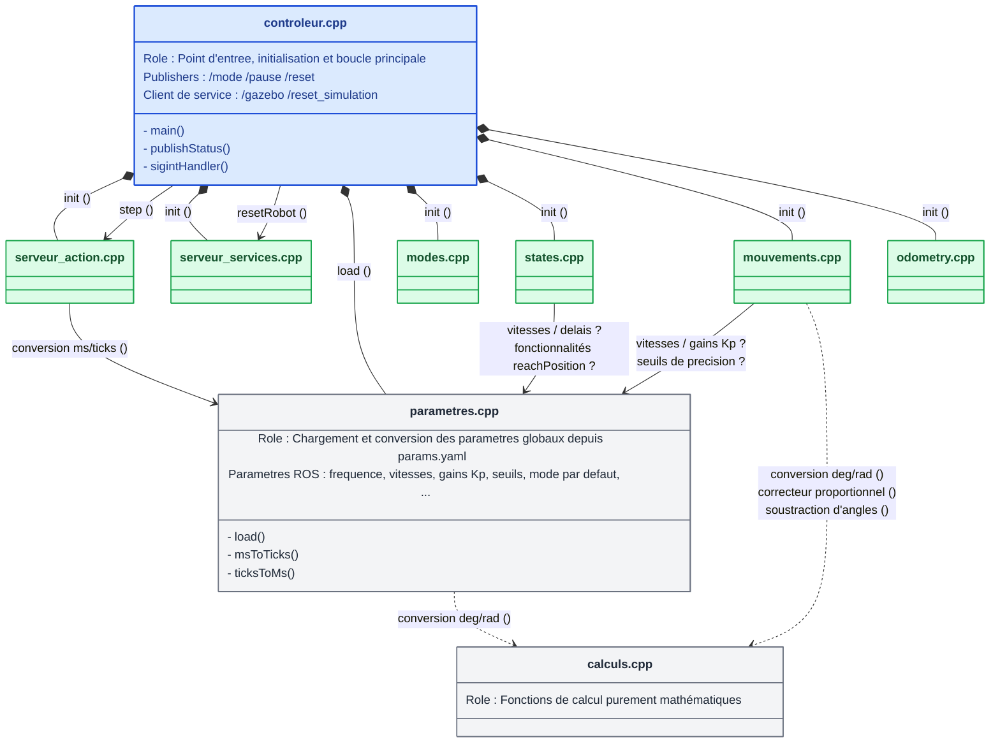
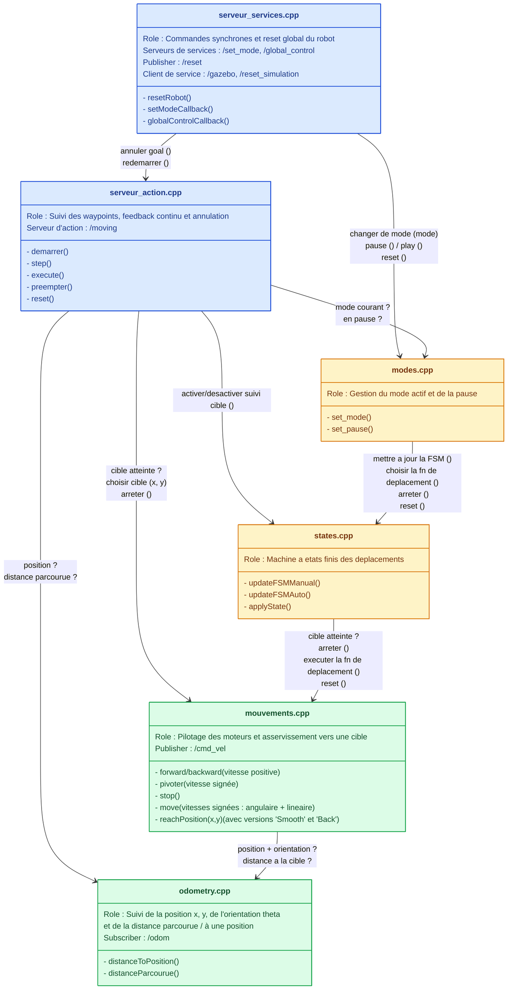
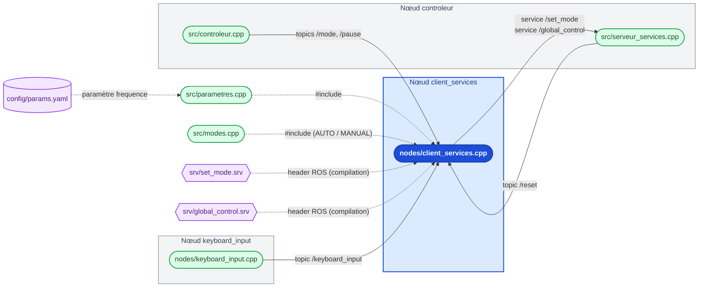
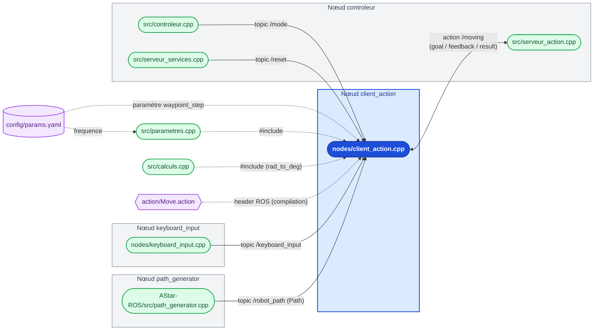
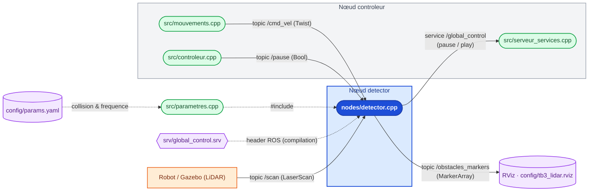

# Rapport — Projet robotique mobile et navigation autonome : Application au robot TurtleBot3

## I. Architecture finale du projet

### Arborescence du paquet TABDK

### Découpage du noeud Controleur en classes

#### Classe principale et dépendances neutres

Le fichier `calculs.cpp` est le seul fichier `.cpp` qui ne contient pas une classe mais simplement des fonctions utilitaires.

#### Interactions entre les classes du nœud Controleur

### Interaction des différents noeuds

Chaque diagramme ci-dessous présente un nœud du dossier `TABDK/src/nodes/` avec ses dépendances de **compilation / paramètres** (flèches pointillées `-.->`) et ses échanges **ROS à l'exécution** par topic, service ou action (flèches pleines `-->` / `<-->`). Chaque fichier `.cpp` appartenant à un nœud ROS est encadré par le nom de son nœud.

#### `keyboard_input.cpp`

Lit les touches du clavier (`getch()`) et les diffuse aux autres nœuds sur `/keyboard_input`.

#### `client_services.cpp`

Traduit les touches clavier (`m` mode, `p` pause/play, `r` reset) en appels de services vers le contrôleur.

#### `client_action.cpp`

Gère la file de waypoints (saisie clavier en mode `manual` ou trajectoire A* `/robot_path` en mode `auto`) et pilote leur exécution via l'action `/moving`.

#### `detector.cpp`

Analyse le LiDAR `/scan` sur 8 régions, affiche les obstacles dans RViz et déclenche `pause`/`play` en cas de collision imminente.

### 2.3 Pilotage de base du TB3

#### Enonce
On voudrait maintenant ajouter dans le nœud contrôleur un autre *publisher* qui permet de générer une commande en vitesse pour déplacer le robot TB3.

1. Identifier le topic concerné, la librairie `.h` nécessaire, son *namespace* ainsi que le type de message véhiculé par le topic (cf. page 53 du cours).
2. Réaliser la fonction `void avancer(double vitesse)` permettant d'avancer le robot. Tester son fonctionnement. **REMARQUE :** la publication du topic doit s'effectuer dans le `main`.
3. Réaliser la fonction `void arreter()`, la publication du topic doit également s'effectuer dans le `main`. Tester son fonctionnement.
4. Ajouter dans `sigintHandler` l'arrêt du robot + la publication du topic afin que le robot s'arrête lors du `CTRL+C`.
5. Appeler maintenant les fonctions précédentes (`avancer` et `arreter`) depuis la fonction `void move()` afin de réaliser au robot les mouvements suivants : avancer pendant une certaine durée, puis s'arrêter pour une autre durée. Ces durées doivent être basées sur la période du contrôleur (valeurs multiples de la période de contrôle).
* Intégrer la fonction `void reculer(double vitesse)` pour réaliser les mouvements suivants : avancer-arreter-reculer périodiquement.

#### notre implementation

1. Le topic est '/cmd_vel' comme l'année dernière
2. Le type de message trouvé grâce à rostopic info, est un Twist qui contient les 3 vitesses linéaires et les 3 vitesses angulaires.
3. C

### 2.4 Paramètres de l'application

On voudrait maintenant rendre l'application plus générique en indiquant des paramètres (la fréquence de contrôle par exemple), au lancement des nœuds. Deux possibilités :

1. **Via les arguments du fichier launch :**
Modifier le fichier de lancement `run.launch` afin d'y inclure en argument un paramètre `freq`, qui précisera au lancement du nœud contrôleur la fréquence de la boucle de contrôle.
2. **Ou bien via les fichiers de configuration YAML :**
Créer dans le dossier de votre package un sous-dossier `/config`, il contiendra les paramètres de configuration de l'application sous forme de fichier `.yaml`.

Tester le fonctionnement du contrôleur avec différentes fréquences.

---

## 3. Contrôle et navigation du TB3

### 3.1 Les modes de navigation

Le robot TB3 peut naviguer selon deux modes : **mode manuel** ou **mode navigation autonome**.

Proposer une solution à base de machine à états finis (usage de l'instruction `switch` par exemple) permettant au robot de basculer d'un mode à un autre. Le mode par défaut peut être indiqué au lancement de l'application.

### 3.2 Mode navigation manuelle

1. À l'aide de ce nouveau nœud `key_input_node.cpp`, modifier votre contrôleur afin de piloter le robot via des touches clavier (cf. tableau des codes ASCII sur la page). Il est possible alors de faire les actions suivantes :
* Avancer/reculer/pivoter le robot avec une certaine vitesse, paramètres de l'application, sans dépasser les valeurs max supportées par le TB3 (cf. `MAX_LINEAR_SPEED` `MAX_ANGULAR_SPEED` dans le `controleur.cpp`).
* Changer en temps réel la vitesse linéaire et/ou angulaire du robot.

2. Évaluer la réactivité du robot aux touches clavier, et proposer une implémentation minimisant les éventuelles latences d'E/S.

### 3.3 Mode navigation autonome

#### 3.3.1 Localisation du TB3

La position du TB3 est calculée au niveau de la carte OpenCR puis transmise à la carte Rpi où cette position est restituée sous forme de topic. Identifier le nom et le rythme de ce topic, ainsi que le type de message associé.

Étendre le nœud contrôleur afin de lire et afficher en temps réel la position du robot.

Utiliser les structures de données adéquates pour le stockage de la position : `[http://wiki.ros.org/common_msgs](http://wiki.ros.org/common_msgs)`.

* **Remarque 1 :** pour une meilleure efficacité et une bonne stabilité numérique des calculs odométriques, l'orientation du robot est représentée dans une unité de mesure appelée quaternion. Pour la conversion des positions angulaires vers l'unité angles d'Euler (Roll (x), Pitch (y), Yaw (z)), utiliser la fonction `tf::getYaw(geometry_msgs::Quaternion orientation_quaternion)`. Elle retourne l'orientation sur l'axe z (Yaw) du robot.
* **Remarque 2 :**
* Pour réinitialiser la position du robot TB3 réel, il suffit de publier un message (vide) vers le topic `/reset`. Associer une touche clavier pour déclencher cette opération.
* Pour réinitialiser la position du robot TB3 simulé, appeler le service `/gazebo/res` et_simulation` (ou bien utiliser ce fichier `reset_gazebo.sh.

#### 3.3.2 Navigation vers un but

##### Parcours de distance (asservissement en position sur un axe)

En mode navigation autonome, le contrôleur doit pouvoir déplacer le robot en ligne droite sur une distance `d` (m) donnée.

Réaliser ce contrôle, sur l'axe `x` par exemple, pour assurer un déplacement de la position `x0` à la position cible `x1`. La vitesse de déplacement doit diminuer lorsque le robot se rapproche de la position cible. La commande en vitesse linéaire doit donc être proportionnelle à la distance restante `x1-x0`. Pour calculer cette commande, utiliser un asservissement PID :

* Déterminer tout d'abord le gain proportionnel `Kp_pos` (puis si nécessaire le gain dérivé `Kd_pos`, puis (si nécessaire) le gain intégral `Ki_pos` pour une meilleure précision).
* Afin que ce processus itératif converge, l'asservissement s'achève lorsque l'amplitude de dépassement (tolérance) autour de la position cible devient faible (`+/- 0.02` au maximum).
* Tester le comportement du robot pour des positions `x1` positives et négatives.
* **Fonctions utiles :** `fabs(float var_float)` : retourne la valeur absolue d'un `float` ou d'un `double`.

##### Asservissement en position angulaire

Le contrôleur doit être maintenant en mesure de pivoter périodiquement le robot pour atteindre une position angulaire `theta`.

* Réaliser un autre correcteur PID pour asservir le robot en position angulaire.
* Déterminer tout d'abord le gain proportionnel `Kp_angle` (puis si nécessaire le gain dérivé `Kd_angle`, puis (si nécessaire) le gain intégral `Ki_angle` pour une meilleure précision).
* L'amplitude de dépassement (tolérance) autour de l'angle cible doit être au maximum égale à `+/-0.05 radian`.
* Valider le fonctionnement du correcteur en gardant le robot immobile.
* **REMARQUE :** dans le cas où la position angulaire serait entre `[-PI, +PI]`, utiliser la fonction `cal_delta_Theta` fournie afin de calculer l'écart entre deux positions angulaires (calcul de delta theta avec les conversions trigonométriques).

##### Cinématique inverse

Le robot doit maintenant atteindre un but, une position `(x,y)` sur un espace cartésien. Pour cela, le contrôleur doit déterminer les suites d'actions à appliquer sur le robot pour atteindre cet objectif. Utiliser les fonctionnalités développées précédemment pour réaliser ce contrôle.

* **Aides :**
1. La distance entre deux points dans un plan cartésien : `distance = sqrt(pow(x2 - x1, 2) + pow(y2 - y1, 2));`
2. L'angle de rotation entre deux points dans un plan cartésien : `angle = atan2((y2 - y1), (x2 - x1));`

##### BONUS (en simulation uniquement)

La consigne de navigation (position désirée du robot) peut être maintenant envoyée depuis RViz en utilisant `2D Nav Goal` :

* Déterminer le topic associé.
* Adapter votre contrôleur afin de lire en temps réel cette consigne de navigation (position désirée). Cela vous permet ainsi d'indiquer au robot, de manière interactive, une nouvelle position cible.

---

## 4. Perception de l'environnement à l'aide du Lidar (Capteur de distance Laser 360 LDS-01 - LDS-02)

Vous devez développer un système de détection d'obstacles pour le robot TurtleBot 3 équipé d'un capteur LIDAR (LDS-01 ou LDS-02). L'objectif est de créer un nœud ROS capable de traiter les données du LIDAR, de détecter la présence d'obstacles dans l'environnement proche, et de visualiser les résultats de manière intuitive dans RVIZ.

Le capteur LDS-01 ou LDS-02 permet théoriquement une mesure sur 360 degrés avec une résolution angulaire de 1° au mieux. Il permet de restituer la distance séparant le robot des obstacles présents à proximité (3.5m max). Chacun des deux types de lidar renvoie les informations suivantes :

* `angle_min` (`float32`) : angle de départ du scan [rad]
* `angle_max` (`float32`) : angle de fin du scan [rad]
* `angle_increment` (`float32`) : distance angulaire entre les mesures [rad]
* `range_min` (`float32`) : valeur minimale de la mesure [m]
* `range_max` (`float32`) : valeur maximale de la mesure [m]
* `ranges` (`float32[]`) : données mesurées par le scan (distances par rapport au centre du robot) [m]

**Important :** les valeurs dans le tableau `ranges` qui sont inférieures à `range_min` ou supérieures à `range_max` doivent être ignorées car elles sont considérées comme non valides.

1. Identifier le topic sur lequel sont publiées les données lidar, ainsi que le type de message associé.
2. Intégrer dans votre package le nœud `detector.cpp`, puis réaliser la détection d'obstacle selon les exigences suivantes :
* L'environnement autour du robot est divisé en 8 régions égales.
* Pour chaque région :
1. collecter toutes les mesures
2. filtrer les valeurs non valides
3. calculer la distance minimale parmi les points valides
4. détecter si un obstacle est présent (comparaison avec un seuil)
5. stocker les résultats pour visualisation

* **DOC :** `[http://wiki.ros.org/sensor_msgs](http://wiki.ros.org/sensor_msgs)`
* **AIDE :** pour déterminer le minimum des valeurs d'un tableau (`vector`), utiliser la fonction fournie dans le fichier `detector.cpp`. La recherche du minimum s'effectue de l'indice `debut` à l'indice `fin` du tableau, et elle retourne la valeur minimale ainsi que sa position dans le tableau (`indice_min`).

3. Créer un système de visualisation dans RVIZ, à l'aide de `visualization_msgs/MarkerArray`, comprenant par exemple :
* **Ressources :**
* `rviz_tb3.launch` (préciser le nom de votre package `tb3_projet_vos_initiales` dans la balise `node`)
* `tb3_lidar.rviz` (placer le fichier dans le dossier `config`, à créer au même niveau que le dossier `src` de votre package)

* Labels textuels indiquant l'état de chaque région.
* Marqueurs d'obstacles sur les obstacles détectés.
* Code couleur : rouge pour zones dangereuses, vert/bleu pour zones sûres.
* **Documentations :** documentation `sensor_msgs/LaserScan`, tutorial `visualization_msgs/Marker`.

---

## 5. Services, actions et gestion de trajectoires

Pour interagir de manière fluide et sécurisée avec le robot, vous allez mettre en place une architecture reposant sur trois mécanismes de communication ROS complémentaires :

* **Un service ROS (`/set_behavior`) :** permet à un opérateur de configurer à tout moment le comportement du robot (mode manuel, `auto_standard`, `auto_turbo`, ...).
* **Une action ROS (`Move.action`) :** pilote la navigation et les « déplacements longs » du robot vers une position cible, en utilisant votre nœud contrôleur.
* **Un topic (`/consigne_trajectoire`) :** transmet le plan de route global que doit suivre le robot.

### 5.1 Configuration à la volée du comportement du robot — Service

L'objectif est de créer un service pour changer à la volée le mode et le comportement du robot. Ce format convient à une configuration ponctuelle et synchrone. Le clavier reste un canal local, le service est le point de passage centralisé qui valide et applique les changements de manière coordonnée sécurisée.

Ce service permet de basculer entre les différents modes du robot : `manuel`, `auto_standard`, `auto_turbo`, ainsi qu'entre les politiques d'évitement d'obstacle (arrêt simple, contournement, etc.). Il garantit un comportement sécurisé : il peut par exemple refuser le passage en `auto_turbo` si la batterie est inférieure à 20 % ou si un obstacle est trop proche. La réponse indique `success` et, en cas de refus, un message explicatif.

#### Configuration du fichier de service

* Dans le dossier `src` de votre package `tb3_projet_<vos_initiaux>`, créer un sous-dossier `srv`. Puis, copier dans ce dossier le fichier de service `set_behavior.srv` permettant de définir les arguments du service et sa valeur de retour.
* Dans le fichier `CMakeLists.txt`, « décommenter » les directives correspondantes (`add_service_files` avec `FILES set_behavior.srv`) afin de créer le service.
* Première compilation (`cm`) est nécessaire pour générer d'abord les messages et les fichiers associés au service.

#### Implémentation du service dans le nœud contrôleur du TurtleBot3

* Implémenter le service `/set_behavior` dans votre nœud contrôleur du TurtleBot3.
* Tester le service : lancer votre nœud, puis testez le fonctionnement du service depuis un terminal à l'aide de la commande d'appel de service `rosservice call /set_behavior <argument>` — les arguments se complètent automatiquement avec la touche Tabulation.

### 5.2 Navigation — Serveur d'action

Pour les déplacements longs et la navigation, un service bloquerait l'appelant pendant toute la durée du trajet et ne permettrait pas d'en suivre l'avancement. Nous allons donc créer une action : l'appelant envoie un objectif (`goal`), reçoit des feedbacks réguliers sur l'état du robot (position, progression, batterie), et obtient un résultat final (`result`). Le robot est ainsi guidé de manière asynchrone, sans bloquer le client.

#### Configuration de la messagerie de l'action

Création d'un serveur d'action — exemple introductif :

* Dans le dossier `src` de votre package `tb3_projet_<vos_initiaux>`, créer un sous-dossier `action`. Puis, copier dans ce dossier le fichier d'action `Move.action` permettant de définir la messagerie de l'action (`goal`, `result`, `feedback`).
* Puis dans le fichier `CMakeLists.txt`, « décommenter » les directives correspondantes (`add_action_files` avec `FILES Move.action` et `generate_messages` avec les dépendances `actionlib_msgs`, `geometry_msgs`, `nav_msgs`, `sensor_msgs`, `std_msgs`) afin de créer l'action `Move.action`.
* **COMPILATION EN DEUX TEMPS :** première compilation (`cm`) est nécessaire pour générer d'abord les messages et les fichiers d'action associés à `Move.action`.

#### Implémentation du client et du serveur d'action

* Copier dans le dossier `src` de votre package les fichiers suivants : `client_action.cpp`, `serveur_action.cpp` (dans ces fichiers, remplacer `tb3_projet_vos_initiales` par le nom de votre package).
* Ajouter à la fin du fichier `CMakeLists.txt` la déclaration de ces deux nouveaux nœuds (`serveur_action` et `client_action`, avec leurs dépendances et liens vers `${catkin_LIBRARIES}`).
* Deuxième compilation (`cm`) permet la construction complète du projet utilisant les actions.
* **Test unitaire :** vérifier le fonctionnement du serveur d'actions en définissant des objectifs depuis le client d'actions.

#### Intégration du contrôleur dans le serveur d'action

On souhaite maintenant intégrer le serveur d'action dans le contrôleur du turtlebot afin de gérer la navigation de celui-ci :

1. Adapter la messagerie d'action (le fichier `Move.action`) pour construire un objectif de navigation, un feedback et un résultat.
2. Intégrer le serveur d'action dans le contrôleur du turtlebot. Ce serveur sera chargé de gérer le processus de navigation du robot conformément aux objectifs transmis par le client.
3. Étendre le serveur d'action avec les éléments suivants :
* Dans les feedbacks : position actuelle, vitesse actuelle, distance restante, niveau de batterie restant.
* Dans le result : distance totale parcourue, temps écoulé.

### 5.3 Gestion des trajectoires — Path

Le nœud `client_action` devient le gestionnaire de mission : il s'abonne à un topic externe pour recevoir un itinéraire complet sous la forme d'un message standardisé de type `nav_msgs/Path`.

1. **Topic de Trajectoire :**
Modifier le nœud `client_action.cpp` pour qu'il s'abonne à un nouveau topic nommé par exemple `/consigne_trajectoire`. Le type de message à utiliser est `nav_msgs/Path`. Consulter l'API officielle (`nav_msgs/Path`) pour comprendre son agencement interne.
2. **Extraction et gestion du Vecteur dans le Client :**
Contrairement à un simple tableau plat, `nav_msgs/Path` contient un champ `poses`, qui est un tableau d'objets `geometry_msgs/PoseStamped`. Chaque `PoseStamped` contient à son tour un objet `pose` contenant la position `(x, y, z)`.
Dans la fonction callback de votre *subscriber*, vous devez itérer sur le message pour extraire les positions 2D `(x, y)` utiles à votre action `Move`, puis les stocker dans votre file d'attente (`std::vector`).
* **Déclaration :** `std::vector<Pose2D> trajectoire;`
* **Opérations :**
* `trajectoire.size()` : retourne la taille du vecteur.
* `trajectoire.push_back(position)` : insère un élément à la fin du vecteur.
* `trajectoire.erase(trajectoire.begin())` : supprime le premier élément du vecteur.
* `trajectoire[0]` : permet l'accès au premier élément du vecteur.
Dès que le serveur d'action valide l'objectif actuel, le client extrait le point suivant (`trajectoire.erase(trajectoire.begin())`) pour relancer l'action `Move`, jusqu'à ce que la file d'attente soit vide.

3. **Test de validation final :**
Lancer l'ensemble de vos nœuds ainsi que la simulation du TurtleBot. Envoyer une trajectoire complète de plusieurs points via le topic `/consigne_trajectoire` de type `nav_msgs/Path` (en utilisant la touche Tabulation pour pré-remplir la structure complexe du message).
Pendant que le robot se déplace de position en position, appeler le service depuis un autre terminal pour basculer en mode `auto_turbo` par exemple.

---

## 6. Évitement d'obstacle et planification de trajectoire — SLAM

### 6.1 SLAM (Cartographie et Localisation simultanées)

* **VERSION SIMU :** `roslaunch turtlebot3_gazebo turtlebot3_house.launch`
* **VERSION RÉELLE :** robot TB3 dans le labyrinthe du labo 4105.

#### Exécution du nœud SLAM

Lancez le nœud SLAM. Le Gmapping est utilisé comme méthode SLAM par défaut. Le paramètre `TURTLEBOT3_MODEL` indique le type du robot `burger` (`export TURTLEBOT3_MODEL=burger` puis `roslaunch turtlebot3_slam turtlebot3_slam.launch`).

#### Exécution du nœud Téléopération

Une fois le nœud SLAM correctement opérationnel, TurtleBot3 explorera une zone inconnue de la carte à l'aide de la téléopération. Il est important d'éviter les mouvements vigoureux tels que le changement trop rapide de la vitesse linéaire et angulaire. Lors de la création d'une carte à l'aide de TurtleBot3, il est recommandé de scanner chaque recoin de la carte.

Ouvrez un nouveau terminal et exécutez le nœud de téléopération (`export TURTLEBOT3_MODEL=burger` puis `roslaunch turtlebot3_teleop turtlebot3_teleop_key.launch` avec les commandes `w`/`x`, `a`/`d`, espace/`s`, `CTRL-C`).

Commencez à explorer et à construire la carte de l'environnement. La carte est dessinée en fonction de l'odométrie, du tf et des informations de scan du robot. Ces données cartographiques sont dessinées dans la fenêtre RViz pendant que le TurtleBot3 se déplace.

#### Enregistrement de la carte

Après avoir créé une carte complète de la zone souhaitée, enregistrez les données cartographiques sur le disque local pour une utilisation ultérieure.

Lancez le nœud `map_saver` dans le package `map_server` pour créer des fichiers de carte. Le fichier de carte est enregistré dans le répertoire où le nœud `map_saver` est lancé. À moins qu'un nom de fichier spécifique ne soit fourni, `map` sera utilisé comme nom de fichier par défaut et créera `map.pgm` et `map.yaml` (`rosrun map_server map_saver -f ~/map`).

L'option `-f` spécifie un emplacement de dossier et un nom de fichier où les fichiers doivent être enregistrés. Avec `~/map`, `map.pgm` et `map.yaml` seront enregistrés dans le dossier personnel `~` (`/home/ubuntu`).

#### La carte

La carte utilise une grille d'occupation bidimensionnelle (OGM), couramment utilisée dans ROS. La carte enregistrée ressemblera à la figure ci-dessous, où la zone blanche est une zone sans collision tandis que la zone noire est une zone occupée et inaccessible, et la zone grise représente la zone inconnue. Cette carte est utilisée pour la navigation.

### 6.2 Navigation à base de SLAM

Importer le package suivant : `AStar-ROS.zip`.

Compilez-le puis lancez le nœud correspondant : `roslaunch path_generator run.launch`.

* Calibrer la position initiale du robot à l'aide de la flèche « 2D Pose Estimate ».
* Spécifier la destination du robot à l'aide de la flèche « 2D Nav Goal ».

Une fois la planification de trajectoire effectuée (diffusion du topic `/robotic_path` (`Path`)), votre contrôleur doit piloter le robot afin d'atteindre la position finale désirée.

Améliorer la navigation afin de réaliser :

* une trajectoire plus « lisse »
* le contournement d'éventuels obstacles dynamiques.