# Rapport : Projet robotique mobile et navigation autonome appliqué au robot TurtleBot3

**Binôme :** Benoît de Keyn & Thibault Agueh  
**Date :** 26 novembre 2026

## Table des matières

<!-- TOC -->

<b>• [Introduction](#introduction)</b><br>
<b>• [1. Environnement de développement](#1-environnement-de-d%C3%A9veloppement)</b><br>
&ensp;&ensp;&ensp;&ensp;◦ [1.1 Simulation en ligne : TheConstructSim](#11-simulation-en-ligne--theconstructsim)<br>
&ensp;&ensp;&ensp;&ensp;◦ [1.2 Développement local et déploiement sur le robot : VS Code, GitHub et SSH](#12-d%C3%A9veloppement-local-et-d%C3%A9ploiement-sur-le-robot--vs-code-github-et-ssh)<br>
<b>• [2. Architecture finale du projet](#2-architecture-finale-du-projet)</b><br>
&ensp;&ensp;&ensp;&ensp;◦ [2.1 Arborescence du paquet TABDK](#21-arborescence-du-paquet-tabdk)<br>
&ensp;&ensp;&ensp;&ensp;◦ [2.2 Découpage du nœud contrôleur en classes](#22-d%C3%A9coupage-du-n%C5%93ud-contr%C3%B4leur-en-classes)<br>
&ensp;&ensp;&ensp;&ensp;◦ [2.3 Interaction des différents nœuds](#23-interaction-des-diff%C3%A9rents-n%C5%93uds)<br>
<b>• [3. Pilotage de base et paramétrage du TB3](#3-pilotage-de-base-et-param%C3%A9trage-du-tb3)</b><br>
&ensp;&ensp;&ensp;&ensp;◦ [3.1 Pilotage de base du TB3](#31-pilotage-de-base-du-tb3)<br>
&ensp;&ensp;&ensp;&ensp;◦ [3.2 Paramètres de l'application](#32-param%C3%A8tres-de-lapplication)<br>
<b>• [4. Contrôle et navigation du TB3](#4-contr%C3%B4le-et-navigation-du-tb3)</b><br>
&ensp;&ensp;&ensp;&ensp;◦ [4.1 Les modes de navigation](#41-les-modes-de-navigation)<br>
&ensp;&ensp;&ensp;&ensp;◦ [4.2 Mode navigation manuelle](#42-mode-navigation-manuelle)<br>
&ensp;&ensp;&ensp;&ensp;◦ [4.3 Mode navigation autonome](#43-mode-navigation-autonome)<br>
<b>• [5. Perception de l'environnement à l'aide du LiDAR](#5-perception-de-lenvironnement-%C3%A0-laide-du-lidar)</b><br>
&ensp;&ensp;&ensp;&ensp;◦ [Énoncé](#%C3%A9nonc%C3%A9-6)<br>
&ensp;&ensp;&ensp;&ensp;◦ [Choix fonctionnels](#choix-fonctionnels-6)<br>
&ensp;&ensp;&ensp;&ensp;◦ [Première implémentation](#premi%C3%A8re-impl%C3%A9mentation-5)<br>
&ensp;&ensp;&ensp;&ensp;◦ [Difficultés rencontrées](#difficult%C3%A9s-rencontr%C3%A9es-6)<br>
&ensp;&ensp;&ensp;&ensp;◦ [5.1 Conception des marqueurs RViz](#51-conception-des-marqueurs-rviz)<br>
&ensp;&ensp;&ensp;&ensp;◦ [Version finale](#version-finale-6)<br>
<b>• [6. Services, actions et gestion de trajectoires](#6-services-actions-et-gestion-de-trajectoires)</b><br>
&ensp;&ensp;&ensp;&ensp;◦ [6.1 Configuration à la volée du comportement du robot : service](#61-configuration-%C3%A0-la-vol%C3%A9e-du-comportement-du-robot--service)<br>
&ensp;&ensp;&ensp;&ensp;◦ [6.2 Navigation : serveur d'action](#62-navigation--serveur-daction)<br>
&ensp;&ensp;&ensp;&ensp;◦ [6.3 Gestion des trajectoires : Path](#63-gestion-des-trajectoires--path)<br>
<b>• [7. Évitement d'obstacle et planification de trajectoire : SLAM](#7-%C3%A9vitement-dobstacle-et-planification-de-trajectoire--slam)</b><br>
&ensp;&ensp;&ensp;&ensp;◦ [7.1 SLAM (Cartographie et Localisation simultanées)](#71-slam-cartographie-et-localisation-simultan%C3%A9es)<br>
&ensp;&ensp;&ensp;&ensp;◦ [7.2 Navigation à base de SLAM](#72-navigation-%C3%A0-base-de-slam)<br>
<b>• [8. Migration architecturale : passage d'un fichier contrôleur unique à un découpage en classes](#8-migration-architecturale--passage-dun-fichier-contr%C3%B4leur-unique-%C3%A0-un-d%C3%A9coupage-en-classes)</b><br>
&ensp;&ensp;&ensp;&ensp;◦ [8.1 Motivation et étapes du découpage](#81-motivation-et-%C3%A9tapes-du-d%C3%A9coupage)<br>
&ensp;&ensp;&ensp;&ensp;◦ [8.2 Organisation des fichiers .cpp et namespaces](#82-organisation-des-fichiers-cpp-et-namespaces)<br>
&ensp;&ensp;&ensp;&ensp;◦ [8.3 Patron init() différé et association des classes par pointeurs](#83-patron-init-diff%C3%A9r%C3%A9-et-association-des-classes-par-pointeurs)<br>
&ensp;&ensp;&ensp;&ensp;◦ [8.4 Cas critique : intégration de ServeurAction](#84-cas-critique--int%C3%A9gration-de-serveuraction)<br>
&ensp;&ensp;&ensp;&ensp;◦ [8.5 Conduite du refactoring](#85-conduite-du-refactoring)

<!-- /TOC -->
## Introduction

Ce rapport présente la conception, l'implémentation et la validation de notre projet de **robotique mobile et navigation autonome** sous **ROS Noetic**, appliqué au robot **TurtleBot3 Burger** (en simulation Gazebo et en conditions réelles dans le labyrinthe de la salle 4105).

L'objectif du projet était de développer progressivement notre package **`TABDK`**, puis de le relier au planificateur **`AStar-ROS`** pour couvrir toutes les étapes demandées :

- le pilotage bas niveau (`/cmd_vel`) et le paramétrage global via YAML ([section 3, Pilotage de base et paramétrage du TB3](#3-pilotage-de-base-et-paramétrage-du-tb3)) ;
- la gestion des modes (`manual` et `auto`), de la pause, du pilotage manuel et de la localisation odométrique (`/odom`) ([section 4, Contrôle et navigation du TB3](#4-contrôle-et-navigation-du-tb3)) ;
- l'asservissement en position et en orientation, étendu vers des déplacements fluides en marche avant et arrière ([section 4.3.2, Navigation vers un but](#432-navigation-vers-un-but)) ;
- la perception 360° par LiDAR (`/scan`), la visualisation dans RViz et la prévention active de collision ([section 5, Perception de l'environnement à l'aide du LiDAR](#5-perception-de-lenvironnement-à-laide-du-lidar)) ;
- les commandes par services ROS (`/set_mode`, `/global_control`), le suivi asynchrone de waypoints par action (`/moving`) et la gestion de trajectoires `nav_msgs/Path` ([section 6, Services, actions et gestion de trajectoires](#6-services-actions-et-gestion-de-trajectoires)) ;
- la cartographie SLAM (Gmapping) et la planification de chemin A\* améliorée avec lissage de trajectoire ([section 7, Évitement d'obstacle et planification de trajectoire : SLAM](#7-évitement-dobstacle-et-planification-de-trajectoire--slam)).

## 1. Environnement de développement

Pour avancer efficacement tout au long du projet et travailler à deux dans de bonnes conditions, nous avons utilisé deux environnements complémentaires : la simulation en ligne **TheConstructSim** et un **workspace VS Code automatisé** couplé à GitHub pour le robot physique.

### 1.1 Simulation en ligne : TheConstructSim

Pour travailler à distance depuis chez nous, tester nos packages dans un environnement virtuel et **économiser la batterie du TurtleBot3 réel** (qui tenait peu longtemps en séance), nous avons utilisé la plateforme **TheConstructSim**. Elle met à disposition dans le navigateur un **VS Code en ligne**, **Gazebo** et **RViz** déjà prêts à l'emploi. Nous détaillons dans la [section 7.1, SLAM (Cartographie et Localisation simultanées)](#71-slam-cartographie-et-localisation-simultanées) les contraintes rencontrées sur cette plateforme lors de l'installation des paquets SLAM et navigation.

### 1.2 Développement local et déploiement sur le robot : VS Code, GitHub et SSH

Sur nos ordinateurs personnels, nous avons préféré utiliser **VS Code**, **GitHub** et **GitHub Desktop** plutôt que **MobaXterm** (qui oblige à garder le code sur le robot, à ouvrir et placer plusieurs fenêtres SSH à la main et à retaper souvent le mot de passe). Nous codions,en local et pour collaborer on utilisait GitHub.

Au début, nous devions copier à la main chaque fichier modifié sur le robot après nos changements sur Git. Nous avons donc mis en place un **workspace VS Code dédié** (`robotique.code-workspace`) pour automatiser notre travail :

- **Arborescence épurée** : nous affichons uniquement nos dossiers utiles (`TABDK/`, puis `AStar-ROS/` lorsque nous en avons eu besoin) directement dans VS Code, sans avoir à parcourir toute l'arborescence du robot.
- **Synchronisation automatique à la sauvegarde** : à chaque enregistrement en local, nos dossiers `TABDK/` et `AStar-ROS/` sont recopiés automatiquement en miroir vers `~/catkin_ws/src/` sur le robot via SSH.
- **Ouverture automatique des terminaux** : à l'ouverture du workspace, VS Code lance une synchronisation initiale, exécute `run_robot.sh` dans un terminal SSH indépendant pour démarrer l'environnement du robot, puis ouvre un terminal SSH prêt à l'emploi avec nos alias déjà chargés.
- **Terminal SSH par défaut** : chaque nouveau terminal ouvert dans VS Code se connecte directement en SSH sur le robot.

## 2. Architecture finale du projet

### 2.1 Arborescence du paquet TABDK


### 2.2 Découpage du nœud contrôleur en classes

Dans notre version finale, `controleur.cpp` est le point d'entrée du contrôleur. Il initialise les différentes classes, lance la boucle principale et et tout ce qui est lié directment à ROS

- le pilotage de la vitesse linéaire et angulaire (`Mouvements`) ;
- l'odométrie (`Odometry`) ;
- la machine à états des déplacements (`States`) ;
- les modes de fonctionnement et la pause (`Modes`) ;
- le chargement des paramètres et leur conversion (`Params`) ;
- les échanges avec ROS par services et par action (`ServeurServices` et `ServeurAction`).

Nous expliquons dans la [section 8, Migration architecturale : passage d'un fichier contrôleur unique à un découpage en classes](#8-migration-architecturale--passage-dun-fichier-contrôleur-unique-à-un-découpage-en-classes) comment nous sommes passés d'un seul fichier `controleur.cpp` à cette organisation en classes.

> Le fichier `calculs.cpp` est le seul fichier `.cpp` dsitué directement dans `src/` qui ne contient pas une classe mais simplement des fonctions utilitaires.

#### Classe principale et dépendances neutres

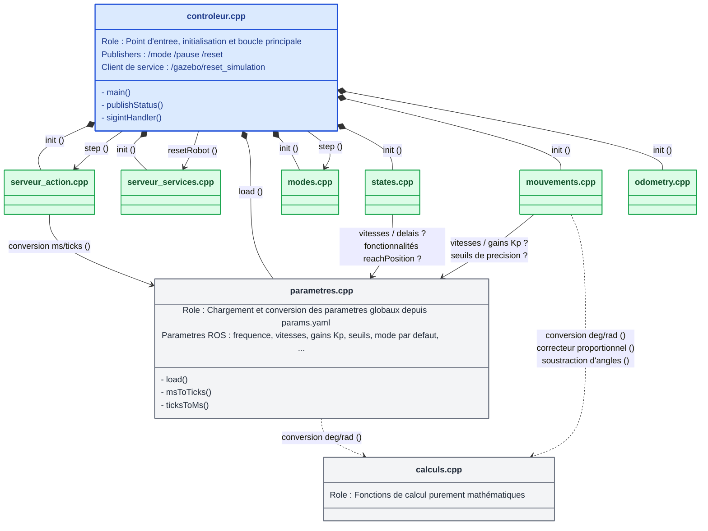

#### Interactions entre les classes du nœud contrôleur

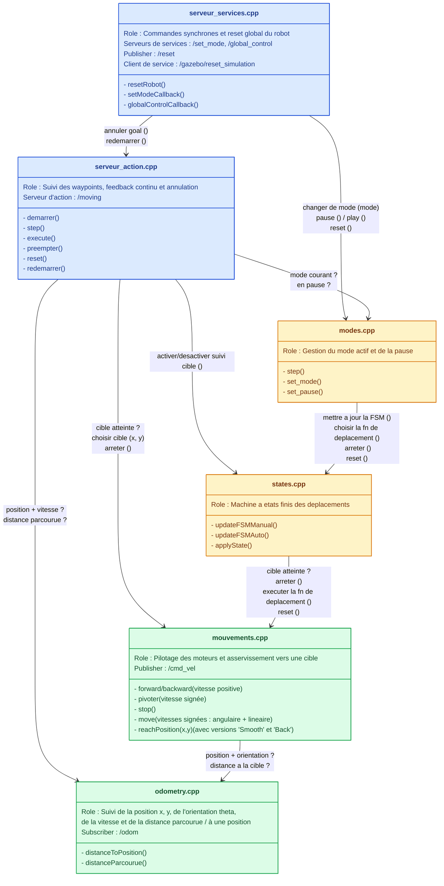

### 2.3 Interaction des différents nœuds

Le paquet `TABDK` contient le nœud contrôleur ainsi que quatre autres nœuds, dont les schémas et les descriptions sont disponibles dans les parties indiquées dans le tableau suivant :

| Nœud (`TABDK/src/nodes/`) | Rôle principal | Schéma détaillé |
| --- | --- | --- |
| `keyboard_input.cpp` | Capture clavier → `/keyboard_input` | [section 4.2, Mode navigation manuelle](#42-mode-navigation-manuelle) |
| `detector.cpp` | Analyse LiDAR 8 régions, marqueurs RViz et obstacles| [section 5, Perception de l'environnement à l'aide du LiDAR](#5-perception-de-lenvironnement-à-laide-du-lidar) |
| `client_services.cpp` | Commandes clavier `m`/`p`/`r` → `/set_mode` et `/global_control` | [section 6.1, Configuration à la volée du comportement du robot : service](#61-configuration-à-la-volée-du-comportement-du-robot--service) |
| `client_action.cpp` | Liste de waypoints (via clavier ou topic) → action `/moving`  | [section 6.3, Gestion des trajectoires : Path](#63-gestion-des-trajectoires--path) |

> Nous expliquons dans la [section 8, Migration architecturale : passage d'un fichier contrôleur unique à un découpage en classes](#8-migration-architecturale--passage-dun-fichier-contrôleur-unique-à-un-découpage-en-classes) comment nous sommes passés d'un fichier `controleur.cpp` unique à ce découpage en classes.

## 3. Pilotage de base et paramétrage du TB3

### 3.1 Pilotage de base du TB3

#### Choix fonctionnels

- Nous avons utilisé le topic `/cmd_vel` avec le message `geometry_msgs::Twist` (`#include <geometry_msgs/Twist.h>`), en pilotant la vitesse linéaire sur `linear.x`.
- Nous avons isolé les commandes des vitesses dans trois fonctions simples (`forward()`, `backward()` et `stop()`).
- Pour gérer l'interruption `CTRL+C` dans ROS, nous avons utilisé le `sigintHandler()` pourarrêter proprement le robot à la fermeture du nœud.

#### Première implémentation

Nous avions regroupé tout dans `controleur.cpp` : un publisher sur `/cmd_vel`, les fonctions globales `forward()`, `backward()` et `stop()`, et une boucle `while (ok())` pour traiter l'algorithme.

Nous gérions l'enchaînement "avancer, arrêter, reculer" avec un compteur (`move_counter`) et des conditions `if / else if`. Nous avions alors exprimé les durées en nombre de périodes (`move_fwd_per`, `move_bwd_per`, `move_stp_per`). Ensuite, à la suite de vos recommandations, nous avons remplacé ce compteur par une véritable machine à états pour rendre le code plus simple à faire évoluer. Nous avons créé un `enum RobotState`, une variable `current_state` pour mémoriser l'état courant, puis un `switch(current_state)` dans `update_FSM_auto()` et `apply_state()` pour gérer les transitions et appeler les fonctions de déplacement.

Nous appelions simplement `stop()` puis `shutdown()` dans `sigintHandler()`.

#### Difficultés rencontrées

- Comme nous avions d'abord exprimé les durées en nombre de périodes (`move_fwd_per`, `move_bwd_per`, `move_stp_per`), la durée réelle des déplacements changeait dès que nous modifiions la fréquence du contrôleur. Nous sommes donc passés à des durées en millisecondes (`move_fwd_tm`, `move_bwd_tm`, `move_stp_tm`), converties en nombre de ticks (voir la [section 3.2, Paramètres de l'application](#32-paramètres-de-lapplication)).
- Lorsque nous avons ajouté la réinitialisation du robot et de la simulation, nous avons modifié `sigintHandler()` pour qu'il appelle `reset_robot()` (qui réinitialise puis arrête le robot) avant `shutdown()`. Enfin, lors du découpage en classes, nous avons choisi de remplacer cet appel direct par un drapeau `arret_demande` mis à `true` dans `sigintHandler()`. La boucle principale s'arrête alors proprement avant de reset le robot dans `main()`.

#### Version finale

- Nous avons regroupé les fonctions de commande de vitesse dans la classe `Mouvements` ([TABDK/src/mouvements.cpp](https://github.com/benoitdekeyn/E4SE_TD_TP/blob/main/robotique_et_navigation/TABDK/src/mouvements.cpp#L57-L106)), où `stop()` publie un `Twist()` nul.
- Nous avons conservé l'ancien cycle avancer, arrêter, reculer dans `States::updateFSMAuto()` ([TABDK/src/states.cpp](https://github.com/benoitdekeyn/E4SE_TD_TP/blob/main/robotique_et_navigation/TABDK/src/states.cpp#L117-L145)), même si nous ne l'appelons plus dans le fonctionnement final (comme expliqué dans la [section 4.3, Mode navigation autonome](#43-mode-navigation-autonome)).
- Dans [TABDK/src/controleur.cpp](https://github.com/benoitdekeyn/E4SE_TD_TP/blob/main/robotique_et_navigation/TABDK/src/controleur.cpp#L24-L28) et [L77-L89](https://github.com/benoitdekeyn/E4SE_TD_TP/blob/main/robotique_et_navigation/TABDK/src/controleur.cpp#L77-L89), `sigintHandler()` lève `arret_demande`, puis `main()` appelle `services.resetRobot()` et `shutdown()` en sortie de boucle.

---

### 3.2 Paramètres de l'application

#### Choix fonctionnels

- Nous avons préféré régler les paramètres dans un fichier YAML (`TABDK/config/params.yaml`) plutôt que de les passer un par un en arguments dans `run.launch`.
- Nous avons écrit les angles en degrés et les durées en millisecondes dans ce fichier YAML pour faciliter les réglages, puis nous faisons les conversions au chargement.
- Nous avons donné une valeur par défaut à chaque variable de configuration. Comme ça, le programme garde des valeurs utilisables si un paramètre n'est pas trouvé à l'exécution.
- Nous avons écrit `msToTicks()` et `ticksToMs()` pour centraliser la conversion entre millisecondes et itérations de boucle, et éviter de répéter des divisions ou multiplications par 1000 partout dans le code.

#### Première implémentation

Au début, notre fichier `config/params.yaml` ne contenait que cinq paramètres (`frequence`, `linear_speed`, `move_fwd_per`, `move_bwd_per`, `move_stp_per`). Nous les récupérions directement au début du `main()` de `controleur.cpp` dans des variables globales avec valeurs par défaut. Quand nous avons ajouté les autres nœuds (`keyboard_input`, `detector`, `client_action`), nous avons d'abord gardé des constantes locales hardcodéesdans chacun des nœuds.

#### Difficultés rencontrées

- **Paramètres dispersés entre plusieurs nœuds** : avec des constantes locales dans chaque nœud, nous ne pouvions pas modifier la fréquence globale ou les seuils anti-collision depuis un seul endroit. Nous avons donc regroupé le chargement des paramètres dans une classe `Params`, incluse dans nos cinq nœuds.
- **Cohérence des unités** : comme nous manipulions des degrés, des radians, des millisecondes et des ticks dans plusieurs fichiers, nous avons regroupé toutes les conversions au chargement et dans `msToTicks()` / `ticksToMs()`.

#### Version finale

- La classe `Params` ([TABDK/src/parametres.cpp](https://github.com/benoitdekeyn/E4SE_TD_TP/blob/main/robotique_et_navigation/TABDK/src/parametres.cpp#L11-L70)) contient les valeurs par défaut, charge les paramètres depuis [TABDK/config/params.yaml](https://github.com/benoitdekeyn/E4SE_TD_TP/blob/main/robotique_et_navigation/TABDK/config/params.yaml) via `Params::load()`, et convertit `precision_angular` et `trigger_pivot` en radians.
- Nos cinq nœuds incluent cette classe. Le paramètre `params.frequence` (réglé à 5 Hz) fixe la fréquence des boucles de `controleur`, `keyboard_input` et `client_action`, tandis que `detector` et `client_services` réagissent directement aux messages reçus via `spin()`.
- Les méthodes `msToTicks()` et `ticksToMs()` assurent les conversions temporelles dans le contrôleur :

---

## 4. Contrôle et navigation du TB3

### 4.1 Les modes de navigation

#### Choix fonctionnels

- Dès les premières versions de notre machine à états, nous avons voulu intégrer un **mécanisme de pause**. Car déjà l'année dernière, nous avions déjà mis un mode pause pour arrêter le robot à un instant précis (par exemple juste avant un obstacle ou dans un cas à analyser) ce qui nous permettait d'observer tranquillement les capteurs, l'état interne et les logs sans qu'il continue d'avancer.
- Nous avons défini le mode de démarrage avec `default_mode` dans `config/params.yaml` (avec un repli sur `"manual"` si la valeur est invalide).
- Quand nous avons ajouté plusieurs nœuds ROS, des services et des actions, nous avons **séparé complètement la pause du mode**. Nous voulions que la pause reflète l'arrêt physique du robot (couper les déplacements et les compteurs de déplacement) sans figer son algorithme de décision ni bloquer la lecture des entrées utilisateur.

#### Première implémentation

Dans notre première version, nous avions deux modes principaux dans `controleur.cpp` (`enum RobotMode`) :

- le mode automatique (`AUTO`) exécutait la séquence prédéfinie (avancer, s'arrêter, reculer) ;
- le mode manuel (`MANUAL`) permettait de piloter directement le robot avec les flèches du clavier.

Nous avons ajouté la pause comme un **troisième mode** (`PAUSE`) dans `enum RobotMode`, avec une variable `previous_mode` pour revenir au mode précédent à la reprise.

#### Difficultés rencontrées

- Au début, la mise en pause ne remettait pas la direction clavier à `NONE`, donc le robot repartait dans l'ancienne direction à la reprise. Ensuite, dès que nous avons ajouté plusieurs nœuds ROS, des services ([section 6.1, Configuration à la volée du comportement du robot : service](#61-configuration-à-la-volée-du-comportement-du-robot--service)) et pour l'arrêt devant un obstacle ([section 5, Perception de l'environnement à l'aide du LiDAR](#5-perception-de-lenvironnement-à-laide-du-lidar)), garder la pause comme un mode est devenu difficile à gérer. Il fallait par exemple mettre à jour `previous_mode` si nous changions de mode pendant une pause.
- Quand nous avons réparti les commandes sur plusieurs nœuds, chacun devait connaître le mode et la pause courants. C'est à ce stade plus tardif que nous avons ajouté la publication continue de `/mode` (`std_msgs/String`) et `/pause` (`std_msgs/Bool`) dans `controleur.cpp`.
- Comme le fichier `controleur.cpp` rassemblait trop de code, nous avons séparé la gestion des modes (`Modes`) de la machine à états des déplacements (`States`). Nous détaillons ce découpage dans la [section 8, Migration architecturale : passage d'un fichier contrôleur unique à un découpage en classes](#8-migration-architecturale--passage-dun-fichier-contrôleur-unique-à-un-découpage-en-classes).

#### Version finale

Dans notre version finale, le mode (`"manual"` ou `"auto"`) et la pause (`pause_active`) sont totalement indépendants :

- La classe `Modes` ([TABDK/src/modes.cpp](https://github.com/benoitdekeyn/E4SE_TD_TP/blob/main/robotique_et_navigation/TABDK/src/modes.cpp#L16-L100)) stocke le mode courant en `std::string` et le booléen `pause_active`. Elle fournit les fonctions `set_mode()` et `set_pause()` au serveur de services (`ServeurServices`), qui les appelle sur `/set_mode` et `/global_control`.
- À chaque itération de la boucle principale de `controleur.cpp` ([TABDK/src/controleur.cpp](https://github.com/benoitdekeyn/E4SE_TD_TP/blob/main/robotique_et_navigation/TABDK/src/controleur.cpp#L77-L83)), nous appelons `Modes::step()` pour mettre à jour la FSM. Si `pause_active` est vrai, `Modes::step()` met la vitesse à 0 (`states->stop()`) et laisse la FSM figée, tout en gardant la boucle ROS et la lecture des commandes actives (et `ServeurAction` cesse d'incrémenter son compteur de temps). Sinon, elle appelle `states->updateFSMManual()` puis `states->applyState()`.
- Nous avons laissé dans la classe `States` ([TABDK/src/states.cpp](https://github.com/benoitdekeyn/E4SE_TD_TP/blob/main/robotique_et_navigation/TABDK/src/states.cpp#L4-L115)) les états ajoutés au fil du projet, mais en pratique, les modes `manual` et `auto` utilisent tous deux le suivi de cible (`STOP` ↔ `REACH_POSITION`), seule la provenance des waypoints change (clavier ou `/robot_path`).

Voici un schéma qui illustre la gestion des modes et de la pause : 

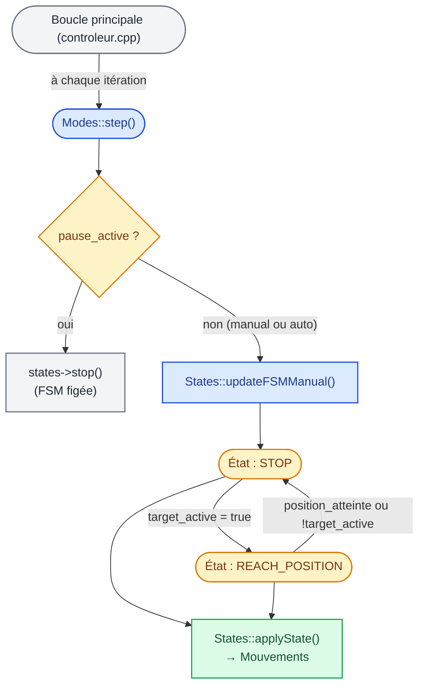

---

### 4.2 Mode navigation manuelle

#### Choix fonctionnels

- Nous avons utilisé le nœud de saisie clavier fourni dans l'énoncé (`key_input_node.cpp`, renommé ensuite `keyboard_input.cpp`). Il publie les codes ASCII des touches sur `/keyboard_input` (`std_msgs/Int8`) dans un nœud séparé, pour ne pas bloquer la boucle du contrôleur.
- Notre mode manuel a évolué deux fois au cours des exercices. Nous allons présenter les trois versions que nous avons successivement développées, jusqu'à une version finale reliée au serveur d'action ([section 6.2, Navigation : serveur d'action](#62-navigation--serveur-daction)) et à l'évitement d'obstacles ([section 5, Perception de l'environnement à l'aide du LiDAR](#5-perception-de-lenvironnement-à-laide-du-lidar)).

#### Première implémentation et évolution du mode manuel

Voici les trois versions de notre mode manuel, développées au fur et à mesure des exercices :

1. **Première version : commandes directes** : au début, `key_input_node.cpp` publiait les touches sur `/keyboard_input` et nous les lisions directement dans `controleur.cpp`. Chaque touche du clavier déclenchait un mouvement élémentaire dans la FSM (`FORWARD`, `BACKWARD`, `PIVOTER_GAUCHE`, `PIVOTER_DROITE`, `STOP`), avec la barre espace pour la pause et la touche `0` (`KEY_ZERO`) pour remettre la direction à `NONE`.
2. **Deuxième version : déplacement vers des coordonnées cibles** : quand nous avons implémenté `reachPosition()` ([section 4.3.2, Navigation vers un but](#432-navigation-vers-un-but)), nous sommes passés à un pilotage par position cible. Les flèches du clavier ne commandaient plus un mouvement direct, mais déplaçaient une cible de coordonnées absolues `(x, y)` dans le repère d'odométrie (par pas de `0,1 m` : haut/bas sur `x`, gauche/droite sur `y`, stockée dans `target_position` puis dans l'attribut `targets` de `Mouvements`). La FSM passait alors dans `REACH_POSITION` pour rejoindre cette cible.
3. **Troisième version : déplacement d'un waypoint virtuel (version finale)** : avec les services et le serveur d'action, nous avons retiré la lecture clavier du contrôleur pour la confier à `client_services.cpp` et `client_action.cpp`. Dans `client_action.cpp`, une variable `waypoint_virtuel` est initialisée à `(0, 0)` (et remise à `(0, 0)` lors d'un reset). En mode manuel, les flèches déplacent ce waypoint virtuel par pas de "`waypoint_step`" mètres. Quand nous appuyons sur `w`, ce waypoint est ajouté à la liste `trajectoire`, et le robot suit les points de la liste dans l'ordre via l'action `/moving`.

#### Difficultés rencontrées

- Dans notre première version, nous avions stocké les commandes clavier dans un dictionnaire dynamique (`std::unordered_map<string, std::variant<bool, string>>`) associant des clés textuelles à des booléens (changement de mode, arrêt) ou des chaînes de caractères (direction). Le callback mettait ce dictionnaire à jour, puis la boucle principale le lisait. Après une discussion avec M. Kocik, nous avons constaté que cette approche était trop lourde pour notre application embarquée. Nous l'avons donc remplacée par une structure typée (`struct KeyboardInputs`) et des énumérations (`Arrow`).
- *Au début, `stop()` ne remettait que `linear.x` à zéro et les fonctions de déplacement réutilisaient la même variable `Twist` globale. Après avoir ajouté `pivoter()`, le robot pouvait continuer à tourner à l'arrêt ou garder une composante non nulle. Nous avons corrigé cela en réinitialisant le message via `vel = Twist()` dans `stop()`, puis en créant un `Twist` vierge dans chacune des fonctions de déplacement (`forward()`, `backward()`, `pivoter()`, `move()`).
- Dans la première version, sans remise explicite à `NONE` (`KEY_ZERO` ou lors d'une pause), la dernière direction reçue restait active d'un tour de boucle à l'autre.
- Lors de l'ajout des services ([section 6.1, Configuration à la volée du comportement du robot : service](#61-configuration-à-la-volée-du-comportement-du-robot--service)), nous avons d'abord regroupé la lecture clavier et les appels de services dans un nœud `keyboard.cpp`. Quand nous avons eu besoin du clavier à la fois pour les services (`m`, `p`, `r`) et pour les waypoints dans `client_action.cpp`, nous avons séparé la capture brute (`keyboard_input.cpp`) des deux nœuds qui la lisaient (`client_services.cpp` et `client_action.cpp`).
- Nous avions d'abord fixé la fréquence de polling de `keyboard_input.cpp` avec une constante locale de 5 Hz (`FREQ_ACTUALISATION = 5`). Nous l'avons ensuite centralisée dans `config/params.yaml` (`params.frequence`), tout en conservant cette fréquence de 5 Hz ([section 3.2, Paramètres de l'application](#32-paramètres-de-lapplication)).

#### Version finale

Dans notre version finale, `keyboard_input.cpp` ([TABDK/src/nodes/keyboard_input.cpp](https://github.com/benoitdekeyn/E4SE_TD_TP/blob/main/robotique_et_navigation/TABDK/src/nodes/keyboard_input.cpp#L14-L32)) publie les codes touches bruts sur `/keyboard_input`. Ils sont ensuite lus par `client_services.cpp` ([TABDK/src/nodes/client_services.cpp](https://github.com/benoitdekeyn/E4SE_TD_TP/blob/main/robotique_et_navigation/TABDK/src/nodes/client_services.cpp#L79-L126)) et `client_action.cpp` ([TABDK/src/nodes/client_action.cpp](https://github.com/benoitdekeyn/E4SE_TD_TP/blob/main/robotique_et_navigation/TABDK/src/nodes/client_action.cpp#L116-L154)) selon le tableau suivant :

| Touches | Nœud consommateur | Mécanisme ROS | Effet |
| --- | --- | --- | --- |
| `m` | `client_services.cpp` | Service `/set_mode` | Bascule `manual` ↔ `auto` |
| `p` | `client_services.cpp` | Service `/global_control` | Bascule `pause` ↔ `play` |
| `r` | `client_services.cpp` | Service `/global_control` | Réinitialisation globale (`reset`) |
| `↑` `↓` `←` `→` | `client_action.cpp` *(mode `manual`)* | Variable locale `waypoint_virtuel` | Déplace le waypoint virtuel de `±waypoint_step` en `x` ou `y` |
| `w` | `client_action.cpp` *(mode `manual`)* | Action `/moving` (via `trajectoire`) | Ajoute `waypoint_virtuel` à la liste des waypoints |
| `x` | `client_action.cpp` *(mode `manual`)* | File locale `trajectoire` | Vide la liste de waypoints en attente |

Voici un schéma qui illustre les interactions de `keyboard_input.cpp` :


---

### 4.3 Mode navigation autonome

Au fil du projet, nous avons fait évoluer le mode automatique : nous sommes passés d'une séquence prédéfinie (avancer, s'arrêter, reculer) à une navigation par waypoints. Dans notre version finale, nous n'appelons plus `States::updateFSMAuto()` dans `Modes::step()`. Les modes `auto` et `manual` passent tous deux par `States::updateFSMManual()` et l'état `REACH_POSITION`, et le serveur d'action ([section 6.2, Navigation : serveur d'action](#62-navigation--serveur-daction)) met directement à jour la cible de `reachPosition()`. Nous avons tout de même gardé `updateFSMAuto()` et les noms historiques dans `states.cpp` pour pouvoir relire l'ancien fonctionnement ou y revenir facilement si besoin (en désactivant le serveur d'action et en réactivant l'appel à `updateFSMAuto()`).

#### 4.3.1 Localisation du TB3 et odométrie

##### Choix fonctionnels

- Nous nous sommes abonnés au topic `/odom` (`nav_msgs/Odometry`), sur lequel nous avons mesuré directement avec ROS une fréquence d'environ 20 Hz.
- Dans chaque message `nav_msgs/Odometry`, nous lisons les coordonnées `x` et `y`, le cap `theta` extrait du quaternion avec `tf::getYaw()`, et les vitesses linéaire et angulaire (`msg->twist.twist`).
- Nous avons ajouté dans `Odometry` le cumul de distance (`distanceParcourue()`) et la méthode `distanceToPosition(x, y)` pour les réutiliser dans l'asservissement ([section 4.3.2, Navigation vers un but](#432-navigation-vers-un-but)) et le serveur d'action ([section 6.2, Navigation : serveur d'action](#62-navigation--serveur-daction)).

##### Première implémentation

Au début, nous avons placé le subscriber `/odom` et la réinitialisation (`/reset` et `/gazebo/reset_simulation`, déclenchés par la touche `r`) directement dans `controleur.cpp`, avec une structure personnalisée pour stocker `x`, `y` et la rotation. Lors du passage en classe `Odometry`, nous avions gardé notre propre `struct Pose2D`. Nous avons ensuite découvert que ROS proposait déjà `geometry_msgs::Pose2D` et nous l'avons adopté à la place. Plus tard, nous avons ajouté le stockage de `vitesse` dans `Odometry` pour donner plus d'informations dans les feedbacks de `Move.action` ([section 6.2, Navigation : serveur d'action](#62-navigation--serveur-daction)).

##### Difficultés rencontrées

- Pendant nos premiers essais d'asservissement sur l'axe `x`, nous pensions que l'odométrie dysfonctionnait car les mesures semblaient incohérentes avec la postion physique du robot malgré des resets. Après un redémarrage complet du robot, nous avons constaté que l'odométrie était finalement assez précise.
- Nous nous sommes longtemps demandé d'où venait le fait que le reset ne gardait pas l'axe `x` face au robot lorsque nous le déplacions pendant nos essais en `(x, y)`. Au moment du reset, l'axe `x` est bien orienté devant le robot, mais comme l'orientation odométrique s'appuie sur l'IMU du robot, cet axe reste ensuite fixe par rapport à l'environnement lorsque nous déplaçons le robot à la main.

##### Version finale

La classe `Odometry` ([TABDK/src/odometry.cpp](https://github.com/benoitdekeyn/E4SE_TD_TP/blob/main/robotique_et_navigation/TABDK/src/odometry.cpp#L17-L60)) met à jour `position` (`geometry_msgs::Pose2D`), `vitesse` (`geometry_msgs::Twist`) et `distance_parcourue` dans `odomCallback()` qui est appelée à la frequence non pas du topic `/odom`, mais de la boucle ROS (donc 5 Hz pour notre cas).

---

#### 4.3.2 Navigation vers un but

##### Choix fonctionnels

- Nous avons choisi un asservissement proportionnel (`commande_proportionnelle()` dans `calculs.cpp`, plafonné aux vitesses maximales `linear_speed` et `angular_speed`). La vitesse est ainsi élevée lorsque l'erreur est grande, puis diminue progressivement à l'approche de la cible, ce qui rend le déplacement fluide et évite les oscillations. Nos essais à 5 Hz ont donné des résultats satisfaisants sans terme intégral ni dérivé : l'asservissement interne des moteurs derrière `/cmd_vel`, ainsi que la vitesse et l'inertie du robot réel, ne provoquaient pas de dépassements à l'arrêt même sans PID et sans avoir à ralentir longtemps à l'avance.
- Pour obtenir une trajectoire droite sans grands arcs de cercle et sans arrêts répétés, nous avons ajouté `move(linear, angular)` (vitesse linéaire et angulaire combinées) et deux options dans `config/params.yaml` (`move_smooth` et `move_back`) :
  - **`reachPositionSmooth(x, y, arriere)`** : utilisée quand `move_smooth` vaut `true`. Tant que l'erreur angulaire reste sous le seuil de pivot (`trigger_pivot`), le robot avance et corrige son cap en même temps avec `move()` (sans tourner du tout si l'erreur reste dans `precision_angular`).  
  Si l'erreur dépasse `trigger_pivot`, le robot pivote sur place (`pivot_en_cours`, avec `Kp_pivot`) jusqu'à revenir dans `precision_angular`.
  - **`reachPositionSmoothBack(x, y)`** : utilisée quand `move_smooth` et `move_back` valent tous deux `true`. Si l'angle à parcourir pour viser la cible dépasse 90°, le robot fait marche arrière plutôt que d'effectuer un grand demi-tour : nous décalons l'angle cible de 180° et nous inversons le signe de la vitesse linéaire.  
  Si `move_back` est désactivé, le robot corrige son cap jusqu'à 180° maximum pour aller en marche avant.
- Pour gérer les additions/soustractions d'angles en restant entre -180° et 180°, nous utilisons deux fonctions distinctes dans `calculs.cpp`. Vous nous avez fourni la première dans l'énoncé, `cal_delta_Theta()`, pour calculer le da différence signée `delta` la plus courte entre 2 angles.  
Nous avons développé la seconde, `cal_angle_offset()`, d'abord dans nos essais pour modifier la valeur de l'angle cible depuis le clavier par incr/décrémentation par un pas, puis nous l'avons réutilisée dans `calculerErreurAngle()` pour décaler l'angle cible de 180° en marche arrière. 

##### Première implémentation

Nous avons d'abord codé et validé `reachPositionX()`, `reachAngle()` et `reachPosition()` (pivot sur place puis avancer) directement dans `controleur.cpp`. Quand nous avons créé la classe `Mouvements` (`mouvements.cpp`), nous avons ajouté `move()` pour développer `reachPositionSmooth()` et enfin `reachPositionSmoothBack()`.

##### Difficultés rencontrées

- Dans nos premiers essais de `reachPositionSmooth()`, nous avions inversé `Kp_pivot` et `Kp_angular`, et une erreur de frappe empêchait la limitation de vitesse. Nous avons corrigé ces deux erreurs et centralisé le calcul dans `commande_proportionnelle()`.
- Dans `reachPositionSmooth()`, sans vérifier la distance en premier, les erreurs angulaires explosaient à proximité  du point visé (à cause du dépassement du point en quelques centimètres) et déclenchaient des pivots inutiles. Nous avons donc placé le test de distance au début de la fonction pour arrêter immédiatement le robot dès qu'il entre dans la tolérance `precision_linear`. 
- Lorsque le robot arrive très près du point demandé, il peut toujours le dépasser légèrement s'il est encore trop loin de la cible, ce qui fait vite monter l'erreur angulaire et peut déclencher un petit pivot final suivi d'une vancée de quelques centimètres. Cette limite existe sur les différentes variantes de `reachPosition()`, et nous avons choisi de l'accepter sans ajouter de traitement particulier.
- Pendant nos essais dans Gazebo, nous avons eu des dépassements et des pertes d'adhérence. Des accélérations ou décélérations trop brusques pouvaient faire tourner le robot sur lui-même, et une vitesse trop élevée le faisait dériver sur le côté. Nous avons donc abaissé et ajusté les vitesses dans `config/params.yaml`. Mais c'est un comportement qui est resté exclusif à la simulation.
- Nous avions d'abord créé trois états dans `states.cpp` (`REACH_POSITION`, `REACH_POSITION_SMOOTH` et `REACH_POSITION_SMOOTH_BACK`). Nous les avons regroupés dans un seul état `REACH_POSITION`, piloté par `move_smooth` et `move_back`. La FSM est ainsi plus simple, tout en gardant les mêmes comportements.

##### Version finale

Dans la version finale, `Mouvements` ([TABDK/src/mouvements.cpp](https://github.com/benoitdekeyn/E4SE_TD_TP/blob/main/robotique_et_navigation/TABDK/src/mouvements.cpp#L158-L279)), `calculs.cpp` ([TABDK/src/calculs.cpp](https://github.com/benoitdekeyn/E4SE_TD_TP/blob/main/robotique_et_navigation/TABDK/src/calculs.cpp#L16-L48)) et l'état `REACH_POSITION` de `States` ([TABDK/src/states.cpp](https://github.com/benoitdekeyn/E4SE_TD_TP/blob/main/robotique_et_navigation/TABDK/src/states.cpp#L102-L110)) gèrent le déplacement vers une cible selon `move_smooth` et `move_back`.

Voici un schéma qui résume la logique de `reachPositionSmoothBack()` :

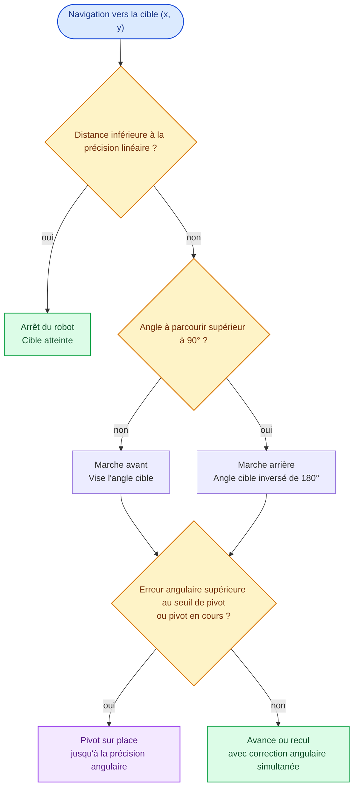

---

## 5. Perception de l'environnement à l'aide du LiDAR

### Choix fonctionnels

- Nous nous sommes abonnés à `/scan` (`sensor_msgs/LaserScan`) et nous publions nos marqueurs sur `/obstacles_markers` (`visualization_msgs/MarkerArray`, dans le repère arbitraire `base_scan` comme dans le tuto).
- Après avoir fait une première version fonctionnelle sans décalage, nous avons décalé les huit régions d'un seizième de tour, soit 22,5° (`OFFSET_REGIONS`), afin que les axes `X` et `Y` du robot traversent le milieu des régions plutôt que leurs frontières. Nous évitons ainsi qu'un obstacle placé droit devant le robot se retrouve systématiquement à cheval sur deux régions : la **région 0** correspond à l'avant du robot et la **région 4** à l'arrière.
- Nous avons choisi de représenter les huit régions sous la forme d'une sorte de camembert autour du robot. Dans chaque région, nous affichons une barre perpendiculaire à son axe central, placée à la distance de l'obstacle le plus proche. Nous voyons ainsi tout de suite dans quelle direction se trouve un obstacle et à quelle distance minimale (nous détaillons cette réalisation dans la [section 5.1, Conception des marqueurs RViz](#51-conception-des-marqueurs-rviz)).
- Nous avons choisi de calculer un "temps avant collision" plutôt que d'utiliser uniquement une distance fixe à garder entre le robot et l'obstacle. L'avantage est que la distance de sécurité s'adapte naturellement à la vitesse du robot :
  - Si le robot avance très lentement, il peut se rapprocher davantage d'un obstacle avant de devoir s'arrêter, sans déclencher d'alerte inutile.
  - À l'inverse, s'il avance vite, il s'arrête plus loin pour un même délai avant collision.
  Il suffit donc de ralentir pour pouvoir naviguer proches de certains obstacles. Une fois `/global_control` en place ([section 6.1, Configuration à la volée du comportement du robot : service](#61-configuration-à-la-volée-du-comportement-du-robot--service)), nous avons abonné `detector.cpp` à `/cmd_vel` et `/pause` pour calculer ce temps dans le sens du déplacement (avant ou arrière) en retranchant à la distance minimale de détection, le gabarit du robot (`debut_collision_face` et `debut_collision_dos`) pour qu'un délai avant collision de 0 corresponde à un obstacle qui touche l'extérieur du robot et non son centre :
  $$t_{\text{collision}} = \frac{|d_{\min} - d_{\text{gabarit}}|}{|v|} \times 1000 \text{ (ms)}$$
  Si ce délai passe sous `delay_collision`, nous mettons le robot en pause via `/global_control` (`"pause"`), et nous mémorisons la distance de l'obstacle (`distance_to_last_obstacle`) ainsi que le côté concerné (`was_obstacle_on_back`). Dès que l'obstacle s'éloigne au-delà de cette distance, nous relançons le robot (`"play"`), sans jamais annuler une pause demandée manuellement (`robot_pause && !collision_pause`). Nous n'avons pas développé de contournement automatique des obstacles : notre système interrompt simplement le déplacement puis le reprend quand la voie se libère. Cela permet aussi au robot de suivre un obstacle lent tout en gardant sa distance de sécurité, comme nous l'avons montré pendant la démo.

### Première implémentation

Avant de répartir les mesures dans nos huit régions, nous avons étudié le message `sensor_msgs/LaserScan` reçu sur `/scan` pour comprendre comment le LiDAR organisait ses données. Ce message contient notamment un tableau `ranges` avec une distance par angle, ainsi que les informations décrivant le balayage (`angle_min`, `angle_max`, `angle_increment`, `range_min` et `range_max`). Dans `scanCallback()`, nous avons exploité les champs utiles à nos calculs : `ranges` pour récupérer les mesures, `angle_increment` (converti en degrés) pour passer d'un angle à l'indice correspondant dans le tableau, ainsi que `range_min` et `range_max` pour filtrer les valeurs invalides en les remplaçant par `FLT_MAX` (nous avons ensuite remplacé `range_max` par notre constante `SEUIL_MAX` à 3,5 m).

Nous avons d'abord découpé les 360° à partir de 0° (`[0°, 45°]`, `[45°, 90°]`…), puis construit nos marqueurs RViz (`rviz_tb3.launch` et `config/tb3_lidar.rviz`). Plus tard, nous avons ajouté une première version de `prevent_collision()` basée sur le temps avant collision (`min_distances / vitesse < MIN_DELAY_COLLISION`), appelée dans `scanCallback()`.

### Difficultés rencontrées

- **Confusion radians / degrés au démarrage** : dans notre première version, nous avions écrit `int SCAN_SAMPLE = 2 * M_PI` (tronqué en entier à `6`) au lieu de `360`. Nous avons corrigé cela en passant à `SCAN_SAMPLE = 360` et en convertissant `angle_increment` en degrés.
- **Renommages du topic RViz et réactivité des marqueurs** : nous avons renommé plusieurs fois le topic des marqueurs (`/markers`, puis `/lidar_visualization`, puis `/obstacles_markers`), et nous avons dû mettre à jour `config/tb3_lidar.rviz` à chaque fois. De plus, nous avions d'abord une boucle lente à 1 Hz qui rendait l'affichage saccadé. Dans la version finale, `detector.cpp` utilise `spin()` : il met à jour les marqueurs et l'évitement d'obstacles à chaque nouveau scan `/scan`.
- **Traversée du 0° après le décalage des régions** : une fois les régions décalées de 22,5°, la région avant couvrait un intervalle à cheval sur 0° (avec `index_fin < index_debut`). Nous avons dû adapter `get_minimum()` pour parcourir cet intervalle en deux boucles (de `index_debut` à la fin du tableau, puis de `0` à `index_fin`). Ce décalage a aussi provoqué un bug d'affichage dans RViz, détaillé dans la [section 5.1, Conception des marqueurs RViz](#51-conception-des-marqueurs-rviz).
- **Mise au point de l'évitement d'obstacles** :
  1. Au début, nous appelions `"play"` dès que le délai repassait au-dessus du seuil, ce qui annulait une pause manuelle. Nous avons résolu cela en écoutant `/pause` et en distinguant `robot_pause` de `collision_pause`.
  2. En marche arrière, nous avons eu des saccades entre pause et reprise car nous ne passions pas `was_obstacle_on_back` à `true` et nous le remettions à `false` trop tôt.
  3. Comme le LiDAR mesure depuis le centre du robot, nous avons retranché les 12 cm de carrosserie (`debut_collision_face` et `debut_collision_dos`) et rendu `delay_collision` configurable dans `config/params.yaml`.

### 5.1 Conception des marqueurs RViz

Nous avons construit progressivement une visualisation claire dans RViz (repère `base_scan`, publiée sur `/obstacles_markers`) pour comprendre d'un coup d'œil ce que le robot détecte autour de lui :

- **Découpage en camembert autour du robot** : la fonction `make_rays()` trace huit rayons gris partant du centre du robot aux frontières entre régions, et `make_ray_labels()` affiche l'angle correspondant au bout de chaque rayon.
- **Distance minimale par région** : la fonction `make_stripline()` trace dans chaque secteur une barre perpendiculaire à l'axe central de la région, placée à la distance minimale détectée et étendue jusqu'aux bords du secteur. Pour convertir chaque couple `(distance, angle)` en coordonnées cartésiennes 2D, nous utilisons notre fonction utilitaire `polar_to_point()`.
- **Code couleur** : la fonction `get_color()` colore en rouge les barres et textes lorsqu'un obstacle est sous le seuil de 0,30 m (`SEUIL_OBSTACLE`), et en vert au-delà.
- **Labels de distance** : `make_labels()` place un texte de distance juste à l'extérieur du milieu de chaque barre, mis en forme par `format_label()` (en `cm` sous 1 m, en `m` au-delà) pour rester lisible à courte comme à longue distance.
- **Assemblage et publication** : chaque marqueur est initialisé par `init_marker()`, puis `update_markers()` rassemble les rayons, les barres et tous les labels dans un `MarkerArray` publié sur `/obstacles_markers`.

**Problème rencontré après le décalage des régions** : juste après avoir décalé les régions de 22,5°, nous avons constaté que la barre représentant l'obstacle placé devant le robot s'affichait derrière lui dans RViz. En cherchant, nous avons vu que le centre de la région frontale (qui commence vers 338° et finit vers 23°) était calculé avec la moyenne `(debut + fin) / 2.0`, ce qui tombait à 180° au lieu de 0°. Nous avons corrigé le calcul dans `angle_region_rad()` en prenant `(debut + ANGLE_REGION / 2.0)`, afin que la barre frontale s'affiche bien devant le robot.

| Vue d'ensemble des 8 régions décalées de 22,5° | Zoom sur le code couleur (rouge sous 30 cm) et les labels `cm` / `m` |
| :---: | :---: |
| 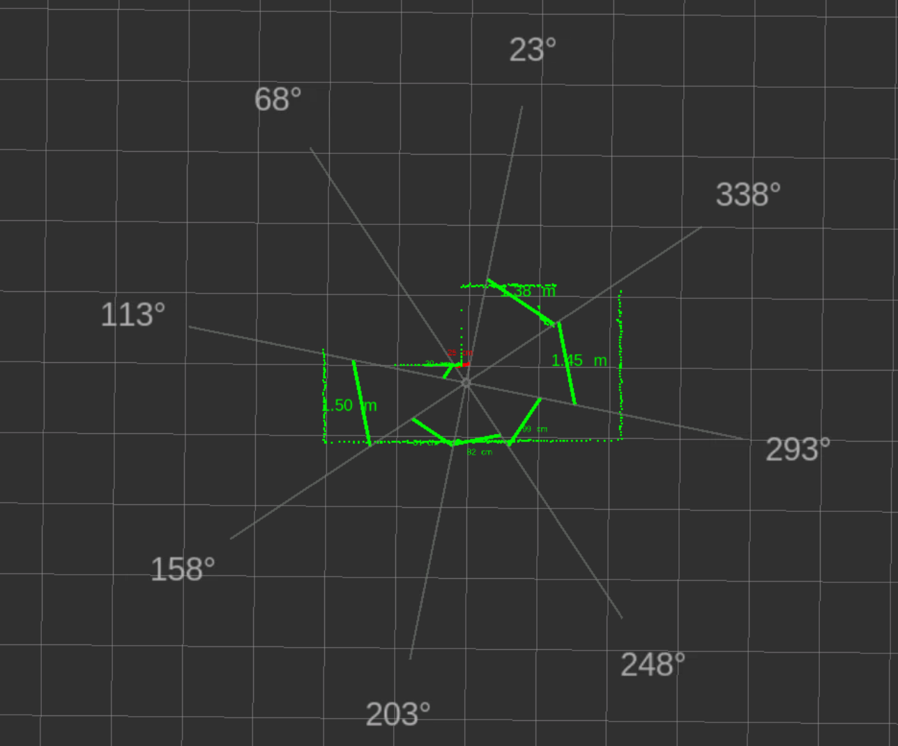 | 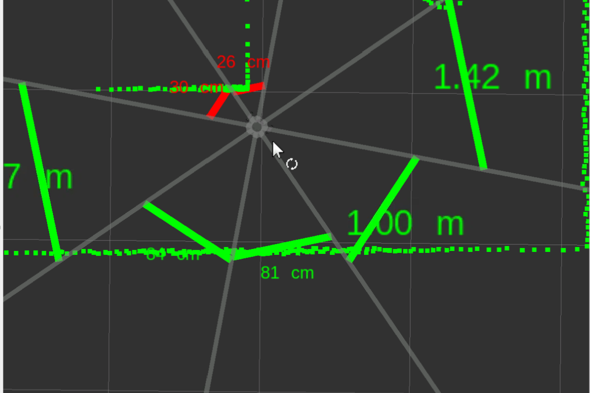 |

### Version finale

Le nœud `detector.cpp` ([TABDK/src/nodes/detector.cpp](https://github.com/benoitdekeyn/E4SE_TD_TP/blob/main/robotique_et_navigation/TABDK/src/nodes/detector.cpp#L64-L233) pour les marqueurs et le scan, et [L330-L377](https://github.com/benoitdekeyn/E4SE_TD_TP/blob/main/robotique_et_navigation/TABDK/src/nodes/detector.cpp#L330-L377) pour l'évitement d'obstacles) analyse les 8 régions à chaque réception sur `/scan`, publie la visualisation sur `/obstacles_markers` (lancée avec [TABDK/launch/rviz_tb3.launch](https://github.com/benoitdekeyn/E4SE_TD_TP/blob/main/robotique_et_navigation/TABDK/launch/rviz_tb3.launch) et `tb3_lidar.rviz`) et gère l'arrêt et la reprise pour les obstacles via `/global_control` ([section 6.1, Configuration à la volée du comportement du robot : service](#61-configuration-à-la-volée-du-comportement-du-robot--service)).

L'organigramme ci-dessous résume le fonctionnement global de `prevent_collision()` :

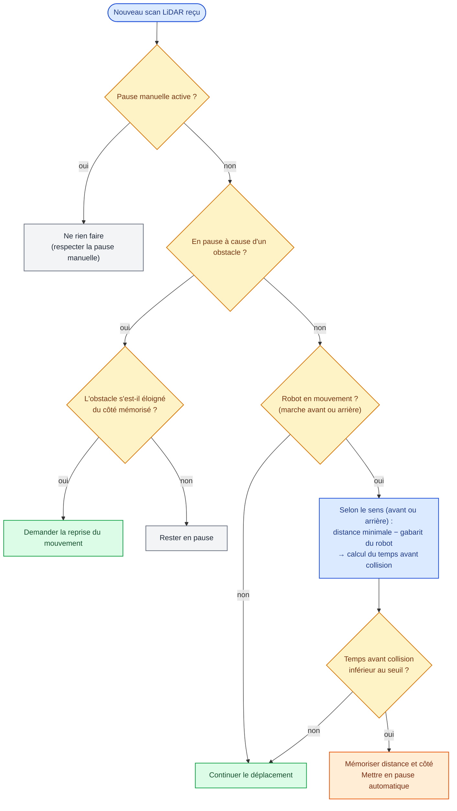

<!-- code:TABDK/src/nodes/detector.cpp -->
```cpp
void prevent_collision() {
  if (robot_pause && !collision_pause) return; // respecte une pause opérateur

  if (robot_pause && collision_pause) {        // reprise auto dès que la voie se libère
    float d = was_obstacle_on_back ? min_distances[REGION_DOS] : min_distances[REGION_FACE];
    if (d > distance_to_last_obstacle) {
      collision_pause = false;
      callGlobalControl("play");
    }
    return;
  }

  if (linear_speed > 0.001 || linear_speed < -0.001) {
    bool back = linear_speed < 0;
    float d   = back ? min_distances[REGION_DOS] : min_distances[REGION_FACE];
    float off = back ? debut_collision_dos       : debut_collision_face;
    int t_ms  = fabs((d - off) / linear_speed * 1000);
    if (t_ms < min_delay_before_collision) {
      distance_to_last_obstacle = d;
      was_obstacle_on_back = back;
      collision_pause = true;
      callGlobalControl("pause");
    }
  }
}
```

Le diagramme ci-dessous résume l'ensemble des échanges finaux du nœud `detector.cpp` :


---

## 6. Services, actions et gestion de trajectoires

### 6.1 Configuration à la volée du comportement du robot : service

#### Énoncé

Définir un service ROS personnalisé (`.srv`, génération dans `CMakeLists.txt`, compilation `cm`) permettant de modifier à la volée et de manière synchrone le comportement du robot dans le contrôleur, puis le tester avec `rosservice call`.

#### Choix fonctionnels

- **Écart choisi par rapport à l'énoncé** : plutôt que de regrouper les changements de mode et les commandes globales dans un unique service `/set_behavior`, nous avons séparé ces responsabilités en **deux services distincts**. Cela permet notamment à `detector.cpp` ([section 5, Perception de l'environnement à l'aide du LiDAR](#5-perception-de-lenvironnement-à-laide-du-lidar)) de mettre le robot en pause ou de le relancer sans connaître ni modifier le mode actif :

<!-- code:TABDK/srv/set_mode.srv -->
```text
string mode          # "auto" ou "manual"
---
bool success
string mode_courant
```

<!-- code:TABDK/srv/global_control.srv -->
```text
string command       # "play", "pause" ou "reset"
---
bool success
string mode_courant
```

- **Synchronisation par topics *latched* (`/mode`, `/pause`)** : nous publions ces deux topics en continu dans `controleur.cpp` afin que chaque nœud connecté reçoive immédiatement le dernier état connu.

#### Première implémentation

Nous sommes partis de l'exemple de serveur de service fourni dans le cours, puis nous l'avons adapté à notre projet en suivant quatre étapes :

1. **Création des fichiers `.srv`** : nous avons défini `TABDK/srv/set_mode.srv` et `TABDK/srv/global_control.srv`.
2. **Adaptation de la compilation** : dans [TABDK/CMakeLists.txt](https://github.com/benoitdekeyn/E4SE_TD_TP/blob/main/robotique_et_navigation/TABDK/CMakeLists.txt#L66-L86) et [L149-L178](https://github.com/benoitdekeyn/E4SE_TD_TP/blob/main/robotique_et_navigation/TABDK/CMakeLists.txt#L149-L178), nous avons déclaré `set_mode.srv` puis `global_control.srv` dans `add_service_files()`, décommenté `generate_messages()` avec les paquets de messages utilisés (`actionlib_msgs`, `geometry_msgs`, `nav_msgs`, `sensor_msgs`, `std_msgs`), et relié chaque exécutable aux cibles générées via `add_dependencies()`. Dans [TABDK/package.xml](https://github.com/benoitdekeyn/E4SE_TD_TP/blob/main/robotique_et_navigation/TABDK/package.xml#L55-L86), `message_generation` était déjà présent en `build_depend`, et nous avons ajouté la balise `<exec_depend>message_generation</exec_depend>`.
3. **Premier test dans `controleur.cpp`** : nous avons d'abord placé les serveurs de services directement dans `controleur.cpp` et les appels clients dans un nœud intermédiaire `keyboard.cpp`, puis validé les services avec `rosservice call` et sur le robot réel.
4. **Intégration dans notre architecture en classes** : nous avons extrait les serveurs dans la classe `ServeurServices` (`serveur_services.cpp`) et séparé le client clavier dans `client_services.cpp`.

#### Difficultés rencontrées

- **Compilation CMake des services et des actions** : nous avons eu une longue session de débogage parce que nos services (puis nos actions) ne se compilaient pas correctement. En relisant notre `CMakeLists.txt`, nous avons compris que nous avions mal interprété ses commentaires : nous avions placé nos `add_dependencies(...)` juste sous `add_executable(...)` en indiquant seulement `${catkin_EXPORTED_TARGETS}`, et en oubliant `${${PROJECT_NAME}_EXPORTED_TARGETS}` (nécessaire pour générer les en-têtes `.srv` et `.action` de notre propre paquet avant les exécutables). Nous avons résolu le problème en suivant l'organisation indiquée dans le fichier `CMakeLists.txt` lui-même : déplacer tous les `add_dependencies(...)` dans la section dédiée après `add_executable(...)`, avec `${${PROJECT_NAME}_EXPORTED_TARGETS}` et `${catkin_EXPORTED_TARGETS}` (sans oublier non plus d'ajouter `global_control.srv` dans `add_service_files()`).
- **Séparation entre mode et pause** : au départ, la pause était encore gérée comme un mode dans `controleur.cpp`, ce qui compliquait les changements de mode en pause (voir la [section 4.1, Les modes de navigation](#41-les-modes-de-navigation)). Nous avons donc découplé `pause_active` pour qu'il soit piloté uniquement par `/global_control`.
- **Désynchronisation multi-clients** : comme `client_services.cpp` bascule `manual ↔ auto` et `pause ↔ play` à l'appui des touches `m` et `p`, son état local devenait faux dès qu'un autre client (`detector.cpp` ou `rosservice call`) appelait un service. Nous avons résolu cela en l'abonnant aux topics `/mode`, `/pause` et `/reset`.
- **Séparation des responsabilités** : nous avons extrait les serveurs dans `ServeurServices` ([section 8.1, Motivation et étapes du découpage](#81-motivation-et-étapes-du-découpage)), séparé `client_services.cpp` de `keyboard_input.cpp` ([section 4.2, Mode navigation manuelle](#42-mode-navigation-manuelle)) et remplacé l'ancienne `enum` des modes par des `std::string`.

#### Version finale

- Côté serveur : la classe `ServeurServices` ([TABDK/src/serveur_services.cpp](https://github.com/benoitdekeyn/E4SE_TD_TP/blob/main/robotique_et_navigation/TABDK/src/serveur_services.cpp#L16-L75)) expose `/set_mode` ([TABDK/srv/set_mode.srv](https://github.com/benoitdekeyn/E4SE_TD_TP/blob/main/robotique_et_navigation/TABDK/srv/set_mode.srv)) et `/global_control` ([TABDK/srv/global_control.srv](https://github.com/benoitdekeyn/E4SE_TD_TP/blob/main/robotique_et_navigation/TABDK/srv/global_control.srv)) dans le nœud `controleur`, et coordonne la réinitialisation globale dans `resetRobot()` *(voir la [section 8.3, Patron init() différé et association des classes par pointeurs](#83-patron-init-différé-et-association-des-classes-par-pointeurs))*.
- Côté client : `client_services.cpp` ([TABDK/src/nodes/client_services.cpp](https://github.com/benoitdekeyn/E4SE_TD_TP/blob/main/robotique_et_navigation/TABDK/src/nodes/client_services.cpp#L79-L126)) gère les touches `m`, `p`, `r`, et `detector.cpp` appelle `/global_control` pour l'évitement d'obstacles.

Le premier diagramme présente les interactions de `serveur_services.cpp` avec le contrôleur, les autres classes et les nœuds ROS :

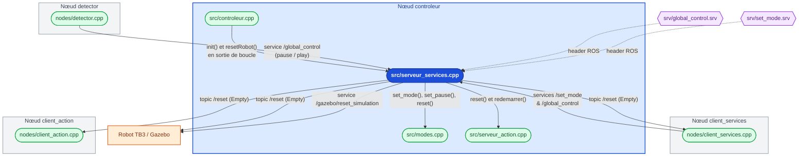

L'organigramme suivant résume le comportement de `serveur_services.cpp` selon la requête reçue :

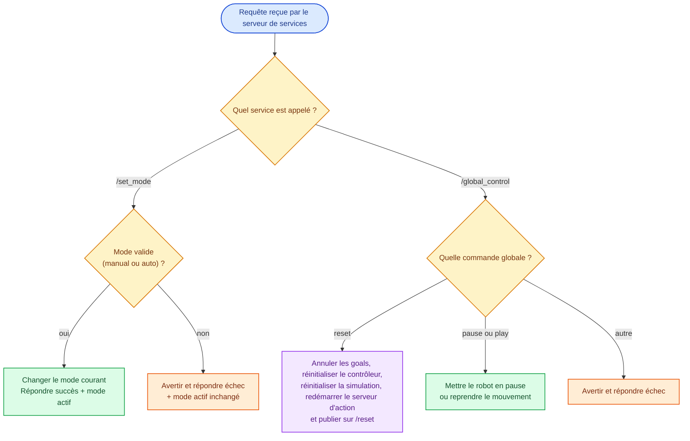

Côté client, cet organigramme présente les décisions prises par `client_services.cpp` :

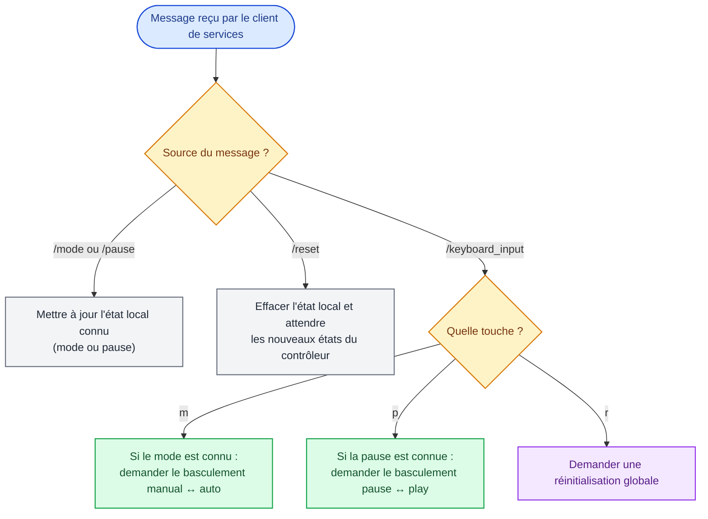

Le schéma ci-dessous présente les dépendances de compilation et les échanges ROS du nœud `client_services.cpp` :


---

### 6.2 Navigation : serveur d'action

#### Énoncé

Créer une action ROS (`action/Move.action`, compilation en deux temps dans `CMakeLists.txt`) pour gérer de façon asynchrone les déplacements longs du robot, puis intégrer le serveur d'action dans le contrôleur avec feedbacks réguliers (position, vitesse, distance restante…) et résultat final (distance totale parcourue, temps écoulé).

#### Choix fonctionnels

- **Adaptation de `Move.action` et abandon du niveau de batterie** : nous avons conçu `TABDK/action/Move.action` autour des données réellement utiles à notre robot. Nous avons choisi de **ne pas conserver le niveau de batterie** dans l'action pour deux raisons :
  1. il aurait été compliqué de faire des tests réalistes, car la simulation ne permettait pas de faire varier facilement le niveau de batterie pour reproduire différents cas ;
  2. nous ne trouvions pas vraiment utile d'ajouter un ralentissement en batterie faible, puisque nous avions déjà deux modes de fonctionnement et une vitesse plafonnée même dans le mode le plus rapide.
  Nous avons donc préféré transmettre le `mode` courant et l'état de `pause`, qui servent directement à notre application :

<!-- code:TABDK/action/Move.action -->
```text
float64 position_x
float64 position_y
---
bool atteint
float64 temps_total            # ms, hors temps de pause
float64 distance_parcourue     # m
geometry_msgs/Pose2D position
---
geometry_msgs/Pose2D position
geometry_msgs/Twist vitesse
float64 distance_restante      # m
float64 temps_ecoule           # ms, hors temps de pause
string mode                    # "manual" ou "auto"
bool pause
```

- **Serveur non-bloquant intégré à la boucle principale** : plutôt que de bloquer dans une boucle d'exécution dédiée, nous utilisons `SimpleActionServer<MoveAction>` avec `registerGoalCallback` (`execute()`) et `registerPreemptCallback` (`preempter()`), tandis que nous appelons `ServeurAction::step()` à chaque itération de `controleur.cpp`.
- **Temps de trajet hors pause** : nous incrémentons `ticks_ecoules` dans `step()` uniquement quand `!modes->paused()`, puis nous convertissons ce compteur en millisecondes avec `params->ticksToMs()`.
- **Logs réguliers sans saturer le terminal (`ROS_INFO_THROTTLE`)** : nous avons déplacé l'affichage du suivi côté `client_action.cpp` pour garder les logs du contrôleur lisibles, et nous utilisons `ROS_INFO_THROTTLE(1.0)`. Comme les feedbacks arrivent en continu, cette fonction nous permet de garder un suivi en temps réel limité à un message par seconde, au lieu de remplir le terminal de dizaines de lignes par seconde.

#### Première implémentation

Au départ, nous avons utilisé les deux nœuds indépendants que vous nous aviez fournis (`nodes/serveur_action.cpp` et `nodes/client_action.cpp`), accompagnés d'un fichier `Move.action` minimal (`pos_x`, `reached`, `pos_x_intermediaire`). Nous avons d'abord ajouté `Move.action` dans `add_action_files()` de `CMakeLists.txt`, compilé en deux temps (`cm`), puis testé ces deux nœuds séparément :


*Premier test unitaire réussi entre `serveur_action` (à gauche) et `client_action` (à droite) sur le robot.*

En comparant cet exemple de départ à notre version finale, nous avons profondément adapté son fonctionnement pour l'intégrer à notre architecture :

- **Remplacement de la boucle simulée** : le serveur initial utilisait un callback `execute()` bloquant qui incrémentait un compteur `count` à 1 Hz jusqu'à `goal->pos_x` sans gérer la préemption. Nous l'avons remplacé par des callbacks non-bloquants (`execute()` et `preempter()`) et une méthode `step()` appelée dans la boucle du contrôleur.
- **Adaptation des données de l'action** : nous avons remplacé les champs de test (`pos_x`, `pos_x_intermediaire`, `reached`) par des coordonnées 2D et des retours réels issus de `Odometry` (`position`, `vitesse`, `distance_parcourue`, `distance_restante`) et de `Modes` (`mode`, `pause`).
- **Intégration dans notre découpage en classes** : le serveur n'est plus un nœud séparé mais la classe `ServeurAction` (`TABDK/src/serveur_action.cpp`), hébergée dans `controleur.cpp` et reliée à `Params`, `Mouvements`, `Modes`, `Odometry` et `States` pour piloter les waypoints.
- **Adaptation du client** : le client initial utilisait un `boost::thread` séparé et des appels bloquants (`waitForServer()`, `waitForResult()`). Nous l'avons réécrit dans `client_action.cpp` autour d'une boucle unique `spinOnce()` qui gère aussi le clavier, `/mode`, `/reset` et `/robot_path`.

#### Difficultés rencontrées

- **Feedbacks reçus en retard** : après un reset ou la fin d'un goal, des feedbacks tardifs continuaient parfois d'arriver côté client. Nous avons corrigé cela en ajoutant `goal_termine`, `stopTrackingGoal()` et `ROS_INFO_THROTTLE(1.0)`.
- **Temps de trajet faussé pendant la pause** : calculer la durée par différence d'horodatages comptait le temps passé en pause (manuelle ou à cause d'un obstacle). Le comptage par ticks actifs (`!modes->paused()`) a réglé ce problème.
- **Serveur bloqué après une réinitialisation** : lors d'un reset du robot (surtout avec `/gazebo/reset_simulation` qui remet l'horloge simulée à `0`), le goal était bien annulé mais le serveur d'action pouvait rester bloqué pour les goals suivants (actionlib gardant en mémoire les dates des anciens goals). Nous avons ajouté `ServeurAction::reset()` et `ServeurAction::redemarrer()` pour annuler les objectifs puis recréer proprement le serveur après le reset de simulation.
- **Association de `ServeurAction` aux autres classes** : comme `SimpleActionServer` n'a pas de constructeur par défaut, nous avons dû l'allouer dynamiquement, ajouter un destructeur et lier les callbacks membres avec `boost::bind` *(voir la [section 8.4, Cas critique : intégration de ServeurAction](#84-cas-critique--intégration-de-serveuraction))*.
- **Cible résiduelle après changement de mode** : nous remettons `states->target_active` à `false` dès qu'un goal est atteint pour qu'un changement de mode ne relance pas une ancienne cible.

#### Version finale

Dans notre version finale, la classe `ServeurAction` ([TABDK/src/serveur_action.cpp](https://github.com/benoitdekeyn/E4SE_TD_TP/blob/main/robotique_et_navigation/TABDK/src/serveur_action.cpp#L38-L145)) gère l'action `/moving` ([TABDK/action/Move.action](https://github.com/benoitdekeyn/E4SE_TD_TP/blob/main/robotique_et_navigation/TABDK/action/Move.action)) au sein du contrôleur. Le schéma ci-dessous présente son rôle et ses échanges avec `controleur.cpp`, les autres classes et `client_action.cpp` :

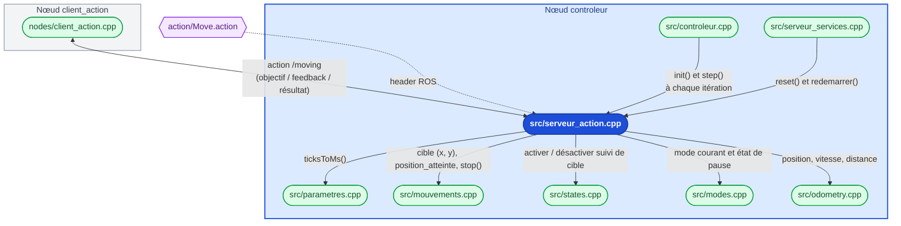

L'organigramme suivant présente le fonctionnement de `ServeurAction` dans les différentes situations rencontrées :

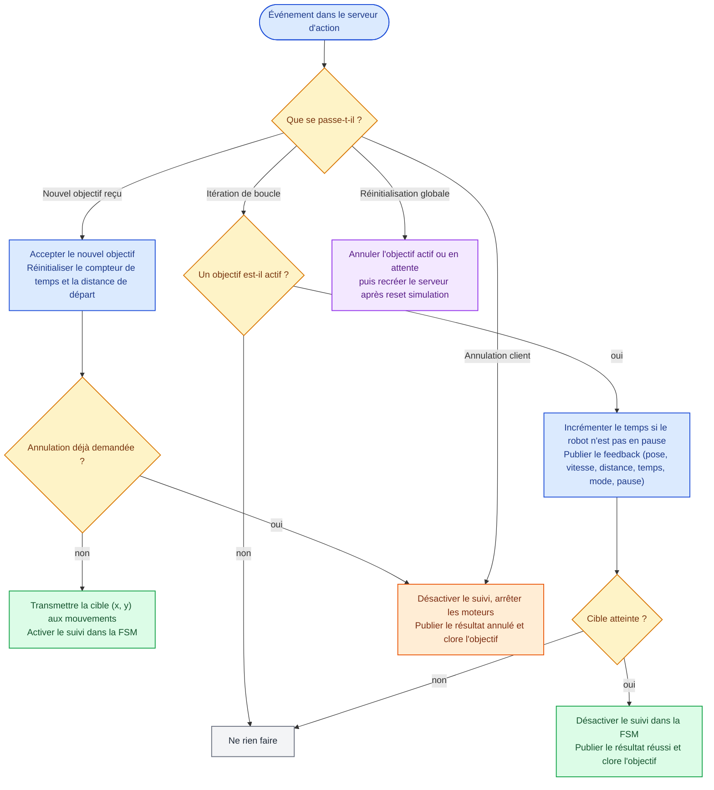

Les deux fonctions clés de réception et d'annulation d'objectif sont `execute()` et `preempter()` ([TABDK/src/serveur_action.cpp](https://github.com/benoitdekeyn/E4SE_TD_TP/blob/main/robotique_et_navigation/TABDK/src/serveur_action.cpp#L116-L145)) :

- `execute()` est déclenchée automatiquement quand `client_action.cpp` envoie un nouvel objectif sur `/moving`. Elle accepte l'objectif, remet le compteur de temps à zéro, mémorise la distance de départ, vérifie qu'aucune annulation immédiate n'a été demandée, puis transmet `(x, y)` à `Mouvements` et active `states->target_active`.
- `preempter()` est déclenchée quand le client annule l'objectif en cours (par exemple lors de la réception d'une nouvelle trajectoire). Elle désactive `states->target_active`, arrête les moteurs, calcule la distance et le temps partiels, puis clôture l'objectif avec `setPreempted(res)`.

<!-- code:TABDK/src/serveur_action.cpp -->
```cpp
void execute() {
  goal = server->acceptNewGoal();
  ticks_ecoules = 0;
  distance_depart = odometry->distanceParcourue();

  if (server->isPreemptRequested()) {
    preempter();
    return;
  }

  mouvements->targets.x = goal->position_x;
  mouvements->targets.y = goal->position_y;
  mouvements->position_atteinte = false;
  states->target_active = true;
}

void preempter() {
  if (!goal) return;

  states->target_active = false;
  mouvements->stop();
  MoveResult res;
  res.temps_total = params->ticksToMs(ticks_ecoules);
  res.distance_parcourue = odometry->distanceParcourue() - distance_depart;
  res.position = odometry->position;
  server->setPreempted(res);
  goal.reset();
}
```

Pendant le suivi d'un waypoint, `client_action.cpp` affiche ainsi un retour complet toutes les secondes grâce à `ROS_INFO_THROTTLE(1.0)` :


*Exemple de deux feedbacks consécutifs affichés à 1 seconde d'intervalle côté `client_action.cpp` (position, orientation, vitesses, distance restante, temps écoulé et mode).*

Enfin, lors d'une réinitialisation globale demandée au serveur de services, `ServeurServices::resetRobot()` ([TABDK/src/serveur_services.cpp](https://github.com/benoitdekeyn/E4SE_TD_TP/blob/main/robotique_et_navigation/TABDK/src/serveur_services.cpp#L31-L42)) interagit avec `ServeurAction` dans un ordre précis pour éviter le blocage évoqué plus haut :

<!-- code:TABDK/src/serveur_services.cpp -->
```cpp
void resetRobot() {
  action_server->reset();                 // 1. annule les goals en cours ou en attente
  modes->reset();                         // 2. stoppe les moteurs, réinitialise mode et pause
  std_srvs::Empty service;
  client_reset_sim->call(service);        // 3. remet la simulation et /clock à 0
  action_server->redemarrer();            // 4. recrée le serveur d'action proprement
  pub_reset->publish(std_msgs::Empty());  // 5. notifie le TB3 réel et les clients ROS
}
```

La capture ci-dessous montre cet enchaînement dans les logs : préemption de l'objectif en cours, réinitialisation du robot, reconnexion automatique au serveur `/moving` recréé, puis prise en charge immédiate d'une nouvelle trajectoire :

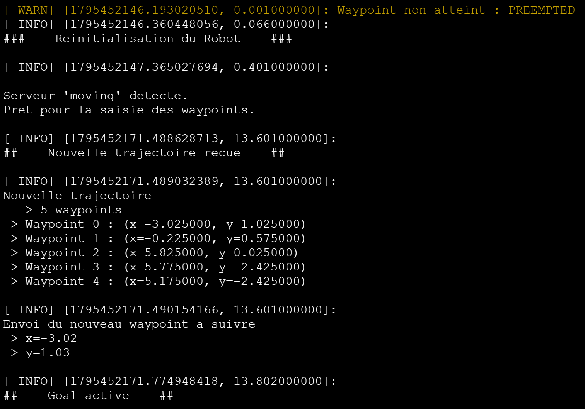
*Logs lors d'un reset : préemption (`PREEMPTED`), redémarrage du serveur `/moving`, puis réception et lancement d'une nouvelle trajectoire de 5 waypoints.*

---

### 6.3 Gestion des trajectoires : Path

#### Énoncé

Faire de `client_action.cpp` un gestionnaire de mission abonné à un topic `nav_msgs/Path` : extraire les coordonnées 2D `(x, y)` de `poses[].pose.position` dans `std::vector<Pose2D> trajectoire`, puis envoyer les waypoints un à un au serveur d'action (`trajectoire[0]` puis `erase(begin())` après réussite) jusqu'à vider la file.

#### Choix fonctionnels

- Nous avons regroupé la gestion des waypoints dans `client_action.cpp` autour d'un seul vecteur `std::vector<Pose2D> trajectoire` :
  - en mode `manual`, nous construisons la liste au clavier (flèches pour déplacer `waypoint_virtuel` par pas de `waypoint_step`, `w` pour ajouter, `x` pour vider la file en attente) ;
  - en mode `auto`, nous recevons un `nav_msgs/Path` sur `/robot_path` (publié par `path_generator`, voir la [section 7.2, Navigation à base de SLAM](#72-navigation-à-base-de-slam)). Quand une nouvelle trajectoire arrive pendant qu'une précédente est en cours, nous avons choisi de **remplacer complètement l'ancienne trajectoire** : `robotPathCallback()` appelle `resetClient()` (qui demande l'annulation du goal actif et vide `trajectoire`), puis copie la nouvelle liste.
- Comme `SimpleActionClient("moving", false)` partage `spinOnce()` avec nos callbacks clavier, `/reset` et `/robot_path`, nos callbacks n'appellent pas `cancelGoal()` directement. Ils lèvent un drapeau `annulation_demandee`, traité dans la boucle principale par `traiterAnnulation()`.
- Nous filtrons les entrées selon `/mode` : les touches clavier sont ignorées en mode `auto`, et les messages `/robot_path` sont ignorés en mode `manual`.

#### Première implémentation

Nous nous étions d'abord abonnés à `/trajectoire` (`nav_msgs/Path`). Nous extrayions les coordonnées `(x, y)` dans `trajectoire`, envoyions `trajectoire[0]` via `client.sendGoal(...)`, puis retirions le point dès que l'état passait à `SUCCEEDED`. Nous avons ensuite renommé le topic en `/robot_path` lors du branchement sur `AStar-ROS` ([section 7.2, Navigation à base de SLAM](#72-navigation-à-base-de-slam)).

#### Difficultés rencontrées

- **Inversion du signe de `y` au clavier** : au début, nos flèches gauche et droite incrémentaient `y` à l'envers par rapport au repère de ROS (`+x` devant, `+y` à gauche). Nous avons corrigé le signe dans `keyboardCallback()`.
- **Annulation depuis les callbacks** : appeler `cancelGoal()` directement dans `resetCallback()` ou `robotPathCallback()` créait des conflits avec `spinOnce()`. Nous avons donc simplifié les callbacks et déplacé l'annulation dans `traiterAnnulation()`, appelée dans la boucle principale.
- **Arrêt de séquence sur échec de goal** : avant nos corrections sur la réinitialisation du serveur d'action ([section 6.2, Navigation : serveur d'action](#62-navigation--serveur-daction)), certains goals échouaient en cours de route. Nous avions ajouté un indicateur `sequence_blocked` pour ne pas enchaîner sur les points suivants après un échec, un cas qui n'est plus censé arriver en fonctionnement normal.

#### Version finale

Le nœud `client_action.cpp` ([TABDK/src/nodes/client_action.cpp](https://github.com/benoitdekeyn/E4SE_TD_TP/blob/main/robotique_et_navigation/TABDK/src/nodes/client_action.cpp#L94-L113) pour `robotPathCallback()` et [L231-L262](https://github.com/benoitdekeyn/E4SE_TD_TP/blob/main/robotique_et_navigation/TABDK/src/nodes/client_action.cpp#L231-L262) pour la boucle principale) envoie les waypoints un par un vers `/moving` (clavier en `manual`, `/robot_path` en `auto`), avec attente non-bloquante du serveur (`attendreServeur()`).

L'organigramme ci-dessous présente le comportement de `client_action.cpp` dans ses différentes situations :

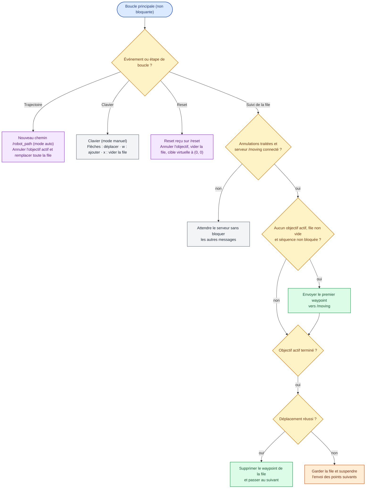

<!-- code:TABDK/src/nodes/client_action.cpp -->
```cpp
if (mode_received && (mode_manual || mode_auto) && !goal_active &&
    !sequence_blocked && !trajectoire.empty()) {
  MoveGoal goal;
  goal.position_x = trajectoire[0].x;
  goal.position_y = trajectoire[0].y;
  goal_termine = false;
  goal_active = true;
  client.sendGoal(goal, &doneCb, &activeCb, &feedbackCallback);
}
if (goal_active && client.getState().isDone()) {
  goal_active = false;
  if (client.getState() == SimpleClientGoalState::SUCCEEDED)
    trajectoire.erase(trajectoire.begin());
  else
    sequence_blocked = true;
}
```

Lorsque le robot atteint un waypoint, `client_action.cpp` affiche le résultat final (temps total, distance parcourue, position et orientation) et enchaîne aussitôt avec le waypoint suivant de la file :


*Logs lors de l'atteinte d'un waypoint, suivie immédiatement de l'envoi et de l'activation du waypoint suivant.*

Le diagramme ci-dessous présente la version finale complète des interactions de `client_action.cpp` :


---

## 7. Évitement d'obstacle et planification de trajectoire : SLAM

### 7.1 SLAM (Cartographie et Localisation simultanées)

#### Énoncé

Cartographier l'environnement (maison Gazebo en simulation ou labyrinthe de la salle 4105 en réel) en lançant Gmapping (`turtlebot3_slam.launch`) et la téléopération (`turtlebot3_teleop_key.launch`) à faible vitesse, puis enregistrer la grille d'occupation 2D (`map.pgm` + `map.yaml`) via `map_server map_saver`.

#### Choix fonctionnels

- **Script utilitaire `tabdk.sh`** : pour simplifier nos tests répétés en simulation comme sur le robot réel, nous avons écrit le script `tabdk.sh` à la racine du projet. Il ajoute sans doublon dans `~/.bash_aliases` nos raccourcis de compilation et de lancement (`cm`, `slam`, `teleop`, `robot_vide`, `robot_maison`, `astar`, `tabdk`, `tabdk_rviz`), source le workspace catkin et automatise l'installation des paquets nécessaires sur **TheConstructSim** ([section 1.1, Simulation en ligne : TheConstructSim](#11-simulation-en-ligne--theconstructsim)) :

<!-- code:tabdk.sh -->
```bash
add_alias 'alias cm="cd ~/catkin_ws && catkin_make && source devel/setup.bash && cd"'
add_alias 'alias slam="roslaunch turtlebot3_slam turtlebot3_slam.launch"'
add_alias 'alias teleop="roslaunch turtlebot3_teleop turtlebot3_teleop_key.launch"'
add_alias 'alias astar="roslaunch path_generator run.launch"'
add_alias 'alias tabdk="roslaunch TABDK run.launch"'
add_alias 'alias tabdk_rviz="roslaunch TABDK rviz_tb3.launch"'

source ~/catkin_ws/devel/setup.bash 2>/dev/null
sudo apt-key adv --keyserver hkp://keyserver.ubuntu.com:80 --recv-key F42ED6FBAB17C654
sudo apt update
sudo apt install -y ros-noetic-turtlebot3-navigation ros-noetic-turtlebot3-slam
```

- Nous avons rangé nos cartes dans `AStar-ROS/map/` afin de passer facilement de la simulation au labyrinthe réel dans `AStar-ROS/launch/run.launch`.

#### Première implémentation

Nous avons d'abord passé environ **30 minutes** à cartographier un environnement personnalisé en simulation (`map_simu_tabdk`, en plus de `map_tb3_house`), puis nous avons enregistré la grille avec `map_saver` :

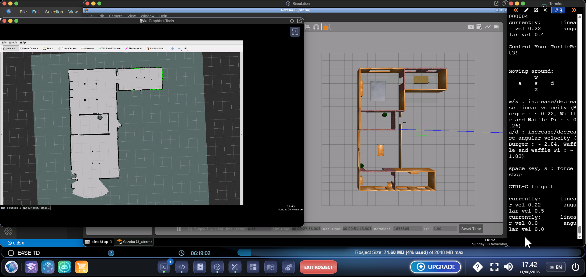
*Cartographie SLAM en simulation sur TheConstructSim : construction de la carte dans RViz (à gauche), environnement Gazebo (au centre) et téléopération au clavier (à droite).*

Nous avons ensuite réalisé la cartographie SLAM du **labyrinthe physique de la salle 4105** (`map_4105`, puis `map_4105_00` à partir d'un point de départ repéré au sol).

#### Difficultés rencontrées

- **Paquets absents et `apt` bridé sur TheConstructSim** : sur la simulation en ligne, `ros-noetic-turtlebot3-slam` et `ros-noetic-turtlebot3-navigation` n'étaient pas préinstallés et disparaissaient entre deux sessions, tandis qu'`apt` refusait de les télécharger faute de clé GPG ROS valide. Nous avons contourné ce blocage en intégrant `apt-key adv`, `apt update` et `apt install` directement dans `tabdk.sh`.
- **Ouverture de RViz sur le robot réel depuis VS Code** : en simulation, RViz se lançait normalement. Sur le robot réel, nous n'arrivions pas à l'ouvrir depuis notre environnement VS Code. Nous avons découvert que cela fonctionnait depuis MobaXterm, car un serveur X y était déjà lancé pour l'affichage graphique. Nous avons donc adapté notre environnement VS Code pour disposer aussi d'un serveur X et ouvrir RViz sur le robot réel.
- **Écrasement accidentel de la carte lors de la synchronisation** : lorsque nous avons sauvegardé la première carte directement sur le robot, elle n'existait pas encore dans notre dossier local. À la synchronisation suivante depuis VS Code, la carte sur le robot a donc été écrasée. Par la suite, nous avons pris l'habitude de copier les cartes du robot vers notre dossier local avant toute modification du code.
- **Alignement de l'origine de la carte** : sans point de départ précis lors du SLAM, le repère de la carte ne coïncidait plus avec l'odométrie du robot au moment de la navigation (nous détaillons ce point et sa résolution dans la [section 7.2, Navigation à base de SLAM](#72-navigation-à-base-de-slam)).

#### Version finale

Nous disposons dans `AStar-ROS/map/` de cartes validées pour la simulation et pour la salle 4105, avec `map_4105_00.pgm` et `map_4105_00.yaml` réalisées à partir d'un repère physique au sol en `(0, 0)` et chargées par défaut dans [AStar-ROS/launch/run.launch](https://github.com/benoitdekeyn/E4SE_TD_TP/blob/main/robotique_et_navigation/AStar-ROS/launch/run.launch#L13), ainsi que notre script [tabdk.sh](https://github.com/benoitdekeyn/E4SE_TD_TP/blob/main/robotique_et_navigation/tabdk.sh#L1-L29).

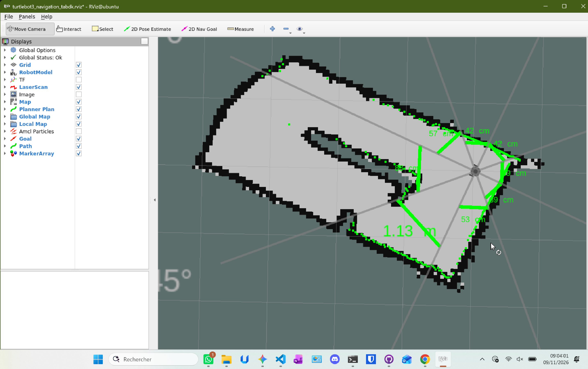
*Visualisation dans RViz du labyrinthe de la salle 4105 (`map_4105_00`) avec le TurtleBot3 positionné sur la carte et nos marqueurs LiDAR alignés sur les parois réelles.*

---

### 7.2 Navigation à base de SLAM

#### Énoncé

Importer et compiler `AStar-ROS` (`roslaunch path_generator run.launch`), calibrer la pose initiale dans RViz (`2D Pose Estimate`), spécifier la destination (`2D Nav Goal`) pour diffuser le chemin `/robot_path` (`nav_msgs/Path`) et le faire suivre par le contrôleur, puis améliorer la navigation pour obtenir :
- une trajectoire plus lisse ;
- la gestion d'éventuels obstacles dynamiques.

#### Choix fonctionnels

- Nous sommes partis du package `AStar-ROS` fourni dans l'énoncé (`path_generator`). Nous l'avons relié à notre nœud `client_action` ([section 6.3, Gestion des trajectoires : Path](#63-gestion-des-trajectoires--path)) via `/robot_path` et nous avons ajouté une vue RViz dédiée (`AStar-ROS/rviz/turtlebot3_navigation_tabdk.rviz`).
- **Marge de sécurité statique (`ecart_obstacle`)** : nous avons ajouté le paramètre `ecart_obstacle` dans `AStar-ROS/config/params.yaml` (`4` cases, soit 20 cm pour une résolution de 5 cm) pour éviter que le robot ne rase les murs et les coins.
- **Amélioration de la recherche A\* (`a_star.cpp`)** : sur certaines cartes de simulation, l'algorithme A\* fourni n'arrivait pas à trouver de chemin, par exemple lorsqu'il devait contourner une porte puis repartir dans une autre direction. Nous avons demandé de l'aide à l'IA pour améliorer `a_star.cpp` afin de résoudre ces cas plus complexes. Nous précisons que nous ne maîtrisons pas dans le détail les modifications internes produites par l'IA dans ce fichier.
- **Lissage de trajectoire (`path_simplifier.cpp`)** : nous avons identifié deux limites concrètes de la trajectoire produite par le A\* initial, qui travaillait sur une grille de 5 cm :
  1. il générait parfois un waypoint tous les 5 cm. Même si le passage d'un point au suivant était rapide, notre asservissement proportionnel ralentissait le robot à chaque cible, ce qui produisait un déplacement saccadé avec des ralentissements répétés ;
  2. le chemin suivait souvent des angles droits en escalier alors qu'un segment direct en diagonale était possible sans traverser d'obstacle.
  Nous avons donc défini le comportement attendu (repérer les segments directs possibles sans obstacle et réduire au maximum le nombre de waypoints tout en gardant notre marge `ecart_obstacle`), puis nous avons guidé l'IA pour implémenter cette étape dans `path_simplifier.cpp`.

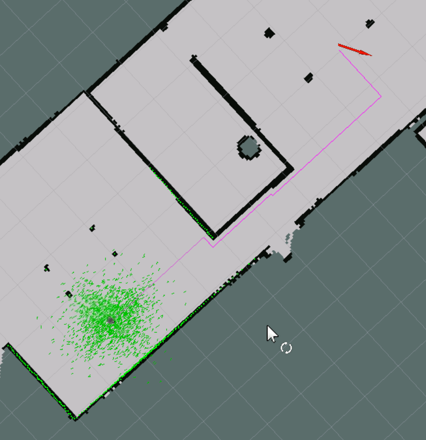
*Trajectoire générée par l'A\* initial : chemin en escalier composé d'angles droits et passant très près du coin central.*

- **Principe du BFS utilisé pour le lissage** : la solution générée avec l'aide de l'IA s'appuie sur un **BFS** (parcours en largeur). Cet algorithme explore les possibilités par étapes successives pour trouver, dans le graphe des points visibles entre eux, le chemin qui utilise le moins de segments directs possible jusqu'à l'arrivée :

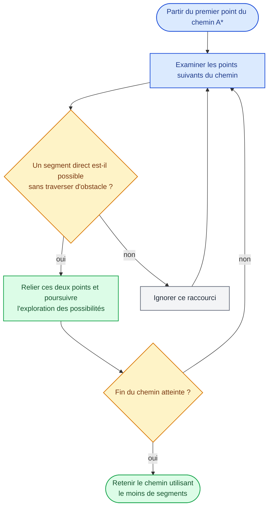

- **Obstacles dynamiques** : comme A\* ne connaît que la carte statique, notre nœud `detector.cpp` ([section 5, Perception de l'environnement à l'aide du LiDAR](#5-perception-de-lenvironnement-à-laide-du-lidar)) gère l'arrêt en temps réel devant les obstacles imprévus.

#### Première implémentation

Nous avons d'abord importé le package `AStar-ROS` brut (`map_server`, `amcl`, `rviz`, `path_generator`) et relié son topic `/robot_path` à notre nœud `client_action.cpp`.

#### Difficultés rencontrées

- **Trajectoire en escalier, échecs de recherche et manque de temps** : après avoir constaté les blocages du A\* d'origine sur certains contournements et le comportement saccadé lié aux waypoints espacés de 5 cm, nous avons mis en place `ecart_obstacle`, l'amélioration de `a_star.cpp` et le lissage dans `path_simplifier.cpp` avec l'aide de l'IA. Nous aurions aimé approfondir davantage cette partie et mieux comprendre tous les détails internes de ces algorithmes, mais nous manquions de temps et nous étions déjà en retard sur le projet. Nous avons donc privilégié une solution fonctionnelle en guidant l'IA sur le comportement attendu.
- **Erreurs de transformation dans RViz** : lors de la mise en place de la navigation, nous avons aussi rencontré des erreurs de transformation dans RViz (`No transform from [base_footprint/base_scan] to [map]`) tant que la chaîne entre le repère `map` et les repères du robot n'était pas correctement publiée :


*Exemple d'erreurs de transformation rencontrées dans RViz (`No transform ... to [map]`) sur `RobotModel` et `LaserScan`.*

- **Décalage entre Gazebo et RViz en simulation** : au départ, en voyant où le robot apparaissait dans RViz, nous avons cru qu'il apparaissait dans le carré vert visible dans Gazebo. En cherchant plus loin et en affichant les axes dans Gazebo, nous avons compris que ce carré vert correspondait simplement au soleil de Gazebo, positionné en `(0, 0)` en 2D. En comparant ensuite Gazebo et RViz, nous avons mesuré un décalage exact de 3 carreaux en longueur et 1 carreau en largeur (la grille faisant 1 m par carreau) : Gazebo faisait en réalité apparaître le robot en `x = -3.0` m et `y = 1.0` m. Nous avons donc réglé la pose initiale d'AMCL (`initial_pose_x = -3.0`, `initial_pose_y = 1.0`, `initial_pose_a = 0.0`) dans `AStar-ROS/launch/run.launch` pour que le robot soit placé directement au bon endroit sans avoir à utiliser `2D Pose Estimate` à chaque lancement.

| Le carré vert dans Gazebo : le soleil placé en `(0, 0)` (le robot est plus bas) | Robot affiché par erreur sur la position du soleil dans RViz |
| :---: | :---: |
| 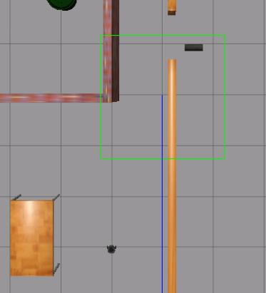 |  |


*Comparaison entre Gazebo (à gauche) et RViz (à droite) ayant permis de mesurer le décalage et de régler AMCL.*

- **Dérive sur le terrain réel (repère carte vs repère odométrie)** : sur le labyrinthe physique, `2D Pose Estimate` ne suffisait pas et le robot se décalait en suivant la trajectoire du `2D Nav Goal`. Dans `path_generator.cpp`, la position de départ pour A\* vient directement de `/odom` (et non d'AMCL). Cela nous a aidés à repérer l'erreur pendant les essais, car nous pouvions comparer dans RViz la position odométrique réelle du robot au comportement attendu. Après échange avec vous, nous avons adopté une procédure fiable sur le terrain :
  1. poser un **marquage physique au sol** au point de départ exact du SLAM (`map_4105_00`) ;
  2. placer le robot sur ce repère et faire un **reset du robot (et donc de son odométrie)** pour faire correspondre l'origine `/odom` avec l'origine `(0, 0)` de la carte dans RViz ;
  3. ajuster à la main la position du robot sur le marquage, sans utiliser `2D Pose Estimate`, jusqu'à ce qu'il apparaisse sur l'origine RViz après un reset.
  Pendant nos essais sur le robot réel, nous avions mis la pose initiale du lancement à `(0, 0, 0)`. Dans le fichier actuellement versionné sur GitHub ([AStar-ROS/launch/run.launch](https://github.com/benoitdekeyn/E4SE_TD_TP/blob/main/robotique_et_navigation/AStar-ROS/launch/run.launch#L26-L30)), `map_file` pointe bien vers `map_4105_00.yaml`, mais `initial_pose_x` et `initial_pose_y` valent encore `-3.0` et `1.0` (valeurs de nos réglages de simulation).
- **Obstacles dynamiques hors carte** : un obstacle ajouté dans le labyrinthe après le SLAM n'apparaît pas sur la carte statique. Grâce à `detector.cpp` ([section 5, Perception de l'environnement à l'aide du LiDAR](#5-perception-de-lenvironnement-à-laide-du-lidar)), le robot s'arrête automatiquement devant lui puis repart quand la voie se libère.

#### Version finale

Dans notre version finale, nous avons personnalisé [AStar-ROS/launch/run.launch](https://github.com/benoitdekeyn/E4SE_TD_TP/blob/main/robotique_et_navigation/AStar-ROS/launch/run.launch#L13-L37) sur trois points : le choix de la carte (`map_file`) et le chargement de `ecart_obstacle`, la pose initiale d'AMCL (`initial_pose_x`, `initial_pose_y`, `initial_pose_a`) pour éviter d'utiliser `2D Pose Estimate` à chaque lancement, et notre vue RViz personnalisée (`turtlebot3_navigation_tabdk.rviz`) afin de retenir nos affichages et leurs topics (`Goal` sur `/move_base_simple/goal`, `Path` sur `/robot_path`, `MarkerArray` sur `/obstacles_markers`, en plus de `/map` et `/scan`) :

<!-- code:AStar-ROS/launch/run.launch -->
```xml
<!-- Carte chargée et paramètre ecart_obstacle -->
<arg name="map_file" default="$(find path_generator)/map/map_4105_00.yaml"/>
<arg name="open_rviz" default="true"/>
<rosparam command="load" file="$(find path_generator)/config/params.yaml" />
...
<!-- Pose initiale AMCL pour éviter 2D Pose Estimate à chaque lancement -->
<include file="$(find turtlebot3_navigation)/launch/amcl.launch">
  <arg name="initial_pose_x" value="-3.0"/>
  <arg name="initial_pose_y" value="1.0"/>
  <arg name="initial_pose_a" value="0.0"/>
</include>

<!-- Configuration RViz personnalisée (affichages et topics sauvegardés) -->
<group if="$(arg open_rviz)">
  <node pkg="rviz" type="rviz" name="rviz" required="true"
        args="-d $(find path_generator)/rviz/turtlebot3_navigation_tabdk.rviz"/>
</group>
```

Nous relions ainsi `AStar-ROS` amélioré ([AStar-ROS/config/params.yaml](https://github.com/benoitdekeyn/E4SE_TD_TP/blob/main/robotique_et_navigation/AStar-ROS/config/params.yaml), [AStar-ROS/src/a_star.cpp](https://github.com/benoitdekeyn/E4SE_TD_TP/blob/main/robotique_et_navigation/AStar-ROS/src/a_star.cpp#L78-L199), [AStar-ROS/src/path_simplifier.cpp](https://github.com/benoitdekeyn/E4SE_TD_TP/blob/main/robotique_et_navigation/AStar-ROS/src/path_simplifier.cpp#L9-L94), [AStar-ROS/src/path_generator.cpp](https://github.com/benoitdekeyn/E4SE_TD_TP/blob/main/robotique_et_navigation/AStar-ROS/src/path_generator.cpp#L72-L148)) à `TABDK` de la façon suivante :

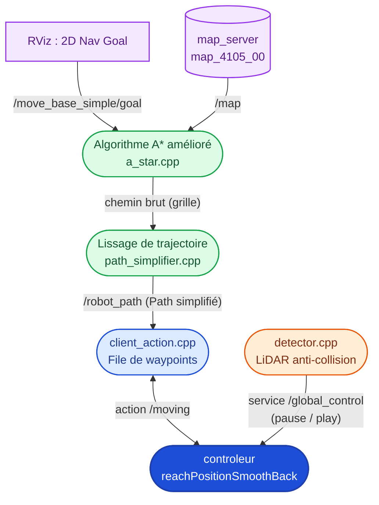

Le robot planifie son itinéraire depuis RViz (`2D Nav Goal`), suit une trajectoire simplifiée et fluide loin des murs, et s'arrête automatiquement devant tout obstacle dynamique :


*Navigation complète en simulation : trajectoire lissée à grands segments directs (diagonale incluse) passant par la porte, avec détection LiDAR en temps réel dans RViz.*

---

## 8. Migration architecturale : passage d'un fichier contrôleur unique à un découpage en classes

### 8.1 Motivation et étapes du découpage

Dans l'énoncé, il n'était pas demandé de découper le code en classes distinctes. Au démarrage du projet ([section 3, Pilotage de base et paramétrage du TB3](#3-pilotage-de-base-et-paramétrage-du-tb3) et [section 4, Contrôle et navigation du TB3](#4-contrôle-et-navigation-du-tb3)), tout notre code tenait dans un seul fichier `controleur.cpp`, qui a fini par dépasser **700 lignes** (variables globales, callbacks ROS, calculs trigonométriques, odométrie, clavier, modes, FSM et asservissements). Dès que nous avons ajouté les services puis le serveur d'action, ce fichier unique est devenu difficile à lire et à faire évoluer.

Nous avons donc choisi de réorganiser le contrôleur autour de **classes distinctes** et d'éviter les variables globales, pour rendre les dépendances explicites grâce aux attributs de chaque classe. Chaque classe regroupe ses propres données et méthodes, ce qui clarifie les échanges entre les différentes parties du contrôleur. Nous avons fait cette migration en trois étapes :

1. **Extraction des fonctions de base** : nous avons créé `calculs.cpp` (fonctions utilitaires), `parametres.cpp` (`Params`), `odometry.cpp` (`Odometry`), `mouvements.cpp` (`Mouvements`) et un fichier temporaire `clavier.cpp`.
2. **Séparation des serveurs ROS** : nous avons déplacé les serveurs dans `serveur_services.cpp` (`ServeurServices`) et `serveur_action.cpp` (`ServeurAction`), et nous avons sorti le clavier du contrôleur vers `client_services.cpp` et `client_action.cpp` ([section 4.2, Mode navigation manuelle](#42-mode-navigation-manuelle)).
3. **Découpage de la logique du contrôleur** : nous avons séparé le reste de `controleur.cpp` en `Modes` (`modes.cpp`) et `States` (`states.cpp`). Le fichier [TABDK/src/controleur.cpp](https://github.com/benoitdekeyn/E4SE_TD_TP/blob/main/robotique_et_navigation/TABDK/src/controleur.cpp#L1-L90) ne contient plus que la création des objets, leur initialisation et la boucle principale.

### 8.2 Organisation des fichiers `.cpp` et namespaces

Nous avons choisi de garder nos classes directement dans des fichiers `.cpp`, plutôt que de multiplier les fichiers d'en-tête `.h`. Nous voulions conserver une organisation simple et adaptée à la taille du projet, avec quelques fichiers dans `TABDK/src/` correspondant chacun à un rôle précis du contrôleur.

Chaque fichier est protégé par une garde d'inclusion (`#ifndef ..._CPP` / `#define ..._CPP` / `#endif`), et nous les incluons dans [TABDK/src/controleur.cpp](https://github.com/benoitdekeyn/E4SE_TD_TP/blob/main/robotique_et_navigation/TABDK/src/controleur.cpp#L8-L15) dans l'ordre de leurs dépendances :

<!-- code:TABDK/src/controleur.cpp -->
```cpp
#include "calculs.cpp"
#include "parametres.cpp"
#include "odometry.cpp"
#include "mouvements.cpp"
#include "states.cpp"
#include "modes.cpp"
#include "serveur_action.cpp"
#include "serveur_services.cpp"
```

Cette organisation permet aussi aux nœuds de `TABDK/src/nodes/` de réutiliser `parametres.cpp`, `calculs.cpp` ou `modes.cpp` sans configurer de bibliothèque CMake supplémentaire. Comme ces fichiers sont compilés ensemble, nous avons nettoyé nos `using namespace` et importé explicitement les symboles utilisés.

### 8.3 Patron `init()` différé et association des classes par pointeurs

En ROS C++, nous ne pouvons créer un `Publisher`, un `Subscriber`, un `ServiceServer` ou un `SimpleActionServer` qu'après `ros::init()` et la création du `ros::NodeHandle`. Nous avons donc suivi deux règles dans [TABDK/src/controleur.cpp](https://github.com/benoitdekeyn/E4SE_TD_TP/blob/main/robotique_et_navigation/TABDK/src/controleur.cpp#L41-L75) :

1. **Initialisation différée avec `init(...)`** : chaque classe possède un constructeur par défaut neutre et une méthode `init(...)` que nous appelons dans `main()` dans l'ordre des dépendances (`Params::load` → `Odometry` → `Mouvements` → `States` → `Modes` → `ServeurAction` → `ServeurServices`).
2. **Instances créées dans `main()` et passées par adresse** : nous créons toutes les instances dans `main()`, ce qui garantit qu'elles existent pendant toute l'exécution. Chaque classe reçoit dans `init(...)` les objets dont elle dépend et garde leur adresse (`Params *`, `Odometry *`, `Mouvements *`, `Modes *`, `States *`). Aucune donnée n'est recopiée : une mise à jour de `odometry.position` ou de `mouvements.position_atteinte` est tout de suite visible par les autres classes.

### 8.4 Cas critique : intégration de `ServeurAction`

Le passage en classes a demandé quelques adaptations pour les callbacks ROS, surtout dans `ServeurAction` ([TABDK/src/serveur_action.cpp](https://github.com/benoitdekeyn/E4SE_TD_TP/blob/main/robotique_et_navigation/TABDK/src/serveur_action.cpp#L17-L146)), qui communique avec cinq autres classes et le `NodeHandle` :

- **Callbacks sur méthodes membres** : contrairement à une fonction globale, nous devons lier une méthode de classe à l'instance `this` :
  - `nh.subscribe("/odom", 100, &Odometry::odomCallback, this)` dans `Odometry` ;
  - `nh.advertiseService("/set_mode", &ServeurServices::setModeCallback, this)` dans `ServeurServices` ;
  - `server->registerGoalCallback(boost::bind(&ServeurAction::execute, this))` et `registerPreemptCallback(boost::bind(&ServeurAction::preempter, this))` dans `ServeurAction`.
- **Allocation dynamique de `SimpleActionServer`** : contrairement à un `Publisher` ou un `Subscriber`, `actionlib::SimpleActionServer<MoveAction>` n'a pas de constructeur par défaut et exige un `NodeHandle` dès sa création. Pour garder notre méthode `init()`, nous l'avons stocké en pointeur (`Server *server = nullptr`), alloué dans `demarrer()` et libéré dans le destructeur `~ServeurAction()`.
- **Réinitialisation après reset** : cette allocation dynamique nous a aussi permis d'écrire `redemarrer()` (`delete server; demarrer();`), appelé par `ServeurServices::resetRobot()` ([section 6.2, Navigation : serveur d'action](#62-navigation--serveur-daction)) pour débloquer le serveur d'action après un reset.

<!-- code:TABDK/src/serveur_action.cpp -->
```cpp
void demarrer() {
  server = new Server(*nh, "moving", false);
  server->registerGoalCallback(boost::bind(&ServeurAction::execute, this));
  server->registerPreemptCallback(boost::bind(&ServeurAction::preempter, this));
  server->start();
}

void redemarrer() {      // appelé par ServeurServices::resetRobot() après un reset
  delete server;
  server = nullptr;
  demarrer();
}

~ServeurAction() {
  if (server) delete server;
}
```

### 8.5 Conduite du refactoring

Cette séparation en classes a représenté un travail important. Après plusieurs heures de développement, nous avons utilisé une IA pour nous aider à refactoriser le code. Nous lui avons demandé de limiter les changements au strict nécessaire et de conserver autant que possible nos fichiers et leur organisation. Nous avons vérifié chaque modification pour garder la logique de notre code d'origine, tout en obtenant une structure claire, avec des dépendances explicites et un découpage en classes adapté au projet.