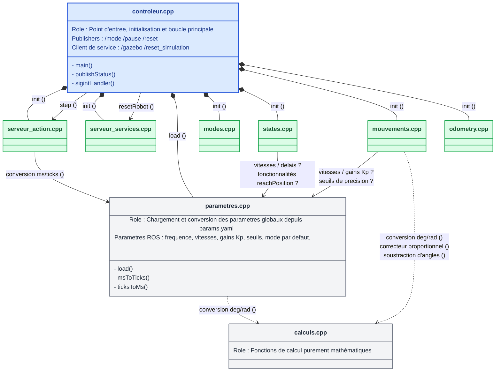
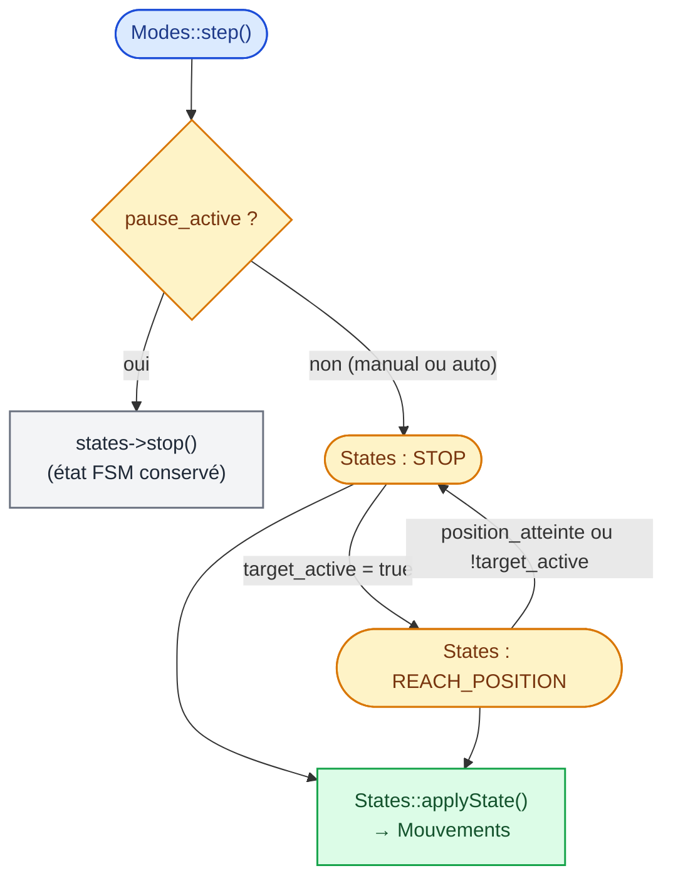
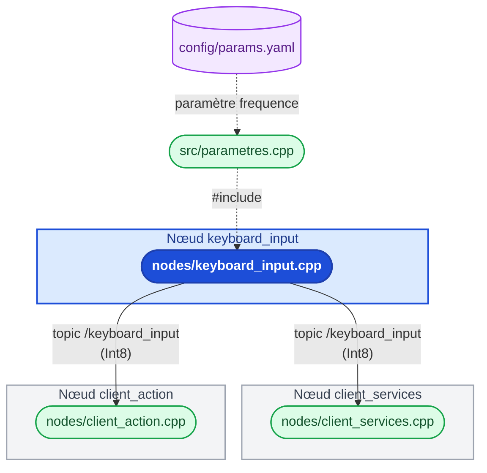
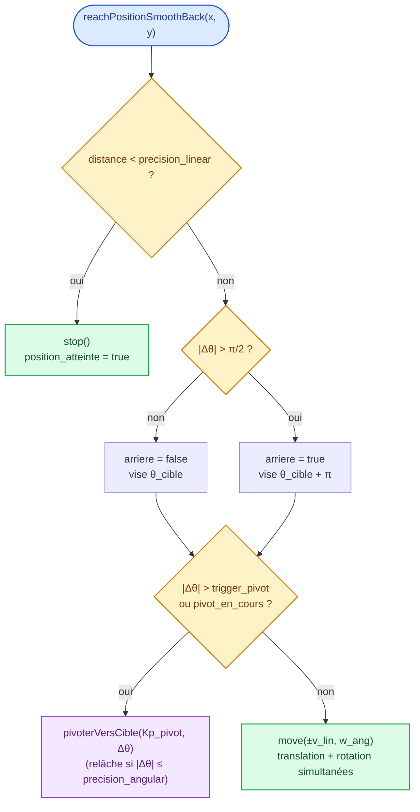

# Rapport : Projet robotique mobile et navigation autonome appliqué au robot TurtleBot3

**Binôme :** Benoît de Keyn & Thibault Agueh  
**Date :** 26 novembre 2026

## Introduction

Ce rapport présente la conception, l'implémentation et la validation de notre projet de **robotique mobile et navigation autonome** sous **ROS Noetic**, appliqué au robot **TurtleBot3 Burger** (en simulation Gazebo et en conditions réelles dans le labyrinthe de la salle 4105).

L'objectif du projet était de construire progressivement une chaîne logicielle complète, regroupée dans notre package **`TABDK`** puis couplée au planificateur **`AStar-ROS`**, couvrant l'ensemble des briques demandées :

- le pilotage bas niveau (`/cmd_vel`) et le paramétrage global via YAML ([§ 3](#3-pilotage-de-base-et-paramétrage-du-tb3)) ;
- la gestion des modes (`manual` et `auto`), de la pause et de la localisation odométrique (`/odom`) ([§ 4](#4-contrôle-et-navigation-du-tb3)) ;
- l'asservissement en position et en orientation, étendu vers des déplacements fluides en marche avant et arrière ([§ 4.3.2](#432-navigation-vers-un-but)) ;
- la perception 360° par LiDAR (`/scan`), la visualisation dans RViz et la prévention active de collision ([§ 5](#5-perception-de-lenvironnement-à-laide-du-lidar-capteur-de-distance-laser-360-lds-01---lds-02)) ;
- la supervision par services ROS (`/set_mode`, `/global_control`), le suivi asynchrone de waypoints par action (`/moving`) et la gestion de trajectoires `nav_msgs/Path` ([§ 6](#6-services-actions-et-gestion-de-trajectoires)) ;
- la cartographie SLAM (Gmapping) et la planification de chemin A\* améliorée avec lissage de trajectoire ([§ 7](#7-évitement-dobstacle-et-planification-de-trajectoire--slam)).

## 1. Environnement de développement

Pour avancer efficacement tout au long du projet et travailler à deux dans de bonnes conditions, nous nous sommes appuyés sur deux environnements complémentaires : la simulation en ligne **TheConstructSim** et un **workspace VS Code automatisé** couplé à GitHub pour le robot physique.

### 1.1 Simulation en ligne : TheConstructSim

Pour travailler à distance depuis chez nous, tester nos packages dans un environnement virtuel et **économiser la batterie du TurtleBot3 réel** (qui tenait peu longtemps en séance), nous avons utilisé la plateforme **TheConstructSim**. Elle met à disposition dans le navigateur un **VS Code en ligne**, **Gazebo** et **RViz** déjà prêts à l'emploi. Nous détaillons en [§ 7.1](#71-slam-cartographie-et-localisation-simultanées) les contraintes rencontrées sur cette plateforme lors de l'installation des paquets SLAM et navigation.

### 1.2 Développement local et déploiement sur le robot : VS Code, GitHub et SSH

Sur nos ordinateurs personnels, plutôt que d'installer **MobaXterm** (qui oblige à garder le code directement sur le robot, à ouvrir et agencer manuellement plusieurs fenêtres SSH et à retaper régulièrement le mot de passe), nous avons préféré travailler avec **VS Code**, **GitHub** et **GitHub Desktop**. Nous versions ainsi notre code localement pour collaborer proprement en binôme, garder un historique clair et sauvegarder nos avancées en toute sécurité.

Au début, nous devions copier manuellement chaque fichier modifié sur le robot après nos modifications sur Git. Nous avons donc fini par mettre en place un **workspace VS Code dédié** (`robotique.code-workspace` et `.vscode/`) qui automatise notre environnement de travail :

- **Arborescence épurée** : nous affichons uniquement nos dossiers utiles (`TABDK/`, puis `AStar-ROS/` lorsque nous en avons eu besoin) directement dans VS Code, sans avoir à naviguer dans toute l'arborescence Ubuntu du robot.
- **Synchronisation automatique à la sauvegarde (`sync_robot.ps1` + extension *Run on Save*)** : à chaque enregistrement d'un fichier local, un script PowerShell recopie automatiquement en miroir le contenu de nos dossiers locaux (`TABDK/` et `AStar-ROS/`) vers `~/catkin_ws/src/` sur le robot via `tar | ssh`, sans saisie de mot de passe grâce à la clé SSH installée par `setup.ps1`.\*
- **Ouverture automatique des terminaux et de RViz (`tasks.json` + `connect.ps1`)** : à l'ouverture du workspace, VS Code démarre le serveur X (**VcXsrv** pour l'affichage de RViz), lance une synchronisation initiale, démarre `./run_robot.sh` (`roscore` et bringup du robot) dans un terminal SSH indépendant, puis ouvre un terminal SSH vierge prêt à l'emploi avec nos alias déjà chargés.
- **Terminal SSH par défaut** : chaque nouveau terminal ouvert dans VS Code s'ouvre automatiquement en SSH (`ssh -Y`) sur le robot.

*\* Remarque sur la synchronisation miroir : lors de la création de la carte SLAM ([§ 7.1](#71-slam-cartographie-et-localisation-simultanées)) directement sur le robot, cette carte n'existait pas encore dans notre dossier local. À la première modification de code local, la synchronisation en miroir a donc écrasé le dossier distant et supprimé la carte que nous venions d'enregistrer. Par la suite, nous avons systématiquement copié chaque carte générée sur le robot vers notre dossier local avant toute modification du code, afin qu'elle soit conservée lors des synchronisations suivantes.*

## 2. Architecture finale du projet

### 2.1 Arborescence du paquet TABDK


### 2.2 Découpage du nœud contrôleur en classes

#### Classe principale et dépendances neutres

Le fichier `calculs.cpp` est le seul fichier `.cpp` qui ne contient pas une classe mais simplement des fonctions utilitaires.



#### Interactions entre les classes du nœud contrôleur


### 2.3 Interaction des différents nœuds

Le paquet `TABDK` contient le nœud contrôleur ainsi que quatre autres nœuds, dont les schémas et les descriptions sont disponibles dans les parties indiquées dans le tableau suivant :

| Nœud (`TABDK/src/nodes/`) | Rôle principal | Schéma détaillé |
| --- | --- | --- |
| `keyboard_input.cpp` | Capture clavier non-canonique → `/keyboard_input` | [§ 4.2 Mode navigation manuelle](#42-mode-navigation-manuelle) |
| `detector.cpp` | Analyse LiDAR 8 régions, marqueurs RViz & anti-collision | [§ 5. Perception LiDAR](#5-perception-de-lenvironnement-à-laide-du-lidar-capteur-de-distance-laser-360-lds-01---lds-02) |
| `client_services.cpp` | Commandes clavier `m`/`p`/`r` → `/set_mode` & `/global_control` | [§ 6.1 Services](#61-configuration-à-la-volée-du-comportement-du-robot--service) |
| `client_action.cpp` | File de waypoints (clavier ou `/robot_path`) → action `/moving` | [§ 6.3 Gestion des trajectoires : Path](#63-gestion-des-trajectoires--path) |

> Nous expliquons en [§ 8. Migration architecturale](#8-migration-architecturale--passage-dun-fichier-contrôleur-unique-à-un-découpage-en-classes) comment nous sommes passés d'un fichier `controleur.cpp` unique à ce découpage en classes (patron `init()`, association entre classes par pointeurs, callbacks membres et intégration de `ServeurAction`).

## 3. Pilotage de base et paramétrage du TB3

### 3.1 Pilotage de base du TB3

#### Énoncé

Ajouter dans le nœud contrôleur un *publisher* générant une commande en vitesse pour déplacer le robot TurtleBot3 :

1. Identifier le topic concerné, l'en-tête `.h`, son *namespace* et le type de message associé.
2. Réaliser `avancer(double vitesse)` et `arreter()` (publication effectuée dans la boucle principale).
3. Arrêter proprement le robot lors d'un `CTRL+C` dans `sigintHandler`.
4. Enchaîner périodiquement **avancer → arrêter → reculer** avec des durées multiples de la période du contrôleur.

#### Choix fonctionnels

- Nous avons utilisé le topic `/cmd_vel` avec le message `geometry_msgs::Twist` (`#include <geometry_msgs/Twist.h>`), en pilotant la vitesse linéaire sur `linear.x`.
- Nous avons isolé les commandes moteurs de base dans trois fonctions simples (`forward`, `backward` et `stop`) afin de structurer clairement le pilotage dès ce premier exercice.
- Nous avons géré l'enchaînement périodique **avancer → arrêter → reculer** à l'aide d'une petite machine à états (`FORWARD` → `STOP` → `BACKWARD`) cadencée par `ros::Rate`.
- Nous avons ajouté l'appel à `stop()` dans `sigintHandler()`, à la fin du fichier, afin d'arrêter proprement le robot lors d'un `CTRL+C`.

#### Première implémentation

Dans notre premier package `TABDK`, nous avions regroupé tout le code dans un seul fichier `controleur.cpp` de 131 lignes : un *publisher* `/cmd_vel`, les fonctions globales `forward`, `backward` et `stop`, un compteur de ticks et une boucle `while (ros::ok())`. Au départ, nous avions configuré les durées directement en **nombre de périodes** (`move_fwd_per: 10`, `move_bwd_per: 5`, `move_stp_per: 3`).

#### Difficultés rencontrées

- **Arrêt lors d'un `CTRL+C`** : sans interception dédiée (`ros::init_options::NoSigintHandler`), ROS fermait la boucle avant la publication de la vitesse nulle et le robot continuait d'avancer. Nous avons donc utilisé un drapeau `arret_demande` levé par `sigintHandler` pour garantir l'envoi de l'arrêt en sortie de boucle avant `ros::shutdown()`.
- **Dépendance des durées à la fréquence** : exprimer les temporisations en nombre brut de périodes (`*_per`) changeait la durée réelle des déplacements dès que nous modifions la fréquence de contrôle. Nous sommes donc passés à des durées en millisecondes (`*_tm`) converties en nombre de ticks par `msToTicks()` ([§ 3.2](#32-paramètres-de-lapplication)).

#### Version finale

- Les fonctions de commande moteur sont regroupées dans la classe `Mouvements` (`TABDK/src/mouvements.cpp`), avec `stop()` qui publie un `Twist()` entièrement nul.
- Le cycle périodique avancer/arrêter/reculer reste présent dans `States::updateFSMAuto()` (`TABDK/src/states.cpp`).
- Dans `TABDK/src/controleur.cpp`, `sigintHandler()` lève `arret_demande`, ce qui déclenche `services.resetRobot()` ([§ 4.3.1](#431-localisation-du-tb3)) puis `ros::shutdown()` en sortie de boucle.

---

### 3.2 Paramètres de l'application

#### Énoncé

Rendre l'application générique en spécifiant des paramètres (notamment la fréquence de contrôle) au lancement des nœuds, soit via les arguments de `run.launch`, soit via un fichier YAML dans un sous-dossier `config/`, puis tester le contrôleur à différentes fréquences.

#### Choix fonctionnels

- Nous avons préféré régler les paramètres depuis un fichier YAML (`TABDK/config/params.yaml`), chargé sur le serveur de paramètres ROS par `<rosparam command="load" file="$(find TABDK)/config/params.yaml" />` dans `launch/run.launch`, plutôt que de les passer en arguments du launch.
- Nous avons choisi d'écrire les paramètres angulaires en **degrés** et les temporisations en **millisecondes** dans le fichier YAML, puis d'effectuer les conversions en radians et en ticks au chargement.
- Nous avons défini des valeurs par défaut dans la classe `Params` afin que le nœud reste fonctionnel même si un paramètre n'est pas trouvé sur le serveur ROS.

#### Première implémentation

Notre premier `config/params.yaml` ne contenait que 5 paramètres (`frequence`, `linear_speed`, `move_fwd_per`, `move_bwd_per`, `move_stp_per`), que nous lisions directement au début du `main()` de `controleur.cpp`. Par la suite, lorsque nous avons ajouté les autres nœuds (`keyboard_input`, `detector`, `client_action`), nous avions d'abord gardé des constantes locales codées en dur (`FREQ_ACTUALISATION = 5`, `Rate loop_rate(5)`, `MIN_DELAY_COLLISION = 2.0f`).

#### Difficultés rencontrées

- **Paramètres éclatés et fréquences désynchronisées** : conserver des constantes locales dans chaque nœud nous empêchait de modifier la fréquence globale ou les seuils anti-collision depuis un seul endroit. Nous avons donc inclus la classe `Params` dans les 5 nœuds pour unifier le chargement.
- **Cohérence des unités** : mélanger degrés, radians, millisecondes et ticks entre plusieurs fichiers nous a conduits à centraliser toutes les conversions dans `Params::load()`, `msToTicks()` et `ticksToMs()`.

#### Version finale

- La classe `Params` (`TABDK/src/parametres.cpp`) est incluse par les 5 nœuds du package (`controleur`, `keyboard_input`, `client_services`, `client_action`, `detector`).
- `Params::load(nh)` charge les 19 paramètres du projet (fréquence, vitesses, gains `Kp_*`, seuils de précision et de pivot, `waypoint_step`, `move_smooth`, `move_back`, `default_mode`, temporisations et paramètres anti-collision) et convertit `precision_angular` et `trigger_pivot` en radians.
- Les méthodes `msToTicks()` et `ticksToMs()` assurent la cohérence temporelle dans l'ensemble du contrôleur :

<!-- code:TABDK/src/parametres.cpp -->
```cpp
void load(NodeHandle &nh) {
  nh.getParam("frequence", frequence);
  // ... chargement des vitesses, gains Kp, seuils, modes et collision ...
  precision_angular = deg_to_rad(precision_angular);
  trigger_pivot     = deg_to_rad(trigger_pivot);
}

int msToTicks(int ms)                   { return frequence * ms / 1000; }
double ticksToMs(std::uint64_t ticks) const { return ticks * 1000.0 / frequence; }
```

*(Voir [§ 8. Migration architecturale](#8-migration-architecturale--passage-dun-fichier-contrôleur-unique-à-un-découpage-en-classes) pour le choix d'inclusion directe `#include "*.cpp"` et l'initialisation différée après `ros::init()`.)*

---

## 4. Contrôle et navigation du TB3

### 4.1 Les modes de navigation

#### Énoncé

Permettre au TurtleBot3 de basculer entre **mode manuel** et **mode navigation autonome** à l'aide d'une machine à états finis (`switch`), avec un mode par défaut configurable au lancement de l'application.

#### Choix fonctionnels

- Dès le début du projet, lorsque nous avons conçu la machine à états du robot, nous avons souhaité intégrer un **mécanisme de pause**. Cette idée venait de notre expérience de l'année précédente : pouvoir figer le robot à un instant précis (par exemple juste avant qu'il ne heurte un mur ou dans une situation intéressante à analyser) nous permettait d'observer tranquillement les valeurs des capteurs, l'état interne et les logs sans que le robot continue d'avancer.
- Nous avons défini le mode de démarrage via `default_mode` dans `config/params.yaml` (avec repli sur `"manual"` si la valeur est invalide) et choisi de publier en continu (topics *latched*) l'état courant sur `/mode` (`std_msgs/String`) et `/pause` (`std_msgs/Bool`) pour que tous les nœuds restent synchronisés.

#### Première implémentation

Dans notre première version, nous avions implémenté les modes dans `controleur.cpp` avec une `enum RobotMode` contenant **trois modes** (`AUTO`, `MANUAL` et `PAUSE`) ainsi qu'une variable d'historique `previous_mode_` pour retrouver le mode précédent après la reprise. Pour les ordres issus du clavier, nous avions d'abord essayé un dictionnaire dynamique `std::unordered_map<string, std::variant<bool, string>>` (une approche proche de Python).

#### Difficultés rencontrées

- **Structure de données trop lourde pour le clavier** : notre dictionnaire `unordered_map<string, variant<bool, string>>` imposait des extractions verbeuses (`std::get<string>`) et des chaînes non vérifiées à la compilation. Nous l'avons rapidement remplacé par une structure typée `struct KeyboardInputs` et une `enum Direction`.
- **Limites de la pause gérée comme un troisième mode** : au début, la mise en pause ne remettait pas la direction clavier à `NONE`, si bien que le robot repartait dans l'ancienne direction à la reprise. Surtout, dès que nous avons ajouté d'autres algorithmes et des nœuds indépendants devant interagir avec la pause (comme `detector.cpp` en [§ 5](#5-perception-de-lenvironnement-à-laide-du-lidar-capteur-de-distance-laser-360-lds-01---lds-02) et les services en [§ 6.1](#61-configuration-à-la-volée-du-comportement-du-robot--service)), cette approche est devenue difficile à maintenir. Par exemple, si nous changions de mode alors que le robot était en pause, il fallait à la fois conserver la pause et mettre à jour l'historique pour que la reprise s'effectue dans le bon mode.
- **Taille croissante de `controleur.cpp`** : le fichier unique accumulait paramètres, calculs, odométrie, clavier, modes, FSM et mouvements (plus de 700 lignes). Nous avons alors entamé le découpage du nœud contrôleur en classes distinctes, notamment en séparant `Modes` et `States` avec une méthode `init()` uniforme *(détaillé en [§ 8. Migration architecturale](#8-migration-architecturale--passage-dun-fichier-contrôleur-unique-à-un-découpage-en-classes))*.

#### Version finale

Nous avons finalement séparé complètement la gestion du **mode de fonctionnement** (`"manual"` ou `"auto"`, changé via `/set_mode`) de celle de la **pause** (booléen `pause_active`, piloté via `/global_control` en [§ 6.1](#61-configuration-à-la-volée-du-comportement-du-robot--service)). Les deux états sont indépendants : nous pouvons changer de mode sans casser la pause, et n'importe quel nœud peut mettre le robot en pause ou le relancer sans connaître son mode courant.

- `Modes` (`TABDK/src/modes.cpp`) stocke le mode actif en `std::string` (directement compatible avec les messages ROS), gère `set_mode()` et `set_pause()`, et cadence `States` dans `step()`.
- `States` (`TABDK/src/states.cpp`) conserve dans son `enum RobotState` les différents états développés au fil des exercices (`FORWARD`, `BACKWARD`, `PIVOTER_GAUCHE`, `PIVOTER_DROITE`, `STOP`, `REACH_POSITION_X`, `REACH_ANGLE`, `REACH_POSITION`). Dans le fonctionnement final, `manual` et `auto` utilisent tous deux le suivi de cible (`STOP` ↔ `REACH_POSITION`), seule la source des waypoints change (clavier en `manual`, `/robot_path` en `auto`), tandis que `pause_active` coupe les moteurs en amont sans modifier l'état courant :



---

### 4.2 Mode navigation manuelle

#### Énoncé

Intégrer un nœud `key_input_node.cpp` pour piloter le robot au clavier (avancer, reculer, pivoter, modifier les vitesses dans les limites du TB3), puis évaluer la réactivité et minimiser les latences d'E/S.

#### Choix fonctionnels

- Nous avons séparé la lecture clavier dans un nœud indépendant (`keyboard_input.cpp`) afin que l'attente de caractères sur `stdin` ne bloque jamais la boucle du contrôleur.
- Dans `getch()`, nous avons désactivé le mode canonique du terminal avec `termios` (`newt.c_lflag &= ~ICANON`) pour réagir immédiatement à chaque touche sans attendre la touche `Entrée`, tout en restaurant les paramètres d'origine (`oldt`) après lecture.
- **Évolution de notre mode manuel** : au lieu de garder un pilotage direct en vitesse séparé du reste de l'architecture, nous avons réparti la chaîne clavier en **3 nœuds** et orienté le mode manuel vers la saisie de **waypoints virtuels**. Ainsi, le mode manuel utilise la même chaîne d'action (`/moving`, [§ 6.2](#62-navigation--serveur-daction)) et la même protection anti-collision ([§ 5](#5-perception-de-lenvironnement-à-laide-du-lidar-capteur-de-distance-laser-360-lds-01---lds-02)) que le mode autonome.

#### Première implémentation

Au départ, notre nœud `key_input_node.cpp` publiait les codes ASCII sur `/keyboard_input`, et `controleur.cpp` s'y abonnait directement pour lancer `FORWARD`, `BACKWARD`, `PIVOTER_GAUCHE`, `PIVOTER_DROITE`, `STOP` (barre espace) et `KEY_ZERO` (`0`, remise de la direction à `NONE`). Quand nous avons introduit les services ([§ 6.1](#61-configuration-à-la-volée-du-comportement-du-robot--service)), nous avons brièvement rassemblé la lecture clavier et les appels de services dans un seul nœud `nodes/keyboard.cpp`.

#### Difficultés rencontrées

- **Arrêt incomplet lors des rotations** : au début, nous nous contentions de remettre `vel.linear.x` à zéro dans `stop()`. Dès que nous avons ajouté `pivoter()`, le robot continuait donc de tourner sur place après un arrêt. Nous avons corrigé cela en réinitialisant tout le message via `vel = Twist()`.
- **Remise à zéro de la direction clavier** : sans remise explicite à `NONE` (`KEY_ZERO` ou lors d'une pause), la dernière direction reçue restait mémorisée à chaque tour de boucle.
- **Conflit de responsabilités dans `keyboard.cpp`** : lorsque nous avons eu besoin du clavier à la fois pour les raccourcis de services (`m`, `p`, `r`) et pour la saisie de waypoints dans `client_action.cpp`, garder toute la logique dans un seul nœud clavier devenait confus. Nous avons donc séparé la capture brute (`keyboard_input.cpp`) des consommateurs (`client_services.cpp` et `client_action.cpp`).
- **Fréquence de scrutation** : la boucle de `keyboard_input.cpp` tournait initialement à une constante locale de 5 Hz avant que nous la raccordions à `params.frequence` ([§ 3.2](#32-paramètres-de-lapplication)).

#### Version finale

Le pilotage clavier s'appuie sur 3 nœuds spécialisés (`keyboard_input.cpp` diffuse les codes bruts sur `/keyboard_input`) selon la répartition suivante :

| Touches | Nœud consommateur | Mécanisme ROS | Effet |
| --- | --- | --- | --- |
| `m` | `client_services.cpp` | Service `/set_mode` | Bascule `manual` ↔ `auto` |
| `p` | `client_services.cpp` | Service `/global_control` | Bascule `pause` ↔ `play` |
| `r` | `client_services.cpp` | Service `/global_control` | Réinitialisation globale (`reset`) |
| `↑` `↓` `←` `→` | `client_action.cpp` *(mode `manual`)* | Variable locale `waypoint_virtuel` | Déplace la cible virtuelle de `±waypoint_step` en `x` ou `y` |
| `w` | `client_action.cpp` *(mode `manual`)* | Action `/moving` (via `trajectoire`) | Empile `waypoint_virtuel` dans la file de waypoints |
| `x` | `client_action.cpp` *(mode `manual`)* | File locale `trajectoire` | Vide la file de waypoints en attente |

Le nœud `keyboard_input.cpp` ne porte plus aucune logique métier : il lit `frequence` via `parametres.cpp` et diffuse les codes touches sur `/keyboard_input` aux deux nœuds clients :



---

### 4.3 Mode navigation autonome

#### 4.3.1 Localisation du TB3

##### Énoncé

Identifier le topic d'odométrie du TB3, son rythme et son type de message. Lire et afficher en temps réel la position `(x, y)` et le cap `theta` (via `tf::getYaw` sur le quaternion), puis permettre la réinitialisation sur robot réel (`/reset`) et en simulation (`/gazebo/reset_simulation`).

##### Choix fonctionnels

- Nous nous sommes abonnés au topic `/odom` (`nav_msgs/Odometry`, environ 30 Hz), en extrayant l'orientation `theta` avec `tf::getYaw()` pour stocker la pose dans un `geometry_msgs/Pose2D`.
- Nous avons ajouté dans la classe `Odometry` le calcul continu de `distance_parcourue` et une méthode `distanceToPosition(x, y)` afin de les partager entre l'asservissement ([§ 4.3.2](#432-navigation-vers-un-but)) et le serveur d'action ([§ 6.2](#62-navigation--serveur-daction)).
- Nous avons regroupé la réinitialisation du robot réel (`/reset`, `std_msgs/Empty`) et celle de la simulation (`/gazebo/reset_simulation`, `std_srvs/Empty`) dans une même fonction `ServeurServices::resetRobot()` qui remet aussi à zéro les états internes du contrôleur et le serveur d'action dans un ordre précis.

##### Première implémentation

Au début, nous avions placé le subscriber `/odom` et le publisher `/reset` (déclenché par la touche `r`) directement dans `controleur.cpp`. Lors de l'extraction en classe `Odometry`, nous avions commencé avec une structure personnelle `struct Pose2D { double x, y, rotation; }` et nous ne relevions pas encore la vitesse du robot (nous avons ajouté le stockage de `vitesse` plus tard, uniquement pour remplir les feedbacks de l'action `Move.action` en [§ 6.2](#62-navigation--serveur-daction)).

##### Difficultés rencontrées

- **Doute initial sur l'odométrie et redémarrage du robot** : pendant nos premiers tests d'asservissement sur l'axe `x`, nous pensions que l'odométrie dysfonctionnait car les mesures semblaient incohérentes et les resets ne fonctionnaient pas. Après un redémarrage complet du robot, nous avons constaté que l'odométrie était finalement précise.
- **Compréhension du repère fixe après reset (cap IMU)** : nous nous sommes longtemps demandé pourquoi le reset ne remettait pas l'orientation face au robot lorsque nous le déplacions pendant nos essais en `(x, y)`. Au moment du reset, l'axe `+x` est bien aligné devant le robot, mais comme l'orientation odométrique repose sur la centrale inertielle (accéléromètre/gyroscope de la carte OpenCR), cet axe reste ensuite **fixe par rapport à l'environnement** et ne tourne pas avec le robot si nous le déplaçons à la main.
- **Saut sur la première mesure odométrique** : lorsque nous avons ajouté le cumul de `distance_parcourue`, le premier message `/odom` additionnait un déplacement fictif entre `(0, 0)` et la position initiale du robot. Nous avons corrigé cela avec un booléen `position_recue`.
- **Conflit avec `geometry_msgs::Pose2D` et effets du reset sur les couches supérieures** : par la suite, notre `struct Pose2D` maison a créé un conflit de nom lors de l'ajout de `Move.action` (détails en [§ 8.2](#82-organisation-des-fichiers-cpp-et-namespaces)), le reset Gazebo a perturbé le serveur d'action (détails en [§ 6.2](#62-navigation--serveur-daction)), et le décalage entre `/odom` et la carte SLAM nous a conduits à tester puis retirer un `tf::TransformListener` (détails en [§ 7.2](#72-navigation-à-base-de-slam)).

##### Version finale

- `Odometry` (`TABDK/src/odometry.cpp`) expose `position` (`geometry_msgs::Pose2D`), `vitesse` (`geometry_msgs::Twist`, ajoutée pour les feedbacks d'action), `distanceToPosition(x, y)` et `distanceParcourue()`.
- `ServeurServices::resetRobot()` (`TABDK/src/serveur_services.cpp`) exécute la réinitialisation dans un ordre strict :

<!-- code:TABDK/src/serveur_services.cpp -->
```cpp
void resetRobot() {
  action_server->reset();                 // 1. préempte les goals en cours
  modes->reset();                         // 2. stoppe moteurs, reset mode & pause
  std_srvs::Empty service;
  client_reset_sim->call(service);        // 3. remet la simu et /clock à 0
  action_server->redemarrer();            // 4. réinitialise le serveur actionlib
  pub_reset->publish(std_msgs::Empty());  // 5. notifie le TB3 réel et les clients ROS
}
```

*(Voir [§ 8. Migration architecturale](#8-migration-architecturale--passage-dun-fichier-contrôleur-unique-à-un-découpage-en-classes) pour l'enregistrement du callback membre `&Odometry::odomCallback, this` et le partage d'instance par pointeur entre classes.)*

---

#### 4.3.2 Navigation vers un but

##### Énoncé

Mettre en place l'asservissement en position du TurtleBot3 :
1. **Parcours de distance** sur un axe (`x0` → `x1`, tolérance `±0.02 m`) avec correcteur proportionnel/PID.
2. **Asservissement angulaire** vers `theta` (tolérance `±0.05 rad`) en gérant l'intervalle `[-π, +π]` avec `cal_delta_Theta`.
3. **Cinématique inverse** pour rallier une cible cartésienne `(x, y)` à partir de la distance et de `atan2`.
4. **Bonus (simulation)** : réception interactive d'une cible via `2D Nav Goal` dans RViz (`/move_base_simple/goal`).

##### Choix fonctionnels

- Nous avons choisi des **correcteurs proportionnels saturés** (`commande_proportionnelle(Kp, erreur, vitesse_max) = min(|Kp · e|, vmax)`). Sur le TurtleBot3, cet amortissement proportionnel adapte naturellement la vitesse de rotation et de translation à l'erreur (rapide loin de la cible, puis ralentissement progressif à l'approche), ce qui évite les changements brusques et les oscillations sans avoir besoin de termes intégral ou dérivé.
- Pour la navigation en `(x, y)`, notre objectif était d'obtenir une **trajectoire suffisamment droite** sans que le robot décrive de grands arcs de cercle, tout en restant fluide. Nous avons donc ajouté la fonction `move(linear, angular)` (qui combine vitesse linéaire et vitesse angulaire simultanément) et développé deux améliorations activables depuis `params.yaml` (`move_smooth` et `move_back`) :
  - **`reachPositionSmooth(x, y, arriere)`** : tant que l'erreur angulaire reste sous `trigger_pivot`, le robot avance et corrige son cap simultanément avec `move(v, w)` (sans tourner dans la zone morte $|\Delta\theta| \le \text{precision\_angular}$). Si $|\Delta\theta|$ dépasse `trigger_pivot`, nous activons l'hystérésis `pivot_en_cours` et le robot pivote sur place (avec le gain `Kp_pivot`) jusqu'à retomber sous `precision_angular`.
  - **`reachPositionSmoothBack(x, y)`** : nous avons constaté que, pour rejoindre un point situé derrière lui, le robot effectuait parfois une grande rotation sur place alors qu'il pouvait simplement reculer. Comme nous n'avions pas besoin d'utiliser la caméra sur cette partie, nous avons décidé que lorsque l'angle à parcourir dépasse 90° ($|\Delta\theta| > \pi / 2$), nous inversons l'angle cible (décalé de $\pi$ via `cal_angle_offset`) ainsi que le signe de `linear.x` dans `/cmd_vel` pour faire reculer le robot directement.

##### Première implémentation

Nous avons d'abord codé et validé `reachPositionX`, `reachAngle` et `reachPosition` (alignement bloquant puis avance) directement dans `controleur.cpp`. Nous les avons ensuite déplacées dans `mouvements.cpp` lors du découpage en classes, moment où nous avons ajouté `move()` et expérimenté la première version de `reachPositionSmooth()`.

##### Difficultés rencontrées

- **Discontinuité angulaire autour de `±π`** : une simple soustraction faisait tourner le robot du mauvais côté au passage de ±180°. Nous avons résolu ce point avec `cal_delta_Theta` et `cal_angle_offset` dans `calculs.cpp`.
- **Inversion des gains, saturation défaillante et instabilité près de la cible** : dans nos premiers tests de `reachPositionSmooth`, nous avions inversé `Kp_pivot` et `Kp_angular` entre le pivot sur place et l'avance simultanée, et une faute de frappe dans le bridage ternaire (`linear_speed > linear_speed`) empêchait la limitation de vitesse (corrigé en factorisant dans `commande_proportionnelle()`). De plus, sans test d'arrêt prioritaire au tout début de la fonction (`if (erreur_distance < precision_linear)`), le bruit d'`atan2` à très faible distance relançait des pivots inutiles.
- **Première tentative ratée de marche arrière** : lors de notre premier essai, nous avions comparé `erreur_angle` à `-90` et `90` (en degrés) alors que l'angle était en **radians**, tout en rendant la distance négative. Nous avons retiré ce code temporairement avant de le réécrire proprement dans `reachPositionSmoothBack()` avec `> M_PI / 2`.
- **Effet « sol glissant » en simulation** : contrairement au robot physique dont les moteurs brident naturellement la vitesse, une vitesse maximale trop élevée dans Gazebo faisait dériver le TB3 comme si le sol glissait, ce qui faussait nos fonctions `reachPosition`. Nous avons donc réduit et calibré la vitesse maximale dans `config/params.yaml`.
- **Simplification des états FSM** : nous avions d'abord créé trois états distincts dans `states.cpp` (`REACH_POSITION`, `REACH_POSITION_SMOOTH`, `REACH_POSITION_SMOOTH_BACK`), avant de les regrouper en un seul état `REACH_POSITION` aiguillé par `move_smooth` et `move_back`.
- **Limite identifiée à proximité immédiate de la cible** : `reachPositionSmoothBack` fonctionne bien sur le robot physique, mais il reste une limite connue. Lorsque le centre du robot arrive très près de la cible et la dépasse légèrement, l'angle d'erreur peut augmenter brusquement et déclencher un petit pivot final sur place pour revenir exactement sur le point demandé. Nous avons conscience de ce comportement et avons choisi de ne pas ajouter de traitement spécifique pour ce cas.

##### Version finale

`Mouvements` (`TABDK/src/mouvements.cpp`) et `calculs.cpp` assurent un asservissement fluide avant et arrière, entièrement réglable dans `config/params.yaml`. La logique de `reachPositionSmoothBack(x, y)` se résume ainsi :



<!-- code:TABDK/src/mouvements.cpp -->
```cpp
void reachPositionSmoothBack(double x, double y) {
  double erreur_angle_abs = fabs(calculerErreurAngle(x, y, false));
  bool arriere = erreur_angle_abs > M_PI / 2;
  reachPositionSmooth(x, y, arriere);
}

double calculerErreurAngle(double x, double y, bool arriere) {
  double angle_cible = atan2(y - odom->position.y, x - odom->position.x);
  if (arriere) angle_cible = cal_angle_offset(angle_cible, M_PI);
  return cal_delta_Theta(angle_cible, odom->position.theta);
}
```

*(Voir [§ 8.3](#83-patron-init-différé-et-association-des-classes-par-pointeurs) pour l'injection de `Params *` et `Odometry *` dans `Mouvements` sans recopie d'état.)*

---

## 5. Perception de l'environnement à l'aide du Lidar (Capteur de distance Laser 360 LDS-01 - LDS-02)

### Énoncé

Créer le nœud `detector.cpp` abonné aux mesures LiDAR 360° (topic et type de message à identifier) : diviser l'espace autour du robot en 8 régions égales, filtrer les valeurs hors `[range_min, range_max]`, calculer la distance minimale par région, détecter les obstacles sous un seuil et publier une visualisation RViz (`visualization_msgs/MarkerArray` avec code couleur rouge/vert et labels textuels, lancée via `rviz_tb3.launch` et `config/tb3_lidar.rviz`).

### Choix fonctionnels

- Nous nous sommes abonnés à `/scan` (`sensor_msgs/LaserScan`) et nous publions nos marqueurs sur `/obstacles_markers` (`visualization_msgs/MarkerArray`, dans le repère `base_scan`).
- **Découpage centré sur les axes du robot** : nous avons décalé les 8 régions de 45° avec `OFFSET_REGIONS = -22.5°`, de sorte que la **région 0** corresponde exactement à l'avant (`[-22.5°, +22.5°]`) et la **région 4** à l'arrière (`[157.5°, 202.5°]`).
- **Visualisation géométrique dans RViz** : nous affichons 8 rayons gris avec leurs angles limites, un label de distance formaté en `cm` sous 1 m et en `m` au-delà, ainsi qu'une *stripline* (`Marker::LINE_LIST`) traçant dans chaque région un segment perpendiculaire à l'axe central à la distance minimale $d$ (rouge si $d < 0{,}30\text{ m}$, vert sinon), avec des extrémités placées sur les bords du secteur à :
  $$d_{\text{bord}} = \frac{d}{\cos(\Delta\theta / 2)} \quad \text{avec } \Delta\theta = 45^\circ$$
- **Prévention active de collision par temps avant impact (`prevent_collision()`)** : nous avons voulu aller plus loin qu'une détection à distance fixe. En effet, la distance nécessaire pour éviter un choc dépend directement de la vitesse du robot. Une fois le service `/global_control` mis en place ([§ 6.1](#61-configuration-à-la-volée-du-comportement-du-robot--service)), nous avons abonné `detector.cpp` à `/cmd_vel` et `/pause` pour estimer le **temps avant collision** dans le sens effectif du mouvement (région avant si $v > 0$, région arrière si $v < 0$) en retranchant le gabarit physique du robot :
  $$t_{\text{collision}} = \frac{|d_{\min} - d_{\text{gabarit}}|}{|v|} \times 1000 \text{ (ms)}$$
  Lorsque $t_{\text{collision}}$ passe sous `delay_collision`, nous arrêtons le robot via `/global_control` (`"pause"`) et nous mémorisons temporairement la distance de l'obstacle (`distance_to_last_obstacle`) ainsi que le côté (`was_obstacle_on_back`). Dès que cette distance augmente suffisamment (l'obstacle s'éloigne), nous autorisons à nouveau l'avancement (`"play"`), sans jamais annuler une pause demandée manuellement par l'opérateur (`robot_pause && !collision_pause`). Ce fonctionnement donne un résultat intéressant que nous avons pu montrer lors de la démonstration : si un obstacle se déplace lentement devant le robot, celui-ci le suit en maintenant sa distance de sécurité.

### Première implémentation

Nous avons commencé par découper les 360° à partir de 0° (`[0°, 45°]`, `[45°, 90°]`…), filtrer les valeurs invalides en les remplaçant par `FLT_MAX`, puis ajouter les marqueurs RViz (`rviz_tb3.launch` et `config/tb3_lidar.rviz`). Plus tard, nous avons ajouté une première ébauche de `prevent_collision()` qui appelait `/global_control` directement depuis `scanCallback`.

### Difficultés rencontrées

- **Confusion radians / degrés au démarrage** : dans notre première version, nous avions écrit `int SCAN_SAMPLE = 2 * M_PI` (tronqué en entier à `6`) au lieu de `360`. Nous avons corrigé cela en passant à `SCAN_SAMPLE = 360` et en convertissant `angle_increment` en degrés.
- **Renommages du topic RViz et cadence des marqueurs** : le topic des marqueurs a changé plusieurs fois (`/markers`, puis `/lidar_visualization`, puis `/obstacles_markers`), nous obligeant à resynchroniser `config/tb3_lidar.rviz`. De plus, la boucle tournait d'abord à 1 Hz, ce qui rendait l'affichage saccadé avant son passage à 5 Hz puis à `params.frequence` ([§ 3.2](#32-paramètres-de-lapplication)).
- **Région frontale à cheval sur 0°** : avant le décalage de `-22.5°`, un obstacle droit devant à `-5°` tombait dans la région 7 au lieu de la région 0. Le décalage a nécessité deux corrections :
  1. gérer la traversée du 0° en deux boucles dans `get_minimum()` lorsque `index_fin < index_debut` ;
  2. corriger un bug d'affichage dans RViz où le centre de la région 0 était calculé par `(debut + fin) / 2.0`, ce qui donnait `(337.5 + 22.5) / 2 = 180°` et plaçait la barre frontale derrière le robot. Nous avons corrigé la formule en `(debut + ANGLE_REGION / 2.0)`.
- **Mise au point de l'anti-collision** :
  1. Au début, nous appelions `"play"` dès qu'il n'y avait plus d'obstacle, ce qui annulait une pause manuelle de l'opérateur. Nous avons résolu ce point en écoutant `/pause` et en distinguant `robot_pause` de `collision_pause`.
  2. En marche arrière, nous avons eu des saccades entre pause et reprise car `was_obstacle_on_back` n'était pas passé à `true` lors d'une détection arrière et était remis à `false` trop tôt.
  3. Comme le LiDAR mesure depuis le centre du robot, nous avons dû soustraire les 12 cm de carrosserie (`debut_collision_face` et `debut_collision_dos`) et rendre `delay_collision` configurable dans `config/params.yaml`.

### Version finale

`TABDK/src/nodes/detector.cpp` analyse les 8 régions centrées, publie les marqueurs sur `/obstacles_markers` (visualisés avec `rviz_tb3.launch` et `tb3_lidar.rviz`) et gère l'arrêt et la reprise anti-collision en marche avant comme en marche arrière via `/global_control` ([§ 6.1](#61-configuration-à-la-volée-du-comportement-du-robot--service)) :

<!-- code:TABDK/src/nodes/detector.cpp -->
```cpp
void prevent_collision() {
  if (robot_pause && !collision_pause) return; // respecte une pause opérateur

  if (robot_pause && collision_pause) {        // reprise auto dès que la voie se libère
    float d = was_obstacle_on_back ? min_distances[REGION_DOS] : min_distances[REGION_FACE];
    if (d > distance_to_last_obstacle) {
      collision_pause = false;
      callGlobalControl("play");
    }
    return;
  }

  if (linear_speed > 0.001 || linear_speed < -0.001) {
    bool back = linear_speed < 0;
    float d   = back ? min_distances[REGION_DOS] : min_distances[REGION_FACE];
    float off = back ? debut_collision_dos       : debut_collision_face;
    int t_ms  = fabs((d - off) / linear_speed * 1000);
    if (t_ms < min_delay_before_collision) {
      distance_to_last_obstacle = d;
      was_obstacle_on_back = back;
      collision_pause = true;
      callGlobalControl("pause");
    }
  }
}
```

Le diagramme ci-dessous résume l'ensemble des échanges finaux du nœud `detector.cpp` :


---

## 6. Services, actions et gestion de trajectoires

### 6.1 Configuration à la volée du comportement du robot : service

#### Énoncé

Définir un service ROS personnalisé (`.srv`, génération dans `CMakeLists.txt`, compilation `cm`) permettant de modifier à la volée et de manière synchrone le comportement du robot dans le contrôleur, puis le tester avec `rosservice call`.

#### Choix fonctionnels

- **Écart choisi par rapport à l'énoncé** : plutôt que de regrouper les changements de mode et les commandes globales dans un unique service `/set_behavior`, nous avons séparé ces responsabilités en **deux services distincts**. Cela permet notamment à `detector.cpp` ([§ 5](#5-perception-de-lenvironnement-à-laide-du-lidar-capteur-de-distance-laser-360-lds-01---lds-02)) de mettre le robot en pause ou de le relancer sans connaître ni modifier le mode actif :

<!-- code:TABDK/srv/set_mode.srv -->
```text
string mode          # "auto" ou "manual"
---
bool success
string mode_courant
```

<!-- code:TABDK/srv/global_control.srv -->
```text
string command       # "play", "pause" ou "reset"
---
bool success
string mode_courant
```

- **Topics *latched* (`/mode`, `/pause`)** : nous publions ces deux topics avec `advertise(..., 1, true)` dans `controleur.cpp` afin que chaque nœud qui démarre après le contrôleur reçoive immédiatement le dernier état connu.

#### Première implémentation

Nous avons déclaré `set_mode.srv` et `global_control.srv` dans `CMakeLists.txt` (`add_service_files`, `generate_messages`), implémenté les serveurs directement dans `controleur.cpp` et les appels dans un nœud `keyboard.cpp`, puis validé les appels par `rosservice call` et sur le robot réel.

#### Difficultés rencontrées

- **Séparation entre mode et pause** : au départ, la pause était encore gérée comme un mode dans `controleur.cpp`, ce qui compliquait les changements de mode en pause (voir l'évolution détaillée en [§ 4.1](#41-les-modes-de-navigation)). Nous avons donc découplé `pause_active` pour qu'il soit piloté uniquement par `/global_control`.
- **Désynchronisation multi-clients** : comme `client_services.cpp` bascule `manual ↔ auto` et `pause ↔ play` à l'appui des touches `m` et `p`, son état local devenait faux dès qu'un autre client (`detector.cpp` ou `rosservice call`) appelait un service. Nous avons résolu cela en l'abonnant aux topics *latched* `/mode`, `/pause` et `/reset`.
- **Séparation des responsabilités** : nous avons ensuite extrait les serveurs dans la classe `ServeurServices` ([§ 8.1](#81-motivation-et-étapes-du-découpage)), séparé `client_services.cpp` de `keyboard_input.cpp` ([§ 4.2](#42-mode-navigation-manuelle)) et remplacé l'ancienne `enum` des modes par des `std::string`.

#### Version finale

- Côté serveur : la classe `ServeurServices` (`TABDK/src/serveur_services.cpp`) expose `/set_mode` et `/global_control` dans le nœud `controleur` *(voir [§ 8.3](#83-patron-init-différé-et-association-des-classes-par-pointeurs) pour les callbacks membres et l'association avec `Modes` et `ServeurAction`)*.
- Côté client : `TABDK/src/nodes/client_services.cpp` gère les touches `m`, `p`, `r`, et `TABDK/src/nodes/detector.cpp` appelle `/global_control` pour l'anti-collision.

Le schéma ci-dessous présente les dépendances de compilation et les échanges ROS du nœud `client_services.cpp` :


---

### 6.2 Navigation : serveur d'action

#### Énoncé

Créer une action ROS (`action/Move.action`, compilation en deux temps dans `CMakeLists.txt`) pour gérer de façon asynchrone les déplacements longs du robot, puis intégrer le serveur d'action dans le contrôleur avec feedbacks réguliers (position, vitesse, distance restante…) et résultat final (distance totale parcourue, temps écoulé).

#### Choix fonctionnels

- Nous avons adapté `TABDK/action/Move.action` à la simulation et au TB3 réel (en remplaçant le niveau de batterie, non disponible en simulation, par le `mode` courant et l'état de `pause`) :

<!-- code:TABDK/action/Move.action -->
```text
float64 position_x
float64 position_y
---
bool atteint
float64 temps_total            # ms, hors temps de pause
float64 distance_parcourue     # m
geometry_msgs/Pose2D position
---
geometry_msgs/Pose2D position
geometry_msgs/Twist vitesse
float64 distance_restante      # m
float64 temps_ecoule           # ms, hors temps de pause
string mode                    # "manual" ou "auto"
bool pause
```

- **Serveur non-bloquant intégré à la boucle principale** : plutôt que de bloquer dans un callback d'exécution, nous utilisons `SimpleActionServer<MoveAction>` avec `registerGoalCallback` (`execute()`) et `registerPreemptCallback` (`preempter()`), tandis que `ServeurAction::step()` est appelé à chaque itération de `controleur.cpp`.
- **Temps de trajet hors pause** : nous incrémentons `ticks_ecoules` dans `step()` uniquement lorsque `!modes->paused()`, puis nous convertissons ce compteur en millisecondes avec `params->ticksToMs()`.
- Nous avons déplacé l'affichage des logs de suivi et de résultat côté `client_action.cpp` afin de garder les logs du contrôleur lisibles.

#### Première implémentation

Nous avons d'abord validé un test unitaire isolé entre client et serveur d'action après la compilation en deux temps (`cm`). Nous avons ensuite enrichi `Move.action` (ajout de `vitesse`, `mode`, `pause`), complété `Odometry` avec `vitesse` ([§ 4.3.1](#431-localisation-du-tb3)), et intégré le serveur dans le contrôleur pour piloter `Mouvements` sur les waypoints envoyés par `client_action`.

#### Difficultés rencontrées

- **Feedbacks reçus en retard** : après un reset ou la fin d'un goal, des feedbacks tardifs continuaient parfois d'arriver côté client. Nous avons corrigé cela en ajoutant le drapeau `goal_termine`, `stopTrackingGoal()` et `ROS_INFO_THROTTLE(1.0)`.
- **Temps de trajet faussé pendant la pause** : calculer la durée par différence d'horodatages comptait le temps passé en pause (manuelle ou anti-collision). Le comptage par ticks actifs a résolu ce problème.
- **Serveur bloqué dans un état incohérent après un reset** : lors d'un reset du robot (en particulier avec `/gazebo/reset_simulation` qui remet l'horloge simulée à `0`), le goal pouvait être annulé mais le serveur d'action restait parfois bloqué dans un état incohérent, perturbant les goals suivants. Pour résoudre précisément ce problème, nous avons ajouté la fonction `ServeurAction::redemarrer()` qui détruit et recrée proprement l'instance du serveur lors d'un reset global ([§ 4.3.1](#431-localisation-du-tb3)). En revanche, si un goal est annulé pendant une pause, nous nous contentons simplement d'annuler ce goal.
- **Association de `ServeurAction` aux autres classes** : `SimpleActionServer` n'ayant pas de constructeur par défaut, son intégration dans notre découpage en classes a demandé une allocation dynamique, un destructeur et la liaison des callbacks membres via `boost::bind` *(voir [§ 8.4](#84-cas-critique--intégration-de-serveuraction))*.
- **Cible résiduelle après changement de mode** : nous remettons `states->target_active` à `false` dès qu'un goal est atteint afin qu'un changement de mode ne relance pas une ancienne cible.

#### Version finale

`ServeurAction` (`TABDK/src/serveur_action.cpp`) est cadencé par `controleur.cpp` (`step()`) et échange sur `/moving` avec `TABDK/src/nodes/client_action.cpp`, avec gestion de la préemption, de la pause et de la réinitialisation *(le schéma complet des interactions de `client_action.cpp` est présenté en [§ 6.3](#63-gestion-des-trajectoires--path))*.

---

### 6.3 Gestion des trajectoires : Path

#### Énoncé

Faire de `client_action.cpp` un gestionnaire de mission abonné à un topic `nav_msgs/Path` : extraire les coordonnées 2D `(x, y)` de `poses[].pose.position` dans `std::vector<Pose2D> trajectoire`, puis envoyer les waypoints un à un au serveur d'action (`trajectoire[0]` puis `erase(begin())` après réussite) jusqu'à vider la file.

#### Choix fonctionnels

- Nous avons unifié la gestion des waypoints dans `client_action.cpp` autour d'un unique vecteur `std::vector<Pose2D> trajectoire` :
  - en mode `manual`, nous construisons la file au clavier (flèches pour déplacer `waypoint_virtuel` par pas de `waypoint_step`, `w` pour empiler, `x` pour vider) ;
  - en mode `auto`, nous recevons un `nav_msgs/Path` sur `/robot_path` (nom aligné sur `path_generator` de [§ 7.2](#72-navigation-à-base-de-slam)). Lorsqu'une nouvelle trajectoire arrive alors qu'une précédente est encore en cours, nous avons fait le choix fonctionnel d'**écraser complètement l'ancienne trajectoire** (annulation du goal en cours et remplacement de la file), plutôt que de la mettre en attente.
- Comme `SimpleActionClient("moving", false)` partage le fil unique de `spinOnce()` avec nos callbacks clavier, `/reset` et `/robot_path`, nos callbacks n'appellent pas `cancelGoal()` directement : ils lèvent un drapeau `annulation_demandee` exécuté proprement dans la boucle principale par `traiterAnnulation()`.
- Nous filtrons strictement les entrées selon `/mode` : les touches clavier sont ignorées en mode `auto`, et les messages `/robot_path` sont ignorés en mode `manual`.

#### Première implémentation

Nous nous étions d'abord abonnés à `/trajectoire` (`nav_msgs/Path`), en extrayant les positions `(x, y)` dans `trajectoire`, en envoyant `trajectoire[0]` via `client.sendGoal(...)` puis en le retirant dès que l'état passait à `SUCCEEDED`. Nous avons ensuite renommé le topic en `/robot_path` lors du branchement sur `AStar-ROS` ([§ 7.2](#72-navigation-à-base-de-slam)).

#### Difficultés rencontrées

- **Inversion du signe de `y` au clavier** : au début, nos flèches gauche et droite incrémentaient `y` à l'envers par rapport au repère direct de ROS (`+x` devant, `+y` à gauche). Nous avons corrigé le signe dans `keyboardCallback()`.
- **Annulation depuis les callbacks** : appeler `cancelGoal()` directement dans `resetCallback` ou `robotPathCallback` créait des conflits avec la boucle `spinOnce()`, ce qui nous a amenés à épurer les callbacks et à différer l'annulation via `traiterAnnulation()`.
- **Arrêt de séquence sur échec de goal** : avant nos corrections sur la réinitialisation du serveur d'action ([§ 6.2](#62-navigation--serveur-daction)), certains goals échouaient en cours de route ; nous avions ajouté un indicateur `sequence_blocked` pour éviter d'enchaîner sur les points suivants après un échec, un état dans lequel nous ne sommes plus censés arriver en fonctionnement normal.

#### Version finale

`TABDK/src/nodes/client_action.cpp` gère l'envoi séquentiel des waypoints (clavier en `manual`, `/robot_path` en `auto`) vers `/moving`, avec attente non-bloquante du serveur (`attendreServeur()`) :

<!-- code:TABDK/src/nodes/client_action.cpp -->
```cpp
if (mode_received && (mode_manual || mode_auto) && !goal_active &&
    !sequence_blocked && !trajectoire.empty()) {
  MoveGoal goal;
  goal.position_x = trajectoire[0].x;
  goal.position_y = trajectoire[0].y;
  goal_termine = false;
  goal_active = true;
  client.sendGoal(goal, &doneCb, &activeCb, &feedbackCallback);
}
if (goal_active && client.getState().isDone()) {
  goal_active = false;
  if (client.getState() == SimpleClientGoalState::SUCCEEDED)
    trajectoire.erase(trajectoire.begin());
  else
    sequence_blocked = true;
}
```

Le diagramme ci-dessous présente la version finale complète des interactions de `client_action.cpp` :


---

## 7. Évitement d'obstacle et planification de trajectoire : SLAM

### 7.1 SLAM (Cartographie et Localisation simultanées)

#### Énoncé

Cartographier l'environnement (maison Gazebo en simulation ou labyrinthe de la salle 4105 en réel) en lançant Gmapping (`turtlebot3_slam.launch`) et la téléopération (`turtlebot3_teleop_key.launch`) à faible vitesse, puis enregistrer la grille d'occupation 2D (`map.pgm` + `map.yaml`) via `map_server map_saver`.

#### Choix fonctionnels

- **Script utilitaire `tabdk.sh`** : pour simplifier nos tests répétés en simulation comme sur le robot réel, nous avons écrit le script `tabdk.sh` à la racine du projet. Il ajoute sans doublon dans `~/.bash_aliases` nos raccourcis de compilation et de lancement (`cm`, `slam`, `teleop`, `robot_vide`, `robot_maison`, `astar`, `tabdk`, `tabdk_rviz`), source le workspace catkin et automatise l'installation des paquets nécessaires sur **TheConstructSim** ([§ 1.1](#11-simulation-en-ligne--theconstructsim)) :

<!-- code:tabdk.sh -->
```bash
add_alias 'alias cm="cd ~/catkin_ws && catkin_make && source devel/setup.bash && cd"'
add_alias 'alias slam="roslaunch turtlebot3_slam turtlebot3_slam.launch"'
add_alias 'alias teleop="roslaunch turtlebot3_teleop turtlebot3_teleop_key.launch"'
add_alias 'alias astar="roslaunch path_generator run.launch"'
add_alias 'alias tabdk="roslaunch TABDK run.launch"'
add_alias 'alias tabdk_rviz="roslaunch TABDK rviz_tb3.launch"'

source ~/catkin_ws/devel/setup.bash 2>/dev/null
sudo apt-key adv --keyserver hkp://keyserver.ubuntu.com:80 --recv-key F42ED6FBAB17C654
sudo apt update
sudo apt install -y ros-noetic-turtlebot3-navigation ros-noetic-turtlebot3-slam
```

- Nous avons rangé nos cartes dans `AStar-ROS/map/` afin de passer facilement de la simulation au labyrinthe réel dans `AStar-ROS/launch/run.launch`.

#### Première implémentation

Nous avons passé environ **30 minutes** à cartographier proprement un environnement personnalisé en simulation (`map_simu_tabdk`, en plus de `map_tb3_house`), puis nous avons réalisé la cartographie SLAM du **labyrinthe physique de la salle 4105** (`map_4105`) et sauvegardé les grilles avec `map_saver`.

> *[Capture d'écran à insérer : carte SLAM personnalisée réalisée en simulation (`map_simu_tabdk`) et carte du labyrinthe physique de la salle 4105 (`map_4105_00`)]*

#### Difficultés rencontrées

- **Paquets absents et `apt` bridé sur TheConstructSim** : sur la simulation en ligne, `ros-noetic-turtlebot3-slam` et `ros-noetic-turtlebot3-navigation` n'étaient pas préinstallés et disparaissaient entre deux sessions, tandis qu'`apt` refusait de les télécharger faute de clé GPG ROS valide. Nous avons contourné ce blocage en intégrant `apt-key adv`, `apt update` et `apt install` directement dans `tabdk.sh`.
- **Perte accidentelle de la carte lors de la synchronisation** : lors de la première sauvegarde sur le robot réel, notre synchronisation miroir a effacé la carte qui n'avait pas encore été copiée en local (voir la remarque et la procédure adoptée en [§ 1.2](#12-développement-local-et-déploiement-sur-le-robot--vs-code-github-et-ssh)).
- **Déformation des murs lors de rotations rapides** : une téléopération trop vive provoquait de la dérive odométrique et dédoublait les murs ; nous avons dû avancer et pivoter lentement dans chaque recoin pour obtenir des cartes exploitables.
- **Alignement de l'origine de la carte** : sans point de départ précis lors du SLAM, le repère de la carte ne coïncidait plus avec l'odométrie du robot au moment de la navigation (nous détaillons ce point et sa résolution en [§ 7.2](#72-navigation-à-base-de-slam)).

#### Version finale

Nous disposons dans `AStar-ROS/map/` de cartes validées pour la simulation et pour la salle 4105, avec `map_4105_00.pgm/.yaml` réalisée à partir d'un repère physique au sol en `(0, 0)` et chargée par défaut dans `AStar-ROS/launch/run.launch`.

---

### 7.2 Navigation à base de SLAM

#### Énoncé

Importer et compiler `AStar-ROS` (`roslaunch path_generator run.launch`), calibrer la pose initiale dans RViz (`2D Pose Estimate`), spécifier la destination (`2D Nav Goal`) pour diffuser le chemin `/robot_path` (`nav_msgs/Path`) et le faire suivre par le contrôleur, puis améliorer la navigation pour obtenir :
- une trajectoire plus lisse ;
- la gestion d'éventuels obstacles dynamiques.

#### Choix fonctionnels

- Nous sommes partis du package `AStar-ROS` fourni dans le sujet (`path_generator`), que nous avons branché directement sur notre nœud `client_action` ([§ 6.3](#63-gestion-des-trajectoires--path)) via `/robot_path` et complété par une vue RViz dédiée (`AStar-ROS/rviz/turtlebot3_navigation_tabdk.rviz`).
- **Marge de sécurité statique (`ecart_obstacle`)** : nous avons ajouté un paramètre `ecart_obstacle` dans `AStar-ROS/config/params.yaml` (`4` cases, soit 20 cm pour une résolution de 5 cm). Dans `isCollision_in_OCG()`, une cellule $(x, y)$ est considérée en collision dès qu'un carré $(2 \cdot \text{ecart} + 1)^2$ autour d'elle touche une cellule occupée, inconnue (`ocg.data != 0`) ou hors carte.
- **Refonte de la recherche A\* (`a_star.cpp`)** : nous avons remplacé la recherche linéaire d'origine (et son timeout arbitraire d'1 s) par une `std::priority_queue` et deux tableaux plats `costs` et `parents` indexés par `y * width + x` (complexité $O((V + E)\log V)$, exploration complète et diagnostics ROS clairs si le départ ou la destination sont bloqués).
- **Lissage de trajectoire par ligne de vue et BFS (`path_simplifier.cpp`)** : nous avons écrit un module supplémentaire composé de deux fonctions :
  1. `hasLineOfSight(start, end)` : un lancer de rayon discret exact sur grille (arithmétique entière `(1 + 2*ix)*ny` vs `(1 + 2*iy)*nx`), qui vérifie chaque cellule traversée ainsi que **les deux cellules latérales** lorsqu'un segment passe exactement par un coin ;
  2. `simplifyPath(path)` : un parcours en largeur (**BFS**) sur les indices du chemin A\*, qui relie deux points dès qu'ils sont visibles en ligne droite. Le BFS garantit le **nombre minimal de segments droits** (diagonales incluses) tout en respectant la marge `ecart_obstacle`.
- **Obstacles dynamiques** : le planificateur A\* ne connaissant que la carte statique, la sécurité face aux obstacles imprévus est assurée en temps réel par notre nœud `detector.cpp` ([§ 5](#5-perception-de-lenvironnement-à-laide-du-lidar-capteur-de-distance-laser-360-lds-01---lds-02)).

#### Première implémentation

Nous avons d'abord importé le package `AStar-ROS` brut (`map_server`, `amcl`, `rviz`, `path_generator`) et raccordé son topic `/robot_path` à notre nœud `client_action.cpp`.

#### Difficultés rencontrées

- **Trajectoire en escalier et frottements contre les murs** : le A\* d'origine générait un waypoint tous les 5 cm en 4 directions et rasait les parois, ce qui faisait s'arrêter le robot sans cesse et toucher les coins. L'ajout d'`ecart_obstacle`, la refonte de `a_star.cpp` (branche `astar_amélioré`) et le lissage dans `path_simplifier.cpp` ont fortement réduit le nombre de waypoints et supprimé les frottements.
- **Décalage entre Gazebo et RViz en simulation** : en simulation, le robot n'apparaissait pas à la même position dans son monde Gazebo que sur la carte RViz, nous obligeant à utiliser `2D Pose Estimate` à chaque lancement. Nous avons réglé ce problème en adaptant les coordonnées de spawn / pose initiale dans le fichier launch XML (`initial_pose_x`, `initial_pose_y`, `initial_pose_a` dans `AStar-ROS/launch/run.launch`) et l'origine de la carte.
- **Dérive sur le terrain réel (repère LiDAR/carte vs repère odométrie)** : sur le labyrinthe physique, utiliser `2D Pose Estimate` ne suffisait pas : le robot se décalait progressivement en suivant la trajectoire du `2D Nav Goal`. Après avoir cherché (y compris en tentant d'ajouter un `tf::TransformListener` `map → odom` dans `odometry.cpp`, tentative ensuite retirée par `revert`), nous avons compris que le LiDAR et RViz travaillaient dans un repère différent de notre repère `/odom`. Après échange avec l'enseignant, nous avons adopté une procédure fiable :
  1. poser un **marquage physique au sol** à l'emplacement exact de départ du SLAM (`map_4105_00`) ;
  2. placer le robot sur ce repère et déclencher un **reset du robot (et donc de son odométrie)** pour faire correspondre l'origine `/odom` avec l'origine `(0, 0)` de la carte dans RViz ;
  3. ajuster empiriquement la position physique du robot sur le marquage, sans utiliser `2D Pose Estimate`, jusqu'à ce qu'il apparaisse pile sur l'origine RViz après un reset, en réglant les coordonnées initiales du XML à `(0, 0, 0)`.
- **Obstacles dynamiques hors carte** : un obstacle ajouté dans le labyrinthe après le SLAM n'apparaît pas sur la carte statique ; le couplage avec `detector.cpp` ([§ 5](#5-perception-de-lenvironnement-à-laide-du-lidar-capteur-de-distance-laser-360-lds-01---lds-02)) permet au robot de s'arrêter automatiquement devant lui puis de repartir quand la voie se libère.

#### Version finale

Le pipeline complet relie `AStar-ROS` amélioré et `TABDK` de la façon suivante :


<!-- code:AStar-ROS/src/path_simplifier.cpp -->
```cpp
// BFS sur les indices du chemin A* : trouve le nombre minimal de segments en ligne de vue
for (size_t head = 0; head < queue.size() && parent[count - 1] == count; ++head) {
  size_t from = queue[head];
  for (size_t to = count - 1; to > from; --to) {
    if (parent[to] == count && hasLineOfSight(path[from], path[to], generator)) {
      parent[to] = from;
      queue.push_back(to);
      if (to == count - 1) break;
    }
  }
}
```

Le robot planifie son itinéraire depuis RViz (`2D Nav Goal`), suit une trajectoire simplifiée et fluide loin des murs, et s'arrête automatiquement devant tout obstacle dynamique.

---

## 8. Migration architecturale : passage d'un fichier contrôleur unique à un découpage en classes

### 8.1 Motivation et étapes du découpage

Dans le cadre du cours, il ne nous était pas demandé de découper le code en classes distinctes. Au démarrage du projet ([§ 3](#3-pilotage-de-base-et-paramétrage-du-tb3) et [§ 4](#4-contrôle-et-navigation-du-tb3)), tout notre code tenait dans un fichier `controleur.cpp` unique, qui a fini par dépasser **700 lignes** (variables globales, callbacks ROS, calculs trigonométriques, odométrie, clavier, modes, FSM et asservissements). Dès que nous avons ajouté les services puis le serveur d'action, cette structure monolithique est devenue difficile à lire et à faire évoluer.

Nous aurions pu nous contenter de découper ce fichier en plusieurs fichiers `.cpp` contenant des fonctions et des variables globales concaténés dans un ordre précis. Nous n'avons pas retenu cette approche, car nous avions déjà beaucoup de variables globales : lorsqu'une fonction en modifie une, il devient difficile de savoir quelles autres parties du programme dépendent de son état et dans quel ordre les fonctions doivent s'exécuter.

Nous avons donc préféré profiter de cette séparation pour passer à des **classes distinctes**, où chaque entité possède ses propres attributs et ses propres méthodes, rendant explicites les données utilisées et les interactions entre composants. Cette migration s'est faite en trois étapes :

1. **Extraction des briques bas niveau** : création de `calculs.cpp` (fonctions pures), `parametres.cpp` (`Params`), `odometry.cpp` (`Odometry`), `mouvements.cpp` (`Mouvements`) et d'un module temporaire `clavier.cpp`.
2. **Externalisation des couches ROS** : extraction des serveurs dans `serveur_services.cpp` (`ServeurServices`) et `serveur_action.cpp` (`ServeurAction`), tandis que le clavier sortait du contrôleur vers `client_services.cpp` et `client_action.cpp` ([§ 4.2](#42-mode-navigation-manuelle)).
3. **Séparation de la logique métier** : éclatement du reste de `controleur.cpp` en `Modes` (`modes.cpp`) et `States` (`states.cpp`). Le fichier `controleur.cpp` ne fait plus que **90 lignes** : instanciation, assemblage et boucle principale.

### 8.2 Organisation des fichiers `.cpp` et namespaces

Nous avons choisi de conserver nos classes directement dans des fichiers `.cpp`, sans créer systématiquement des paires `.h` / `.cpp`. Nous voulions limiter le nombre de fichiers, éviter les déclarations redondantes contenant peu d'informations et garder une vue visuelle simple (quelques fichiers regroupés dans `TABDK/src/`, chacun correspondant à une partie du même nœud).

Chaque fichier est protégé par une garde d'inclusion (`#ifndef ..._CPP` / `#define ..._CPP` / `#endif`) et inclus par `controleur.cpp` dans l'ordre de ses dépendances :

<!-- code:TABDK/src/controleur.cpp -->
```cpp
#include "calculs.cpp"
#include "parametres.cpp"
#include "odometry.cpp"
#include "mouvements.cpp"
#include "states.cpp"
#include "modes.cpp"
#include "serveur_action.cpp"
#include "serveur_services.cpp"
```

Cette organisation permet également aux nœuds de `nodes/` de réutiliser directement `parametres.cpp`, `calculs.cpp` ou `modes.cpp` sans configurer de bibliothèque CMake supplémentaire. En contrepartie, toutes les classes compilées ensemble partagent la même unité de compilation : nous avons dû nettoyer nos `using namespace`, supprimer notre ancienne `struct Pose2D` maison au profit de `geometry_msgs::Pose2D` (pour éviter une collision de nom lors de l'ajout de `Move.action` en [§ 6.2](#62-navigation--serveur-daction)) et importer explicitement chaque symbole utilisé.

### 8.3 Patron `init()` différé et association des classes par pointeurs

En ROS C++, un `Publisher`, un `Subscriber`, un `ServiceServer` ou un `SimpleActionServer` ne peut être créé qu'**après** `ros::init()` et la création du `ros::NodeHandle`. Nous avons donc suivi deux règles uniformes :

1. **Initialisation différée par `init(...)`** : chaque classe possède un constructeur par défaut neutre et une méthode `init(...)` appelée dans `main()` dans l'ordre des dépendances (`Params::load` → `Odometry` → `Mouvements` → `States` → `Modes` → `ServeurAction` → `ServeurServices`).
2. **Propriété unique dans `main()` et injection par adresse** : toutes les instances sont créées sur la pile de `main()`, garantissant leur durée de vie sur toute l'exécution. Les classes reçoivent les objets dont elles dépendent dans `init(...)` et conservent leur adresse (`Params *`, `Odometry *`, `Mouvements *`, `Modes *`, `States *`). Aucune donnée n'est copiée : une mise à jour de `odometry.position` ou de `mouvements.position_atteinte` est immédiatement visible par les autres classes.

### 8.4 Cas critique : intégration de `ServeurAction`

Le passage en classes a introduit des contraintes particulières pour les callbacks ROS, en particulier dans `ServeurAction` (`TABDK/src/serveur_action.cpp`), qui interagit avec 5 autres classes et le `NodeHandle` :

- **Callbacks sur méthodes membres** : contrairement à une fonction globale C, une méthode de classe doit être liée à l'instance `this` lors de son enregistrement :
  - `nh.subscribe("/odom", 100, &Odometry::odomCallback, this)` dans `Odometry` ;
  - `nh.advertiseService("/set_mode", &ServeurServices::setModeCallback, this)` dans `ServeurServices` ;
  - `server->registerGoalCallback(boost::bind(&ServeurAction::execute, this))` et `registerPreemptCallback(boost::bind(&ServeurAction::preempter, this))` dans `ServeurAction`.
- **Allocation dynamique de `SimpleActionServer`** : contrairement à un `Publisher` ou un `Subscriber`, `actionlib::SimpleActionServer<MoveAction>` n'a pas de constructeur par défaut et exige un `NodeHandle` dès sa construction. Pour conserver notre patron `init()`, nous l'avons stocké en pointeur (`Server *server = nullptr`), alloué dans `demarrer()` et libéré dans le destructeur `~ServeurAction()`.
- **Réinitialisation après reset** : cette allocation dynamique nous a ensuite permis d'écrire `redemarrer()` (`delete server; demarrer();`), appelé par `ServeurServices::resetRobot()` ([§ 4.3.1](#431-localisation-du-tb3) et [§ 6.2](#62-navigation--serveur-daction)) pour sortir le serveur d'action d'un état incohérent après un reset.

<!-- code:TABDK/src/serveur_action.cpp -->
```cpp
void demarrer() {
  server = new Server(*nh, "moving", false);
  server->registerGoalCallback(boost::bind(&ServeurAction::execute, this));
  server->registerPreemptCallback(boost::bind(&ServeurAction::preempter, this));
  server->start();
}

void redemarrer() {      // appelé par ServeurServices::resetRobot() après un reset
  delete server;
  server = nullptr;
  demarrer();
}

~ServeurAction() {
  if (server) delete server;
}
```

### 8.5 Conduite du refactoring

Cette séparation en classes a représenté un travail conséquent. Nous nous sommes appuyés sur une IA pour nous aider pendant le refactoring, mais cette étape nous a tout de même demandé plusieurs heures : nous ne voulions pas laisser l'outil réécrire le système à sa manière. Nous avons dû spécifier précisément le découpage attendu et contrôler chaque modification pour rester aussi minimalistes que possible, afin de préserver au maximum la logique et la présentation de notre code d'origine tout en clarifiant son organisation.


### 8.5 Conduite du refactoring

Cette séparation en classes a représenté un travail conséquent. Nous nous sommes appuyés sur une IA pour nous aider pendant le refactoring, mais cette étape nous a tout de même demandé plusieurs heures : nous ne voulions pas laisser l'outil réécrire le système à sa manière. Nous avons dû spécifier précisément le découpage attendu et contrôler chaque modification pour rester aussi minimalistes que possible, afin de préserver au maximum la logique et la présentation de notre code d'origine tout en clarifiant son organisation.