# Rapport : Projet robotique mobile et navigation autonome appliqué au robot TurtleBot3

**Binôme :** Benoît de Keyn & Thibault Agueh  
**Date :** 26 novembre 2026

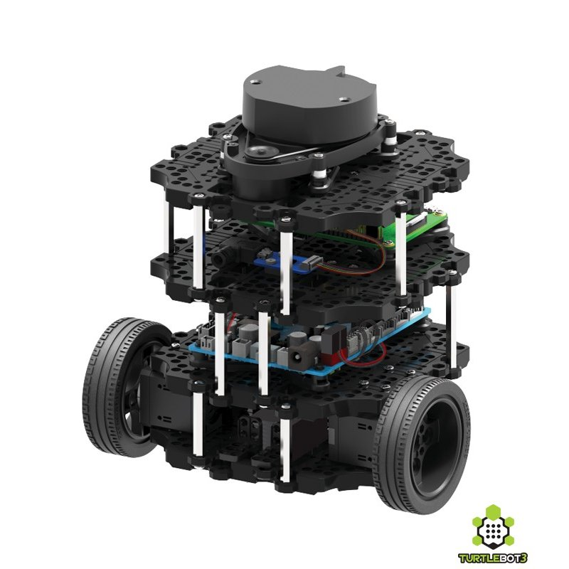

## Table des matières

<!-- TOC -->

<b>• [Table des matières](#table-des-mati%C3%A8res)</b><br>
<b>• [Introduction](#introduction)</b><br>
<b>• [1. Environnement de développement](#1-environnement-de-d%C3%A9veloppement)</b><br>
&ensp;&ensp;&ensp;&ensp;◦ [1.1 Simulation en ligne : TheConstructSim](#11-simulation-en-ligne--theconstructsim)<br>
&ensp;&ensp;&ensp;&ensp;◦ [1.2 Développement local et déploiement sur le robot : VS Code, GitHub et SSH](#12-d%C3%A9veloppement-local-et-d%C3%A9ploiement-sur-le-robot--vs-code-github-et-ssh)<br>
<b>• [2. Architecture finale du projet](#2-architecture-finale-du-projet)</b><br>
&ensp;&ensp;&ensp;&ensp;◦ [2.1 Arborescence du paquet TABDK](#21-arborescence-du-paquet-tabdk)<br>
&ensp;&ensp;&ensp;&ensp;◦ [2.2 Découpage du nœud contrôleur en classes](#22-d%C3%A9coupage-du-n%C5%93ud-contr%C3%B4leur-en-classes)<br>
&ensp;&ensp;&ensp;&ensp;◦ [2.3 Interaction des différents nœuds](#23-interaction-des-diff%C3%A9rents-n%C5%93uds)<br>
<b>• [3. Pilotage de base et paramétrage du TB3](#3-pilotage-de-base-et-param%C3%A9trage-du-tb3)</b><br>
&ensp;&ensp;&ensp;&ensp;◦ [3.1 Pilotage de base du TB3](#31-pilotage-de-base-du-tb3)<br>
&ensp;&ensp;&ensp;&ensp;◦ [3.2 Paramètres de l'application](#32-param%C3%A8tres-de-lapplication)<br>
<b>• [4. Contrôle et navigation du TB3](#4-contr%C3%B4le-et-navigation-du-tb3)</b><br>
&ensp;&ensp;&ensp;&ensp;◦ [4.1 Les modes de navigation](#41-les-modes-de-navigation)<br>
&ensp;&ensp;&ensp;&ensp;◦ [4.2 Mode navigation manuelle](#42-mode-navigation-manuelle)<br>
&ensp;&ensp;&ensp;&ensp;◦ [4.3 Mode navigation autonome](#43-mode-navigation-autonome)<br>
<b>• [5. Perception de l'environnement à l'aide du LiDAR](#5-perception-de-lenvironnement-%C3%A0-laide-du-lidar)</b><br>
&ensp;&ensp;&ensp;&ensp;◦ [5.1 Analyse du scan LiDAR et découpage en régions](#51-analyse-du-scan-lidar-et-d%C3%A9coupage-en-r%C3%A9gions)<br>
&ensp;&ensp;&ensp;&ensp;◦ [5.2 Conception des marqueurs RViz](#52-conception-des-marqueurs-rviz)<br>
<b>• [6. Services, actions et gestion de trajectoires](#6-services-actions-et-gestion-de-trajectoires)</b><br>
&ensp;&ensp;&ensp;&ensp;◦ [6.1 Configuration à la volée du comportement du robot : service](#61-configuration-%C3%A0-la-vol%C3%A9e-du-comportement-du-robot--service)<br>
&ensp;&ensp;&ensp;&ensp;◦ [6.2 Navigation : serveur d'action](#62-navigation--serveur-daction)<br>
&ensp;&ensp;&ensp;&ensp;◦ [6.3 Gestion des trajectoires : Path](#63-gestion-des-trajectoires--path)<br>
<b>• [7. Planification de trajectoire : SLAM](#7-planification-de-trajectoire--slam)</b><br>
&ensp;&ensp;&ensp;&ensp;◦ [7.1 SLAM (Cartographie et Localisation simultanées)](#71-slam-cartographie-et-localisation-simultan%C3%A9es)<br>
&ensp;&ensp;&ensp;&ensp;◦ [7.2 Navigation à base de SLAM](#72-navigation-%C3%A0-base-de-slam)<br>
<b>• [8. Évitement d'obstacles](#8-%C3%A9vitement-dobstacles)</b><br>
<b>• [9. Passage d'un fichier controleur.cpp à un découpage en classes](#9-passage-dun-fichier-controleurcpp-%C3%A0-un-d%C3%A9coupage-en-classes)</b><br>
&ensp;&ensp;&ensp;&ensp;◦ [9.1 Motivation et étapes du découpage](#91-motivation-et-%C3%A9tapes-du-d%C3%A9coupage)<br>
&ensp;&ensp;&ensp;&ensp;◦ [9.2 Organisation des fichiers .cpp et namespaces](#92-organisation-des-fichiers-cpp-et-namespaces)<br>
&ensp;&ensp;&ensp;&ensp;◦ [9.3 Fonction init() et accès par pointeurs](#93-fonction-init-et-acc%C3%A8s-par-pointeurs)<br>
&ensp;&ensp;&ensp;&ensp;◦ [9.4 Cas critique : intégration de ServeurAction](#94-cas-critique--int%C3%A9gration-de-serveuraction)<br>
&ensp;&ensp;&ensp;&ensp;◦ [9.5 Conduite du refactoring](#95-conduite-du-refactoring)

<!-- /TOC -->
## Introduction

Ce rapport présente l'architecture, les difficultés rencontrées et les solutions apportées dans le cadre pour la réalisation de notre projet de robotique mobile et navigation autonome sous ROS.
Nous avons utilisé un robot TurtleBot3 Burger en simulation Gazebo et en conditions réelles dans le labyrinthe de la salle 4105.

L'objectif du projet était de développer progressivement notre package `TABDK`, puis de le relier au planificateur `AStar-ROS` pour couvrir toutes les étapes demandées :

- le pilotage bas niveau (`/cmd_vel`) et le paramétrage global via YAML ([section 3, Pilotage de base et paramétrage du TB3](#3-pilotage-de-base-et-paramétrage-du-tb3)) ;
- la gestion des modes (`manual` et `auto`), de la pause, du pilotage manuel et de la localisation odométrique (`/odom`) ([section 4, Contrôle et navigation du TB3](#4-contrôle-et-navigation-du-tb3)) ;
- l'asservissement en position et en orientation, étendu vers des déplacements fluides en marche avant et arrière ([section 4.3.2, Navigation vers un but](#432-navigation-vers-un-but)) ;
- la perception 360° par LiDAR (`/scan`), le découpage en huit régions et la visualisation dans RViz ([section 5, Perception de l'environnement à l'aide du LiDAR](#5-perception-de-lenvironnement-à-laide-du-lidar)) ;
- les commandes par services ROS (`/set_mode`, `/global_control`), le suivi asynchrone de waypoints par action (`/moving`) et la gestion de trajectoires `nav_msgs/Path` ([section 6, Services, actions et gestion de trajectoires](#6-services-actions-et-gestion-de-trajectoires)) ;
- la cartographie SLAM (Gmapping) et la planification de chemin A\* améliorée avec lissage de trajectoire ([section 7, Planification de trajectoire : SLAM](#7-planification-de-trajectoire--slam)) ;
- l'évitement d'obstacles en temps réel basé sur le temps avant collision ([section 8, Évitement d'obstacles](#8-évitement-dobstacles)).

## 1. Environnement de développement

Pour avancer efficacement tout au long du projet et travailler à deux dans de bonnes conditions, nous avons utilisé deux environnements complémentaires : la simulation en ligne sur TheConstructSim et un workspace VS Code automatisé pour le robot physique, avec GitHub pour le suivi et la collaboration sur le code.

### 1.1 Simulation en ligne : TheConstructSim

Pour travailler à distance depuis chez nous, tester nos packages dans un environnement virtuel et économiser la batterie du TurtleBot3 réel (qui tenait peu longtemps en séance), nous avons utilisé la plateforme TheConstructSim (VS Code en ligne, Gazebo et RViz déjà prêts à l'emploi). Nous détaillons dans la [section 7.1, SLAM (Cartographie et Localisation simultanées)](#71-slam-cartographie-et-localisation-simultanées) les contraintes rencontrées sur cette plateforme.

### 1.2 Développement local et déploiement sur le robot : VS Code, GitHub et SSH

Sur nos PC, nous avons préféré utiliser VS Code, GitHub et GitHub Desktop plutôt que MobaXterm (qui oblige à garder le code sur le robot, à ouvrir et placer plusieurs fenêtres SSH à la main et à retaper souvent le mot de passe). Nous codions,en local et pour collaborer on utilisait GitHub.

Au début, nous devions copier à la main chaque fichier modifié sur le robot après nos changements sur Git. Nous avons donc mis en place un workspace VS Code dédié (`robotique.code-workspace`) pour automatiser notre travail :

- **Arborescence épurée** : nous affichons uniquement nos dossiers utiles (`TABDK/`, puis `AStar-ROS/` lorsque nous en avons eu besoin) directement dans VS Code, sans avoir à parcourir toute l'arborescence du robot.
- **Synchronisation automatique à la sauvegarde** : à chaque enregistrement en local, nos dossiers `TABDK/` et `AStar-ROS/` sont recopiés automatiquement en miroir vers `~/catkin_ws/src/` sur le robot via SSH.
- **Ouverture automatique des terminaux** : à l'ouverture du workspace, VS Code lance une synchronisation initiale, exécute `run_robot.sh` dans un terminal SSH indépendant pour démarrer l'environnement du robot, puis ouvre un terminal SSH prêt à l'emploi avec nos alias déjà chargés.
- **Terminal SSH par défaut** : chaque nouveau terminal ouvert dans VS Code se connecte directement en SSH sur le robot.

## 2. Architecture finale du projet

### 2.1 Arborescence du paquet TABDK

<!-- paysage : zoom = 60 -->
<!-- portrait : zoom = 100 -->
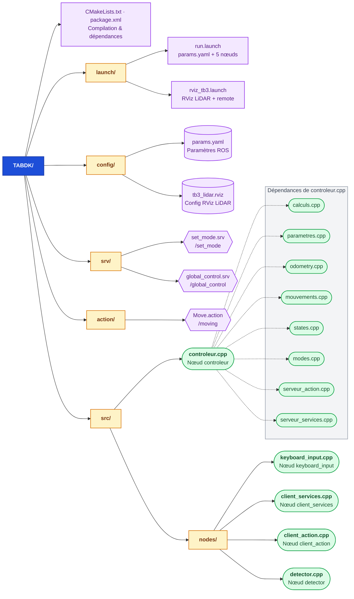

### 2.2 Découpage du nœud contrôleur en classes

Dans notre version finale, `controleur.cpp` est le point d'entrée du contrôleur. Il initialise les différentes classes, lance la boucle principale et et tout ce qui est lié directment à ROS

- le pilotage de la vitesse linéaire et angulaire (`Mouvements`) ;
- l'odométrie (`Odometry`) ;
- la machine à états des déplacements (`States`) ;
- les modes de fonctionnement et la pause (`Modes`) ;
- le chargement des paramètres et leur conversion (`Params`) ;
- les échanges avec ROS par services et par action (`ServeurServices` et `ServeurAction`).

Nous expliquons dans la [section 9, Passage d'un fichier controleur.cpp à un découpage en classes](#9-passage-dun-fichier-controleurcpp-%C3%A0-un-d%C3%A9coupage-en-classes) comment nous sommes passés d'un seul fichier `controleur.cpp` à cette organisation en classes.

> Le fichier `calculs.cpp` est le seul fichier `.cpp` dsitué directement dans `src/` qui ne contient pas une classe mais simplement des fonctions utilitaires.

#### Classe principale et dépendances neutres

<!-- paysage : zoom = 80 -->
<!-- portrait : zoom = 100 -->
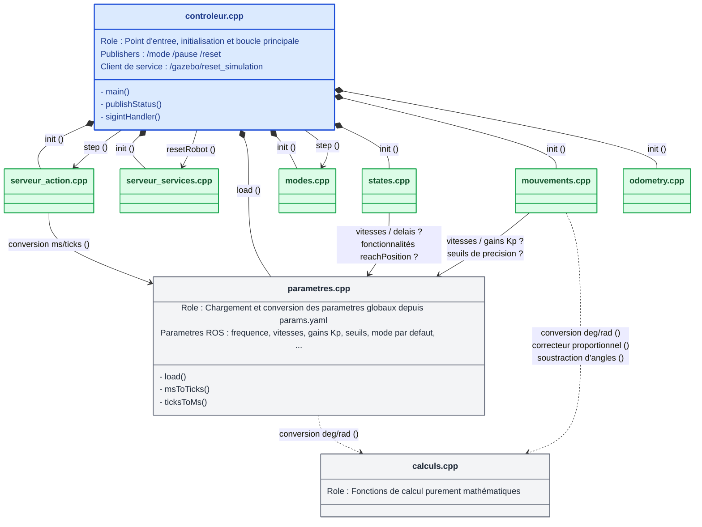

#### Interactions entre les classes du nœud contrôleur

<!-- paysage : zoom = 60 -->
<!-- portrait : zoom = 100 -->
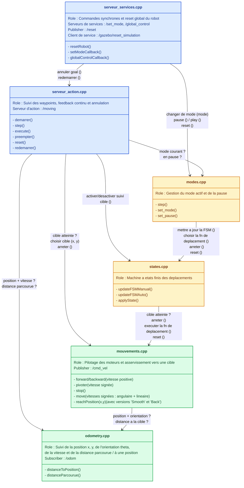

### 2.3 Interaction des différents nœuds

Le paquet `TABDK` contient le nœud contrôleur ainsi que quatre autres nœuds, dont les schémas et les descriptions sont disponibles dans les parties indiquées dans le tableau suivant :

| Nœud (`TABDK/src/nodes/`) | Rôle principal | Schéma détaillé |
| --- | --- | --- |
| `keyboard_input.cpp` | Capture clavier → `/keyboard_input` | [section 4.2, Mode navigation manuelle](#42-mode-navigation-manuelle) |
| `detector.cpp` | Analyse LiDAR 8 régions, marqueurs RViz et évitement d'obstacles | [section 5, Perception de l'environnement à l'aide du LiDAR](#5-perception-de-lenvironnement-à-laide-du-lidar) et [section 8, Évitement d'obstacles](#8-évitement-dobstacles) |
| `client_services.cpp` | Commandes clavier `m`/`p`/`r` → `/set_mode` et `/global_control` | [section 6.1, Configuration à la volée du comportement du robot : service](#61-configuration-à-la-volée-du-comportement-du-robot--service) |
| `client_action.cpp` | Liste de waypoints (via clavier ou topic) → action `/moving`  | [section 6.3, Gestion des trajectoires : Path](#63-gestion-des-trajectoires--path) |

> Nous expliquons dans la [section 9, Passage d'un fichier controleur.cpp à un découpage en classes](#9-passage-dun-fichier-controleurcpp-%C3%A0-un-d%C3%A9coupage-en-classes) comment nous sommes passés d'un fichier `controleur.cpp` unique à ce découpage en classes.

## 3. Pilotage de base et paramétrage du TB3

### 3.1 Pilotage de base du TB3

#### Choix fonctionnels

- Nous avons utilisé le topic `/cmd_vel` avec le message `geometry_msgs::Twist` (`#include <geometry_msgs/Twist.h>`), en pilotant la vitesse linéaire sur `linear.x`.
- Nous avons isolé les commandes des vitesses dans trois fonctions simples (`forward()`, `backward()` et `stop()`).
- Pour gérer l'interruption `CTRL+C` dans ROS, nous avons utilisé le `sigintHandler()` pourarrêter proprement le robot à la fermeture du nœud.

#### Première implémentation

Nous avions regroupé tout dans `controleur.cpp` : un publisher sur `/cmd_vel`, les fonctions globales `forward()`, `backward()` et `stop()`, et une boucle `while (ok())` pour traiter l'algorithme.

Nous gérions l'enchaînement "avancer, arrêter, reculer" avec un compteur (`move_counter`) et des conditions `if / else if`. Nous avions alors exprimé les durées en nombre de périodes (`move_fwd_per`, `move_bwd_per`, `move_stp_per`). Ensuite, à la suite de vos recommandations, nous avons remplacé ce compteur par une véritable machine à états pour rendre le code plus simple à faire évoluer. Nous avons créé un `enum RobotState`, une variable `current_state` pour mémoriser l'état courant, puis un `switch(current_state)` dans `update_FSM_auto()` et `apply_state()` pour gérer les transitions et appeler les fonctions de déplacement.

Nous appelions simplement `stop()` puis `shutdown()` dans `sigintHandler()`.

#### Difficultés rencontrées

- Comme nous avions d'abord exprimé les durées en nombre de périodes (`move_fwd_per`, `move_bwd_per`, `move_stp_per`), la durée réelle des déplacements changeait dès que nous modifiions la fréquence du contrôleur. Nous sommes donc passés à des durées en millisecondes (`move_fwd_tm`, `move_bwd_tm`, `move_stp_tm`), converties en nombre de ticks (voir la [section 3.2, Paramètres de l'application](#32-paramètres-de-lapplication)).
- Lorsque nous avons ajouté la réinitialisation du robot et de la simulation, nous avons modifié `sigintHandler()` pour qu'il appelle `reset_robot()` (qui réinitialise puis arrête le robot) avant `shutdown()`. Enfin, lors du découpage en classes, nous avons choisi de remplacer cet appel direct par un drapeau `arret_demande` mis à `true` dans `sigintHandler()`. La boucle principale s'arrête alors proprement avant de reset le robot dans `main()`.

#### Version finale

- Nous avons regroupé les fonctions de commande de vitesse dans la classe `Mouvements` ([TABDK/src/mouvements.cpp](https://github.com/benoitdekeyn/E4SE_TD_TP/blob/main/robotique_et_navigation/TABDK/src/mouvements.cpp#L57-L106)), où `stop()` publie un `Twist()` nul.
- Nous avons conservé l'ancien cycle avancer, arrêter, reculer dans `States::updateFSMAuto()` ([TABDK/src/states.cpp](https://github.com/benoitdekeyn/E4SE_TD_TP/blob/main/robotique_et_navigation/TABDK/src/states.cpp#L117-L145)), même si nous ne l'appelons plus dans le fonctionnement final (comme expliqué dans la [section 4.3, Mode navigation autonome](#43-mode-navigation-autonome)).
- Dans [TABDK/src/controleur.cpp](https://github.com/benoitdekeyn/E4SE_TD_TP/blob/main/robotique_et_navigation/TABDK/src/controleur.cpp#L24-L28) et [L77-L89](https://github.com/benoitdekeyn/E4SE_TD_TP/blob/main/robotique_et_navigation/TABDK/src/controleur.cpp#L77-L89), `sigintHandler()` lève `arret_demande`, puis `main()` appelle `services.resetRobot()` et `shutdown()` en sortie de boucle.

### 3.2 Paramètres de l'application

#### Choix fonctionnels

- Nous avons préféré régler les paramètres dans un fichier YAML (`TABDK/config/params.yaml`) plutôt que de les passer un par un en arguments dans `run.launch`.
- Nous avons écrit les angles en degrés et les durées en millisecondes dans ce fichier YAML pour faciliter les réglages, puis nous faisons les conversions au chargement.
- Nous avons donné une valeur par défaut à chaque variable de configuration. Comme ça, le programme garde des valeurs utilisables si un paramètre n'est pas trouvé à l'exécution.
- Nous avons écrit `msToTicks()` et `ticksToMs()` pour centraliser la conversion entre millisecondes et itérations de boucle, et éviter de répéter des divisions ou multiplications par 1000 partout dans le code.

#### Première implémentation

Au début, notre fichier `config/params.yaml` ne contenait que cinq paramètres (`frequence`, `linear_speed`, `move_fwd_per`, `move_bwd_per`, `move_stp_per`). Nous les récupérions directement au début du `main()` de `controleur.cpp` dans des variables globales avec valeurs par défaut. Quand nous avons ajouté les autres nœuds (`keyboard_input`, `detector`, `client_action`), nous avons d'abord gardé des constantes locales hardcodéesdans chacun des nœuds.

#### Difficultés rencontrées

- Avec des constantes locales dans chaque nœud, nous ne pouvions pas modifier la fréquence globale ou les seuils d'évitement d'obstacles depuis un seul endroit. Nous avons donc regroupé le chargement des paramètres dans une classe `Params`, incluse dans nos cinq nœuds.
- Comme nous manipulions des degrés, des radians, des millisecondes et des ticks dans plusieurs fichiers, nous avons regroupé toutes les conversions au chargement et dans `msToTicks()` / `ticksToMs()`.

#### Version finale

- La classe `Params` ([TABDK/src/parametres.cpp](https://github.com/benoitdekeyn/E4SE_TD_TP/blob/main/robotique_et_navigation/TABDK/src/parametres.cpp#L11-L70)) contient les valeurs par défaut, charge les paramètres depuis [TABDK/config/params.yaml](https://github.com/benoitdekeyn/E4SE_TD_TP/blob/main/robotique_et_navigation/TABDK/config/params.yaml) via [`Params::load()`](https://github.com/benoitdekeyn/E4SE_TD_TP/blob/main/robotique_et_navigation/TABDK/src/parametres.cpp#L36-L59), et convertit `precision_angular` et `trigger_pivot` en radians.
- Nos cinq nœuds (lancés ensemble par [TABDK/launch/run.launch](https://github.com/benoitdekeyn/E4SE_TD_TP/blob/main/robotique_et_navigation/TABDK/launch/run.launch#L1-L8)) incluent cette classe. Le paramètre `params.frequence` (réglé à 5 Hz) fixe la fréquence des boucles de `controleur`, `keyboard_input` et `client_action`, tandis que `detector` et `client_services` réagissent directement aux messages reçus via `spin()`.
- Les méthodes [`msToTicks()`](https://github.com/benoitdekeyn/E4SE_TD_TP/blob/main/robotique_et_navigation/TABDK/src/parametres.cpp#L62-L64) et [`ticksToMs()`](https://github.com/benoitdekeyn/E4SE_TD_TP/blob/main/robotique_et_navigation/TABDK/src/parametres.cpp#L67-L69) assurent les conversions temporelles dans le contrôleur.

## 4. Contrôle et navigation du TB3

### 4.1 Les modes de navigation

#### Choix fonctionnels

- Dès les premières versions de notre machine à états, nous avons voulu intégrer un mécanisme de pause. Car déjà l'année dernière, nous avions déjà mis un mode pause pour arrêter le robot à un instant précis (par exemple juste avant un obstacle ou dans un cas à analyser) ce qui nous permettait d'observer tranquillement les capteurs, l'état interne et les logs sans qu'il continue d'avancer.
- Nous avons défini le mode de démarrage avec `default_mode` dans `config/params.yaml` (avec un repli sur `"manual"` si la valeur est invalide).
- Quand nous avons ajouté plusieurs nœuds ROS, des services et des actions, nous avons séparé complètement la pause du mode. Nous voulions que la pause reflète l'arrêt physique du robot (couper les déplacements et les compteurs de déplacement) sans figer son algorithme de décision ni bloquer la lecture des entrées utilisateur.

#### Première implémentation

Dans notre première version, nous avions deux modes principaux dans `controleur.cpp` (`enum RobotMode`) :

- le mode automatique (`AUTO`) exécutait la séquence prédéfinie (avancer, s'arrêter, reculer) ;
- le mode manuel (`MANUAL`) permettait de piloter directement le robot avec les flèches du clavier.

Nous avons ajouté la pause comme un troisième mode (`PAUSE`) dans `enum RobotMode`, avec une variable `previous_mode` pour revenir au mode précédent à la reprise.

#### Difficultés rencontrées

- Au début, la mise en pause ne remettait pas la direction clavier à `NONE`, donc le robot repartait dans l'ancienne direction à la reprise. Ensuite, dès que nous avons ajouté plusieurs nœuds ROS, des services ([section 6.1, Configuration à la volée du comportement du robot : service](#61-configuration-à-la-volée-du-comportement-du-robot--service)) et l'arrêt devant un obstacle ([section 8, Évitement d'obstacles](#8-évitement-dobstacles)), garder la pause comme un mode est devenu difficile à gérer. Il fallait par exemple mettre à jour `previous_mode` si nous changions de mode pendant une pause.
- Quand nous avons réparti les commandes sur plusieurs nœuds, chacun devait connaître le mode et la pause courants. C'est à ce stade plus tardif que nous avons ajouté la publication continue de `/mode` (`std_msgs/String`) et `/pause` (`std_msgs/Bool`) dans `controleur.cpp`.
- Comme le fichier `controleur.cpp` rassemblait trop de code, nous avons séparé la gestion des modes (`Modes`) de la machine à états des déplacements (`States`). Nous détaillons ce découpage dans la [section 9, Passage d'un fichier controleur.cpp à un découpage en classes](#9-passage-dun-fichier-controleurcpp-%C3%A0-un-d%C3%A9coupage-en-classes).

#### Version finale

Dans notre version finale, le mode (`"manual"` ou `"auto"`) et la pause (`pause_active`) sont totalement indépendants :

- La classe `Modes` ([TABDK/src/modes.cpp](https://github.com/benoitdekeyn/E4SE_TD_TP/blob/main/robotique_et_navigation/TABDK/src/modes.cpp#L16-L100)) stocke le mode courant en `std::string` et le booléen `pause_active`. Elle fournit les fonctions [`set_mode()`](https://github.com/benoitdekeyn/E4SE_TD_TP/blob/main/robotique_et_navigation/TABDK/src/modes.cpp#L49-L59) et [`set_pause()`](https://github.com/benoitdekeyn/E4SE_TD_TP/blob/main/robotique_et_navigation/TABDK/src/modes.cpp#L61-L71) au serveur de services (`ServeurServices`), qui les appelle sur `/set_mode` et `/global_control`.
- À chaque itération de la boucle principale de `controleur.cpp` ([TABDK/src/controleur.cpp](https://github.com/benoitdekeyn/E4SE_TD_TP/blob/main/robotique_et_navigation/TABDK/src/controleur.cpp#L77-L83)), nous appelons [`Modes::step()`](https://github.com/benoitdekeyn/E4SE_TD_TP/blob/main/robotique_et_navigation/TABDK/src/modes.cpp#L30-L47) pour mettre à jour la FSM. Si `pause_active` est vrai, `Modes::step()` met la vitesse à 0 (`states->stop()`) et laisse la FSM figée, tout en gardant la boucle ROS et la lecture des commandes actives (et `ServeurAction` cesse d'incrémenter son compteur de temps). Sinon, elle appelle [`states->updateFSMManual()`](https://github.com/benoitdekeyn/E4SE_TD_TP/blob/main/robotique_et_navigation/TABDK/src/states.cpp#L59-L77) puis [`states->applyState()`](https://github.com/benoitdekeyn/E4SE_TD_TP/blob/main/robotique_et_navigation/TABDK/src/states.cpp#L79-L115).
- Nous avons laissé dans la classe `States` ([TABDK/src/states.cpp](https://github.com/benoitdekeyn/E4SE_TD_TP/blob/main/robotique_et_navigation/TABDK/src/states.cpp#L4-L115)) les états ajoutés au fil du projet, mais en pratique, les modes `manual` et `auto` utilisent tous deux le suivi de cible (`STOP` ↔ `REACH_POSITION`), seule la provenance des waypoints change (clavier ou `/robot_path`).

Voici un schéma qui illustre la gestion des modes et de la pause : 

<!-- paysage : zoom = 80 -->
<!-- portrait : zoom = 70 -->


### 4.2 Mode navigation manuelle

#### Choix fonctionnels

- Nous avons utilisé le nœud de saisie clavier fourni dans l'énoncé (`key_input_node.cpp`, renommé ensuite `keyboard_input.cpp`). Il publie les codes ASCII des touches sur `/keyboard_input` (`std_msgs/Int8`) dans un nœud séparé, pour ne pas bloquer la boucle du contrôleur.
- Notre mode manuel a évolué deux fois au cours des exercices. Nous allons présenter les trois versions que nous avons successivement développées, jusqu'à une version finale reliée au serveur d'action ([section 6.2, Navigation : serveur d'action](#62-navigation--serveur-daction)) et à l'évitement d'obstacles ([section 8, Évitement d'obstacles](#8-évitement-dobstacles)).

#### Première implémentation et évolution du mode manuel

Voici les trois versions de notre mode manuel, développées au fur et à mesure des exercices :

1. **Première version : commandes directes** : au début, `key_input_node.cpp` publiait les touches sur `/keyboard_input` et nous les lisions directement dans `controleur.cpp`. Chaque touche du clavier déclenchait un mouvement élémentaire dans la FSM (`FORWARD`, `BACKWARD`, `PIVOTER_GAUCHE`, `PIVOTER_DROITE`, `STOP`), avec la barre espace pour la pause et la touche `0` (`KEY_ZERO`) pour remettre la direction à `NONE`.
2. **Deuxième version : déplacement vers des coordonnées cibles** : quand nous avons implémenté `reachPosition()` ([section 4.3.2, Navigation vers un but](#432-navigation-vers-un-but)), nous sommes passés à un pilotage par position cible. Les flèches du clavier ne commandaient plus un mouvement direct, mais déplaçaient une cible de coordonnées absolues `(x, y)` dans le repère d'odométrie (par pas de `0,1 m` : haut/bas sur `x`, gauche/droite sur `y`, stockée dans `target_position` puis dans l'attribut `targets` de `Mouvements`). La FSM passait alors dans `REACH_POSITION` pour rejoindre cette cible.
3. **Troisième version : déplacement d'un waypoint virtuel (version finale)** : avec les services et le serveur d'action, nous avons retiré la lecture clavier du contrôleur pour la confier à `client_services.cpp` et `client_action.cpp`. Dans `client_action.cpp`, une variable `waypoint_virtuel` est initialisée à `(0, 0)` (et remise à `(0, 0)` lors d'un reset). En mode manuel, les flèches déplacent ce waypoint virtuel par pas de "`waypoint_step`" mètres. Quand nous appuyons sur `w`, ce waypoint est ajouté à la liste `trajectoire`, et le robot suit les points de la liste dans l'ordre via l'action `/moving`.

#### Difficultés rencontrées

- Dans notre première version, nous avions stocké les commandes clavier dans un dictionnaire dynamique (`std::unordered_map<string, std::variant<bool, string>>`) associant des clés textuelles à des booléens (changement de mode, arrêt) ou des chaînes de caractères (direction). Le callback mettait ce dictionnaire à jour, puis la boucle principale le lisait. Après une discussion avec M. Kocik, nous avons constaté que cette approche était trop lourde pour notre application embarquée. Nous l'avons donc remplacée par une structure typée (`struct KeyboardInputs`) et des énumérations (`Arrow`).
- *Au début, `stop()` ne remettait que `linear.x` à zéro et les fonctions de déplacement réutilisaient la même variable `Twist` globale. Après avoir ajouté `pivoter()`, le robot pouvait continuer à tourner à l'arrêt ou garder une composante non nulle. Nous avons corrigé cela en réinitialisant le message via `vel = Twist()` dans `stop()`, puis en créant un `Twist` vierge dans chacune des fonctions de déplacement (`forward()`, `backward()`, `pivoter()`, `move()`).
- Dans la première version, sans remise explicite à `NONE` (`KEY_ZERO` ou lors d'une pause), la dernière direction reçue restait active d'un tour de boucle à l'autre.
- Lors de l'ajout des services ([section 6.1, Configuration à la volée du comportement du robot : service](#61-configuration-à-la-volée-du-comportement-du-robot--service)), nous avons d'abord regroupé la lecture clavier et les appels de services dans un nœud `keyboard.cpp`. Quand nous avons eu besoin du clavier à la fois pour les services (`m`, `p`, `r`) et pour les waypoints dans `client_action.cpp`, nous avons séparé la capture brute (`keyboard_input.cpp`) des deux nœuds qui la lisaient (`client_services.cpp` et `client_action.cpp`).
- Nous avions d'abord fixé la fréquence de polling de `keyboard_input.cpp` avec une constante locale de 5 Hz (`FREQ_ACTUALISATION = 5`). Nous l'avons ensuite centralisée dans `config/params.yaml` (`params.frequence`), tout en conservant cette fréquence de 5 Hz ([section 3.2, Paramètres de l'application](#32-paramètres-de-lapplication)).

#### Version finale

Dans notre version finale, `keyboard_input.cpp` ([TABDK/src/nodes/keyboard_input.cpp](https://github.com/benoitdekeyn/E4SE_TD_TP/blob/main/robotique_et_navigation/TABDK/src/nodes/keyboard_input.cpp#L14-L32)) publie les codes touches bruts sur `/keyboard_input`. Ils sont ensuite lus par `client_services.cpp` ([TABDK/src/nodes/client_services.cpp](https://github.com/benoitdekeyn/E4SE_TD_TP/blob/main/robotique_et_navigation/TABDK/src/nodes/client_services.cpp#L79-L126)) et `client_action.cpp` ([TABDK/src/nodes/client_action.cpp](https://github.com/benoitdekeyn/E4SE_TD_TP/blob/main/robotique_et_navigation/TABDK/src/nodes/client_action.cpp#L116-L154)) selon le tableau suivant :

| Touches | Nœud consommateur | Mécanisme ROS | Effet |
| --- | --- | --- | --- |
| `m` | `client_services.cpp` | Service `/set_mode` | Bascule `manual` ↔ `auto` |
| `p` | `client_services.cpp` | Service `/global_control` | Bascule `pause` ↔ `play` |
| `r` | `client_services.cpp` | Service `/global_control` | Réinitialisation globale (`reset`) |
| `↑` `↓` `←` `→` | `client_action.cpp` *(mode `manual`)* | Variable locale `waypoint_virtuel` | Déplace le waypoint virtuel de `±waypoint_step` en `x` ou `y` |
| `w` | `client_action.cpp` *(mode `manual`)* | Action `/moving` (via `trajectoire`) | Ajoute `waypoint_virtuel` à la liste des waypoints |
| `x` | `client_action.cpp` *(mode `manual`)* | File locale `trajectoire` | Vide la liste de waypoints en attente |

Voici un schéma qui illustre les interactions de `keyboard_input.cpp` :

<!-- paysage : zoom = 95 -->
<!-- portrait : direction = TB, zoom = 55 -->
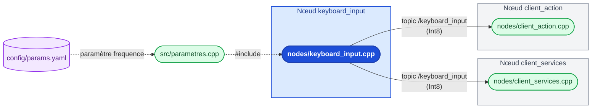

### 4.3 Mode navigation autonome

Au fil du projet, nous avons fait évoluer le mode automatique : nous sommes passés d'une séquence prédéfinie (avancer, s'arrêter, reculer) à une navigation par waypoints. Dans notre version finale, nous n'appelons plus `States::updateFSMAuto()` dans `Modes::step()`. Les modes `auto` et `manual` passent tous deux par `States::updateFSMManual()` et l'état `REACH_POSITION`, et le serveur d'action ([section 6.2, Navigation : serveur d'action](#62-navigation--serveur-daction)) met directement à jour la cible de `reachPosition()`. Nous avons tout de même gardé `updateFSMAuto()` et les noms historiques dans `states.cpp` pour pouvoir relire l'ancien fonctionnement ou y revenir facilement si besoin (en désactivant le serveur d'action et en réactivant l'appel à `updateFSMAuto()`).

#### 4.3.1 Localisation du TB3 et odométrie

##### Choix fonctionnels

- Nous nous sommes abonnés au topic `/odom` (`nav_msgs/Odometry`), sur lequel nous avons mesuré directement avec ROS une fréquence d'environ 20 Hz.
- Dans chaque message `nav_msgs/Odometry`, nous lisons les coordonnées `x` et `y`, le cap `theta` extrait du quaternion avec `tf::getYaw()`, et les vitesses linéaire et angulaire (`msg->twist.twist`).
- Nous avons ajouté dans `Odometry` le cumul de distance (`distanceParcourue()`) et la méthode `distanceToPosition(x, y)` pour les réutiliser dans l'asservissement ([section 4.3.2, Navigation vers un but](#432-navigation-vers-un-but)) et le serveur d'action ([section 6.2, Navigation : serveur d'action](#62-navigation--serveur-daction)).

##### Première implémentation

Au début, nous avons placé le subscriber `/odom` et la réinitialisation (`/reset` et `/gazebo/reset_simulation`, déclenchés par la touche `r`) directement dans `controleur.cpp`, avec une structure personnalisée pour stocker `x`, `y` et la rotation. Lors du passage en classe `Odometry`, nous avions gardé notre propre `struct Pose2D`. Nous avons ensuite découvert que ROS proposait déjà `geometry_msgs::Pose2D` et nous l'avons adopté à la place. Plus tard, nous avons ajouté le stockage de `vitesse` dans `Odometry` pour donner plus d'informations dans les feedbacks de `Move.action` ([section 6.2, Navigation : serveur d'action](#62-navigation--serveur-daction)).

##### Difficultés rencontrées

- Pendant nos premiers essais d'asservissement sur l'axe `x`, nous pensions que l'odométrie dysfonctionnait car les mesures semblaient incohérentes avec la postion physique du robot malgré des resets. Après un redémarrage complet du robot, nous avons constaté que l'odométrie était finalement assez précise.
- Nous nous sommes longtemps demandé d'où venait le fait que le reset ne gardait pas l'axe `x` face au robot lorsque nous le déplacions pendant nos essais en `(x, y)`. Au moment du reset, l'axe `x` est bien orienté devant le robot, mais comme l'orientation odométrique s'appuie sur l'IMU du robot, cet axe reste ensuite fixe par rapport à l'environnement lorsque nous déplaçons le robot à la main.

##### Version finale

La classe `Odometry` ([TABDK/src/odometry.cpp](https://github.com/benoitdekeyn/E4SE_TD_TP/blob/main/robotique_et_navigation/TABDK/src/odometry.cpp#L17-L60)) met à jour `position` (`geometry_msgs::Pose2D`), `vitesse` (`geometry_msgs::Twist`) et `distance_parcourue` dans [`odomCallback()`](https://github.com/benoitdekeyn/E4SE_TD_TP/blob/main/robotique_et_navigation/TABDK/src/odometry.cpp#L41-L59) (ainsi que [`distanceToPosition()`](https://github.com/benoitdekeyn/E4SE_TD_TP/blob/main/robotique_et_navigation/TABDK/src/odometry.cpp#L26-L30) et [`distanceParcourue()`](https://github.com/benoitdekeyn/E4SE_TD_TP/blob/main/robotique_et_navigation/TABDK/src/odometry.cpp#L32-L34)) qui est appelée à la frequence non pas du topic `/odom`, mais de la boucle ROS (donc 5 Hz pour notre cas).

#### 4.3.2 Navigation vers un but

##### Choix fonctionnels

- Nous avons choisi un asservissement proportionnel (`commande_proportionnelle()` dans `calculs.cpp`, plafonné aux vitesses maximales `linear_speed` et `angular_speed`). La vitesse est ainsi élevée lorsque l'erreur est grande, puis diminue progressivement à l'approche de la cible, ce qui rend le déplacement fluide et évite les oscillations. Nos essais à 5 Hz ont donné des résultats satisfaisants sans terme intégral ni dérivé : l'asservissement interne des moteurs derrière `/cmd_vel`, ainsi que la vitesse et l'inertie du robot réel, ne provoquaient pas de dépassements à l'arrêt même sans PID et sans avoir à ralentir longtemps à l'avance.
- Pour obtenir une trajectoire droite sans grands arcs de cercle et sans arrêts répétés, nous avons ajouté `move(linear, angular)` (vitesse linéaire et angulaire combinées) et deux options dans `config/params.yaml` (`move_smooth` et `move_back`) :
  - **`reachPositionSmooth(x, y, arriere)`** : utilisée quand `move_smooth` vaut `true`. Tant que l'erreur angulaire reste sous le seuil de pivot (`trigger_pivot`), le robot avance et corrige son cap en même temps avec `move()` (sans tourner du tout si l'erreur reste dans `precision_angular`).  
  Si l'erreur dépasse `trigger_pivot`, le robot pivote sur place (`pivot_en_cours`, avec `Kp_pivot`) jusqu'à revenir dans `precision_angular`.
  - **`reachPositionSmoothBack(x, y)`** : utilisée quand `move_smooth` et `move_back` valent tous deux `true`. Si l'angle à parcourir pour viser la cible dépasse 90°, le robot fait marche arrière plutôt que d'effectuer un grand demi-tour : nous décalons l'angle cible de 180° et nous inversons le signe de la vitesse linéaire.  
  Si `move_back` est désactivé, le robot corrige son cap jusqu'à 180° maximum pour aller en marche avant.
- Pour gérer les additions/soustractions d'angles en restant entre -180° et 180°, nous utilisons deux fonctions distinctes dans `calculs.cpp`. Vous nous avez fourni la première dans l'énoncé, `cal_delta_Theta()`, pour calculer le da différence signée `delta` la plus courte entre 2 angles.  
Nous avons développé la seconde, `cal_angle_offset()`, d'abord dans nos essais pour modifier la valeur de l'angle cible depuis le clavier par incr/décrémentation par un pas, puis nous l'avons réutilisée dans `calculerErreurAngle()` pour décaler l'angle cible de 180° en marche arrière. 

##### Première implémentation

Nous avons d'abord codé et validé `reachPositionX()`, `reachAngle()` et `reachPosition()` (pivot sur place puis avancer) directement dans `controleur.cpp`. Quand nous avons créé la classe `Mouvements` (`mouvements.cpp`), nous avons ajouté `move()` pour développer `reachPositionSmooth()` et enfin `reachPositionSmoothBack()`.

##### Difficultés rencontrées

- Dans nos premiers essais de `reachPositionSmooth()`, nous avions inversé `Kp_pivot` et `Kp_angular`, et une erreur de frappe empêchait la limitation de vitesse. Nous avons corrigé ces deux erreurs et centralisé le calcul dans `commande_proportionnelle()`.
- Dans `reachPositionSmooth()`, sans vérifier la distance en premier, les erreurs angulaires explosaient à proximité  du point visé (à cause du dépassement du point en quelques centimètres) et déclenchaient des pivots inutiles. Nous avons donc placé le test de distance au début de la fonction pour arrêter immédiatement le robot dès qu'il entre dans la tolérance `precision_linear`. 
- Lorsque le robot arrive très près du point demandé, il peut toujours le dépasser légèrement s'il est encore trop loin de la cible, ce qui fait vite monter l'erreur angulaire et peut déclencher un petit pivot final suivi d'une vancée de quelques centimètres. Cette limite existe sur les différentes variantes de `reachPosition()`, et nous avons choisi de l'accepter sans ajouter de traitement particulier.
- Pendant nos essais dans Gazebo, nous avons eu des dépassements et des pertes d'adhérence. Des accélérations ou décélérations trop brusques pouvaient faire tourner le robot sur lui-même, et une vitesse trop élevée le faisait dériver sur le côté. Nous avons donc abaissé et ajusté les vitesses dans `config/params.yaml`. Mais c'est un comportement qui est resté exclusif à la simulation.
- Nous avions d'abord créé trois états dans `states.cpp` (`REACH_POSITION`, `REACH_POSITION_SMOOTH` et `REACH_POSITION_SMOOTH_BACK`). Nous les avons regroupés dans un seul état `REACH_POSITION`, piloté par `move_smooth` et `move_back`. La FSM est ainsi plus simple, tout en gardant les mêmes comportements.

##### Version finale

Dans la version finale, `Mouvements` ([TABDK/src/mouvements.cpp](https://github.com/benoitdekeyn/E4SE_TD_TP/blob/main/robotique_et_navigation/TABDK/src/mouvements.cpp#L158-L279), avec [`reachPosition()`](https://github.com/benoitdekeyn/E4SE_TD_TP/blob/main/robotique_et_navigation/TABDK/src/mouvements.cpp#L158-L177), [`reachPositionSmooth()`](https://github.com/benoitdekeyn/E4SE_TD_TP/blob/main/robotique_et_navigation/TABDK/src/mouvements.cpp#L191-L241) et [`reachPositionSmoothBack()`](https://github.com/benoitdekeyn/E4SE_TD_TP/blob/main/robotique_et_navigation/TABDK/src/mouvements.cpp#L247-L252)), `calculs.cpp` ([TABDK/src/calculs.cpp](https://github.com/benoitdekeyn/E4SE_TD_TP/blob/main/robotique_et_navigation/TABDK/src/calculs.cpp#L16-L48)) et l'état `REACH_POSITION` de `States` ([TABDK/src/states.cpp](https://github.com/benoitdekeyn/E4SE_TD_TP/blob/main/robotique_et_navigation/TABDK/src/states.cpp#L102-L110)) gèrent le déplacement vers une cible selon `move_smooth` et `move_back`.

Voici un schéma qui résume la logique de [`reachPositionSmoothBack()`](https://github.com/benoitdekeyn/E4SE_TD_TP/blob/main/robotique_et_navigation/TABDK/src/mouvements.cpp#L247-L252) :

<!-- paysage : zoom = 95 -->
<!-- portrait : direction = TB, zoom = 100 -->
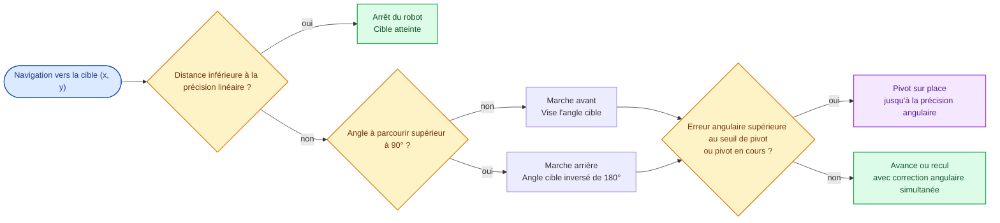

## 5. Perception de l'environnement à l'aide du LiDAR

### 5.1 Analyse du scan LiDAR et découpage en régions

#### Choix fonctionnels

- Nous nous sommes abonnés à `/scan` (`sensor_msgs/LaserScan`) et nous publions nos marqueurs sur `/obstacles_markers` (`visualization_msgs/MarkerArray`, dans le repère arbitraire `base_scan` comme dans le tuto).
- Après avoir fait une première version fonctionnelle sans décalage, nous avons décalé les huit régions d'un seizième de tour, soit 22,5° (`OFFSET_REGIONS`), afin que les axes `X` et `Y` du robot traversent le milieu des régions plutôt que leurs frontières. Nous évitons ainsi qu'un obstacle placé droit devant le robot se retrouve systématiquement à cheval sur deux régions : la région 0 correspond à l'avant du robot et la région 4 à l'arrière. Ce découpage sert ensuite directement à notre évitement d'obstacles ([section 8, Évitement d'obstacles](#8-évitement-dobstacles)).
- Nous avons choisi de représenter les huit régions sous la forme d'une sorte de camembert autour du robot. Dans chaque région, nous affichons une barre perpendiculaire à son axe central, placée à la distance de l'obstacle le plus proche. Nous voyons ainsi tout de suite dans quelle direction se trouve un obstacle et à quelle distance minimale (nous détaillons cette réalisation dans la [section 5.2, Conception des marqueurs RViz](#52-conception-des-marqueurs-rviz)).

#### Première implémentation

Avant de découper les mesures en huit régions, nous avons étudié le message `sensor_msgs/LaserScan` reçu sur `/scan` pour comprendre comment le LiDAR organise ses données. Il contient un tableau `ranges` avec une distance par angle, ainsi que les infos du balayage (`angle_min`, `angle_max`, `angle_increment`, `range_min` et `range_max`). Dans `scanCallback()`, nous utilisons `ranges` pour lire les distances, `angle_increment` (converti en degrés) pour passer d'un angle à son indice dans le tableau, et `range_min` / `range_max` pour filtrer les valeurs invalides en les remplaçant par `FLT_MAX` (nous avons ensuite remplacé `range_max` par notre constante `SEUIL_MAX` à 3,5 m).

Nous avons d'abord découpé les 360° à partir de 0° (`[0°, 45°]`, `[45°, 90°]`…), puis construit nos marqueurs RViz (`rviz_tb3.launch` et `config/tb3_lidar.rviz`).

#### Difficultés rencontrées

- Au démarrage, nous avons confondu radians et degrés en écrivant `int SCAN_SAMPLE = 2 * M_PI` (tronqué en entier à `6`) au lieu de `360`. Nous avons corrigé cela en passant à `SCAN_SAMPLE = 360` et en convertissant `angle_increment` en degrés.
- Nous avons renommé plusieurs fois le topic des marqueurs (`/markers`, puis `/lidar_visualization`, puis `/obstacles_markers`), ce qui obligeait à mettre à jour `config/tb3_lidar.rviz` à chaque fois. De plus, notre première boucle à 1 Hz rendait l'affichage saccadé. Dans la version finale, `detector.cpp` utilise `spin()` et met à jour les marqueurs à chaque nouveau scan `/scan`.
- Une fois les régions décalées de 22,5°, la région avant se retrouvait à cheval sur 0° (avec `index_fin < index_debut`). Nous avons adapté [`get_minimum()`](https://github.com/benoitdekeyn/E4SE_TD_TP/blob/main/robotique_et_navigation/TABDK/src/nodes/detector.cpp#L266-L299) pour parcourir cet intervalle en deux boucles (de `index_debut` à la fin du tableau, puis de `0` à `index_fin`). Ce décalage a aussi causé un bug d'affichage dans RViz, détaillé dans la [section 5.2, Conception des marqueurs RViz](#52-conception-des-marqueurs-rviz).

#### Version finale

Le nœud `detector.cpp` ([TABDK/src/nodes/detector.cpp](https://github.com/benoitdekeyn/E4SE_TD_TP/blob/main/robotique_et_navigation/TABDK/src/nodes/detector.cpp#L64-L233) pour les marqueurs et [`scanCallback()`](https://github.com/benoitdekeyn/E4SE_TD_TP/blob/main/robotique_et_navigation/TABDK/src/nodes/detector.cpp#L203-L233)) analyse les 8 régions à chaque réception sur `/scan` et publie la visualisation sur `/obstacles_markers` (lancée avec [TABDK/launch/rviz_tb3.launch](https://github.com/benoitdekeyn/E4SE_TD_TP/blob/main/robotique_et_navigation/TABDK/launch/rviz_tb3.launch) et [`tb3_lidar.rviz`](https://github.com/benoitdekeyn/E4SE_TD_TP/blob/main/robotique_et_navigation/TABDK/config/tb3_lidar.rviz)). Ce même nœud assure aussi l'évitement d'obstacles via `/global_control`, détaillé dans la [section 8, Évitement d'obstacles](#8-évitement-dobstacles).

Voici un schéma qui illustre l'ensemble des échanges du nœud `detector.cpp` :

<!-- paysage : zoom = 85 -->
<!-- portrait : zoom = 84 -->


### 5.2 Conception des marqueurs RViz

Au départ, nous avons codé toute la logique avec le publisher du MarkerArray sur un topic, et la trigonométrique de calcul des positions de départ et de fin de tracé des premiers marqueurs simples (point sur le minimum et traits pour afficher les rayons).

Cependant, nous voulions obtenir un design plus abouti comme c'est la cas actuellement. Or, comme le tutoriel restait assez évasif, qu'il s'agissait d'une partie purement graphique, et que nous manquions de temps, nous nous sommes ensuite aidés d'une IA pour implémenter la syntaxe RViz dans des fonctions dont nous avions d'abord défini les paramètres et le fonctionnement, afin d'obtenir ce rendu final, graphiquement difficile à coder : 

| Vue d'ensemble des 8 régions décalées de 22,5° | Zoom sur le code couleur (rouge sous 30 cm) et les labels `cm` / `m` |
| :---: | :---: |
|  |  |

Voici un aperçu des fonctions principales utilisées pour générer les marqueurs RViz :  

- [`make_rays()`](https://github.com/benoitdekeyn/E4SE_TD_TP/blob/main/robotique_et_navigation/TABDK/src/nodes/detector.cpp#L135-L150) trace huit rayons gris partant du centre du robot aux frontières entre régions, et [`make_ray_labels()`](https://github.com/benoitdekeyn/E4SE_TD_TP/blob/main/robotique_et_navigation/TABDK/src/nodes/detector.cpp#L153-L168) affiche l'angle correspondant au bout de chaque rayon.
- [`make_stripline()`](https://github.com/benoitdekeyn/E4SE_TD_TP/blob/main/robotique_et_navigation/TABDK/src/nodes/detector.cpp#L111-L132) trace dans chaque secteur une barre perpendiculaire à l'axe central de la région, placée à la distance minimale détectée et étendue jusqu'aux bords du secteur. Pour passer de `(distance, angle)` aux coordonnées 2D, nous utilisons notre fonction [`polar_to_point()`](https://github.com/benoitdekeyn/E4SE_TD_TP/blob/main/robotique_et_navigation/TABDK/src/nodes/detector.cpp#L79-L85).
- [`get_color()`](https://github.com/benoitdekeyn/E4SE_TD_TP/blob/main/robotique_et_navigation/TABDK/src/nodes/detector.cpp#L70-L77) colore en rouge les barres et textes quand un obstacle passe sous le seuil de 0,30 m (`SEUIL_OBSTACLE`), et en vert au-delà.
- [`make_labels()`](https://github.com/benoitdekeyn/E4SE_TD_TP/blob/main/robotique_et_navigation/TABDK/src/nodes/detector.cpp#L171-L185) place un texte de distance juste à l'extérieur du milieu de chaque barre, mis en forme par [`format_label()`](https://github.com/benoitdekeyn/E4SE_TD_TP/blob/main/robotique_et_navigation/TABDK/src/nodes/detector.cpp#L88-L95) (en `cm` sous 1 m, en `m` au-delà) pour rester lisible de près comme de loin.
- Chaque marqueur est initialisé par [`init_marker()`](https://github.com/benoitdekeyn/E4SE_TD_TP/blob/main/robotique_et_navigation/TABDK/src/nodes/detector.cpp#L97-L107), puis [`update_markers()`](https://github.com/benoitdekeyn/E4SE_TD_TP/blob/main/robotique_et_navigation/TABDK/src/nodes/detector.cpp#L187-L200) rassemble les rayons, les barres et tous les labels dans un `MarkerArray` publié sur `/obstacles_markers`.

Au passage, juste après avoir décalé les régions de 22,5°, nous avons remarqué un bug : la barre représentant un obstacle devant le robot s'affichait derrière lui dans RViz. En cherchant, nous avons vu que le centre de la région frontale (qui va de 338° à 23°) était calculé avec la moyenne `(debut + fin) / 2.0`, ce qui tombait à 180° au lieu de 0°. Nous avons corrigé [`angle_region_rad()`](https://github.com/benoitdekeyn/E4SE_TD_TP/blob/main/robotique_et_navigation/TABDK/src/nodes/detector.cpp#L64-L68) avec `(debut + ANGLE_REGION / 2.0)` pour que la barre frontale s'affiche bien devant le robot.

## 6. Services, actions et gestion de trajectoires

### 6.1 Configuration à la volée du comportement du robot : service

#### Choix fonctionnels

- Contrairement à l'énoncé qui proposait un seul service `/set_behavior`, nous avons séparé les changements de mode et les commandes globales en deux services distincts. Comme ça, `detector.cpp` ([section 8, Évitement d'obstacles](#8-évitement-dobstacles)) peut mettre le robot en pause ou le relancer sans connaître ni changer le mode actif :

<!-- code:TABDK/srv/set_mode.srv -->
```text
string mode          # "auto" ou "manual"
---
bool success
string mode_courant
```

<!-- code:TABDK/srv/global_control.srv -->
```text
string command       # "play", "pause" ou "reset"
---
bool success
string mode_courant
```

- Nous publions aussi les topics `/mode` et `/pause` en continu dans `controleur.cpp` pour que chaque nœud qui se connecte reçoive tout de suite le dernier état connu grâce aux publications latched (`, true)`): 

#### Première implémentation

Nous sommes partis de l'exemple de serveur de service du cours, puis nous l'avons adapté en quatre étapes :

1. Nous avons créé `TABDK/srv/set_mode.srv` et `TABDK/srv/global_control.srv`.
2. Nous avons adapté la compilation dans [TABDK/CMakeLists.txt](https://github.com/benoitdekeyn/E4SE_TD_TP/blob/main/robotique_et_navigation/TABDK/CMakeLists.txt#L66-L86) et [L149-L178](https://github.com/benoitdekeyn/E4SE_TD_TP/blob/main/robotique_et_navigation/TABDK/CMakeLists.txt#L149-L178) : 
   - ajout des `.srv` dans `add_service_files()`
   - décommentage de `generate_messages()` avec nos paquets de messages (`actionlib_msgs`, `geometry_msgs`, `nav_msgs`, `sensor_msgs`, `std_msgs`)
   - liaison des exécutables via `add_dependencies()`. Dans [TABDK/package.xml](https://github.com/benoitdekeyn/E4SE_TD_TP/blob/main/robotique_et_navigation/TABDK/package.xml#L55-L86), `message_generation` était déjà en `build_depend`
   - ajout de `<exec_depend>message_generation</exec_depend>`.
3. Nous avons d'abord mis les serveurs de services directement dans `controleur.cpp` et les appels clients dans un nœud `keyboard.cpp`, puis validé les services avec `rosservice call` et sur le robot réel.
4. Enfin, nous avons extrait les serveurs dans la classe `ServeurServices` (`serveur_services.cpp`) et séparé le client clavier dans `client_services.cpp`.

#### Difficultés rencontrées

- Nous avons passé pas mal de temps à déboguer la compilation CMake de nos services (puis de nos actions). En relisant `CMakeLists.txt`, nous avons vu que nous avions mal lu ses commentaires : nous avions placé nos `add_dependencies(...)` juste sous `add_executable(...)` avec seulement `${catkin_EXPORTED_TARGETS}`, en oubliant `${${PROJECT_NAME}_EXPORTED_TARGETS}` (indispensable pour générer les headers `.srv` et `.action` de notre paquet avant les exécutables). Nous avons réglé le problème en déplaçant tous les `add_dependencies(...)` dans la section prévue plus bas avec les deux variables (et en pensant aussi à ajouter `global_control.srv` dans `add_service_files()`).
- Au départ, la pause était encore un mode dans `controleur.cpp`, ce qui compliquait les changements de mode en pause (voir la [section 4.1, Les modes de navigation](#41-les-modes-de-navigation)). Nous avons donc séparé `pause_active` pour qu'il soit piloté uniquement par `/global_control`.
- Comme `client_services.cpp` bascule `manual ↔ auto` et `pause ↔ play` avec les touches `m` et `p`, son état local devenait faux dès qu'un autre client (`detector.cpp` ou `rosservice call`) appelait un service. Nous l'avons donc abonné aux topics `/mode`, `/pause` et `/reset`.
- Nous avons ensuite extrait les serveurs dans `ServeurServices` ([section 9.1, Motivation et étapes du découpage](#91-motivation-et-étapes-du-découpage)), séparé `client_services.cpp` de `keyboard_input.cpp` ([section 4.2, Mode navigation manuelle](#42-mode-navigation-manuelle)) et remplacé l'ancienne `enum` des modes par des `std::string` pour qu'il suffise de taper le nom du mode en toutes lettres dans le client de de service (plus facile à comprendre et utiliser).

#### Version finale

- Côté serveur, la classe `ServeurServices` ([TABDK/src/serveur_services.cpp](https://github.com/benoitdekeyn/E4SE_TD_TP/blob/main/robotique_et_navigation/TABDK/src/serveur_services.cpp#L16-L75)) expose `/set_mode` ([TABDK/srv/set_mode.srv](https://github.com/benoitdekeyn/E4SE_TD_TP/blob/main/robotique_et_navigation/TABDK/srv/set_mode.srv)) et `/global_control` ([TABDK/srv/global_control.srv](https://github.com/benoitdekeyn/E4SE_TD_TP/blob/main/robotique_et_navigation/TABDK/srv/global_control.srv)) dans le nœud `controleur`, et gère la réinitialisation globale dans `resetRobot()` (voir la [section 9.3, Fonction init() et accès par pointeurs](#93-fonction-init-et-acc%C3%A8s-par-pointeurs)).
- Côté client, `client_services.cpp` ([TABDK/src/nodes/client_services.cpp](https://github.com/benoitdekeyn/E4SE_TD_TP/blob/main/robotique_et_navigation/TABDK/src/nodes/client_services.cpp#L79-L126)) gère les touches `m`, `p`, `r`, et `detector.cpp` appelle `/global_control` pour l'évitement d'obstacles ([section 8, Évitement d'obstacles](#8-évitement-dobstacles)).

Voici un schéma qui illustre les échanges de `serveur_services.cpp` avec le contrôleur, les autres classes et les nœuds ROS :

<!-- paysage : zoom = 80 -->
<!-- portrait : zoom = 85 -->


<!-- newpage -->

Voici un schéma qui illustre le fonctionnement de `serveur_services.cpp` selon la requête reçue :

<!-- paysage : zoom = 85 -->
<!-- portrait : direction = TB, zoom = 78 -->
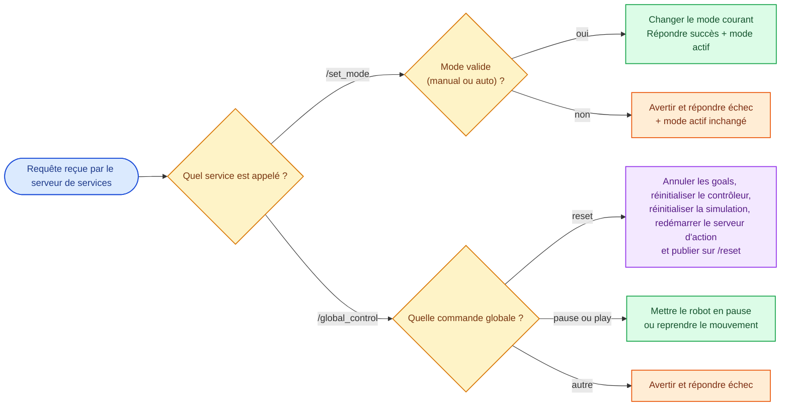
<!-- newpage -->

Côté client, voici le fonctionnement de `client_services.cpp` :

<!-- paysage : zoom = 85 -->
<!-- portrait : direction = TB, zoom = 57 -->
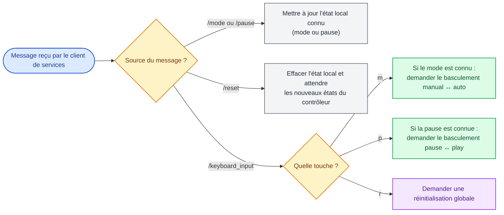

<!-- newpage -->

Voici les échanges du nœud `client_services.cpp` :

<!-- paysage : zoom = 90 -->
<!-- portrait : zoom = 100 -->


### 6.2 Navigation : serveur d'action

#### Choix fonctionnels

- Nous avons construit `TABDK/action/Move.action` autour des données vraiment utiles à notre robot. Nous avons choisi de ne pas garder le niveau de batterie dans l'action pour deux raisons :
  - il aurait été compliqué de faire des tests réalistes, car la simulation ne permet pas de faire varier facilement le niveau de batterie ;
  - nous ne trouvions pas utile d'ajouter un ralentissement en batterie faible, puisque nous avions déjà deux modes et une vitesse plafonnée même dans le mode le plus rapide.
  Nous avons préféré transmettre le `mode` courant et l'état de `pause`, qui servent directement à notre application :

<!-- code:TABDK/action/Move.action -->
```text
float64 position_x
float64 position_y
---
bool atteint
float64 temps_total            # ms, hors temps de pause
float64 distance_parcourue     # m
geometry_msgs/Pose2D position
---
geometry_msgs/Pose2D position
geometry_msgs/Twist vitesse
float64 distance_restante      # m
float64 temps_ecoule           # ms, hors temps de pause
string mode                    # "manual" ou "auto"
bool pause
```

- Pour ne pas bloquer le contrôleur dans une boucle d'exécution dédiée, nous utilisons `SimpleActionServer<MoveAction>` avec `registerGoalCallback` (`execute()`) et `registerPreemptCallback` (`preempter()`), et nous appelons `ServeurAction::step()` à chaque itération de `controleur.cpp`.
- Pour ne pas compter le temps de pause dans la durée du trajet, nous incrémentons `ticks_ecoules` dans `step()` uniquement quand `!modes->paused()`, puis nous le convertissons en millisecondes avec `params->ticksToMs()`.
- Nous avons déplacé l'affichage du suivi côté `client_action.cpp` pour garder les logs du contrôleur lisibles, avec `ROS_INFO_THROTTLE(1.0)`. Comme les feedbacks arrivent en continu, cela limite l'affichage à un message par seconde au lieu de noyer le terminal.

#### Première implémentation

Au départ, nous sommes partis des deux nœuds indépendants que vous nous aviez fournis (`nodes/serveur_action.cpp` et `nodes/client_action.cpp`), avec un fichier `Move.action` minimal (`pos_x`, `reached`, `pos_x_intermediaire`). Nous avons ajouté `Move.action` dans `add_action_files()` de `CMakeLists.txt`, compilé en deux temps (`cm`), puis testé ces deux nœuds séparément :

*Premier test réussi entre `serveur_action` (à gauche) et `client_action` (à droite) sur le robot.*

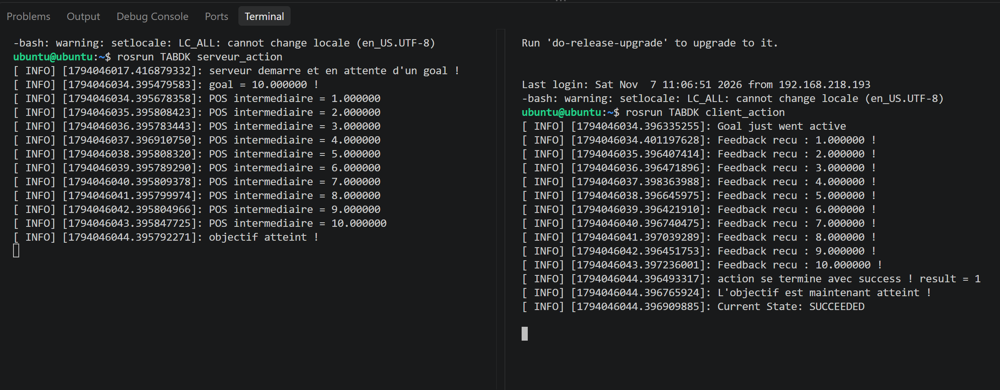

Nous avons ensuite pas mal adapté cet exemple de départ pour l'intégrer à notre architecture :

- Le serveur initial utilisait un callback `execute()` bloquant qui incrémentait un compteur `count` à 1 Hz jusqu'à `goal->pos_x` sans gérer la préemption. Nous l'avons remplacé par des callbacks non-bloquants (`execute()` et `preempter()`) et une méthode `step()` appelée dans la boucle du contrôleur.
- Nous avons remplacé les champs de test (`pos_x`, `pos_x_intermediaire`, `reached`) par des coordonnées 2D et de vraies données issues de `Odometry` (`position`, `vitesse`, `distance_parcourue`, `distance_restante`) et de `Modes` (`mode`, `pause`).
- Le serveur n'est plus un nœud à part mais la classe `ServeurAction` (`TABDK/src/serveur_action.cpp`), hébergée dans `controleur.cpp` et reliée à `Params`, `Mouvements`, `Modes`, `Odometry` et `States` pour piloter les waypoints.
- Le client initial utilisait un `boost::thread` séparé et des appels bloquants (`waitForServer()`, `waitForResult()`). Nous l'avons réécrit dans `client_action.cpp` autour d'une boucle unique `spinOnce()` qui gère aussi le clavier, `/mode`, `/reset` et `/robot_path`.

#### Difficultés rencontrées

- Après un reset ou la fin d'un goal, des feedbacks en retard continuaient parfois d'arriver côté client. Nous avons corrigé cela avec `goal_termine`, `stopTrackingGoal()` et `ROS_INFO_THROTTLE(1.0)`.
- Calculer la durée du trajet par différence d'horodatages comptait le temps passé en pause (manuelle ou à cause d'un obstacle). Le comptage par ticks actifs (`!modes->paused()`) a réglé ce problème.
- Lors d'un reset du robot (surtout avec `/gazebo/reset_simulation` qui remet l'horloge simulée à `0`), le goal était bien annulé mais le serveur d'action pouvait rester bloqué pour les goals suivants, car `actionlib` gardait en mémoire les dates des anciens goals. Nous avons ajouté `ServeurAction::reset()` et `ServeurAction::redemarrer()` pour annuler les objectifs puis recréer proprement le serveur après le reset de simulation.
- Comme `SimpleActionServer` n'a pas de constructeur par défaut, nous avons dû l'allouer dynamiquement, ajouter un destructeur et lier les callbacks membres avec `boost::bind` (voir la [section 9.4, Cas critique : intégration de ServeurAction](#94-cas-critique--intégration-de-serveuraction)).
- Nous remettons `states->target_active` à `false` dès qu'un goal est atteint pour qu'un changement de mode ne relance pas une ancienne cible.

#### Version finale

Dans notre version finale, la classe `ServeurAction` ([TABDK/src/serveur_action.cpp](https://github.com/benoitdekeyn/E4SE_TD_TP/blob/main/robotique_et_navigation/TABDK/src/serveur_action.cpp#L38-L145)) gère l'action `/moving` ([TABDK/action/Move.action](https://github.com/benoitdekeyn/E4SE_TD_TP/blob/main/robotique_et_navigation/TABDK/action/Move.action)) dans le contrôleur. Voici un schéma qui illustre ses échanges avec `controleur.cpp`, les autres classes et `client_action.cpp` :

<!-- paysage : zoom = 100 -->
<!-- portrait : direction = TB, zoom = 100 -->
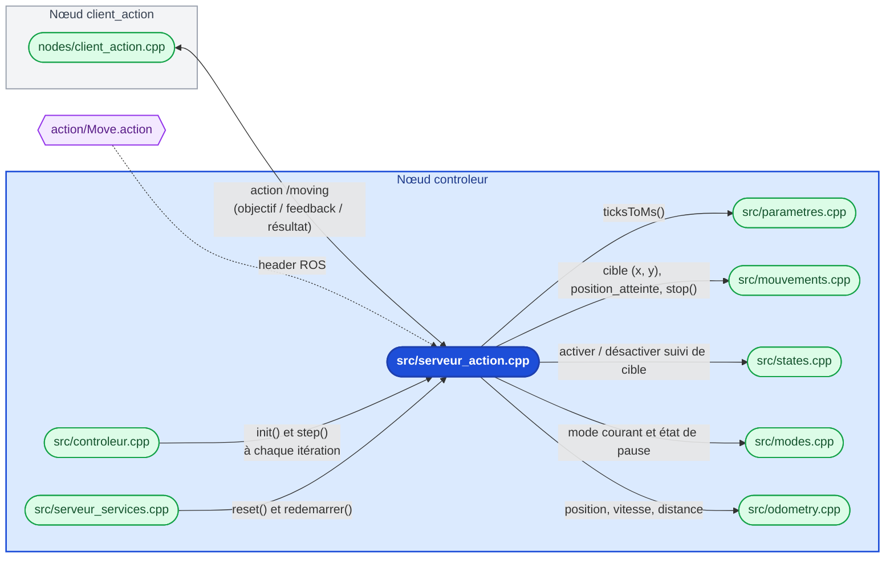

<!-- newpage -->

Voici le fonctionnement de `ServeurAction` selon l'événement reçu :

<!-- paysage : zoom = 100 -->
<!-- portrait : direction = TB, zoom = 100 -->
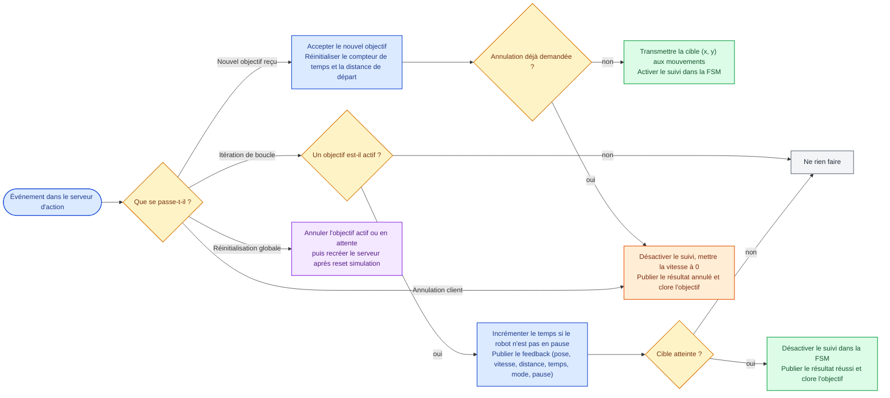

Les deux fonctions clés de réception et d'annulation d'objectif sont [`execute()`](https://github.com/benoitdekeyn/E4SE_TD_TP/blob/main/robotique_et_navigation/TABDK/src/serveur_action.cpp#L116-L131) et [`preempter()`](https://github.com/benoitdekeyn/E4SE_TD_TP/blob/main/robotique_et_navigation/TABDK/src/serveur_action.cpp#L134-L145) (la boucle de suivi et de publication des feedbacks se trouvant dans [`step()`](https://github.com/benoitdekeyn/E4SE_TD_TP/blob/main/robotique_et_navigation/TABDK/src/serveur_action.cpp#L63-L93)) :

- `execute()` est appelée quand `client_action.cpp` envoie un nouvel objectif sur `/moving`. Elle accepte l'objectif, remet le compteur de temps à zéro, mémorise la distance de départ, vérifie qu'aucune annulation immédiate n'a été demandée, puis transmet `(x, y)` à `Mouvements` et active `states->target_active`.
- `preempter()` est appelée quand le client annule l'objectif en cours (par exemple quand une nouvelle trajectoire arrive). Elle désactive `states->target_active`, met la vitesse à 0, calcule la distance et le temps partiels, puis clôture l'objectif avec `setPreempted(res)`.

Pendant le suivi d'un waypoint, [`feedbackCallback()`](https://github.com/benoitdekeyn/E4SE_TD_TP/blob/main/robotique_et_navigation/TABDK/src/nodes/client_action.cpp#L175-L191) dans `client_action.cpp` affiche un retour complet toutes les secondes grâce à `ROS_INFO_THROTTLE(1.0)` :

*Exemple de deux feedbacks consécutifs affichés à 1 seconde d'intervalle côté `client_action.cpp` (position, orientation, vitesses, distance restante, temps écoulé et mode).*

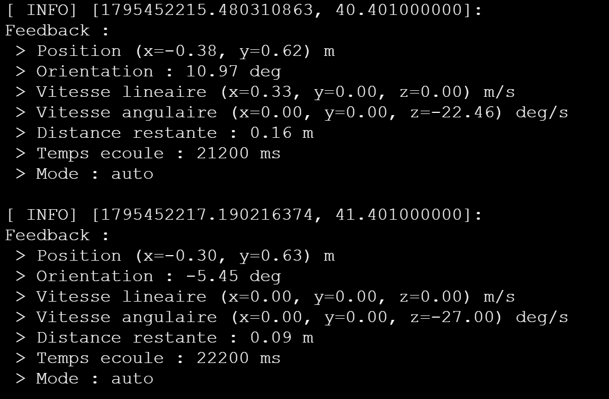

<!-- newpage -->

Enfin, lors d'un reset demandé au serveur de services, [`ServeurServices::resetRobot()`](https://github.com/benoitdekeyn/E4SE_TD_TP/blob/main/robotique_et_navigation/TABDK/src/serveur_services.cpp#L31-L42) suit un ordre précis pour éviter le blocage vu plus haut : elle annule d'abord les objectifs en cours ([`action_server->reset()`](https://github.com/benoitdekeyn/E4SE_TD_TP/blob/main/robotique_et_navigation/TABDK/src/serveur_action.cpp#L38-L53)), réinitialise `Modes` (vitesse à 0, mode et pause), remet la simulation et `/clock` à 0 (`/gazebo/reset_simulation`), recrée le serveur d'action ([`action_server->redemarrer()`](https://github.com/benoitdekeyn/E4SE_TD_TP/blob/main/robotique_et_navigation/TABDK/src/serveur_action.cpp#L56-L60)), puis publie sur `/reset` pour prévenir le TB3 réel et les clients ROS.

La capture ci-dessous montre cet enchaînement dans les logs : préemption de l'objectif en cours, réinitialisation du robot, reconnexion automatique au serveur `/moving` recréé, puis prise en charge immédiate d'une nouvelle trajectoire :

*Logs lors d'un reset : préemption (`PREEMPTED`), redémarrage du serveur `/moving`, puis réception et lancement d'une nouvelle trajectoire de 5 waypoints.*


### 6.3 Gestion des trajectoires : Path

#### Choix fonctionnels

- Nous avons regroupé la gestion des waypoints dans `client_action.cpp` autour d'un seul vecteur `std::vector<Pose2D> trajectoire` :
  - en mode `manual`, nous construisons la liste au clavier (flèches pour déplacer `waypoint_virtuel` par pas de `waypoint_step`, `w` pour ajouter, `x` pour vider la file en attente) ;
  - en mode `auto`, nous recevons un `nav_msgs/Path` sur `/robot_path` (publié par `path_generator`, voir la [section 7.2, Navigation à base de SLAM](#72-navigation-à-base-de-slam)). Quand une nouvelle trajectoire arrive pendant qu'une précédente est en cours, nous avons choisi de remplacer complètement l'ancienne trajectoire : `robotPathCallback()` appelle `resetClient()` (qui demande l'annulation du goal actif et vide `trajectoire`), puis copie la nouvelle liste.
- Comme `SimpleActionClient("moving", false)` partage `spinOnce()` avec nos callbacks clavier, `/reset` et `/robot_path`, nos callbacks n'appellent pas `cancelGoal()` directement. Ils lèvent un drapeau `annulation_demandee`, traité dans la boucle principale par `traiterAnnulation()`.
- Nous filtrons les entrées selon `/mode` : les touches clavier sont ignorées en mode `auto`, et les messages `/robot_path` sont ignorés en mode `manual`.

#### Première implémentation

Nous nous étions d'abord abonnés à `/trajectoire` (`nav_msgs/Path`). Nous extrayions les coordonnées `(x, y)` dans `trajectoire`, envoyions `trajectoire[0]` via `client.sendGoal(...)`, puis retirions le point dès que l'état passait à `SUCCEEDED`. Nous avons ensuite renommé le topic en `/robot_path` en le branchant sur `AStar-ROS` ([section 7.2, Navigation à base de SLAM](#72-navigation-à-base-de-slam)).

#### Difficultés rencontrées

- Au début, nos flèches gauche et droite incrémentaient `y` à l'envers par rapport au repère ROS (`+x` devant, `+y` à gauche). Nous avons corrigé le signe dans `keyboardCallback()`.
- Appeler `cancelGoal()` directement dans `resetCallback()` ou `robotPathCallback()` créait des conflits avec `spinOnce()`. Nous avons donc simplifié les callbacks et déplacé l'annulation dans `traiterAnnulation()`, appelée dans la boucle principale.
- Avant nos corrections sur la réinitialisation du serveur d'action ([section 6.2, Navigation : serveur d'action](#62-navigation--serveur-daction)), certains goals échouaient en cours de route. Nous avions ajouté un drapeau `sequence_blocked` pour ne pas enchaîner les points suivants après un échec, un cas qui n'est plus censé arriver en fonctionnement normal.

#### Version finale

Le nœud `client_action.cpp` ([`robotPathCallback()`](https://github.com/benoitdekeyn/E4SE_TD_TP/blob/main/robotique_et_navigation/TABDK/src/nodes/client_action.cpp#L94-L113), [`traiterAnnulation()`](https://github.com/benoitdekeyn/E4SE_TD_TP/blob/main/robotique_et_navigation/TABDK/src/nodes/client_action.cpp#L193-L200) et la [boucle principale](https://github.com/benoitdekeyn/E4SE_TD_TP/blob/main/robotique_et_navigation/TABDK/src/nodes/client_action.cpp#L231-L262)) envoie les waypoints un par un vers `/moving` (clavier en `manual`, `/robot_path` en `auto`), avec une attente non-bloquante du serveur ([`attendreServeur()`](https://github.com/benoitdekeyn/E4SE_TD_TP/blob/main/robotique_et_navigation/TABDK/src/nodes/client_action.cpp#L202-L213)).

Voici un schéma qui illustre le fonctionnement de `client_action.cpp` :

<!-- paysage : zoom = 100 -->
<!-- portrait : direction = TB, zoom = 100 -->
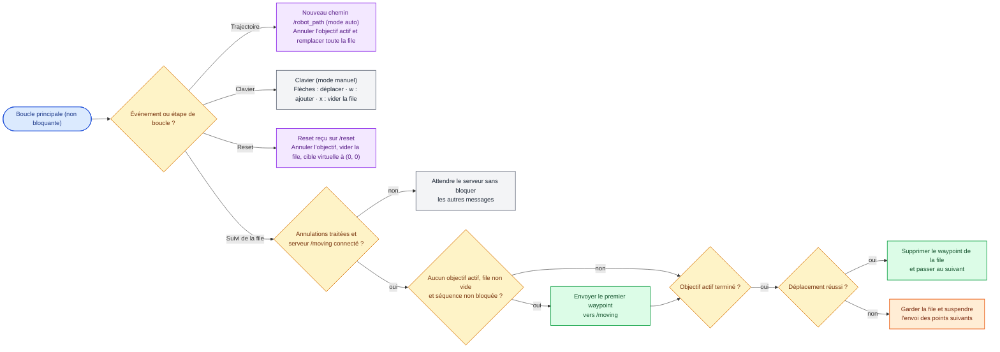
<!-- newpage -->

Lorsque le robot atteint un waypoint, [`doneCb()`](https://github.com/benoitdekeyn/E4SE_TD_TP/blob/main/robotique_et_navigation/TABDK/src/nodes/client_action.cpp#L156-L169) affiche le résultat final (temps total, distance parcourue, position et orientation) et la [boucle d'envoi](https://github.com/benoitdekeyn/E4SE_TD_TP/blob/main/robotique_et_navigation/TABDK/src/nodes/client_action.cpp#L238-L259) enchaîne aussitôt avec le waypoint suivant de la file :

*Logs lors de l'atteinte d'un waypoint, suivie immédiatement de l'envoi et de l'activation du waypoint suivant.*

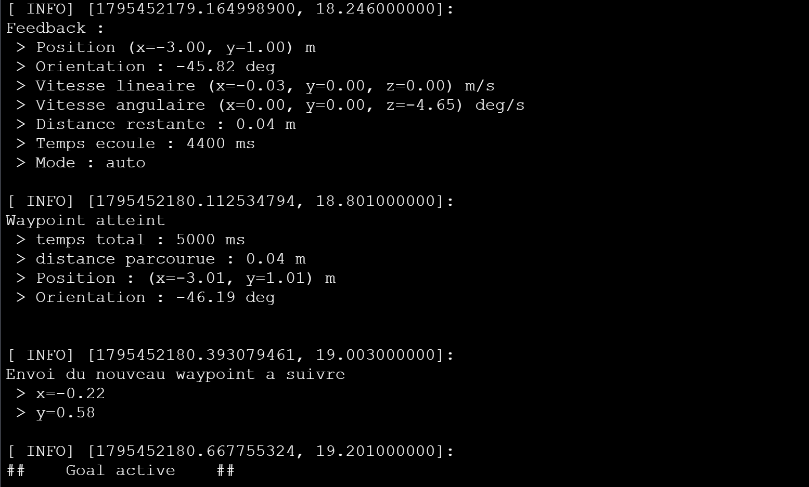

Voici un schéma qui illustre les échanges de `client_action.cpp` :

<!-- paysage : zoom = 90 -->
<!-- portrait : zoom = 100 -->


## 7. Planification de trajectoire : SLAM

### 7.1 SLAM (Cartographie et Localisation simultanées)

#### Choix fonctionnels

- Pour simplifier nos tests répétés en simulation comme sur le robot réel, nous avons écrit le script `tabdk.sh` à la racine du projet. Il ajoute sans doublon dans `~/.bash_aliases` nos raccourcis de compilation et de lancement (`cm`, `slam`, `teleop`, `robot_vide`, `robot_maison`, `astar`, `tabdk`, `tabdk_rviz`), source le workspace catkin et installe automatiquement les paquets nécessaires sur TheConstructSim ([section 1.1, Simulation en ligne : TheConstructSim](#11-simulation-en-ligne--theconstructsim)) :

<!-- code:tabdk.sh -->
```bash
add_alias 'alias cm="cd ~/catkin_ws && catkin_make && source devel/setup.bash && cd"'
add_alias 'alias slam="roslaunch turtlebot3_slam turtlebot3_slam.launch"'
add_alias 'alias teleop="roslaunch turtlebot3_teleop turtlebot3_teleop_key.launch"'
add_alias 'alias astar="roslaunch path_generator run.launch"'
add_alias 'alias tabdk="roslaunch TABDK run.launch"'
add_alias 'alias tabdk_rviz="roslaunch TABDK rviz_tb3.launch"'

source ~/catkin_ws/devel/setup.bash 2>/dev/null
sudo apt-key adv --keyserver hkp://keyserver.ubuntu.com:80 --recv-key F42ED6FBAB17C654
sudo apt update
sudo apt install -y ros-noetic-turtlebot3-navigation ros-noetic-turtlebot3-slam
```

- Nous avons rangé nos cartes dans `AStar-ROS/map/` pour passer facilement de la simulation au labyrinthe réel dans `AStar-ROS/launch/run.launch`.

#### Première implémentation

Nous avons d'abord passé environ 30 minutes à cartographier un environnement personnalisé en simulation (`map_simu_tabdk`, en plus de `map_tb3_house`), puis nous avons enregistré la grille avec `map_saver` :

*Cartographie SLAM en simulation sur TheConstructSim : construction de la carte dans RViz (à gauche), environnement Gazebo (au centre) et téléopération au clavier (à droite).*


Nous avons ensuite cartographié le labyrinthe physique de la salle 4105 (`map_4105`, puis `map_4105_00` à partir d'un point de départ repéré au sol).

#### Difficultés rencontrées

- Sur TheConstructSim, `ros-noetic-turtlebot3-slam` et `ros-noetic-turtlebot3-navigation` n'étaient pas préinstallés et disparaissaient entre deux sessions, et `apt` refusait de les télécharger faute de clé GPG ROS valide. Nous avons réglé ça en mettant `apt-key adv`, `apt update` et `apt install` directement dans `tabdk.sh`.
- En simulation, RViz se lançait normalement, mais sur le robot réel nous n'arrivions pas à l'ouvrir depuis VS Code. Nous avons vu que cela marchait dans MobaXterm parce qu'un serveur X y tournait déjà pour l'affichage graphique. Nous avons donc ajouté un serveur X à notre environnement VS Code pour ouvrir RViz sur le robot réel.
- Lorsque nous avons sauvegardé la première carte directement sur le robot, elle n'existait pas encore dans notre dossier local. À la synchronisation suivante depuis VS Code, la carte sur le robot a été écrasée. Ensuite, nous avons pris l'habitude de copier les cartes du robot vers notre PC avant de modifier le code.
- Sans point de départ précis lors du SLAM, le repère de la carte ne correspondait plus à l'odométrie du robot au moment de la navigation (nous détaillons ce point dans la [section 7.2, Navigation à base de SLAM](#72-navigation-à-base-de-slam)).

#### Version finale

Nous disposons dans `AStar-ROS/map/` de cartes validées pour la simulation et pour la salle 4105, avec `map_4105_00.pgm` et `map_4105_00.yaml` faites à partir d'un repère physique au sol en `(0, 0)` et chargées par défaut dans [AStar-ROS/launch/run.launch](https://github.com/benoitdekeyn/E4SE_TD_TP/blob/main/robotique_et_navigation/AStar-ROS/launch/run.launch#L13), ainsi que notre script [tabdk.sh](https://github.com/benoitdekeyn/E4SE_TD_TP/blob/main/robotique_et_navigation/tabdk.sh#L1-L29).

*Visualisation dans RViz du labyrinthe de la salle 4105 (`map_4105_00`) avec le TurtleBot3 positionné sur la carte et nos marqueurs LiDAR alignés sur les parois réelles.*


### 7.2 Navigation à base de SLAM

#### Choix fonctionnels

- Nous sommes partis du package `AStar-ROS` fourni dans l'énoncé (`path_generator`). Nous l'avons relié à notre nœud `client_action` ([section 6.3, Gestion des trajectoires : Path](#63-gestion-des-trajectoires--path)) via `/robot_path` et nous avons ajouté une config RViz dédiée (`AStar-ROS/rviz/turtlebot3_navigation_tabdk.rviz`).
- Pour éviter que le robot ne rase les murs et les coins, nous avons ajouté le paramètre `ecart_obstacle` dans `AStar-ROS/config/params.yaml` (`4` cases, soit 20 cm pour une résolution de 5 cm).
- Sur certaines cartes de simulation, l'algorithme A\* fourni n'arrivait pas à trouver de chemin, par exemple quand il devait contourner une porte puis repartir dans une autre direction. Nous avons demandé de l'aide à l'IA pour améliorer `a_star.cpp` sur ces cas plus complexes. Nous précisons que nous ne maîtrisons pas en détail les modifications internes produites par l'IA dans ce fichier.
- Nous avons aussi vu deux limites concrètes sur la trajectoire du A\* initial, qui travaille sur une grille de 5 cm :
  1. il générait parfois un waypoint tous les 5 cm. Même si le passage d'un point au suivant était rapide, notre asservissement proportionnel ralentissait le robot à chaque cible, ce qui donnait un déplacement saccadé ;
  2. le chemin faisait souvent des angles droits en escalier alors qu'un segment direct en diagonale passait sans obstacle.
  Nous avons donc défini ce que nous voulions (repérer les segments directs sans obstacle et réduire au maximum le nombre de waypoints en gardant notre marge `ecart_obstacle`), puis nous avons guidé l'IA pour l'implémenter dans `path_simplifier.cpp`.

*Trajectoire générée par l'A\* initial : chemin en escalier composé d'angles droits et passant très près du coin central.*


- La solution générée avec l'IA dans `path_simplifier.cpp` utilise un BFS (parcours en largeur) pour trouver, parmi les points visibles en ligne droite sans obstacle, le chemin qui demande le moins de segments jusqu'à l'arrivée :

<!-- paysage : zoom = 95 -->
<!-- portrait : direction = TB, zoom = 86 -->
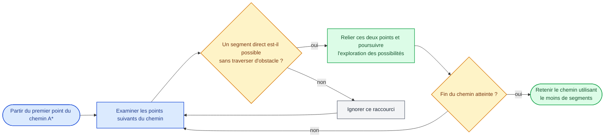

- Comme A\* ne connaît que la carte statique, la gestion des obstacles dynamiques est assurée en temps réel par notre évitement d'obstacles ([section 8, Évitement d'obstacles](#8-évitement-dobstacles)).

#### Première implémentation

Nous avons d'abord importé le package `AStar-ROS` brut (`map_server`, `amcl`, `rviz`, `path_generator`) et relié son topic `/robot_path` à notre nœud `client_action.cpp`.

#### Difficultés rencontrées

- Face aux blocages du A\* d'origine sur certains contournements et aux saccades liées aux waypoints espacés de 5 cm, nous avons mis en place `ecart_obstacle`, l'amélioration de `a_star.cpp` et le lissage dans `path_simplifier.cpp` avec l'aide de l'IA. Nous aurions aimé creuser davantage ces algorithmes pour bien maîtriser tous leurs détails internes, mais nous manquions de temps et nous étions déjà en retard sur le projet. Nous avons donc privilégié une solution qui fonctionne en guidant l'IA sur le résultat attendu.
- Pendant la mise en place de la navigation, nous avons aussi eu des erreurs de transformation dans RViz (`No transform from [base_footprint/base_scan] to [map]`) qui nous arrivaient régulièrement de manière aléatoires. Nous devions souvent arrêter et relancer le launch de AStar-ROS pour que la transformation soit correctement publiée :

*Exemple d'erreurs de transformation rencontrées dans RViz (`No transform ... to [map]`) sur `RobotModel` et `LaserScan`.*

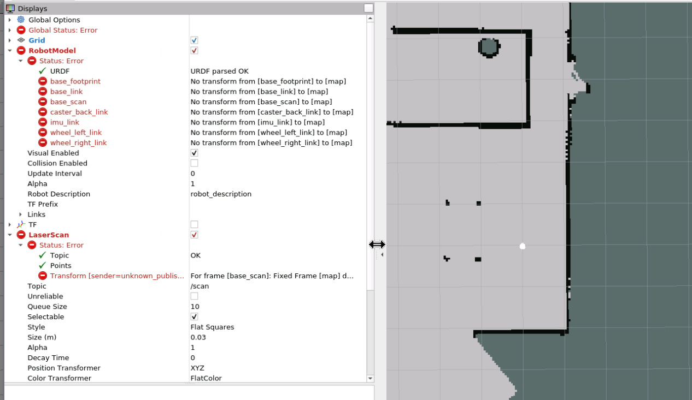

- En simulation, en voyant où le robot apparaissait dans RViz, nous avons d'abord cru qu'il apparaissait dans le carré vert visible dans Gazebo. En cherchant plus loin et en affichant les axes dans Gazebo, nous avons compris que ce carré vert correspondait simplement au soleil de Gazebo, placé en `(0, 0)` en 2D. En comparant ensuite Gazebo et RViz, nous avons mesuré un décalage exact de 3 carreaux en longueur et 1 carreau en largeur (chaque carreau faisant 1 m) : Gazebo faisait en réalité apparaître le robot en `x = -3.0` m et `y = 1.0` m. Nous avons donc réglé la pose initiale d'AMCL (`initial_pose_x = -3.0`, `initial_pose_y = 1.0`, `initial_pose_a = 0.0`) dans `AStar-ROS/launch/run.launch` pour placer le robot au bon endroit dès le démarrage, sans devoir refaire `2D Pose Estimate` à chaque lancement.

| Le carré vert dans Gazebo : le soleil placé en `(0, 0)` (le robot est plus bas) | Robot affiché par erreur sur la position du soleil dans RViz |
| :---: | :---: |
|  | 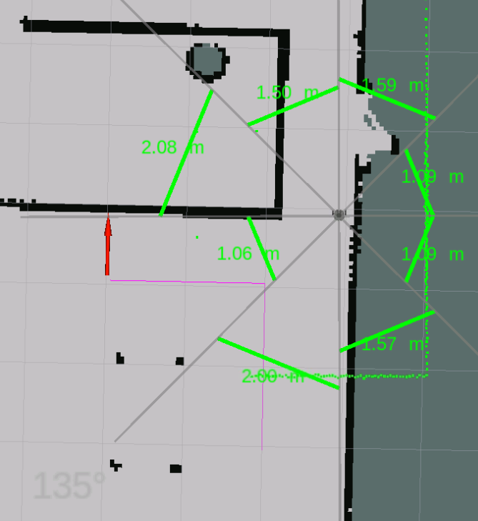 |

*Comparaison entre Gazebo (à gauche) et RViz (à droite) ayant permis de mesurer le décalage et de régler AMCL.*

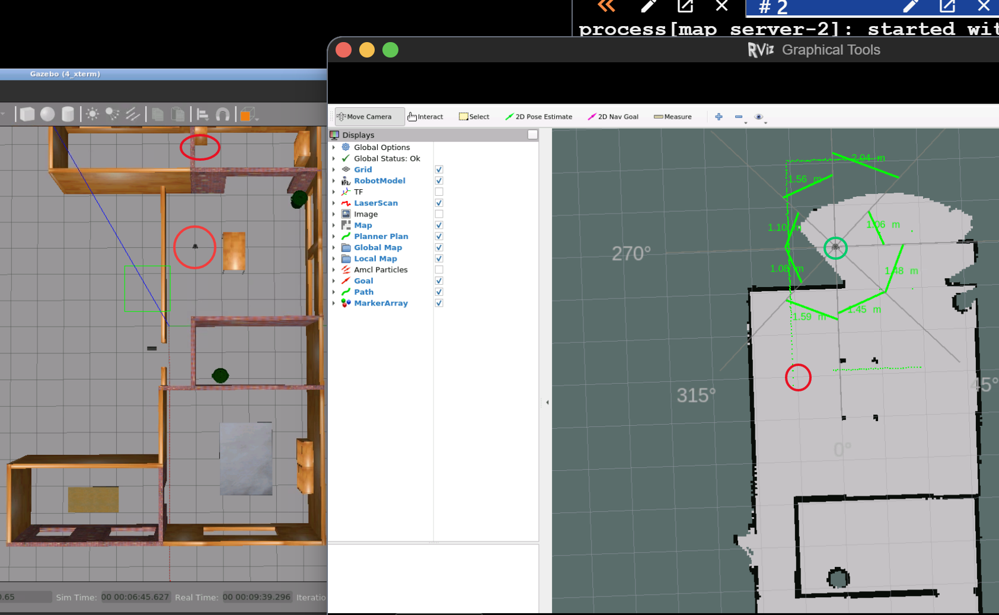

- Sur le labyrinthe physique, `2D Pose Estimate` ne suffisait pas et le robot se décalait en suivant la trajectoire du `2D Nav Goal`. Dans `path_generator.cpp` ([`odomCallback()`](https://github.com/benoitdekeyn/E4SE_TD_TP/blob/main/robotique_et_navigation/AStar-ROS/src/path_generator.cpp#L142-L148)), la position de départ pour A\* vient directement de `/odom` (et non d'AMCL). Cela nous a aidés à repérer l'erreur pendant les essais, car nous pouvions comparer dans RViz la position odométrique réelle du robot au comportement attendu. Après échange avec vous, nous avons suivi une procédure fiable sur le terrain :
  1. placer le robot sur un repère au sol et faire un reset du robot (et donc de son odométrie) pour aligner l'origine `/odom` sur l'origine `(0, 0)` de la carte dans RViz ;
  2. ajuster à la main la position du robot sur le marquage, sans utiliser `2D Pose Estimate`, jusqu'à ce qu'il apparaisse sur l'origine RViz après un reset.
  Pendant nos essais sur le robot réel, nous avions mis la pose initiale du lancement à `(0, 0, 0)`.

#### Version finale

Dans notre version finale, nous avons personnalisé [AStar-ROS/launch/run.launch](https://github.com/benoitdekeyn/E4SE_TD_TP/blob/main/robotique_et_navigation/AStar-ROS/launch/run.launch#L13-L37) sur trois points : le choix de la carte (`map_file`) et le chargement de `ecart_obstacle`, la pose initiale d'AMCL (`initial_pose_x`, `initial_pose_y`, `initial_pose_a`) pour éviter d'utiliser `2D Pose Estimate` à chaque lancement, et notre config RViz ([`turtlebot3_navigation_tabdk.rviz`](https://github.com/benoitdekeyn/E4SE_TD_TP/blob/main/robotique_et_navigation/AStar-ROS/rviz/turtlebot3_navigation_tabdk.rviz)) pour retenir nos affichages et leurs topics (`Goal` sur `/move_base_simple/goal`, `Path` sur `/robot_path`, `MarkerArray` sur `/obstacles_markers`, en plus de `/map` et `/scan`) :

*Extrait de configuration finale dans `AStar-ROS/launch/run.launch` pour la simulation sur TheConstructSim par exemple :*
<!-- code:AStar-ROS/launch/run.launch -->
```xml
<!-- Carte chargée et paramètre ecart_obstacle -->
<arg name="map_file" default="$(find path_generator)/map/map_simu_tabdk.yaml"/>
<arg name="open_rviz" default="true"/>
<rosparam command="load" file="$(find path_generator)/config/params.yaml" />
...
<!-- Pose initiale AMCL pour éviter 2D Pose Estimate à chaque lancement -->
<include file="$(find turtlebot3_navigation)/launch/amcl.launch">
  <arg name="initial_pose_x" value="-3.0"/>
  <arg name="initial_pose_y" value="1.0"/>
  <arg name="initial_pose_a" value="0.0"/>
</include>

<!-- Configuration RViz personnalisée (affichages et topics sauvegardés) -->
<group if="$(arg open_rviz)">
  <node pkg="rviz" type="rviz" name="rviz" required="true"
        args="-d $(find path_generator)/rviz/turtlebot3_navigation_tabdk.rviz"/>
</group>
```

<!-- newpage -->

Voici un schéma qui illustre comment nous relions `AStar-ROS` amélioré ([AStar-ROS/config/params.yaml](https://github.com/benoitdekeyn/E4SE_TD_TP/blob/main/robotique_et_navigation/AStar-ROS/config/params.yaml), [AStar-ROS/src/a_star.cpp](https://github.com/benoitdekeyn/E4SE_TD_TP/blob/main/robotique_et_navigation/AStar-ROS/src/a_star.cpp#L78-L199), [AStar-ROS/src/path_simplifier.cpp](https://github.com/benoitdekeyn/E4SE_TD_TP/blob/main/robotique_et_navigation/AStar-ROS/src/path_simplifier.cpp#L9-L94), [AStar-ROS/src/path_generator.cpp](https://github.com/benoitdekeyn/E4SE_TD_TP/blob/main/robotique_et_navigation/AStar-ROS/src/path_generator.cpp#L72-L148)) à `TABDK` :

<!-- paysage : zoom = 100 -->
<!-- portrait : direction = TB, zoom = 60 -->
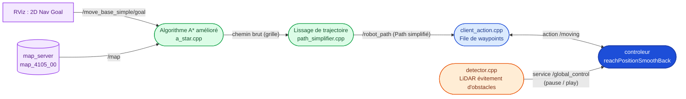

Le robot planifie son itinéraire depuis RViz (`2D Nav Goal`) et suit une trajectoire simplifiée loin des murs (et l'arrêt devant tout obstacle dynamique est assuré par notre système décrit en [section 8, Évitement d'obstacles](#8-évitement-dobstacles)) :

*Navigation complète en simulation : trajectoire lissée à grands segments directs (diagonale incluse) passant par la porte, avec détection LiDAR en temps réel dans RViz.*

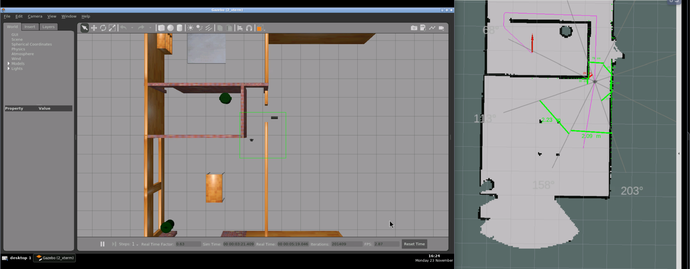

## 8. Évitement d'obstacles

#### Choix fonctionnels

- Nous avons choisi d'intégrer l'évitement d'obstacles directement dans `detector.cpp` ([section 5, Perception de l'environnement à l'aide du LiDAR](#5-perception-de-lenvironnement-à-laide-du-lidar)), qui calcule déjà la distance minimale dans chacune des huit régions autour du robot (région 0 à l'avant, région 4 à l'arrière).
- Plutôt que d'utiliser uniquement une distance fixe à garder devant un obstacle, nous calculons un « temps avant collision ». L'avantage est que la distance de sécurité s'adapte naturellement à la vitesse du robot :
  - si le robot avance très lentement, il peut se rapprocher davantage d'un obstacle avant de s'arrêter, sans déclencher d'alerte inutile ;
  - à l'inverse, s'il avance vite, il s'arrête plus loin pour un même délai avant collision.
  Il suffit donc de ralentir pour pouvoir naviguer proche de certains obstacles.
- Comme notre asservissement `reachPositionSmoothBack()` ([section 4.3.2, Navigation vers un but](#432-navigation-vers-un-but)) peut faire reculer le robot, nous avons abonné `detector.cpp` à `/cmd_vel` ([`cmdVelCallback()`](https://github.com/benoitdekeyn/E4SE_TD_TP/blob/main/robotique_et_navigation/TABDK/src/nodes/detector.cpp#L235-L237)) pour connaître la vitesse linéaire commandée et surveiller uniquement le côté vers lequel le robot se déplace (`REGION_FACE` si `linear_speed > 0,001`, `REGION_DOS` si `linear_speed < -0,001`). Nous retranchons aussi le gabarit du robot (`debut_collision_face` et `debut_collision_dos`, réglés à 12 cm dans [TABDK/config/params.yaml](https://github.com/benoitdekeyn/E4SE_TD_TP/blob/main/robotique_et_navigation/TABDK/config/params.yaml#L21-L23)) à la distance minimale mesurée depuis le centre du LiDAR, pour qu'un délai de 0 corresponde à un obstacle qui touche le bord extérieur du robot et non son centre :
  $$t_{\text{collision}} = \frac{|d_{\min} - d_{\text{gabarit}}|}{|v|} \times 1000 \text{ (ms)}$$
- Plutôt que de publier sur `/cmd_vel` en concurrence avec le contrôleur, nous utilisons le service `/global_control` ([section 6.1, Configuration à la volée du comportement du robot : service](#61-configuration-à-la-volée-du-comportement-du-robot--service)) via [`callGlobalControl()`](https://github.com/benoitdekeyn/E4SE_TD_TP/blob/main/robotique_et_navigation/TABDK/src/nodes/detector.cpp#L317-L328) pour mettre le robot en pause puis le relancer, sans connaître ni changer le mode actif (`manual` ou `auto`). Quand le délai passe sous `delay_collision`, nous envoyons `"pause"` et mémorisons la distance de l'obstacle (`distance_to_last_obstacle`) ainsi que le côté concerné (`was_obstacle_on_back`). Dès que la distance mesurée de ce côté repasse au-dessus de `distance_to_last_obstacle`, nous envoyons `"play"`.
- Pour ne jamais annuler une pause demandée manuellement au clavier ou par service, `detector.cpp` écoute aussi `/pause` ([`pauseCallback()`](https://github.com/benoitdekeyn/E4SE_TD_TP/blob/main/robotique_et_navigation/TABDK/src/nodes/detector.cpp#L239-L241)) et distingue `robot_pause` de `collision_pause`.
- Nous n'avons pas développé de contournement automatique d'obstacles : comme A\* ne connaît que la carte statique du SLAM ([section 7.2, Navigation à base de SLAM](#72-navigation-à-base-de-slam)), notre système interrompt simplement le déplacement devant tout obstacle imprévu (en mode manuel comme en autonome), puis reprend quand la voie se libère. Cela permet aussi au robot de suivre un obstacle lent tout en gardant sa distance de sécurité, comme nous l'avons montré pendant la démo.

#### Difficultés rencontrées

- Au début, nous appelions `"play"` dès que le délai repassait au-dessus du seuil, ce qui annulait une pause manuelle. Nous avons réglé cela en écoutant `/pause` et en ne relançant le robot que si la pause venait d'un obstacle (`robot_pause && collision_pause`).
- En marche arrière, le robot saccadait entre pause et reprise parce que nous ne passions pas `was_obstacle_on_back` à `true` et que nous le remettions à `false` trop tôt.
- Comme le LiDAR mesure depuis le centre du robot, nous avons retranché les 12 cm de « carrosserie » (`debut_collision_face` et `debut_collision_dos`) et rendu `delay_collision` configurable dans `config/params.yaml`. D'après nos essais, ces 12 cm correspondent d'ailleurs à la distance minimale à partir de laquelle les mesures du LiDAR deviennent fiables.
- Au départ, la boucle lente à 1 Hz de `detector.cpp` rendait la réaction face aux obstacles trop tardive ; en passant le nœud sur `spin()` ([`main()`](https://github.com/benoitdekeyn/E4SE_TD_TP/blob/main/robotique_et_navigation/TABDK/src/nodes/detector.cpp#L243-L264)), [`prevent_collision()`](https://github.com/benoitdekeyn/E4SE_TD_TP/blob/main/robotique_et_navigation/TABDK/src/nodes/detector.cpp#L330-L377) est appelée à chaque nouveau scan reçu sur `/scan`.

#### Version finale

Dans la version finale, [`prevent_collision()`](https://github.com/benoitdekeyn/E4SE_TD_TP/blob/main/robotique_et_navigation/TABDK/src/nodes/detector.cpp#L330-L377) est exécutée dans [`scanCallback()`](https://github.com/benoitdekeyn/E4SE_TD_TP/blob/main/robotique_et_navigation/TABDK/src/nodes/detector.cpp#L203-L233) à chaque scan LiDAR, avec les seuils chargés depuis [TABDK/config/params.yaml](https://github.com/benoitdekeyn/E4SE_TD_TP/blob/main/robotique_et_navigation/TABDK/config/params.yaml#L21-L23) (`delay_collision`, `debut_collision_face`, `debut_collision_dos`). Voici un schéma qui résume sa logique :

<!-- paysage : zoom = 100 -->
<!-- portrait : direction = TB, zoom = 100 -->
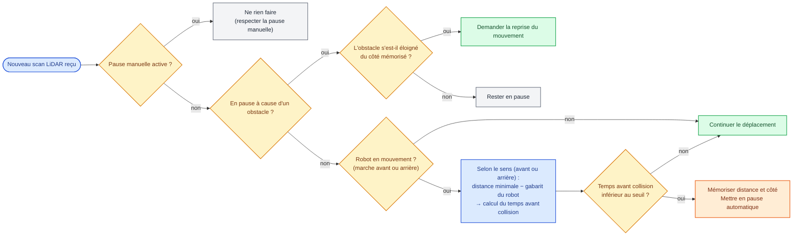

## 9. Passage d'un fichier controleur.cpp à un découpage en classes

### 9.1 Motivation et étapes du découpage

Dans l'énoncé, il n'était pas demandé de découper le code en classes distinctes. Au début du projet ([section 3, Pilotage de base et paramétrage du TB3](#3-pilotage-de-base-et-paramétrage-du-tb3) et [section 4, Contrôle et navigation du TB3](#4-contrôle-et-navigation-du-tb3)), tout notre code tenait dans un seul fichier `controleur.cpp`, qui a fini par dépasser 700 lignes (variables globales, callbacks ROS, calculs trigonométriques, odométrie, clavier, modes, FSM et asservissements). Dès que nous avons ajouté les services puis le serveur d'action, ce fichier unique est devenu difficile à lire et à faire évoluer.

Nous avons donc réorganisé le contrôleur en classes distinctes pour éviter les variables globales et rendre les dépendances claires via les attributs de chaque classe. Nous avons fait cette migration en trois étapes :

1. Nous avons extrait les fonctions de base dans `calculs.cpp`, `parametres.cpp` (`Params`), `odometry.cpp` (`Odometry`), `mouvements.cpp` (`Mouvements`) et un fichier temporaire `clavier.cpp`.
2. Nous avons déplacé les serveurs ROS dans `serveur_services.cpp` (`ServeurServices`) et `serveur_action.cpp` (`ServeurAction`), et sorti le clavier du contrôleur vers `client_services.cpp` et `client_action.cpp` ([section 4.2, Mode navigation manuelle](#42-mode-navigation-manuelle)).
3. Nous avons découpé le reste de `controleur.cpp` en `Modes` (`modes.cpp`) et `States` (`states.cpp`). Le fichier [TABDK/src/controleur.cpp](https://github.com/benoitdekeyn/E4SE_TD_TP/blob/main/robotique_et_navigation/TABDK/src/controleur.cpp#L1-L90) ne contient plus que la création des objets, leur initialisation et la boucle principale.

### 9.2 Organisation des fichiers `.cpp` et namespaces

Nous avons choisi de garder nos classes directement dans des fichiers `.cpp`, plutôt que de multiplier les fichiers `.h`. Cela garde une organisation simple, adaptée à la taille du projet, avec quelques fichiers dans `TABDK/src/` ayant chacun un rôle précis.

Chaque fichier a une garde d'inclusion (`#ifndef ..._CPP` / `#define ..._CPP` / `#endif`), et nous les incluons dans [TABDK/src/controleur.cpp](https://github.com/benoitdekeyn/E4SE_TD_TP/blob/main/robotique_et_navigation/TABDK/src/controleur.cpp#L8-L15) dans l'ordre de leurs dépendances (`calculs.cpp`, `parametres.cpp`, `odometry.cpp`, `mouvements.cpp`, `states.cpp`, `modes.cpp`, `serveur_action.cpp`, `serveur_services.cpp`).

Comme ça, les nœuds de `TABDK/src/nodes/` peuvent aussi réutiliser `parametres.cpp`, `calculs.cpp` ou `modes.cpp` sans configurer de bibliothèque CMake supplémentaire.

### 9.3 Fonction `init()` et accès par pointeurs

En ROS C++, nous ne pouvons créer un `Publisher`, un `Subscriber`, un `ServiceServer` ou un `SimpleActionServer` qu'après `ros::init()` et la création du `ros::NodeHandle`. Nous avons donc suivi deux règles dans [TABDK/src/controleur.cpp](https://github.com/benoitdekeyn/E4SE_TD_TP/blob/main/robotique_et_navigation/TABDK/src/controleur.cpp#L41-L75) :

1. Chaque classe a un constructeur par défaut neutre et une méthode `init(...)` que nous appelons dans `main()` dans l'ordre des dépendances (`Params::load` → `Odometry` → `Mouvements` → `States` → `Modes` → `ServeurAction` → `ServeurServices`).
2. Nous créons toutes les instances dans `main()`, donc elles existent pendant toute l'exécution. Chaque classe reçoit dans `init(...)` les objets dont elle dépend et garde leur adresse (`Params *`, `Odometry *`, `Mouvements *`, `Modes *`, `States *`). Rien n'est recopié : une mise à jour de `odometry.position` ou de `mouvements.position_atteinte` est tout de suite visible par les autres classes.

### 9.4 Cas critique : intégration de `ServeurAction`

Le passage en classes a demandé quelques adaptations pour les callbacks ROS, surtout dans `ServeurAction` ([TABDK/src/serveur_action.cpp](https://github.com/benoitdekeyn/E4SE_TD_TP/blob/main/robotique_et_navigation/TABDK/src/serveur_action.cpp#L17-L146)), qui communique avec cinq autres classes et le `NodeHandle` :

- Contrairement à une fonction globale, une méthode de classe doit être liée à son instance `this` :
  - `nh.subscribe("/odom", 100, &Odometry::odomCallback, this)` dans [`Odometry::init()`](https://github.com/benoitdekeyn/E4SE_TD_TP/blob/main/robotique_et_navigation/TABDK/src/odometry.cpp#L22-L24) ;
  - `nh.advertiseService("/set_mode", &ServeurServices::setModeCallback, this)` dans [`ServeurServices::init()`](https://github.com/benoitdekeyn/E4SE_TD_TP/blob/main/robotique_et_navigation/TABDK/src/serveur_services.cpp#L18-L29) ;
  - `server->registerGoalCallback(boost::bind(&ServeurAction::execute, this))` et `registerPreemptCallback(boost::bind(&ServeurAction::preempter, this))` dans [`ServeurAction::demarrer()`](https://github.com/benoitdekeyn/E4SE_TD_TP/blob/main/robotique_et_navigation/TABDK/src/serveur_action.cpp#L108-L113).
- Contrairement à un `Publisher` ou un `Subscriber`, `actionlib::SimpleActionServer<MoveAction>` n'a pas de constructeur par défaut et demande un `NodeHandle` dès sa création. Pour garder notre méthode `init()`, nous l'avons stocké en pointeur (`Server *server = nullptr`), alloué dans [`demarrer()`](https://github.com/benoitdekeyn/E4SE_TD_TP/blob/main/robotique_et_navigation/TABDK/src/serveur_action.cpp#L108-L113) et libéré dans le destructeur [`~ServeurAction()`](https://github.com/benoitdekeyn/E4SE_TD_TP/blob/main/robotique_et_navigation/TABDK/src/serveur_action.cpp#L33-L35).
- Cette allocation dynamique nous a aussi permis d'écrire [`redemarrer()`](https://github.com/benoitdekeyn/E4SE_TD_TP/blob/main/robotique_et_navigation/TABDK/src/serveur_action.cpp#L56-L60) (`delete server; demarrer();`), appelé par `ServeurServices::resetRobot()` ([section 6.2, Navigation : serveur d'action](#62-navigation--serveur-daction)) pour débloquer le serveur d'action après un reset.

### 9.5 Conduite du refactoring

Cette séparation en classes a représenté un gros travail. Après plusieurs heures de réflexion et de tests, nous avons utilisé une IA pour nous aider à refactoriser le code. Nous lui avons demandé de limiter les changements au strict nécessaire et de garder autant que possible nos fichiers et leur organisation. Nous avons vérifié chaque modification pour conserver la logique de notre code d'origine, tout en obtenant une structure claire et un découpage en classes adapté au projet.