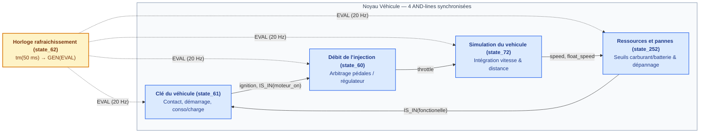
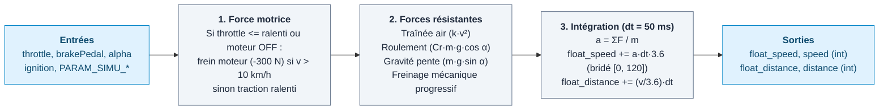
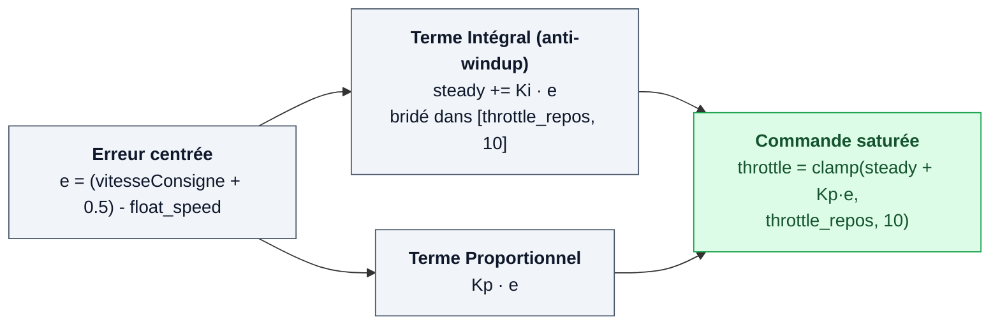
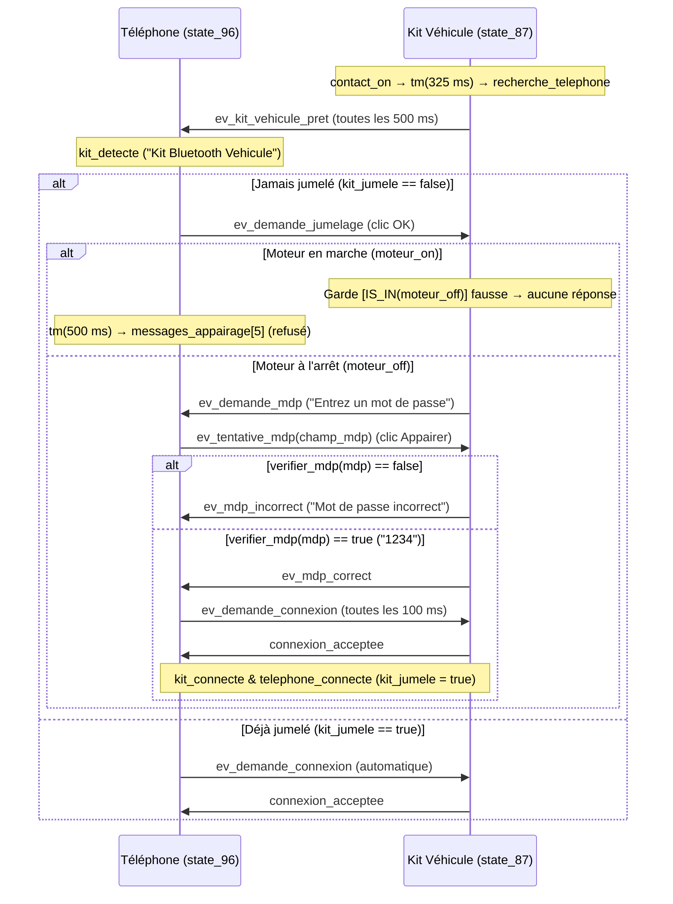
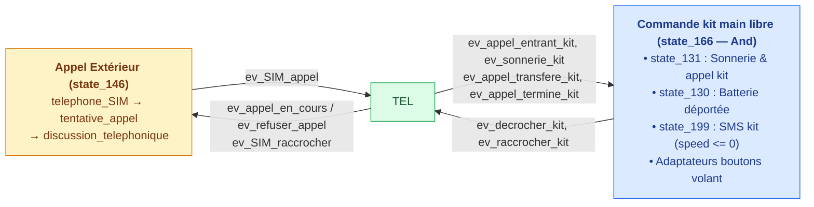
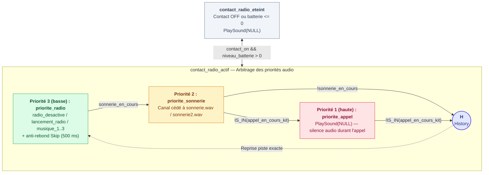
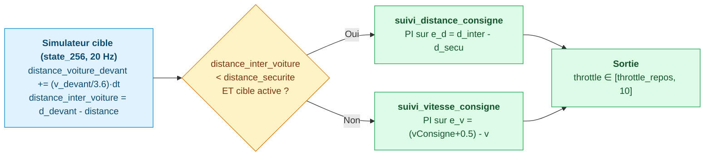
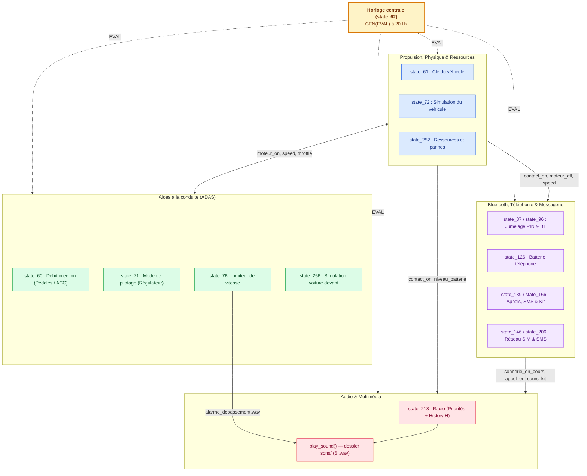

# Rapport de Projet — Systèmes Embarqués Automobiles
## Régulateur-Limiteur de Vitesse, Kit Mains-Libres Bluetooth, Autoradio et Régulateur Adaptatif

**Établissement :** ESIEE Paris — Université Gustave Eiffel (Département DISC)  
**Encadrants :** R. Hamouche / M. Dridi  
**Auteurs :** Benoît de Keyn, Thibault *[Nom]*  
**Date :** 22/11/2026  
**Projet Rhapsody :** `Projet_TABDK_E4SE` (`IBM Engineering Systems Design Rhapsody v9.0.2` — Statecharts, Panel Diagram & Génération C++ OXF)

---

## Table des matières

1. [Introduction générale](#1-introduction-générale)
2. [Modélisation et simulation du véhicule](#2-modélisation-et-simulation-du-véhicule)
   - [2.1 Architecture globale en AND-lines, synchronisation `EVAL` et interfaces](#21-architecture-globale-en-and-lines-synchronisation-eval-et-interfaces)
   - [2.2 Dynamique du véhicule et primitives de simulation (`Simulation du vehicule`)](#22-dynamique-du-véhicule-et-primitives-de-simulation-simulation-du-vehicule)
   - [2.3 Gestion de la pédale d'accélération](#23-gestion-de-la-pédale-daccélération)
   - [2.4 Intégration du système de freinage et priorité stricte](#24-intégration-du-système-de-freinage-et-priorité-stricte)
   - [2.5 Gestion du contact, du démarrage et de l'arrêt d'urgence (`Clé du véhicule`)](#25-gestion-du-contact-du-démarrage-et-de-larrêt-durgence-clé-du-véhicule)
   - [2.6 Modélisation énergétique : carburant, batterie et pannes (`Ressources et pannes`)](#26-modélisation-énergétique--carburant-batterie-et-pannes-ressources-et-pannes)
3. [Spécification et développement du régulateur de vitesse](#3-spécification-et-développement-du-régulateur-de-vitesse)
4. [Spécification et développement du limiteur de vitesse](#4-spécification-et-développement-du-limiteur-de-vitesse)
5. [Contrôleur de Kit Bluetooth « mains libres » et infodivertissement](#5-contrôleur-de-kit-bluetooth--mains-libres--et-infodivertissement)
   - [5.1 Protocole Bluetooth, jumelage par code PIN et cycle de vie du téléphone](#51-protocole-bluetooth-jumelage-par-code-pin-et-cycle-de-vie-du-téléphone)
   - [5.2 Gestion des appels entrants et redirection mains-libres](#52-gestion-des-appels-entrants-et-redirection-mains-libres)
   - [5.3 Messagerie SMS et tableau de bord connecté](#53-messagerie-sms-et-tableau-de-bord-connecté)
   - [5.4 Autoradio, arbitrage des priorités audio et centralisation sonore](#54-autoradio-arbitrage-des-priorités-audio-et-centralisation-sonore)
6. [Extension : Régulateur de vitesse adaptatif (ACC)](#6-extension--régulateur-de-vitesse-adaptatif-acc)
7. [Synthèse, cartographie des AND-lines, IHM globale et tests d'intégration](#7-synthèse-cartographie-des-and-lines-ihm-globale-et-tests-dintégration)
8. [Conclusion générale](#8-conclusion-générale)

---

## 1. Introduction générale

### Contexte et objectifs

Ce projet porte sur la spécification, la modélisation comportementale par **Statecharts** et la simulation temps réel en C++ (framework OXF) de plusieurs systèmes embarqués automobiles sous **IBM Engineering Systems Design Rhapsody (v9.0.2)**, à partir du socle `BaseProjectVehicule2022` (renommé et restructuré en `Projet_TABDK_E4SE`).

Le système final couvre cinq axes majeurs, enrichis d'une gestion énergétique complète et d'un autoradio multi-pistes à arbitrage de priorités :

1. **Modélisation et simulation du véhicule** : couplage entre un moteur de dynamique longitudinale, le contrôle d'injection par pédales (priorité freinage > accélération), le cycle de vie contact/moteur (arrêt d'urgence avec conservation d'inertie) et la gestion des ressources/pannes (carburant et batterie).
2. **Régulateur de vitesse** : maintien d'une vitesse cible compensant le profil routier ($\alpha \in [-20^\circ, +20^\circ]$) via un correcteur PI discret auto-dimensionné avec anti-windup et transfert sans à-coup.
3. **Limiteur de vitesse** : fonctionnement strictement mutuellement exclusif avec le régulateur, double appui rapide ($< 500\text{ ms}$ pour $\pm 10\text{ km/h}$), kick-down, activation différée (inhibition) et alarme sonore de dépassement.
4. **Kit Bluetooth « mains libres », téléphonie, SMS et autoradio** : dialogue maître/esclave par événements, jumelage par code PIN verrouillé moteur éteint, reconnexion automatique, gestion parallèle des appels et SMS, redirection Bluetooth sans perte de contexte, et autoradio avec reprise par connecteur d'historique (`H`).
5. **Extension Régulateur de vitesse adaptatif (ACC)** : simulation d'un véhicule précédent et basculement dynamique entre asservissement en vitesse et asservissement en distance de sécurité.

### Méthodologie adoptée

Après une première prise en main des Statecharts et régions orthogonales sur le `TD1` (système d'éclairage domotique), notre démarche de conception a suivi quatre principes directeurs :

* **Repartir d'une architecture orthogonale propre** : dès le démarrage du projet véhicule, le statechart squelette de `BaseProjectVehicule2022` (10 états rudimentaires) a été intégralement supprimé afin de concevoir une grille modulaire d'**AND-lines** au sein d'un unique état composite racine `Systeme` (`And`) dans la classe active `_SysVehicule` (instance `objetSysVehicule`).
* **Séparation stricte entre logique événementielle et calculs continus** : les opérations de simulation physique/numérique (héritées ou adaptées d'un modèle fournisseur) sont encapsulées dans des opérations C++ atomiques (`calcul_*`, `accelerer`, `freiner_injection`), tandis que l'ensemble de la logique décisionnelle, des priorités, des sécurités et des protocoles réside dans les Statecharts.
* **Normalisation sémantique des identifiants** : adoption systématique de préfixes (`PARAM_SIMU_*`, `SEUIL_*`, `cmd_*`, `SWITCH_*`, `ev_*`, `ex_*`, `calcul_*`, `VOYANT_*`) afin de maintenir la lisibilité malgré la croissance du modèle (77 attributs, 105 événements, 29 opérations, 154 états).
* **Développement incrémental et collaboratif** : chaque module a été validé immédiatement sur le **Panel Diagram** en mode animation (`ModeAnimation`). Le développement en binôme a été réparti par domaines (socle véhicule, régulateur, limiteur, ACC et architecture `EVAL` / audio d'un côté ; téléphonie, messagerie SMS, autoradio et intégration kit de l'autre), avec suivi de version sur Git et gestion manuelle des merges sur les fichiers XML Rhapsody (`.sbsx`).

---

## 2. Modélisation et simulation du véhicule

### 2.1 Architecture globale en AND-lines, synchronisation `EVAL` et interfaces

#### De deux modules conceptuels à une grille d'AND-lines dans `_SysVehicule`

Le sujet introduisait le simulateur selon deux rôles conceptuels (`dyn_deplacement` et `gestion_pedales_moteur`). Afin de garantir un accès direct et déterministe aux variables d'état partagées (`speed`, `float_speed`, `throttle`, `ignition`, `IS_IN(...)`) sans multiplier les ports et les classes d'interface dès l'ajout du régulateur, du limiteur et du Bluetooth, nous avons centralisé l'ensemble du comportement dans la classe active `_SysVehicule` (`OMThread`, `OMReactive`).

Son Statechart racine `Systeme` est découpé en **AND-lines (régions orthogonales exécutées en parallèle)** disposées en grille logique. Pour la partie véhicule de base, cinq AND-lines assurent le découplage des responsabilités :

| AND-line (intitulé Rhapsody) | ID interne | Entrées (Événements / Attributs) | Sorties (Événements / Attributs) | Opérations appelées |
| :--- | :--- | :--- | :--- | :--- |
| **Horloge rafraichissement** | `state_62` | `PARAM_SIMU_freq_rafraichissement` (`20 Hz`) | `GEN(EVAL)` | — |
| **Simulation du vehicule** | `state_72` | `EVAL`, `throttle`, `brakePedal`, `alpha`, `ignition`, `PARAM_SIMU_*` | `float_speed`, `speed`, `float_distance`, `distance` | `init()`, `calcul_vitesse_distance()` |
| **Débit de l'injection d'essence** | `state_60` | `EVAL`, `accelPedal`, `brakePedal`, `IS_IN(moteur_on)`, `IS_IN(limiteur_effectif)`, `IS_IN(mode_regulateur)` | `throttle` | `accelerer()`, `freiner_injection()`, `calcul_regulateur_*()` |
| **Clé du véhicule** | `state_61` | `EVAL`, `cmd_contact`, `ev_demarrer`, `IS_IN(fonctionelle)` | `ignition`, `throttle`, `niveau_batterie`, `reservoir_carburant` | `ex_demarrer()`, `arreter()`, `calcul_batterie()`, `calcul_carburant()` |
| **Ressources et pannes** | `state_252` | `EVAL`, `reservoir_carburant`, `niveau_batterie`, `ev_remplir_carburant`, `ev_depanner_batterie`, `speed`, `IS_IN(contact_off)` | `carburant_faible`, `batterie_faible`, état `fonctionelle` | `ex_remplir_carburant()`, `ex_depanner_batterie()` |

#### Pivot architectural majeur : de la boucle `tm() -> History` à l'horloge centrale `GEN(EVAL)`

* **Première implémentation (problématique)** : dans Rhapsody, une transition portant uniquement une garde booléenne `[condition]` sans événement déclencheur n'est réévaluée qu'à l'entrée de l'état ou lors de la consommation d'un événement. Dans nos premières versions, pour forcer la réévaluation périodique des gardes (changement d'un slider ou d'un interrupteur IHM), **chaque AND-line possédait sa propre auto-transition `tm(1000/PARAM_SIMU_freq_rafraichissement)` rebouclant sur un connecteur d'historique** (`cle_du_vehicule -> History`, `ressources_pannes -> History`, `mode_pilotage -> History`, `debit_injection_essence -> History`, `limiteur_vitesse -> History`).
* **Difficultés rencontrées** :
  1. Multiplication de timers OXF asynchrones indépendants, rendant l'ordre de réévaluation non déterministe entre régions dépendantes (ex. une coupure moteur détectée avant ou après le calcul d'injection).
  2. Déclenchement intempestif d'actions d'entrée/sortie sur les super-états lors des sorties/réentrées périodiques par le connecteur d'historique, et saturation des traces d'animation.
  3. Complexité visuelle importante du Statechart et risque d'oubli lors des refactorisations (un dernier rebouclage `tm()` résiduel sur `state_61/contact_on` n'a d'ailleurs été repéré et nettoyé que tardivement lors du nettoyage global de fin de projet).
* **Solution retenue (validée sur la branche `eval-tm-test`)** : création d'une **AND-line dédiée `Horloge rafraichissement` (`state_62`)** contenant un unique état qui émet `GEN(EVAL)` à $20\text{ Hz}$ (`tm(1000/PARAM_SIMU_freq_rafraichissement)`). Toutes les transitions purement gardées du projet sont déclenchées par `EVAL [garde]`, supprimant les boucles `tm() -> History` et offrant un véritable **bus de synchronisation périodique** commun à tout le véhicule.



> **[Capture Rhapsody à insérer — Version finale]** : AND-line **`Horloge rafraichissement`** (`state_62`, haut-centre de la zone véhicule) montrant l'état `horloge_rafraichissement` (`entry / GEN(EVAL);`) et sa transition `tm(1000/PARAM_SIMU_freq_rafraichissement)`.

---

### 2.2 Dynamique du véhicule et primitives de simulation (`Simulation du vehicule`)

#### Énoncé
Mettre en œuvre le calcul périodique (50 ms) de la vitesse (`speed`) et de la distance (`distance`) à partir du couple moteur (`throttle`), du freinage (`brakePedal`) et de la pente (`alpha`), et valider le comportement sur le Panel Diagram.

#### Choix fonctionnels et fonctionnement des primitives de simulation

L'AND-line **`Simulation du vehicule` (`state_72`)** est volontairement minimaliste : elle ne contient qu'un unique état `simulation_du_vehicule` qui exécute `calcul_vitesse_distance()` à chaque événement `EVAL` (20 Hz). Toute la mécanique est encapsulée dans deux primitives de simulation (`init()` et `calcul_vitesse_distance()`), adaptées en un modèle Newtonien paramétrable (`PARAM_SIMU_*`) :



```cpp
// Extrait de init() : calcul analytique du ralenti d'équilibre à plat (10 km/h)
const double vit_repos_ms         = VITESSE_REPOS / 3.6;
const double forceAir_repos       = AIR_DRAG * vit_repos_ms * vit_repos_ms;
const double forceRoulement_repos = 0.015 * MASSE * 9.81;
throttle_repos = (forceAir_repos + forceRoulement_repos) / PUISSANCE;
throttle = throttle_repos;
```

```cpp
// Extrait de calcul_vitesse_distance() : intégration Newtonienne à 20 Hz
const double forceTotale  = forceMoteur - forceFrein - forceAir - forceRoulement - forceGravite;
const double acceleration = forceTotale / MASSE;
float_speed += (acceleration * dt) * 3.6;
if (float_speed > MAX_SPEED) float_speed = MAX_SPEED;
if (float_speed < 0.0)       float_speed = 0.0;
float_distance += (float_speed / 3.6) * dt;
speed    = (int)float_speed;
distance = (int)float_distance;
```

#### Première implémentation

La première version conservait les équations empiriques de `BaseProjectVehicule2022` (utilisant `fspeed`, `fdist`, `airResistance`), puis a été remplacée par le modèle Newtonien déclenché initialement par un timer local `tm(50)`. À cette étape, `calcul_vitesse_distance()` modifiait aussi elle-même le `throttle` (décélération de régime moteur et remontée autonome au ralenti).

#### Difficultés rencontrées et erreurs corrigées

* **Couplage indésirable entre dynamique et commande d'injection** : le fait que `calcul_vitesse_distance()` modifie `throttle` en parallèle des états d'accélération et du régulateur créait des conflits d'écriture impossibles à déboguer. Nous avons extrait toute gestion de `throttle` hors de `calcul_vitesse_distance()` (sauf la mise à sécurité `if (ignition == false) throttle = 0.0;`), faisant de `state_60` le seul écrivain de `throttle`.
* **Réinitialisation involontaire de l'odomètre dans `init()`** : `init()` contenait au départ `distance = 0;`, écrasant la valeur initiale de $200\,000\text{ m}$ configurée sur l'IHM. L'instruction a été retirée puis remplacée par `float_distance = (double)distance;`.
* **Erreur de compilation sur les attributs renommés** : lors de la refonte `fspeed`/`fdist` → `float_speed`/`float_distance`, une version intermédiaire de `init()` a brièvement assigné `speed = (double)int_speed;` (attribut inexistant), immédiatement corrigé.
* **Calibration itérative des paramètres et léger écart résiduel** : la masse, la puissance et les frottements ont été ajustés à plusieurs reprises (`masse` : `1200` → `500` → `800` → `1500 kg`) pour rendre la simulation réactive sur l'IHM et permettre à l'ACC de décélérer efficacement au frein moteur. Lors de la dernière recalibration ACC, `CST_COEFF_ROULEMENT` a été monté à `0.05` dans `calcul_vitesse_distance()` alors que `init()` conserve `0.015` pour le calcul de `throttle_repos` — un petit écart identifié lors de l'audit du code C++ généré.

#### Version finale

> **[Capture Rhapsody à insérer — Version finale]** : AND-line **`Simulation du vehicule`** (`state_72`, en haut à droite de la zone véhicule, juste à droite de `Horloge rafraichissement`) montrant l'état `simulation_du_vehicule` (`entry / calcul_vitesse_distance();`) et sa boucle sur `EVAL`.

---

### 2.3 Gestion de la pédale d'accélération

#### Énoncé
Acquérir la position de la pédale d'accélération (`accelPedal` $\in [0{,}0, 10{,}0]$), la convertir en signal `throttle` via `accelerer()` lorsque le moteur est démarré, et valider sur le Panel Diagram.

#### Choix fonctionnels

Dans l'AND-line **`Débit de l'injection d'essence` (`state_60`)**, la conduite manuelle est regroupée dans le super-état `pedales`, contenant l'état `acceleration`. Celui-ci rafraîchit `accelerer(accelPedal)` toutes les $50\text{ ms}$ (`tm(1000/PARAM_SIMU_freq_rafraichissement)`) via une mise à l'échelle linéaire directe sur la plage utile $[\text{throttle\_repos}, \text{PARAM\_SIMU\_max\_throttle}]$ :

```cpp
// accelerer(double accelPedal) : projection directe [0..10] -> [throttle_repos..10.0]
double plage_utile = PARAM_SIMU_max_throttle - throttle_repos;
throttle = throttle_repos + (accelPedal / (double)PARAM_SIMU_max_accel) * plage_utile;
```

#### Première implémentation

La première implémentation de `accelerer()` intégrait une rampe d'inertie logicielle (`VITESSE_MONTEE = PUISSANCE / 1000.0`), un « coup de gaz virtuel » (`CST_COUP_DE_GAZ_AMORCE = 0.5`) pour relancer le ralenti, ainsi qu'un test interne `if (IS_IN(moteur_on))` puis `if (ignition == true)`.

#### Difficultés rencontrées et erreurs corrigées

* **Double inertie et sensation « molle »** : cumuler une rampe sur `throttle` dans `accelerer()` et l'inertie de masse dans `calcul_vitesse_distance()` dégradait la réactivité du slider IHM et faussait la transition vers le régulateur. Le passage à une projection affine instantanée a nettoyé le comportement.
* **Duplication de la logique de garde entre C++ et Statechart** : garder `if (ignition == true)` à l'intérieur de `accelerer()` masquait des bugs de transitions dans le Statechart (l'état pouvait rester en `acceleration` moteur éteint sans que cela se voie sur `throttle`). La condition a été supprimée du C++ afin que **seule la garde d'état `IS_IN(moteur_on)`** du Statechart autorise l'entrée dans `acceleration`.

#### Version finale

> **[Capture Rhapsody à insérer — Version finale]** : Sous-état `pedales` (sous-états `acceleration` et `freinage_injection`) au sein de l'AND-line **`Débit de l'injection d'essence`** (`state_60`, colonne tout à gauche du Statechart). *(Peut être mutualisé avec la capture du § 2.4.)*

---

### 2.4 Intégration du système de freinage et priorité stricte

#### Énoncé
Ajouter la gestion de la pédale de frein (`brakePedal` $\in [0{,}0, 10{,}0]$) avec un temps de réponse d'au plus **200 ms** et une priorité stricte **Freinage > Accélération** garantissant l'annulation de l'accélération en cas d'appui simultané.

#### Choix fonctionnels

La gestion du freinage est dissociée en deux actions complémentaires :
1. **Coupure prioritaire d'injection dans `state_60/pedales`** : l'état initial est `freinage_injection`. L'entrée dans `acceleration` exige `brakePedal < 0.5 && IS_IN(moteur_on)` (zone morte de $0{,}5$ évitant le bruit sur le slider). Dès que `brakePedal >= 0.5`, la transition vers `freinage_injection` coupe immédiatement l'injection via `freiner_injection()` (`if (throttle > throttle_repos) throttle = throttle_repos;`), quelle que soit la position de `accelPedal`.
2. **Application continue du frein mécanique dans `state_72`** : l'effort mécanique $F_{\text{frein}}$ est calculé à $20\text{ Hz}$ (période **50 ms**, donc quatre fois plus réactif que la borne de 200 ms demandée) dans `calcul_vitesse_distance()`, y compris moteur éteint.

```cpp
// freiner_injection(double brakePedal) : neutralisation immédiate de l'accélérateur
if (throttle > throttle_repos) {
    throttle = throttle_repos;
}
```

#### Première implémentation

À l'origine (`68894a12`), le super-état `commandes_du_vehicule` était cadencé à `tm(200)` et utilisait une opération `freiner()` tentant de modéliser un « étouffement mécanique du moteur » (`if (brakePedal > 3.0 && float_speed < 8.0) throttle -= brakePedal * 0.01;`), couplé à une garde `throttle < 0.5` dans `Clé du véhicule` destinée à faire caler le moteur.

#### Difficultés rencontrées et erreurs corrigées

* **Calage intempestif au freinage et conflit avec le ralenti** : le mécanisme d'étouffement faisait régulièrement caler la voiture dès qu'on s'arrêtait franchement, obligeant à redémarrer le moteur à chaque arrêt. Il a été abandonné au profit de `freiner_injection()` (qui plafonne proprement à `throttle_repos` sans jamais caler).
* **Disparition accidentelle de la transition de retour (`ecc87045` → `76d0448a`)** : lors d'une restructuration de l'AND-line d'injection, la transition `acceleration -> freinage_injection` avait été supprimée par erreur : une fois en accélération, l'appui sur le frein ne coupait plus les gaz !
* **Faute de frappe `brakePedal >= 05` (`76d0448a`)** : lors de la recréation de cette transition, le point décimal a été omis (`brakePedal >= 05`, interprété comme `5` en C++ !). Résultat : tout freinage modéré entre `0.5` et `4.9` laissait l'accélérateur actif simultanément. La garde a dû être corrigée en `brakePedal >= 0.5`.

#### Version finale

> **[Capture Rhapsody à insérer — Version finale]** : Super-état `pedales` dans l'AND-line **`Débit de l'injection d'essence`** (`state_60`) montrant `freinage_injection`, `acceleration`, leurs auto-transitions `tm(1000/PARAM_SIMU_freq_rafraichissement)` et les gardes mutuelles de priorité freinage/limiteur/moteur.

---

### 2.5 Gestion du contact, du démarrage et de l'arrêt d'urgence (`Clé du véhicule`)

#### Énoncé
Gérer la clé de contact (`cmd_contact`), le démarrage moteur (`ev_demarrer`) et l'arrêt d'urgence en roulant : coupure moteur immédiate (`arreter()`), désactivation de l'accélérateur, conservation de l'inertie et décélération par frottements ou freinage mécanique.

#### Choix fonctionnels

L'AND-line **`Clé du véhicule` (`state_61`)** organise le cycle de vie de façon hiérarchique :
* `contact_off` ↔ `contact_on` sur `EVAL [cmd_contact == true / false]`.
* À l'intérieur de `contact_on` (qui appelle `calcul_batterie()` à l'entrée) :
  * `moteur_off` (état initial) exécute `arreter()` (`ignition = false;`).
  * `moteur_on` n'est atteint que sur événement poussoir `ev_demarrer` sous la garde `[IS_IN(fonctionelle)]`, en exécutant `ex_demarrer()` (`ignition = true; throttle = throttle_repos; niveau_batterie -= 10;`). Il appelle `calcul_carburant()`.
  * La coupure moteur intervient sur `EVAL [!IS_IN(fonctionelle) || cmd_contact == false]`.
* **Arrêt d'urgence à haute vitesse** : basculer `cmd_contact` à `false` en roulant fait sortir de `moteur_on` → `arreter()` passe `ignition = false` → `state_60` bascule en `freinage_injection` → `calcul_vitesse_distance()` annule `throttle` tout en **conservant `float_speed`** et en maintenant la pédale de frein active. Simultanément, le régulateur, le limiteur, le Bluetooth et l'autoradio se coupent proprement.

#### Première implémentation

Au départ, le système utilisait deux attributs booléens (`cle_contact` et `cle_demarrer`), `arreter()` était placé en entrée de `contact_off` (et non de `moteur_off`), et `calcul_carburant()` était exécuté dans `simulation_du_vehicule`.

#### Difficultés rencontrées et erreurs corrigées

* **Moteur restant « allumé » lors d'une panne sèche (`3115059e`)** : tant que `arreter()` n'était appelé qu'à l'entrée de `contact_off`, une panne de carburant ou de batterie faisait bien passer `state_61` dans `moteur_off`, mais **sans exécuter `arreter()`** puisque le contact restait mis ! `ignition` restait donc à `true`. Le déplacement de `arreter()` en `entry` de `moteur_off` (et la suppression de l'appel en `contact_off`) a garanti la cohérence `IS_IN(moteur_off) ⇔ ignition == false`.
* **Consommation de carburant moteur coupé (`3115059e`)** : tant que `calcul_carburant()` résidait dans `simulation_du_vehicule`, la voiture pouvait consommer dès que `throttle > 0`. Son déplacement dans `moteur_on` a éliminé le problème.
* **État initial `moteur_on` laissé par mégarde (`a6f535d8`)** : durant les tests intensifs du régulateur de vitesse, la transition par défaut avait été temporairement pointée sur `moteur_on` pour gagner du temps au lancement de la simulation ; il a fallu penser à la remettre sur `moteur_off` pour respecter le scénario nominal de démarrage.
* **Doublon `cle_demarrer` (bool) → `ev_demarrer` (événement)** : le démarrage étant une impulsion et non un état maintenu, remplacer `cle_demarrer` par un bouton poussoir émettant `ev_demarrer` a évité le redémarrage en boucle après une coupure.

#### Version finale

> **[Capture Rhapsody à insérer — Version finale]** : AND-line **`Clé du véhicule`** (`state_61`, en haut-gauche entre `Débit de l'injection d'essence` et `Horloge rafraichissement`) montrant `contact_off`, `contact_on` et ses sous-états `moteur_off` / `moteur_on`.

---

### 2.6 Modélisation énergétique : carburant, batterie et pannes (`Ressources et pannes`)

#### Énoncé
Modéliser la consommation de carburant, la charge/décharge de la batterie (alternateur, démarrage, consommation à l'arrêt), la détection des pannes et les opérations sécurisées de plein et de dépannage.

#### Choix fonctionnels

Cette partie optionnelle a été pleinement implémentée dans l'AND-line **`Ressources et pannes` (`state_252`)**, couplée aux opérations `calcul_carburant()` et `calcul_batterie()` :

* **Carburant** : consommation de `throttle * 0.005` par pas dans `calcul_carburant()` (réservoir initial `40.0 L`, max `50.0 L`, plein de `+5 L` par appui sur `ev_remplir_carburant`). Seuil de panne : `SEUIL_carburant = 5.0 L` → état `panne_carburant` (`carburant_faible = true`).
* **Batterie** : impulsion de `-10 %` au démarrage (`ex_demarrer()`). Dans `calcul_batterie()`, si `throttle > 1.5`, l'alternateur recharge proportionnellement jusqu'à $+2{,}5\,\%/\text{s}$ (saturé à `throttle = 5.0`) ; sinon la batterie se décharge de $-0{,}25\,\%/\text{s}$ (initiale `80.0 %`). Seuil de panne : `SEUIL_batterie = 40.0 %` → état `panne_batterie` (`batterie_faible = true`).
* **Sécurité de maintenance** : les transitions vers `remplir_carburant` et `depanner_batterie` exigent toutes la garde **`[speed == 0 && IS_IN(contact_off)]`**.

```cpp
// Extrait de calcul_batterie() : modèle physique alternateur / décharge en %/s
if (throttle > 1.5) {
    const double taux_charge = (throttle < 5.0) ? (0.5 * throttle) : 2.5;
    new_niveau_batterie += taux_charge * dt;
} else {
    new_niveau_batterie -= 0.25 * dt;
}
```

#### Première implémentation

Dans la première version (`ecc87045`), l'état `fonctionelle` était lui-même subdivisé en deux sous-états **`garee`** et **`non_garee`** (`[speed == 0 && IS_IN(contact_off)]`), et les états `remplir_carburant` / `depanner_batterie` utilisaient une transition vers un connecteur d'historique pour revenir dans `fonctionelle`. Par ailleurs, `ex_depanner_batterie()` remontait la batterie à `25 %` puis exactement à `SEUIL_batterie` (`40 %`).

#### Difficultés rencontrées et erreurs corrigées

* **Piège du blocage infini après dépannage batterie (`76d0448a`)** : lorsque `ex_depanner_batterie()` remettait `niveau_batterie = SEUIL_batterie` ($40\,\%$), le véhicule sortait bien de `panne_batterie`, mais dès le premier coup de démarreur (`ex_demarrer()` retirant $10\,\%$), la batterie chutait à $30\,\% < 40\,\%$, déclenchant immédiatement une nouvelle `panne_batterie` et rendant le véhicule impossible à redémarrer ! La correction `niveau_batterie = SEUIL_batterie + 15;` ($55\,\%$) a garanti la marge nécessaire au démarrage.
* **Complexité inutile des états `garee` / `non_garee` (`76d0448a`)** : cette sous-hiérarchie créait un problème dès qu'on était en `panne_batterie` ou `panne_carburant` (puisqu'on avait quitté `fonctionelle`, `IS_IN(garee)` devenait faux et empêchait toute réparation !). La suppression de `garee`/`non_garee` au profit de la garde directe `[speed == 0 && IS_IN(contact_off)]` sur chaque transition de dépannage a résolu ce blocage critique.
* **Dépendance à la fréquence de simulation** : les premiers coefficients fixes (`-0.05` par tick) changeaient de vitesse physique dès qu'on modifiait `PARAM_SIMU_freq_rafraichissement`. L'expression en taux physiques par seconde multipliés par `dt` dans `calcul_batterie()` a rendu le modèle invariant à la fréquence.

#### Version finale

> **[Capture Rhapsody à insérer — Version finale]** : AND-line **`Ressources et pannes`** (`state_252`, colonne tout à gauche sous `Débit de l'injection d'essence`) montrant `fonctionelle`, `panne_carburant`, `panne_batterie`, `remplir_carburant` et `depanner_batterie`.

---

## 3. Spécification et développement du régulateur de vitesse

### Énoncé
Maintenir une vitesse cible (`vitesseConsigne`) sur route dénivelée ($\alpha \in [-20^\circ, +20^\circ]$) avec : activation au volant si `speed >= 30 km/h` (`vitesseConsigne = speed`), réglage $\pm 1\text{ km/h}$ (`set+`/`set-`), désactivation explicite ou implicite (frein, `< 30 km/h`, moteur coupé) et suspension temporaire sur appui accélérateur.

### Choix fonctionnels

#### Découplage Pilotage (`state_71`) vs Injection (`state_60`)

Plutôt que d'écrire `throttle` directement depuis l'état du régulateur (ce qui créerait des conflits avec les pédales), nous avons séparé le fonctionnement en deux AND-lines :
* **`Mode de pilotage` (`state_71`)** : gère le mode logique (`mode_manuel` ↔ `mode_regulateur`), l'allumage du voyant `voyant_regulateur`, et les sous-états `maintien` / `plus` / `moins` appelant `ex_vitesseConsigne(±1)` (bornée dans $[0, 120]\text{ km/h}$).
* **`Débit de l'injection d'essence` (`state_60`)** : bascule entre `pedales` et `regulateur` sur `EVAL [IS_IN(mode_regulateur) && accelPedal < 0.5]` et inversement sur `EVAL [IS_IN(mode_manuel) || accelPedal >= 0.5]`.

Grâce à ce découplage, **la suspension sur accélérateur est naturelle et sans état supplémentaire** : appuyer sur la pédale (`accelPedal >= 0.5`) rend la main à `pedales` dans `state_60` tout en laissant `state_71` actif en `mode_regulateur` (mémorisant `vitesseConsigne`), puis le relâchement restitue immédiatement le contrôle à `regulateur`.

#### Loi de commande : correcteur PI discret auto-dimensionné

La loi statique fournie dans l'énoncé n'était pas adaptée au modèle physique Newtonien en forte pente. L'asservissement final (`calcul_regulateur_vitesse()`, cadencé à `PARAM_SIMU_freq_regulateur = 3 Hz`) repose sur un **correcteur PI discret avec saturation anti-windup**, dont les gains sont calculés automatiquement dans `init()` à partir de la masse, de la puissance et de la fréquence :



```cpp
// init() : auto-dimensionnement des gains PI selon la physique du véhicule
const double delta_v_par_throttle = (PUISSANCE / MASSE) * (1.0 / FREQ_REG) * 3.6;
Kp_regulateur = PARAM_SIMU_Kp_regulateur / delta_v_par_throttle;
Ki_regulateur = Kp_regulateur / PARAM_SIMU_Ki_regulateur;
```

### Première implémentation

Notre implémentation du régulateur a traversé **trois générations distinctes** :
1. **V1 — Formule linéaire du sujet (`fe89426d`)** : `error = 5*(vitesseConsigne - float_speed)/6.0`, `steady = vitesseConsigne/12.0`, commandée par un interrupteur booléen `cmd_regulateur`.
2. **V2 — Correcteurs non-linéaires (`248574c2`, `0e5102b2`)** : expérimentation d'une intégration quadratique signée (`throttle += 0.05 * e * |e|`), puis cubique (`throttle += K_cube * e³`, jugée *« agréable »* sur petits écarts).
3. **V3 — Correcteur PI auto-dimensionné (`a6f535d8` → `7e69e249`)** : retour à une structure PI classique rigoureuse avec anti-windup (l'opération `regulateur_Prof()` étant conservée à titre de référence).

### Difficultés rencontrées et erreurs corrigées

* **Désynchronisation critique du switch booléen `cmd_regulateur` (`fe89426d` → `8999114b`)** : lorsque le régulateur se désactivait automatiquement au freinage (`brakePedal >= 0.5`), le Statechart forçait `cmd_regulateur = false;`, mais l'interrupteur visuel de l'IHM restait parfois en position enclenchée, réactivant le régulateur dès le relâchement du frein ! Le passage à un **bouton poussoir événementiel `ev_regulateur`** (couplé au témoin lecture seule `voyant_regulateur`) a définitivement éliminé cet effet.
* **Divergence du correcteur cubique sur grands échelons** : avec `K_cube * e³`, une erreur de $30\text{ km/h}$ générait une variation $30^3 = 27\,000$ fois plus forte qu'une erreur de $1\text{ km/h}$, saturant violemment `throttle` et induisant des oscillations. Le PI auto-dimensionné a garanti une réponse homogène quelle que soit l'amplitude d'erreur ou la masse configurée.
* **À-coup à l'enclenchement (*bumpless transfer*, `3115059e`)** : initialement, `steady` n'était réinitialisé qu'à la *sortie* du régulateur, provoquant un saut brutal de `throttle` à l'activation suivante si le conducteur avait accéléré entre-temps. L'action `entry / vitesseConsigne = speed; steady = throttle;` sur `mode_regulateur` assure une reprise imperceptible.
* **Scintillement de la vitesse affichée (`7e69e249`)** : comme `speed = (int)float_speed` tronque vers le bas, une régulation centrée sur `50.0` oscillait entre `49.98` (affiché `49`) et `50.02` (affiché `50`). Viser `vitesseConsigne + 0.5` stabilise parfaitement l'entier affiché.
* **Erreurs de nommage de variables à la refonte PI (`a6f535d8` → `7e69e249`)** : un renommage incomplet (`GLOB_SIMU_Kp_regulateur` / `GLOB_SIMU_Ki_regulateur` au lieu de `Kp_regulateur` / `Ki_regulateur`) avait cassé la compilation entre deux commits avant d'être corrigé.

### Version finale

> **[Capture Rhapsody à insérer — Version finale]** : AND-line **`Mode de pilotage`** (`state_71`, sous `Horloge rafraichissement` / `Simulation du vehicule`) montrant `mode_manuel`, `mode_regulateur` (`maintien`, `plus`, `moins`) et l'ensemble des transitions `ev_regulateur`, `ev_limiteur` et `EVAL`.

---

## 4. Spécification et développement du limiteur de vitesse

### Énoncé
Étendre le système avec un **limiteur de vitesse** strictement mutuellement exclusif avec le régulateur : bridage de l'accélérateur à `vitesseConsigne`, reprise d'urgence (kick-down), réglage $\pm 1\text{ km/h}$ ou **$\pm 10\text{ km/h}$ par double appui en moins de 500 ms**, activation différée si `speed > vitesseConsigne` (avec voyant d'attente) et **alarme sonore** en cas de dépassement.

### Choix fonctionnels

L'AND-line **`Limiteur de vitesse` (`state_76`)** met en œuvre les mécanismes suivants :

* **Exclusion mutuelle symétrique** : `ev_limiteur` active le limiteur (si `IS_IN(moteur_on)`) et renvoie `state_71` vers `mode_manuel` ; réciproquement, `ev_regulateur` éteint `state_76` vers `limiteur_off`.
* **Consigne initiale et double appui `< 500 ms`** : l'entrée dans `consigne_fixe` initialise `vitesseConsigne = valeur_initiale_limiteur` ($50\text{ km/h}$). Un appui sur `+` passe en `plus` (`entry / ex_vitesseConsigne(+1);`). Si un second `+` survient avant `tm(500)`, la transition de retour exécute `ex_vitesseConsigne(+9)` (total exact : $+10\text{ km/h}$). Sinon, `tm(500)` ramène en `consigne_fixe` (total : $+1\text{ km/h}$). Logique strictement symétrique pour `-` (`-1` puis `-9`).
* **Activation différée (`limiteur_inhibe` → `limiteur_effectif`)** : tant que `speed > vitesseConsigne`, le limiteur reste en `limiteur_inhibe` (`limiteur_attente = true`) sans brider ni déclencher d'alarme. Dès que `speed <= vitesseConsigne`, il bascule en `limiteur_effectif` (`limiteur_attente = false`).
* **Bridage d'injection dans `state_60`** : `acceleration` bascule vers `freinage_injection` dès que `IS_IN(limiteur_effectif) && float_speed >= vitesseConsigne + 0.5`.
* **Kick-down** : désactivation automatique sur `EVAL [IS_IN(moteur_off) || ((vitesseConsigne - speed) < 10 && accelPedal > 7)]`.
* **Alarme de dépassement** : dans `limiteur_effectif`, si `speed > vitesseConsigne + 2` (typiquement en forte descente), l'entrée en `depassement` déclenche `alerte_depassement(1)` (voyant `limiteur_depasse = true` et `play_sound("alarme_depassement.wav")`).

### Première implémentation

La première implémentation (`7e69e249` → `b59e5d70`) utilisait un interrupteur `cmd_limiteur`, un seuil de kick-down à `accelPedal > 5`, un état temporaire `stabilisation` (`tm(2000)`), et surtout une **décomposition orthogonale interne (`And`) à l'intérieur de `limiteur_on`** séparant `state_81` (`limiteur_inhibe` ↔ `limiteur_effectif`) et `state_82` (`maintien_consigne` → `stabilisation` / `limite_tenue` / `depassement`).

### Difficultés rencontrées et erreurs corrigées

Cette fonctionnalité a concentré certains des bugs comportementaux les plus instructifs du projet :

1. **Double appui : latence de 500 ms vs bug du `+11 km/h` (`7e69e249` → `cec0a9cf`)** :
   * En V1, l'état `plus` attendait la fin du `tm(500)` pour appliquer `+1` (ou `+10` sur second appui) : un simple clic avait donc une latence pénible d'une demi-seconde sur l'affichage.
   * En déplaçant `+1` en action d'entrée pour un retour visuel immédiat, un second clic qui ajoutait `+10` produisait **`+11 km/h`** ! La solution propre a consisté à appliquer **`+1` à l'entrée et `+9` sur le second appui** (et `-1` / `-9` sur `-`).
2. **Faux déclenchement d'alarme pendant l'inhibition (`b59e5d70` → `2bbf29c0`)** :
   * Avec `limiteur_on` découpé en deux régions parallèles (`state_81` et `state_82`), activer le limiteur à $90\text{ km/h}$ (pour une consigne initiale de $50\text{ km/h}$) plaçait `state_81` en `limiteur_inhibe`, mais `state_82` quittait `stabilisation` au bout de $2\text{ s}$ (`tm(2000)`) et entrait en `depassement` — **faisant hurler la sirène alors que le limiteur était encore en attente !**
   * De plus, une transition `limiteur_effectif -> limiteur_inhibe` sur `[speed >= vitesseConsigne + 3]` entrait en conflit direct avec `limite_tenue -> depassement` sur `[vitesseConsigne < speed - 3]`.
   * **Correction architecturale (`2bbf29c0`)** : suppression complète de l'orthogonalité interne et de l'état rustine `stabilisation`. Les états `limite_tenue` et `depassement` ont été **emboîtés hiérarchiquement à l'intérieur de `limiteur_effectif`**, rendant par construction toute alarme impossible tant que le limiteur est inhibé.
3. **Effet yo-yo sur le bridage d'injection (`b59e5d70` → `2bbf29c0`)** : tester l'entier `speed >= vitesseConsigne + 0.5` puis `speed >= vitesseConsigne - 0.5` dans `state_60` créait des oscillations saccadées d'injection. Le passage à `float_speed >= vitesseConsigne + 0.5` a lissé le maintien à la limite.
4. **Sensibilité excessive du kick-down (`cec0a9cf` → `8999114b`)** : le seuil initial `accelPedal > 5` désactivait le limiteur lors d'une simple accélération franche ; il a été relevé à `accelPedal > 7`.
5. **Égalité stricte ratée et inversion résiduelle sur la sortie de `depassement`** : en V1 (`8999114b`), le retour `depassement -> limite_tenue` testait `[vitesseConsigne == speed]`, condition fragile qui pouvait être sautée lors d'un freinage appuyé faisant passer `speed` de `51` à `49` en un pas ! Lors de sa réécriture en inégalité (`2bbf29c0`), la garde `EVAL [vitesseConsigne <= speed]` comporte une inversion de sens (l'attendu étant `speed <= vitesseConsigne`) : l'audit du modèle final a permis de la relever (l'alarme reste coupée par `alerte_depassement(0)` dès qu'on désactive le limiteur).

### Version finale

> **[Capture Rhapsody à insérer — Version finale]** : AND-line **`Limiteur de vitesse`** (`state_76`, sous `Clé du véhicule` et `Mode de pilotage`) montrant `limiteur_off` et la hiérarchie finale de `limiteur_on` (`consigne_fixe` → `limiteur_inhibe` → `limiteur_effectif` [`limite_tenue` / `depassement`], ainsi que `plus` / `moins`).

---

## 5. Contrôleur de Kit Bluetooth « mains libres » et infodivertissement

Compte tenu de l'ampleur fonctionnelle de cet ensemble — qui mobilise **8 AND-lines** du Statechart final — il est présenté en **quatre sous-parties** : protocole Bluetooth/PIN, appels et redirection mains-libres, messagerie SMS, et autoradio à priorités audio.

---

### 5.1 Protocole Bluetooth, jumelage par code PIN et cycle de vie du téléphone

#### Énoncé
Modéliser le dialogue entre un kit véhicule esclave (actif contact mis) et un téléphone maître : détection de *« Kit Bluetooth Vehicule »*, jumelage autorisé **uniquement moteur à l'arrêt** avec code PIN (`"1234"`), mémorisation (`kit_jumele`), reconnexion automatique et gestion de la batterie/alimentation du téléphone.

#### Choix fonctionnels

Trois AND-lines collaborent exclusivement par échanges d'événements :
* **`Jumelage kit main libre` (`state_87`, côté véhicule)** : démarre après `tm(325)` lorsque `IS_IN(contact_on)`, diffuse sa présence via `GEN(ev_kit_vehicule_pret)` toutes les `500 ms` en `recherche_telephone`, n'accepte `ev_demande_jumelage` que sous **`[IS_IN(moteur_off)]`**, demande le PIN (`GEN(ev_demande_mdp)`), et vérifie `verifier_mdp(params->mdp)` sur réception de `ev_tentative_mdp`.
* **`Telephone` (`state_96`, côté téléphone)** : encapsule le Bluetooth dans `telephone_actif` (dépendant de `telephone_allume && niveau_batterie_telephone > 0`). Une fois le kit détecté (`ev_kit_vehicule_pret`), aiguille automatiquement vers `connexion` si `kit_jumele == true`, ou vers `jumelage` (`attente_jumelage` → `attente_reponse` → `jumelage_effectif`) sinon.
* **`Batterie téléphone` (`state_126`)** : décharge de $-1\,\%/\text{s}$ lorsque `IS_IN(telephone_actif)`, recharge de $+5\,\%$ toutes les $1{,}5\text{ s}$ si `charge_vehicule_telephone == true`, et émission de `ev_actualisation_batterie_telephone_vehicule(niveau_batterie_telephone)`.



#### Première implémentation

Dans la première ébauche (`6ce1ad56` → `ebe690e7`), le téléphone n'avait ni bouton marche/arrêt ni état `bluetooth_telephone_desactive`, et la vérification `verifier_mdp()` était exécutée **localement côté téléphone** (sans aucun échange avec le kit), en comparant directement la variable globale `champ_mdp == mot_de_passe`.

#### Difficultés rencontrées et erreurs corrigées

* **Oubli de la macro `GEN(...)` et mauvaise action sur `bluetooth_desactive` (`ebe690e7` → `ffaf2fb6`)** : dans la première version, l'action de sortie de `bluetooth_desactive` contenait simplement `ev_bluetooth_kit_desactive` (sans `GEN(...)`, donc sans rien émettre, et déclenchée à la *sortie* au lieu de l'*entrée* !). Corrigé en `entry / VOYANT_bluetooth_vehicule = false; GEN(ev_bluetooth_kit_desactive);`.
* **Contournement involontaire de la règle « moteur éteint » (`ebe690e7` → `ffaf2fb6`)** : tant que le téléphone validait lui-même le PIN, le jumelage réussissait même moteur allumé ! Déporter `jumelage_kit` sur le kit (`state_87`, gardé par `[IS_IN(moteur_off)]`) et ajouter l'état `attente_reponse` avec timeout `tm(500)` côté téléphone a permis de détecter et signaler proprement le refus moteur tournant.
* **Passage du PIN par événement paramétré (`ffaf2fb6` → `5bcb9ea4`)** : au lieu de lire une variable partagée `champ_mdp` (qui conservait l'ancien code erroné à l'écran), `ev_tentative_mdp(champ_mdp)` transmet le mot de passe en paramètre (`params->mdp`) et `verifier_mdp()` réinitialise systématiquement `champ_mdp = ""`.
* **Confusion de variable batterie : batterie voiture vs batterie téléphone (`9d5036e2`)** : lors de l'ajout de l'extinction automatique du téléphone, la garde de `telephone_actif -> telephone_eteint` testait par mégarde **`niveau_batterie == 0`** (la batterie du **véhicule** !) au lieu de `niveau_batterie_telephone <= 0` — le téléphone ne s'éteignait donc jamais sur batterie vide ! Corrigé par la suite en `EVAL [niveau_batterie_telephone <= 0 || !(telephone_allume)]`.
* **Décharge fantôme téléphone éteint (`f18e79d3` → `9d5036e2`)** : dans `state_126`, l'état `batterie_telephone` bouclait inconditionnellement sur `tm(1000)` en appelant `decharge_telephone()`, vidant la batterie même lorsque le téléphone était éteint. L'ajout de l'état intermédiaire `verifiaction_telephone_allume` gardé par `EVAL [IS_IN(telephone_actif)]` a corrigé cette fuite.

#### Version finale

> **[Capture Rhapsody à insérer — Version finale]** : Les trois AND-lines de la zone Bluetooth/Téléphone :
> 1. **`Jumelage kit main libre`** (`state_87`, ligne du haut, au centre) ;
> 2. **`Telephone`** (`state_96`, juste en dessous de `state_87`) ;
> 3. **`Batterie téléphone`** (`state_126`, à droite de `state_96`).

---

### 5.2 Gestion des appels entrants et redirection mains-libres

#### Énoncé
Gérer la réception d'appels entrants (sonneries visuelle et sonore, acceptation, refus, raccrochage) sur le téléphone seul ou redirigés vers le kit mains-libres au volant lorsque le Bluetooth est connecté.

#### Choix fonctionnels

Le traitement des appels s'articule autour de trois AND-lines découplées :
1. **`Appel Extérieur` (`state_146`)** : simule le réseau appelant (`telephone_SIM` → `tentative_appel` émettant `GEN(ev_SIM_appel)` toutes les `100 ms` pendant `5 s` max → `discussion_telephonique` sur `ev_appel_en_cours` → retour sur `ev_SIM_raccrocher`).
2. **`Communication telephone` (`state_139`)** : bascule entre `arret_de_communication` (quand `IS_IN(telephone_eteint)`) et `gestion_communication` → `gestion_communication_telephone` (**état `And` à 3 sous-régions parallèles**) :
   * `state_183` : appels sur le téléphone (`attente_appel_tel`, `gestion_sonnerie` [clignotement voyant + `sonnerie.wav` en parallèle], `appel_en_cours`).
   * `state_184` : messagerie SMS locale (voir § 5.3).
   * `state_262` : **redirection Bluetooth** (`redirection_off` ↔ `redirection_kit_bluetooth_communication` selon `IS_IN(kit_connecte)`), qui relaie la sonnerie, le décrochage et le raccrochage vers le kit.
3. **`Commande kit main libre` (`state_166`)** : actif uniquement si `IS_IN(telephone_connecte)`, cet état `And` fait tourner en parallèle la gestion d'appel du kit (`state_131` : `attente_redirection_appel`, `gestion_sonnerie_kit` [clignotement + `sonnerie2.wav`], `appel_en_cours_kit`), l'affichage batterie (`state_130`), la messagerie SMS (`state_199`) et les adaptateurs de boutons au volant (`state_173`, `state_174`, `state_198`).



#### Première implémentation

Dans la première version (`d165757a` → `caa1ac20`), `gestion_communication_telephone` et `redirection_kit_bluetooth_communication` étaient **deux états frères mutuellement exclusifs (`OR`)**. Le réseau appelant se nommait `telephone_exterieur` et sortait de `discussion_telephonique` en écoutant directement `ev_raccrocher_kit` et `ev_raccrocher_telephone`.

#### Difficultés rencontrées et erreurs corrigées

* **Perte de contexte d'appel lors d'une connexion/déconnexion Bluetooth (`3feef2e1`)** : avec l'architecture initiale `OR`, connecter le kit ou couper le contact en plein appel détruisait l'état actif de `gestion_communication_telephone` et désynchronisait les boutons téléphone vs volant. La refactorisation finale (`3feef2e1`) a transformé la redirection Bluetooth en **sous-région orthogonale interne `state_262`** à l'intérieur de `gestion_communication_telephone`, tout en ajoutant les transitions croisées (`ev_decrocher_telephone`, `ev_raccrocher_telephone`, `ev_btn_telephone_sms`) sur la branche kit : décrocher sur le téléphone ou au volant maintient désormais les deux côtés parfaitement cohérents.
* **Simulateur SIM bloqué en `discussion_telephonique` (`9c50bc77` – *fix ev_SIM_appel*)** : écouter uniquement les boutons manuels `ev_raccrocher_*` dans `state_146` laissait le correspondant bloqué en communication lorsque l'appel se terminait par extinction du téléphone ou perte de liaison. La solution a consisté à renommer l'état en `telephone_SIM`, unifier le flux sur `ev_btn_SIM_appel` / `ev_SIM_appel`, et émettre **`GEN(ev_SIM_raccrocher)` en action de sortie (`exit`)** de `appel_en_cours` et `transfer_appel`.
* **Sonnerie sonore qui ne s'arrêtait pas au décrochage ou au timeout (`3feef2e1`)** : `PlaySound(..., SND_LOOP | SND_ASYNC)` continuait à tourner en tâche de fond après la prise d'appel ou la fin des 5 secondes de sonnerie. L'ajout de `play_sound("stop")` en entrée de `appel_en_cours` et `sonnerie_finie` (et `PlaySound(NULL, 0, 0)` en sortie de `gestion_sonnerie_kit`) a stoppé la fuite audio.
* **Piège Rhapsody : création silencieuse d'événements sur fautes de frappe** : lors du développement rapide des transitions téléphonie/SMS, Rhapsody crée automatiquement un nouvel événement dans le package à chaque coquille saisie sur une flèche (laissant apparaître dans le modèle des événements parasites tels que `ev_raccrocher_telephonel`, `ev_raccroher_telephone`, `ev_eppel_termine_kit`, `ev_bnt_appel_externe`). Ce retour d'expérience nous a amenés à vérifier systématiquement le navigateur d'événements pour traquer les transitions qui ne se déclenchaient jamais à cause d'une lettre de différence.

#### Version finale

> **[Capture Rhapsody à insérer — Version finale]** : Les trois AND-lines de téléphonie :
> 1. **`Appel Extérieur`** (`state_146`, haut-droite) ;
> 2. **`Communication telephone`** (`state_139`, bas-droite, montrant `arret_de_communication` et les 3 sous-régions parallèles de `gestion_communication_telephone`) ;
> 3. **`Commande kit main libre`** (`state_166`, haut-centre-droite, entre `state_87` et `state_146`).

---

### 5.3 Messagerie SMS et tableau de bord connecté

#### Énoncé
Recevoir des SMS en parallèle des appels, afficher leur nombre et un témoin lumineux sur le téléphone et sur le tableau de bord connecté, synchroniser la lecture entre téléphone et kit, et interdire la consultation sur le kit en roulant.

#### Choix fonctionnels

* **Générateur externe (`SMS Extérieur`, `state_206`)** : transforme `ev_sms` en `GEN(ev_envoi_sms)`.
* **Parallélisme natif** : les automates SMS vivent dans leurs propres sous-régions orthogonales (`state_184` sur téléphone, `state_189` dans la redirection BT, `state_199` sur le kit), garantissant qu'un SMS reçu en plein appel est comptabilisé sans perturber la conversation.
* **Source de vérité unique et sécurité routière** : seul le téléphone modifie `nbr_sms_telephone` (via `actualisation_sms_telephone(±1)`) et pousse la valeur exacte vers le kit via des événements paramétrés (`ev_transfert_sms_to_kit`, `ev_nv_sms_kit`, `ev_actualisation_sms_kit`). Côté kit (`state_199`), la transition `messagerie_kit -> lire_message_kit` est gardée par **`[speed <= 0]`** (lecture impossible en roulant).
* **Persistance à l'extinction** : lorsque le téléphone s'éteint (`arret_de_communication`), `nbr_sauvegarde_sms_telephone = nbr_sms_telephone` sauvegarde les SMS non lus, qui sont restaurés à la sortie lors du rallumage. À la déconnexion Bluetooth, `VOYANT_kit(false)` remet `nbr_sms_kit = 0` et éteint les voyants tableau de bord.

#### Première implémentation

Dans la première version (`fe4c06a2`), les sous-régions SMS utilisaient 5 états côté redirection (`init_sms_kit`, `transfert_sms`, `attente_sms_kit`, `reception_sms_kit`, `lire_sms_kit`), incrémentaient **deux compteurs séparément** (`actualisation_sms_kit(1); actualisation_sms_telephone(1)`), et s'appuyaient sur des événements booléens `ev_nv_message_kit` et `ev_messagerie_vide_kit` pour allumer ou éteindre manuellement les voyants.

#### Difficultés rencontrées et erreurs corrigées

* **Dérive entre `nbr_sms_telephone` et `nbr_sms_kit` (`fe4c06a2` → `9d5036e2`)** : maintenir deux compteurs indépendants et tenter de recopier `nbr_sms_telephone = nbr_sms_kit` à la lecture créait des décalages dès qu'un SMS arrivait pendant une déconnexion. La refactorisation (`9d5036e2`) a supprimé `init_sms_kit`/`transfert_sms`/`attente_sms_kit` pour faire de `nbr_sms_telephone` l'unique référence et calculer les voyants de manière déclarative : `VOYANT_vehicule_sms = (nbr_sms_kit > 0)` et `VOYANT_telephone_sms = (nbr_sms_telephone > 0)`.
* **Blocage de la lecture SMS sur téléphone (`9d5036e2` → `b1047c59`)** : dans `state_184`, la transition de retour `lire_sms -> reception_sms` portait initialement la garde **`[nbr_sms_telephone == 0]`** ! Dès lors qu'il y avait au moins 2 SMS non lus, lire le premier faisait passer le compteur à `1 != 0`, **bloquant définitivement la machine dans `lire_sms`** ! Remplacer cette garde par `tm(10)` a débloqué la lecture successive de plusieurs messages.
* **SMS non synchronisés quand lus sur le téléphone alors que le kit est connecté (`3feef2e1`)** : ajouter la transition `reception_sms_kit -> lire_sms_kit` sur `ev_btn_telephone_sms` (en plus de `ev_lire_sms_kit`) a assuré la mise à jour instantanée du compteur tableau de bord quel que soit l'écran utilisé.

#### Version finale

> **[Capture Rhapsody à insérer — Version finale]** : AND-line **`SMS Extérieur`** (`state_206`, tout en haut à droite), accompagnée des sous-régions SMS (`state_184` et `state_189` dans `Communication telephone` + `state_199` dans `Commande kit main libre`).

---

### 5.4 Autoradio, arbitrage des priorités audio et centralisation sonore

#### Énoncé
Intégrer un autoradio multi-pistes s'éteignant contact coupé ou batterie vide, arbitrant automatiquement les priorités audio face aux sonneries et aux appels mains-libres, avec reprise transparente de la piste en cours après interruption.

#### Choix fonctionnels

L'AND-line **`Radio` (`state_218`)** implémente une machine à deux niveaux :
* **Alimentation** : `contact_radio_eteint` ↔ `contact_radio_actif` selon `EVAL [IS_IN(contact_on) && niveau_batterie > 0]`.
* **Arbitrage strict des priorités (`Radio < Sonnerie < Appel`) et History Connector (`H`)** :
  * `priorite_radio` (état `And`) gère en parallèle le lecteur (`radio_desactive` → `lancement_radio` [`"Press PLAY"`] → `radio_active` bouclant entre `musique_1`, `musique_2`, `musique_3` sur `ev_skip_musique`) et un filtre anti-rebond `tm(500)` sur `ev_btn_radio_skip` (`state_260`).
  * L'arrivée d'une sonnerie (`sonnerie_en_cours == true`) fait passer en `priorite_sonnerie`, puis la prise d'appel sur le kit (`IS_IN(appel_en_cours_kit)`) fait passer en `priorite_appel` (`entry / PlaySound(NULL, 0, 0);`).
  * À la fin de la sonnerie ou de l'appel, les transitions pointent vers un **History Connector (`historyconnector_331`)** dans `priorite_radio` : la radio reprend exactement la piste (`musique_1`/`2`/`3`) ou l'état éteint (`radio_desactive`) qu'elle avait avant l'interruption !



#### Première implémentation

Dans la première version (`caa1ac20`), chaque état sonore appelait directement l'API Win32 `PlaySound(TEXT("..."), NULL, SND_LOOP | SND_ASYNC);` avec des noms codés en dur (`"musique_1"`, `"sonnerie.wav"`, `"..\\..\\media\\alarme_incendie.wav"`), obligeant à copier manuellement les `.wav` dans `CodesGeneres/ModeAnimation/` (dossier ignoré par Git).

#### Difficultés rencontrées et erreurs corrigées

* **Extension `.wav` oubliée dans les pistes radio (`caa1ac20` → `58b9fda3`)** : les trois états musicaux appelaient `PlaySound(TEXT("musique_1"), ...)` sans l'extension `.wav`, empêchant la lecture sur certains postes Windows.
* **Fragilité des chemins audio et non-versionnement (`58b9fda3`)** : placer les sons dans `CodesGeneres/ModeAnimation/` (qui est purgé/ignoré par Git) cassait le son à chaque clonage ou changement de poste entre binômes. Nous avons centralisé les 6 fichiers `.wav` dans un dossier versionné [sons/](file:///c:/Users/benoi/Documents/GitHub/E4SE_TD_TP/systemes_evenements_discrets/Rhapsody_v9.0.2/Projet_TABDK_E4SE/sons), défini l'attribut `chemin_sons = "..\\..\\sons\\"`, et créé une opération unique **`play_sound(OMString fichier)`** utilisée par l'autoradio, les sonneries et `alerte_depassement()` :
  ```cpp
  // play_sound(const OMString& fichier) : gestion audio centralisée
  if (fichier == "stop") {
      PlaySound(NULL, NULL, 0);
  } else {
      OMString chemin = chemin_sons;
      chemin += fichier;
      PlaySound(TEXT(chemin.GetBuffer(0)), NULL, SND_LOOP | SND_ASYNC);
  }
  ```
* **Harmonisation des noms d'états (`b1047c59`)** : les premiers noms `contac_active` et `contact_eteint` pouvaient prêter à confusion avec `contact_on`/`contact_off` de `Clé du véhicule` lors des `IS_IN(...)` ; ils ont été renommés en `contact_radio_actif` et `contact_radio_eteint`.

#### Version finale

> **[Capture Rhapsody à insérer — Version finale]** : AND-line **`Radio`** (`state_218`, en bas de la colonne véhicule, sous `Simulation voiture régulateur adaptatif`) montrant `contact_radio_eteint`, `contact_radio_actif`, les trois niveaux de priorité (`priorite_radio`, `priorite_sonnerie`, `priorite_appel`) et le **History Connector `H`**.

---

## 6. Extension : Régulateur de vitesse adaptatif (ACC)

### Énoncé
Étendre le régulateur de vitesse classique vers un **régulateur adaptatif (ACC)** capable de suivre un véhicule précédent à une distance de sécurité configurable, puis de réaccélérer jusqu'à la vitesse de croisière dès que la voie se libère.

### Choix fonctionnels

L'extension a été intégrée de façon non intrusive en ajoutant une AND-line d'environnement et en subdivisant l'état `regulateur` existant dans `state_60` :

1. **AND-line `Simulation voiture régulateur adaptatif` (`state_256`)** :
   * En `reglage_voiture_devant`, l'utilisateur règle la distance initiale et la vitesse cible `vitesse_voiture_devant`.
   * Dès l'activation de `SWITCH_simulation_voiture_devant`, l'entrée dans `simulation_voiture_devant` cale la position de la cible (`distance_voiture_devant = distance + distance_inter_voiture;`), puis `loop_simulation` intègre à $20\text{ Hz}$ `calcul_distance_voiture_devant()` et actualise `distance_inter_voiture = distance_voiture_devant - distance`.
2. **Aiguillage dans `state_60 / regulateur` (cadencé à `3 Hz`)** :
   * L'état `verif_distance_secu` choisit dynamiquement à chaque pas :
     * **`suivi_distance_consigne`** (`calcul_regulateur_distance()`) si `distance_inter_voiture < distance_securite && IS_IN(simulation_voiture_devant)` ;
     * **`suivi_vitesse_consigne`** (`calcul_regulateur_vitesse()`) si `distance_inter_voiture > distance_securite || !IS_IN(simulation_voiture_devant)`.
   * `calcul_regulateur_distance()` réutilise exactement la même loi PI saturée que le régulateur de vitesse, appliquée à l'erreur de distance (`distance_securite = 30.0 m` par défaut) :



```cpp
// calcul_regulateur_distance() : même correcteur PI appliqué à l'erreur de distance
const double erreur = (double)distance_inter_voiture - (double)distance_securite;
steady += Ki_regulateur * erreur;
// Saturation anti-windup et commande dans [throttle_repos, PARAM_SIMU_max_throttle]
```

### Première implémentation

L'ACC a été prototypé en parallèle sur la branche Git dédiée **`teste-tregulateur-distance`** (`b35f069a`, qui contenait un attribut temporaire `target_throttle`, un événement `ev_spawn_voiture_devant` et `distance_securite = 20 m`), pendant que l'autoradio était finalisé sur `main`.

### Difficultés rencontrées et erreurs corrigées

* **Fusion manuelle des fichiers XML Rhapsody (`b35f069a` → `c4d4f1fa` → `3c0fedbf`)** : les fichiers `_MonPkg.sbsx` (~60 000 lignes XML) ne se fusionnent pas automatiquement sous Git sans corrompre les GUID internes. Le report manuel de la branche ACC vers `main` a entraîné dans un premier temps deux fautes de frappe (`distance_entire_voiture_devant` et `calcul_vitesse_voiture_devant()`), détectées à la compilation et corrigées dans les commits suivants (`f40bff72`, `3c0fedbf`), suivis d'un nettoyage des valeurs par défaut (`distance_securite` portée à `30.0 m`, suppression de `target_throttle`, `7d3df9f4`).
* **Capacité de décélération limitée sans frein mécanique** : comme `calcul_regulateur_distance()` agit uniquement sur `throttle` (plancher à `throttle_repos` + frein moteur $-300\text{ N}$), la voiture ralentissait initialement trop lentement face à un véhicule très lent. Rehausser `CST_COEFF_ROULEMENT` à `0.05` et `PARAM_SIMU_masse` à `1500 kg` a amélioré la décélération naturelle, mais **l'absence d'actionnement automatique du frein mécanique et d'alerte collision dédiée** reste la limite assumée de cette V1 en cas de freinage brutal de la cible.
* **Cas limite d'égalité exacte dans `verif_distance_secu`** : l'audit du modèle montre que les deux transitions sortantes utilisent `< distance_securite` et `> distance_securite` (inégalités strictes). Bien que statistiquement quasi impossible en `double`, remplacer l'une des deux par `>=` garantirait mathématiquement l'absence de blocage sur le cas exact `distance_inter_voiture == distance_securite`.

### Version finale

> **[Capture Rhapsody à insérer — Version finale]** :
> 1. AND-line **`Simulation voiture régulateur adaptatif`** (`state_256`, sous `Limiteur de vitesse`) montrant `reglage_voiture_devant` et `simulation_voiture_devant` / `loop_simulation`.
> 2. Sous-état **`regulateur`** dans l'AND-line **`Débit de l'injection d'essence`** (`state_60`) montrant l'aiguillage `verif_distance_secu` → `suivi_distance_consigne` / `suivi_vitesse_consigne`.

---

## 7. Synthèse, cartographie des AND-lines, IHM globale et tests d'intégration

### Cartographie complète de la grille d'AND-lines (`Systeme`)

Le Statechart final de `_SysVehicule` se structure en **16 AND-lines actives** réparties spatialement en deux grands blocs (Conduite/ADAS à gauche, Télécommunications/Bluetooth à droite, Autoradio en bas), complétées par 4 cellules structurelles vides (`state_217`, `state_219`, `state_220`, `state_221`) issues du quadrillage orthogonal de la ligne inférieure :

| Zone visuelle | Intitulé Rhapsody de l'AND-line | ID | Rôle fonctionnel |
| :--- | :--- | :---: | :--- |
| **Gauche — Haut** | `Débit de l'injection d'essence` | `state_60` | Arbitrage pédales (priorité frein/limiteur) ↔ régulateur vitesse/distance (ACC) |
| **Gauche — Haut** | `Clé du véhicule` | `state_61` | Contact électrique, démarrage/arrêt moteur, appels conso/alternateur |
| **Gauche — Haut** | `Horloge rafraichissement` | `state_62` | Horloge maître unique émettant `GEN(EVAL)` à 20 Hz |
| **Gauche — Haut** | `Simulation du vehicule` | `state_72` | Intégration Newtonienne (`calcul_vitesse_distance()`) |
| **Gauche — Milieu** | `Mode de pilotage` | `state_71` | Logique régulateur de vitesse et réglage consigne $\pm 1\text{ km/h}$ |
| **Gauche — Milieu** | `Limiteur de vitesse` | `state_76` | Limiteur, double appui $\pm 10$, kick-down, inhibition et alarme |
| **Gauche — Bas** | `Ressources et pannes` | `state_252` | Seuils carburant/batterie, états de panne et dépannages à l'arrêt |
| **Gauche — Bas** | `Simulation voiture régulateur adaptatif` | `state_256` | Modélisation du véhicule précédent et de `distance_inter_voiture` |
| **Bas — Gauche** | `Radio` | `state_218` | Autoradio 3 pistes, priorités audio et History Connector `H` |
| **Droite — Haut** | `Jumelage kit main libre` | `state_87` | Protocole Bluetooth côté véhicule (esclave) + vérification PIN moteur OFF |
| **Droite — Haut** | `Commande kit main libre` | `state_166` | Tableau de bord connecté (appels, SMS `[speed<=0]`, batterie, boutons volant) |
| **Droite — Haut** | `Appel Extérieur` | `state_146` | Simulateur réseau `telephone_SIM` (appels entrants, timeout 5 s, raccrochage) |
| **Droite — Haut** | `SMS Extérieur` | `state_206` | Simulateur d'envoi de SMS entrants |
| **Droite — Bas** | `Telephone` | `state_96` | Alimentation téléphone, Bluetooth maître, jumelage PIN et reconnexion auto |
| **Droite — Bas** | `Batterie téléphone` | `state_126` | Décharge (téléphone actif) / charge véhicule et envoi du niveau au kit |
| **Droite — Bas** | `Communication telephone` | `state_139` | Appels locaux, SMS locaux et redirection Bluetooth orthogonale (`state_262`) |



> **[Capture Rhapsody à insérer — Vue d'ensemble]** : Capture globale du Statechart `Systeme` de `_SysVehicule` montrant la répartition complète des 16 AND-lines actives.

### Présentation du tableau de bord complet (Panel Diagram `IHM`)

Le Panel Diagram regroupe **19 boutons poussoirs**, **44 composants ActiveX** (sliders, compteurs, jauges, interrupteurs, voyants) et **4 zones de texte** :

| Zone de l'IHM | Commandes | Affichages et témoins |
| :--- | :--- | :--- |
| **Véhicule & Route** | Switch `cmd_contact`, bouton `Démarrer`, sliders `accelPedal`, `brakePedal`, `alpha` | Compteur `speed`, odomètre `distance`, `throttle` |
| **Énergie & Dépannage** | Boutons `remplir carburant`, `recharge d'urgence batterie` | Jauges `reservoir_carburant`, `niveau_batterie`, voyants `carburant_faible`, `batterie_faible` |
| **ADAS (Régul. / Lim. / ACC)** | Boutons `Régulateur`, `Limiteur`, `+`, `-`, switch `SWITCH_simulation_voiture_devant`, sliders `vitesse_voiture_devant`, `distance_securite` | `vitesseConsigne`, `distance_inter_voiture`, voyants `voyant_regulateur`, `voyant_limiteur`, `limiteur_attente`, `limiteur_depasse` |
| **Téléphone & Réseau SIM** | Switches `telephone_allume`, `bluetooth_telephone_actif`, `charge_vehicule_telephone`, champ `champ_mdp`, boutons `OK`, `Appairer`, `Décrocher`, `Raccrocher`, `lire sms`, `Appeler`, `Envoyer SMS` | `affichage_liste_appareils`, `affichage_appairage`, `niveau_batterie_telephone`, `nbr_sms_telephone`, voyants `VOYANT_vehicule_connecte`, `VOYANT_telephone_appel/sonnerie/sms` |
| **Kit Mains-Libres & Radio** | Switch `radio_on`, boutons `Play`, `Skip`, `Décrocher`, `Raccrocher`, `lire message` | `affichage_titre_musique`, `niveau_batterie_kit`, `nbr_sms_kit`, voyants `VOYANT_bluetooth_vehicule`, `VOYANT_telephone_connecte`, `VOYANT_vehicule_appel/sonnerie/sms`, `VOYANT_radio` |

> **[Capture Rhapsody à insérer — Version finale]** : Capture d'écran annotée du Panel Diagram `IHM` complet en cours de simulation (`ModeAnimation`).

### Scénarios de validation croisée (Tests d'intégration)

| # | Scénario testé | AND-lines impliquées | Comportement vérifié en animation | Statut |
| :---: | :--- | :--- | :--- | :---: |
| 1 | Coupure contact à 90 km/h sous régulateur + radio active | `state_61`, `state_60`, `state_71`, `state_72`, `state_218`, `state_87` | Passage en `moteur_off`, arrêt régulateur/radio/Bluetooth, `throttle = 0`, décélération par inertie et frein mécanique actif | Validé |
| 2 | Panne batterie puis dépannage et redémarrage | `state_252`, `state_61`, `state_72` | Coupure moteur sous $40\,\%$, dépannage bloqué tant que `speed > 0` ou `contact_on`, recharge à $55\,\%$, redémarrage réussi (chute à $45\,\% > 40\,\%$) | Validé |
| 3 | Bascule Régulateur → Limiteur à 80 km/h (consigne initiale 50) | `state_71`, `state_76`, `state_60` | Exclusion mutuelle immédiate, entrée en `limiteur_inhibe` (`limiteur_attente = true`, pas d'alarme), activation `limiteur_effectif` dès `speed <= 50` | Validé |
| 4 | Double appui `+` en $< 500\text{ ms}$ puis kick-down en limiteur | `state_76`, `state_60` | Saut exact $+10\text{ km/h}$ ($+1$ puis $+9$), puis désactivation immédiate dès `(vitesseConsigne - speed) < 10 && accelPedal > 7` | Validé |
| 5 | Jumelage PIN moteur allumé vs moteur éteint, puis reconnexion | `state_61`, `state_87`, `state_96` | Timeout `500 ms` moteur ON ; validation `"1234"` moteur OFF ; reconnexion automatique après coupure/remise du contact | Validé |
| 6 | Appel entrant pendant `musique_2`, décroché au volant puis raccroché | `state_146`, `state_139`, `state_166`, `state_218` | Interruption `musique_2`, sonnerie `sonnerie2.wav`, coupure audio durant l'appel, reprise exacte sur `musique_2` via `H`, retour SIM en `telephone_SIM` | Validé |
| 7 | Réception et lecture de SMS sur le kit en roulant puis à l'arrêt | `state_206`, `state_139`, `state_166`, `state_72` | Compteur incrémenté sans couper un appel, lecture kit bloquée si `speed > 0`, autorisée à `speed == 0` avec décrémentation synchronisée | Validé |
| 8 | Rattrapage d'un véhicule lent sous régulateur ACC puis dégagement | `state_256`, `state_60`, `state_71`, `state_72` | Bascule `suivi_vitesse_consigne` → `suivi_distance_consigne` sous `30 m`, stabilisation, puis réaccélération jusqu'à `vitesseConsigne` une fois la voie libre | Validé |

---

## 8. Conclusion générale

### Bilan du projet

Ce projet a abouti à un **modèle Statechart complet, exécutable et validé en animation** couvrant l'ensemble des sous-systèmes demandés — dynamique véhicule, commandes primaires, modélisation énergétique, régulateur PI, limiteur de vitesse, kit Bluetooth mains-libres (PIN, appels, SMS), autoradio à priorités et extension ACC.

### Enseignements majeurs tirés des difficultés rencontrées

Notre parcours d'implémentation — marqué par de nombreuses itérations, refactorisations et corrections de bugs subtils — met en lumière plusieurs principes fondamentaux d'ingénierie des Systèmes à Événements Discrets :

1. **Synchronisation centralisée (`GEN(EVAL)`)** : remplacer les boucles locales `tm() -> History` par une unique horloge de rafraîchissement à $20\text{ Hz}$ a été le tournant architectural le plus bénéfique en termes de déterminisme et de lisibilité.
2. **Juste usage de l'orthogonalité (`And` vs `OR`)** :
   * L'orthogonalité nous a **sauvés** sur la redirection Bluetooth (`state_262` placée en parallèle des appels locaux pour ne jamais perdre une conversation en cours) et sur la séparation Appels/SMS.
   * À l'inverse, une orthogonalité **superflue** dans `limiteur_on` créait des conflits d'alarme en phase d'inhibition ; revenir à une hiérarchie séquentielle (`limiteur_inhibe` → `limiteur_effectif` → `depassement`) a rendu la logique irréprochable.
3. **Source de vérité unique et événements paramétrés** : aussi bien pour le code PIN (`ev_tentative_mdp(champ_mdp)`) que pour la messagerie (`nbr_sms_telephone` poussé par événement vers `nbr_sms_kit`), éviter la duplication d'états partagés a éliminé les désynchronisations.
4. **Rigueur sur les interfaces IHM et le collaboratif Rhapsody** : le passage des switches maintenus aux boutons poussoirs événementiels (`ev_regulateur`, `ev_limiteur`, `ev_demarrer`), la centralisation audio (`play_sound()` + dossier `sons/`), la vigilance face aux fautes de frappe d'événements et la discipline de fusion sur les fichiers XML `.sbsx` sont des acquis concrets directement transposables en milieu industriel.

### Perspectives d'évolution

Pour prolonger `Projet_TABDK_E4SE` vers une V2 encore plus aboutie, quatre améliorations prioritaires ressortent de notre audit final :

1. **Correction des trois détails identifiés lors de l'audit** : inverser la garde de sortie `depassement -> limite_tenue` (`speed <= vitesseConsigne`), passer l'une des deux gardes de `verif_distance_secu` en inégalité large (`>=`), et aligner `CST_COEFF_ROULEMENT` (`0.05`) dans `init()`.
2. **Freinage d'urgence autonome (AEB) et distance de sécurité dynamique** : doter l'ACC d'une commande bornée de frein mécanique, d'une alerte visuelle/sonore anti-collision en cas de freinage brutal de la cible, et d'une distance de sécurité adaptative selon la règle des 2 secondes ($d_{\text{sécu}} = 2 \cdot v$).
3. **Arbitrage audio unifié incluant la sécurité ADAS** : intégrer les alarmes limiteur et ACC comme niveau de priorité supérieur dans `state_218` (**Sécurité > Appel > Sonnerie > Radio**) afin qu'une alarme coupe puis restitue la musique proprement via le connecteur `H`.
4. **Scénarios routiers automatisés et multi-téléphones** : profils de pente préprogrammés et gestion d'une liste de plusieurs terminaux Bluetooth jumelés.
