# Rapport de Projet - Systèmes à événements discrets
## 1. Régulateur-Limiteur de Vitesse, Kit Mains-Libres Bluetooth, Autoradio et Régulateur Adaptatif

**Binôme** : Benoît de Keyn, Thibault Agueh  
**Date :** 24/11/2026  

---

## 2. Table des matières

<!-- TOC -->

<b>• [Rapport de Projet - Systèmes à événements discrets](#rapport-de-projet---syst%C3%A8mes-%C3%A0-%C3%A9v%C3%A9nements-discrets)</b><br>
<b>• [1. Régulateur-Limiteur de Vitesse, Kit Mains-Libres Bluetooth, Autoradio et Régulateur Adaptatif](#1-r%C3%A9gulateur-limiteur-de-vitesse-kit-mains-libres-bluetooth-autoradio-et-r%C3%A9gulateur-adaptatif)</b><br>
<b>• [2. Table des matières](#2-table-des-mati%C3%A8res)</b><br>
<b>• [3. Vue d'ensemble de l'IHM](#3-vue-densemble-de-lihm)</b><br>
<b>• [4. Architecture globale et horloge partagée EVAL](#4-architecture-globale-et-horloge-partag%C3%A9e-eval)</b><br>
&ensp;&ensp;&ensp;&ensp;◦ [3.1 Vue d'ensemble des AND-lines](#31-vue-densemble-des-and-lines)<br>
&ensp;&ensp;&ensp;&ensp;◦ [3.2 Horloge partagée via l'évènement EVAL](#32-horloge-partag%C3%A9e-via-l%C3%A9v%C3%A8nement-eval)<br>
<b>• [5. Simulation du véhicule](#5-simulation-du-v%C3%A9hicule)</b><br>
&ensp;&ensp;&ensp;&ensp;◦ [4.1 Statechart](#41-statechart)<br>
&ensp;&ensp;&ensp;&ensp;◦ [4.2 Fonctionnement](#42-fonctionnement)<br>
&ensp;&ensp;&ensp;&ensp;◦ [4.3 Initialisation et vitesse de repos](#43-initialisation-et-vitesse-de-repos)<br>
&ensp;&ensp;&ensp;&ensp;◦ [4.4 Implémentation dans les opérations](#44-impl%C3%A9mentation-dans-les-op%C3%A9rations)<br>
<b>• [6. Gestion des pédales d'accélération et de frein](#6-gestion-des-p%C3%A9dales-dacc%C3%A9l%C3%A9ration-et-de-frein)</b><br>
&ensp;&ensp;&ensp;&ensp;◦ [5.1 Statechart](#51-statechart)<br>
&ensp;&ensp;&ensp;&ensp;◦ [5.2 Utilisation depuis l'IHM](#52-utilisation-depuis-lihm)<br>
&ensp;&ensp;&ensp;&ensp;◦ [5.3 Fonctionnement](#53-fonctionnement)<br>
&ensp;&ensp;&ensp;&ensp;◦ [5.4 Implémentation des opérations](#54-impl%C3%A9mentation-des-op%C3%A9rations)<br>
&ensp;&ensp;&ensp;&ensp;◦ [5.5 Évolution](#55-%C3%A9volution)<br>
<b>• [7. Gestion du contact et du démarrage](#7-gestion-du-contact-et-du-d%C3%A9marrage)</b><br>
<b>• [8. Modélisation énergétique : carburant, batterie et pannes](#8-mod%C3%A9lisation-%C3%A9nerg%C3%A9tique--carburant-batterie-et-pannes)</b><br>
<b>• [9. Régulateur de vitesse simple](#9-r%C3%A9gulateur-de-vitesse-simple)</b><br>
&ensp;&ensp;&ensp;&ensp;◦ [8.1 Fonctionnement depuis l'IHM](#81-fonctionnement-depuis-lihm)<br>
&ensp;&ensp;&ensp;&ensp;◦ [8.2 Statechart](#82-statechart)<br>
&ensp;&ensp;&ensp;&ensp;◦ [8.3 Correcteur PI pour le régulateur de vitesse](#83-correcteur-pi-pour-le-r%C3%A9gulateur-de-vitesse)<br>
&ensp;&ensp;&ensp;&ensp;◦ [8.4 Évolution](#84-%C3%A9volution)<br>
<b>• [10. Limiteur de vitesse](#10-limiteur-de-vitesse)</b><br>
&ensp;&ensp;&ensp;&ensp;◦ [9.1 Fonctionnement depuis l'IHM](#91-fonctionnement-depuis-lihm)<br>
&ensp;&ensp;&ensp;&ensp;◦ [9.2 Statechart](#92-statechart)<br>
&ensp;&ensp;&ensp;&ensp;◦ [9.3 Opérations](#93-op%C3%A9rations)<br>
&ensp;&ensp;&ensp;&ensp;◦ [9.4 Évolution](#94-%C3%A9volution)<br>
<b>• [11. Contrôleur de Kit Bluetooth « mains libres »](#11-contr%C3%B4leur-de-kit-bluetooth--mains-libres-)</b><br>
&ensp;&ensp;&ensp;&ensp;◦ [10.1 Cycle de vie du téléphone et du kit](#101-cycle-de-vie-du-t%C3%A9l%C3%A9phone-et-du-kit)<br>
&ensp;&ensp;&ensp;&ensp;◦ [10.2 Principe : deux équipements cloisonnés qui échangent des paquets](#102-principe--deux-%C3%A9quipements-cloisonn%C3%A9s-qui-%C3%A9changent-des-paquets)<br>
&ensp;&ensp;&ensp;&ensp;◦ [10.3 Protocole Bluetooth et jumelage par code PIN](#103-protocole-bluetooth-et-jumelage-par-code-pin)<br>
&ensp;&ensp;&ensp;&ensp;◦ [10.4 Gestion des appels entrants et redirection mains-libres](#104-gestion-des-appels-entrants-et-redirection-mains-libres)<br>
&ensp;&ensp;&ensp;&ensp;◦ [10.5 Messagerie SMS et tableau de bord connecté](#105-messagerie-sms-et-tableau-de-bord-connect%C3%A9)<br>
<b>• [12. Autoradio et arbitrage des priorités audio](#12-autoradio-et-arbitrage-des-priorit%C3%A9s-audio)</b><br>
&ensp;&ensp;&ensp;&ensp;◦ [11.1 Statechart associé](#111-statechart-associ%C3%A9)<br>
&ensp;&ensp;&ensp;&ensp;◦ [11.2 Choix fonctionnels](#112-choix-fonctionnels)<br>
&ensp;&ensp;&ensp;&ensp;◦ [11.3 Choix de conception](#113-choix-de-conception)<br>
<b>• [13. Régulateur de vitesse adaptatif (ACC)](#13-r%C3%A9gulateur-de-vitesse-adaptatif-acc)</b><br>
&ensp;&ensp;&ensp;&ensp;◦ [12.1 Fonctionnement depuis l'IHM](#121-fonctionnement-depuis-lihm)<br>
&ensp;&ensp;&ensp;&ensp;◦ [12.2 Statechart](#122-statechart)<br>
&ensp;&ensp;&ensp;&ensp;◦ [12.3 Simulation de la cible et correcteur PI de distance](#123-simulation-de-la-cible-et-correcteur-pi-de-distance)<br>
&ensp;&ensp;&ensp;&ensp;◦ [12.4 Évolution et limites](#124-%C3%A9volution-et-limites)<br>
<b>• [14. Implémentation de la gestion sonore sous Rhapsody](#14-impl%C3%A9mentation-de-la-gestion-sonore-sous-rhapsody)</b><br>
&ensp;&ensp;&ensp;&ensp;◦ [14.1 Côté IHM](#141-c%C3%B4t%C3%A9-ihm)<br>
&ensp;&ensp;&ensp;&ensp;◦ [14.2 Côté statechart](#142-c%C3%B4t%C3%A9-statechart)<br>
&ensp;&ensp;&ensp;&ensp;◦ [14.3 Pourquoi ce fonctionnement](#143-pourquoi-ce-fonctionnement)<br>
<b>• [15. Outillage complémentaire : injection d'une API REST et interface graphique Web](#15-outillage-compl%C3%A9mentaire--injection-dune-api-rest-et-interface-graphique-web)</b><br>
&ensp;&ensp;&ensp;&ensp;◦ [15.1 Motivation](#151-motivation)<br>
&ensp;&ensp;&ensp;&ensp;◦ [15.2 Architecture et fonctionnement de l'outil](#152-architecture-et-fonctionnement-de-loutil)<br>
&ensp;&ensp;&ensp;&ensp;◦ [15.3 Liens vers la démonstration et le dépôt GitHub](#153-liens-vers-la-d%C3%A9monstration-et-le-d%C3%A9p%C3%B4t-github)<br>
<b>• [16. Annexes](#16-annexes)</b><br>
&ensp;&ensp;&ensp;&ensp;◦ [Annexe A — IHM détaillée](#annexe-a--ihm-d%C3%A9taill%C3%A9e)<br>
&ensp;&ensp;&ensp;&ensp;◦ [Annexe B — États par AND-line](#annexe-b--%C3%A9tats-par-and-line)<br>
&ensp;&ensp;&ensp;&ensp;◦ [Annexe C — Attributs et opérations](#annexe-c--attributs-et-op%C3%A9rations)<br>
&ensp;&ensp;&ensp;&ensp;◦ [Annexe D — Conventions de nommage](#annexe-d--conventions-de-nommage)<br>
&ensp;&ensp;&ensp;&ensp;◦ [Annexe E — Paquets Bluetooth et messages du téléphone](#annexe-e--paquets-bluetooth-et-messages-du-t%C3%A9l%C3%A9phone)

<!-- /TOC -->

## 3. Vue d'ensemble de l'IHM


<!--
Le tableau suivant résume le rôle de chaque zone :

| Zone | Nom | Ce qu'elle permet | Détail |
| :---: | :--- | :--- | :--- |
| **A** | Environnement | Régler la pente de la route (-20° à +20°) | [Section 4 Simulation du véhicule](#5-simulation-du-v%C3%A9hicule) |
| **B** | Voiture de devant | Activer un véhicule cible, régler sa distance initiale et sa vitesse | [Section 12 Régulateur de vitesse adaptatif (ACC)](#13-r%C3%A9gulateur-de-vitesse-adaptatif-acc) |
| **C** | Réseau extérieur | Simuler un appel entrant ou l'envoi d'un SMS vers le téléphone | [Section 10.4 Gestion des appels entrants et redirection mains-libres](#104-gestion-des-appels-entrants-et-redirection-mains-libres), [Section 10.5 Messagerie SMS et tableau de bord connecté](#105-messagerie-sms-et-tableau-de-bord-connect%C3%A9) |
| **D** | Ressources | Suivre batterie et carburant, faire le plein, dépanner la batterie | [Section 7 Modélisation énergétique : carburant, batterie et pannes](#8-mod%C3%A9lisation-%C3%A9nerg%C3%A9tique--carburant-batterie-et-pannes) |
| **E** | Clé | Mettre le contact, démarrer le moteur, voir l'état moteur | [Section 6 Gestion du contact et du démarrage](#7-gestion-du-contact-et-du-d%C3%A9marrage) |
| **F** | Tableau de bord | Lire la distance parcourue, le throttle et la vitesse | [Section 4 Simulation du véhicule](#5-simulation-du-v%C3%A9hicule) |
| **G** | Commandes au volant | Activer le limiteur ou le régulateur, régler la vitesse cible | [Section 8 Régulateur de vitesse simple](#9-r%C3%A9gulateur-de-vitesse-simple), [Section 9 Limiteur de vitesse](#10-limiteur-de-vitesse) |
| **H** | Pédales | Freiner et accélérer | [Section 5 Gestion des pédales d'accélération et de frein](#6-gestion-des-p%C3%A9dales-dacc%C3%A9l%C3%A9ration-et-de-frein) |
| **I** | Kit mains libres | Voir la connexion du téléphone, décrocher, lire les SMS au volant, brancher le téléphone | [Section 10 Contrôleur de Kit Bluetooth « mains libres »](#11-contr%C3%B4leur-de-kit-bluetooth--mains-libres-) |
| **J** | Autoradio | Allumer la radio, lancer et changer de piste | [Section 11 Autoradio et arbitrage des priorités audio](#12-autoradio-et-arbitrage-des-priorit%C3%A9s-audio) |
| **K** | Téléphone | Allumer le téléphone, activer le Bluetooth, jumeler, gérer appels et SMS | [Section 10 Contrôleur de Kit Bluetooth « mains libres »](#11-contr%C3%B4leur-de-kit-bluetooth--mains-libres-) |
-->

## 4. Architecture globale et horloge partagée EVAL

### 3.1 Vue d'ensemble des AND-lines

Nous avons découpé le statechart en 16 AND-lines (régions orthogonales exécutées en parallèle). Nous les avons regroupées en blocs fonctionnels selon le tableau suivant :

| Bloc | AND-lines | Rôle | Section |
| :--- | :--- | :--- | :--- |
| Véhicule | Horloge rafraichissement, Simulation du vehicule, Débit de l'injection d'essence, Clé du véhicule, Ressources et pannes | Physique, pédales, moteur, énergie | [Section 3 Architecture globale et horloge partagée EVAL](#4-architecture-globale-et-horloge-partag%C3%A9e-eval) à [Section 7 Modélisation énergétique : carburant, batterie et pannes](#8-mod%C3%A9lisation-%C3%A9nerg%C3%A9tique--carburant-batterie-et-pannes) |
| Aides à la conduite | Mode de pilotage, Limiteur de vitesse, Simulation voiture régulateur adaptatif | Régulateur, limiteur, ACC | [Section 8 Régulateur de vitesse simple](#9-r%C3%A9gulateur-de-vitesse-simple), [Section 9 Limiteur de vitesse](#10-limiteur-de-vitesse), [Section 12 Régulateur de vitesse adaptatif (ACC)](#13-r%C3%A9gulateur-de-vitesse-adaptatif-acc) |
| Téléphone | Telephone, Batterie téléphone, Communication telephone | Bluetooth côté téléphone, appels, SMS | [Section 10 Contrôleur de Kit Bluetooth « mains libres »](#11-contr%C3%B4leur-de-kit-bluetooth--mains-libres-) |
| Kit véhicule | Jumelage kit main libre, Commande kit main libre | Bluetooth côté véhicule, affichage au volant | [Section 10 Contrôleur de Kit Bluetooth « mains libres »](#11-contr%C3%B4leur-de-kit-bluetooth--mains-libres-) |
| Réseau extérieur | Appel Extérieur, SMS Extérieur | Simulation des appels et SMS entrants | [Section 10.4 Gestion des appels entrants et redirection mains-libres](#104-gestion-des-appels-entrants-et-redirection-mains-libres), [Section 10.5 Messagerie SMS et tableau de bord connecté](#105-messagerie-sms-et-tableau-de-bord-connect%C3%A9) |
| Infodivertissement | Radio | Lecture musicale et priorités audio | [Section 11 Autoradio et arbitrage des priorités audio](#12-autoradio-et-arbitrage-des-priorit%C3%A9s-audio) |

### 3.2 Horloge partagée via l'évènement EVAL


Certaines transitions n'ont pas d'évènement et ne dépendent que d'une garde.
Pour chaque état qui avait une de ces transistions en sorties, nous devions mettre un `tm(X ms)` qui rebouclait sur lui même.

Comme nous voulions éviter de noyer le statechart de `tm(X ms)` individuels, nous avons d'abord commencé par créer des états qui englobaient l'ensemble des des AND-line pour que toutes les transistions internes qui doivent s'activer sur des gardes soient évaluées via un `tm(X ms)` global à ce super-état.

Cependant nous avons vite touché aux limites de cette approche : parfois nous voulions attendre un certain temps dans un AND-line, ce qui était empêché par la réinitialisation du timer global. De plus, on ne pouvait pas rester dans un état plus longtemps que la période du timer global sans que celui-ci ne se réinitialise, ce qui devenait vite ingérable.

Finalement nous avons trouvé une solution parfaite : utiliser un événement global `EVAL` (comme "évaluer" une garde) qui est déclenché à intervalles réguliers par une AND-line dédiée à l'horloge. Toutes les transistions dépendant d'une garde temporelle écoutent cet événement plutôt que de créer des timers individuels.

La fréquence de déclenchement de l'événement `EVAL` est directement calculée en fonction de l'attribut `PARAM_SIMU_frequence_simulation`, ce qui rend le changement de la fréquence de simulation très simple à changer car centralisé.

## 5. Simulation du véhicule

### 4.1 Statechart

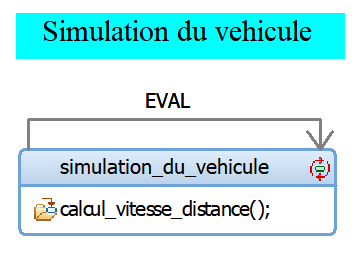

Pour simuler la vitesse et la distance du véhicule, à partir de l'injection (throttle), nous avons repris la fonction `calcul_vitesse_distance()` qui est appelée à chaque évènement `EVAL` qui se déclenche à la fréquence de simulation comme détaillé dans la [Section 3.2 Horloge partagée via l'évènement EVAL](#32-horloge-partag%C3%A9e-via-l%C3%A9v%C3%A8nement-eval).

### 4.2 Fonctionnement

Nous avons volontairement gardé l'AND-line **`Simulation du vehicule`** minimaliste : elle ne contient qu'un unique état `simulation_du_vehicule`, qui exécute `calcul_vitesse_distance()` à chaque événement `EVAL`.  
Toute la mécanique est encapsulée dans le constructeur de la classe `_SysVehicule()` et l'opération `calcul_vitesse_distance()` qui sont décrits ci-après.

**Évolution depuis les fonctions de base.** Les fonctions fournies au départ étaient très simplistes : `accelerer()` incrémentait le `throttle` proportionnellement à l'appui sur la pédale d'accélération, `freiner()` le décrémentait à l'appui sur le frein, et les frottements faisaient redescendre le `throttle` naturellement. En analysant ce fonctionnement, nous nous sommes d'abord rendu compte que la fonction `freiner()` n'agissait en réalité que sur le `throttle` (l'injection), et non directement sur la décélération du véhicule.

Aussi, si nous ne faisions que freiner, la voiture ne faisait que doucement ralentir, ce qui était complètement irréaliste et embêtant pour les tests de notre système quand nous voulions ralentir rapidement.

Nous avons donc décidé, avec l'aide de l'IA, de passer sur une simulation physique plus poussée en prenant en compte des caractéristiques du véhicule comme
- la masse (`PARAM_SIMU_masse`)
- les frottements aérodynamiques (`PARAM_SIMU_frottement_air`)
- le frottement de roulement (`PARAM_SIMU_frottement_roulement`)
- les puissances moteur (`PARAM_SIMU_puissance_moteur`)
- la puissance de freinage (`PARAM_SIMU_puissance_frein`)
- la pente (`PARAM_SIMU_pente`) qui était déjà prise en compte dans la version que vous nous avez fournie.

Les avantages de notre nouvelle fonction `calcul_vitesse_distance()` physique sont :

* **Freinage réaliste** : Elle prend en compte `brakePedal` comme un effort de freinage mécanique dans `calcul_vitesse_distance()`, en plus de la coupure d'injection (`freiner_injection()`).
* **Maîtriser le ralentissement en mode régulateur ou limiteur** : Comme le régulateur ainsi que le limiteur ne pilotent que le `throttle` sans actionner les freins, le réglage de la masse et des frottements était le seul moyen d'obtenir un frein moteur et une décélération personalisable.
* **Simuler différents types de véhicules** : En ajustant les paramètres `PARAM_SIMU_*`, le même modèle peut représenter aussi bien une petite voiture légère qu'un camion lourd avec beaucoup d'inertie, ou une voiture puissante donc nerveuse.

### 4.3 Initialisation et vitesse de repos

Au démarrage, le véhicule se comporte comme un moteur diesel : le `throttle` est maintenu à une valeur de ralenti `throttle_repos`, calculée en fonction des caractéristiques du véhicule, dès l'initialisation pour que sur du plat à vitesse basse, le véhicule se maintienne à la vitesse de repos paramétrable (`PARAM_SIMU_vitesse_repos`, 10 km/h par défaut).  
Par ailleurs, en suivant vos conseils, nous n'utilisons plus l'opération `init()` appelée par le point d'entrée du statechart : toute l'initialisation a été déplacée directement dans le constructeur de la classe `_SysVehicule()`, ce qui garantit un état initial cohérent avant même le lancement du statechart.  

Les attributs de la simulation initialisés dans le constructeur en fonctions des constantes sont :
- le `throttle_repos` pour maintenir la vitesse de repos
- les variables d'état `float_speed` et `float_distance`

> D'autres attributs y sont calculés à l'initialisation mais c'est l'objet des parties suivantes.

### 4.4 Implémentation dans les opérations

Voici un schéma synthétique montrant comment `calcul_vitesse_distance()` calcule la vitesse et la distance à partir des variables d'état lues et des paramètres de simulation :

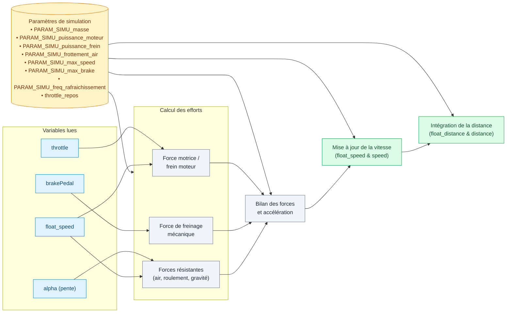

Voici le code complet de notre nouvelle fonction calcul_vitesse_distance() qui reprend le schéma présenté juste au-dessus :  

<!-- code:calcul_vitesse_distance() -->
```cpp
// --- PARAMETRES EXTERNES ---
const double MAX_SPEED            = (double)PARAM_SIMU_max_speed;        // ex: 120 km/h
const double MASSE                = (double)PARAM_SIMU_masse;            // ex: 1200 kg
const double PUISSANCE            = (double)PARAM_SIMU_puissance_moteur; // ex: 600 N par unité de throttle
const double FORCE_FREINS         = (double)PARAM_SIMU_puissance_frein;  // ex: 80 N
const double CST_RALENTI          = throttle_repos;                      // ex: 1.0
const double MAX_BRAKE            = (double)PARAM_SIMU_max_brake;        // ex: 10.0
const double AIR_DRAG             = PARAM_SIMU_frottement_air;           // en kg/m (mettre ~0.4)
const double DELTA_T_MS           = (double)(1000/PARAM_SIMU_freq_rafraichissement);

// --- CONSTANTES PHYSIQUES ET MATHEMATIQUES ---
const double CST_COEFF_ROULEMENT   = 0.05;
const double CST_MULTIPLICATEUR_F  = 10.0;
const double CST_GRAVITE           = 9.81;
const double CST_PI_SUR_180        = 3.14159 / 180.0;
const double CST_CONVERSION_KMH_MS = 3.6;
const double CST_CONVERSION_MS_S   = 1000.0;
const double ZERO                  = 0.0;

// --- LOGIQUE ---
const double dt = DELTA_T_MS / CST_CONVERSION_MS_S; // 0.05 s

// D'abord, on coupe l'accélération si le moteur est éteint
if (ignition == false) {
    throttle = ZERO;
}

// 1. Force motrice / Frein moteur
double forceMoteur = ZERO;

if (throttle <= CST_RALENTI || ignition == false) {
    if (float_speed > 10.0) {
        // Au-dessus de 10 km/h pied levé : couple résistant mécanique (frein moteur ~300 N)
        forceMoteur = -300.0;
    } else {
        // En dessous de 10 km/h : traction douce du ralenti pour ne pas caler
        forceMoteur = throttle * PUISSANCE;
    }
} else {
    // Phase d'accélération active (pédale ou régulateur)
    forceMoteur = throttle * PUISSANCE;
}

// 2. Calcul des forces résistantes (Unités SI : Newtons)
const double vitesse_ms = float_speed / CST_CONVERSION_KMH_MS;

// Traînée aérodynamique pure : F = (1/2 * rho * S * Cx) * v^2
const double forceAir = AIR_DRAG * vitesse_ms * vitesse_ms;

// Frottement au sol (roulement des pneumatiques)
const double forceRoulement = CST_COEFF_ROULEMENT * MASSE * CST_GRAVITE * cos(alpha * CST_PI_SUR_180);

// Gravité le long de la pente
const double forceGravite = MASSE * CST_GRAVITE * sin(alpha * CST_PI_SUR_180);

// Frein mécanique progressif
double pedale_frein = brakePedal;
if (pedale_frein > MAX_BRAKE) pedale_frein = MAX_BRAKE;
if (pedale_frein < ZERO) pedale_frein = ZERO;
const double forceFrein = (pedale_frein / MAX_BRAKE) * (FORCE_FREINS * CST_MULTIPLICATEUR_F * MASSE / 100.0);

// 3. Somme des forces et accélération Newtonienne (m/s²)
const double forceTotale = forceMoteur - forceFrein - forceAir - forceRoulement - forceGravite;
const double acceleration = forceTotale / MASSE;

// 4. Intégration temporelle et bridage
float_speed += (acceleration * dt) * CST_CONVERSION_KMH_MS;

if (float_speed > MAX_SPEED) float_speed = MAX_SPEED;
if (float_speed < ZERO) float_speed = ZERO;

float_distance += (float_speed / CST_CONVERSION_KMH_MS) * dt;

speed = (int)float_speed;
distance = (int)float_distance;
```

Et voici un extrait de l'initialisation des attributs globaux nécessaires à la simulation dans le constructeur de la classe `_SysVehicule` : 

<!-- code:Constructeur de classe SysVehicule -->
```cpp
speed = 0;
brakePedal = 0;
accelPedal = 0;
float_speed = (double)speed;
float_distance = (double)distance;

const double MASSE         = (double)PARAM_SIMU_masse;
const double PUISSANCE     = (double)PARAM_SIMU_puissance_moteur;
const double AIR_DRAG      = PARAM_SIMU_frottement_air;
const double VITESSE_REPOS = (double)PARAM_SIMU_vitesse_repos;

// Calcul du throttle de repos (ralenti « diesel » à plat)
const double vit_repos_ms         = VITESSE_REPOS / 3.6;
const double forceAir_repos       = AIR_DRAG * vit_repos_ms * vit_repos_ms;
const double forceRoulement_repos = 0.015 * MASSE * 9.81;

throttle_repos = (forceAir_repos + forceRoulement_repos) / PUISSANCE;
throttle = throttle_repos;
```


## 6. Gestion des pédales d'accélération et de frein

### 5.1 Statechart

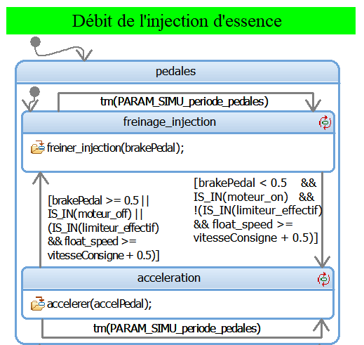

> La partie inférieure du AND-line qui gère le contrôle de l'injection d'essence par le régulateur est tronquée dans cette capture. Les conditions liées au limiteur apparaissent quand-même mais seront expliquées plus loin.

### 5.2 Utilisation depuis l'IHM

- Sur l'IHM, nous contrôlons la pédale d'accélération avec le slider `pédale d'accélération`, qui fixe `accelPedal`. Le throttle résultant s'affiche en valeur numérique et sur la jauge `injecteur`.

### 5.3 Fonctionnement

- C'est dans le AND-line `Débit de l'injection d'essence` qu'est gérée toute modification de l'attribut `throttle`.
- Le super-état `pedales` gère à la fois l'accélération et le freinage manuels via les états `acceleration` et `freinage_injection`.
- La priorité stricte est appliquée : dès que le frein est actionné, le throttle retombe au ralenti, indépendamment de l'accélération demandée (`brakePedal < 0.5`).
- Le moteur doit être allumé pour que l'accélération soit effective, mais n'empêche pas le freinage.
- La fréquence de polling des pédales se fait bien toutes les 200 ms comme demandé dans l'énoncé (via l'attribut `PARAM_SIMU_periode_pedales` qui vaut 200).

### 5.4 Implémentation des opérations

#### 5.4.1 Opération `accelerer()`

Voici le code de l'opération `accelerer()` :

<!-- code:accelerer(double accelPedal) -->
```cpp
// --- PARAMETRES EXTERNES ---
const double MAX_THROTTLE = PARAM_SIMU_max_throttle;
const double CST_RALENTI  = throttle_repos;
const double MAX_ACCEL    = (double)PARAM_SIMU_max_accel;

// --- LOGIQUE ---
// Mise à l'échelle : 0->10 sur la pédale donne throttle_repos->10.0 sur le throttle
double plage_utile = MAX_THROTTLE - CST_RALENTI;
throttle = CST_RALENTI + (accelPedal / MAX_ACCEL) * plage_utile;
```

La fonction fait un mapping linéaire de la position de la pédale d'accélération `accelPedal` sur la plage utile du `throttle`, allant de `throttle_repos` à `MAX_THROTTLE` :  
Si on appuie pas du tout sur la pédale d'accélération (`accelPedal = 0`), le `throttle` reste calé sur le ralenti `throttle_repos`.
Si on appuie à fond sur la pédale d'accélération (`accelPedal = MAX_ACCEL`), le `throttle` atteint directement son maximum `MAX_THROTTLE`.

#### 5.4.2 Opération `freiner_injection()`

Voici le code de l'opération `freiner_injection()` (anciennement `freiner()`) :

<!-- code:freiner_injection(double brakePedal) -->
```cpp
if (throttle > throttle_repos) {
    throttle = throttle_repos;
}
```

Cette opération se limite volontairement à couper l'accélération en ramenant immédiatement le `throttle` au niveau du ralenti `throttle_repos` (sans jamais le faire passer en dessous, afin de ne pas étouffer le moteur à l'arrêt). L'effort de freinage mécanique progressif proportionnel à `brakePedal` est quant à lui appliqué directement sur la vitesse dans `calcul_vitesse_distance()` (voir [Section 4 Simulation du véhicule](#5-simulation-du-v%C3%A9hicule)), ce qui garantit que le freinage reste actif même moteur coupé.

### 5.5 Évolution

Dans la version originale de ces fonctions, l'injection était incrémentée/décrémentée progressivement, alors que ce comportement est typique de la vitesse du moteur (en tours/minute) qui possède en effet une certaine inertie, et non du débit de l'injection d'essence (le throttle) qui est instantané.
Nous avons donc modifié les opérations `accelerer()` et `freiner_injection()` pour qu'elles ajustent instantanément le débit d'injection (`throttle`) en fonction de la position des pédales.

## 7. Gestion du contact et du démarrage

Le sujet demande de gérer la clé, le démarrage et l'arrêt d'urgence en roulant : coupure moteur immédiate, accélérateur désactivé, inertie conservée.

**Côté IHM.** Nous mettons ou coupons le contact avec l'interrupteur **E1** (`cmd_contact`), et la LED **E2** le confirme. Le bouton **Démarrer** (**E3**) envoie `ev_demarrer`, et la LED **E4** indique que le moteur tourne (`ignition`).

**Côté statechart.** Dans l'AND-line Clé du véhicule, nous avons organisé le cycle de vie de façon hiérarchique :

* `contact_off` ↔ `contact_on` sur `EVAL [cmd_contact == true / false]`.
* Dans `contact_on`, l'état initial `moteur_off` exécute `arreter()` (`ignition = false;`).
* `moteur_on` n'est atteint que sur `ev_demarrer` sous la garde `[IS_IN(fonctionelle)]` (aucune panne), en exécutant `ex_demarrer()` : `ignition = true; throttle = throttle_repos; niveau_batterie -= 10;`. L'état appelle `calcul_carburant()` et, dans une région parallèle, `calcul_batterie()` au rythme de rafraîchissement.
* La coupure moteur intervient sur `EVAL [!IS_IN(fonctionelle) || cmd_contact == false]`.

**Arrêt d'urgence.** Quand nous coupons le contact (**E1**) en roulant, l'AND-line sort de `moteur_on`. `arreter()` passe `ignition` à `false`, l'AND-line Débit de l'injection d'essence bascule en `freinage_injection`, et `calcul_vitesse_distance()` annule `throttle` tout en conservant `float_speed`. La pédale de frein reste active, et le régulateur, le limiteur, le Bluetooth et l'autoradio se coupent en même temps.

**Pourquoi ce fonctionnement.** Nous avons placé `arreter()` en entrée de `moteur_off` et non de `contact_off` : sinon, une panne sèche, qui coupe le moteur sans couper le contact, laissait `ignition` à `true`. De la même façon, nous avons mis `calcul_carburant()` dans `moteur_on` pour qu'aucune consommation n'ait lieu moteur coupé.


## 8. Modélisation énergétique : carburant, batterie et pannes

Nous avons entièrement implémenté cette partie optionnelle du sujet : consommation, charge et décharge de la batterie, détection des pannes, plein et dépannage.

**Côté IHM.** Les jauges **D1** (batterie, %) et **D2** (carburant, L) affichent les niveaux. Le bouton **remplir carburant** (**D3**) ajoute 5 L, et le bouton **recharge d'urgence batterie** (**D4**) remet la batterie à 55 %. Ces deux boutons ne fonctionnent que véhicule à l'arrêt et contact coupé.

**Côté statechart.** L'AND-line Ressources et pannes s'appuie sur `calcul_carburant()` et `calcul_batterie()` :

* **Carburant** : consommation de `throttle * 0.005` par pas (réservoir initial 40 L, maximum 50 L). Sous `SEUIL_carburant` = 5 L, passage en `panne_carburant` (`carburant_faible = true`).
* **Batterie** : -10 % au démarrage. Si `throttle > 1.5`, l'alternateur recharge jusqu'à +2,5 %/s ; sinon la batterie se décharge de 0,25 %/s (initiale 80 %). Sous `SEUIL_batterie` = 40 %, passage en `panne_batterie` (`batterie_faible = true`).
* **Sécurité de maintenance** : les transitions vers `remplir_carburant` et `depanner_batterie` portent la garde `[speed == 0 && IS_IN(contact_off)]`.

```cpp
// Extrait de calcul_batterie() : modèle alternateur / décharge en %/s
if (throttle > 1.5) {
    const double taux_charge = (throttle < 5.0) ? (0.5 * throttle) : 2.5;
    new_niveau_batterie += taux_charge * dt;
} else {
    new_niveau_batterie -= 0.25 * dt;
}
```

**Pourquoi ce fonctionnement.** Au début, le dépannage remettait la batterie au seuil exact : à 40 %, le premier démarrage (-10 %) rouvrait immédiatement une panne et le véhicule ne redémarrait jamais. Nous remettons donc la batterie à `SEUIL_batterie + 15` (55 %). De même, nous avions d'abord découpé la maintenance en sous-états `garee` / `non_garee`, mais ce découpage bloquait toute réparation une fois en panne. Nous portons donc la garde de maintenance directement sur chaque transition.

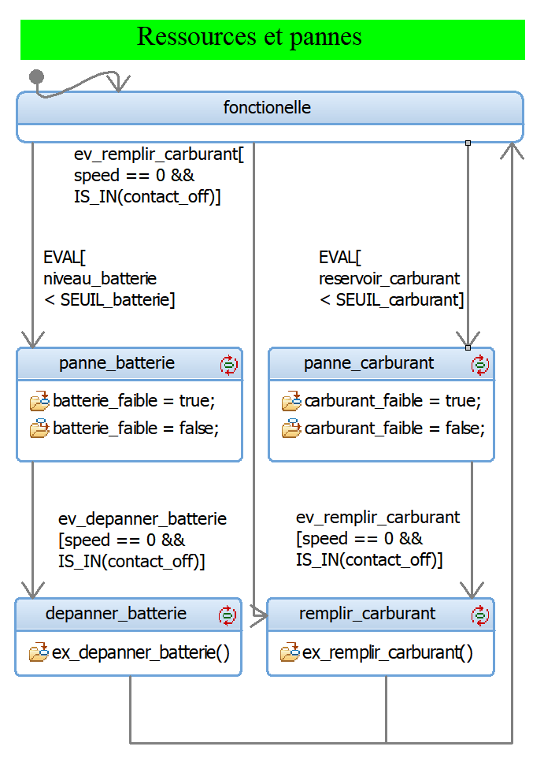

<!-- >>>>>>>>>>>>> TBD ↑ -->

## 9. Régulateur de vitesse simple

Le régulateur maintient une vitesse cible (`vitesseConsigne`) sur route dénivelée (α entre -20° et +20°).

### 8.1 Fonctionnement depuis l'IHM

* **Activer / désactiver** : nous utilisons le bouton **Régulateur**, qui envoie l'événement `ev_regulateur`. La LED (`voyant_regulateur`) indique que le régulateur est actif.
* **Consigne** : à l'activation, la vitesse courante s'affiche dans **vitesse cible**. Les boutons **+** et **−** la modifient de 1 km/h.
* **Suspension** : en appuyant sur la pédale d'accélération, nous reprenons la main et au relâchement, le régulateur ramène la vitesse à la consigne.
* **Désactivation implicite** : freiner, descendre sous 30 km/h ou couper le moteur éteint le voyant du régulateur.

### 8.2 Statechart

#### 8.2.1 Décision du mode manuel vs régulateur

Un premier AND-line détermine si le pilotage du throttle doit se faire par le régulateur ou par le conducteur : 


#### 8.2.2 Commande de l'injection d'essence

C'est dans le même AND-line 'Débit de l'injection d'essence' que nous déterminons la valeur du throttle en fonction du mode de pilotage et de la consigne de vitesse : 


### 8.3 Correcteur PI pour le régulateur de vitesse

Nous avons remarqué que la formule fournie dans le sujet (`error = (double)(5*(vitesseConsigne - speed) / 6.0); steady = (double)(vitesseConsigne / 12.0); throttle = steady + error;`) n'était pas adaptée au fonctionnement réel de la voiture. En effet, cette formule est un simple correcteur proportionnel qui possède une erreur statique qui se voit notamment quand on change l'angle de la pente.

Nous avons voulu améliorer cette fonction pour qu'il joue avec un attribut qui stocke l'erreur intégrale afin de corriger l'erreur statique. Avec l'aide de l'IA, nous avons donc écrit une fonction de correcteur PI discret pour asservir la vitesse de la voiture à la vitesse de la consigne. Cette fonction est appelée `calcul_regulateur_vitesse()`, cadencée à `PARAM_SIMU_freq_regulateur` = 3 Hz.

Pour ce correcteur PI, nous avons deux attributs `Kp_regulateur` et `Ki_regulateur` qui représentent les gains appliqués à la commande.

Ces variables ne sont pas des constantes à régler, mais sont calculées à partir des deux coefficients "normalisés" `PARAM_SIMU_Kp_regulateur` et `PARAM_SIMU_Ki_regulateur`.
C'est dans le constructeur de la classe `SysVehicule` que ces coefficients normalisés sont lus et utilisés pour calculer les gains effectifs `Kp_regulateur` et `Ki_regulateur` à partir des caractéristiques physiques du véhicule et de la fréquence du régulateur.

Ainsi nous pouvons changer les caractéristiques physiques du véhicule sans avoir à recalculer manuellement les gains du régulateur, ce qui rend le système plus flexible et adaptable à différents types de véhicules.

À l'activation, nous initialisons `steady = throttle` pour éviter un à-coup lorsque le conducteur a accéléré entre deux activations.

Comme `vitesseConsigne` est un entier, il est tronqué vers le bas, nous visons donc la consigne + 0,5, ce qui évite que l'affichage oscille autour d'une valeur entière, mais plutôt au milieu de l'intervalle entre deux entiers.

Voici un schéma qui illustre ce correcteur :

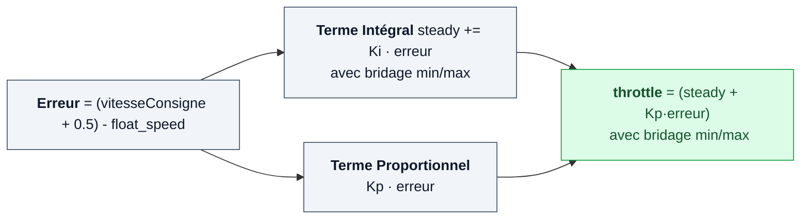

Voici le code de l'opération du correcteur PI `calcul_regulateur_vitesse()`:

```cpp
const double erreur = (double)vitesseConsigne+0.5 - (double)float_speed;

steady += Ki_regulateur * erreur;

if (steady > PARAM_SIMU_max_throttle) steady = PARAM_SIMU_max_throttle;
if (steady < throttle_repos)          steady = throttle_repos;

double commande = steady + (Kp_regulateur * erreur);

if (commande > PARAM_SIMU_max_throttle) commande = PARAM_SIMU_max_throttle;
if (commande < throttle_repos)          commande = throttle_repos;

throttle = commande;
```

Voici un extrait du constructeur `_SysVehicule()` qui sert à intialiser les gains effectifs Kp et Ki à partir des coefficients normalisés et des caractéristiques du véhicule :  
```cpp
// Constructeur _SysVehicule() : construction des gains effectifs Kp et Ki à partir des coefficients normalisés
const double RATIO_CORRECTION_P   = PARAM_SIMU_Kp_regulateur;
const double RATIO_LENTEUR_I      = PARAM_SIMU_Ki_regulateur;
const double FREQ_REG             = (double)PARAM_SIMU_freq_regulateur;
const double delta_v_par_throttle = (PUISSANCE / MASSE) * (1.0 / FREQ_REG) * 3.6;

Kp_regulateur = RATIO_CORRECTION_P / delta_v_par_throttle;
Ki_regulateur = (Kp_regulateur / RATIO_LENTEUR_I);
```

### 8.4 Évolution

Nous avions d'abord un interrupteur `cmd_regulateur` : le statechart désactivait le régulateur au freinage, mais l'interrupteur de l'IHM restait enclenché et le réactivait. Nous l'avons donc remplacé par un bouton poussoir qui envoie l'événement `ev_regulateur`, associé à un voyant en lecture seule : comme ça, il n'y a plus de décalage.

Entre temps nous avons aussi essayé des corrections non linéaires en ±erreur² puis ±erreur³ pour augmenter la réactivité en fonction de l'erreur, mais nous n'arrivions pas à obtenir une correction à la fois réactive et douce dans toutes les situations. C'est pourquoi nous avons finalement opté pour un correcteur PI.

## 10. Limiteur de vitesse

Le limiteur de vitesse empêche le véhicule de dépasser une vitesse maximale programmée (`vitesseConsigne`) en bridant automatiquement le débit d'injection. Il est mutuellement exclusif avec le régulateur, s'active en différé si le véhicule roule déjà au-dessus de la limite, et déclenche une alarme sonore en cas de dépassement.

### 9.1 Fonctionnement depuis l'IHM

* **Activer / désactiver** : nous utilisons le bouton **Limiteur**, qui envoie l'événement `ev_limiteur`. La LED (`voyant_limiteur`) indique que le limiteur est actif. Activer le limiteur désactive automatiquement le régulateur, et inversement.
* **Consigne** : à l'activation, **vitesse cible** s'initialise à `50 km/h` (`valeur_initiale_limiteur`). Un appui simple sur les boutons **+** ou **−** modifie la consigne de `1 km/h`, et un double appui en moins de `500 ms` la modifie de `10 km/h`.
* **Voyants d'attente** : Si le limiteur est en attente suite à une activation au-dessus de la vitesse limite, le voyant jaune de l'IHM (`limiteur_attente`) s'allume pour indiquer que le limiteur n'est pas encore effectif.  
* **Voyants de dépassement** : Si le véhicule dépasse la vitesse limite alors que le limiteur est effectif, le voyant rouge de l'IHM (`limiteur_depasse`) s'allume et une alarme sonore est déclenchée.
* **Reprise de la main sur l'accélération** : En enfonçant franchement la pédale d'accélération (> 7/10) à proximité de la vitesse limite (< 10 km/h), le limiteur se désactive automatiquement pour permettre au conducteur de dépasser en cas d'urgence.

### 9.2 Statechart

#### 9.2.1 Gestion du limiteur, de la consigne et des alarmes

L'AND-line **`Limiteur de vitesse`** gère l'activation du limiteur, le réglage de la consigne par simple ou double appui, l'activation différée et l'alerte de dépassement :


* **Exclusion mutuelle avec le régulateur** : l'événement `ev_limiteur` fait passer de `limiteur_off` à `limiteur_on` (uniquement moteur allumé, `[IS_IN(moteur_on)]`) et renvoie simultanément l'AND-line `Mode de pilotage` vers `mode_manuel`. À l'inverse, `ev_regulateur` fait immédiatement repasser le limiteur dans `limiteur_off`.
* **Consigne initiale et double appui** : l'entrée dans `consigne_fixe` initialise `vitesseConsigne = valeur_initiale_limiteur` (`50 km/h`). Un premier appui sur **+** (`ev_vitesseConsigne_plus`) passe dans `plus` et applique tout de suite `ex_vitesseConsigne(+1)`. Si un second appui arrive avant `500 ms`, la transition de retour applique `ex_vitesseConsigne(+9)` (soit `+10 km/h` au total) ; sinon, `tm(500)` ramène dans `consigne_fixe` sans modification supplémentaire. Le bouton **−** suit exactement le même principe (`-1` puis `-9`).
* **Activation différée** : à l'entrée dans `consigne_fixe`, le limiteur démarre dans `limiteur_inhibe` (`limiteur_attente = true`) : tant que le véhicule roule au-dessus de la consigne, il ne bride pas l'injection et ne déclenche aucune alarme. Dès que la vitesse repasse sous la consigne (`EVAL[speed <= vitesseConsigne]`), il bascule dans `limiteur_effectif` (`limiteur_attente = false`).
* **Alarme de dépassement** : dans `limiteur_effectif`, si la vitesse dépasse la consigne de plus de `2 km/h` (`EVAL[speed > vitesseConsigne + 2]`, typiquement en forte descente), l'entrée dans `depassement` appelle `alerte_depassement(1)`, ce qui allume le voyant `limiteur_depasse` et lance l'alarme sonore en boucle (voir [Section 14 Implémentation de la gestion sonore sous Rhapsody](#14-impl%C3%A9mentation-de-la-gestion-sonore-sous-rhapsody)). Dès que la vitesse redescend sous la consigne (`EVAL[vitesseConsigne >= speed]`), l'action de sortie `alerte_depassement(0)` coupe l'alarme et éteint le voyant.
* **Désactivation automatique et kick-down** : le limiteur repasse dans `limiteur_off` dès que le moteur s'arrête ou que le conducteur enfonce fortement l'accélérateur près de la limite (`EVAL[IS_IN(moteur_off) || ((vitesseConsigne - speed) < 10 && accelPedal > 7)]`).

#### 9.2.2 Bridage de l'injection d'essence

Le bridage effectif du `throttle` est centralisé dans l'AND-line **`Débit de l'injection d'essence`** (présentée en [Section 5 Gestion des pédales d'accélération et de frein](#6-gestion-des-p%C3%A9dales-dacc%C3%A9l%C3%A9ration-et-de-frein) et [Section 8.2 Statechart](#82-statechart)), afin de conserver un seul écrivain sur `throttle`. Dans le super-état `pedales`, dès que `IS_IN(limiteur_effectif) && float_speed >= vitesseConsigne + 0.5`, la transition vers `freinage_injection` coupe l'accélération et ramène le `throttle` au ralenti, quelle que soit la position de la pédale d'accélération. Comme pour le régulateur, le seuil à `vitesseConsigne + 0.5` sur `float_speed` évite les oscillations autour de l'entier tronqué `speed`.

### 9.3 Opérations

Voici le code de l'opération `ex_vitesseConsigne()` (partagée avec le régulateur de vitesse) :

<!-- code:ex_vitesseConsigne(int delta) -->
```cpp
vitesseConsigne += delta;

if (vitesseConsigne > PARAM_SIMU_max_speed) {
    vitesseConsigne = PARAM_SIMU_max_speed;
}
if (vitesseConsigne < 0) {
    vitesseConsigne = 0;
}
```

Cette opération applique l'incrément `delta` (`±1` ou `±9`) puis borne `vitesseConsigne` entre `0` et `PARAM_SIMU_max_speed` (`120 km/h`) afin d'empêcher toute consigne incohérente.

Voici le code de l'opération `alerte_depassement()` :

<!-- code:alerte_depassement(int actif) -->
```cpp
if (actif == 0) {
    PlaySound(NULL, NULL, 0);
    limiteur_depasse = false;
} else {
    play_sound("alarme_depassement.wav");
    limiteur_depasse = true;
}
```

Appelée en entrée (`actif = 1`) et en sortie (`actif = 0`) de l'état `depassement`, ainsi qu'à l'entrée de `limiteur_off` par sécurité, elle synchronise l'allumage du voyant `limiteur_depasse` avec la lecture ou l'arrêt de l'alarme sonore `alarme_depassement.wav` (voir [Section 14 Implémentation de la gestion sonore sous Rhapsody](#14-impl%C3%A9mentation-de-la-gestion-sonore-sous-rhapsody)).

### 9.4 Évolution

Au début, nous avions modélisé `limiteur_on` avec deux régions parallèles (une pour l'inhibition et une pour le dépassement), mais l'alarme sonnait dès que le limiteur était activé au-dessus de `50 km/h` alors qu'il devait rester en attente. Nous avons donc imbriqué `limite_tenue` et `depassement` directement à l'intérieur de `limiteur_effectif`, ce qui garantit qu'aucune alarme ne peut se déclencher tant que le limiteur est inhibé.

Pour le double appui, nous attendions initialement la fin des `500 ms` avant d'appliquer `+1` ou `+10`, ce qui provoquait une latence visible à chaque clic simple. Nous appliquons désormais `+1` immédiatement, puis `+9` si un second appui arrive dans la fenêtre de `500 ms`.

Enfin, nous avons affiné plusieurs seuils au fil des tests : nous avons remplacé la comparaison sur l'entier `speed` par `float_speed >= vitesseConsigne + 0.5` pour supprimer les à-coups d'injection autour de la limite, relevé le seuil de kick-down de `5` à `7` pour éviter des coupures involontaires lors d'une accélération normale, et utilisé des inégalités (`<=` / `>=`) à la place d'égalités strictes qui pouvaient être sautées entre deux ticks `EVAL` lors d'un freinage fort.

## 11. Contrôleur de Kit Bluetooth « mains libres »

### 10.1 Cycle de vie du téléphone et du kit

> **[Capture Rhapsody à insérer — IHM téléphone et kit]** : 

Le kit Bluetooth du véhicule permet de connecter un téléphone pour passer des appels et lire les SMS. Le téléphone et le kit mains libres ont chacun leur propre cycle de vie, qui conditionne tout le reste de cette section.

* **Le téléphone** : toute manipulation du téléphone se réalise dans le super-état `telephone_actif`. Nous n'y entrons que si le téléphone est allumé et que sa batterie n'est pas vide (`EVAL[niveau_batterie_telephone > 0 && telephone_allume]`), et nous en sortons dès que l'une de ces deux conditions tombe. Dans `telephone_actif`, le Bluetooth a lui aussi son propre interrupteur : `bluetooth_telephone_desactive` ↔ `bluetooth_telephone_active` selon `cmd_bluetooth_telephone_actif`. Tant que le téléphone est dans `telephone_actif`, sa batterie se décharge de 1 %/s. Branché au véhicule, elle se recharge de 5 % toutes les 1,5 s.
* **Le kit** : toute communication Bluetooth du kit se réalise dans le super-état `bluetooth_active`, et les commandes au volant ne sont actives que lorsqu'un téléphone y est connecté. Il est alimenté par le véhicule et ne fonctionne donc que contact mis (`EVAL[IS_IN(contact_on)]`). À la coupure du contact (`EVAL[IS_IN(contact_off)]`), il retourne en `bluetooth_desactive` et éteint son voyant Bluetooth (`VOYANT_bluetooth_vehicule`).

En sortant de leur super-état respectif, le téléphone et le kit se mettent en veille et ne peuvent plus communiquer. Ils préviennent alors l'autre appareil : le téléphone émet `GEN(ev_bluetooth_telephone_desactive)` en entrée de `telephone_eteint` et de `bluetooth_telephone_desactive`, et le kit émet `GEN(ev_kit_bluetooth_desactive)` en entrée de `bluetooth_desactive`. Côté téléphone, les écrans sont aussi vidés et affichent « Standby ».

### 10.2 Principe : deux équipements cloisonnés qui échangent des paquets

#### 10.2.1 Statechart associé
> **[Capture Rhapsody à insérer — 3 zones]** :

#### 10.2.2 Choix fonctionnels

Dans la réalité, le téléphone et le kit mains libres sont deux appareils distincts qui ne communiquent que par Bluetooth. Ils ne partagent donc aucune mémoire commune : aucun état (`IS_IN`), attribut ni opération ne peut être partagé entre le téléphone et le véhicule. Le partage de données se fait uniquement par génération d'événements Bluetooth, qui peuvent transporter des paramètres.
L'émetteur les envoie avec `GEN(ev_nom(valeur))`, et le récepteur les lit via `params->nom_du_parametre`. La liste complète de ces paquets, dans les deux sens, est donnée dans l'[Annexe E — Paquets Bluetooth et messages du téléphone](#annexe-e--paquets-bluetooth-et-messages-du-t%C3%A9l%C3%A9phone).

Nous avons également choisi de diviser les tâches de chaque appareil en plusieurs AND-lines, par souci de lisibilité et de place. Au lieu d'avoir une seule AND-line dédiée au téléphone ou au kit, plusieurs AND-lines sont regroupées en trois ensembles distincts :

* **le téléphone** : AND-lines Telephone, Batterie téléphone et Communication telephone ;
* **le kit véhicule** : AND-lines Jumelage kit main libre et Commande kit main libre (l'AND-line Radio, également côté véhicule, forme le bloc infodivertissement et est traitée dans la [Section 11 Autoradio et arbitrage des priorités audio](#12-autoradio-et-arbitrage-des-priorit%C3%A9s-audio)) ;
* **le réseau extérieur**, simulé par les AND-lines Appel Extérieur et SMS Extérieur.

Le réseau extérieur joue le rôle de l'opérateur : il ne parle qu'au téléphone (`ev_SIM_appel`, `ev_SIM_envoi_sms`), et c'est le téléphone qui relaie ensuite vers le kit.


### 10.3 Protocole Bluetooth et jumelage par code PIN
 
#### 10.3.1 Statechart associé
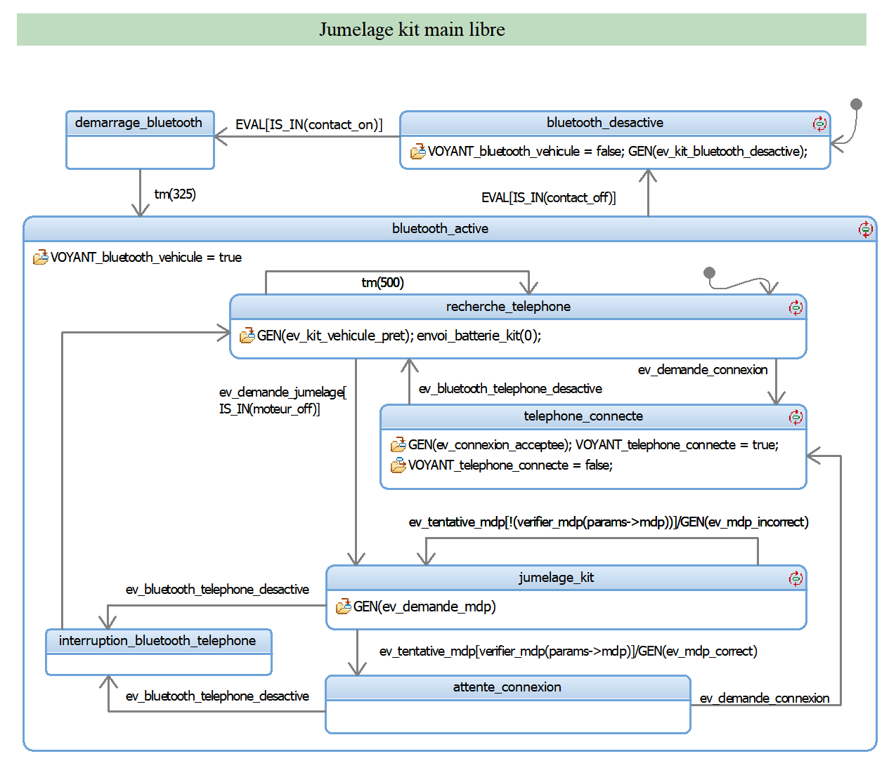

> **[Capture Rhapsody à insérer]** : AND-line **`Telephone`** (`state_96`).


#### 10.3.2 Choix fonctionnels
Le Bluetooth du kit véhicule s'active à la mise du contact. Le téléphone (maître) détecte le kit, se jumelle avec le code `1234` uniquement moteur à l'arrêt, puis se reconnecte automatiquement. Le jumelage se fait par un échange de requêtes et de réponses entre le kit et le téléphone. L'utilisateur peut suivre la procédure dans les champs texte du téléphone (liste complète des messages dans l'[Annexe E — Paquets Bluetooth et messages du téléphone](#annexe-e--paquets-bluetooth-et-messages-du-t%C3%A9l%C3%A9phone)).

##### Côté IHM

* **Téléphone** : nous allumons le téléphone puis son Bluetooth avec leurs interrupteurs, et sa jauge affiche son niveau de batterie.
* **Détection** : « Kit Bluetooth Vehicule » apparaît dans la liste des appareils, et le bouton **OK** demande le jumelage.
* **Code PIN** : nous le saisissons dans le champ du mot de passe et l'envoyons avec **Appairer**.
* **Connexion** : la LED « Appareil connecté » s'allume côté téléphone, et les LED de connexion du kit s'allument côté véhicule.
* **Batterie au tableau de bord** : la jauge **Batterie téléphone** du kit recopie le niveau du téléphone, et l'interrupteur **Brancher Téléphone** permet de le recharger.

**Côté statechart.** Nous avons fait collaborer trois AND-lines uniquement par événements :

* **Jumelage kit main libre (kit)** :

À la mise du contact, le kit passe par `demarrage_bluetooth`, une légère pause (`tm(325)`) qui simule le temps de démarrage du module, puis entre dans `bluetooth_active` et allume son voyant Bluetooth. Il commence directement la recherche du téléphone : en état `recherche_telephone`, il annonce sa présence par `GEN(ev_kit_vehicule_pret)` toutes les 500 ms et affiche une batterie téléphone à 0 (`envoi_batterie_kit(0)`). Il attend alors l'une des deux requêtes du téléphone :
    * une demande de jumelage (`ev_demande_jumelage`), acceptée uniquement moteur à l'arrêt (`[IS_IN(moteur_off)]`). Le kit passe en `jumelage_kit` et demande le mot de passe (`GEN(ev_demande_mdp)`), puis vérifie le PIN reçu (`ev_tentative_mdp[verifier_mdp(params->mdp)]`) :
        * si le code est correct, le kit envoie un paquet de confirmation `GEN(ev_mdp_correct)` et passe en `attente_connexion`. À la première demande de connexion du téléphone (`ev_demande_connexion`), il entre dans `telephone_connecte` : il allume ses voyants (`VOYANT_telephone_connecte`) et notifie le téléphone (`GEN(ev_connexion_acceptee)`) ;
        * sinon, il retourne un paquet d'erreur `GEN(ev_mdp_incorrect)`, redemande le mot de passe et attend une nouvelle tentative.
    * une demande de connexion (`ev_demande_connexion`), envoyée par un téléphone déjà jumelé : le kit passe directement en `telephone_connecte`, sans repasser par le code PIN.

Durant toute cette manœuvre, le kit peut être déconnecté par la coupure du contact (retour en `bluetooth_desactive`) ou par la désactivation du Bluetooth côté téléphone (`ev_bluetooth_telephone_desactive`). Dans ce second cas, il reprend à `recherche_telephone` : directement depuis `telephone_connecte`, ou via `interruption_bluetooth_telephone` si le jumelage ou la connexion étaient en cours (`jumelage_kit`, `attente_connexion`).

* **Telephone (téléphone)** :

Dans `bluetooth_telephone_active`, l'état initial `recherche_bluetooth` se lance à l'activation du Bluetooth du téléphone, qui commence alors sa recherche et affiche « Aucun appareil détecté ». Il détecte le kit à la réception de `ev_kit_vehicule_pret` et passe en `kit_detecte` : sur l'IHM, le nom du kit apparaît dans le champ `affichage_liste_appareils`. `kit_detecte` est un état de décision :
    * si le kit est déjà jumelé (`[kit_jumele]`), le téléphone passe directement en `connexion` ;
    * sinon, il entre dans le super-état `jumelage`, en `attente_jumelage`.

À la pression du bouton **OK** (`ev_btn_ok`), le téléphone envoie une requête de jumelage `GEN(ev_demande_jumelage)` et attend en `attente_reponse` la demande d'authentification `ev_demande_mdp`. Si le kit ne répond pas sous 500 ms (moteur en marche), la demande est considérée comme refusée : le téléphone affiche « Jumelage Impossible » et retourne en `attente_jumelage`. Sinon, le jumelage est accepté (`jumelage_effectif`) et l'utilisateur peut saisir le code PIN. En pressant le bouton **Appairer** (`ev_jumeler`), le téléphone envoie le contenu du champ au kit (`GEN(ev_tentative_mdp(champ_mdp))`), qui vérifie la correspondance. Si le paquet reçu annonce un échec (`ev_mdp_incorrect`), le téléphone affiche « Mot de passe incorrect » et vide le champ du mot de passe. Sinon, à la réception de `ev_mdp_correct`, le téléphone passe en `connexion`.

En `connexion`, le téléphone affiche « Appareil jumelé » et envoie `GEN(ev_demande_connexion)` toutes les 100 ms (`tm(100)`), jusqu'à la confirmation finale du kit (`ev_connexion_acceptee`). Il passe alors en `kit_connecte` et allume son voyant (`VOYANT_kit_connecte`).

De même que pour le kit, le téléphone peut être déconnecté par la coupure du contact, qui désactive le Bluetooth côté kit (`ev_kit_bluetooth_desactive`) : il repasse alors en `recherche_bluetooth`, directement depuis `kit_connecte` ou via `interruption_bluetooth_kit` depuis le jumelage ou la connexion.

* **Reconnexion automatique** : à la première connexion, le téléphone passe le booléen `kit_jumele` à `true` en entrée de `kit_connecte`. Le téléphone se reconnecte ensuite automatiquement au kit à chaque mise sous tension du téléphone ou du kit, sans passer par les étapes de jumelage. Seul le jumelage est soumis à la garde moteur : la reconnexion d'un téléphone déjà jumelé est acceptée même moteur en marche. La mémoire du jumelage est uniquement côté téléphone : le kit ne vérifie pas `kit_jumele` et accepte toute demande de connexion, ce qui suffit pour une simulation à un seul téléphone.

* **Batterie téléphone** :

Cette AND-line tourne en permanence, que le téléphone soit allumé ou non. À chaque entrée dans `batterie_telephone`, elle envoie le niveau au kit (`GEN(ev_actualisation_batterie_telephone_vehicule(niveau_batterie_telephone))`) et décharge la batterie de 1 % (`decharge_telephone()`). Si le téléphone est actif (`EVAL[IS_IN(telephone_actif)]`), elle passe par `verifiaction_telephone_allume` pendant 1 s avant de revenir en `batterie_telephone` : d'où la décharge de 1 %/s. Si le téléphone est branché (`[cmd_charge_vehicule_telephone == true]`), elle passe en `charge_batterie_telephone`, qui recharge de 5 % toutes les 1,5 s (`charge_telephone()`, plafonné à 100 %) et envoie le niveau au kit à chaque recharge. Côté kit, la région `affichage_batterie` de Commande kit main libre lit ce paquet et met à jour la jauge (`envoi_batterie_kit(params->pourcentage)`).

##### Échange 1 — Découverte et jumelage par code PIN

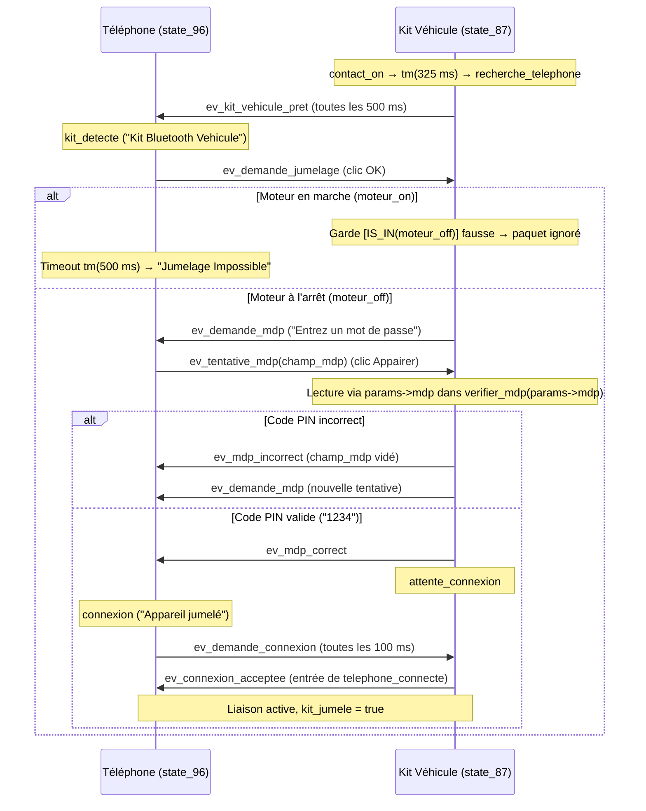

##### Échange 2 — Connexion, reconnexion automatique et déconnexion

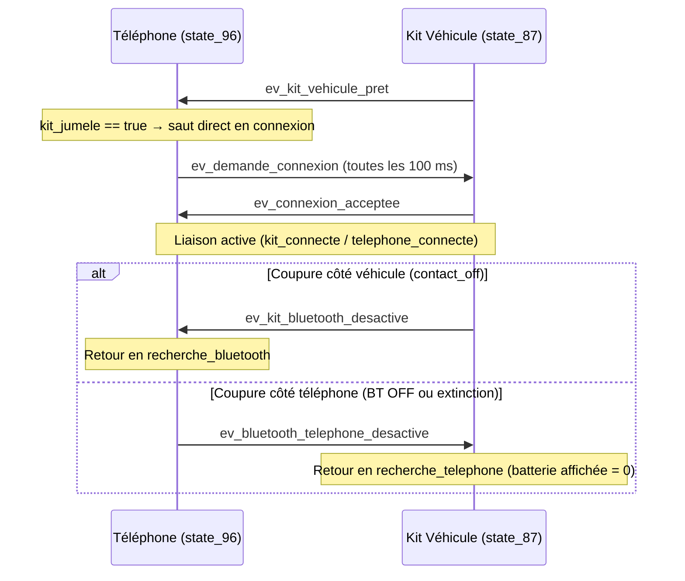


### 10.4 Gestion des appels entrants et redirection mains-libres

#### 10.4.1 Statechart associé
> **[Capture Rhapsody à insérer — Version finale]** : Les trois AND-lines de téléphonie :
> 1. **`Appel Extérieur`** (`state_146`, haut-droite) ;
> 2. **`Communication telephone`** (`state_139`, bas-droite, montrant `arret_de_communication` et les 3 sous-régions parallèles de `gestion_communication_telephone`) ;
> 3. **`Commande kit main libre`** (`state_166`, haut-centre-droite, entre `state_87` et `state_146`).

#### 10.4.2 Choix fonctionnels
Un appel entrant sonne sur le téléphone, ou au volant lorsque le Bluetooth est connecté. L'utilisateur peut l'accepter, le refuser ou le raccrocher indifféremment depuis le téléphone ou depuis le volant.

##### Côté IHM

* **Déclencher un appel** : bouton **Appeler**.
* **Sur le téléphone** : les LED « Appel reçu » indiquent l'appel et la sonnerie, et les boutons **Décrocher** / **Raccrocher** permettent de répondre.
* **Au volant** : les LED « Appel Téléphonique » indiquent l'appel et la sonnerie, avec les mêmes boutons **Décrocher** / **Raccrocher**.
* **Son** : `sonnerie.wav` sur le téléphone, `sonnerie2.wav` sur le kit ; la radio se coupe pendant l'appel (voir [Section 11 Autoradio et arbitrage des priorités audio](#12-autoradio-et-arbitrage-des-priorit%C3%A9s-audio)).

**Côté statechart.** Nous avons découplé la gestion des appels en trois AND-lines, qui collaborent uniquement par événements :

* **Appel Extérieur (réseau)** :

Cette AND-line simule le réseau qui appelle le téléphone. Au repos, elle attend dans `telephone_SIM` la pression du bouton **Appeler** (`ev_btn_SIM_appel`) pour lancer une tentative d'appel (`tentative_appel`), limitée à 5 s (`tm(5000)`). Elle émet alors `GEN(ev_SIM_appel)` toutes les 100 ms (`tm(100)`) : c'est ce flux d'événements qui fait sonner le téléphone et le kit. La tentative se termine de trois façons :
    * l'appel est décroché (`ev_SIM_appel_en_cours`) : le réseau passe en `discussion_telephonique` et y reste jusqu'au raccrochage (`ev_SIM_raccrocher`) ;
    * l'appel est refusé (`ev_SIM_raccrocher`) : retour direct en `telephone_SIM` ;
    * personne ne répond pendant 5 s : le timeout ramène le réseau en `telephone_SIM`.

* **Communication telephone** :

Tant que le téléphone est éteint, les communications sont coupées (`arret_de_communication`). Dès que le téléphone passe dans `telephone_actif` (`EVAL[IS_IN(telephone_actif)]`), l'AND-line entre dans `gestion_communication_telephone`, un état And à trois régions parallèles : les appels sur le téléphone, les SMS ([Section 10.5 Messagerie SMS et tableau de bord connecté](#105-messagerie-sms-et-tableau-de-bord-connect%C3%A9)) et la redirection Bluetooth. Elle y reste jusqu'à l'extinction du téléphone (`EVAL[IS_IN(telephone_eteint)]`).

   * **Appels sur le téléphone** :

   La région démarre dans `init_appel_telephone`, un état de décision : si un appel est déjà en cours (`[appel_en_cours_telephone]`), l'appel est directement repris (on passe en `appel_en_cours`), sinon le téléphone attend la requête de la carte SIM en `attente_appel_tel`. À la réception de l'appel extérieur (`ev_SIM_appel`), le téléphone entre dans `gestion_sonnerie`, qui fait tourner deux régions en parallèle : `sonnerie_lumineuse` fait clignoter le voyant (`VOYANT_telephone_sonnerie`) au rythme de `ev_SIM_appel`, et `sonnerie_sonore` joue la sonnerie du téléphone (`sonnerie.wav`) toutes les 3 s (`tm(3000)`). Si plus aucune requête de la carte SIM n'arrive pendant 1 s (`tm(1000)`), la région lumineuse passe en `sonnerie_finie` et le téléphone retourne en attente (`EVAL[IS_IN(sonnerie_finie)]`). Pendant la sonnerie, l'utilisateur peut :
      * décrocher, sur le téléphone (`ev_btn_telephone_decrocher`) ou au volant (`ev_kit_decrocher`) si le kit est connecté : le téléphone passe en `appel_en_cours`, coupe la sonnerie, allume son voyant d'appel et notifie le réseau (`GEN(ev_SIM_appel_en_cours)`) ;
      * refuser avec **Raccrocher** (`ev_btn_telephone_raccrocher`) : le téléphone envoie `GEN(ev_SIM_raccrocher)` et retourne en attente.

   L'appel se termine par **Raccrocher** sur le téléphone, qui remet `appel_en_cours_telephone` à `false`, ou par `ev_SIM_raccrocher` lorsque l'appel est raccroché au volant. Dans les deux cas, l'action de sortie de `appel_en_cours` éteint le voyant d'appel et prévient le réseau.

   * **Redirection Bluetooth** :

   Cette région ne fait que transférer des paquets au kit Bluetooth, qui s'occupe de réaliser les actions côté véhicule.
   Elle reste inactive (`redirection_off`) tant que le kit n'est pas connecté. Dès que le kit se connecte (`EVAL[IS_IN(kit_connecte)]`), elle éteint le voyant de sonnerie du téléphone et entre dans `redirection_kit_bluetooth_communication`, jusqu'à la déconnexion du kit. La région des appels sur le téléphone reste active en parallèle : le téléphone continue de sonner et de gérer ses propres boutons, et la redirection relaie en plus chaque étape de l'appel vers le volant.
   Son fonctionnement est similaire à celui du téléphone : la redirection démarre par un état de décision, `init_appel_kit`. Si un appel est déjà en cours, elle va directement en `transfer_appel` pour le basculer sur le kit, sinon elle attend en `attente_appel_kit`. À la réception de `ev_SIM_appel`, elle entre dans `sonnerie_transfert`, qui notifie le kit de la présence d'un appel à chaque salve du réseau (`ev_kit_appel_entrant`) et du besoin de sonner toutes les 3 s (`ev_kit_sonnerie`). Si plus aucune requête n'arrive pendant 1 s, la région passe en `sonnerie_finie_kit` et la redirection envoie `GEN(ev_kit_fin_sonnerie)` pour arrêter la sonnerie au volant.
   Depuis `sonnerie_transfert`, deux cas sont possibles :
      * l'appel est décroché au volant (`ev_kit_decrocher`) ou sur le téléphone (`ev_btn_telephone_decrocher`) : la redirection passe en `transfer_appel` et transfère l'appel au kit (`GEN(ev_kit_appel_transfere)`) ;
      * l'appel est raccroché au volant (`ev_kit_raccrocher`) : la redirection refuse l'appel auprès du réseau (`GEN(ev_SIM_raccrocher)`).

   En `transfer_appel`, raccrocher au volant passe par `fin_appel_kit`, qui remet `appel_en_cours_telephone` à `false` et notifie la fin de l'appel au réseau et au kit (`GEN(ev_SIM_raccrocher)` puis `GEN(ev_kit_appel_termine)`) avant de revenir en attente. Un raccrochage depuis le téléphone (`ev_SIM_raccrocher`) ramène lui aussi la région en `attente_appel_kit`, en prévenant le kit de la fin de l'appel (`GEN(ev_kit_appel_termine)`).

   Nous obtenons donc un fonctionnement symétrique entre le téléphone et la redirection Bluetooth : décrocher ou raccrocher sur l'un ou l'autre garde les deux côtés cohérents. Ce choix de conception est expliqué plus bas.

* **Commande kit main libre (kit)** :

Côté véhicule, les commandes ne sont actives que si le téléphone est connecté : le kit passe de `telephone_deconnecte` à `controle_telephone_connecte` sur `EVAL[IS_IN(telephone_connecte)]`, et y revient dès que la connexion est perdue. `controle_telephone_connecte` fait alors tourner en parallèle les appels au volant, l'affichage de la batterie, les SMS au volant ([Section 10.5 Messagerie SMS et tableau de bord connecté](#105-messagerie-sms-et-tableau-de-bord-connect%C3%A9)) et les adaptateurs des boutons au volant. Ces adaptateurs transforment les boutons **Décrocher** / **Raccrocher** du volant (`ev_btn_kit_decrocher`, `ev_btn_kit_raccrocher`) en paquets Bluetooth `ev_kit_decrocher` et `ev_kit_raccrocher`, envoyés au téléphone.
Pour les appels, le kit attend en `attente_redirection_appel`. À la réception de `ev_kit_appel_entrant`, il entre dans `gestion_sonnerie_kit`, où `sonnerie_lumineuse_kit` fait clignoter `VOYANT_kit_sonnerie` à chaque paquet reçu et `sonnerie_sonore_kit` joue `sonnerie2.wav` à chaque `ev_kit_sonnerie` du téléphone. La sonnerie s'arrête de deux façons :
    * sur `ev_kit_fin_sonnerie` ou `ev_kit_raccrocher`, le kit retourne en attente et coupe le son en sortie (`play_sound("stop")`) ;
    * sur `ev_kit_appel_transfere`, le kit passe en `appel_en_cours_kit`, allume `VOYANT_kit_appel` et notifie le réseau (`GEN(ev_SIM_appel_en_cours)`).

L'appel au volant se termine sur `ev_kit_appel_termine`, qui éteint le voyant d'appel et ramène le kit en `attente_redirection_appel`.

##### Échange 3 — Appel entrant redirigé vers le kit mains-libres

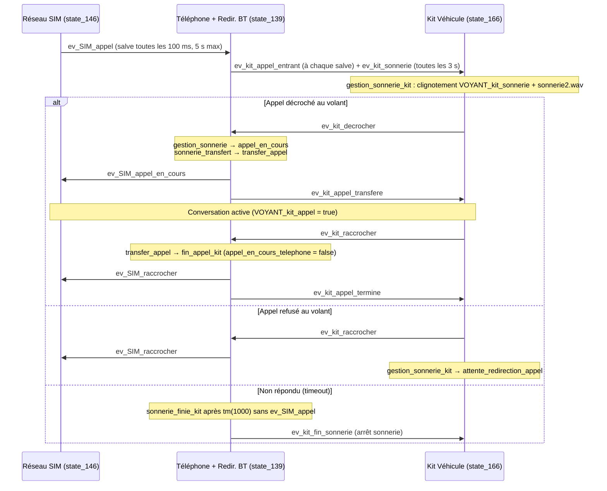

#### 10.4.3 Choix de conception

* Au début, la redirection et la gestion locale des appels étaient deux états exclusifs : connecter le kit ou couper le contact en plein appel détruisait le contexte de l'appel. Nous avons donc placé la redirection dans une région parallèle, avec des transitions croisées : la région du téléphone accepte `ev_kit_decrocher` venant du volant, la redirection accepte `ev_btn_telephone_decrocher` venant du téléphone, et chacune se remet en attente sur le `ev_SIM_raccrocher` émis par l'autre. Décrocher ou raccrocher sur le téléphone ou au volant garde ainsi les deux côtés cohérents.
Nous avons choisi de garder cette architecture parallèle plutôt que de fusionner les deux régions par souci de lisibilité : le statechart est déjà très dense, et la fusion aurait dupliqué les états, différenciés seulement par une garde vérifiant la connexion du kit.
* Nous émettons `GEN(ev_SIM_raccrocher)` en action `exit` de `appel_en_cours` : comme ça, quelle que soit la façon dont l'appel se termine (bouton **Raccrocher**, raccrochage au volant ou extinction du téléphone en pleine conversation), le réseau simulé ne reste jamais bloqué en communication. Au volant, `fin_appel_kit` émet le même paquet en entrée.
* En entrée, `arret_de_communication` éteint le téléphone (`eteindre_telephone()`, qui remet à zéro les voyants, `appel_en_cours_telephone` et le compteur de SMS). Cette action aurait pu être placée sur sa transition d'entrée, mais nous avons préféré la garder dans l'état pour plus de lisibilité.
* Il n'y a qu'une seule bande son (`PlaySound` ne lit qu'un fichier à la fois) : le téléphone et le kit ne peuvent donc pas sonner en même temps. Lorsque le téléphone est connecté au kit, c'est la sonnerie du kit (`sonnerie2.wav`) qui a la priorité : elle est relancée juste après celle du téléphone, puisqu'elle passe par un paquet Bluetooth supplémentaire (`ev_kit_sonnerie`), et remplace donc `sonnerie.wav` à chaque cycle de 3 s. L'utilisateur entend ainsi que l'appel est redirigé vers le véhicule. Sans kit connecté, c'est la sonnerie du téléphone qui est jouée.


### 10.5 Messagerie SMS et tableau de bord connecté

#### 10.5.1 Statechart associé
> **[Capture Rhapsody à insérer — Version finale]** : AND-line **`SMS Extérieur`** (`state_206`, tout en haut à droite), accompagnée des sous-régions SMS (`state_184` et `state_189` dans `Communication telephone` + `state_199` dans `Commande kit main libre`).

#### 10.5.2 Choix fonctionnels
Les SMS sont reçus en parallèle des appels : un SMS reçu en plein appel est compté sans perturber la conversation. Leur nombre et un voyant s'affichent sur le téléphone et au tableau de bord. La lecture est synchronisée entre les deux, et interdite au volant en roulant.

##### Côté IHM

* **Envoyer un SMS** : bouton **Envoyer SMS**.
* **Sur le téléphone** : une LED, un compteur de SMS et le bouton **lire sms**.
* **Au volant** : la LED « SMS non lus », un compteur et le bouton **lire message**, sans effet si le véhicule roule.

**Côté statechart.** Comme pour les appels, la messagerie est répartie sur trois AND-lines, et seul le téléphone modifie le nombre de SMS : le kit ne fait qu'afficher la valeur qu'il reçoit.

* **SMS Extérieur (réseau)** :

Cette AND-line simule l'envoi d'un SMS par le réseau. Elle n'a qu'un seul état, `sms_exterrieur` : à chaque pression du bouton **Envoyer SMS** (`ev_btn_SIM_sms`), elle émet `GEN(ev_SIM_envoi_sms)` vers le téléphone.

* **Communication telephone** :

Dans `gestion_communication_telephone`, deux des trois régions parallèles gèrent les SMS :

   * **SMS sur le téléphone** :

   La région attend en `reception_sms`, qui calcule en entrée le voyant du téléphone (`VOYANT_telephone_sms = (nbr_sms_telephone > 0)`). À chaque SMS reçu (`ev_SIM_envoi_sms`), le compteur augmente de 1 (`actualisation_sms_telephone(1)`). À la pression du bouton **lire sms** (`ev_btn_telephone_lire_sms`), la région passe en `lire_sms`, qui retire un SMS (`actualisation_sms_telephone(-1)`, plancher à 0), puis revient en `reception_sms` après `tm(1)`.

   * **Redirection Bluetooth des SMS** :

   Dans `redirection_kit_bluetooth_communication`, une seconde région synchronise le kit. À la connexion du kit, elle envoie tout l'historique (`GEN(ev_transfert_sms_to_kit(nbr_sms_telephone))`), puis attend en `reception_sms_kit`, qui renvoie le compteur à jour au kit en entrée (`GEN(ev_nv_sms_kit(nbr_sms_telephone))`). Elle réagit à trois événements :
      * un nouveau SMS (`ev_SIM_envoi_sms`) : elle rentre de nouveau dans `reception_sms_kit`, qui transmet le nouveau compteur au kit ;
      * une lecture sur le téléphone (`ev_btn_telephone_lire_sms`) : elle envoie `GEN(ev_actualisation_sms_kit(nbr_sms_telephone))`, puis le compteur à jour en entrée de `reception_sms_kit` ;
      * une lecture au volant (`ev_kit_lire_sms`) : elle passe en `lire_sms_kit`, qui retire un SMS côté téléphone (`actualisation_sms_telephone(-1)`), puis renvoie le compteur au kit en sortie (`GEN(ev_actualisation_sms_kit(nbr_sms_telephone))`) après `tm(1)`.

* **Commande kit main libre (kit)** :

Dans `controle_telephone_connecte`, deux régions parallèles gèrent les SMS au volant :
    * l'adaptateur du bouton **lire message** (`gestion_btn_lire_sms_kit`) transforme `ev_btn_kit_lire_sms` en `GEN(ev_tentative_lire_sms_kit)` ;
    * la messagerie du kit démarre en `init_redirection_sms_kit` et attend l'historique du téléphone (`ev_transfert_sms_to_kit`, `nbr_sms_kit = params->historique`). Elle passe ensuite en `messagerie_kit`, qui calcule le voyant en entrée (`VOYANT_kit_sms = (nbr_sms_kit > 0)`) et recopie chaque nouveau compteur (`ev_nv_sms_kit`, `nbr_sms_kit = params->sms_telephone`). Une demande de lecture n'est acceptée que véhicule à l'arrêt (`[speed<=0]`) : le kit passe en `lire_message_kit`, envoie `GEN(ev_kit_lire_sms)` au téléphone et attend le compteur à jour pour revenir en `messagerie_kit`.

* **Persistance** : à l'extinction du téléphone, `arret_de_communication` sauvegarde le compteur (`nbr_sauvegarde_sms_telephone = nbr_sms_telephone`) avant de le remettre à 0. Les SMS non lus sont restaurés au rallumage, en sortie de `arret_de_communication`. Seuls les SMS déjà reçus sont conservés : un SMS envoyé pendant que le téléphone est éteint n'est reçu par aucune région et il est perdu. À la déconnexion Bluetooth, `VOYANT_kit(false)` éteint les voyants du tableau de bord et `nbr_sms_kit` est remis à 0.

##### Échange 4 — Synchronisation et lecture de SMS

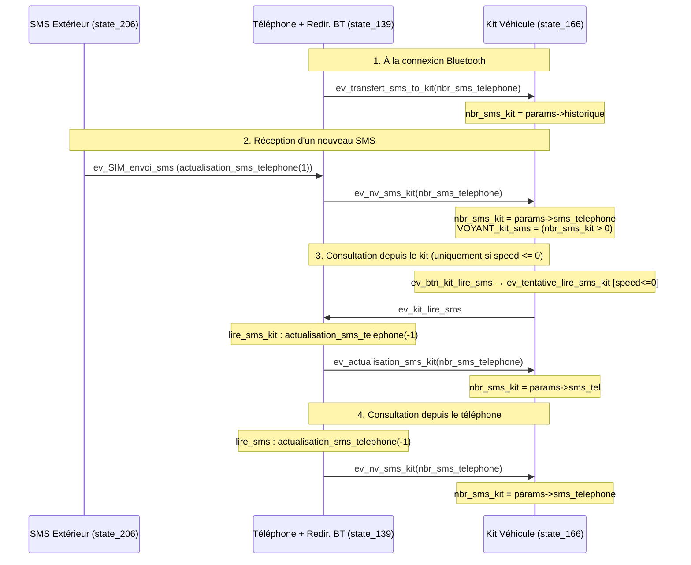

#### 10.5.3 Choix de conception

* Au début, nous avions deux compteurs indépendants (téléphone et kit), qui dérivaient dès qu'un SMS arrivait pendant une déconnexion. Nous n'en gardons donc qu'un seul comme référence, `nbr_sms_telephone`, que le téléphone pousse vers le kit (`ev_transfert_sms_to_kit`, `ev_nv_sms_kit`, `ev_actualisation_sms_kit`).
* La lecture est synchronisée quel que soit l'écran : quand nous lisons un SMS sur le téléphone (`ev_btn_telephone_lire_sms`), le compteur du tableau de bord est aussi mis à jour.
* Lorsque le té


## 12. Autoradio et arbitrage des priorités audio

### 11.1 Statechart associé


### 11.2 Choix fonctionnels
L'autoradio lit trois pistes, s'éteint contact coupé ou batterie vide, cède la place aux sonneries et aux appels passés au volant, puis reprend la piste en cours.

**Côté IHM.** Nous allumons la radio avec son interrupteur, et sa LED le confirme. **Play** lance la lecture, **Skip** passe à la piste suivante, et l'afficheur montre le titre (« Press PLAY » à l'arrêt).

**Côté statechart.** Nous avons construit l'AND-line Radio comme une machine à deux niveaux : une alimentation, puis un arbitrage des priorités audio (Radio < Sonnerie < Appel).

* **Alimentation** :

Au démarrage, la radio est en `radio_eteinte`. En entrée, cet état coupe le son (`play_sound("stop")`), éteint le voyant (`VOYANT_radio = false`), vide l'afficheur et remet l'interrupteur à `false` (`cmd_radio = false`). Dès que le véhicule peut l'alimenter (`EVAL[IS_IN(contact_on) && niveau_batterie > 0]`), la radio passe en `radio_prete` et attend son interrupteur (`EVAL[cmd_radio == true]`) pour entrer dans `contact_radio_actif`. Elle retourne en `radio_eteinte` si le contact est coupé ou la batterie vide (`EVAL[IS_IN(contact_off) || niveau_batterie <= 0]`), ou si nous l'éteignons (`EVAL[cmd_radio == false]`).

* **Lecteur (`priorite_radio`)** :

`contact_radio_actif` démarre dans `priorite_radio`, un état And à deux régions parallèles :
   * **le lecteur** : en `lancement_radio`, le voyant s'allume et l'afficheur indique « Press PLAY ». À la pression de **Play** (`ev_btn_start_radio`), la radio entre dans `radio_active` et lit `musique_1`. Chaque piste affiche son titre et lance son fichier en entrée (`play_sound("musique_1.wav")`…), et `ev_skip_musique` fait tourner la lecture en boucle : `musique_1` → `musique_2` → `musique_3` → `musique_1` ;
   * **l'anti-rebond du bouton Skip** : en `attente_btn_radio`, un appui sur **Skip** (`ev_btn_radio_skip`) fait passer en `appui_btn_radio`, qui n'envoie `GEN(ev_skip_musique)` qu'après 500 ms (`tm(500)`). Les appuis reçus pendant ce délai sont ignorés.

* **Priorités** :

Depuis `priorite_radio`, deux transitions sur `EVAL` interrompent la musique :
   * une sonnerie, sur le téléphone ou au volant (`[sonnerie_en_cours]`), fait passer en `priorite_sonnerie` : la radio laisse le canal audio à `sonnerie.wav` ou `sonnerie2.wav` ;
   * un appel décroché au volant (`[IS_IN(appel_en_cours_kit)]`) fait passer en `priorite_appel`, qui coupe le son en entrée (`play_sound("stop")`).

   Depuis `priorite_sonnerie`, un appel décroché au volant fait aussi passer en `priorite_appel`.

* **Reprise** : en fin de sonnerie (`[!sonnerie_en_cours]`) ou d'appel (`[!IS_IN(appel_en_cours_kit)]`), les transitions visent un connecteur d'historique (H) dans `priorite_radio`. La radio revient exactement dans l'état d'avant l'interruption : en `lancement_radio` si nous n'avions pas lancé la lecture, ou sur la même piste, qui est relancée par son action d'entrée.

Voici un schéma qui illustre cet arbitrage des priorités :

```mermaid
flowchart LR
    OFF["`**radio_eteinte**<br/>Coupure audio, VOYANT_radio = false`"]
    PRET["`**radio_prete**<br/>Contact mis, batterie > 0`"]
    subgraph ACT["contact_radio_actif — Arbitrage des priorités audio"]
        P1["`**Priorité 3 (basse) : priorite_radio**<br/>lancement_radio / musique_1..3<br/>+ anti-rebond Skip (500 ms)`"]
        P2["`**Priorité 2 : priorite_sonnerie**<br/>Canal cédé à sonnerie.wav / sonnerie2.wav`"]
        P3["`**Priorité 1 (haute) : priorite_appel**<br/>Silence audio durant l'appel`"]
        H(("`**H**<br/>History`"))

        P1 -->|"`sonnerie_en_cours`"| P2
        P1 -->|"`IS_IN(appel_en_cours_kit)`"| P3
        P2 -->|"`IS_IN(appel_en_cours_kit)`"| P3
        P2 -->|"`!sonnerie_en_cours`"| H
        P3 -->|"`!IS_IN(appel_en_cours_kit)`"| H
        H -.->|"`Reprise piste exacte`"| P1
    end

    OFF -->|"`IS_IN(contact_on) && niveau_batterie > 0`"| PRET
    PRET -->|"`cmd_radio == true`"| ACT
    ACT -->|"`IS_IN(contact_off) || niveau_batterie <= 0`<br/>`cmd_radio == false`"| OFF

    classDef off fill:#f1f5f9,stroke:#64748b,color:#334155
    classDef p1 fill:#dcfce7,stroke:#16a34a,color:#14532d
    classDef p2 fill:#fef3c7,stroke:#d97706,color:#78350f
    classDef p3 fill:#ffe4e6,stroke:#e11d48,color:#881337
    classDef hist fill:#e0e7ff,stroke:#4f46e5,stroke-width:2px,color:#312e81
    class OFF off
    class PRET off
    class P1 p1
    class P2 p2
    class P3 p3
    class H hist
```

### 11.3 Choix de conception

* `PlaySound` ne gère qu'une piste à la fois : toute sonnerie coupe donc la musique. Nous avons mis en place la machine de priorités et le connecteur d'historique pour reprendre proprement la lecture.
* Nous avons ajouté l'anti-rebond pour éviter qu'un double clic sur **Skip** saute plusieurs pistes.
* Les deux priorités ne sont pas traitées de la même façon, et c'est voulu. Le simulateur n'a qu'une seule bande son : toute sonnerie, qu'elle vienne du téléphone ou du kit (`sonnerie_en_cours`), prend donc forcément la place de la musique. En revanche, un appel passé sur le téléphone seul n'a aucune incidence réelle sur l'autoradio du véhicule : la musique reprend dès la fin de la sonnerie. Ce n'est que lorsque le téléphone est connecté au kit que l'appel utilise la piste audio du véhicule (`IS_IN(appel_en_cours_kit)`) : la radio passe alors en `priorite_appel` et se tait jusqu'à la fin de l'appel.

## 13. Régulateur de vitesse adaptatif (ACC)

Le régulateur de vitesse adaptatif (ACC) prolonge le régulateur de vitesse simple ([Section 8 Régulateur de vitesse simple](#9-r%C3%A9gulateur-de-vitesse-simple)) en prenant en compte un véhicule plus lent qui nous précède. Tant que la voie est libre, la voiture maintient sa vitesse de consigne ; dès que l'écart passe sous la distance de sécurité (`distance_securite`, `30 m` par défaut), elle adapte son injection pour suivre la cible à distance constante, puis réaccélère jusqu'à la vitesse cible quand la voie se libère.

### 12.1 Fonctionnement depuis l'IHM

* **Paramétrage du véhicule cible** : nous réglons la distance initiale qui nous sépare de la voiture de devant (`distance_inter_voiture`) ainsi que sa vitesse (`vitesse_voiture_devant`).
* **Activation de la simulation** : l'interrupteur `cmd_simulation_voiture_devant` active le déplacement de la voiture cible ; la distance qui nous sépare d'elle se met à jour en temps réel sur l'IHM.
* **Pilotage sous ACC** : aucune commande supplémentaire n'est nécessaire au volant, nous activons simplement le bouton **Régulateur** (voir [Section 8.1 Fonctionnement depuis l'IHM](#81-fonctionnement-depuis-lihm)). Si la distance passe sous `30 m`, le véhicule ralentit automatiquement pour la maintenir ; si la voiture de devant accélère ou est désactivée, le régulateur revient de lui-même à la **vitesse cible**.

### 12.2 Statechart

#### 12.2.1 Simulation de la voiture qui précède

Une AND-line dédiée **`Simulation voiture régulateur adaptatif`** simule le déplacement du véhicule cible indépendamment de notre véhicule :

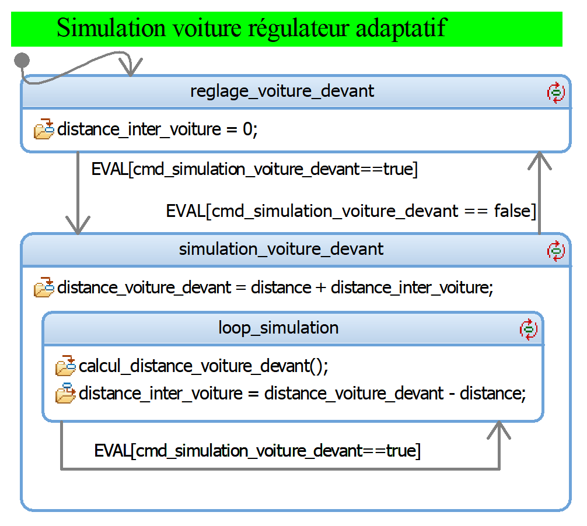

* Dans l'état initial `reglage_voiture_devant`, la distance inter-véhicule est remise à zéro tant que la simulation n'est pas lancée, ce qui permet de régler librement les conditions initiales.
* Dès que `EVAL[cmd_simulation_voiture_devant == true]`, l'entrée dans `simulation_voiture_devant` place la voiture cible devant nous (`distance_voiture_devant = distance + distance_inter_voiture;`).
* Le sous-état `loop_simulation` reboucle à chaque événement `EVAL` (`20 Hz`) tant que l'interrupteur reste enclenché : il avance la cible via `calcul_distance_voiture_devant()` et actualise l'écart `distance_inter_voiture = distance_voiture_devant - distance`. Couper l'interrupteur (`EVAL[cmd_simulation_voiture_devant == false]`) renvoie l'AND-line dans `reglage_voiture_devant`.

#### 12.2.2 Aiguillage entre suivi de vitesse et suivi de distance

Plutôt que d'ajouter une nouvelle AND-line qui modifierait `throttle`, nous avons directement étendu le super-état `regulateur` de l'AND-line **`Débit de l'injection d'essence`** :


* À chaque pas du régulateur (`tm(1000/PARAM_SIMU_freq_regulateur)`, soit `3 Hz`), le super-état `regulateur` repasse par son état initial `verification_distance_securite`, qui aiguille immédiatement le calcul :
  * si un véhicule cible est actif et plus proche que la distance de sécurité (`[distance_inter_voiture < distance_securite && IS_IN(simulation_voiture_devant)]`), il passe dans `suivi_distance_consigne` et appelle `calcul_regulateur_distance()` ;
  * sinon (`[distance_inter_voiture > distance_securite || !IS_IN(simulation_voiture_devant)]`), il passe dans `suivi_vitesse_consigne` et appelle le régulateur classique `calcul_regulateur_vitesse()`.

### 12.3 Simulation de la cible et correcteur PI de distance

Voici un schéma synthétique illustrant l'articulation entre la simulation de la voiture cible et les deux modes du régulateur :

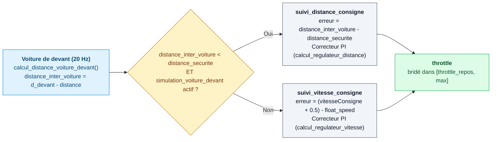

Voici le code de l'opération `calcul_distance_voiture_devant()`, appelée à `20 Hz` dans `loop_simulation` :

<!-- code:calcul_distance_voiture_devant() -->
```cpp
const double DELTA_T_MS            = (double)(1000/PARAM_SIMU_freq_rafraichissement);
const double CST_CONVERSION_KMH_MS = 3.6;
const double CST_CONVERSION_MS_S   = 1000.0;
const double dt                    = DELTA_T_MS / CST_CONVERSION_MS_S;

distance_voiture_devant += (vitesse_voiture_devant / CST_CONVERSION_KMH_MS) * dt;
distance_entiere_voiture_devant = (int)distance_voiture_devant;
```

Elle intègre simplement la position de la voiture de devant sur le même pas de temps `dt` (`50 ms`) que notre propre véhicule dans `calcul_vitesse_distance()`.

Voici le code de l'opération `calcul_regulateur_distance()`, appelée à `3 Hz` dans `suivi_distance_consigne` :

<!-- code:calcul_regulateur_distance() -->
```cpp
// Calcul de l'erreur de distance à partir de
// la distance inter voiture
// et de la distance de sécurité
const double erreur = (double)distance_inter_voiture - (double)distance_securite;

steady += Ki_regulateur * erreur;

if (steady > PARAM_SIMU_max_throttle) steady = PARAM_SIMU_max_throttle;
if (steady < throttle_repos)          steady = throttle_repos;

double commande = steady + (Kp_regulateur * erreur);

if (commande > PARAM_SIMU_max_throttle) commande = PARAM_SIMU_max_throttle;
if (commande < throttle_repos)          commande = throttle_repos;

throttle = commande;
```

Cette fonction reprend exactement la même loi PI saturée et les mêmes gains `Kp_regulateur` / `Ki_regulateur` que `calcul_regulateur_vitesse()` (voir [Section 8.3 Correcteur PI pour le régulateur de vitesse](#83-correcteur-pi-pour-le-r%C3%A9gulateur-de-vitesse)), en remplaçant l'erreur de vitesse par l'erreur de distance `distance_inter_voiture - distance_securite`. Le partage de l'accumulateur intégral `steady` garantit une transition fluide, sans à-coup sur le `throttle`, lors du basculement entre suivi de vitesse et suivi de distance.

### 12.4 Évolution et limites

Nous voulions une extension non intrusive : en intégrant directement le choix vitesse/distance dans le super-état `regulateur` existant, l'AND-line `Débit de l'injection d'essence` reste l'unique écrivain de `throttle`, et le comportement reste homogène entre régulateur simple et régulateur adaptatif.

Comme l'ACC n'agit que sur le `throttle` (plancher à `throttle_repos` et frein moteur de `-300 N` au-dessus de `10 km/h`), sa capacité de ralentissement repose uniquement sur l'inertie et les frottements du véhicule. C'est l'une des raisons pour lesquelles nous avons relevé la masse (`1500 kg`) et le coefficient de roulement (`0.05`) dans le modèle physique (voir [Section 4 Simulation du véhicule](#5-simulation-du-v%C3%A9hicule)), afin d'obtenir une décélération naturelle suffisamment efficace pour maintenir la distance de sécurité.

Enfin, deux limites restent identifiées pour d'éventuelles améliorations : nous n'avons pas implémenté de freinage mécanique automatique ni d'alerte sonore en cas de freinage brutal de la cible, et les deux gardes en sortie de `verification_distance_securite` sont strictes (`<` et `>`), ce qui laisse de côté le cas exact d'égalité `distance_inter_voiture == distance_securite` jusqu'au pas suivant.

<!--

## 13. Synthèse, cartographie des AND-lines et tests d'intégration

### 13.1 Cartographie complète de la grille d'AND-lines (Systeme)

Le statechart final de `_SysVehicule` compte 16 AND-lines actives, réparties en deux grands blocs (conduite et aides à la conduite à gauche, télécommunications et Bluetooth à droite, autoradio en bas). Quatre cellules vides complètent le quadrillage de la ligne inférieure. Nous détaillons le regroupement par bloc dans la [Section 3.1 Vue d'ensemble des AND-lines](#31-vue-densemble-des-and-lines), et chaque AND-line est capturée dans l'[Annexe B — États par AND-line](#annexe-b--%C3%A9tats-par-and-line).

> **[Capture Rhapsody à insérer — Vue d'ensemble]** : Capture globale du Statechart `Systeme` de `_SysVehicule` montrant la répartition complète des 16 AND-lines actives.

### 13.2 Scénarios testés

Voici les scénarios que nous avons testés en mode animation :

| # | Scénario testé | AND-lines impliquées | Comportement vérifié en animation | Statut |
| :---: | :--- | :--- | :--- | :---: |
| 1 | Coupure du contact à 90 km/h sous régulateur, radio active | Clé du véhicule, Débit de l'injection d'essence, Mode de pilotage, Simulation du vehicule, Radio, Jumelage kit main libre | Passage en `moteur_off`, arrêt du régulateur, de la radio et du Bluetooth, `throttle = 0`, décélération par inertie, frein mécanique actif | ✓ |
| 2 | Panne batterie puis dépannage et redémarrage | Ressources et pannes, Clé du véhicule, Simulation du vehicule | Coupure moteur sous 40 %, dépannage bloqué tant que `speed > 0` ou contact mis, recharge à 55 %, redémarrage réussi (chute à 45 %, au-dessus du seuil) | ✓ |
| 3 | Bascule régulateur vers limiteur à 80 km/h (consigne initiale 50) | Mode de pilotage, Limiteur de vitesse, Débit de l'injection d'essence | Exclusion mutuelle immédiate, entrée en `limiteur_inhibe` (`limiteur_attente = true`, pas d'alarme), passage en `limiteur_effectif` dès `speed <= 50` | ✓ |
| 4 | Double appui + en moins de 500 ms, puis kick-down | Limiteur de vitesse, Débit de l'injection d'essence | Saut exact de +10 km/h (+1 puis +9), puis désactivation dès `(vitesseConsigne - speed) < 10 && accelPedal > 7` | ✓ |
| 5 | Jumelage PIN moteur allumé puis moteur éteint, puis reconnexion | Clé du véhicule, Jumelage kit main libre, Telephone | Timeout de 500 ms moteur allumé ; validation de `1234` moteur éteint ; reconnexion automatique après coupure et remise du contact | ✓ |
| 6 | Appel entrant pendant `musique_2`, décroché au volant puis raccroché | Appel Extérieur, Communication telephone, Commande kit main libre, Radio | Interruption de `musique_2`, `sonnerie2.wav`, son coupé pendant l'appel, reprise exacte sur `musique_2` via H, réseau revenu en `telephone_SIM` | ✓ |
| 7 | Réception et lecture de SMS au volant en roulant, puis à l'arrêt | SMS Extérieur, Communication telephone, Commande kit main libre, Simulation du vehicule | Compteur incrémenté sans couper un appel, lecture au volant bloquée si `speed > 0`, autorisée à l'arrêt avec décrémentation synchronisée | ✓ |
| 8 | Rattrapage d'un véhicule lent sous ACC puis dégagement | Simulation voiture régulateur adaptatif, Débit de l'injection d'essence, Mode de pilotage, Simulation du vehicule | Bascule `suivi_vitesse_consigne` → `suivi_distance_consigne` sous 30 m, stabilisation, puis réaccélération jusqu'à `vitesseConsigne` une fois la voie libre | ✓ |


-->


## 14. Implémentation de la gestion sonore sous Rhapsody

Trois fonctionnalités produisent du son : l'alarme de dépassement du limiteur ([Section 9 Limiteur de vitesse](#10-limiteur-de-vitesse)), les sonneries d'appel sur le téléphone et le kit ([Section 10.4 Gestion des appels entrants et redirection mains-libres](#104-gestion-des-appels-entrants-et-redirection-mains-libres)), et les trois pistes de l'autoradio ([Section 11 Autoradio et arbitrage des priorités audio](#12-autoradio-et-arbitrage-des-priorit%C3%A9s-audio)). Nous les faisons toutes passer par une seule opération, `play_sound()`.

### 14.1 Côté IHM

* **Alarme du limiteur** : en forte descente sous limiteur, la LED de dépassement (**G2**) s'allume et `alarme_depassement.wav` tourne en boucle jusqu'à ce que la vitesse revienne sous la consigne ou que le limiteur soit désactivé (**G1**).
* **Sonneries** : un appel lancé depuis **C1** fait sonner `sonnerie.wav` sur le téléphone, ou `sonnerie2.wav` au volant si le kit est connecté. Le son s'arrête au décrochage (**I6**, **K11**) ou à la fin du délai.
* **Autoradio** : **Play** (**J5**) et **Skip** (**J4**) lancent `musique_1.wav` à `musique_3.wav` ; la musique s'interrompt pendant une sonnerie ou un appel puis reprend.

### 14.2 Côté statechart

Dans notre version, les états concernés n'appellent jamais `PlaySound` directement :

* **Dossier versionné** : les 6 fichiers `.wav` sont dans `Projet_TABDK_E4SE/sons/`, suivi sous Git.
* **Chemin centralisé** : l'attribut `chemin_sons` (`"..\\..\\sons\\"`, relatif à `CodesGeneres/ModeAnimation/`) est le seul endroit où le chemin est écrit.
* **Point d'entrée unique** : `play_sound(const OMString& fichier)` lance un fichier en boucle, ou coupe le son avec le mot-clé `"stop"`.

```cpp
// Opération play_sound(const OMString& fichier)
if (fichier == "stop") {
    PlaySound(NULL, NULL, 0);
} else {
    OMString chemin = chemin_sons;
    chemin += fichier;
    PlaySound(TEXT(chemin.GetBuffer(0)), NULL, SND_LOOP | SND_ASYNC);
}
```

Le tableau suivant résume, pour chaque son, l'état qui le lance et la façon dont il s'arrête :

| Fonctionnalité | État / opération appelante | Fichier .wav joué | Mécanisme d'arrêt |
| :--- | :--- | :--- | :--- |
| Alarme limiteur ([Section 9 Limiteur de vitesse](#10-limiteur-de-vitesse)) | `alerte_depassement(1)` depuis Limiteur de vitesse / `depassement` | `alarme_depassement.wav` | `alerte_depassement(0)` en exit de `depassement` et en entry de `limiteur_off` |
| Sonnerie téléphone ([Section 10.4 Gestion des appels entrants et redirection mains-libres](#104-gestion-des-appels-entrants-et-redirection-mains-libres)) | Communication telephone / `sonnerie_sonore` | `sonnerie.wav` | `play_sound("stop")` en exit de `gestion_sonnerie` et en entry de `appel_en_cours` |
| Sonnerie kit véhicule ([Section 10.4 Gestion des appels entrants et redirection mains-libres](#104-gestion-des-appels-entrants-et-redirection-mains-libres)) | Commande kit main libre / `sonnerie_sonore_kit` | `sonnerie2.wav` | `play_sound("stop")` en exit de `gestion_sonnerie_kit` |
| Autoradio 3 pistes ([Section 11 Autoradio et arbitrage des priorités audio](#12-autoradio-et-arbitrage-des-priorit%C3%A9s-audio)) | Radio / `musique_1`, `musique_2`, `musique_3` | `musique_1.wav` à `musique_3.wav` | `play_sound("stop")` en entry de `radio_eteinte` et de `priorite_appel` |

### 14.3 Pourquoi ce fonctionnement

* Le sujet propose de placer les `.wav` dans `CodesGeneres/ModeAnimation/`, mais ce dossier est généré et exclu par `.gitignore` : après chaque récupération du travail de l'autre binôme, les sons manquaient. Nous les avons donc rangés dans un dossier `sons/` versionné.
* Au début, nos appels `PlaySound` étaient dispersés et utilisaient des chemins différents, et les pistes de la radio n'avaient même pas l'extension `.wav`. Nous avons donc centralisé le chemin et l'appel dans une seule opération.
* Avec `SND_LOOP | SND_ASYNC`, un son tourne jusqu'à un arrêt explicite : sans les arrêts listés ci-dessus, les sonneries continuaient après un décrochage. Nous avons donc prévu un arrêt explicite pour chaque son.
* `PlaySound` coupe la piste en cours à chaque nouvel appel : c'est ce qui nous a imposé la machine de priorités de l'AND-line Radio (voir [Section 11 Autoradio et arbitrage des priorités audio](#12-autoradio-et-arbitrage-des-priorit%C3%A9s-audio)).


## 15. Outillage complémentaire : injection d'une API REST et interface graphique Web

### 15.1 Motivation

Le Panel Diagram de Rhapsody est très pratique pour le débogage pas à pas en mode animation, mais son ergonomie (widgets ActiveX datés, pas de mise en page adaptative, dépendance à une installation locale de Rhapsody) limite la lisibilité lors d'une démonstration complète. Nous avons donc développé un outil qui transforme le code C++ généré par Rhapsody en un logiciel autonome pilotable depuis une interface Web.

### 15.2 Architecture et fonctionnement de l'outil

Plutôt que de réécrire la logique du véhicule en JavaScript, nous avons choisi de garder le moteur C++ OXF généré par Rhapsody comme cœur d'exécution. Notre outil procède en trois étapes :

1. **Analyse du code C++ généré** : `_SysVehicule`, ses attributs, getters/setters et événements OXF.
2. **Injection d'un serveur HTTP embarqué** : l'outil relie les attributs (lecture de l'état : vitesse, distance, voyants, messages, jauges ; écriture des commandes : pédales, pente, interrupteurs) et les événements (`GEN(ev_*)` sur les boutons) à une API REST.
3. **Interface graphique Web** : l'exécutable enrichi est couplé à une interface (tableau de bord, commandes au volant, smartphone virtuel, autoradio) qui dialogue en temps réel avec le statechart via des requêtes REST.

Voici un schéma qui illustre cette chaîne :

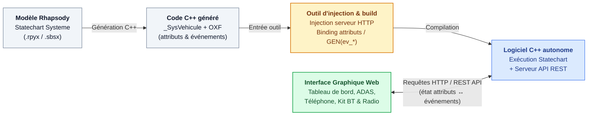

### 15.3 Liens vers la démonstration et le dépôt GitHub

* Démo de l'interface Web : \[lien à compléter\]
* Dépôt GitHub de l'outil (injection API REST et interface Web) : \[lien à compléter\]

> **[Capture d'écran à insérer — Optionnel]** : Vue de l'interface graphique Web pilotant le code C++ Rhapsody via l'API REST.

<!--

## 16. Conclusion générale

### 16.1 Bilan du projet

Nous avons abouti à un modèle Statechart complet, exécutable et validé en animation. Il couvre tous les sous-systèmes demandés (dynamique véhicule, commandes, modélisation énergétique, régulateur PI, limiteur, kit Bluetooth avec PIN, appels et SMS, autoradio à priorités, extension ACC), complétés par une couche audio centralisée et un outil d'exposition REST/Web du code C++ généré.

### 16.2 Enseignements majeurs tirés des difficultés rencontrées

1. **Synchronisation centralisée (`GEN(EVAL)`)** : en remplaçant les boucles locales `tm() -> History` par une horloge unique à 20 Hz, nous avons fait le changement d'architecture le plus bénéfique pour le déterminisme et la lisibilité.
2. **Juste usage de l'orthogonalité (And vs OR)** :
   * l'orthogonalité nous a servis pour la redirection Bluetooth (en parallèle des appels locaux, pour ne jamais perdre une conversation) et pour la séparation appels / SMS ;
   * à l'inverse, une orthogonalité superflue dans `limiteur_on` créait des alarmes en phase d'inhibition ; nous avons résolu le problème avec une hiérarchie séquentielle (`limiteur_inhibe` → `limiteur_effectif` → `depassement`).
3. **Source de vérité unique et événements paramétrés** : pour le code PIN (`ev_tentative_mdp(champ_mdp)`) comme pour les SMS (`nbr_sms_telephone` poussé vers `nbr_sms_kit`), nous avons supprimé les désynchronisations en évitant les données dupliquées.
4. **Rigueur sur l'IHM et le travail collaboratif** : nous avons préféré les boutons poussoirs événementiels (`ev_regulateur`, `ev_limiteur`, `ev_demarrer`) aux interrupteurs, centralisé l'audio (`play_sound()` et dossier `sons/`), surveillé les fautes de frappe dans les noms d'événements et fusionné avec discipline les fichiers XML `.sbsx`.

### 16.3 Perspectives d'évolution

1. **Correction des trois détails identifiés** : inverser la garde de sortie `depassement -> limite_tenue` (`speed <= vitesseConsigne`), passer l'une des gardes de `verif_distance_secu` en inégalité large (`>=`), et aligner `CST_COEFF_ROULEMENT` (0,05) dans le constructeur `_SysVehicule()`.
2. **Freinage d'urgence autonome (AEB) et distance de sécurité dynamique** : commande bornée du frein mécanique par l'ACC, alerte visuelle et sonore en cas de freinage brutal de la cible, et distance de sécurité selon la règle des 2 secondes (d = 2 · v).
3. **Arbitrage audio incluant la sécurité** : intégrer les alarmes limiteur et ACC comme priorité la plus haute de l'AND-line Radio (Sécurité > Appel > Sonnerie > Radio), pour qu'une alarme coupe puis restitue la musique via le connecteur H.
4. **Scénarios routiers automatisés et multi-téléphones** : profils de pente préprogrammés et liste de plusieurs téléphones jumelés.

-->

<!-- 

## 16. Annexes

### Annexe A — IHM détaillée

> **\[Image à insérer\]** Capture du Panel Diagram en grand format (ou zone par zone), chaque widget portant son numéro (A1 à K14).

E = entrée (commande de l'utilisateur), S = sortie (affichage). Les liaisons marquées « à vérifier » sont à confirmer dans Rhapsody.

| N° | Widget | Attribut / événement lié | E/S |
| :---: | :--- | :--- | :---: |
| A1 | Slider « Pente (°) » \[-20 ; 20\] | `alpha` | E |
| A2 | Afficheur de la pente | `alpha` | S |
| B1 | Slider de distance initiale \[0 ; 50\] | `distance_inter_voiture` | E |
| B2 | Slider « vitesse\_voiture\_devant » \[0 ; 130\] | `vitesse_voiture_devant` | E |
| B3 | Bouton « Activation voiture devant » | `SWITCH_simulation_voiture_devant` | E |
| B4 | Afficheur « distance\_inter\_voiture » | `distance_inter_voiture` | S |
| C1 | Bouton « Appeler » | `ev_btn_SIM_appel` (à vérifier) | E |
| C2 | Bouton « Envoyer SMS » | `ev_sms` | E |
| D1 | Jauge batterie | `niveau_batterie` | S |
| D2 | Jauge carburant | `reservoir_carburant` | S |
| D3 | Bouton « remplir carburant » | `ev_remplir_carburant` | E |
| D4 | Bouton « recharge d'urgence batterie » | `ev_depanner_batterie` (à vérifier) | E |
| E1 | Interrupteur « contact » | `cmd_contact` | E |
| E2 | LED jaune du contact | contact mis (à vérifier) | S |
| E3 | Bouton « Démarrer » | `ev_demarrer` | E |
| E4 | LED « moteur » | `ignition` | S |
| F1 | Compteur kilométrique | `distance` | S |
| F2 | Afficheur numérique du throttle | `throttle` | S |
| F3 | Jauge du throttle \[0 ; 10\] | `throttle` | S |
| F4 | Afficheur numérique de la vitesse | `speed` | S |
| F5 | Compteur de vitesse \[0 ; 120\] | `speed` / `float_speed` | S |
| G1 | Bouton « Limiteur » | `ev_limiteur` | E |
| G2 | 3 LED sous « Limiteur » | `voyant_limiteur`, `limiteur_attente`, `limiteur_depasse` (à vérifier) | S |
| G3 | Afficheur « vitesse cible » | `vitesseConsigne` | S |
| G4 | Boutons « − » / « + » | événements set− / set+ | E |
| G5 | Bouton « Régulateur » | `ev_regulateur` | E |
| G6 | LED du régulateur | `voyant_regulateur` | S |
| H1 | Slider « pédale de frein » \[0 ; 10\] | `brakePedal` | E |
| H2 | Slider « pédale d'accélération » \[0 ; 10\] | `accelPedal` | E |
| I1 | LED en haut à droite du kit | `VOYANT_bluetooth_vehicule` (à vérifier) | S |
| I2 | 2 LED « Téléphone connecté » | `VOYANT_vehicule_connecte` (à vérifier) | S |
| I3 | Jauge « Batterie téléphone » | `niveau_batterie_kit` | S |
| I4 | Interrupteur « Brancher Téléphone » | `charge_vehicule_telephone` | E |
| I5 | 2 LED « Appel Téléphonique » | `VOYANT_vehicule_appel`, `VOYANT_vehicule_sonnerie` | S |
| I6 | Boutons « Décrocher » / « Raccrocher » | `ev_decrocher_kit` / `ev_raccrocher_kit` | E |
| I7 | LED « SMS non lus » | `VOYANT_vehicule_sms` | S |
| I8 | Compteur de SMS | `nbr_sms_kit` | S |
| I9 | Bouton « lire message » | `ev_lire_sms_kit` | E |
| J1 | LED de la radio | `VOYANT_radio` | S |
| J2 | Interrupteur de la radio | `radio_on` | E |
| J3 | Afficheur du titre | `affichage_titre_musique` | S |
| J4 | Bouton « Skip » | `ev_btn_radio_skip` | E |
| J5 | Bouton « Play » | à vérifier | E |
| K1 | Interrupteur d'allumage du téléphone | `telephone_allume` | E |
| K2 | Jauge de batterie du téléphone | `niveau_batterie_telephone` | S |
| K3 | Interrupteur « Bluetooth » | `bluetooth_telephone_actif` | E |
| K4 | Champ « affichage\_liste\_appareils » | `affichage_liste_appareils` | S |
| K5 | Bouton « OK » | `ev_demande_jumelage` (à vérifier) | E |
| K6 | Champ « affichage\_appairage » | `affichage_appairage` | S |
| K7 | Champ « champ\_mdp » | `champ_mdp` | E |
| K8 | Bouton « Appairer » | envoi de `ev_tentative_mdp(champ_mdp)` (à vérifier) | E |
| K9 | LED « Appareil connecté » | `VOYANT_telephone_connecte` | S |
| K10 | 2 LED « Appel reçu » | `VOYANT_telephone_appel`, `VOYANT_telephone_sonnerie` | S |
| K11 | Boutons « Décrocher » / « Raccrocher » | `ev_decrocher_telephone` / `ev_raccrocher_telephone` | E |
| K12 | LED « SMS » | `VOYANT_telephone_sms` | S |
| K13 | Compteur de SMS | `nbr_sms_telephone` | S |
| K14 | Bouton « lire sms » | `ev_btn_telephone_sms` | E |

### Annexe B — États par AND-line

Une capture par AND-line du statechart `Systeme`, dans l'ordre des blocs de la [Section 3.1 Vue d'ensemble des AND-lines](#31-vue-densemble-des-and-lines).


> **\[Image à insérer\]** B.9 Telephone


> **\[Image à insérer\]** B.11 Communication telephone


> **\[Image à insérer\]** B.13 Commande kit main libre

> **\[Image à insérer\]** B.14 Appel Extérieur

> **\[Image à insérer\]** B.15 SMS Extérieur


### Annexe C — Attributs et opérations

Les 77 attributs de `_SysVehicule`, regroupés par domaine. Les types et valeurs initiales restent à compléter depuis le modèle.

| Domaine | Attribut | Rôle | IHM |
| :--- | :--- | :--- | :---: |
| Véhicule | `accelPedal` | Position de la pédale d'accélération \[0 ; 10\] | H2 |
| Véhicule | `brakePedal` | Position de la pédale de frein \[0 ; 10\] | H1 |
| Véhicule | `alpha` | Pente de la route (°) | A1, A2 |
| Véhicule | `throttle` | Commande d'injection, écrite par Débit de l'injection d'essence | F2, F3 |
| Véhicule | `throttle_repos` | Throttle de ralenti, calculé dans le constructeur `_SysVehicule()` |  |
| Véhicule | `float_speed` / `speed` | Vitesse réelle (km/h) et sa valeur entière affichée | F4, F5 |
| Véhicule | `float_distance` / `distance` | Distance parcourue et sa valeur entière affichée | F1 |
| Véhicule | `ignition` | Moteur en marche | E4 |
| Véhicule | `cmd_contact` | Position de la clé de contact | E1 |
| Véhicule | `_simu` | à compléter |  |
| Paramètres | `PARAM_SIMU_max_throttle`, `PARAM_SIMU_max_speed`, `PARAM_SIMU_max_accel`, `PARAM_SIMU_max_brake` | Bornes du throttle, de la vitesse et des pédales |  |
| Paramètres | `PARAM_SIMU_masse`, `PARAM_SIMU_frottement_air`, `PARAM_SIMU_puissance_moteur`, `PARAM_SIMU_puissance_frein`, `PARAM_SIMU_vitesse_repos` | Paramètres physiques du modèle newtonien |  |
| Paramètres | `PARAM_SIMU_freq_rafraichissement`, `PARAM_SIMU_freq_regulateur` | Fréquences de l'horloge `EVAL` (20 Hz) et du régulateur (3 Hz) |  |
| Paramètres | `PARAM_SIMU_Kp_regulateur`, `PARAM_SIMU_Ki_regulateur` | Coefficients normalisés du régulateur PI, lus dans `_SysVehicule()` pour calculer les gains effectifs selon les caractéristiques du véhicule |  |
| Ressources | `reservoir_carburant` | Niveau de carburant (L) | D2 |
| Ressources | `niveau_batterie` | Charge de la batterie (%) | D1 |
| Ressources | `SEUIL_carburant`, `SEUIL_batterie` | Seuils de panne (5 L, 40 %) |  |
| Ressources | `carburant_faible`, `batterie_faible` | Indicateurs de panne |  |
| Régulateur / limiteur | `vitesseConsigne` | Vitesse cible commune au régulateur et au limiteur | G3 |
| Régulateur / limiteur | `Kp_regulateur`, `Ki_regulateur` | Gains PI effectifs calculés dans le constructeur `_SysVehicule()` à partir des coefficients normalisés et de la physique du véhicule |  |
| Régulateur / limiteur | `steady` | Terme intégral du PI |  |
| Régulateur / limiteur | `voyant_regulateur`, `voyant_limiteur` | Voyants d'activation | G6, G2 |
| Régulateur / limiteur | `limiteur_attente`, `limiteur_depasse` | Voyants d'attente et de dépassement | G2 |
| Régulateur / limiteur | `valeur_initiale_limiteur` | Consigne à l'activation du limiteur (50 km/h) |  |
| ACC | `vitesse_voiture_devant` | Vitesse de la voiture de devant | B2 |
| ACC | `distance_voiture_devant`, `distance_entiere_voiture_devant` | Position de la voiture de devant |  |
| ACC | `distance_inter_voiture` | Distance entre les deux véhicules | B1, B4 |
| ACC | `distance_securite` | Distance à maintenir (30 m) |  |
| ACC | `SWITCH_simulation_voiture_devant` | Activation de la voiture de devant | B3 |
| Kit véhicule | `kit_jumele` | Mémoire du jumelage |  |
| Kit véhicule | `mot_de_passe` | Code PIN attendu (`1234`) |  |
| Kit véhicule | `VOYANT_bluetooth_vehicule`, `VOYANT_vehicule_connecte` | Voyants Bluetooth et connexion | I1, I2 |
| Kit véhicule | `VOYANT_vehicule_appel`, `VOYANT_vehicule_sonnerie`, `VOYANT_vehicule_sms` | Voyants d'appel, de sonnerie et de SMS | I5, I7 |
| Kit véhicule | `niveau_batterie_kit` | Batterie du téléphone vue par le kit | I3 |
| Kit véhicule | `nbr_sms_kit` | SMS non lus vus par le kit | I8 |
| Kit véhicule | `charge_vehicule_telephone` | Téléphone branché sur le véhicule | I4 |
| Téléphone | `telephone_allume`, `bluetooth_telephone_actif` | Alimentation et Bluetooth du téléphone | K1, K3 |
| Téléphone | `niveau_batterie_telephone` | Batterie du téléphone | K2 |
| Téléphone | `liste_appareils_detectes`, `affichage_liste_appareils` | Appareils détectés | K4 |
| Téléphone | `messages_appairage`, `affichage_appairage` | Messages du jumelage | K6 |
| Téléphone | `champ_mdp` | Code PIN saisi | K7 |
| Téléphone | `VOYANT_telephone_appairage`, `VOYANT_telephone_connecte` | Voyants de jumelage et de connexion | K9 |
| Téléphone | `VOYANT_telephone_appel`, `VOYANT_telephone_sonnerie`, `VOYANT_telephone_sms` | Voyants d'appel, de sonnerie et de SMS | K10, K12 |
| Téléphone | `appel_en_cours_telephone`, `sonnerie_en_cours` | État de l'appel, lu par la radio pour ses priorités |  |
| Téléphone | `nbr_sms_telephone`, `nbr_sauvegarde_sms_telephone` | SMS non lus et leur sauvegarde à l'extinction | K13 |
| Radio et son | `radio_on`, `VOYANT_radio` | Alimentation et voyant de la radio | J2, J1 |
| Radio et son | `affichage_titre_musique` | Titre affiché | J3 |
| Radio et son | `chemin_sons` | Chemin relatif du dossier `sons/` |  |

**Opérations citées dans le rapport** (liste à compléter avec l'export du modèle) :

| Domaine | Opération | Rôle |
| :--- | :--- | :--- |
| Véhicule | `_SysVehicule()` (constructeur) | Initialise la simulation dès l'instanciation (remplace `init()`), calcule `throttle_repos`, les gains PI et les messages Bluetooth |
| Véhicule | `calcul_vitesse_distance()` | Intègre le modèle newtonien à 20 Hz |
| Véhicule | `accelerer(accelPedal)` | Convertit la pédale en throttle |
| Véhicule | `freiner_injection(brakePedal)` | Ramène le throttle au ralenti au freinage |
| Véhicule | `ex_demarrer()`, `arreter()` | Démarrent et arrêtent le moteur |
| Ressources | `calcul_carburant()`, `calcul_batterie()` | Consommation de carburant, charge et décharge de la batterie |
| Ressources | `ex_depanner_batterie()` | Remet la batterie à `SEUIL_batterie + 15` |
| Régulateur / limiteur | `ex_vitesseConsigne(delta)` | Modifie la consigne dans \[0 ; 120\] |
| Régulateur / limiteur | `calcul_regulateur_vitesse()` | Correcteur PI sur l'erreur de vitesse |
| Régulateur / limiteur | `regulateur_Prof()` | Loi de commande du sujet, conservée pour référence |
| Régulateur / limiteur | `alerte_depassement(on)` | Allume ou éteint l'alarme du limiteur |
| ACC | `calcul_distance_voiture_devant()` | Avance la voiture de devant à 20 Hz |
| ACC | `calcul_regulateur_distance()` | Correcteur PI sur l'erreur de distance |
| Bluetooth | `verifier_mdp(mdp)` | Vérifie le PIN reçu et vide `champ_mdp` |
| Bluetooth | `envoi_batterie_kit(pourcentage)` | Met à jour `niveau_batterie_kit` |
| Bluetooth | `actualisation_sms_telephone(delta)` | Met à jour le compteur de SMS du téléphone |
| Bluetooth | `VOYANT_kit(etat)` | Remet à zéro les voyants et compteurs du kit à la déconnexion |
| Son | `play_sound(fichier)` | Point d'entrée unique de la lecture audio |

### Annexe D — Conventions de nommage

| Préfixe / forme | Usage | Exemple |
| :--- | :--- | :--- |
| `ev_` | Événement | `ev_demarrer`, `ev_tentative_mdp` |
| `ev_btn_` | Événement envoyé par un bouton de l'IHM | `ev_btn_radio_skip` |
| `ex_` | Opération exécutée sur une transition ou une entrée d'état | `ex_demarrer()`, `ex_vitesseConsigne()` |
| `calcul_` | Opération de calcul périodique | `calcul_batterie()` |
| `PARAM_SIMU_` | Paramètre de simulation réglable | `PARAM_SIMU_masse` |
| `SEUIL_` | Seuil de déclenchement | `SEUIL_batterie` |
| `VOYANT_` / `voyant_` | Voyant affiché sur l'IHM | `VOYANT_radio`, `voyant_regulateur` |
| `cmd_`, `SWITCH_` | Commande maintenue de l'IHM | `cmd_contact`, `SWITCH_simulation_voiture_devant` |
| `float_` | Valeur continue dont l'entier correspondant est affiché | `float_speed` |
| `_kit` / `_telephone` | Côté de la liaison Bluetooth auquel appartient la donnée | `nbr_sms_kit`, `nbr_sms_telephone` |

### Annexe E — Paquets Bluetooth et messages du téléphone

#### Paquets échangés entre le téléphone et le kit

Liste complète des paquets présentés en [Section 10.2 Principe : deux équipements cloisonnés qui échangent des paquets](#102-principe--deux-%C3%A9quipements-cloisonn%C3%A9s-qui-%C3%A9changent-des-paquets) :

| Événement | Sens | Paramètre | Rôle |
| :--- | :---: | :--- | :--- |
| `ev_kit_vehicule_pret` | Kit → Téléphone | — | Annonce du kit toutes les 500 ms en `recherche_telephone` |
| `ev_demande_jumelage` | Téléphone → Kit | — | Demande de jumelage (bouton **OK**) |
| `ev_demande_mdp` | Kit → Téléphone | — | Demande du code PIN |
| `ev_tentative_mdp` | Téléphone → Kit | `mdp` (`OMString`) | Code PIN saisi (bouton **Appairer**) |
| `ev_mdp_correct` | Kit → Téléphone | — | Code PIN accepté |
| `ev_mdp_incorrect` | Kit → Téléphone | — | Code PIN refusé |
| `ev_demande_connexion` | Téléphone → Kit | — | Demande de connexion, toutes les 100 ms en `connexion` |
| `ev_connexion_acceptee` | Kit → Téléphone | — | Connexion établie |
| `ev_bluetooth_telephone_desactive` | Téléphone → Kit | — | Bluetooth du téléphone coupé ou téléphone éteint |
| `ev_kit_bluetooth_desactive` | Kit → Téléphone | — | Bluetooth du kit coupé (contact coupé) |
| `ev_actualisation_batterie_telephone_vehicule` | Téléphone → Kit | `pourcentage` (`int`) | Niveau de batterie du téléphone |
| `ev_kit_appel_entrant` | Téléphone → Kit | — | Appel entrant, à chaque salve du réseau |
| `ev_kit_sonnerie` | Téléphone → Kit | — | Relance de `sonnerie2.wav`, toutes les 3 s |
| `ev_kit_fin_sonnerie` | Téléphone → Kit | — | Fin de sonnerie sans réponse |
| `ev_kit_appel_transfere` | Téléphone → Kit | — | Appel décroché, basculé sur le kit |
| `ev_kit_appel_termine` | Téléphone → Kit | — | Fin de l'appel au volant |
| `ev_kit_decrocher` | Kit → Téléphone | — | Bouton **Décrocher** au volant |
| `ev_kit_raccrocher` | Kit → Téléphone | — | Bouton **Raccrocher** au volant |
| `ev_transfert_sms_to_kit` | Téléphone → Kit | `historique` (`int`) | Compteur de SMS envoyé à la connexion |
| `ev_nv_sms_kit` | Téléphone → Kit | `sms_telephone` (`int`) | Compteur de SMS à jour |
| `ev_actualisation_sms_kit` | Téléphone → Kit | `sms_tel` (`int`) | Compteur après une lecture |
| `ev_kit_lire_sms` | Kit → Téléphone | — | Lecture d'un SMS au volant (véhicule à l'arrêt) |

**Événements entre le réseau extérieur et le téléphone** :

| Événement | Sens | Rôle |
| :--- | :---: | :--- |
| `ev_SIM_appel` | Réseau → Téléphone | Appel entrant, toutes les 100 ms pendant 5 s au plus |
| `ev_SIM_appel_en_cours` | Téléphone / Kit → Réseau | Appel décroché |
| `ev_SIM_raccrocher` | Téléphone → Réseau | Appel refusé ou terminé |
| `ev_SIM_envoi_sms` | Réseau → Téléphone | Réception d'un SMS |

**Messages affichés par le téléphone** (`affichage_appairage`, tableau `messages_appairage`) :

| Indice | Message | Affiché |
| :---: | :--- | :--- |
| 0 | « Aucun appareil détecté » | En entrée de `recherche_bluetooth` |
| 1 | « Sélectioner un appareil » | En entrée de `kit_detecte` (« Kit Bluetooth Vehicule » apparaît dans `affichage_liste_appareils`) |
| 2 | « Entrez un mot de passe » | À la réception de `ev_demande_mdp` |
| 3 | « Mot de passe incorrect » | À la réception de `ev_mdp_incorrect` |
| 4 | « Appareil jumelé » | En entrée de `connexion` |
| 5 | « Jumelage Impossible » | Après 500 ms sans réponse du kit (moteur en marche) |
| — | « Standby » | En entrée de `telephone_eteint` et de `bluetooth_telephone_desactive` |

-->