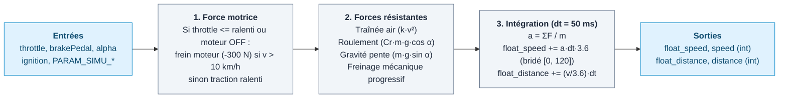
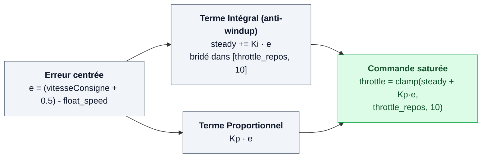
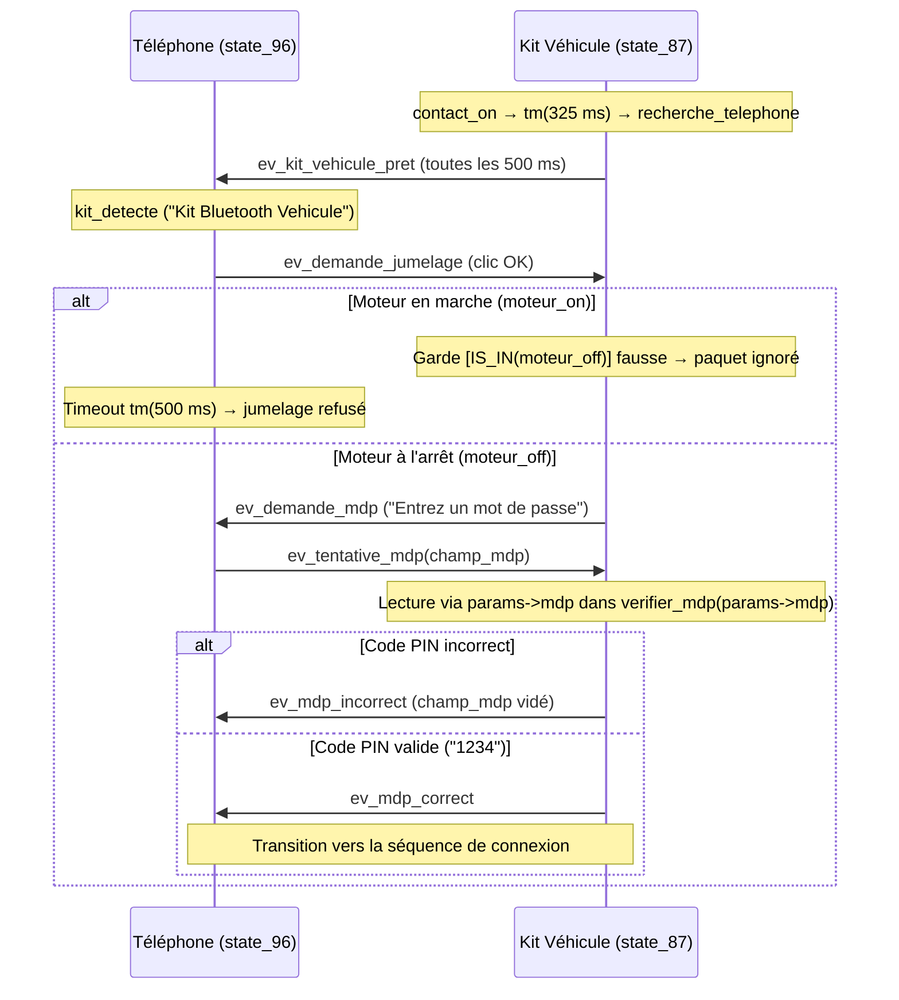
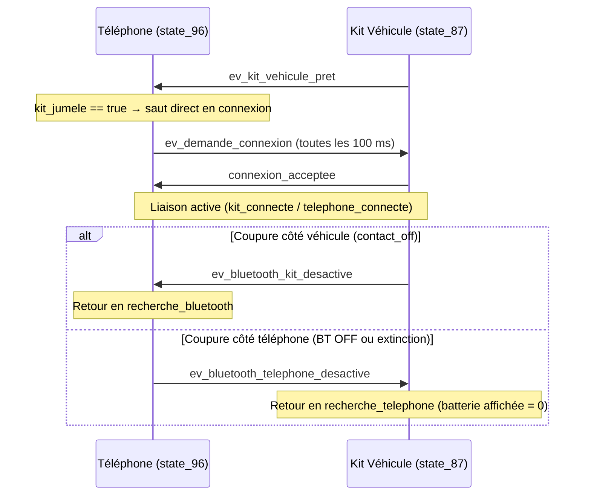
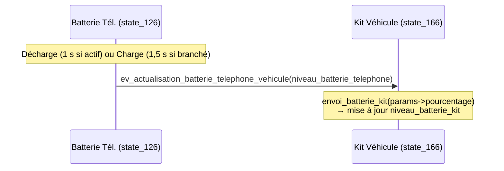
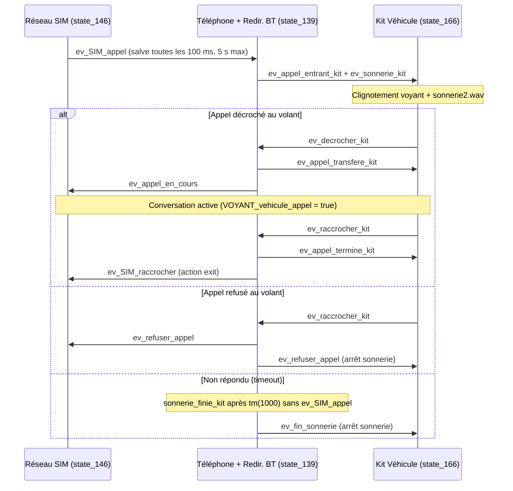
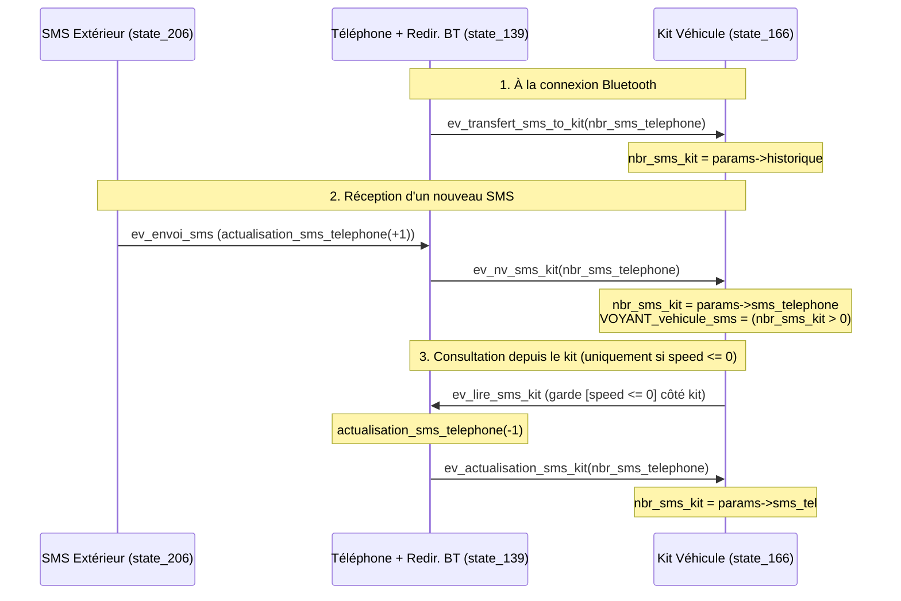
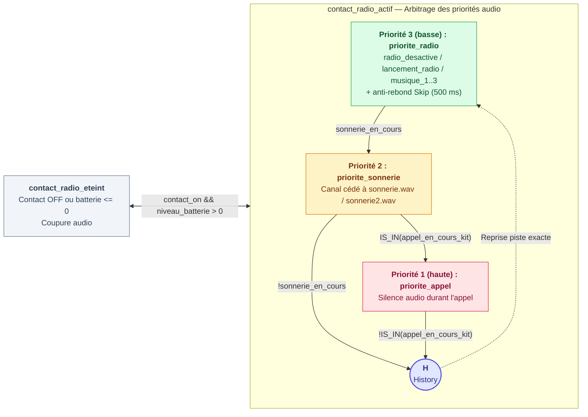
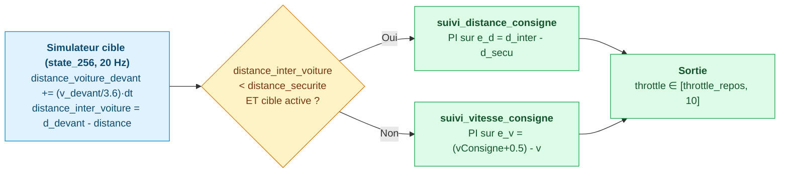
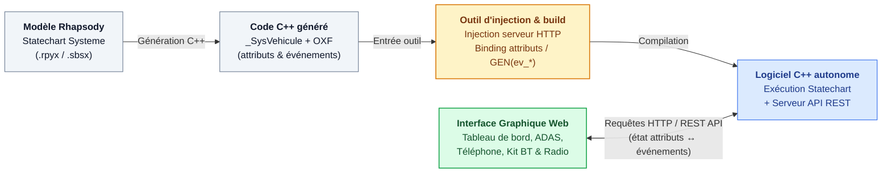

# Rapport de Projet - Systèmes à événements discrets
## Régulateur-Limiteur de Vitesse, Kit Mains-Libres Bluetooth, Autoradio et Régulateur Adaptatif  

**Binôme** : Benoît de Keyn, Thibault Agueh  
**Date :** 24/11/2026  

---

## Table des matières

<!-- TOC -->

<b>• [Rapport de Projet - Systèmes à événements discrets](#rapport-de-projet---syst%C3%A8mes-%C3%A0-%C3%A9v%C3%A9nements-discrets)</b><br>
<b>• [Régulateur-Limiteur de Vitesse, Kit Mains-Libres Bluetooth, Autoradio et Régulateur Adaptatif](#r%C3%A9gulateur-limiteur-de-vitesse-kit-mains-libres-bluetooth-autoradio-et-r%C3%A9gulateur-adaptatif)</b><br>
<b>• [Table des matières](#table-des-mati%C3%A8res)</b><br>
<b>• [1. Introduction](#1-introduction)</b><br>
&ensp;&ensp;&ensp;&ensp;◦ [Contexte et objectifs](#contexte-et-objectifs)<br>
&ensp;&ensp;&ensp;&ensp;◦ [Méthodologie adoptée](#m%C3%A9thodologie-adopt%C3%A9e)<br>
<b>• [2. Prise en main : l'IHM du simulateur](#2-prise-en-main--lihm-du-simulateur)</b><br>
&ensp;&ensp;&ensp;&ensp;◦ [Premier scénario : démarrer et rouler](#premier-sc%C3%A9nario--d%C3%A9marrer-et-rouler)<br>
&ensp;&ensp;&ensp;&ensp;◦ [Deuxième scénario : connecter le téléphone](#deuxi%C3%A8me-sc%C3%A9nario--connecter-le-t%C3%A9l%C3%A9phone)<br>
<b>• [3. Modélisation et simulation du véhicule](#3-mod%C3%A9lisation-et-simulation-du-v%C3%A9hicule)</b><br>
&ensp;&ensp;&ensp;&ensp;◦ [3.1 Architecture globale en AND-lines, synchronisation EVAL et interfaces](#31-architecture-globale-en-and-lines-synchronisation-eval-et-interfaces)<br>
&ensp;&ensp;&ensp;&ensp;◦ [3.2 Dynamique du véhicule (Simulation du vehicule)](#32-dynamique-du-v%C3%A9hicule-simulation-du-vehicule)<br>
&ensp;&ensp;&ensp;&ensp;◦ [3.3 Gestion de la pédale d'accélération](#33-gestion-de-la-p%C3%A9dale-dacc%C3%A9l%C3%A9ration)<br>
&ensp;&ensp;&ensp;&ensp;◦ [3.4 Intégration du système de freinage et priorité stricte](#34-int%C3%A9gration-du-syst%C3%A8me-de-freinage-et-priorit%C3%A9-stricte)<br>
&ensp;&ensp;&ensp;&ensp;◦ [3.5 Gestion du contact, du démarrage et de l'arrêt d'urgence (Clé du véhicule)](#35-gestion-du-contact-du-d%C3%A9marrage-et-de-larr%C3%AAt-durgence-cl%C3%A9-du-v%C3%A9hicule)<br>
&ensp;&ensp;&ensp;&ensp;◦ [3.6 Modélisation énergétique : carburant, batterie et pannes (Ressources et pannes)](#36-mod%C3%A9lisation-%C3%A9nerg%C3%A9tique--carburant-batterie-et-pannes-ressources-et-pannes)<br>
<b>• [4. Spécification et développement du régulateur de vitesse](#4-sp%C3%A9cification-et-d%C3%A9veloppement-du-r%C3%A9gulateur-de-vitesse)</b><br>
&ensp;&ensp;&ensp;&ensp;◦ [Côté IHM](#c%C3%B4t%C3%A9-ihm)<br>
&ensp;&ensp;&ensp;&ensp;◦ [Côté statechart](#c%C3%B4t%C3%A9-statechart)<br>
&ensp;&ensp;&ensp;&ensp;◦ [Loi de commande : correcteur PI discret auto-dimensionné](#loi-de-commande--correcteur-pi-discret-auto-dimensionn%C3%A9)<br>
&ensp;&ensp;&ensp;&ensp;◦ [Pourquoi ce fonctionnement](#pourquoi-ce-fonctionnement)<br>
<b>• [5. Spécification et développement du limiteur de vitesse](#5-sp%C3%A9cification-et-d%C3%A9veloppement-du-limiteur-de-vitesse)</b><br>
&ensp;&ensp;&ensp;&ensp;◦ [Côté IHM](#c%C3%B4t%C3%A9-ihm-1)<br>
&ensp;&ensp;&ensp;&ensp;◦ [Côté statechart](#c%C3%B4t%C3%A9-statechart-1)<br>
&ensp;&ensp;&ensp;&ensp;◦ [Pourquoi ce fonctionnement](#pourquoi-ce-fonctionnement-1)<br>
<b>• [6. Contrôleur de Kit Bluetooth « mains libres » et infodivertissement](#6-contr%C3%B4leur-de-kit-bluetooth--mains-libres--et-infodivertissement)</b><br>
&ensp;&ensp;&ensp;&ensp;◦ [Principe : deux équipements cloisonnés qui échangent des paquets](#principe--deux-%C3%A9quipements-cloisonn%C3%A9s-qui-%C3%A9changent-des-paquets)<br>
&ensp;&ensp;&ensp;&ensp;◦ [6.1 Protocole Bluetooth, jumelage par code PIN et cycle de vie du téléphone](#61-protocole-bluetooth-jumelage-par-code-pin-et-cycle-de-vie-du-t%C3%A9l%C3%A9phone)<br>
&ensp;&ensp;&ensp;&ensp;◦ [6.2 Gestion des appels entrants et redirection mains-libres](#62-gestion-des-appels-entrants-et-redirection-mains-libres)<br>
&ensp;&ensp;&ensp;&ensp;◦ [6.3 Messagerie SMS et tableau de bord connecté](#63-messagerie-sms-et-tableau-de-bord-connect%C3%A9)<br>
&ensp;&ensp;&ensp;&ensp;◦ [6.4 Autoradio et arbitrage des priorités audio](#64-autoradio-et-arbitrage-des-priorit%C3%A9s-audio)<br>
<b>• [7. Extension : Régulateur de vitesse adaptatif (ACC)](#7-extension--r%C3%A9gulateur-de-vitesse-adaptatif-acc)</b><br>
&ensp;&ensp;&ensp;&ensp;◦ [Côté IHM](#c%C3%B4t%C3%A9-ihm-2)<br>
&ensp;&ensp;&ensp;&ensp;◦ [Côté statechart](#c%C3%B4t%C3%A9-statechart-2)<br>
&ensp;&ensp;&ensp;&ensp;◦ [Pourquoi ce fonctionnement](#pourquoi-ce-fonctionnement-2)<br>
<b>• [8. Synthèse, cartographie des AND-lines et tests d'intégration](#8-synth%C3%A8se-cartographie-des-and-lines-et-tests-dint%C3%A9gration)</b><br>
&ensp;&ensp;&ensp;&ensp;◦ [Cartographie complète de la grille d'AND-lines (Systeme)](#cartographie-compl%C3%A8te-de-la-grille-dand-lines-systeme)<br>
&ensp;&ensp;&ensp;&ensp;◦ [Scénarios testés](#sc%C3%A9narios-test%C3%A9s)<br>
<b>• [9. Implémentation de la gestion sonore sous Rhapsody](#9-impl%C3%A9mentation-de-la-gestion-sonore-sous-rhapsody)</b><br>
&ensp;&ensp;&ensp;&ensp;◦ [Côté IHM](#c%C3%B4t%C3%A9-ihm-3)<br>
&ensp;&ensp;&ensp;&ensp;◦ [Côté statechart](#c%C3%B4t%C3%A9-statechart-3)<br>
&ensp;&ensp;&ensp;&ensp;◦ [Pourquoi ce fonctionnement](#pourquoi-ce-fonctionnement-3)<br>
<b>• [10. Outillage complémentaire : injection d'une API REST et interface graphique Web](#10-outillage-compl%C3%A9mentaire--injection-dune-api-rest-et-interface-graphique-web)</b><br>
&ensp;&ensp;&ensp;&ensp;◦ [Motivation](#motivation)<br>
&ensp;&ensp;&ensp;&ensp;◦ [Architecture et fonctionnement de l'outil](#architecture-et-fonctionnement-de-loutil)<br>
&ensp;&ensp;&ensp;&ensp;◦ [Liens vers la démonstration et le dépôt GitHub](#liens-vers-la-d%C3%A9monstration-et-le-d%C3%A9p%C3%B4t-github)<br>
<b>• [11. Conclusion générale](#11-conclusion-g%C3%A9n%C3%A9rale)</b><br>
&ensp;&ensp;&ensp;&ensp;◦ [Bilan du projet](#bilan-du-projet)<br>
&ensp;&ensp;&ensp;&ensp;◦ [Enseignements majeurs tirés des difficultés rencontrées](#enseignements-majeurs-tir%C3%A9s-des-difficult%C3%A9s-rencontr%C3%A9es)<br>
&ensp;&ensp;&ensp;&ensp;◦ [Perspectives d'évolution](#perspectives-d%C3%A9volution)<br>
<b>• [Annexes](#annexes)</b><br>
&ensp;&ensp;&ensp;&ensp;◦ [Annexe A — IHM détaillée](#annexe-a--ihm-d%C3%A9taill%C3%A9e)<br>
&ensp;&ensp;&ensp;&ensp;◦ [Annexe B — États par AND-line](#annexe-b--%C3%A9tats-par-and-line)<br>
&ensp;&ensp;&ensp;&ensp;◦ [Annexe C — Attributs et opérations](#annexe-c--attributs-et-op%C3%A9rations)<br>
&ensp;&ensp;&ensp;&ensp;◦ [Annexe D — Conventions de nommage](#annexe-d--conventions-de-nommage)

<!-- /TOC -->
---

## 1. Introduction

### Contexte et objectifs

Ce rapport présente la spécification, la modélisation comportementale par Statecharts et la simulation temps réel en C++ de plusieurs systèmes embarqués automobiles, que nous avons réalisées sous IBM Engineering Systems Design Rhapsody (v9.0.2).

Notre système final couvre cinq axes majeurs, auxquels nous avons ajouté une gestion énergétique complète, un autoradio multi-pistes et une interface de simulation temps réel pour tester et valider le comportement du véhicule simulé :

* **Modélisation et simulation du véhicule** : couplage entre un moteur de dynamique, le contrôle d'injection par pédales, le cycle de vie contact/moteur (arrêt d'urgence avec conservation d'inertie) et la gestion des ressources et des pannes de carburant et de batterie (section 3, Modélisation et simulation du véhicule) ;
* **Régulateur de vitesse** : maintien d'une vitesse cible avec un correcteur PI discret (section 4, Spécification et développement du régulateur de vitesse) ;
* **Limiteur de vitesse** : fonctionnement mutuellement exclusif avec le régulateur, activation différée et alarme sonore de dépassement (section 5, Spécification et développement du limiteur de vitesse) ;
* **Kit Bluetooth « mains libres »** : dialogue par événements, jumelage par code PIN, reconnexion automatique, gestion parallèle des appels et SMS, et autoradio avec reprise de la piste après interruption (section 6, Contrôleur de Kit Bluetooth « mains libres » et infodivertissement) ;
* **Extension Régulateur de vitesse adaptatif** : simulation d'un véhicule qui nous précède et basculement dynamique entre asservissement en vitesse et asservissement en distance de sécurité (section 7, Extension : Régulateur de vitesse adaptatif (ACC)).

### Méthodologie adoptée

Nous avons suivi quatre principes directeurs tout au long de la conception :

* **Architecture propre** : nous avons remanié le statechart squelette de BaseProjectVehicule2022 en une grille modulaire d'AND-lines au sein d'un unique état racine `Systeme` (voir la section 3.1, Architecture globale en AND-lines, synchronisation EVAL et interfaces) ;
* **Séparation entre logique événementielle et calculs continus** : nous écrivons les calculs physiques et numériques dans des opérations C++, tandis que la logique décisionnelle, les priorités, les sécurités et les protocoles restent dans les Statecharts ;
* **Conventions de nommage** : nous avons utilisé des préfixes systématiques pour les attributs, événements et opérations, afin de garder le modèle lisible malgré sa taille (voir l'annexe D, Conventions de nommage) ;
* **Enjeu de réalisme** : nous voulions que le simulateur se comporte de façon réaliste, réactive et robuste, de la séparation des responsabilités à la gestion des priorités et des pannes, en passant par la modélisation physique du véhicule.

---

## 2. Prise en main : l'IHM du simulateur

Nous pilotons l'ensemble du système depuis un unique Panel Diagram, que nous avons découpé en onze zones. Chaque zone correspond à une ou plusieurs AND-lines du statechart, décrits dans les sections suivantes.


Le tableau suivant résume le rôle de chaque zone :

| Zone | Nom | Ce qu'elle permet | Détail |
| :---: | :--- | :--- | :---: |
| **A** | Environnement | Régler la pente de la route (-20° à +20°) | § 3.2 |
| **B** | Voiture de devant | Activer un véhicule cible, régler sa distance initiale et sa vitesse | § 7 |
| **C** | Réseau extérieur | Simuler un appel entrant ou l'envoi d'un SMS vers le téléphone | § 6.2, 6.3 |
| **D** | Ressources | Suivre batterie et carburant, faire le plein, dépanner la batterie | § 3.6 |
| **E** | Clé | Mettre le contact, démarrer le moteur, voir l'état moteur | § 3.5 |
| **F** | Tableau de bord | Lire la distance parcourue, le throttle et la vitesse | § 3.2 |
| **G** | Commandes au volant | Activer le limiteur ou le régulateur, régler la vitesse cible | § 4, 5 |
| **H** | Pédales | Freiner et accélérer | § 3.3, 3.4 |
| **I** | Kit mains libres | Voir la connexion du téléphone, décrocher, lire les SMS au volant, brancher le téléphone | § 6 |
| **J** | Autoradio | Allumer la radio, lancer et changer de piste | § 6.4 |
| **K** | Téléphone | Allumer le téléphone, activer le Bluetooth, jumeler, gérer appels et SMS | § 6 |

### Premier scénario : démarrer et rouler

Pour démarrer et tester le régulateur, nous suivons les étapes suivantes :

1. Mettre le contact avec l'interrupteur **E1** : la LED **E2** s'allume.
2. Appuyer sur **Démarrer** (**E3**) : la LED moteur **E4** s'allume, le véhicule tient son ralenti (environ 10 km/h sur le plat).
3. Monter la pédale d'accélération **H2** : le throttle (**F2**, **F3**) et la vitesse (**F4**, **F5**) augmentent.
4. Au-dessus de 30 km/h, appuyer sur **Régulateur** (**G5**) : la LED **G6** s'allume et la vitesse courante devient la consigne (**G3**). Nous pouvons alors relâcher la pédale.
5. Faire varier la pente (**A1**) : le régulateur compense et maintient la consigne.
6. Appuyer sur la pédale de frein **H1** : le régulateur se désactive.

### Deuxième scénario : connecter le téléphone

Pour connecter le téléphone au kit mains libres, nous suivons les étapes suivantes :

1. Contact mis et moteur à l'arrêt, allumer le téléphone (**K1**) puis son Bluetooth (**K3**).
2. « Kit Bluetooth Vehicule » apparaît dans la liste (**K4**) : valider avec **OK** (**K5**).
3. Saisir le code `1234` dans **K7** puis appuyer sur **Appairer** (**K8**) : les LED **K9** et **I2** indiquent la connexion.
4. Depuis la zone **C**, déclencher un appel : il sonne sur le téléphone et au volant, et peut être décroché depuis **I6** ou **K11**.

La liste complète des widgets et de leurs attributs associés se trouve dans l'annexe A, IHM détaillée.

---

## 3. Modélisation et simulation du véhicule

### 3.1 Architecture globale en AND-lines, synchronisation EVAL et interfaces

Avant de développer les différentes fonctions, nous avons réfléchi à l'architecture générale du modèle, afin de synchroniser les mécanismes de l'IHM avec ceux des différentes régions du statechart et de bien répartir le comportement du véhicule entre ces régions. Ces choix de conception sont le socle de tout le projet : les fonctionnalités que nous avons développées ensuite (régulateur, limiteur, Bluetooth, ACC) s'y intègrent sans modifier l'existant.

**Une seule classe active.** Le sujet présentait le simulateur en deux modules (`dyn_deplacement` et `gestion_pedales_moteur`). Nous avons préféré centraliser tout le comportement dans la classe active `_SysVehicule` : comme ça, nous accédons directement aux variables partagées, sans multiplier les ports et les classes d'interface à chaque ajout (régulateur, limiteur, Bluetooth).

**Une grille d'AND-lines.** Nous avons découpé le statechart racine `Systeme` en 16 AND-lines (régions orthogonales exécutées en parallèle). Nous les avons regroupées en blocs fonctionnels selon le tableau suivant :

| Bloc | AND-lines | Rôle | Section |
| :--- | :--- | :--- | :---: |
| Véhicule | Horloge rafraichissement, Simulation du vehicule, Débit de l'injection d'essence, Clé du véhicule, Ressources et pannes | Physique, pédales, moteur, énergie | § 3 |
| Aides à la conduite | Mode de pilotage, Limiteur de vitesse, Simulation voiture régulateur adaptatif | Régulateur, limiteur, ACC | § 4, 5, 7 |
| Téléphone | Telephone, Batterie téléphone, Communication telephone | Bluetooth côté téléphone, appels, SMS | § 6 |
| Kit véhicule | Jumelage kit main libre, Commande kit main libre | Bluetooth côté véhicule, affichage au volant | § 6 |
| Réseau extérieur | Appel Extérieur, SMS Extérieur | Simulation des appels et SMS entrants | § 6.2, 6.3 |
| Infodivertissement | Radio | Lecture musicale et priorités audio | § 6.4 |

> **\[Image à insérer\]** Vue d'ensemble du statechart `Systeme` avec les blocs ci-dessus encadrés.

**Une horloge centrale `EVAL`.** Dans Rhapsody, une transition qui porte uniquement une garde `[condition]` n'est réévaluée qu'à l'entrée de l'état ou à la consommation d'un événement. Dans nos premières versions, nous utilisions un timer par AND-line, rebouclant sur un connecteur d'historique : l'ordre d'évaluation entre AND-lines devenait indéterminé et les actions d'entrée/sortie se redéclenchaient à chaque boucle. Nous avons donc créé l'AND-line **`Horloge rafraichissement`**, qui contient un unique état émettant `GEN(EVAL)` à $20\text{ Hz}$ (`tm(1000/PARAM_SIMU_freq_rafraichissement)`). Toutes les transitions gardées du projet sont de la forme `EVAL [garde]` : elles sont réévaluées au même rythme, dans un ordre déterministe.


---

### 3.2 Dynamique du véhicule (Simulation du vehicule)

#### Choix fonctionnels

Nous avons volontairement gardé l'AND-line **`Simulation du vehicule`** minimaliste : elle ne contient qu'un unique état `simulation_du_vehicule`, qui exécute `calcul_vitesse_distance()` à chaque événement `EVAL`. Toute la mécanique est encapsulée dans deux primitives de simulation (`init()` et `calcul_vitesse_distance()`), que nous avons adaptées en un modèle newtonien paramétrable (`PARAM_SIMU_*`). Voici un schéma qui illustre ce calcul :



```cpp
// Extrait de init() : calcul analytique du ralenti d'équilibre à plat (10 km/h)
const double vit_repos_ms         = VITESSE_REPOS / 3.6;
const double forceAir_repos       = AIR_DRAG * vit_repos_ms * vit_repos_ms;
const double forceRoulement_repos = 0.015 * MASSE * 9.81;
throttle_repos = (forceAir_repos + forceRoulement_repos) / PUISSANCE;
throttle = throttle_repos;
```

```cpp
// Extrait de calcul_vitesse_distance() : intégration newtonienne à 20 Hz
const double forceTotale = forceMoteur - forceFrein - forceAir - forceRoulement - forceGravite;
const double acceleration = forceTotale / MASSE;
float_speed += (acceleration * dt) * 3.6;
if (float_speed > MAX_SPEED) float_speed = MAX_SPEED;
if (float_speed < 0.0)       float_speed = 0.0;
float_distance += (float_speed / 3.6) * dt;
speed    = (int)float_speed;
distance = (int)float_distance;
```

Dans une première version, `calcul_vitesse_distance()` modifiait elle-même `throttle`, ce qui créait des conflits d'écriture avec les pédales et le régulateur. Nous avons donc sorti toute la gestion de `throttle` de `calcul_vitesse_distance()` (sauf la mise en sécurité `if (ignition == false) throttle = 0.0;`) : comme ça, `Débit d'injection d'essence` est le seul écrivain de `throttle`. Nous avons aussi calibré les paramètres (masse finale de 1500 kg, puissance, frottements) pour que la simulation reste réactive sur l'IHM et que l'ACC puisse décélérer au frein moteur.


---

### 3.3 Gestion de la pédale d'accélération

#### Choix fonctionnels
Sur l'IHM, nous contrôlons la pédale d'accélération avec le slider `pédale d'accélération`, qui fixe `accelPedal`. Le throttle résultant s'affiche en valeur numérique et sur la jauge `injecteur`.
//capture IHM

Dans l'AND-line `Débit de l'injection d'essence`, nous avons regroupé la conduite manuelle dans le super-état `pedales`, qui contient l'état `acceleration`. Celui-ci appelle `accelerer(accelPedal)` toutes les $50\text{ ms}$. La conversion est une projection linéaire directe sur la plage utile $[\text{throttle\_repos}, \text{PARAM\_SIMU\_max\_throttle}]$ :

```cpp
// accelerer(double accelPedal) : projection directe [0..10] -> [throttle_repos..10.0]
double plage_utile = PARAM_SIMU_max_throttle - throttle_repos;
throttle = throttle_repos + (accelPedal / (double)PARAM_SIMU_max_accel) * plage_utile;
```

Dans une première version, nous ajoutions une rampe logicielle sur `throttle` : cumulée à l'inertie de la masse, elle rendait la réponse « molle » et faussait le passage au régulateur. Nous sommes donc passés à une projection affine instantanée, ce qui a amélioré la réactivité et nettoyé le comportement.

*La capture du super-état `pedales` est donnée dans la section 3.4, Intégration du système de freinage et priorité stricte.*

---

### 3.4 Intégration du système de freinage et priorité stricte

#### Choix fonctionnels
**Côté IHM.** Le slider **H1** fixe `brakePedal` (0 à 10). Dès qu'il dépasse 0,5, le throttle (**F2**, **F3**) retombe au ralenti même si la pédale **H2** est enfoncée, et la vitesse (**F4**) diminue.

**Côté statechart.** Nous avons fait agir le freinage à deux endroits complémentaires :

1. **Coupure prioritaire de l'injection** dans `pedales` : l'état initial est `freinage_injection`. L'entrée dans `acceleration` exige `brakePedal < 0.5 && IS_IN(moteur_on)` (zone morte de 0,5 contre le bruit du slider). Dès que `brakePedal >= 0.5`, la transition vers `freinage_injection` coupe l'injection via `freiner_injection()`, quelle que soit la position de `accelPedal`.
2. **Frein mécanique continu** : nous calculons l'effort de freinage à 20 Hz dans `calcul_vitesse_distance()`, y compris moteur éteint. La période de 50 ms est donc quatre fois plus courte que la borne de 200 ms demandée.

```cpp
// freiner_injection(double brakePedal) : neutralisation immédiate de l'accélérateur
if (throttle > throttle_repos) {
    throttle = throttle_repos;
}
```

**Pourquoi ce fonctionnement.** Dans une première version, nous simulions un « étouffement » du moteur au freinage, qui faisait caler la voiture à chaque arrêt franc. Avec `freiner_injection()`, nous plafonnons maintenant l'injection au ralenti, sans jamais caler.


---

### 3.5 Gestion du contact, du démarrage et de l'arrêt d'urgence (Clé du véhicule)

Le sujet demande de gérer la clé, le démarrage et l'arrêt d'urgence en roulant : coupure moteur immédiate, accélérateur désactivé, inertie conservée.

**Côté IHM.** Nous mettons ou coupons le contact avec l'interrupteur **E1** (`cmd_contact`), et la LED **E2** le confirme. Le bouton **Démarrer** (**E3**) envoie `ev_demarrer`, et la LED **E4** indique que le moteur tourne (`ignition`).

**Côté statechart.** Dans l'AND-line Clé du véhicule, nous avons organisé le cycle de vie de façon hiérarchique :

* `contact_off` ↔ `contact_on` sur `EVAL [cmd_contact == true / false]`.
* Dans `contact_on`, l'état initial `moteur_off` exécute `arreter()` (`ignition = false;`).
* `moteur_on` n'est atteint que sur `ev_demarrer` sous la garde `[IS_IN(fonctionelle)]` (aucune panne), en exécutant `ex_demarrer()` : `ignition = true; throttle = throttle_repos; niveau_batterie -= 10;`. L'état appelle `calcul_carburant()` et, dans une région parallèle, `calcul_batterie()` au rythme de rafraîchissement.
* La coupure moteur intervient sur `EVAL [!IS_IN(fonctionelle) || cmd_contact == false]`.

**Arrêt d'urgence.** Quand nous coupons le contact (**E1**) en roulant, l'AND-line sort de `moteur_on`. `arreter()` passe `ignition` à `false`, l'AND-line Débit de l'injection d'essence bascule en `freinage_injection`, et `calcul_vitesse_distance()` annule `throttle` tout en conservant `float_speed`. La pédale de frein reste active, et le régulateur, le limiteur, le Bluetooth et l'autoradio se coupent en même temps.

**Pourquoi ce fonctionnement.** Nous avons placé `arreter()` en entrée de `moteur_off` et non de `contact_off` : sinon, une panne sèche, qui coupe le moteur sans couper le contact, laissait `ignition` à `true`. De la même façon, nous avons mis `calcul_carburant()` dans `moteur_on` pour qu'aucune consommation n'ait lieu moteur coupé.


---

### 3.6 Modélisation énergétique : carburant, batterie et pannes (Ressources et pannes)

Nous avons entièrement implémenté cette partie optionnelle du sujet : consommation, charge et décharge de la batterie, détection des pannes, plein et dépannage.

**Côté IHM.** Les jauges **D1** (batterie, %) et **D2** (carburant, L) affichent les niveaux. Le bouton **remplir carburant** (**D3**) ajoute 5 L, et le bouton **recharge d'urgence batterie** (**D4**) remet la batterie à 55 %. Ces deux boutons ne fonctionnent que véhicule à l'arrêt et contact coupé.

**Côté statechart.** L'AND-line Ressources et pannes s'appuie sur `calcul_carburant()` et `calcul_batterie()` :

* **Carburant** : consommation de `throttle * 0.005` par pas (réservoir initial 40 L, maximum 50 L). Sous `SEUIL_carburant` = 5 L, passage en `panne_carburant` (`carburant_faible = true`).
* **Batterie** : -10 % au démarrage. Si `throttle > 1.5`, l'alternateur recharge jusqu'à +2,5 %/s ; sinon la batterie se décharge de 0,25 %/s (initiale 80 %). Sous `SEUIL_batterie` = 40 %, passage en `panne_batterie` (`batterie_faible = true`).
* **Sécurité de maintenance** : les transitions vers `remplir_carburant` et `depanner_batterie` portent la garde `[speed == 0 && IS_IN(contact_off)]`.

```cpp
// Extrait de calcul_batterie() : modèle alternateur / décharge en %/s
if (throttle > 1.5) {
    const double taux_charge = (throttle < 5.0) ? (0.5 * throttle) : 2.5;
    new_niveau_batterie += taux_charge * dt;
} else {
    new_niveau_batterie -= 0.25 * dt;
}
```

**Pourquoi ce fonctionnement.** Au début, le dépannage remettait la batterie au seuil exact : à 40 %, le premier démarrage (-10 %) rouvrait immédiatement une panne et le véhicule ne redémarrait jamais. Nous remettons donc la batterie à `SEUIL_batterie + 15` (55 %). De même, nous avions d'abord découpé la maintenance en sous-états `garee` / `non_garee`, mais ce découpage bloquait toute réparation une fois en panne. Nous portons donc la garde de maintenance directement sur chaque transition.


---

## 4. Spécification et développement du régulateur de vitesse

Le régulateur maintient une vitesse cible (`vitesseConsigne`) sur route dénivelée (α entre -20° et +20°). Nous l'avons conçu pour qu'il s'active au-dessus de 30 km/h, se règle par pas de 1 km/h et se suspende tant que le conducteur accélère.

### Côté IHM

* **Activer / désactiver** : nous utilisons le bouton **Régulateur** (**G5**), qui envoie l'événement `ev_regulateur`. La LED **G6** (`voyant_regulateur`) indique que le régulateur est actif.
* **Consigne** : à l'activation, la vitesse courante s'affiche dans **vitesse cible** (**G3**). Les boutons **+** et **−** (**G4**) la modifient de 1 km/h.
* **Suspension** : en appuyant sur la pédale **H2**, nous reprenons la main ; au relâchement, le régulateur ramène la vitesse à la consigne.
* **Désactivation implicite** : freiner (**H1**), descendre sous 30 km/h ou couper le moteur (**E1**) éteint **G6**.

### Côté statechart

Nous avons réparti le régulateur sur deux AND-lines :

* **Mode de pilotage** gère le mode logique (`mode_manuel` ↔ `mode_regulateur`), le voyant `voyant_regulateur`, et les sous-états `maintien` / `plus` / `moins` qui appellent `ex_vitesseConsigne(±1)` (bornée à \[0, 120\] km/h). L'entrée dans `mode_regulateur` exécute `vitesseConsigne = speed; steady = throttle;`.
* **Débit de l'injection d'essence** bascule entre `pedales` et `regulateur` sur `EVAL [IS_IN(mode_regulateur) && accelPedal < 0.5]`, et revient sur `EVAL [IS_IN(mode_manuel) || accelPedal >= 0.5]`.

La suspension n'a donc pas besoin d'état dédié : quand nous appuyons sur la pédale, `pedales` reprend la main pendant que Mode de pilotage reste en `mode_regulateur` et mémorise la consigne. Au relâchement, `regulateur` reprend tout de suite.

### Loi de commande : correcteur PI discret auto-dimensionné

Nous avons remarqué que la formule fournie dans le sujet (
`error  = (double) (5*(vitesseConsigne - speed) / 6.0)`;`steady = (double) (vitesseConsigne / 12.0);` `throttle = steady+error`) n'était pas adaptée au fonctionnement réel de la voiture. Avec l'aide de l'ia nous avons donc modélisé un modèle "plus réalist" newtonien en forte pente avec un correcteur PI discret avec saturation pour l'asservissement final (`calcul_regulateur_vitesse()`, cadencé à `PARAM_SIMU_freq_regulateur` = 3 Hz). Ses gains sont calculés dans `init()` à partir de la masse, de la puissance et de la fréquence. Nous avons tout de même gardé la loi du sujet dans l'opération `regulateur_Prof()`. Voici un schéma qui illustre ce correcteur :



```cpp
// init() : auto-dimensionnement des gains PI selon la physique du véhicule
const double delta_v_par_throttle = (PUISSANCE / MASSE) * (1.0 / FREQ_REG) * 3.6;
Kp_regulateur = PARAM_SIMU_Kp_regulateur / delta_v_par_throttle;
Ki_regulateur = Kp_regulateur / PARAM_SIMU_Ki_regulateur;
```

### Pourquoi ce fonctionnement

* Nous avions d'abord un interrupteur `cmd_regulateur` : le statechart désactivait le régulateur au freinage, mais l'interrupteur de l'IHM restait enclenché et le réactivait. Nous l'avons donc remplacé par un bouton poussoir qui envoie l'événement `ev_regulateur`, associé à un voyant en lecture seule : comme ça, il n'y a plus de décalage.
* Nous avons d'abord essayé des corrections non linéaires en e·|e| puis e³, mais la version cubique saturait et oscillait sur les grands écarts. Nous avons donc préféré le PI auto-dimensionné, qui répond de façon homogène quelle que soit l'erreur ou la masse.
* À l'activation, nous initialisons `steady = throttle` pour éviter un à-coup lorsque le conducteur a accéléré entre deux activations.
* Comme `speed` est tronqué vers le bas, nous visons la consigne + 0,5 (50,5 au lieu de 50), ce qui évite que l'affichage oscille entre 49 et 50.


---

## 5. Spécification et développement du limiteur de vitesse

Le limiteur bride l'accélérateur pour que le véhicule ne dépasse pas une vitesse maximale programmée. Nous l'avons rendu mutuellement exclusif avec le régulateur : il s'active en différé si la vitesse est déjà au-dessus de la consigne, et déclenche une alarme sonore en cas de dépassement.

### Côté IHM

* **Activer / désactiver** : nous utilisons le bouton **Limiteur** (**G1**), qui envoie `ev_limiteur`. Activer le limiteur désactive le régulateur, et inversement.
* **Consigne** : à l'activation, **vitesse cible** (**G3**) affiche 50 km/h. Un appui sur **+** ou **−** (**G4**) change la consigne de 1 km/h, et un double appui en moins de 500 ms la change de 10 km/h.
* **Voyants** (**G2**) : ils indiquent si le limiteur est actif, en attente (`limiteur_attente`) ou en dépassement (`limiteur_depasse`).
* **Reprise de la main** : en enfonçant franchement la pédale **H2** près de la limite (kick-down), nous désactivons le limiteur.

> **[Capture Rhapsody à insérer — Version finale]** : AND-line **`limiteur de vitesse`** (`state_72`, `limiteur_on` et ses sous-états).

### Côté statechart

Dans l'AND-line Limiteur de vitesse, nous avons mis en place les mécanismes suivants :

* **Exclusion mutuelle symétrique** : `ev_limiteur` active le limiteur (si `IS_IN(moteur_on)`) et renvoie Mode de pilotage vers `mode_manuel`. À l'inverse, `ev_regulateur` renvoie le limiteur vers `limiteur_off`.
* **Consigne initiale et double appui** : l'entrée dans `consigne_fixe` initialise `vitesseConsigne = valeur_initiale_limiteur` (50 km/h). Un appui sur + passe en `plus` et applique tout de suite `ex_vitesseConsigne(+1)`. Si un second + arrive avant 500 ms, la transition de retour applique `ex_vitesseConsigne(+9)` (soit +10 km/h au total). Sinon, `tm(500)` ramène en `consigne_fixe` (soit +1 km/h au total). Le bouton − fonctionne de la même façon.
* **Activation différée** (`limiteur_inhibe` → `limiteur_effectif`) : tant que `speed > vitesseConsigne`, le limiteur reste en `limiteur_inhibe` (`limiteur_attente = true`), sans brider l'injection ni déclencher d'alarme. Dès que `speed <= vitesseConsigne`, il passe en `limiteur_effectif`.
* **Bridage de l'injection** : dans Débit de l'injection d'essence, `acceleration` bascule vers `freinage_injection` dès que `IS_IN(limiteur_effectif) && float_speed >= vitesseConsigne + 0.5`.
* **Kick-down** : le limiteur se désactive sur `EVAL [IS_IN(moteur_off) || ((vitesseConsigne - speed) < 10 && accelPedal > 7)]`.
* **Alarme de dépassement** : dans `limiteur_effectif`, si `speed > vitesseConsigne + 2` (typiquement en forte descente), l'entrée en `depassement` appelle `alerte_depassement(1)`, qui allume le voyant `limiteur_depasse` et lance en boucle `alarme_depassement.wav` (voir la section 9, Implémentation de la gestion sonore sous Rhapsody).

La hiérarchie finale de `limiteur_on` est donc : `consigne_fixe` → `limiteur_inhibe` → `limiteur_effectif` (contenant `limite_tenue` et `depassement`), avec les états `plus` / `moins` pour le réglage.

### Pourquoi ce fonctionnement

* Au début, nous avions mis deux régions parallèles dans `limiteur_on`, mais l'alarme sonnait alors que le limiteur était encore en attente (activation à 90 km/h pour une consigne de 50). Nous avons donc placé `limite_tenue` et `depassement` à l'intérieur de `limiteur_effectif` : comme ça, aucune alarme n'est possible tant que le limiteur est inhibé.
* Nous attendions d'abord la fin des 500 ms avant d'appliquer +1 ou +10, ce qui donnait une latence visible à chaque clic. Nous appliquons donc +1 tout de suite, puis +9 si le second appui arrive à temps.
* Quand nous comparions l'entier `speed` à la consigne, l'injection oscillait de façon saccadée autour de la limite. Nous avons donc fait la comparaison sur `float_speed`.
* Nous avions d'abord réglé le seuil de kick-down à 5, mais une simple accélération franche désactivait le limiteur. Nous l'avons donc remonté à 7.
* Nous avons préféré des inégalités plutôt que des égalités dans les gardes : une garde `[vitesseConsigne == speed]` pouvait être sautée lors d'un freinage appuyé (51 puis 49 en un pas). Il reste un point connu : la garde de sortie `depassement → limite_tenue` est actuellement écrite `[vitesseConsigne <= speed]` alors que l'attendu est `[speed <= vitesseConsigne]`.


---

## 6. Contrôleur de Kit Bluetooth « mains libres » et infodivertissement

Nous présentons cet ensemble en quatre parties : protocole Bluetooth et jumelage, appels, SMS, et autoradio.

### Principe : deux équipements cloisonnés qui échangent des paquets

Toutes les AND-lines cohabitent dans `_SysVehicule` pour les besoins de la simulation, mais nous avons conçu le système comme deux équipements physiques indépendants, auxquels s'ajoute le réseau extérieur :

* **le téléphone** : AND-lines Telephone, Batterie téléphone et Communication telephone ;
* **le kit véhicule** : AND-lines Jumelage kit main libre, Commande kit main libre et Radio ;
* **le réseau extérieur**, simulé par les AND-lines Appel Extérieur et SMS Extérieur.

**Aucune mémoire partagée.** Nous ne partageons aucun état (`IS_IN`), attribut ni opération entre le téléphone et le véhicule. Seul l'accès au périphérique audio (`play_sound()`, voir la section 9, Implémentation de la gestion sonore sous Rhapsody) est commun, parce que les deux systèmes tournent sur le même poste.

**Des événements paramétrés comme paquets Bluetooth.** Nous encapsulons dans un événement toute donnée qui franchit la frontière. L'émetteur l'envoie avec `GEN(ev_nom(valeur))`, et le récepteur la lit via `params->nom_du_parametre`, sans jamais lire un attribut de l'autre système. Le tableau suivant résume ces paquets :

| Fonctionnalité | Événement (paquet Bluetooth) | Émission côté téléphone | Réception côté kit (`params->`) |
| :--- | :--- | :--- | :--- |
| Code PIN (§ 6.1) | `ev_tentative_mdp(OMString mdp)` | `GEN(ev_tentative_mdp(champ_mdp))` | `[verifier_mdp(params->mdp)]` |
| Batterie (§ 6.1) | `ev_actualisation_batterie_telephone_vehicule(int pourcentage)` | `GEN(ev_actualisation_batterie_telephone_vehicule(niveau_batterie_telephone))` | `envoi_batterie_kit(params->pourcentage)` |
| Synchro SMS initiale (§ 6.3) | `ev_transfert_sms_to_kit(int historique)` | `GEN(ev_transfert_sms_to_kit(nbr_sms_telephone))` | `nbr_sms_kit = params->historique` |
| Réception SMS (§ 6.3) | `ev_nv_sms_kit(int sms_telephone)` | `GEN(ev_nv_sms_kit(nbr_sms_telephone))` | `nbr_sms_kit = params->sms_telephone` |
| Lecture SMS (§ 6.3) | `ev_actualisation_sms_kit(int sms_tel)` | `GEN(ev_actualisation_sms_kit(nbr_sms_telephone))` | `nbr_sms_kit = params->sms_tel` |

---

### 6.1 Protocole Bluetooth, jumelage par code PIN et cycle de vie du téléphone

Le kit véhicule (esclave) est actif contact mis. Le téléphone (maître) détecte le kit, se jumelle avec le code `1234` uniquement moteur à l'arrêt, puis se reconnecte automatiquement.

**Côté IHM.**

* **Téléphone** : allumage avec **K1**, Bluetooth avec **K3**, batterie en **K2**.
* **Détection** : « Kit Bluetooth Vehicule » apparaît dans **K4** ; **OK** (**K5**) demande le jumelage.
* **Code PIN** : saisi dans **K7** et envoyé avec **Appairer** (**K8**). Les messages du jumelage s'affichent en **K6**.
* **Connexion** : LED **K9** côté téléphone et LED **I1** / **I2** côté kit.
* **Batterie au tableau de bord** : la jauge **I3** recopie le niveau du téléphone ; l'interrupteur **I4** branche le téléphone pour le recharger.

**Côté statechart.** Nous avons fait collaborer trois AND-lines uniquement par événements :

* **Jumelage kit main libre** (kit) : démarre après `tm(325)` quand `IS_IN(contact_on)`. En `recherche_telephone`, il annonce sa présence par `GEN(ev_kit_vehicule_pret)` toutes les 500 ms. Il n'accepte `ev_demande_jumelage` que sous `[IS_IN(moteur_off)]`, demande le PIN (`GEN(ev_demande_mdp)`) et vérifie `verifier_mdp(params->mdp)` à la réception de `ev_tentative_mdp`.
* **Telephone** (téléphone) : le Bluetooth vit dans `telephone_actif` (qui exige `telephone_allume && niveau_batterie_telephone > 0`). À la détection du kit, il va directement en `connexion` si `kit_jumele == true`, sinon en `jumelage` (`attente_jumelage` → `attente_reponse` → `jumelage_effectif`).
* **Batterie téléphone** (téléphone) : décharge de 1 %/s quand `IS_IN(telephone_actif)`, recharge de 5 % toutes les 1,5 s si `charge_vehicule_telephone == true`, et envoie le niveau au kit.

##### Échange 1 — Découverte et jumelage par code PIN



##### Échange 2 — Connexion, reconnexion automatique et déconnexion



##### Échange 3 — Transmission du niveau de batterie téléphone vers le kit



**Pourquoi ce fonctionnement.**

* Au début, le téléphone vérifiait lui-même le PIN, et le jumelage réussissait moteur allumé. Nous avons donc déplacé la vérification dans le kit, sous `[IS_IN(moteur_off)]`, avec un timeout de 500 ms côté téléphone pour signaler le refus.
* Nous faisons voyager le PIN en paramètre (`params->mdp`), et `verifier_mdp()` vide `champ_mdp` à chaque essai : comme ça, l'ancien code erroné ne reste plus affiché.
* Nous émettons les événements avec `GEN(...)` en entrée d'état : la désactivation du Bluetooth s'écrit `entry / VOYANT_bluetooth_vehicule = false; GEN(ev_bluetooth_kit_desactive);`. Sans `GEN`, l'événement n'était jamais émis.

> **[Capture Rhapsody à insérer — Version finale]** : Les trois AND-lines de la zone Bluetooth/Téléphone :
> 1. **`Jumelage kit main libre`** (`state_87`, ligne du haut, au centre) ;
> 2. **`Telephone`** (`state_96`, juste en dessous de `state_87`) ;
> 3. **`Batterie téléphone`** (`state_126`, à droite de `state_96`).

---

### 6.2 Gestion des appels entrants et redirection mains-libres

Un appel entrant sonne sur le téléphone seul, ou sur le téléphone et au volant lorsque le Bluetooth est connecté. Il peut être accepté, refusé ou raccroché depuis l'un ou l'autre.

**Côté IHM.**

* **Déclencher un appel** : bouton **Appeler** (**C1**).
* **Sur le téléphone** : les LED **K10** indiquent l'appel et la sonnerie ; **Décrocher** / **Raccrocher** (**K11**).
* **Au volant** : les LED **I5** indiquent l'appel et la sonnerie ; **Décrocher** / **Raccrocher** (**I6**).
* **Son** : `sonnerie.wav` sur le téléphone, `sonnerie2.wav` sur le kit ; la radio se coupe pendant l'appel (section 6.4, Autoradio et arbitrage des priorités audio).

**Côté statechart.** Nous avons découplé la gestion des appels en trois AND-lines :

1. **Appel Extérieur** simule le réseau appelant : `telephone_SIM` → `tentative_appel`, qui émet `GEN(ev_SIM_appel)` toutes les 100 ms pendant 5 s au plus, → `discussion_telephonique` sur `ev_appel_en_cours`, puis retour sur `ev_SIM_raccrocher`.
2. **Communication telephone** bascule entre `arret_de_communication` (téléphone éteint) et `gestion_communication_telephone`, un état And à trois régions parallèles :
   * **appels sur le téléphone** : `attente_appel_tel`, `gestion_sonnerie` (clignotement du voyant et `sonnerie.wav` en parallèle), `appel_en_cours` ;
   * **SMS sur le téléphone** (section 6.3, Messagerie SMS et tableau de bord connecté) ;
   * **redirection Bluetooth** : `redirection_off` ↔ `redirection_kit_bluetooth_communication` selon `IS_IN(kit_connecte)`, qui relaie sonnerie, décrochage et raccrochage vers le kit.
3. **Commande kit main libre**, actif seulement si `IS_IN(telephone_connecte)`, fait tourner en parallèle : les appels au volant (`attente_redirection_appel`, `gestion_sonnerie_kit`, `appel_en_cours_kit`), l'affichage de la batterie, les SMS au volant et les adaptateurs des boutons au volant.

##### Échange 4 — Appel entrant redirigé vers le kit mains-libres



**Pourquoi ce fonctionnement.**

* Au début, la redirection et la gestion locale des appels étaient deux états exclusifs : connecter le kit ou couper le contact en plein appel détruisait le contexte de l'appel. Nous avons donc placé la redirection dans une région parallèle, avec des transitions croisées (`ev_decrocher_telephone`, `ev_raccrocher_telephone`) : décrocher sur le téléphone ou au volant garde ainsi les deux côtés cohérents.
* Nous émettons `GEN(ev_SIM_raccrocher)` en action `exit` de `appel_en_cours` et `transfer_appel` : comme ça, le réseau simulé ne reste plus bloqué en communication quand l'appel se termine par extinction du téléphone ou perte de liaison.

> **[Capture Rhapsody à insérer — Version finale]** : Les trois AND-lines de téléphonie :
> 1. **`Appel Extérieur`** (`state_146`, haut-droite) ;
> 2. **`Communication telephone`** (`state_139`, bas-droite, montrant `arret_de_communication` et les 3 sous-régions parallèles de `gestion_communication_telephone`) ;
> 3. **`Commande kit main libre`** (`state_166`, haut-centre-droite, entre `state_87` et `state_146`).

---

### 6.3 Messagerie SMS et tableau de bord connecté

Les SMS sont reçus en parallèle des appels. Leur nombre et un voyant s'affichent sur le téléphone et au tableau de bord ; la lecture est synchronisée entre les deux, et interdite au volant en roulant.

**Côté IHM.**

* **Envoyer un SMS** : bouton **Envoyer SMS** (**C2**).
* **Sur le téléphone** : LED **K12**, compteur **K13**, bouton **lire sms** (**K14**).
* **Au volant** : LED **I7**, compteur **I8**, bouton **lire message** (**I9**), sans effet si le véhicule roule.

**Côté statechart.**

* **Générateur externe** : l'AND-line SMS Extérieur transforme `ev_sms` en `GEN(ev_envoi_sms)`.
* **Parallélisme** : trois régions SMS indépendantes (téléphone, redirection Bluetooth, kit) ; un SMS reçu en plein appel est compté sans perturber la conversation.
* **Une seule source de vérité** : seul le téléphone modifie `nbr_sms_telephone` et pousse la valeur vers le kit (`ev_transfert_sms_to_kit`, `ev_nv_sms_kit`, `ev_actualisation_sms_kit`). Les voyants sont calculés : `VOYANT_vehicule_sms = (nbr_sms_kit > 0)` et `VOYANT_telephone_sms = (nbr_sms_telephone > 0)`.
* **Sécurité routière** : côté kit, `messagerie_kit → lire_message_kit` est gardée par `[speed <= 0]`.
* **Persistance** : à l'extinction du téléphone, `nbr_sauvegarde_sms_telephone = nbr_sms_telephone` conserve les SMS non lus, restaurés au rallumage. À la déconnexion Bluetooth, `VOYANT_kit(false)` remet `nbr_sms_kit` à 0 et éteint les voyants du tableau de bord.

##### Échange 5 — Synchronisation et lecture de SMS



**Pourquoi ce fonctionnement.**

* Au début, nous avions deux compteurs indépendants (téléphone et kit), qui dérivaient dès qu'un SMS arrivait pendant une déconnexion. Nous n'en gardons donc qu'un seul comme référence.
* Avec la garde `[nbr_sms_telephone == 0]`, la machine restait bloquée dans `lire_sms` dès qu'il restait au moins un SMS. Nous en sortons donc par `tm(10)` après lecture.
* La lecture est synchronisée quel que soit l'écran : quand nous lisons un SMS sur le téléphone (`ev_btn_telephone_sms`), le compteur du tableau de bord est aussi mis à jour.

> **[Capture Rhapsody à insérer — Version finale]** : AND-line **`SMS Extérieur`** (`state_206`, tout en haut à droite), accompagnée des sous-régions SMS (`state_184` et `state_189` dans `Communication telephone` + `state_199` dans `Commande kit main libre`).

---

### 6.4 Autoradio et arbitrage des priorités audio

L'autoradio lit trois pistes, s'éteint contact coupé ou batterie vide, cède la place aux sonneries et aux appels, puis reprend la piste en cours.

**Côté IHM.** Nous allumons la radio avec l'interrupteur **J2**, et la LED **J1** le confirme. **Play** (**J5**) lance la lecture, **Skip** (**J4**) passe à la piste suivante, et l'afficheur **J3** montre le titre (« Press PLAY » à l'arrêt).

**Côté statechart.** Nous avons construit l'AND-line Radio comme une machine à deux niveaux :

* **Alimentation** : `contact_radio_eteint` ↔ `contact_radio_actif` selon `EVAL [IS_IN(contact_on) && niveau_batterie > 0]`.
* **Priorités** (Radio < Sonnerie < Appel) dans `contact_radio_actif` :
  * `priorite_radio` (état And) gère le lecteur (`radio_desactive` → `lancement_radio` → `radio_active`, qui boucle entre `musique_1`, `musique_2`, `musique_3` sur `ev_skip_musique`) et un anti-rebond de 500 ms sur le bouton Skip ;
  * une sonnerie (`sonnerie_en_cours == true`) fait passer en `priorite_sonnerie` ;
  * un appel décroché au volant (`IS_IN(appel_en_cours_kit)`) fait passer en `priorite_appel`, qui coupe le son.
* **Reprise** : en fin de sonnerie ou d'appel, les transitions visent un connecteur d'historique (H) dans `priorite_radio`. La radio reprend exactement la piste (ou l'état éteint) d'avant l'interruption.

Voici un schéma qui illustre cet arbitrage des priorités :



**Pourquoi ce fonctionnement.** `PlaySound` ne gère qu'une piste à la fois : toute sonnerie coupe donc la musique. Nous avons mis en place la machine de priorités et le connecteur d'historique pour reprendre proprement la lecture, ainsi qu'un anti-rebond pour éviter qu'un double clic sur Skip saute plusieurs pistes.


---

## 7. Extension : Régulateur de vitesse adaptatif (ACC)

L'ACC prolonge le régulateur classique : il suit un véhicule plus lent à une distance de sécurité, puis réaccélère jusqu'à la vitesse de croisière quand la voie se libère.

### Côté IHM

1. Régler la distance initiale (**B1**) et la vitesse de la voiture de devant (**B2**).
2. Activer la voiture de devant avec **B3** : la distance qui nous en sépare s'affiche en **B4**.
3. Activer le régulateur (**G5**) : si la distance passe sous 30 m, le véhicule ralentit pour la maintenir ; si la voie se libère (voiture plus rapide ou désactivée), il revient à la consigne **G3**.

### Côté statechart

Pour cette extension, nous avons ajouté une AND-line d'environnement et subdivisé l'état `regulateur` existant de l'AND-line Débit de l'injection d'essence :

1. **AND-line Simulation voiture régulateur adaptatif** :
   * en `reglage_voiture_devant`, l'utilisateur règle la distance initiale et `vitesse_voiture_devant` ;
   * quand `SWITCH_simulation_voiture_devant` est activé, l'entrée dans `simulation_voiture_devant` place la cible (`distance_voiture_devant = distance + distance_inter_voiture;`), puis `loop_simulation` appelle `calcul_distance_voiture_devant()` à 20 Hz et met à jour `distance_inter_voiture = distance_voiture_devant - distance`.
2. **Aiguillage dans `regulateur`** (cadencé à 3 Hz) : l'état `verif_distance_secu` choisit à chaque pas :
   * `suivi_distance_consigne` (`calcul_regulateur_distance()`) si `distance_inter_voiture < distance_securite && IS_IN(simulation_voiture_devant)` ;
   * `suivi_vitesse_consigne` (`calcul_regulateur_vitesse()`) si `distance_inter_voiture > distance_securite || !IS_IN(simulation_voiture_devant)`.

`calcul_regulateur_distance()` réutilise la même loi PI saturée que le régulateur de vitesse, appliquée à l'erreur de distance (`distance_securite` = 30 m par défaut). Voici un schéma qui illustre cet aiguillage :



```cpp
// calcul_regulateur_distance() : même correcteur PI appliqué à l'erreur de distance
const double erreur = (double)distance_inter_voiture - (double)distance_securite;
steady += Ki_regulateur * erreur;
// Saturation anti-windup et commande dans [throttle_repos, PARAM_SIMU_max_throttle]
```

### Pourquoi ce fonctionnement

* Nous voulions une extension non intrusive : en réutilisant le même PI et le même état `regulateur`, nous gardons un seul écrivain de `throttle` et un comportement homogène entre suivi de vitesse et suivi de distance.
* L'ACC agit seulement sur `throttle` (plancher au ralenti et frein moteur de -300 N), sa décélération est donc limitée. Nous avons relevé le coefficient de roulement (0,05) et la masse (1500 kg) pour améliorer la décélération naturelle.
* Nous n'avons pas développé de freinage mécanique automatique ni d'alerte visuelle et sonore en cas de freinage brutal de la cible. Il reste aussi un point connu : les deux gardes de `verif_distance_secu` sont strictes (`<` et `>`), et le cas d'égalité exacte n'est pas couvert.


---

## 8. Synthèse, cartographie des AND-lines et tests d'intégration

### Cartographie complète de la grille d'AND-lines (Systeme)

Le statechart final de `_SysVehicule` compte 16 AND-lines actives, réparties en deux grands blocs (conduite et aides à la conduite à gauche, télécommunications et Bluetooth à droite, autoradio en bas). Quatre cellules vides complètent le quadrillage de la ligne inférieure. Nous détaillons le regroupement par bloc dans la section 3.1, Architecture globale en AND-lines, synchronisation EVAL et interfaces, et chaque AND-line est capturée dans l'annexe B, États par AND-line.

> **[Capture Rhapsody à insérer — Vue d'ensemble]** : Capture globale du Statechart `Systeme` de `_SysVehicule` montrant la répartition complète des 16 AND-lines actives.

### Scénarios testés

Voici les scénarios que nous avons testés en mode animation :

| # | Scénario testé | AND-lines impliquées | Comportement vérifié en animation | Statut |
| :---: | :--- | :--- | :--- | :---: |
| 1 | Coupure du contact à 90 km/h sous régulateur, radio active | Clé du véhicule, Débit de l'injection d'essence, Mode de pilotage, Simulation du vehicule, Radio, Jumelage kit main libre | Passage en `moteur_off`, arrêt du régulateur, de la radio et du Bluetooth, `throttle = 0`, décélération par inertie, frein mécanique actif | ✓ |
| 2 | Panne batterie puis dépannage et redémarrage | Ressources et pannes, Clé du véhicule, Simulation du vehicule | Coupure moteur sous 40 %, dépannage bloqué tant que `speed > 0` ou contact mis, recharge à 55 %, redémarrage réussi (chute à 45 %, au-dessus du seuil) | ✓ |
| 3 | Bascule régulateur vers limiteur à 80 km/h (consigne initiale 50) | Mode de pilotage, Limiteur de vitesse, Débit de l'injection d'essence | Exclusion mutuelle immédiate, entrée en `limiteur_inhibe` (`limiteur_attente = true`, pas d'alarme), passage en `limiteur_effectif` dès `speed <= 50` | ✓ |
| 4 | Double appui + en moins de 500 ms, puis kick-down | Limiteur de vitesse, Débit de l'injection d'essence | Saut exact de +10 km/h (+1 puis +9), puis désactivation dès `(vitesseConsigne - speed) < 10 && accelPedal > 7` | ✓ |
| 5 | Jumelage PIN moteur allumé puis moteur éteint, puis reconnexion | Clé du véhicule, Jumelage kit main libre, Telephone | Timeout de 500 ms moteur allumé ; validation de `1234` moteur éteint ; reconnexion automatique après coupure et remise du contact | ✓ |
| 6 | Appel entrant pendant `musique_2`, décroché au volant puis raccroché | Appel Extérieur, Communication telephone, Commande kit main libre, Radio | Interruption de `musique_2`, `sonnerie2.wav`, son coupé pendant l'appel, reprise exacte sur `musique_2` via H, réseau revenu en `telephone_SIM` | ✓ |
| 7 | Réception et lecture de SMS au volant en roulant, puis à l'arrêt | SMS Extérieur, Communication telephone, Commande kit main libre, Simulation du vehicule | Compteur incrémenté sans couper un appel, lecture au volant bloquée si `speed > 0`, autorisée à l'arrêt avec décrémentation synchronisée | ✓ |
| 8 | Rattrapage d'un véhicule lent sous ACC puis dégagement | Simulation voiture régulateur adaptatif, Débit de l'injection d'essence, Mode de pilotage, Simulation du vehicule | Bascule `suivi_vitesse_consigne` → `suivi_distance_consigne` sous 30 m, stabilisation, puis réaccélération jusqu'à `vitesseConsigne` une fois la voie libre | ✓ |

---

## 9. Implémentation de la gestion sonore sous Rhapsody

Trois fonctionnalités produisent du son : l'alarme de dépassement du limiteur (section 5, Spécification et développement du limiteur de vitesse), les sonneries d'appel sur le téléphone et le kit (section 6.2, Gestion des appels entrants et redirection mains-libres), et les trois pistes de l'autoradio (section 6.4, Autoradio et arbitrage des priorités audio). Nous les faisons toutes passer par une seule opération, `play_sound()`.

### Côté IHM

* **Alarme du limiteur** : en forte descente sous limiteur, la LED de dépassement (**G2**) s'allume et `alarme_depassement.wav` tourne en boucle jusqu'à ce que la vitesse revienne sous la consigne ou que le limiteur soit désactivé (**G1**).
* **Sonneries** : un appel lancé depuis **C1** fait sonner `sonnerie.wav` sur le téléphone, ou `sonnerie2.wav` au volant si le kit est connecté. Le son s'arrête au décrochage (**I6**, **K11**) ou à la fin du délai.
* **Autoradio** : **Play** (**J5**) et **Skip** (**J4**) lancent `musique_1.wav` à `musique_3.wav` ; la musique s'interrompt pendant une sonnerie ou un appel puis reprend.

### Côté statechart

Dans notre version, les états concernés n'appellent jamais `PlaySound` directement :

* **Dossier versionné** : les 6 fichiers `.wav` sont dans `Projet_TABDK_E4SE/sons/`, suivi sous Git.
* **Chemin centralisé** : l'attribut `chemin_sons` (`"..\\..\\sons\\"`, relatif à `CodesGeneres/ModeAnimation/`) est le seul endroit où le chemin est écrit.
* **Point d'entrée unique** : `play_sound(const OMString& fichier)` lance un fichier en boucle, ou coupe le son avec le mot-clé `"stop"`.

```cpp
// Opération play_sound(const OMString& fichier)
if (fichier == "stop") {
    PlaySound(NULL, NULL, 0);
} else {
    OMString chemin = chemin_sons;
    chemin += fichier;
    PlaySound(TEXT(chemin.GetBuffer(0)), NULL, SND_LOOP | SND_ASYNC);
}
```

Le tableau suivant résume, pour chaque son, l'état qui le lance et la façon dont il s'arrête :

| Fonctionnalité | État / opération appelante | Fichier .wav joué | Mécanisme d'arrêt |
| :--- | :--- | :--- | :--- |
| Alarme limiteur (§ 5) | `alerte_depassement(1)` depuis Limiteur de vitesse / `depassement` | `alarme_depassement.wav` | `alerte_depassement(0)` en exit de `depassement` et en entry de `limiteur_off` |
| Sonnerie téléphone (§ 6.2) | Communication telephone / `sonnerie_sonore` | `sonnerie.wav` | `play_sound("stop")` en entry de `appel_en_cours` et `sonnerie_finie` |
| Sonnerie kit véhicule (§ 6.2) | Commande kit main libre / `sonnerie_sonore_kit` | `sonnerie2.wav` | `PlaySound(NULL, 0, 0)` en exit de `gestion_sonnerie_kit` |
| Autoradio 3 pistes (§ 6.4) | Radio / `musique_1`, `musique_2`, `musique_3` | `musique_1.wav` à `musique_3.wav` | `PlaySound(NULL, 0, 0)` en entry de `radio_desactive`, `contact_radio_eteint` et `priorite_appel` |

### Pourquoi ce fonctionnement

* Le sujet propose de placer les `.wav` dans `CodesGeneres/ModeAnimation/`, mais ce dossier est généré et exclu par `.gitignore` : après chaque récupération du travail de l'autre binôme, les sons manquaient. Nous les avons donc rangés dans un dossier `sons/` versionné.
* Au début, nos appels `PlaySound` étaient dispersés et utilisaient des chemins différents, et les pistes de la radio n'avaient même pas l'extension `.wav`. Nous avons donc centralisé le chemin et l'appel dans une seule opération.
* Avec `SND_LOOP | SND_ASYNC`, un son tourne jusqu'à un arrêt explicite : sans les arrêts listés ci-dessus, les sonneries continuaient après un décrochage. Nous avons donc prévu un arrêt explicite pour chaque son.
* `PlaySound` coupe la piste en cours à chaque nouvel appel : c'est ce qui nous a imposé la machine de priorités de l'AND-line Radio (section 6.4, Autoradio et arbitrage des priorités audio).

---

## 10. Outillage complémentaire : injection d'une API REST et interface graphique Web

### Motivation

Le Panel Diagram de Rhapsody est très pratique pour le débogage pas à pas en mode animation, mais son ergonomie (widgets ActiveX datés, pas de mise en page adaptative, dépendance à une installation locale de Rhapsody) limite la lisibilité lors d'une démonstration complète. Nous avons donc développé un outil qui transforme le code C++ généré par Rhapsody en un logiciel autonome pilotable depuis une interface Web.

### Architecture et fonctionnement de l'outil

Plutôt que de réécrire la logique du véhicule en JavaScript, nous avons choisi de garder le moteur C++ OXF généré par Rhapsody comme cœur d'exécution. Notre outil procède en trois étapes :

1. **Analyse du code C++ généré** : `_SysVehicule`, ses attributs, getters/setters et événements OXF.
2. **Injection d'un serveur HTTP embarqué** : l'outil relie les attributs (lecture de l'état : vitesse, distance, voyants, messages, jauges ; écriture des commandes : pédales, pente, interrupteurs) et les événements (`GEN(ev_*)` sur les boutons) à une API REST.
3. **Interface graphique Web** : l'exécutable enrichi est couplé à une interface (tableau de bord, commandes au volant, smartphone virtuel, autoradio) qui dialogue en temps réel avec le statechart via des requêtes REST.

Voici un schéma qui illustre cette chaîne :



### Liens vers la démonstration et le dépôt GitHub

* Démo de l'interface Web : \[lien à compléter\]
* Dépôt GitHub de l'outil (injection API REST et interface Web) : \[lien à compléter\]

> **[Capture d'écran à insérer — Optionnel]** : Vue de l'interface graphique Web pilotant le code C++ Rhapsody via l'API REST.

---

## 11. Conclusion générale

### Bilan du projet

Nous avons abouti à un modèle Statechart complet, exécutable et validé en animation. Il couvre tous les sous-systèmes demandés (dynamique véhicule, commandes, modélisation énergétique, régulateur PI, limiteur, kit Bluetooth avec PIN, appels et SMS, autoradio à priorités, extension ACC), complétés par une couche audio centralisée et un outil d'exposition REST/Web du code C++ généré.

### Enseignements majeurs tirés des difficultés rencontrées

1. **Synchronisation centralisée (`GEN(EVAL)`)** : en remplaçant les boucles locales `tm() -> History` par une horloge unique à 20 Hz, nous avons fait le changement d'architecture le plus bénéfique pour le déterminisme et la lisibilité.
2. **Juste usage de l'orthogonalité (And vs OR)** :
   * l'orthogonalité nous a servis pour la redirection Bluetooth (en parallèle des appels locaux, pour ne jamais perdre une conversation) et pour la séparation appels / SMS ;
   * à l'inverse, une orthogonalité superflue dans `limiteur_on` créait des alarmes en phase d'inhibition ; nous avons résolu le problème avec une hiérarchie séquentielle (`limiteur_inhibe` → `limiteur_effectif` → `depassement`).
3. **Source de vérité unique et événements paramétrés** : pour le code PIN (`ev_tentative_mdp(champ_mdp)`) comme pour les SMS (`nbr_sms_telephone` poussé vers `nbr_sms_kit`), nous avons supprimé les désynchronisations en évitant les données dupliquées.
4. **Rigueur sur l'IHM et le travail collaboratif** : nous avons préféré les boutons poussoirs événementiels (`ev_regulateur`, `ev_limiteur`, `ev_demarrer`) aux interrupteurs, centralisé l'audio (`play_sound()` et dossier `sons/`), surveillé les fautes de frappe dans les noms d'événements et fusionné avec discipline les fichiers XML `.sbsx`.

### Perspectives d'évolution

1. **Correction des trois détails identifiés** : inverser la garde de sortie `depassement -> limite_tenue` (`speed <= vitesseConsigne`), passer l'une des gardes de `verif_distance_secu` en inégalité large (`>=`), et aligner `CST_COEFF_ROULEMENT` (0,05) dans `init()`.
2. **Freinage d'urgence autonome (AEB) et distance de sécurité dynamique** : commande bornée du frein mécanique par l'ACC, alerte visuelle et sonore en cas de freinage brutal de la cible, et distance de sécurité selon la règle des 2 secondes (d = 2 · v).
3. **Arbitrage audio incluant la sécurité** : intégrer les alarmes limiteur et ACC comme priorité la plus haute de l'AND-line Radio (Sécurité > Appel > Sonnerie > Radio), pour qu'une alarme coupe puis restitue la musique via le connecteur H.
4. **Scénarios routiers automatisés et multi-téléphones** : profils de pente préprogrammés et liste de plusieurs téléphones jumelés.

---

## Annexes

### Annexe A — IHM détaillée

> **\[Image à insérer\]** Capture du Panel Diagram en grand format (ou zone par zone), chaque widget portant son numéro (A1 à K14).

E = entrée (commande de l'utilisateur), S = sortie (affichage). Les liaisons marquées « à vérifier » sont à confirmer dans Rhapsody.

| N° | Widget | Attribut / événement lié | E/S |
| :---: | :--- | :--- | :---: |
| A1 | Slider « Pente (°) » \[-20 ; 20\] | `alpha` | E |
| A2 | Afficheur de la pente | `alpha` | S |
| B1 | Slider de distance initiale \[0 ; 50\] | `distance_inter_voiture` | E |
| B2 | Slider « vitesse\_voiture\_devant » \[0 ; 130\] | `vitesse_voiture_devant` | E |
| B3 | Bouton « Activation voiture devant » | `SWITCH_simulation_voiture_devant` | E |
| B4 | Afficheur « distance\_inter\_voiture » | `distance_inter_voiture` | S |
| C1 | Bouton « Appeler » | `ev_btn_SIM_appel` (à vérifier) | E |
| C2 | Bouton « Envoyer SMS » | `ev_sms` | E |
| D1 | Jauge batterie | `niveau_batterie` | S |
| D2 | Jauge carburant | `reservoir_carburant` | S |
| D3 | Bouton « remplir carburant » | `ev_remplir_carburant` | E |
| D4 | Bouton « recharge d'urgence batterie » | `ev_depanner_batterie` (à vérifier) | E |
| E1 | Interrupteur « contact » | `cmd_contact` | E |
| E2 | LED jaune du contact | contact mis (à vérifier) | S |
| E3 | Bouton « Démarrer » | `ev_demarrer` | E |
| E4 | LED « moteur » | `ignition` | S |
| F1 | Compteur kilométrique | `distance` | S |
| F2 | Afficheur numérique du throttle | `throttle` | S |
| F3 | Jauge du throttle \[0 ; 10\] | `throttle` | S |
| F4 | Afficheur numérique de la vitesse | `speed` | S |
| F5 | Compteur de vitesse \[0 ; 120\] | `speed` / `float_speed` | S |
| G1 | Bouton « Limiteur » | `ev_limiteur` | E |
| G2 | 3 LED sous « Limiteur » | `voyant_limiteur`, `limiteur_attente`, `limiteur_depasse` (à vérifier) | S |
| G3 | Afficheur « vitesse cible » | `vitesseConsigne` | S |
| G4 | Boutons « − » / « + » | événements set− / set+ | E |
| G5 | Bouton « Régulateur » | `ev_regulateur` | E |
| G6 | LED du régulateur | `voyant_regulateur` | S |
| H1 | Slider « pédale de frein » \[0 ; 10\] | `brakePedal` | E |
| H2 | Slider « pédale d'accélération » \[0 ; 10\] | `accelPedal` | E |
| I1 | LED en haut à droite du kit | `VOYANT_bluetooth_vehicule` (à vérifier) | S |
| I2 | 2 LED « Téléphone connecté » | `VOYANT_vehicule_connecte` (à vérifier) | S |
| I3 | Jauge « Batterie téléphone » | `niveau_batterie_kit` | S |
| I4 | Interrupteur « Brancher Téléphone » | `charge_vehicule_telephone` | E |
| I5 | 2 LED « Appel Téléphonique » | `VOYANT_vehicule_appel`, `VOYANT_vehicule_sonnerie` | S |
| I6 | Boutons « Décrocher » / « Raccrocher » | `ev_decrocher_kit` / `ev_raccrocher_kit` | E |
| I7 | LED « SMS non lus » | `VOYANT_vehicule_sms` | S |
| I8 | Compteur de SMS | `nbr_sms_kit` | S |
| I9 | Bouton « lire message » | `ev_lire_sms_kit` | E |
| J1 | LED de la radio | `VOYANT_radio` | S |
| J2 | Interrupteur de la radio | `radio_on` | E |
| J3 | Afficheur du titre | `affichage_titre_musique` | S |
| J4 | Bouton « Skip » | `ev_btn_radio_skip` | E |
| J5 | Bouton « Play » | à vérifier | E |
| K1 | Interrupteur d'allumage du téléphone | `telephone_allume` | E |
| K2 | Jauge de batterie du téléphone | `niveau_batterie_telephone` | S |
| K3 | Interrupteur « Bluetooth » | `bluetooth_telephone_actif` | E |
| K4 | Champ « affichage\_liste\_appareils » | `affichage_liste_appareils` | S |
| K5 | Bouton « OK » | `ev_demande_jumelage` (à vérifier) | E |
| K6 | Champ « affichage\_appairage » | `affichage_appairage` | S |
| K7 | Champ « champ\_mdp » | `champ_mdp` | E |
| K8 | Bouton « Appairer » | envoi de `ev_tentative_mdp(champ_mdp)` (à vérifier) | E |
| K9 | LED « Appareil connecté » | `VOYANT_telephone_connecte` | S |
| K10 | 2 LED « Appel reçu » | `VOYANT_telephone_appel`, `VOYANT_telephone_sonnerie` | S |
| K11 | Boutons « Décrocher » / « Raccrocher » | `ev_decrocher_telephone` / `ev_raccrocher_telephone` | E |
| K12 | LED « SMS » | `VOYANT_telephone_sms` | S |
| K13 | Compteur de SMS | `nbr_sms_telephone` | S |
| K14 | Bouton « lire sms » | `ev_btn_telephone_sms` | E |

### Annexe B — États par AND-line

Une capture par AND-line du statechart `Systeme`, dans l'ordre des blocs de la section 3.1, Architecture globale en AND-lines, synchronisation EVAL et interfaces.


> **\[Image à insérer\]** B.9 Telephone

> **\[Image à insérer\]** B.10 Batterie téléphone

> **\[Image à insérer\]** B.11 Communication telephone

> **\[Image à insérer\]** B.12 Jumelage kit main libre

> **\[Image à insérer\]** B.13 Commande kit main libre

> **\[Image à insérer\]** B.14 Appel Extérieur

> **\[Image à insérer\]** B.15 SMS Extérieur


### Annexe C — Attributs et opérations

Les 77 attributs de `_SysVehicule`, regroupés par domaine. Les types et valeurs initiales restent à compléter depuis le modèle.

| Domaine | Attribut | Rôle | IHM |
| :--- | :--- | :--- | :---: |
| Véhicule | `accelPedal` | Position de la pédale d'accélération \[0 ; 10\] | H2 |
| Véhicule | `brakePedal` | Position de la pédale de frein \[0 ; 10\] | H1 |
| Véhicule | `alpha` | Pente de la route (°) | A1, A2 |
| Véhicule | `throttle` | Commande d'injection, écrite par Débit de l'injection d'essence | F2, F3 |
| Véhicule | `throttle_repos` | Throttle de ralenti, calculé dans `init()` |  |
| Véhicule | `float_speed` / `speed` | Vitesse réelle (km/h) et sa valeur entière affichée | F4, F5 |
| Véhicule | `float_distance` / `distance` | Distance parcourue et sa valeur entière affichée | F1 |
| Véhicule | `ignition` | Moteur en marche | E4 |
| Véhicule | `cmd_contact` | Position de la clé de contact | E1 |
| Véhicule | `_simu` | à compléter |  |
| Paramètres | `PARAM_SIMU_max_throttle`, `PARAM_SIMU_max_speed`, `PARAM_SIMU_max_accel`, `PARAM_SIMU_max_brake` | Bornes du throttle, de la vitesse et des pédales |  |
| Paramètres | `PARAM_SIMU_masse`, `PARAM_SIMU_frottement_air`, `PARAM_SIMU_puissance_moteur`, `PARAM_SIMU_puissance_frein`, `PARAM_SIMU_vitesse_repos` | Paramètres physiques du modèle newtonien |  |
| Paramètres | `PARAM_SIMU_freq_rafraichissement`, `PARAM_SIMU_freq_regulateur` | Fréquences de l'horloge `EVAL` (20 Hz) et du régulateur (3 Hz) |  |
| Paramètres | `PARAM_SIMU_Kp_regulateur`, `PARAM_SIMU_Ki_regulateur` | Réglages des gains PI avant mise à l'échelle |  |
| Ressources | `reservoir_carburant` | Niveau de carburant (L) | D2 |
| Ressources | `niveau_batterie` | Charge de la batterie (%) | D1 |
| Ressources | `SEUIL_carburant`, `SEUIL_batterie` | Seuils de panne (5 L, 40 %) |  |
| Ressources | `carburant_faible`, `batterie_faible` | Indicateurs de panne |  |
| Régulateur / limiteur | `vitesseConsigne` | Vitesse cible commune au régulateur et au limiteur | G3 |
| Régulateur / limiteur | `Kp_regulateur`, `Ki_regulateur` | Gains PI calculés dans `init()` |  |
| Régulateur / limiteur | `steady` | Terme intégral du PI |  |
| Régulateur / limiteur | `voyant_regulateur`, `voyant_limiteur` | Voyants d'activation | G6, G2 |
| Régulateur / limiteur | `limiteur_attente`, `limiteur_depasse` | Voyants d'attente et de dépassement | G2 |
| Régulateur / limiteur | `valeur_initiale_limiteur` | Consigne à l'activation du limiteur (50 km/h) |  |
| ACC | `vitesse_voiture_devant` | Vitesse de la voiture de devant | B2 |
| ACC | `distance_voiture_devant`, `distance_entiere_voiture_devant` | Position de la voiture de devant |  |
| ACC | `distance_inter_voiture` | Distance entre les deux véhicules | B1, B4 |
| ACC | `distance_securite` | Distance à maintenir (30 m) |  |
| ACC | `SWITCH_simulation_voiture_devant` | Activation de la voiture de devant | B3 |
| Kit véhicule | `kit_jumele` | Mémoire du jumelage |  |
| Kit véhicule | `mot_de_passe` | Code PIN attendu (`1234`) |  |
| Kit véhicule | `VOYANT_bluetooth_vehicule`, `VOYANT_vehicule_connecte` | Voyants Bluetooth et connexion | I1, I2 |
| Kit véhicule | `VOYANT_vehicule_appel`, `VOYANT_vehicule_sonnerie`, `VOYANT_vehicule_sms` | Voyants d'appel, de sonnerie et de SMS | I5, I7 |
| Kit véhicule | `niveau_batterie_kit` | Batterie du téléphone vue par le kit | I3 |
| Kit véhicule | `nbr_sms_kit` | SMS non lus vus par le kit | I8 |
| Kit véhicule | `charge_vehicule_telephone` | Téléphone branché sur le véhicule | I4 |
| Téléphone | `telephone_allume`, `bluetooth_telephone_actif` | Alimentation et Bluetooth du téléphone | K1, K3 |
| Téléphone | `niveau_batterie_telephone` | Batterie du téléphone | K2 |
| Téléphone | `liste_appareils_detectes`, `affichage_liste_appareils` | Appareils détectés | K4 |
| Téléphone | `messages_appairage`, `affichage_appairage` | Messages du jumelage | K6 |
| Téléphone | `champ_mdp` | Code PIN saisi | K7 |
| Téléphone | `VOYANT_telephone_appairage`, `VOYANT_telephone_connecte` | Voyants de jumelage et de connexion | K9 |
| Téléphone | `VOYANT_telephone_appel`, `VOYANT_telephone_sonnerie`, `VOYANT_telephone_sms` | Voyants d'appel, de sonnerie et de SMS | K10, K12 |
| Téléphone | `appel_en_cours_telephone`, `sonnerie_en_cours` | État de l'appel, lu par la radio pour ses priorités |  |
| Téléphone | `nbr_sms_telephone`, `nbr_sauvegarde_sms_telephone` | SMS non lus et leur sauvegarde à l'extinction | K13 |
| Radio et son | `radio_on`, `VOYANT_radio` | Alimentation et voyant de la radio | J2, J1 |
| Radio et son | `affichage_titre_musique` | Titre affiché | J3 |
| Radio et son | `chemin_sons` | Chemin relatif du dossier `sons/` |  |

**Opérations citées dans le rapport** (liste à compléter avec l'export du modèle) :

| Domaine | Opération | Rôle |
| :--- | :--- | :--- |
| Véhicule | `init()` | Initialise la simulation, calcule `throttle_repos` et les gains PI |
| Véhicule | `calcul_vitesse_distance()` | Intègre le modèle newtonien à 20 Hz |
| Véhicule | `accelerer(accelPedal)` | Convertit la pédale en throttle |
| Véhicule | `freiner_injection(brakePedal)` | Ramène le throttle au ralenti au freinage |
| Véhicule | `ex_demarrer()`, `arreter()` | Démarrent et arrêtent le moteur |
| Ressources | `calcul_carburant()`, `calcul_batterie()` | Consommation de carburant, charge et décharge de la batterie |
| Ressources | `ex_depanner_batterie()` | Remet la batterie à `SEUIL_batterie + 15` |
| Régulateur / limiteur | `ex_vitesseConsigne(delta)` | Modifie la consigne dans \[0 ; 120\] |
| Régulateur / limiteur | `calcul_regulateur_vitesse()` | Correcteur PI sur l'erreur de vitesse |
| Régulateur / limiteur | `regulateur_Prof()` | Loi de commande du sujet, conservée pour référence |
| Régulateur / limiteur | `alerte_depassement(on)` | Allume ou éteint l'alarme du limiteur |
| ACC | `calcul_distance_voiture_devant()` | Avance la voiture de devant à 20 Hz |
| ACC | `calcul_regulateur_distance()` | Correcteur PI sur l'erreur de distance |
| Bluetooth | `verifier_mdp(mdp)` | Vérifie le PIN reçu et vide `champ_mdp` |
| Bluetooth | `envoi_batterie_kit(pourcentage)` | Met à jour `niveau_batterie_kit` |
| Bluetooth | `actualisation_sms_telephone(delta)` | Met à jour le compteur de SMS du téléphone |
| Bluetooth | `VOYANT_kit(etat)` | Remet à zéro les voyants et compteurs du kit à la déconnexion |
| Son | `play_sound(fichier)` | Point d'entrée unique de la lecture audio |

### Annexe D — Conventions de nommage

| Préfixe / forme | Usage | Exemple |
| :--- | :--- | :--- |
| `ev_` | Événement | `ev_demarrer`, `ev_tentative_mdp` |
| `ev_btn_` | Événement envoyé par un bouton de l'IHM | `ev_btn_radio_skip` |
| `ex_` | Opération exécutée sur une transition ou une entrée d'état | `ex_demarrer()`, `ex_vitesseConsigne()` |
| `calcul_` | Opération de calcul périodique | `calcul_batterie()` |
| `PARAM_SIMU_` | Paramètre de simulation réglable | `PARAM_SIMU_masse` |
| `SEUIL_` | Seuil de déclenchement | `SEUIL_batterie` |
| `VOYANT_` / `voyant_` | Voyant affiché sur l'IHM | `VOYANT_radio`, `voyant_regulateur` |
| `cmd_`, `SWITCH_` | Commande maintenue de l'IHM | `cmd_contact`, `SWITCH_simulation_voiture_devant` |
| `float_` | Valeur continue dont l'entier correspondant est affiché | `float_speed` |
| `_kit` / `_telephone` | Côté de la liaison Bluetooth auquel appartient la donnée | `nbr_sms_kit`, `nbr_sms_telephone` |
