# Rapport de Projet - Systèmes à événements discrets
## Régulateur-Limiteur de Vitesse, Kit Mains-Libres Bluetooth, Autoradio et Régulateur Adaptatif

**Binôme** : Benoît de Keyn, Thibault Agueh  
**Date :** 24/11/2026  

## Table des matières

<!-- TOC -->

<b>• [Rapport de Projet - Systèmes à événements discrets](#rapport-de-projet---syst%C3%A8mes-%C3%A0-%C3%A9v%C3%A9nements-discrets)</b><br>
<b>• [Régulateur-Limiteur de Vitesse, Kit Mains-Libres Bluetooth, Autoradio et Régulateur Adaptatif](#r%C3%A9gulateur-limiteur-de-vitesse-kit-mains-libres-bluetooth-autoradio-et-r%C3%A9gulateur-adaptatif)</b><br>
<b>• [Table des matières](#table-des-mati%C3%A8res)</b><br>
<b>• [1. Vue d'ensemble de l'IHM de Rhapsody](#1-vue-densemble-de-lihm-de-rhapsody)</b><br>
<b>• [2. Architecture globale](#2-architecture-globale)</b><br>
&ensp;&ensp;&ensp;&ensp;◦ [2.1 Vue d'ensemble des régions](#21-vue-densemble-des-r%C3%A9gions)<br>
&ensp;&ensp;&ensp;&ensp;◦ [2.2 Horloge partagée via l'événement EVAL](#22-horloge-partag%C3%A9e-via-l%C3%A9v%C3%A9nement-eval)<br>
<b>• [3. Simulation du véhicule](#3-simulation-du-v%C3%A9hicule)</b><br>
&ensp;&ensp;&ensp;&ensp;◦ [3.1 Statechart](#31-statechart)<br>
&ensp;&ensp;&ensp;&ensp;◦ [3.2 Fonctionnement](#32-fonctionnement)<br>
&ensp;&ensp;&ensp;&ensp;◦ [3.3 Initialisation et vitesse de repos](#33-initialisation-et-vitesse-de-repos)<br>
&ensp;&ensp;&ensp;&ensp;◦ [3.4 Implémentation dans les opérations](#34-impl%C3%A9mentation-dans-les-op%C3%A9rations)<br>
<b>• [4. Gestion des pédales d'accélération et de frein](#4-gestion-des-p%C3%A9dales-dacc%C3%A9l%C3%A9ration-et-de-frein)</b><br>
&ensp;&ensp;&ensp;&ensp;◦ [4.1 Statechart](#41-statechart)<br>
&ensp;&ensp;&ensp;&ensp;◦ [4.2 Utilisation depuis l'IHM](#42-utilisation-depuis-lihm)<br>
&ensp;&ensp;&ensp;&ensp;◦ [4.3 Fonctionnement](#43-fonctionnement)<br>
&ensp;&ensp;&ensp;&ensp;◦ [4.4 Implémentation des opérations](#44-impl%C3%A9mentation-des-op%C3%A9rations)<br>
&ensp;&ensp;&ensp;&ensp;◦ [4.5 Évolution](#45-%C3%A9volution)<br>
<b>• [5. Gestion du contact et du démarrage](#5-gestion-du-contact-et-du-d%C3%A9marrage)</b><br>
&ensp;&ensp;&ensp;&ensp;◦ [5.1 Statechart](#51-statechart)<br>
&ensp;&ensp;&ensp;&ensp;◦ [5.2 Utilisation depuis l'IHM](#52-utilisation-depuis-lihm)<br>
&ensp;&ensp;&ensp;&ensp;◦ [5.3 Fonctionnement](#53-fonctionnement)<br>
&ensp;&ensp;&ensp;&ensp;◦ [5.4 Implémentation des opérations](#54-impl%C3%A9mentation-des-op%C3%A9rations)<br>
&ensp;&ensp;&ensp;&ensp;◦ [5.5 Évolution](#55-%C3%A9volution)<br>
<b>• [6. Batterie de la voiture, carburant et pannes](#6-batterie-de-la-voiture-carburant-et-pannes)</b><br>
&ensp;&ensp;&ensp;&ensp;◦ [6.1 Statechart](#61-statechart)<br>
&ensp;&ensp;&ensp;&ensp;◦ [6.2 Utilisation depuis l'IHM](#62-utilisation-depuis-lihm)<br>
&ensp;&ensp;&ensp;&ensp;◦ [6.3 Fonctionnement](#63-fonctionnement)<br>
&ensp;&ensp;&ensp;&ensp;◦ [6.4 Implémentation des opérations](#64-impl%C3%A9mentation-des-op%C3%A9rations)<br>
&ensp;&ensp;&ensp;&ensp;◦ [6.5 Choix fonctionnels](#65-choix-fonctionnels)<br>
<b>• [7. Régulateur de vitesse simple](#7-r%C3%A9gulateur-de-vitesse-simple)</b><br>
&ensp;&ensp;&ensp;&ensp;◦ [7.1 Fonctionnement depuis l'IHM](#71-fonctionnement-depuis-lihm)<br>
&ensp;&ensp;&ensp;&ensp;◦ [7.2 Statechart](#72-statechart)<br>
&ensp;&ensp;&ensp;&ensp;◦ [7.3 Correcteur PI pour le régulateur de vitesse](#73-correcteur-pi-pour-le-r%C3%A9gulateur-de-vitesse)<br>
&ensp;&ensp;&ensp;&ensp;◦ [7.4 Évolution](#74-%C3%A9volution)<br>
<b>• [8. Limiteur de vitesse](#8-limiteur-de-vitesse)</b><br>
&ensp;&ensp;&ensp;&ensp;◦ [8.1 Fonctionnement depuis l'IHM](#81-fonctionnement-depuis-lihm)<br>
&ensp;&ensp;&ensp;&ensp;◦ [8.2 Statechart](#82-statechart)<br>
&ensp;&ensp;&ensp;&ensp;◦ [8.3 Opérations](#83-op%C3%A9rations)<br>
&ensp;&ensp;&ensp;&ensp;◦ [8.4 Évolution](#84-%C3%A9volution)<br>
<b>• [9. Contrôleur de Kit Bluetooth « mains libres »](#9-contr%C3%B4leur-de-kit-bluetooth--mains-libres-)</b><br>
&ensp;&ensp;&ensp;&ensp;◦ [9.1 Cycle de vie du téléphone et du kit](#91-cycle-de-vie-du-t%C3%A9l%C3%A9phone-et-du-kit)<br>
&ensp;&ensp;&ensp;&ensp;◦ [9.2 Principe : deux équipements cloisonnés qui échangent des paquets](#92-principe--deux-%C3%A9quipements-cloisonn%C3%A9s-qui-%C3%A9changent-des-paquets)<br>
&ensp;&ensp;&ensp;&ensp;◦ [9.3 Protocole Bluetooth et jumelage par code PIN](#93-protocole-bluetooth-et-jumelage-par-code-pin)<br>
&ensp;&ensp;&ensp;&ensp;◦ [9.4 Gestion des appels entrants et redirection mains-libres](#94-gestion-des-appels-entrants-et-redirection-mains-libres)<br>
&ensp;&ensp;&ensp;&ensp;◦ [9.5 Messagerie SMS et tableau de bord connecté](#95-messagerie-sms-et-tableau-de-bord-connect%C3%A9)<br>
<b>• [10. Autoradio et arbitrage des priorités audio](#10-autoradio-et-arbitrage-des-priorit%C3%A9s-audio)</b><br>
&ensp;&ensp;&ensp;&ensp;◦ [10.1 Statechart associé](#101-statechart-associ%C3%A9)<br>
&ensp;&ensp;&ensp;&ensp;◦ [10.2 Choix fonctionnels](#102-choix-fonctionnels)<br>
&ensp;&ensp;&ensp;&ensp;◦ [10.3 Choix de conception](#103-choix-de-conception)<br>
<b>• [11. Régulateur de vitesse adaptatif](#11-r%C3%A9gulateur-de-vitesse-adaptatif)</b><br>
&ensp;&ensp;&ensp;&ensp;◦ [11.1 Fonctionnement depuis l'IHM](#111-fonctionnement-depuis-lihm)<br>
&ensp;&ensp;&ensp;&ensp;◦ [11.2 Statechart](#112-statechart)<br>
&ensp;&ensp;&ensp;&ensp;◦ [11.3 Simulation de la voiture devant](#113-simulation-de-la-voiture-devant)<br>
&ensp;&ensp;&ensp;&ensp;◦ [11.4 Correcteur PI pour le suivi de distance](#114-correcteur-pi-pour-le-suivi-de-distance)<br>
<b>• [12. Implémentation de la gestion sonore sous Rhapsody](#12-impl%C3%A9mentation-de-la-gestion-sonore-sous-rhapsody)</b><br>
&ensp;&ensp;&ensp;&ensp;◦ [12.1 Fonctionnement de PlaySound](#121-fonctionnement-de-playsound)<br>
&ensp;&ensp;&ensp;&ensp;◦ [12.2 Choix de conception](#122-choix-de-conception)<br>
<b>• [13. Interface WEB pour l'IHM](#13-interface-web-pour-lihm)</b><br>
&ensp;&ensp;&ensp;&ensp;◦ [13.1 Aucune logique côté Web](#131-aucune-logique-c%C3%B4t%C3%A9-web)<br>
&ensp;&ensp;&ensp;&ensp;◦ [13.2 Tester le simulateur](#132-tester-le-simulateur)<br>
&ensp;&ensp;&ensp;&ensp;◦ [13.3 Tutoriel](#133-tutoriel)

<!-- /TOC -->

## 1. Vue d'ensemble de l'IHM de Rhapsody


## 2. Architecture globale

### 2.1 Vue d'ensemble des régions

Nous avons découpé le statechart en 16 régions orthogonales (exécutées en parallèle, appelées AND-lines dans Rhapsody). Nous les avons regroupées en blocs fonctionnels selon le tableau suivant :

| Bloc | Régions | Rôle | Section |
| :--- | :--- | :--- | :--- |
| Véhicule | Horloge rafraichissement, Simulation du vehicule, Débit de l'injection d'essence, Clé du véhicule, Ressources et pannes | Physique, pédales, moteur, énergie | [Section 2 Architecture globale](#2-architecture-globale) à [Section 6 Batterie de la Voiture, carburant et pannes](#6-batterie-de-la-voiture-carburant-et-pannes) |
| Aides à la conduite | Mode de pilotage, Limiteur de vitesse, Simulation voiture régulateur adaptatif | Régulateur, limiteur, ACC | [Section 7 Régulateur de vitesse simple](#7-r%C3%A9gulateur-de-vitesse-simple), [Section 8 Limiteur de vitesse](#8-limiteur-de-vitesse), [Section 11 Régulateur de vitesse adaptatif](#11-r%C3%A9gulateur-de-vitesse-adaptatif) |
| Téléphone | Telephone, Batterie téléphone, Communication telephone | Bluetooth côté téléphone, appels, SMS | [Section 9 Contrôleur de Kit Bluetooth « mains libres »](#9-contr%C3%B4leur-de-kit-bluetooth--mains-libres-) |
| Kit véhicule | Jumelage kit main libre, Commande kit main libre | Bluetooth côté véhicule, affichage au volant | [Section 9 Contrôleur de Kit Bluetooth « mains libres »](#9-contr%C3%B4leur-de-kit-bluetooth--mains-libres-) |
| Réseau extérieur | Appel Extérieur, SMS Extérieur | Simulation des appels et SMS entrants | [Section 9.4 Gestion des appels entrants et redirection mains-libres](#94-gestion-des-appels-entrants-et-redirection-mains-libres), [Section 9.5 Messagerie SMS et tableau de bord connecté](#95-messagerie-sms-et-tableau-de-bord-connect%C3%A9) |
| Infodivertissement | Radio | Lecture musicale et priorités audio | [Section 10 Autoradio et arbitrage des priorités audio](#10-autoradio-et-arbitrage-des-priorit%C3%A9s-audio) |

### 2.2 Horloge partagée via l'événement EVAL

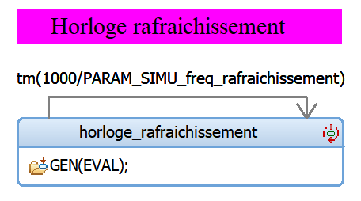

Certaines transitions n'ont pas d'événement et ne dépendent que d'une garde.
Pour chaque état qui avait une de ces transitions en sortie, nous devions mettre un `tm(X ms)` qui rebouclait sur lui-même.

Comme nous voulions éviter de noyer le statechart de `tm(X ms)` individuels, nous avons d'abord commencé par créer des états qui englobaient l'ensemble des régions pour que toutes les transitions internes qui doivent s'activer sur des gardes soient évaluées via un `tm(X ms)` global à ce super-état.

Cependant nous avons vite touché aux limites de cette approche : parfois nous voulions attendre un certain temps dans une région, ce qui était empêché par la réinitialisation du timer global. De plus, on ne pouvait pas rester dans un état plus longtemps que la période du timer global sans que celui-ci ne se réinitialise, ce qui devenait vite ingérable.

Finalement nous avons trouvé une solution parfaite : utiliser un événement global `EVAL` (comme "évaluer" une garde) qui est déclenché à intervalles réguliers par une région dédiée à l'horloge. Toutes les transitions dépendant d'une garde temporelle écoutent cet événement plutôt que de créer des timers individuels.

La fréquence de déclenchement de l'événement `EVAL` est directement calculée à partir de l'attribut `PARAM_SIMU_freq_rafraichissement` : la fréquence de simulation se change donc en un seul endroit.

## 3. Simulation du véhicule

### 3.1 Statechart


Pour simuler la vitesse et la distance du véhicule, à partir de l'injection (throttle), nous avons repris la fonction `calcul_vitesse_distance()` qui est appelée à chaque événement `EVAL` qui se déclenche à la fréquence de simulation comme détaillé dans la [Section 2.2 Horloge partagée via l'événement EVAL](#22-horloge-partag%C3%A9e-via-l%C3%A9v%C3%A9nement-eval).

### 3.2 Fonctionnement

Nous avons volontairement gardé la région **`Simulation du vehicule`** minimaliste : elle ne contient qu'un unique état `simulation_du_vehicule`, qui exécute `calcul_vitesse_distance()` à chaque événement `EVAL`.  
Toute la mécanique est encapsulée dans le constructeur de la classe `_SysVehicule()` et l'opération `calcul_vitesse_distance()` qui sont décrits ci-après.

**Évolution depuis les fonctions de base.** Les fonctions fournies au départ étaient très simplistes : `accelerer()` incrémentait le `throttle` proportionnellement à l'appui sur la pédale d'accélération, `freiner()` le décrémentait à l'appui sur le frein, et les frottements faisaient redescendre le `throttle` naturellement. En analysant ce fonctionnement, nous nous sommes d'abord rendu compte que la fonction `freiner()` n'agissait en réalité que sur le `throttle` (l'injection), et non directement sur la décélération du véhicule.

Aussi, si nous ne faisions que freiner, la voiture ne faisait que doucement ralentir, ce qui était complètement irréaliste et embêtant pour les tests de notre système quand nous voulions ralentir rapidement.

Nous avons donc décidé, avec l'aide de l'IA, de passer sur une simulation physique plus poussée en prenant en compte des caractéristiques du véhicule comme
- la masse (`PARAM_SIMU_masse`)
- les frottements aérodynamiques (`PARAM_SIMU_frottement_air`)
- le frottement de roulement (`PARAM_SIMU_frottement_roulement`)
- les puissances moteur (`PARAM_SIMU_puissance_moteur`)
- la puissance de freinage (`PARAM_SIMU_puissance_frein`)
- la pente (`PARAM_SIMU_pente`) qui était déjà prise en compte dans la version que vous nous avez fournie.

Les avantages de notre nouvelle fonction `calcul_vitesse_distance()` physique sont :

* **Freinage réaliste** : Elle prend en compte `brakePedal` comme un effort de freinage mécanique dans `calcul_vitesse_distance()`, en plus de la coupure d'injection (`freiner_injection()`).
* **Maîtriser le ralentissement en mode régulateur ou limiteur** : Comme le régulateur ainsi que le limiteur ne pilotent que le `throttle` sans actionner les freins, le réglage de la masse et des frottements était le seul moyen d'obtenir un frein moteur et une décélération personnalisable.
* **Simuler différents types de véhicules** : En ajustant les paramètres `PARAM_SIMU_*`, le même modèle peut représenter aussi bien une petite voiture légère qu'un camion lourd avec beaucoup d'inertie, ou une voiture puissante donc nerveuse.

### 3.3 Initialisation et vitesse de repos

Au démarrage, le véhicule se comporte comme un moteur diesel : le `throttle` est maintenu à une valeur de ralenti `throttle_repos`, calculée en fonction des caractéristiques du véhicule, dès l'initialisation pour que sur du plat à vitesse basse, le véhicule se maintienne à la vitesse de repos paramétrable (`PARAM_SIMU_vitesse_repos`, 10 km/h par défaut).  
Par ailleurs, en suivant vos conseils, nous n'utilisons plus l'opération `init()` appelée par le point d'entrée du statechart : toute l'initialisation a été déplacée directement dans le constructeur de la classe `_SysVehicule()`, ce qui garantit un état initial cohérent avant même le lancement du statechart.  

Les attributs de la simulation initialisés dans le constructeur en fonction des constantes sont :
- le `throttle_repos` pour maintenir la vitesse de repos
- les variables d'état `float_speed` et `float_distance`

> D'autres attributs y sont calculés à l'initialisation mais c'est l'objet des parties suivantes.

### 3.4 Implémentation dans les opérations

Voici un schéma synthétique montrant comment `calcul_vitesse_distance()` calcule la vitesse et la distance à partir des variables d'état lues et des paramètres de simulation :

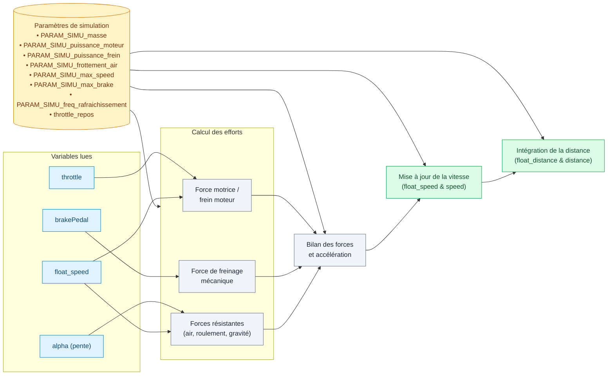

Voici le code complet de notre nouvelle fonction `calcul_vitesse_distance()`, qui reprend le schéma présenté juste au-dessus :  

<!-- code:calcul_vitesse_distance() -->
```cpp
// --- PARAMETRES EXTERNES ---
const double MAX_SPEED            = (double)PARAM_SIMU_max_speed;        // ex: 120 km/h
const double MASSE                = (double)PARAM_SIMU_masse;            // ex: 1200 kg
const double PUISSANCE            = (double)PARAM_SIMU_puissance_moteur; // ex: 600 N par unité de throttle
const double FORCE_FREINS         = (double)PARAM_SIMU_puissance_frein;  // ex: 80 N
const double CST_RALENTI          = throttle_repos;                      // ex: 1.0
const double MAX_BRAKE            = (double)PARAM_SIMU_max_brake;        // ex: 10.0
const double AIR_DRAG             = PARAM_SIMU_frottement_air;           // en kg/m (mettre ~0.4)
const double DELTA_T_MS           = (double)(1000/PARAM_SIMU_freq_rafraichissement);

// --- CONSTANTES PHYSIQUES ET MATHEMATIQUES ---
const double CST_COEFF_ROULEMENT   = 0.05;
const double CST_MULTIPLICATEUR_F  = 10.0;
const double CST_GRAVITE           = 9.81;
const double CST_PI_SUR_180        = 3.14159 / 180.0;
const double CST_CONVERSION_KMH_MS = 3.6;
const double CST_CONVERSION_MS_S   = 1000.0;
const double ZERO                  = 0.0;

// --- LOGIQUE ---
const double dt = DELTA_T_MS / CST_CONVERSION_MS_S; // 0.05 s

// D'abord, on coupe l'accélération si le moteur est éteint
if (ignition == false) {
    throttle = ZERO;
}

// 1. Force motrice / Frein moteur
double forceMoteur = ZERO;

if (throttle <= CST_RALENTI || ignition == false) {
    if (float_speed > 10.0) {
        // Au-dessus de 10 km/h pied levé : couple résistant mécanique (frein moteur ~300 N)
        forceMoteur = -300.0;
    } else {
        // En dessous de 10 km/h : traction douce du ralenti pour ne pas caler
        forceMoteur = throttle * PUISSANCE;
    }
} else {
    // Phase d'accélération active (pédale ou régulateur)
    forceMoteur = throttle * PUISSANCE;
}

// 2. Calcul des forces résistantes (Unités SI : Newtons)
const double vitesse_ms = float_speed / CST_CONVERSION_KMH_MS;

// Traînée aérodynamique pure : F = (1/2 * rho * S * Cx) * v^2
const double forceAir = AIR_DRAG * vitesse_ms * vitesse_ms;

// Frottement au sol (roulement des pneumatiques)
const double forceRoulement = CST_COEFF_ROULEMENT * MASSE * CST_GRAVITE * cos(alpha * CST_PI_SUR_180);

// Gravité le long de la pente
const double forceGravite = MASSE * CST_GRAVITE * sin(alpha * CST_PI_SUR_180);

// Frein mécanique progressif
double pedale_frein = brakePedal;
if (pedale_frein > MAX_BRAKE) pedale_frein = MAX_BRAKE;
if (pedale_frein < ZERO) pedale_frein = ZERO;
const double forceFrein = (pedale_frein / MAX_BRAKE) * (FORCE_FREINS * CST_MULTIPLICATEUR_F * MASSE / 100.0);

// 3. Somme des forces et accélération Newtonienne (m/s²)
const double forceTotale = forceMoteur - forceFrein - forceAir - forceRoulement - forceGravite;
const double acceleration = forceTotale / MASSE;

// 4. Intégration temporelle et bridage
float_speed += (acceleration * dt) * CST_CONVERSION_KMH_MS;

if (float_speed > MAX_SPEED) float_speed = MAX_SPEED;
if (float_speed < ZERO) float_speed = ZERO;

float_distance += (float_speed / CST_CONVERSION_KMH_MS) * dt;

speed = (int)float_speed;
distance = (int)float_distance;
```

Et voici un extrait de l'initialisation des attributs globaux nécessaires à la simulation dans le constructeur de la classe `_SysVehicule` : 

<!-- code:Constructeur de classe SysVehicule -->
```cpp
speed = 0;
brakePedal = 0;
accelPedal = 0;
float_speed = (double)speed;
float_distance = (double)distance;

const double MASSE         = (double)PARAM_SIMU_masse;
const double PUISSANCE     = (double)PARAM_SIMU_puissance_moteur;
const double AIR_DRAG      = PARAM_SIMU_frottement_air;
const double VITESSE_REPOS = (double)PARAM_SIMU_vitesse_repos;

// Calcul du throttle de repos (ralenti « diesel » à plat)
const double vit_repos_ms         = VITESSE_REPOS / 3.6;
const double forceAir_repos       = AIR_DRAG * vit_repos_ms * vit_repos_ms;
const double forceRoulement_repos = 0.015 * MASSE * 9.81;

throttle_repos = (forceAir_repos + forceRoulement_repos) / PUISSANCE;
throttle = throttle_repos;
```


## 4. Gestion des pédales d'accélération et de frein

### 4.1 Statechart


> La partie inférieure de la région qui gère le contrôle de l'injection d'essence par le régulateur est tronquée dans cette capture. Les conditions liées au limiteur apparaissent quand même mais seront expliquées plus loin.

### 4.2 Utilisation depuis l'IHM

- Sur l'IHM, nous contrôlons la pédale d'accélération avec le slider `pédale d'accélération`, qui fixe `accelPedal`. Le throttle résultant s'affiche en valeur numérique et sur la jauge `injecteur`.

### 4.3 Fonctionnement

- C'est dans la région `Débit de l'injection d'essence` qu'est gérée toute modification de l'attribut `throttle`.
- Le super-état `pedales` gère à la fois l'accélération et le freinage manuels via les états `acceleration` et `freinage_injection`.
- La priorité stricte est appliquée : dès que le frein est actionné, le throttle retombe au ralenti, indépendamment de l'accélération demandée (`brakePedal < 0.5`).
- Le moteur doit être allumé pour que l'accélération soit effective, mais n'empêche pas le freinage.
- La fréquence de polling des pédales se fait bien toutes les 200 ms comme demandé dans l'énoncé (via l'attribut `PARAM_SIMU_periode_pedales` qui vaut 200).

### 4.4 Implémentation des opérations

#### 4.4.1 Opération `accelerer()`

Voici le code de l'opération `accelerer()` :

<!-- code:accelerer(double accelPedal) -->
```cpp
// --- PARAMETRES EXTERNES ---
const double MAX_THROTTLE = PARAM_SIMU_max_throttle;
const double CST_RALENTI  = throttle_repos;
const double MAX_ACCEL    = (double)PARAM_SIMU_max_accel;

// --- LOGIQUE ---
// Mise à l'échelle : 0->10 sur la pédale donne throttle_repos->10.0 sur le throttle
double plage_utile = MAX_THROTTLE - CST_RALENTI;
throttle = CST_RALENTI + (accelPedal / MAX_ACCEL) * plage_utile;
```

La fonction fait un mapping linéaire de la position de la pédale d'accélération `accelPedal` sur la plage utile du `throttle`, allant de `throttle_repos` à `MAX_THROTTLE` :  
Si on n'appuie pas du tout sur la pédale d'accélération (`accelPedal = 0`), le `throttle` reste calé sur le ralenti `throttle_repos`.
Si on appuie à fond sur la pédale d'accélération (`accelPedal = MAX_ACCEL`), le `throttle` atteint directement son maximum `MAX_THROTTLE`.

#### 4.4.2 Opération `freiner_injection()`

Voici le code de l'opération `freiner_injection()` (anciennement `freiner()`) :

<!-- code:freiner_injection(double brakePedal) -->
```cpp
if (throttle > throttle_repos) {
    throttle = throttle_repos;
}
```

Cette opération se limite volontairement à couper l'accélération en ramenant immédiatement le `throttle` au niveau du ralenti `throttle_repos` (sans jamais le faire passer en dessous, afin de ne pas étouffer le moteur à l'arrêt). L'effort de freinage mécanique progressif proportionnel à `brakePedal` est quant à lui appliqué directement sur la vitesse dans `calcul_vitesse_distance()` (voir [Section 3 Simulation du véhicule](#3-simulation-du-v%C3%A9hicule)), ce qui garantit que le freinage reste actif même moteur coupé.

### 4.5 Évolution

Dans la version originale de ces fonctions, l'injection était incrémentée/décrémentée progressivement, alors que ce comportement est typique de la vitesse du moteur (en tours/minute) qui possède en effet une certaine inertie, et non du débit de l'injection d'essence (le throttle) qui est instantané.
Nous avons donc modifié les opérations `accelerer()` et `freiner_injection()` pour qu'elles ajustent instantanément le débit d'injection (`throttle`) en fonction de la position des pédales.

## 5. Gestion du contact et du démarrage

### 5.1 Statechart

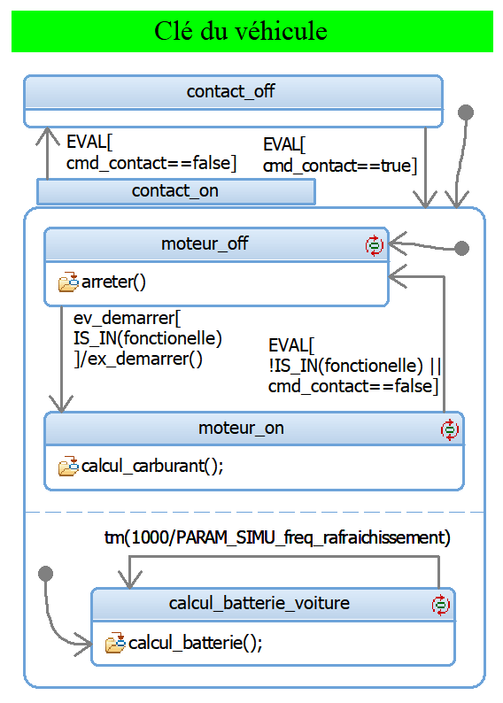

### 5.2 Utilisation depuis l'IHM

Nous mettons ou coupons le contact avec l'interrupteur **contact** (`cmd_contact`), et la LED jaune placée dessous le confirme. Le bouton **Démarrer** envoie `ev_demarrer`, et la LED **moteur** indique que le moteur tourne (`ignition`).

### 5.3 Fonctionnement

Tout le cycle de vie de la clé et du moteur se trouve dans la région Clé du véhicule. Le super-état `contact_on` gère l'état du moteur :

* **Contact** : la région passe de `contact_off` à `contact_on` sur `EVAL[cmd_contact == true]`, et revient sur `EVAL[cmd_contact == false]`. lorsque que la clé est insérée, le moteur est à l'arrêt (par défaut) et execute `arreter()`, qui passe `ignition` à `false`. (voir [Section 6 Batterie de la Voiture, carburant et pannes](#6-batterie-de-la-voiture-carburant-et-pannes)) .L'état`moteur_on` n'est atteint que sur `ev_demarrer`, et seulement si le véhicule n'est pas en panne (`[IS_IN(fonctionelle)]`). La transition exécute `ex_demarrer()`.

* **Moteur tournant** : `moteur_on` appelle `calcul_carburant()` et, dans une sous-région parallèle, `calcul_batterie()`, au rythme de rafraîchissement (voir [Section 6 Batterie de la Voiture, carburant et pannes](#6-batterie-de-la-voiture-carburant-et-pannes)). Le moteur s'arrête dès que le véhicule tombe en panne ou que le contact est coupé (`EVAL[!IS_IN(fonctionelle) || cmd_contact == false]`).
* **Arrêt d'urgence en roulant** : quand nous coupons le contact en roulant, la région sort de `moteur_on` et `arreter()` passe `ignition` à `false`. La région Débit de l'injection d'essence bascule alors en `freinage_injection`, et `calcul_vitesse_distance()` annule le `throttle` tout en conservant `float_speed` : le véhicule continue sur son inertie.

### 5.4 Implémentation des opérations

#### 5.4.1 Opération `ex_demarrer()`

Voici le code de l'opération `ex_demarrer()` :

<!-- code:ex_demarrer() -->
```cpp
ignition = true;
throttle = throttle_repos;
niveau_batterie -= 10;
```

L'opération allume le moteur, place directement le `throttle` au ralenti `throttle_repos` (voir [Section 3.3 Initialisation et vitesse de repos](#33-initialisation-et-vitesse-de-repos)) et retire 10 % de batterie pour le démarrage (voir [Section 6 Batterie de la Voiture, carburant et pannes](#6-batterie-de-la-voiture-carburant-et-pannes)).

### 5.5 Évolution

Nous avons placé `arreter()` en entrée de `moteur_off` et non de `contact_off`. Sinon, une panne sèche, qui coupe le moteur sans couper le contact, laissait `ignition` à `true`. De la même façon, nous avons mis `calcul_carburant()` dans `moteur_on` pour qu'aucune consommation n'ait lieu moteur coupé.

## 6. Batterie de la voiture, carburant et pannes

Le cycle de vie de la voiture est modélisé par la gestion de ses ressources énergétiques : la batterie et le carburant. Lorsqu'une de ces ressources tombe en dessous d'un seuil critique, une panne est déclenchée.

### 6.1 Statechart


### 6.2 Utilisation depuis l'IHM

Les jauges **% Batterie** et **Carburant** (L) affichent les niveaux. Le bouton **remplir carburant** ajoute 5 L, et le bouton **recharge d'urgence batterie** remet la batterie à 55 %. Ces deux boutons ne fonctionnent que véhicule à l'arrêt et contact coupé.

### 6.3 Fonctionnement

La région Ressources et pannes surveille les niveaux calculés par `calcul_carburant()` et `calcul_batterie()`, appelées par le moteur (voir [Section 5.3 Fonctionnement](#53-fonctionnement)) :

* **Carburant** : le réservoir démarre à 40 L (50 L au maximum) et perd `throttle * 0.005` L à chaque pas. Sous `SEUIL_carburant` (5 L), la région passe en `panne_carburant` (`carburant_faible = true`), activant la LED rouge **panne** et empêchant le démarrage du moteur.
* **Batterie** : elle démarre à 80 % et perd 10 % à chaque démarrage. Lorsque le moteur tourne, l'alternateur la recharge dès que `throttle > 1.5` ; sinon, elle se décharge de 0,25 %/s. Sous `SEUIL_batterie` (40 %), la région passe en `panne_batterie` (`batterie_faible = true`), activant la LED rouge **panne** et empêchant le démarrage du moteur.
* **Dépannage** : en cas de panne de carburant ou de batterie, le véhicule ne peut pas démarrer. Le dépannage est possible à l'arrêt et contact coupé (`[speed == 0 && IS_IN(contact_off)]`), à l'appui des boutons **remplir carburant** ou **recharge d'urgence batterie**. Ces deux opérations réinitialisent les pannes et éteignent la LED rouge **panne**.

### 6.4 Implémentation des opérations

#### 6.4.1 Opération `calcul_carburant()`

<!-- code:calcul_carburant() -->
```cpp
const double COEF_CONSO = 0.005;

double new_reservoir_carburant = reservoir_carburant;

new_reservoir_carburant -= throttle*COEF_CONSO;

if (new_reservoir_carburant < 0.0) {
	new_reservoir_carburant = 0;
} 

reservoir_carburant = new_reservoir_carburant;
```

À chaque pas, l'opération retire du réservoir une quantité proportionnelle au `throttle`, sans jamais descendre sous 0 L.

#### 6.4.2 Opération `calcul_batterie()`

<!-- code:calcul_batterie() -->
```cpp
// --- PARAMETRES ET CONSTANTES ---
const int deltaTms                    = 1000 / PARAM_SIMU_freq_rafraichissement; // Division entière en ms
const double dt                       = (double)deltaTms / 1000.0;               // En secondes pour la physique

// Seuils d'injection
const double SEUIL_THROTTLE_MIN       = 1.5;
const double SEUIL_THROTTLE_MAX       = 5.0;

// Taux de charge et décharge physiques (% par seconde)
const double TAUX_CHARGE_PAR_THROTTLE = 0.5;
const double TAUX_CHARGE_MAX_SEC      = TAUX_CHARGE_PAR_THROTTLE * SEUIL_THROTTLE_MAX;
const double TAUX_DECHARGE_SEC        = 0.25;

// --- LOGIQUE ---
double new_niveau_batterie = niveau_batterie;

if (throttle > SEUIL_THROTTLE_MIN) {
    const double taux_charge = (throttle < SEUIL_THROTTLE_MAX)
                               ? (TAUX_CHARGE_PAR_THROTTLE * throttle)
                               : TAUX_CHARGE_MAX_SEC;

    new_niveau_batterie += taux_charge * dt;
    if (new_niveau_batterie > 100.0) {
        new_niveau_batterie = 100.0;
    }
} else {
    new_niveau_batterie -= TAUX_DECHARGE_SEC * dt;
    if (new_niveau_batterie < 0.0) {
        new_niveau_batterie = 0.0;
    }
}

niveau_batterie = new_niveau_batterie;
```

L'opération modélise l'alternateur. Au-delà de `SEUIL_THROTTLE_MIN` (1,5), il recharge la batterie proportionnellement au `throttle` (0,5 %/s par unité), avec un plafond de 2,5 %/s atteint à `SEUIL_THROTTLE_MAX` (5). En dessous, la batterie se décharge de 0,25 %/s. Le niveau reste borné entre 0 et 100 %.

#### 6.4.3 Opérations `ex_depanner_batterie()` et `remplir_carburant()`

* voici le code de l'opération `ex_depanner_batterie()` :

```cpp
if (niveau_batterie < SEUIL_batterie) {
	niveau_batterie = SEUIL_batterie+15;
}
if (niveau_batterie > 100) {
	niveau_batterie = 100;
}
```

* Voici le code de l'opération `remplir_carburant()` :

```cpp
double new_reservoir_carburant = reservoir_carburant;

new_reservoir_carburant += 5;

if (new_reservoir_carburant > 50.0) {
	new_reservoir_carburant = 50;
} 

reservoir_carburant = new_reservoir_carburant;
```

### 6.5 Choix fonctionnels
* **Éviter les pannes sèches** : nous avons choisi de ne pas permettre de démarrer le moteur si la batterie ou le carburant sont en dessous du seuil critique, afin d'éviter une panne sèche qui immobiliserait le véhicule.
* **Dépannage réaliste** : nous avons choisi de ne pas remettre la batterie à 100 % lors d'une recharge d'urgence, mais plutôt à 55 % (`SEUIL_batterie + 15`) pour simuler un dépannage réaliste.

---

## 7. Régulateur de vitesse simple

Le régulateur maintient une vitesse cible (`vitesseConsigne`) sur route dénivelée (α entre -20° et +20°).

### 7.1 Fonctionnement depuis l'IHM

* **Activer / désactiver** : nous utilisons le bouton **Régulateur**, qui envoie l'événement `ev_regulateur`. La LED (`voyant_regulateur`) indique que le régulateur est actif.
* **Consigne** : à l'activation, la vitesse courante s'affiche dans **vitesse cible**. Les boutons **+** et **−** la modifient de 1 km/h.
* **Suspension** : en appuyant sur la pédale d'accélération, nous reprenons la main et au relâchement, le régulateur ramène la vitesse à la consigne.
* **Désactivation implicite** : freiner, descendre sous 30 km/h ou couper le moteur éteint le voyant du régulateur.

### 7.2 Statechart

#### 7.2.1 Décision du mode manuel vs régulateur

Une première région détermine si le pilotage du throttle doit se faire par le régulateur ou par le conducteur : 

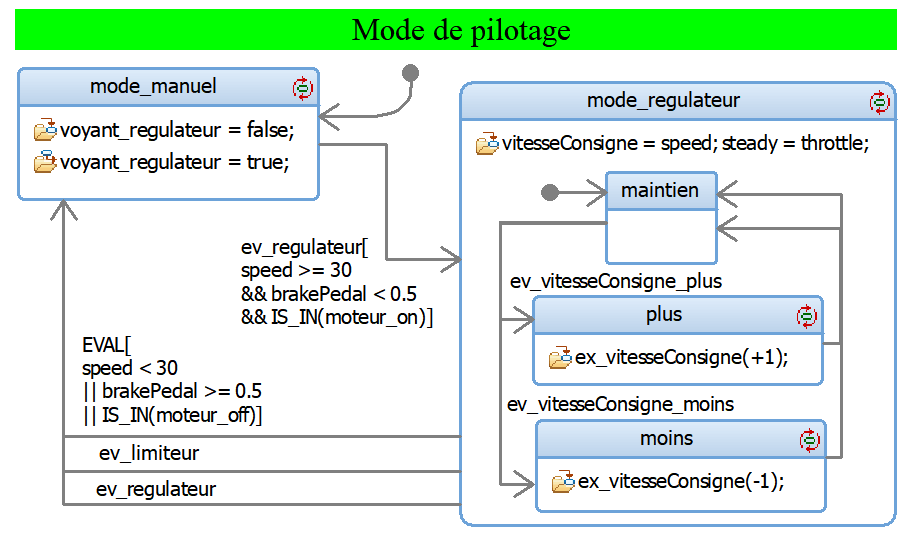

#### 7.2.2 Commande de l'injection d'essence

C'est dans la même région `Débit de l'injection d'essence` que nous déterminons la valeur du throttle en fonction du mode de pilotage et de la consigne de vitesse : 

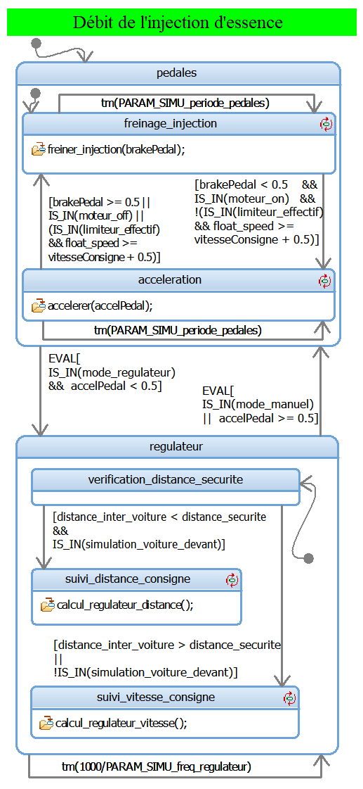

### 7.3 Correcteur PI pour le régulateur de vitesse

Nous avons remarqué que la formule fournie dans le sujet (`error = (double)(5*(vitesseConsigne - speed) / 6.0); steady = (double)(vitesseConsigne / 12.0); throttle = steady + error;`) n'était pas adaptée au fonctionnement réel de la voiture. En effet, cette formule est un simple correcteur proportionnel qui possède une erreur statique qui se voit notamment quand on change l'angle de la pente.

En effet, avec cette formule, on calcule uniquement un débit d'injection théorique en fonction de la vitesse de consigne (sur un sol supposé plat), puis on modifie l'injection pour qu'elle converge vers ce steady en fonction de l'erreur mesurée. Donc il n'y a aucune prise en compte du rapport dynamique entre injection et vitesse (en fonction de la pente par exemple).

Nous avons voulu améliorer cette fonction pour qu'elle utilise un attribut qui stocke l'erreur intégrale afin de corriger l'erreur statique. Avec l'aide de l'IA, nous avons donc écrit une fonction de correcteur PI discret pour asservir la vitesse de la voiture à la vitesse de la consigne. Cette fonction est appelée `calcul_regulateur_vitesse()`, cadencée à `PARAM_SIMU_freq_regulateur` = 2 Hz.

Pour ce correcteur PI, nous avons deux attributs `Kp_regulateur` et `Ki_regulateur` qui représentent les gains appliqués à la commande.

Ces variables ne sont pas des constantes à régler, mais sont calculées à partir des deux coefficients "normalisés" `PARAM_SIMU_Kp_regulateur` et `PARAM_SIMU_Ki_regulateur`.
C'est dans le constructeur de la classe `_SysVehicule` que ces coefficients normalisés sont lus et utilisés pour calculer les gains effectifs `Kp_regulateur` et `Ki_regulateur` à partir des caractéristiques physiques du véhicule et de la fréquence du régulateur.

Ainsi nous pouvons changer les caractéristiques physiques du véhicule sans avoir à recalculer manuellement les gains du régulateur, ce qui rend le système plus flexible et adaptable à différents types de véhicules.

À l'activation, nous initialisons `steady = throttle` pour éviter un à-coup lorsque le conducteur a accéléré entre deux activations.

Comme `vitesseConsigne` est un entier, il est tronqué vers le bas, nous visons donc la consigne + 0,5, ce qui évite que l'affichage oscille autour d'une valeur entière, mais plutôt au milieu de l'intervalle entre deux entiers.

Voici un schéma qui illustre ce correcteur :

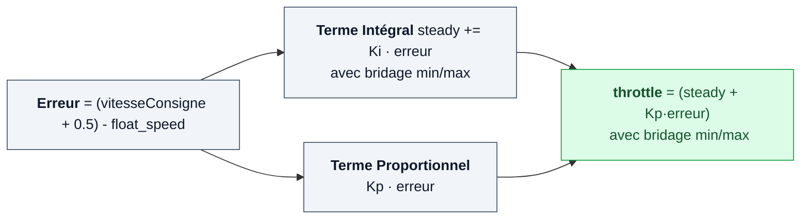

Voici le code de l'opération du correcteur PI `calcul_regulateur_vitesse()`:

```cpp
const double erreur = (double)vitesseConsigne+0.5 - (double)float_speed;

steady += Ki_regulateur * erreur;

if (steady > PARAM_SIMU_max_throttle) steady = PARAM_SIMU_max_throttle;
if (steady < throttle_repos)          steady = throttle_repos;

double commande = steady + (Kp_regulateur * erreur);

if (commande > PARAM_SIMU_max_throttle) commande = PARAM_SIMU_max_throttle;
if (commande < throttle_repos)          commande = throttle_repos;

throttle = commande;
```

Voici un extrait du constructeur `_SysVehicule()` qui sert à initialiser les gains effectifs Kp et Ki à partir des coefficients normalisés et des caractéristiques du véhicule :  
```cpp
// Constructeur _SysVehicule() : construction des gains effectifs Kp et Ki à partir des coefficients normalisés
const double RATIO_CORRECTION_P   = PARAM_SIMU_Kp_regulateur;
const double RATIO_LENTEUR_I      = PARAM_SIMU_Ki_regulateur;
const double FREQ_REG             = (double)PARAM_SIMU_freq_regulateur;
const double delta_v_par_throttle = (PUISSANCE / MASSE) * (1.0 / FREQ_REG) * 3.6;

Kp_regulateur = RATIO_CORRECTION_P / delta_v_par_throttle;
Ki_regulateur = (Kp_regulateur / RATIO_LENTEUR_I);
```

### 7.4 Évolution

Nous avions d'abord un interrupteur `cmd_regulateur` : le statechart désactivait le régulateur au freinage, mais l'interrupteur de l'IHM restait enclenché et le réactivait. Nous l'avons donc remplacé par un bouton poussoir qui envoie l'événement `ev_regulateur`, associé à un voyant en lecture seule : comme ça, il n'y a plus de décalage.

Entre temps nous avons aussi essayé des corrections non linéaires en ±erreur² puis ±erreur³ pour augmenter la réactivité en fonction de l'erreur, mais nous n'arrivions pas à obtenir une correction à la fois réactive et douce dans toutes les situations. C'est pourquoi nous avons finalement opté pour un correcteur PI.

## 8. Limiteur de vitesse

Le limiteur de vitesse empêche le véhicule de dépasser une vitesse maximale programmée (`vitesseConsigne`) en bridant automatiquement le débit d'injection. Il est mutuellement exclusif avec le régulateur, s'active en différé si le véhicule roule déjà au-dessus de la limite, et déclenche une alarme sonore en cas de dépassement.

### 8.1 Fonctionnement depuis l'IHM

* **Activer / désactiver** : nous utilisons le bouton **Limiteur**, qui envoie l'événement `ev_limiteur`. La LED (`voyant_limiteur`) indique que le limiteur est actif. Activer le limiteur désactive automatiquement le régulateur, et inversement.
* **Consigne** : à l'activation, **vitesse cible** s'initialise à `50 km/h` (`valeur_initiale_limiteur`). Un appui simple sur les boutons **+** ou **−** modifie la consigne de `1 km/h`, et un double appui en moins de `500 ms` la modifie de `10 km/h`.
* **Voyants d'attente** : Si le limiteur est en attente suite à une activation au-dessus de la vitesse limite, le voyant jaune de l'IHM (`limiteur_attente`) s'allume pour indiquer que le limiteur n'est pas encore effectif.  
* **Voyants de dépassement** : Si le véhicule dépasse la vitesse limite alors que le limiteur est effectif, le voyant rouge de l'IHM (`limiteur_depasse`) s'allume et une alarme sonore est déclenchée.
* **Reprise de la main sur l'accélération** : En enfonçant franchement la pédale d'accélération (> 7/10) à proximité de la vitesse limite (< 10 km/h), le limiteur se désactive automatiquement pour permettre au conducteur de dépasser en cas d'urgence.

### 8.2 Statechart

#### 8.2.1 Gestion du limiteur, de la consigne et des alarmes

La région **`Limiteur de vitesse`** gère l'activation du limiteur, le réglage de la consigne par simple ou double appui, l'activation différée et l'alerte de dépassement :

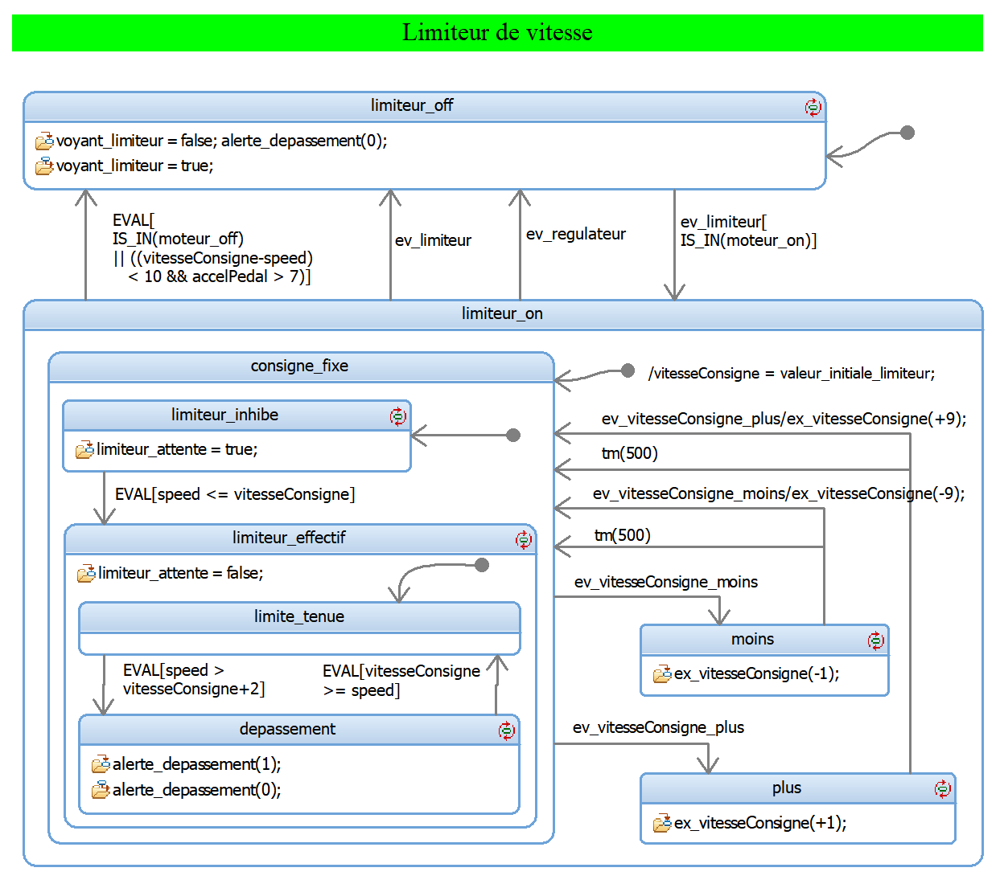

* **Exclusion mutuelle avec le régulateur** : l'événement `ev_limiteur` fait passer de `limiteur_off` à `limiteur_on` (uniquement moteur allumé, `[IS_IN(moteur_on)]`) et renvoie simultanément la région `Mode de pilotage` vers `mode_manuel`. À l'inverse, `ev_regulateur` fait immédiatement repasser le limiteur dans `limiteur_off`.
* **Consigne initiale et double appui** : l'entrée dans `consigne_fixe` initialise `vitesseConsigne = valeur_initiale_limiteur` (`50 km/h`). Un premier appui sur **+** (`ev_vitesseConsigne_plus`) passe dans `plus` et applique tout de suite `ex_vitesseConsigne(+1)`. Si un second appui arrive avant `500 ms`, la transition de retour applique `ex_vitesseConsigne(+9)` (soit `+10 km/h` au total) ; sinon, `tm(500)` ramène dans `consigne_fixe` sans modification supplémentaire. Le bouton **−** suit exactement le même principe (`-1` puis `-9`).
* **Activation différée** : à l'entrée dans `consigne_fixe`, le limiteur démarre dans `limiteur_inhibe` (`limiteur_attente = true`) : tant que le véhicule roule au-dessus de la consigne, il ne bride pas l'injection et ne déclenche aucune alarme. Dès que la vitesse repasse sous la consigne (`EVAL[speed <= vitesseConsigne]`), il bascule dans `limiteur_effectif` (`limiteur_attente = false`).
* **Alarme de dépassement** : dans `limiteur_effectif`, si la vitesse dépasse la consigne de plus de `2 km/h` (`EVAL[speed > vitesseConsigne + 2]`, typiquement en forte descente), l'entrée dans `depassement` appelle `alerte_depassement(1)`, ce qui allume le voyant `limiteur_depasse` et lance l'alarme sonore en boucle (voir [Section 12 Implémentation de la gestion sonore sous Rhapsody](#12-impl%C3%A9mentation-de-la-gestion-sonore-sous-rhapsody)). Dès que la vitesse redescend sous la consigne (`EVAL[vitesseConsigne >= speed]`), l'action de sortie `alerte_depassement(0)` coupe l'alarme et éteint le voyant.
* **Désactivation automatique** : le limiteur repasse dans `limiteur_off` dès que le moteur s'arrête ou que le conducteur appuie beaucoup sur l'accélérateur près de la limite (`EVAL[IS_IN(moteur_off) || ((vitesseConsigne - speed) < 10 && accelPedal > 7)]`).

#### 8.2.2 Bridage de l'injection d'essence

Le bridage effectif du `throttle` pour empêcher le dépassement de la vitesse de consigne est géré dans la région **`Débit de l'injection d'essence`** (présentée en [Section 4 Gestion des pédales d'accélération et de frein](#4-gestion-des-p%C3%A9dales-dacc%C3%A9l%C3%A9ration-et-de-frein) et [Section 7.2 Statechart](#72-statechart)), afin de conserver une seule région qui contrôle le `throttle`. Dans le super-état `pedales`, dès que `IS_IN(limiteur_effectif) && float_speed >= vitesseConsigne + 0.5`, la transition vers `freinage_injection` coupe l'accélération et ramène le `throttle` à son minimum, quelle que soit la position de la pédale d'accélération. Comme pour le régulateur, le seuil à `vitesseConsigne + 0.5` sur `float_speed` évite les oscillations autour de l'entier `speed`.

### 8.3 Opérations

Voici le code de l'opération `ex_vitesseConsigne()` (partagée avec le régulateur de vitesse) :

<!-- code:ex_vitesseConsigne(int delta) -->
```cpp
vitesseConsigne += delta;

if (vitesseConsigne > PARAM_SIMU_max_speed) {
    vitesseConsigne = PARAM_SIMU_max_speed;
}
if (vitesseConsigne < 0) {
    vitesseConsigne = 0;
}
```

Cette opération applique le "delta" (`±1` ou `±9`) puis borne `vitesseConsigne` entre `0` et `PARAM_SIMU_max_speed` (`120 km/h`).

Voici le code de l'opération `alerte_depassement()` :

<!-- code:alerte_depassement(int actif) -->
```cpp
if (actif == 0) {
    play_sound("stop");
    limiteur_depasse = false;
} else {
    play_sound("alarme_depassement.wav");
    limiteur_depasse = true;
}
```

Cette opération synchronise l'allumage du voyant `limiteur_depasse` avec la lecture ou l'arrêt de l'alarme sonore `alarme_depassement.wav` (voir [Section 12 Implémentation de la gestion sonore sous Rhapsody](#12-impl%C3%A9mentation-de-la-gestion-sonore-sous-rhapsody)).

### 8.4 Évolution

Au début, nous avions modélisé `limiteur_on` avec deux sous-régions parallèles (une pour l'inhibition et une pour le dépassement), mais l'alarme sonnait dès que le limiteur était activé au-dessus de `50 km/h` alors qu'il devait rester en attente. Nous avons donc imbriqué `limite_tenue` et `depassement` directement à l'intérieur de `limiteur_effectif`, ce qui garantit qu'aucune alarme ne peut se déclencher tant que le limiteur est inhibé.

Pour le double appui, nous attendions initialement la fin des `500 ms` avant d'appliquer `+1` ou `+10`, ce qui provoquait une latence visible à chaque clic simple. Nous appliquons désormais `+1` immédiatement, puis `+9` si un second appui arrive dans la fenêtre de `500 ms`.

Enfin, nous avons affiné plusieurs seuils au fil des tests : nous avons remplacé la comparaison sur l'entier `speed` par `float_speed >= vitesseConsigne + 0.5` pour supprimer les à-coups d'injection autour de la limite, relevé le seuil de kick-down de `5` à `7` pour éviter des coupures involontaires lors d'une accélération normale, et utilisé des inégalités (`<=` / `>=`) à la place d'égalités strictes qui pouvaient être sautées entre deux ticks `EVAL` lors d'un freinage fort.

## 9. Contrôleur de Kit Bluetooth « mains libres »

### 9.1 Cycle de vie du téléphone et du kit

> **[Capture Rhapsody à insérer — IHM téléphone et kit]** : 

Le kit Bluetooth du véhicule permet de connecter un téléphone pour passer des appels et lire les SMS. Le téléphone et le kit mains libres ont chacun leur propre cycle de vie, qui conditionne tout le reste de cette section.

* **Le téléphone** : toute manipulation du téléphone se réalise dans le super-état `telephone_actif`. Nous n'y entrons que si le téléphone est allumé et que sa batterie n'est pas vide (`EVAL[niveau_batterie_telephone > 0 && telephone_allume]`), et nous en sortons dès que l'une de ces deux conditions tombe. Dans `telephone_actif`, le Bluetooth a lui aussi son propre interrupteur : `bluetooth_telephone_desactive` ↔ `bluetooth_telephone_active` selon `cmd_bluetooth_telephone_actif`. Tant que le téléphone est dans `telephone_actif`, sa batterie se décharge de 1 %/s. Branché au véhicule, elle se recharge de 5 % toutes les 1,5 s.
* **Le kit** : toute communication Bluetooth du kit se réalise dans le super-état `bluetooth_active`, et les commandes au volant ne sont actives que lorsqu'un téléphone y est connecté. Il est alimenté par le véhicule et ne fonctionne donc que contact mis (`EVAL[IS_IN(contact_on)]`). À la coupure du contact (`EVAL[IS_IN(contact_off)]`), il retourne en `bluetooth_desactive` et éteint son voyant Bluetooth.

En sortant de leur super-état respectif, le téléphone et le kit se mettent en veille et ne peuvent plus communiquer. Ils préviennent alors l'autre appareil : le téléphone émet `GEN(ev_telephone_bluetooth_desactive)`, et le kit émet `GEN(ev_kit_bluetooth_desactive)`. Côté téléphone, les écrans sont aussi vidés et affichent « Standby ». À la réception de ce paquet, l'autre appareil reprend sa recherche : le kit revient en `recherche_telephone` et le téléphone en `recherche_bluetooth`, directement depuis l'état connecté (`telephone_connecte`, `kit_connecte`), ou via un état d'interruption (`interruption_bluetooth_telephone`, `interruption_bluetooth_kit`) si le jumelage ou la connexion étaient en cours. À la réception de ce paquet, l'autre appareil reprend sa recherche : le kit revient en `recherche_telephone` et le téléphone en `recherche_bluetooth`, directement depuis l'état connecté (`telephone_connecte`, `kit_connecte`), ou via un état d'interruption (`interruption_bluetooth_telephone`, `interruption_bluetooth_kit`) si le jumelage ou la connexion étaient en cours.

### 9.2 Principe : deux équipements cloisonnés qui échangent des paquets

#### 9.2.1 Statechart associé
> **[Capture Rhapsody à insérer — 3 zones]** :

#### 9.2.2 Choix fonctionnels

Dans la réalité, le téléphone et le kit mains libres sont deux appareils distincts qui ne communiquent que par Bluetooth. Ils ne partagent donc aucune mémoire commune : aucun état (`IS_IN`), attribut ni opération ne peut être partagé entre le téléphone et le véhicule. Le partage de données se fait uniquement par génération d'événements Bluetooth, qui peuvent transporter des paramètres.
L'émetteur les envoie avec `GEN(ev_nom(valeur))`, et le récepteur les lit via `params->nom_du_parametre`. Chacune des sous-parties suivantes liste, dans un tableau, les paquets qu'elle utilise. Le nom de chaque paquet indique l'appareil qui l'émet, et pour le téléphone son destinataire.

Nous avons également choisi de diviser les tâches de chaque appareil en plusieurs régions, par souci de lisibilité et de place. Au lieu d'avoir une seule région dédiée au téléphone ou au kit, plusieurs régions sont regroupées en trois ensembles distincts :

* **le téléphone** : régions Telephone, Batterie téléphone et Communication telephone ;
* **le kit véhicule** : régions Jumelage kit main libre et Commande kit main libre (la région Radio, également côté véhicule, forme le bloc infodivertissement et est traitée dans la [Section 10 Autoradio et arbitrage des priorités audio](#10-autoradio-et-arbitrage-des-priorit%C3%A9s-audio)) ;
* **le réseau extérieur**, simulé par les régions Appel Extérieur et SMS Extérieur.

Le réseau extérieur joue le rôle de l'opérateur : il ne parle qu'au téléphone (`ev_SIM_appel`, `ev_SIM_envoi_sms`), et c'est le téléphone qui relaie ensuite vers le kit.


#### 9.2.3 Conventions de nommage des événements

Pour différencier les différents échanges entre le téléphone, le kit et le réseau, nous avons adopté une convention de nommage. Le nom d'un événement indique donc **quel appareil l'émet** :

* la forme de base est `ev_<source>_<action>`. La **source** est l'appareil qui fait le `GEN`, et c'est le seul autorisé à le générer. Seul l'appareil destinataire utilise l'événement comme trigger ;
* le kit et le réseau ne parlent qu'au téléphone : leur destinataire est implicite. Le téléphone est le seul appareil qui communique à la fois avec le kit et avec le réseau. Ses événements précisent donc le **destinataire en suffixe** : `ev_telephone_<action>_kit` ou `ev_telephone_<action>_SIM`.

| Forme | Émetteur → Récepteur | Exemple |
| :--- | :--- | :--- |
| `ev_kit_<action>` | Kit → Téléphone | `ev_kit_mdp_correct` |
| `ev_SIM_<action>` | Réseau → Téléphone | `ev_SIM_appel` |
| `ev_telephone_<action>_kit` | Téléphone → Kit | `ev_telephone_appel_entrant_kit` |
| `ev_telephone_<action>_SIM` | Téléphone → Réseau | `ev_telephone_raccrocher_SIM` |
| `ev_btn_<appareil>_<bouton>` | Bouton de l'IHM → Appareil | `ev_btn_telephone_decrocher` |

Ainsi, en lisant `GEN(ev_telephone_appel_entrant_kit)`, on sait que l'action se trouve côté téléphone. En lisant le trigger `ev_telephone_appel_entrant_kit`, on sait qu'on est côté kit. Un `GEN(ev_kit_…)` placé dans une région du téléphone est donc une erreur visible au premier coup d'œil.

Les événements du jumelage et de la déconnexion (`ev_telephone_demande_jumelage`, `ev_telephone_tentative_mdp`, `ev_telephone_demande_connexion` et `ev_telephone_bluetooth_desactive`), nommés avant l'ajout du suffixe, ne précisent pas leur destinataire : ils sont tous destinés au kit.

---

### 9.3 Protocole Bluetooth et jumelage par code PIN
 
#### 9.3.1 Statechart associé
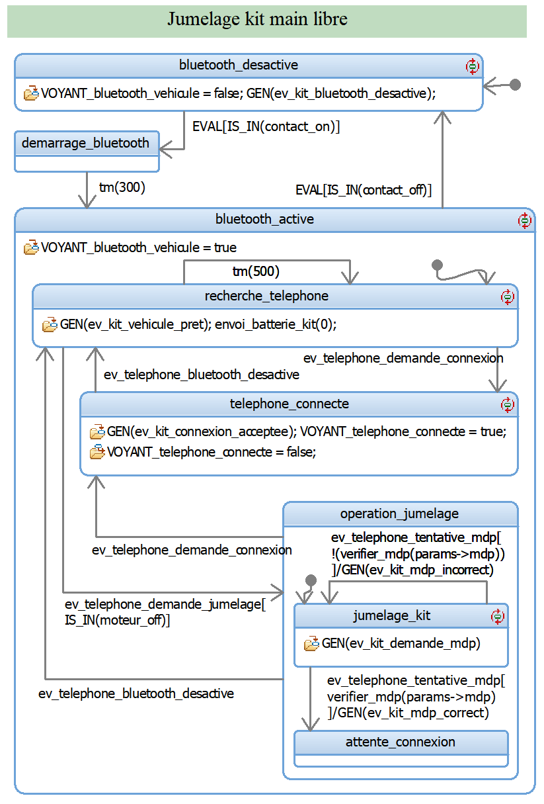

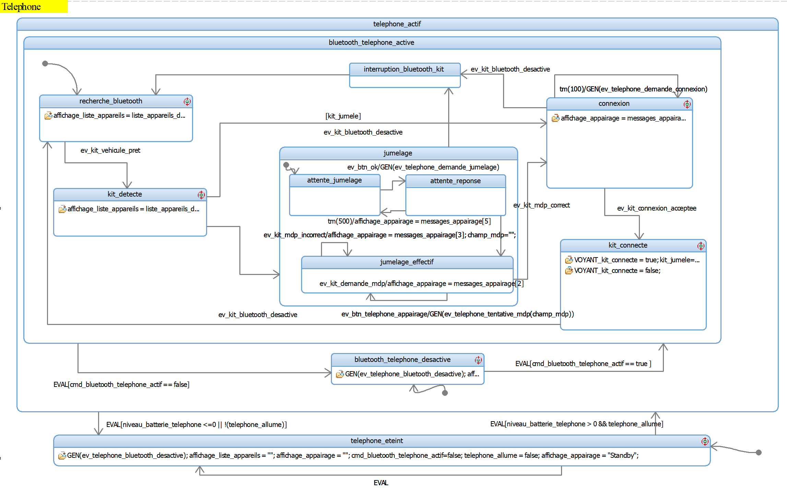

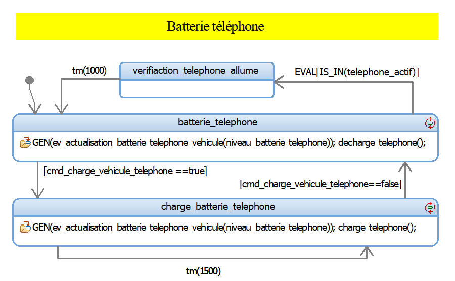

#### 9.3.2 Choix fonctionnels
Le Bluetooth du kit véhicule s'active à la mise du contact. Le téléphone (maître) détecte le kit, se jumelle avec le code `1234` uniquement moteur à l'arrêt, puis se reconnecte automatiquement. Le jumelage se fait par un échange de requêtes et de réponses entre le kit et le téléphone. L'utilisateur peut suivre la procédure dans les champs texte du téléphone (liste complète des messages dans le tableau en fin de sous-partie).

##### Côté IHM

* **Téléphone** : nous allumons le téléphone puis son Bluetooth avec leurs interrupteurs, et sa jauge affiche son niveau de batterie.
* **Détection** : « Kit Bluetooth Vehicule » apparaît dans la liste des appareils, et le bouton **OK** demande le jumelage.
* **Code PIN** : nous le saisissons dans le champ du mot de passe et l'envoyons avec **Appairer**.
* **Connexion** : la LED « Appareil connecté » s'allume côté téléphone, et les LED de connexion du kit s'allument côté véhicule.
* **Batterie au tableau de bord** : la jauge **Batterie téléphone** du kit recopie le niveau du téléphone, et l'interrupteur **Brancher Téléphone** permet de le recharger.

**Côté statechart.** Nous avons fait collaborer trois régions uniquement par événements :

* **Jumelage kit main libre (kit)** :

À la mise du contact, le kit passe par `demarrage_bluetooth`, une légère pause (`tm(300)`) qui simule le temps de démarrage du module, puis entre dans `bluetooth_active` et allume son voyant Bluetooth. Il commence directement la recherche du téléphone : en état `recherche_telephone`, il annonce sa présence par `GEN(ev_kit_vehicule_pret)` toutes les 500 ms et affiche une batterie téléphone vide (`envoi_batterie_kit(0)`). Il attend ensuite l'une des deux requêtes du téléphone :
* une demande de jumelage (`ev_telephone_demande_jumelage`), acceptée uniquement moteur à l'arrêt (`[IS_IN(moteur_off)]`). Le kit passe en `jumelage_kit` et demande le mot de passe (`GEN(ev_kit_demande_mdp)`), puis vérifie le PIN reçu (`ev_telephone_tentative_mdp[verifier_mdp(params->mdp)]`) :
    * si le code est correct, le kit envoie un paquet de confirmation `GEN(ev_kit_mdp_correct)` et passe en `attente_connexion`. À la première demande de connexion du téléphone (`ev_telephone_demande_connexion`), il entre dans `telephone_connecte` : il allume ses voyants (`VOYANT_telephone_connecte`) et notifie le téléphone (`GEN(ev_kit_connexion_acceptee)`) ;
    * sinon, il retourne un paquet d'erreur `GEN(ev_kit_mdp_incorrect)`, redemande le mot de passe et attend une nouvelle tentative.
* une demande de connexion (`ev_telephone_demande_connexion`), envoyée par un téléphone déjà jumelé : le kit passe directement en `telephone_connecte`, sans repasser par le code PIN.

Durant toute cette manœuvre, le kit peut être déconnecté (voir [Section 9.1 Cycle de vie du téléphone et du kit](#91-cycle-de-vie-du-t%C3%A9l%C3%A9phone-et-du-kit)).

* **Telephone** :

Dans `bluetooth_telephone_active`, l'état initial `recherche_bluetooth` se lance à l'activation du Bluetooth du téléphone, qui commence alors sa recherche et affiche « Aucun appareil détecté ». Il détecte le kit à la réception de `ev_kit_vehicule_pret` et passe en `kit_detecte` : sur l'IHM, le nom du kit apparaît dans le champ `affichage_liste_appareils`. `kit_detecte` est un état de décision :
* si le kit est déjà jumelé (`[kit_jumele]`), le téléphone passe directement en `connexion` ;
* sinon, il entre dans le super-état `jumelage`, en `attente_jumelage`.

À la pression du bouton **OK** (`ev_btn_ok`), le téléphone envoie une requête de jumelage `GEN(ev_telephone_demande_jumelage)` et attend en `attente_reponse` la demande d'authentification `ev_kit_demande_mdp`. Si le kit ne répond pas sous 500 ms (moteur en marche), la demande est considérée comme refusée : le téléphone affiche « Jumelage Impossible » et retourne en `attente_jumelage`. Sinon, le jumelage est accepté (`jumelage_effectif`) et l'utilisateur peut saisir le code PIN. En pressant le bouton **Appairer** (`ev_btn_telephone_appairage`), le téléphone envoie le contenu du champ au kit (`GEN(ev_telephone_tentative_mdp(champ_mdp))`), qui vérifie la correspondance. Si le paquet reçu annonce un échec (`ev_kit_mdp_incorrect`), le téléphone affiche « Mot de passe incorrect » et vide le champ du mot de passe. Sinon, à la réception de `ev_kit_mdp_correct`, le téléphone passe en `connexion`.

En `connexion`, le téléphone affiche « Appareil jumelé » et envoie `GEN(ev_telephone_demande_connexion)` toutes les 100 ms (`tm(100)`), jusqu'à la confirmation finale du kit (`ev_kit_connexion_acceptee`). Il passe alors en `kit_connecte` et allume son voyant (`VOYANT_kit_connecte`).

De même, le téléphone peut être déconnecté à tout moment (voir [Section 9.1 Cycle de vie du téléphone et du kit](#91-cycle-de-vie-du-t%C3%A9l%C3%A9phone-et-du-kit)).

* **Reconnexion automatique** : à la première connexion, le téléphone passe le booléen `kit_jumele` à `true` en entrée de `kit_connecte`. Le téléphone se reconnecte ensuite automatiquement au kit à chaque mise sous tension du téléphone ou du kit, sans passer par les étapes de jumelage. Seul le jumelage est soumis à la garde moteur : la reconnexion d'un téléphone déjà jumelé est acceptée même moteur en marche. La mémoire du jumelage est uniquement côté téléphone : le kit ne vérifie pas `kit_jumele` et accepte toute demande de connexion, ce qui suffit pour une simulation à un seul téléphone.

* **Batterie téléphone** :

Cette région tourne en permanence, que le téléphone soit allumé ou non. À chaque entrée dans `batterie_telephone`, elle envoie le niveau au kit (`GEN(ev_telephone_actualisation_batterie_kit(niveau_batterie_telephone))`) et décharge la batterie de 1 % (`decharge_telephone()`). Si le téléphone est actif (`EVAL[IS_IN(telephone_actif)]`), elle passe par `verifiaction_telephone_allume` pendant 1 s avant de revenir en `batterie_telephone` : d'où la décharge de 1 %/s. Si le téléphone est branché (`[cmd_charge_vehicule_telephone == true]`), elle passe en `charge_batterie_telephone`, qui recharge de 5 % toutes les 1,5 s (`charge_telephone()`, plafonné à 100 %) et envoie le niveau au kit à chaque recharge. Côté kit, la sous-région `affichage_batterie` de Commande kit main libre lit ce paquet et met à jour la jauge (`envoi_batterie_kit(params->pourcentage)`).

**Paquets Bluetooth du jumelage et de la connexion** :

| Événement | Sens | Paramètre | Rôle |
| :--- | :---: | :--- | :--- |
| `ev_kit_vehicule_pret` | Kit → Téléphone | — | Annonce du kit toutes les 500 ms en `recherche_telephone` |
| `ev_telephone_demande_jumelage` | Téléphone → Kit | — | Demande de jumelage (bouton **OK**) |
| `ev_kit_demande_mdp` | Kit → Téléphone | — | Demande du code PIN |
| `ev_telephone_tentative_mdp` | Téléphone → Kit | `mdp` (`OMString`) | Code PIN saisi (bouton **Appairer**) |
| `ev_kit_mdp_correct` | Kit → Téléphone | — | Code PIN accepté |
| `ev_kit_mdp_incorrect` | Kit → Téléphone | — | Code PIN refusé |
| `ev_telephone_demande_connexion` | Téléphone → Kit | — | Demande de connexion, toutes les 100 ms en `connexion` |
| `ev_kit_connexion_acceptee` | Kit → Téléphone | — | Connexion établie |
| `ev_telephone_bluetooth_desactive` | Téléphone → Kit | — | Bluetooth du téléphone coupé ou téléphone éteint |
| `ev_kit_bluetooth_desactive` | Kit → Téléphone | — | Bluetooth du kit coupé (contact coupé) |
| `ev_telephone_actualisation_batterie_kit` | Téléphone → Kit | `pourcentage` (`int`) | Niveau de batterie du téléphone |

**Messages affichés par le téléphone** (`affichage_appairage`, tableau `messages_appairage`) :

| Indice | Message | Affiché |
| :---: | :--- | :--- |
| 0 | « Aucun appareil détecté » | En entrée de `recherche_bluetooth` |
| 1 | « Sélectioner un appareil » | En entrée de `kit_detecte` (« Kit Bluetooth Vehicule » apparaît dans `affichage_liste_appareils`) |
| 2 | « Entrez un mot de passe » | À la réception de `ev_kit_demande_mdp` |
| 3 | « Mot de passe incorrect » | À la réception de `ev_kit_mdp_incorrect` |
| 4 | « Appareil jumelé » | En entrée de `connexion` |
| 5 | « Jumelage Impossible » | Après 500 ms sans réponse du kit (moteur en marche) |
| — | « Standby » | En entrée de `telephone_eteint` et de `bluetooth_telephone_desactive` |

### 9.4 Gestion des appels entrants et redirection mains-libres

#### 9.4.1 Statechart associé
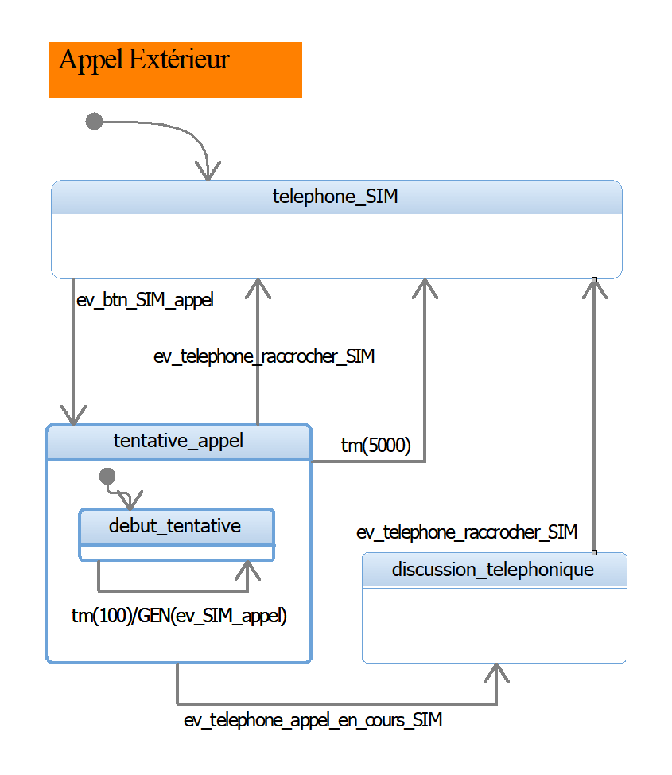

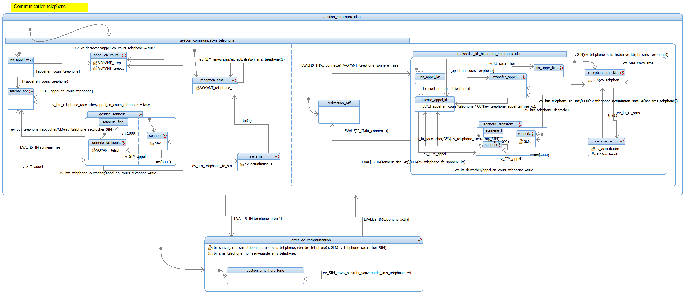

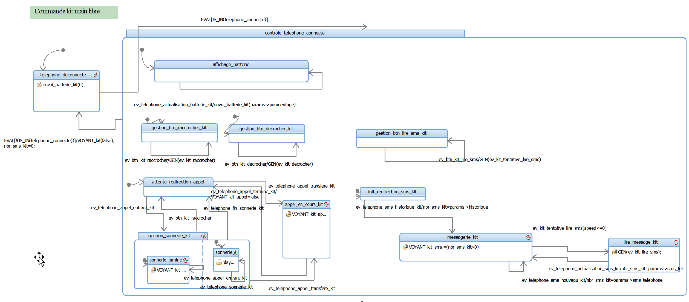

#### 9.4.2 Choix fonctionnels
Un appel entrant sonne sur le téléphone, ou au volant lorsque le Bluetooth est connecté. L'utilisateur peut l'accepter, le refuser ou le raccrocher indifféremment depuis le téléphone ou depuis le volant.

##### Côté IHM

* **Déclencher un appel** : bouton **Appeler**.
* **Sur le téléphone** : les LED « Appel reçu » indiquent l'appel et la sonnerie, et les boutons **Décrocher** / **Raccrocher** permettent de répondre.
* **Au volant** : les LED « Appel Téléphonique » indiquent l'appel et la sonnerie, avec les mêmes boutons **Décrocher** / **Raccrocher**.
* **Son** : `sonnerie.wav` sur le téléphone, `sonnerie2.wav` sur le kit ; la radio se coupe pendant l'appel (voir [Section 10 Autoradio et arbitrage des priorités audio](#10-autoradio-et-arbitrage-des-priorit%C3%A9s-audio)).

**Côté statechart.** Nous avons découplé la gestion des appels en trois régions, qui collaborent uniquement par événements :

* **Appel Extérieur (réseau)** :

Cette région simule le réseau qui appelle le téléphone. Au repos, elle attend dans `telephone_SIM` la pression du bouton **Appeler** (`ev_btn_SIM_appel`) pour lancer une tentative d'appel (`tentative_appel`), limitée à 5 s (`tm(5000)`). Elle émet alors `GEN(ev_SIM_appel)` toutes les 100 ms (`tm(100)`) : c'est ce flux d'événements qui fait sonner le téléphone et le kit. La tentative se termine de trois façons :
   * l'appel est décroché (`ev_telephone_appel_en_cours_SIM`) : le réseau passe en `discussion_telephonique` et y reste jusqu'au raccrochage (`ev_telephone_raccrocher_SIM`) ;
   * l'appel est refusé (`ev_telephone_raccrocher_SIM`) : retour direct en `telephone_SIM` ;
   * personne ne répond pendant 5 s : le timeout ramène le réseau en `telephone_SIM`.

* **Communication telephone** :

Tant que le téléphone est éteint, les communications sont coupées (`arret_de_communication`). Dès que le téléphone passe dans `telephone_actif` (`EVAL[IS_IN(telephone_actif)]`), la région entre dans `gestion_communication_telephone`, un état And à trois sous-régions parallèles : les appels sur le téléphone, les SMS ([Section 9.5 Messagerie SMS et tableau de bord connecté](#95-messagerie-sms-et-tableau-de-bord-connect%C3%A9)) et la redirection Bluetooth. Elle y reste jusqu'à l'extinction du téléphone (`EVAL[IS_IN(telephone_eteint)]`).

   * **Appels sur le téléphone** :

   La sous-région démarre dans `init_appel_telephone`, un état de décision : si un appel est déjà en cours (`[appel_en_cours_telephone]`), l'appel est directement repris (on passe en `appel_en_cours`), sinon le téléphone attend la requête de la carte SIM en `attente_appel_tel`. À la réception de l'appel extérieur (`ev_SIM_appel`), le téléphone entre dans `gestion_sonnerie`, qui fait tourner deux sous-régions en parallèle : `sonnerie_lumineuse` fait clignoter le voyant (`VOYANT_telephone_sonnerie`) au rythme de `ev_SIM_appel`, et `sonnerie_sonore` joue la sonnerie du téléphone (`sonnerie.wav`) toutes les 3 s (`tm(3000)`). Si plus aucune requête de la carte SIM n'arrive pendant 1 s (`tm(1000)`), la sous-région lumineuse passe en `sonnerie_finie` et le téléphone retourne en attente (`EVAL[IS_IN(sonnerie_finie)]`). Pendant la sonnerie, l'utilisateur peut :
   * décrocher, sur le téléphone (`ev_btn_telephone_decrocher`) ou au volant (`ev_kit_decrocher`) si le kit est connecté : le téléphone passe en `appel_en_cours`, coupe la sonnerie, allume son voyant d'appel et notifie le réseau (`GEN(ev_telephone_appel_en_cours_SIM)`) ;
   * refuser avec **Raccrocher** (`ev_btn_telephone_raccrocher`) : le téléphone envoie `GEN(ev_telephone_raccrocher_SIM)` et retourne en attente.

   L'attribut `appel_en_cours_telephone` est la référence de l'appel pour tout le téléphone : il passe à `true` au décrochage, sur le téléphone comme au volant. L'appel se termine par **Raccrocher** sur le téléphone, qui remet l'attribut à `false`, ou dès que l'attribut repasse à `false` (`EVAL[!appel_en_cours_telephone]`) lorsque l'appel est raccroché au volant. Dans les deux cas, l'action de sortie de `appel_en_cours` éteint le voyant d'appel et prévient le réseau (`GEN(ev_telephone_raccrocher_SIM)`).

   * **Redirection Bluetooth** :

   Cette sous-région ne fait que transférer des paquets au kit Bluetooth, qui s'occupe de réaliser les actions côté véhicule.
   Elle reste inactive (`redirection_off`) tant que le kit n'est pas connecté. Dès que le kit se connecte (`EVAL[IS_IN(kit_connecte)]`), elle éteint le voyant de sonnerie du téléphone et entre dans `redirection_kit_bluetooth_communication`, jusqu'à la déconnexion du kit. La sous-région des appels sur le téléphone reste active en parallèle : le téléphone continue de sonner et de gérer ses propres boutons, et la redirection relaie en plus chaque étape de l'appel vers le volant.
   Son fonctionnement est similaire à celui du téléphone : la redirection démarre par un état de décision, `init_appel_kit`. Si un appel est déjà en cours, elle va directement en `transfer_appel` pour le basculer sur le kit, sinon elle attend en `attente_appel_kit`. À la réception de `ev_SIM_appel`, elle entre dans `sonnerie_transfert`, qui notifie le kit de la présence d'un appel à chaque salve du réseau (`ev_telephone_appel_entrant_kit`) et du besoin de sonner toutes les 3 s (`ev_telephone_sonnerie_kit`). Si plus aucune requête n'arrive pendant 1 s, la sous-région passe en `sonnerie_finie_kit` et la redirection envoie `GEN(ev_telephone_fin_sonnerie_kit)` pour arrêter la sonnerie au volant.
   Depuis `sonnerie_transfert`, deux cas sont possibles :
   * l'appel est décroché au volant (`ev_kit_decrocher`) ou sur le téléphone (`ev_btn_telephone_decrocher`) : la redirection passe en `transfer_appel` et transfère l'appel au kit (`GEN(ev_telephone_appel_transfere_kit)`) ;
   * l'appel est raccroché au volant (`ev_kit_raccrocher`) : la redirection refuse l'appel auprès du réseau (`GEN(ev_telephone_raccrocher_SIM)`).

   En `transfer_appel`, raccrocher au volant passe par `fin_appel_kit`, qui remet `appel_en_cours_telephone` à `false` et notifie la fin de l'appel au kit (`GEN(ev_telephone_appel_termine_kit)`) avant de revenir en attente. Le réseau est prévenu par la sous-région des appels sur le téléphone, à la sortie de `appel_en_cours`. Un raccrochage depuis le téléphone ramène lui aussi la sous-région en `attente_appel_kit` : dès que l'attribut repasse à `false` (`EVAL[!appel_en_cours_telephone]`), elle prévient le kit de la fin de l'appel (`GEN(ev_telephone_appel_termine_kit)`).

   Nous obtenons donc un fonctionnement symétrique entre le téléphone et la redirection Bluetooth : décrocher ou raccrocher sur l'un ou l'autre garde les deux côtés cohérents. Ce choix de conception est expliqué plus bas.

* **Commande kit main libre (kit)** :

Côté véhicule, les commandes ne sont actives que si le téléphone est connecté : le kit passe de `telephone_deconnecte` à `controle_telephone_connecte` sur `EVAL[IS_IN(telephone_connecte)]`, et y revient dès que la connexion est perdue. `controle_telephone_connecte` fait alors tourner en parallèle les appels au volant, l'affichage de la batterie, les SMS au volant ([Section 9.5 Messagerie SMS et tableau de bord connecté](#95-messagerie-sms-et-tableau-de-bord-connect%C3%A9)) et les adaptateurs des boutons au volant. Ces adaptateurs transforment les boutons **Décrocher** / **Raccrocher** du volant (`ev_btn_kit_decrocher`, `ev_btn_kit_raccrocher`) en paquets Bluetooth `ev_kit_decrocher` et `ev_kit_raccrocher`, envoyés au téléphone.
Pour les appels, le kit attend en `attente_redirection_appel`. À la réception de `ev_telephone_appel_entrant_kit`, il entre dans `gestion_sonnerie_kit`, où `sonnerie_lumineuse_kit` fait clignoter `VOYANT_kit_sonnerie` à chaque paquet reçu et `sonnerie_sonore_kit` joue `sonnerie2.wav` à chaque `ev_telephone_sonnerie_kit` du téléphone. La sonnerie s'arrête de deux façons :
* sur `ev_telephone_fin_sonnerie_kit`, ou directement sur son bouton **Raccrocher** (`ev_btn_kit_raccrocher`), le kit retourne en attente et coupe le son en sortie (`play_sound("stop")`) ;
* sur `ev_telephone_appel_transfere_kit`, le kit passe en `appel_en_cours_kit` et allume `VOYANT_kit_appel`. C'est le téléphone qui notifie le réseau du décrochage : le kit ne communique jamais directement avec lui.

L'appel au volant se termine sur `ev_telephone_appel_termine_kit`, qui éteint le voyant d'appel et ramène le kit en `attente_redirection_appel`.

**Événements des appels** (réseau ↔ téléphone et téléphone ↔ kit) :

| Événement | Sens | Paramètre | Rôle |
| :--- | :---: | :--- | :--- |
| `ev_SIM_appel` | Réseau → Téléphone | — | Appel entrant, toutes les 100 ms pendant 5 s au plus |
| `ev_telephone_appel_en_cours_SIM` | Téléphone → Réseau | — | Appel décroché |
| `ev_telephone_raccrocher_SIM` | Téléphone → Réseau | — | Appel refusé ou terminé |
| `ev_telephone_appel_entrant_kit` | Téléphone → Kit | — | Appel entrant, à chaque salve du réseau |
| `ev_telephone_sonnerie_kit` | Téléphone → Kit | — | Relance de `sonnerie2.wav`, toutes les 3 s |
| `ev_telephone_fin_sonnerie_kit` | Téléphone → Kit | — | Fin de sonnerie sans réponse |
| `ev_telephone_appel_transfere_kit` | Téléphone → Kit | — | Appel décroché, basculé sur le kit |
| `ev_telephone_appel_termine_kit` | Téléphone → Kit | — | Fin de l'appel au volant |
| `ev_kit_decrocher` | Kit → Téléphone | — | Bouton **Décrocher** au volant |
| `ev_kit_raccrocher` | Kit → Téléphone | — | Bouton **Raccrocher** au volant |

#### 9.4.3 Choix de conception

* Au début, la redirection et la gestion locale des appels étaient deux états exclusifs : connecter le kit ou couper le contact en plein appel détruisait le contexte de l'appel. Nous avons donc placé la redirection dans une sous-région parallèle, avec des transitions croisées : la sous-région du téléphone accepte `ev_kit_decrocher` venant du volant, et la redirection accepte `ev_btn_telephone_decrocher` venant du téléphone. Pour la fin de l'appel, les deux sous-régions se synchronisent sur l'attribut `appel_en_cours_telephone` (`EVAL[!appel_en_cours_telephone]`). Décrocher ou raccrocher sur le téléphone ou au volant garde ainsi les deux côtés cohérents.
Dans une première version, chaque sous-région se remettait en attente sur le `ev_telephone_raccrocher_SIM` émis par l'autre. Le téléphone réagissait donc à un paquet qu'il avait lui-même destiné au réseau, et le réseau le recevait en double. Synchroniser les deux sous-régions sur un attribut propre au téléphone respecte le cloisonnement décrit en [Section 9.2](#92-principe--deux-%C3%A9quipements-cloisonn%C3%A9s-qui-%C3%A9changent-des-paquets) : un paquet n'est utilisé que par l'appareil auquel il est destiné.
Nous avons choisi de garder cette architecture parallèle plutôt que de fusionner les deux sous-régions par souci de lisibilité : le statechart est déjà très dense, et la fusion aurait dupliqué les états, différenciés seulement par une garde vérifiant la connexion du kit.
* Nous émettons `GEN(ev_telephone_raccrocher_SIM)` en action `exit` de `appel_en_cours` : comme ça, quelle que soit la façon dont l'appel se termine (bouton **Raccrocher**, raccrochage au volant ou extinction du téléphone en pleine conversation), le réseau simulé ne reste jamais bloqué en communication. C'est le seul endroit qui annonce la fin d'une conversation décrochée au réseau.
* En entrée, `arret_de_communication` éteint le téléphone (`eteindre_telephone()`, qui remet à zéro les voyants, `appel_en_cours_telephone` et le compteur de SMS) et prévient le réseau (`GEN(ev_telephone_raccrocher_SIM)`). Si le téléphone s'éteint pendant la sonnerie, il n'est pas encore en `appel_en_cours` : sans ce `GEN`, le réseau continuerait d'appeler jusqu'à la fin de sa tentative. Cette action aurait pu être placée sur sa transition d'entrée, mais nous avons préféré la garder dans l'état pour plus de lisibilité.
* Il n'y a qu'une seule bande son (`PlaySound` ne lit qu'un fichier à la fois) : le téléphone et le kit ne peuvent donc pas sonner en même temps. Lorsque le téléphone est connecté au kit, c'est la sonnerie du kit (`sonnerie2.wav`) qui a la priorité : elle est relancée juste après celle du téléphone, puisqu'elle passe par un paquet Bluetooth supplémentaire (`ev_telephone_sonnerie_kit`), et remplace donc `sonnerie.wav` à chaque cycle de 3 s. L'utilisateur entend ainsi que l'appel est redirigé vers le véhicule. Sans kit connecté, c'est la sonnerie du téléphone qui est jouée.


### 9.5 Messagerie SMS et tableau de bord connecté

#### 9.5.1 Statechart associé
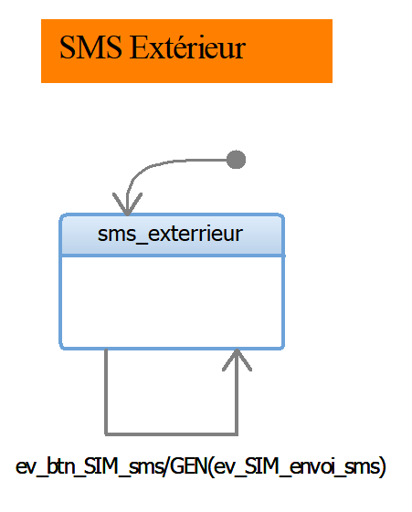

*Les sous-régions SMS côté téléphone (`Communication telephone`) et côté kit (`Commande kit main libre`) sont visibles dans les captures complètes de la [Section 9.4.1 Statechart associé](#941-statechart-associ%C3%A9).*

#### 9.5.2 Choix fonctionnels
Les SMS sont reçus en parallèle des appels : un SMS reçu en plein appel est compté sans perturber la conversation. Leur nombre et un voyant s'affichent sur le téléphone et au tableau de bord. La lecture est synchronisée entre les deux, et interdite au volant en roulant.

##### Côté IHM

* **Envoyer un SMS** : bouton **Envoyer SMS**.
* **Sur le téléphone** : une LED, un compteur de SMS et le bouton **lire sms**.
* **Au volant** : la LED « SMS non lus », un compteur et le bouton **lire message**, sans effet si le véhicule roule.

**Côté statechart.** Comme pour les appels, la messagerie est répartie sur trois régions, et seul le téléphone modifie le nombre de SMS : le kit ne fait qu'afficher la valeur qu'il reçoit.

* **SMS Extérieur (réseau)** :

Cette région simule l'envoi d'un SMS par le réseau. Elle n'a qu'un seul état, `sms_exterrieur` : à chaque pression du bouton **Envoyer SMS** (`ev_btn_SIM_sms`), elle émet `GEN(ev_SIM_envoi_sms)` vers le téléphone.

* **Communication telephone** :

Dans `gestion_communication_telephone`, deux des trois sous-régions parallèles gèrent les SMS :

   * **SMS sur le téléphone** :

   La sous-région attend en `reception_sms`, qui calcule en entrée le voyant du téléphone (`VOYANT_telephone_sms = (nbr_sms_telephone > 0)`). À chaque SMS reçu (`ev_SIM_envoi_sms`), le compteur augmente de 1 (`ex_actualisation_sms_telephone(1)`). À la pression du bouton **lire sms** (`ev_btn_telephone_lire_sms`), la sous-région passe en `lire_sms`, qui retire un SMS (`ex_actualisation_sms_telephone(-1)`, plancher à 0), puis revient en `reception_sms` après `tm(1)`.

   * **Redirection Bluetooth des SMS** :

   Dans `redirection_kit_bluetooth_communication`, une seconde sous-région synchronise le kit. À la connexion du kit, elle envoie tout l'historique (`GEN(ev_telephone_sms_historique_kit(nbr_sms_telephone))`), puis attend en `reception_sms_kit`, qui renvoie le compteur à jour au kit en entrée (`GEN(ev_telephone_sms_nouveau_kit(nbr_sms_telephone))`). Elle réagit à trois événements :
      * un nouveau SMS (`ev_SIM_envoi_sms`) : elle rentre de nouveau dans `reception_sms_kit`, qui transmet le nouveau compteur au kit ;
      * une lecture sur le téléphone (`ev_btn_telephone_lire_sms`) : elle rentre de nouveau dans `reception_sms_kit`, qui transmet le compteur à jour au kit (`GEN(ev_telephone_sms_nouveau_kit(nbr_sms_telephone))`). La transition émet aussi `ev_telephone_actualisation_sms_kit`, mais le kit ne l'attend qu'en `lire_message_kit` : seule une lecture au volant l'utilise ;
      * une lecture au volant (`ev_kit_lire_sms`) : elle passe en `lire_sms_kit`, qui retire un SMS côté téléphone (`ex_actualisation_sms_telephone(-1)`), puis renvoie le compteur au kit en sortie (`GEN(ev_telephone_actualisation_sms_kit(nbr_sms_telephone))`) après `tm(1)`.

* **Commande kit main libre (kit)** :

Dans `controle_telephone_connecte`, deux sous-régions parallèles gèrent les SMS au volant :
  * l'adaptateur du bouton **lire message** (`gestion_btn_lire_sms_kit`) transforme `ev_btn_kit_lire_sms` en `GEN(ev_kit_tentative_lire_sms)` ;
  * la messagerie du kit démarre en `init_redirection_sms_kit` et attend l'historique du téléphone (`ev_telephone_sms_historique_kit`, `nbr_sms_kit = params->historique`). Elle passe ensuite en `messagerie_kit`, qui calcule le voyant en entrée (`VOYANT_kit_sms = (nbr_sms_kit > 0)`) et recopie chaque nouveau compteur (`ev_telephone_sms_nouveau_kit`, `nbr_sms_kit = params->sms_telephone`). Une demande de lecture n'est acceptée que véhicule à l'arrêt (`[speed<=0]`) : le kit passe en `lire_message_kit`, envoie `GEN(ev_kit_lire_sms)` au téléphone et attend le compteur à jour pour revenir en `messagerie_kit`.

* **Persistance** : à l'extinction du téléphone, `arret_de_communication` sauvegarde le compteur avant de le remettre à 0. Tant que le téléphone reste éteint, le sous-état `gestion_sms_hors_ligne` continue de compter les SMS envoyés par le réseau. Au rallumage, le compteur est restauré (`nbr_sms_telephone = nbr_sauvegarde_sms_telephone`) : les SMS non lus et ceux reçus pendant l'extinction s'affichent. À la déconnexion Bluetooth, les voyants du tableau s'éteignent et `nbr_sms_kit` est remis à 0.

**Événements de la messagerie** (réseau ↔ téléphone et téléphone ↔ kit) :

| Événement | Sens | Paramètre | Rôle |
| :--- | :---: | :--- | :--- |
| `ev_SIM_envoi_sms` | Réseau → Téléphone | — | Réception d'un SMS |
| `ev_telephone_sms_historique_kit` | Téléphone → Kit | `historique` (`int`) | Compteur de SMS envoyé à la connexion |
| `ev_telephone_sms_nouveau_kit` | Téléphone → Kit | `sms_telephone` (`int`) | Compteur de SMS à jour |
| `ev_telephone_actualisation_sms_kit` | Téléphone → Kit | `sms_tel` (`int`) | Compteur après une lecture au volant (sortie de `lire_sms_kit`) |
| `ev_kit_lire_sms` | Kit → Téléphone | — | Lecture d'un SMS au volant (véhicule à l'arrêt) |

#### 9.5.3 Choix de conception

* Au début, nous avions deux compteurs indépendants (téléphone et kit), qui dérivaient dès qu'un SMS arrivait pendant une déconnexion. Nous n'en gardons donc qu'un seul comme référence, `nbr_sms_telephone`, que le téléphone pousse vers le kit (`ev_telephone_sms_historique_kit`, `ev_telephone_sms_nouveau_kit`, `ev_telephone_actualisation_sms_kit`).
* La lecture est synchronisée quel que soit l'écran : quand nous lisons un SMS sur le téléphone (`ev_btn_telephone_lire_sms`), le compteur du tableau de bord est aussi mis à jour.
* Lorsque le téléphone est éteint, un vrai téléphone ne perd pas les SMS : l'opérateur les lui délivre au rallumage. Nous reproduisons ce comportement avec un compteur de SMS sauvegardé (`nbr_sauvegarde_sms_telephone`) différent du compteur affiché (`nbr_sms_telephone`) : le compteur sauvegardé continue de compter les SMS reçus pendant l'extinction, et est restauré à la remise en marche du téléphone.


## 10. Autoradio et arbitrage des priorités audio

### 10.1 Statechart associé
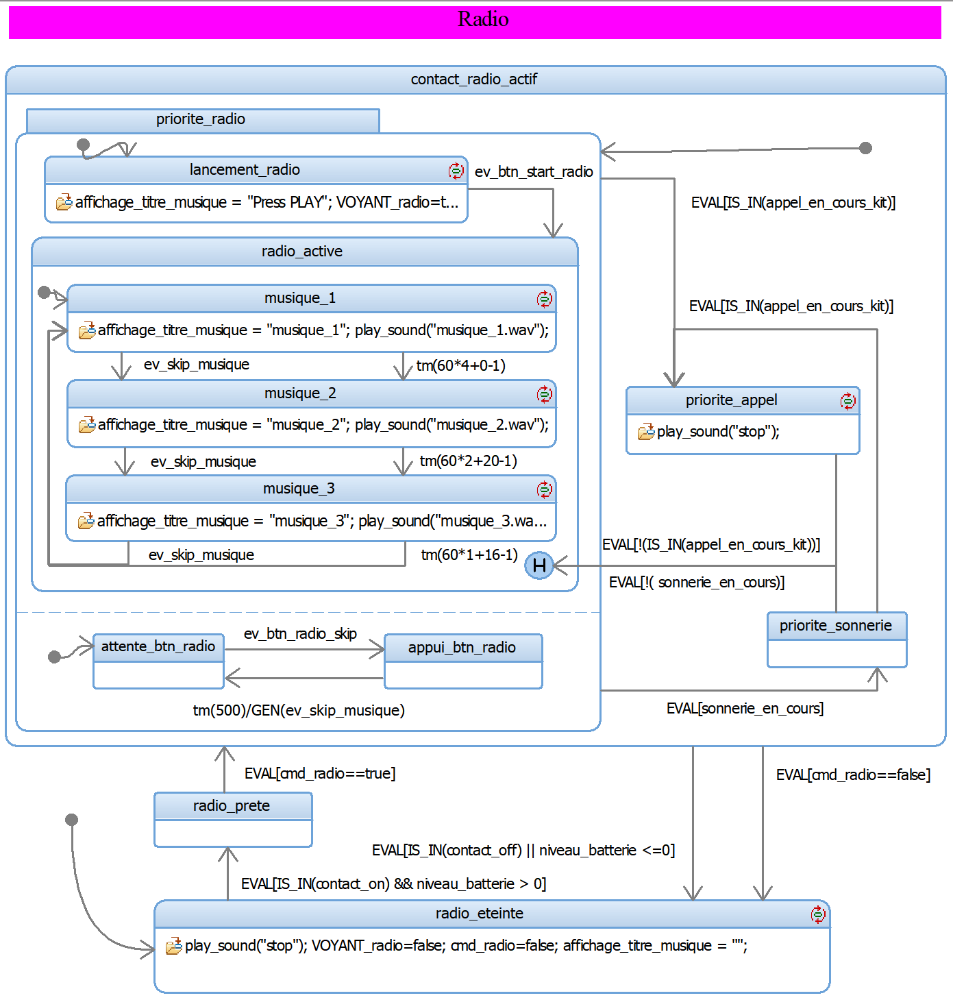

### 10.2 Choix fonctionnels
L'autoradio lit trois pistes, s'éteint contact coupé ou batterie vide, cède la place aux sonneries et aux appels passés au volant, puis reprend la piste en cours.

**Côté IHM.** Nous allumons la radio avec son interrupteur, et sa LED le confirme. **Play** lance la lecture, **Skip** passe à la piste suivante, et l'afficheur montre le titre (« Press PLAY » à l'arrêt).

**Côté statechart.** Nous avons construit la région Radio comme une machine à deux niveaux : une alimentation, puis un arbitrage des priorités audio (Radio < Sonnerie < Appel).

* **Alimentation** :

Au démarrage, la radio est en `radio_eteinte`. En entrée, cet état coupe le son (`play_sound("stop")`, voir [Section 12 Implémentation de la gestion sonore sous Rhapsody](#12-impl%C3%A9mentation-de-la-gestion-sonore-sous-rhapsody)), éteint le voyant (`VOYANT_radio = false`), vide l'afficheur et remet l'interrupteur à `false` (`cmd_radio = false`). Dès que le véhicule peut l'alimenter (`EVAL[IS_IN(contact_on) && niveau_batterie > 0]`), la radio passe en `radio_prete` et attend son interrupteur (`EVAL[cmd_radio == true]`) pour entrer dans `contact_radio_actif`. Elle retourne en `radio_eteinte` si le contact est coupé ou la batterie vide (`EVAL[IS_IN(contact_off) || niveau_batterie <= 0]`), ou si nous l'éteignons (`EVAL[cmd_radio == false]`).

* **Lecteur (`priorite_radio`)** :

`contact_radio_actif` démarre dans `priorite_radio`, un état And à deux sous-régions parallèles :
   * **le lecteur** : en `lancement_radio`, le voyant s'allume et l'afficheur indique « Press PLAY ». À la pression de **Play** (`ev_btn_start_radio`), la radio entre dans `radio_active` et lit `musique_1`. Chaque piste affiche son titre et lance son fichier en entrée (`play_sound("musique_1.wav")`…), et `ev_skip_musique` fait tourner la lecture en boucle : `musique_1` → `musique_2` → `musique_3` → `musique_1` ;
   * **l'anti-rebond du bouton Skip** : en `attente_btn_radio`, un appui sur **Skip** (`ev_btn_radio_skip`) fait passer en `appui_btn_radio`, qui n'envoie `GEN(ev_skip_musique)` qu'après 500 ms (`tm(500)`). Les appuis reçus pendant ce délai sont ignorés.

* **Priorités** :

Depuis `priorite_radio`, deux transitions sur `EVAL` interrompent la musique :
   * une sonnerie, sur le téléphone ou au volant (`[sonnerie_en_cours]`), fait passer en `priorite_sonnerie` : la radio laisse le canal audio à `sonnerie.wav` ou `sonnerie2.wav` ;
   * un appel décroché au volant (`[IS_IN(appel_en_cours_kit)]`) fait passer en `priorite_appel`, qui coupe le son en entrée (`play_sound("stop")`).

   Depuis `priorite_sonnerie`, un appel décroché au volant fait aussi passer en `priorite_appel`.

* **Reprise** : en fin de sonnerie (`[!sonnerie_en_cours]`) ou d'appel (`[!IS_IN(appel_en_cours_kit)]`), les transitions visent un connecteur d'historique (H) dans `priorite_radio`. La radio revient exactement dans l'état d'avant l'interruption : en `lancement_radio` si nous n'avions pas lancé la lecture, ou sur la même piste, qui est relancée par son action d'entrée.

Voici un schéma qui illustre cet arbitrage des priorités :

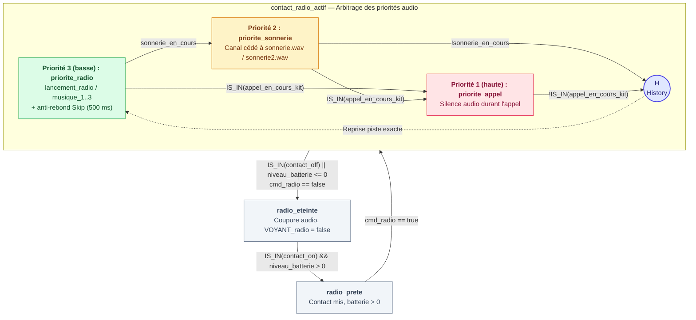

### 10.3 Choix de conception

* `PlaySound` ne gère qu'une piste à la fois : toute sonnerie coupe donc la musique. Nous avons mis en place la machine de priorités et le connecteur d'historique pour reprendre proprement la lecture.
* Nous avons ajouté l'anti-rebond pour éviter qu'un double clic sur **Skip** saute plusieurs pistes.
* Les deux priorités ne sont pas traitées de la même façon, et c'est voulu. Le simulateur n'a qu'une seule bande son : toute sonnerie, qu'elle vienne du téléphone ou du kit (`sonnerie_en_cours`), prend donc forcément la place de la musique. En revanche, un appel passé sur le téléphone seul n'a aucune incidence réelle sur l'autoradio du véhicule : la musique reprend dès la fin de la sonnerie. Ce n'est que lorsque le téléphone est connecté au kit que l'appel utilise la piste audio du véhicule (`IS_IN(appel_en_cours_kit)`) : la radio passe alors en `priorite_appel` et se tait jusqu'à la fin de l'appel.

## 11. Régulateur de vitesse adaptatif

Le régulateur de vitesse adaptatif est une extension du régulateur de vitesse simple ([Section 7 Régulateur de vitesse simple](#7-r%C3%A9gulateur-de-vitesse-simple)) en prenant en compte un véhicule devant celui qu'on conduit.  
Tant que la voiture devant est plus éloignée que la distance de sécurité, le régulateur maintient la vitesse consigne comme d'habitude.  
Dès que l'écart passe sous la distance de sécurité, on régule la vitesse toujours en contrôlant le throttle, mais au lieu de suivre une vitesse de consigne avec la fonction `calcul_regulateur_vitesse()`, on vise une distance entre les deux véhicules (à savoir la distance de sécurité) avec une nouvelle fonction très similaire `calcul_regulateur_distance()`.  
Par défaut, la distance de sécurité est fixée à `30 m` dans l'attribut `distance_securite`.

### 11.1 Fonctionnement depuis l'IHM

L'IHM contient deux sliders en input/output pour à la fois régler et visualiser la distance de sécurité (`distance_securite`) et la distance inter-véhicule (`distance_inter_voiture`).

L'interrupteur `cmd_simulation_voiture_devant` permet d'activer ou de désactiver la simulation du véhicule devant. L'avantage est que tant que l'interrupteur est désactivé, la distance inter-véhicule peut être réglée manuellement sans que la valeur ne soit écrasée par la simulation.

Une fois l'interrupteur activé, la simulation prend le relais et met à jour automatiquement la distance inter-véhicule en fonction du déplacement du véhicule devant.
Un afficheur numérique permet de visualiser en temps réel la distance inter-véhicule même si elle dépasse l'intervalle de 0 - 50 m du slider.

### 11.2 Statechart

#### 11.2.1 Simulation de la voiture qui précède

Une région dédiée **`Simulation voiture régulateur adaptatif`** simule le déplacement du véhicule de devant, indépendamment de notre véhicule :


L'état par défaut `reglage_voiture_devant` sert à mettre en pause la simulation. En entrant dans cet état, la distance inter-véhicule est remise à zéro pour revenir dans l'intervalle de réglage du slider.  

Dès que `EVAL[cmd_simulation_voiture_devant == true]`, l'entrée dans `simulation_voiture_devant` place la voiture devant nous (`distance_voiture_devant = distance + distance_inter_voiture;`) et démarre sa simulation.

Le sous-état `loop_simulation` reboucle à chaque événement `EVAL` (déclenché à la fréquence de simulation) tant que l'interrupteur reste enclenché :  
Il calcule la nouvelle position de la voiture devant via `calcul_distance_voiture_devant()` et actualise l'écart `distance_inter_voiture = distance_voiture_devant - distance`, en continu.  

Couper l'interrupteur (`EVAL[cmd_simulation_voiture_devant == false]`) renvoie la région dans `reglage_voiture_devant`.

#### 11.2.2 Aiguillage entre suivi de vitesse et suivi de distance

Plutôt que d'ajouter une nouvelle région qui modifierait `throttle`, nous avons directement étendu le super-état `regulateur` de la région **`Débit de l'injection d'essence`** :

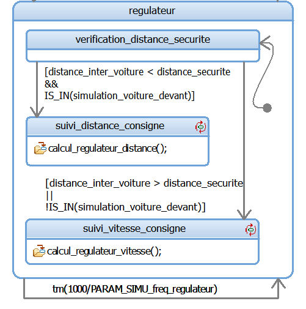

À chaque itération du régulateur, le super-état `regulateur` repasse par son état initial `verification_distance_securite`, qui aiguille immédiatement le calcul :
* si un véhicule cible est actif et plus proche que la distance de sécurité (`[distance_inter_voiture < distance_securite && IS_IN(simulation_voiture_devant)]`), il passe dans `suivi_distance_consigne` et appelle `calcul_regulateur_distance()` ;
* sinon (`[distance_inter_voiture > distance_securite || !IS_IN(simulation_voiture_devant)]`), il passe dans `suivi_vitesse_consigne` et appelle le régulateur classique `calcul_regulateur_vitesse()`.

### 11.3 Simulation de la voiture devant

La fonction `calcul_distance_voiture_devant()` se contente de mettre à jour la position de la voiture devant en fonction de sa vitesse, sans tenir compte du reste.

Voici le code de l'opération `calcul_distance_voiture_devant()`, appelée à la fréquence de simulation dans `loop_simulation` :

<!-- code:calcul_distance_voiture_devant() -->
```cpp
const double DELTA_T_MS            = (double)(1000/PARAM_SIMU_freq_rafraichissement);
const double CST_CONVERSION_KMH_MS = 3.6;
const double CST_CONVERSION_MS_S   = 1000.0;
const double dt                    = DELTA_T_MS / CST_CONVERSION_MS_S;

distance_voiture_devant += (vitesse_voiture_devant / CST_CONVERSION_KMH_MS) * dt;
distance_entiere_voiture_devant = (int)distance_voiture_devant;
```

Elle intègre simplement la position de la voiture de devant sur le même `dt` (50 ms pour 20 Hz) que notre propre véhicule dans `calcul_vitesse_distance()`.

### 11.4 Correcteur PI pour le suivi de distance

L'opération `calcul_regulateur_distance()` est un miroir de l'opération `calcul_regulateur_vitesse()`, adaptée pour le suivi de distance plutôt que de vitesse.

Voici le code de l'opération `calcul_regulateur_distance()`, appelée à `2 Hz` dans `suivi_distance_consigne` :

<!-- code:calcul_regulateur_distance() -->
```cpp
// Calcul de l'erreur de distance à partir de
// la distance inter voiture
// et de la distance de sécurité
const double erreur = (double)distance_inter_voiture - (double)distance_securite;

steady += Ki_regulateur * erreur;

if (steady > PARAM_SIMU_max_throttle) steady = PARAM_SIMU_max_throttle;
if (steady < throttle_repos)          steady = throttle_repos;

double commande = steady + (Kp_regulateur * erreur);

if (commande > PARAM_SIMU_max_throttle) commande = PARAM_SIMU_max_throttle;
if (commande < throttle_repos)          commande = throttle_repos;

throttle = commande;
```

Cette fonction reprend exactement la même formule de PI bridé et les mêmes gains `Kp_regulateur` / `Ki_regulateur` que `calcul_regulateur_vitesse()` (voir [Section 7.3 Correcteur PI pour le régulateur de vitesse](#73-correcteur-pi-pour-le-r%C3%A9gulateur-de-vitesse)), en remplaçant l'erreur de vitesse par l'erreur de distance `distance_inter_voiture - distance_securite`. Le fait que l'attribut `steady` soit partagé garantit une transition sans à-coup entre suivi de vitesse et suivi de distance.

## 12. Implémentation de la gestion sonore sous Rhapsody

Trois fonctionnalités produisent du son : l'alarme de dépassement du limiteur ([Section 8 Limiteur de vitesse](#8-limiteur-de-vitesse)), les sonneries d'appel sur le téléphone et le kit ([Section 9.4 Gestion des appels entrants et redirection mains-libres](#94-gestion-des-appels-entrants-et-redirection-mains-libres)), et les trois pistes de l'autoradio ([Section 10 Autoradio et arbitrage des priorités audio](#10-autoradio-et-arbitrage-des-priorit%C3%A9s-audio)). Nous les faisons toutes passer par une seule opération, `play_sound()`.

### 12.1 Fonctionnement de PlaySound

Dans notre version, les états concernés n'appellent jamais `PlaySound` directement, les 6 fichiers `.wav` sont dans `Projet_TABDK_E4SE/sons/`, suivis sous Git. À la place nous avons créé une opération `play_sound(const OMString& fichier)` qui prend en paramètre le nom du fichier à jouer, et qui appelle `PlaySound` avec le chemin complet :

```cpp
// Opération play_sound(const OMString& fichier)
if (fichier == "stop") {
    PlaySound(NULL, NULL, 0);
} else {
    OMString chemin = chemin_sons;
    chemin += fichier;
    PlaySound(TEXT(chemin.GetBuffer(0)), NULL, SND_LOOP | SND_ASYNC);
}
```
L'attribut `chemin_sons` (`"..\\..\\sons\\"`) donne le chemin du dossier des sons : c'est le seul endroit où il est écrit. `play_sound` lance un fichier en boucle, ou coupe le son avec le mot-clé `"stop"`.

### 12.2 Choix de conception

* Au début du projet, nous avions placé les `.wav` dans `CodesGeneres/ModeAnimation/`, mais ce dossier est généré et exclu par `.gitignore` : après chaque récupération du travail de l'autre binôme, les sons manquaient. Nous les avons donc rangés dans un dossier `sons/` versionné.
* Avec `SND_LOOP | SND_ASYNC`, un son tourne en boucle jusqu'à un arrêt explicite : sans `play_sound("stop")`, les sonneries continuaient après un décrochage. Nous avons donc prévu un arrêt explicite pour chaque son (de la durée du son enregistré).
* `PlaySound` coupe la piste en cours à chaque nouvel appel : c'est ce qui nous a imposé la machine de priorités de la région Radio (voir [Section 10 Autoradio et arbitrage des priorités audio](#10-autoradio-et-arbitrage-des-priorit%C3%A9s-audio)).
* Tous les sons choisis sont libres de droits.


## 13. Interface WEB pour l'IHM

L'IHM de Rhapsody est pratique pour déboguer nos animations et ne pas dépendre d'outils extérieurs, mais nous avons dès le début cherché à avoir une belle interface moderne en passant par du WEB.

Nous avons donc développé, avec beaucoup d'aide de l'IA, un outil générique (**`rhapsody_webapp_builder`**) qui prend en entrée le code C++ généré par Rhapsody, y injecte automatiquement un serveur HTTP/REST relié aux attributs et événements du statechart, et compile le tout en un exécutable Windows autonome (`simulateur.exe`) qui sert une interface web en local accessible depuis n'importe quel navigateur.

La chaîne de construction ci-dessous résume les cinq étapes pour passer du modèle Rhapsody à l'application Web exécutable :


Une fois `simulateur.exe` lancé, la page Web dialogue en temps réel avec le moteur C++ Rhapsody via l'API REST intégrée :

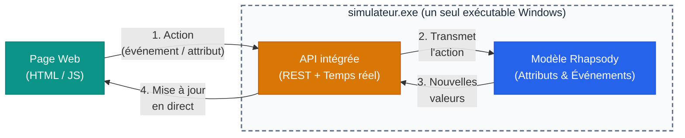

Avec cet outil, nous avons réalisé à avec l'aide de l'IA une fois encore, notre propre interface WEB complète regroupant le tableau de bord, les pédales, les aides à la conduite, le téléphone, le kit mains-libres et l'autoradio.

Voici une capture de l'interface graphique Web pilotant le simulateur C++ Rhapsody (`http://127.0.0.1:8080/custom/`) :

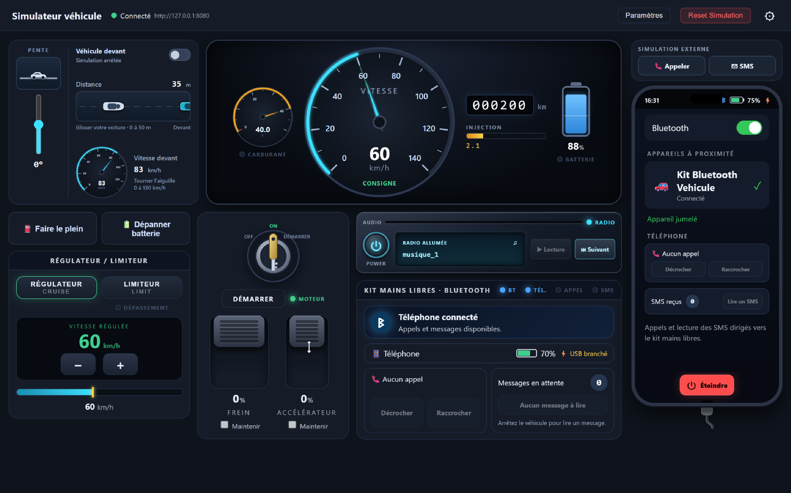

On peut aussi y reset la simulation ou régler des attributs constants ou variables depuis le modal de paramètres : 

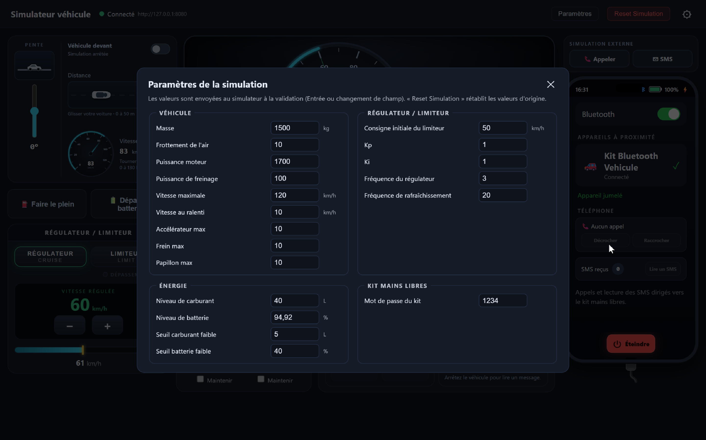  

### 13.1 Aucune logique côté Web

Hormis les animations visuelles et différents textes d'information, notre interface WEB n'exécute aucune logique supplémentaire : elle se contente de transmettre les actions de l'utilisateur au simulateur C++ Rhapsody et de lire la valeur des attributs en temps réel.  
> En revanche, le mot de passe Bluetooth du jumelage est animé par un clavier de code PIN, même si nous avons gardé la simple lecture de l'OMString liée à la textbox `champ_mdp`.

### 13.2 Tester le simulateur

Pour tester directement notre simulateur (sans rien installer, avec le son fonctionnel) :

1. Télécharger et décompresser l'archive prête à l'emploi **[`zip-demo-webapp-rhapsody.zip`](https://github.com/benoitdekeyn/rhapsody_webapp_builder/raw/main/application/zip-demo-webapp-rhapsody.zip)** : elle contient `simulateur.exe` (avec les interfaces Web embarquées) ainsi que le dossier `sons/` nécessaire aux bruitages et à l'autoradio. *(Tout le livrable est également disponible dans le dossier [application/](https://github.com/benoitdekeyn/rhapsody_webapp_builder/tree/main/application) du dépôt GitHub.)*
2. Double-cliquer sur **`simulateur.exe`** : le navigateur s'ouvre automatiquement sur le cockpit véhicule (`http://127.0.0.1:8080/custom/`), et l'interface générique auto-générée est accessible sur `http://127.0.0.1:8080/api/`.

### 13.3 Tutoriel

Nous avons également mis à disposition un tutoriel complet en ligne : [https://tutoriel-web-rhapsody.benoitdekeyn.com](https://tutoriel-web-rhapsody.benoitdekeyn.com) qui permet à n'importe quel utilisateur de comprendre et d'utiliser efficacement notre outil.
